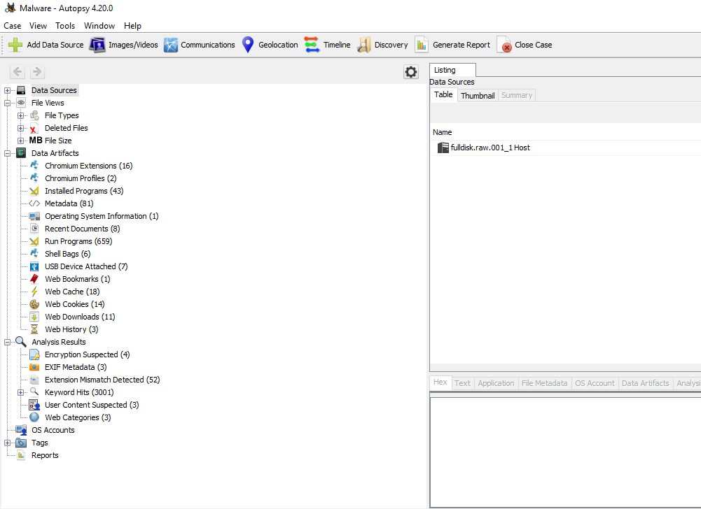
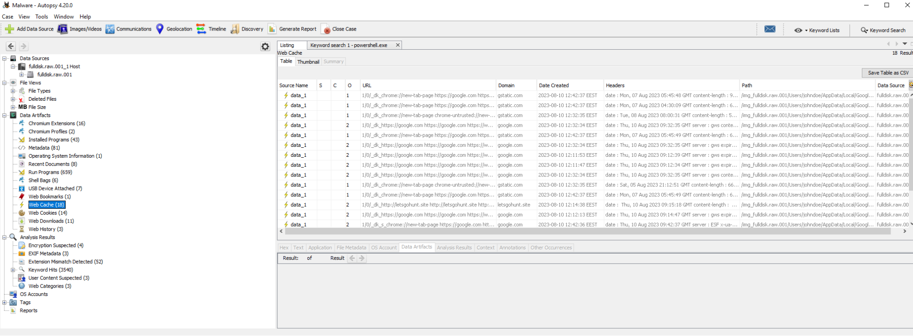
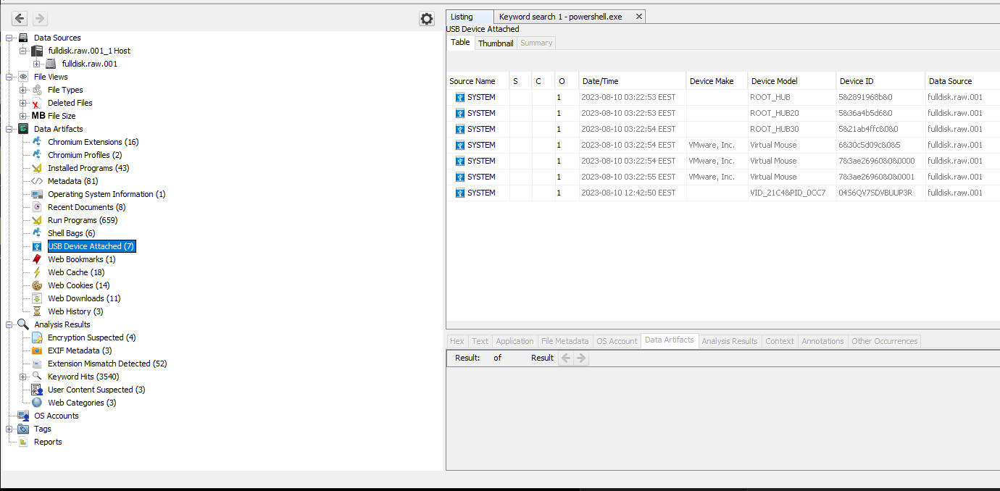
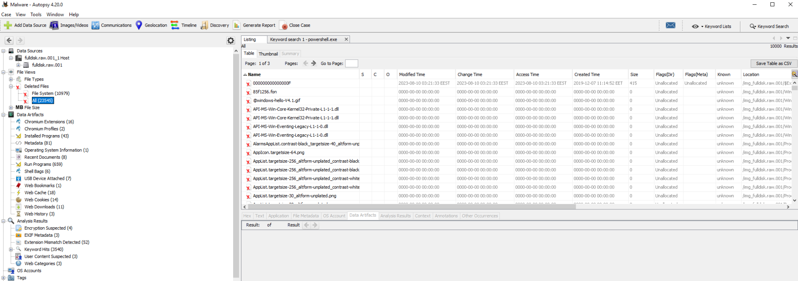
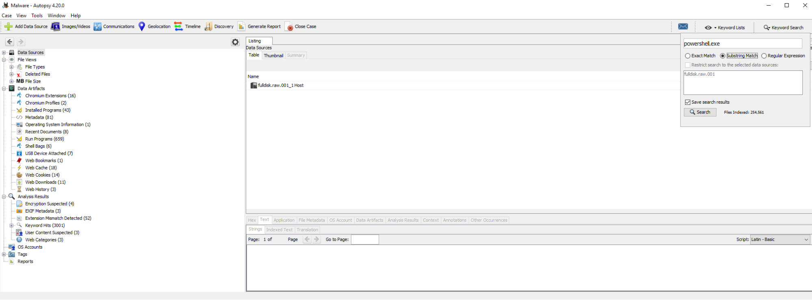
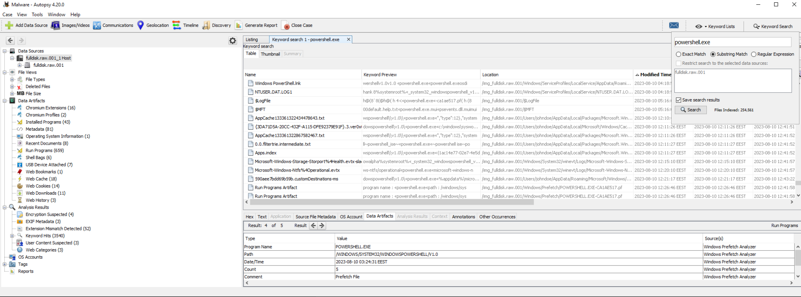
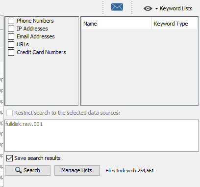
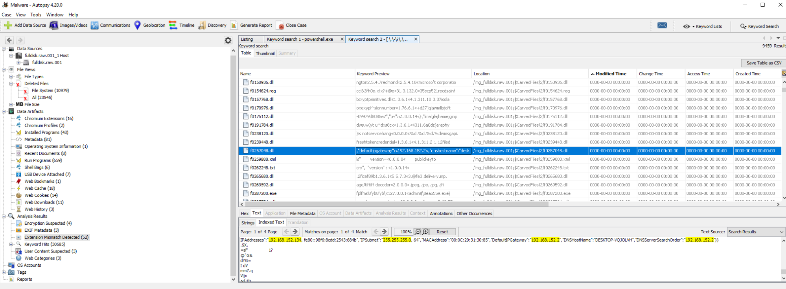
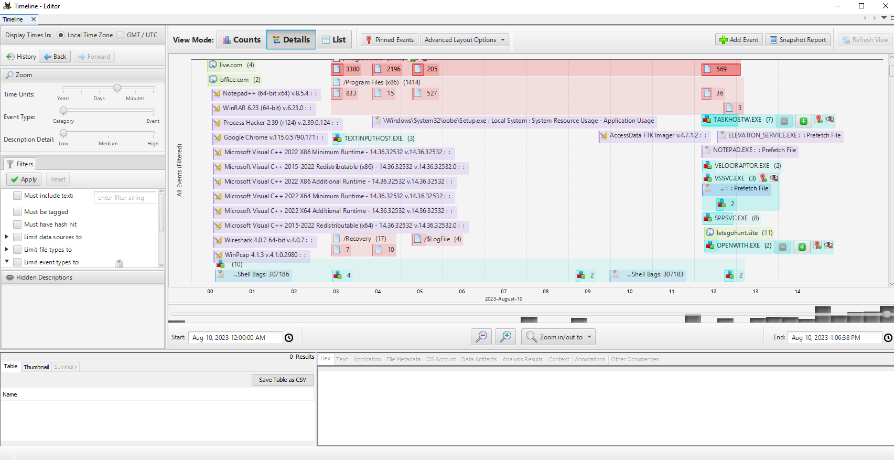

# Disk Forensics (Điều tra ổ đĩa)

Như đã nhấn mạnh trước đó, việc tuân thủ thứ tự về độ khả biến của dữ liệu (order of volatility) là rất quan trọng. Ta bắt buộc phải xem xét kỹ từng byte để phát hiện những dấu vết tinh vi mà kẻ tấn công để lại. Sau khi đã tìm hiểu memory forensics, giờ hãy chuyển sự chú ý sang lĩnh vực `disk forensics` (kiểm tra và phân tích disk image – ảnh ổ đĩa).

Nhiều công cụ disk forensics, cả thương mại lẫn mã nguồn mở, đều được tích hợp rất nhiều tính năng. Tuy nhiên, với các đội incident response, một số chức năng đặc biệt nổi bật:
- `File Structure Insight` (nắm bắt cấu trúc file): Khả năng duyệt và xem cây phân cấp file của ổ đĩa là rất quan trọng. Các công cụ forensic hàng đầu cần hiển thị cấu trúc này, cho phép truy cập nhanh tới các file cụ thể, đặc biệt là ở những vị trí đã biết trên một hệ thống bị nghi ngờ.
- `Hex Viewer` (trình xem hex): Trong những lúc cần soi thật kỹ dữ liệu của mình, việc xem file ở dạng thập lục phân (hexadecimal) là điều thiết yếu. Khả năng này đặc biệt hữu ích khi xử lý các mối đe doạ như malware được may đo riêng (tailored malware) hoặc các exploit đặc thù.
- `Web Artifacts Analysis` (phân tích artifact web): Vì có rất nhiều dữ liệu người dùng gắn với hoạt động trên web, một công cụ forensic phải sàng lọc và trình bày dữ liệu này một cách hiệu quả. Đây là yếu tố thay đổi cuộc chơi khi bạn đang ghép nối các sự kiện dẫn tới việc người dùng truy cập vào một website độc hại.
- `Email Carving` (trích xuất email): Đôi khi, dấu vết dẫn tới các mối đe doạ nội bộ. Có thể đó là một nhân viên có ý đồ xấu, hoặc chỉ là ai đó sơ suất. Trong những trường hợp như vậy, email thường nắm giữ chìa khoá. Một công cụ có thể trích xuất và trình bày dữ liệu này sẽ giúp quy trình gọn gàng hơn, giúp việc kết nối các manh mối trở nên dễ dàng hơn.
- `Image Viewer` (trình xem ảnh): Đôi khi, chính các hình ảnh được lưu trên hệ thống có thể tự kể một câu chuyện. Dù là để kiểm tra việc tuân thủ chính sách hay để điều tra sâu hơn, việc có sẵn một trình xem ảnh tích hợp là một lợi thế lớn.
- `Metadata Analysis` (phân tích metadata): Những chi tiết như timestamp tạo file, hash và vị trí trên ổ đĩa có thể vô cùng giá trị. Hãy xét một tình huống trong đó bạn đang cố khớp thời điểm khởi chạy một ứng dụng với một alert về malware. Những mối tương quan như vậy có thể là mắt xích then chốt trong cuộc điều tra của bạn.

Đó là lúc [Autopsy](https://www.autopsy.com/) xuất hiện: một nền tảng forensic thân thiện với người dùng, được xây dựng trên bộ công cụ mã nguồn mở Sleuth Kit. Nó có nhiều tính năng tương tự như các đối thủ thương mại: đánh giá timeline, tìm kiếm theo từ khoá, truy xuất artifact web và email, cùng khả năng sàng lọc kết quả dựa trên hash của các file độc hại đã biết.

Sau khi đã nạp một forensic image và xử lý dữ liệu, bạn sẽ thấy các artifact forensic được sắp xếp gọn gàng ở bảng điều khiển bên cạnh (side panel). Từ đây, bạn có thể:

- Đi sâu vào `Data Sources` để khám phá các file và thư mục.
	
- Kiểm tra `Web Artifacts`.
	
- Kiểm tra `Attached Devices`.
	
- Khôi phục `Deleted Files`.
	
- Thực hiện `Keyword Searches`.
	
	
	
- Dùng `Keyword Lists` cho các tìm kiếm có mục tiêu.
	
	
	
- Tiến hành `Timeline Analysis` để lập bản đồ các sự kiện.
	
	
---

Chúng ta sẽ sử dụng Autopsy rất nhiều trong section "Practical Digital Forensics Scenario" sắp tới.
