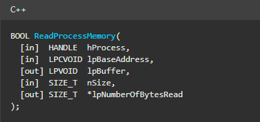
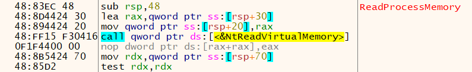
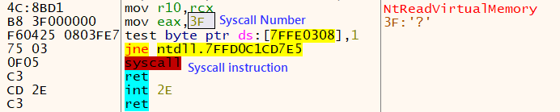
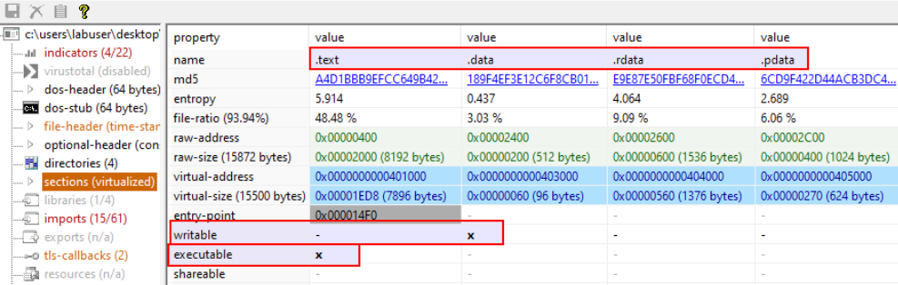
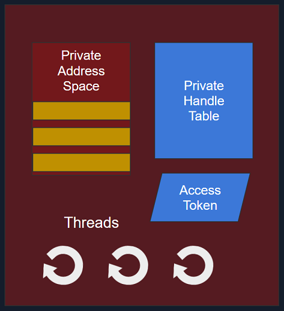
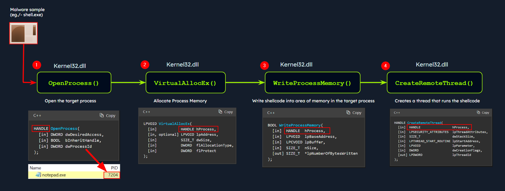
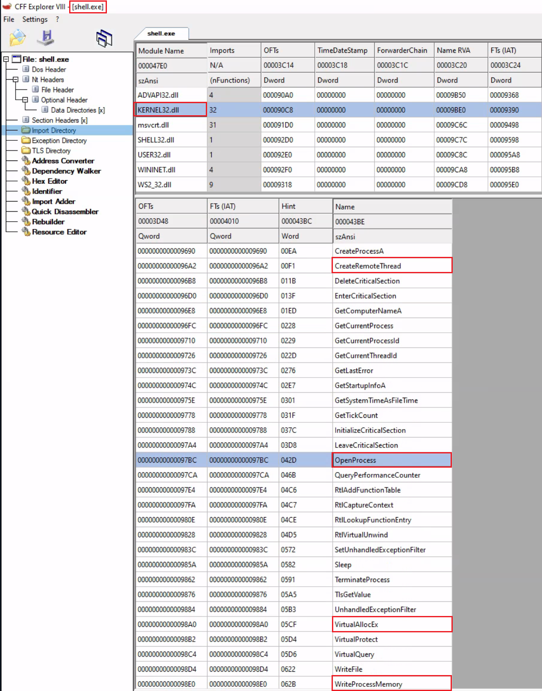
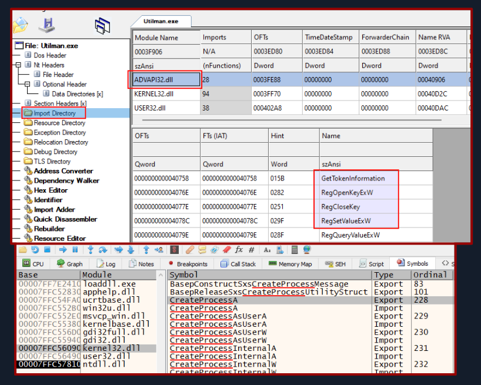

# Windows Internals (Cấu trúc bên trong Windows)

Để phân tích malware hiệu quả, việc hiểu sâu về Windows internals (cấu trúc bên trong Windows) là điều thiết yếu. Hệ điều hành Windows hoạt động ở hai mode chính:

- `User Mode`: Đây là mode mà phần lớn ứng dụng và process của người dùng hoạt động. Ứng dụng ở user mode chỉ có quyền truy cập hạn chế vào tài nguyên hệ thống và phải tương tác với hệ điều hành thông qua Application Programming Interface (API). Các process này được cô lập với nhau và không thể truy cập trực tiếp phần cứng hay các chức năng hệ thống quan trọng. Tuy nhiên, ở mode này malware vẫn có thể thao túng file, thiết lập registry, kết nối mạng và các tài nguyên khác mà người dùng truy cập được, đồng thời có thể tìm cách leo thang đặc quyền (privilege escalation) để giành thêm quyền kiểm soát hệ thống.

- `Kernel Mode`: Ngược lại, kernel mode là mode có đặc quyền rất cao, nơi Windows kernel chạy. Kernel có quyền truy cập không giới hạn vào tài nguyên hệ thống, phần cứng và các chức năng quan trọng. Nó cung cấp các dịch vụ lõi của hệ điều hành, quản lý tài nguyên hệ thống, đồng thời đảm bảo tính bảo mật và ổn định. Device driver (trình điều khiển thiết bị), thành phần hỗ trợ giao tiếp với thiết bị phần cứng, cũng chạy ở kernel mode. Nếu malware hoạt động ở kernel mode, nó sẽ có quyền kiểm soát cao hơn và có thể thao túng hành vi hệ thống, che giấu sự hiện diện của mình, chặn bắt (intercept) system call và can thiệp vào các cơ chế bảo mật.


## Tổng quan kiến trúc Windows

Hình dưới đây trình bày một phiên bản đơn giản hoá của kiến trúc Windows.


Kiến trúc Windows đơn giản hoá này gồm cả các thành phần user mode và kernel mode, mỗi thành phần đảm nhận một vai trò riêng trong hoạt động của hệ thống.

### Các thành phần User-mode

`User-mode components` là những phần của hệ điều hành không có quyền truy cập trực tiếp vào phần cứng hay các cấu trúc dữ liệu của kernel. Chúng tương tác với tài nguyên hệ thống thông qua API và system call. Hãy cùng điểm qua một số thành phần:

- `System Support Processes`: Đây là các thành phần thiết yếu cung cấp những chức năng và dịch vụ quan trọng, chẳng hạn như các process đăng nhập (`winlogon.exe`), Session Manager (`smss.exe`) và Service Control Manager (`services.exe`). Chúng không phải là Windows service nhưng lại cần thiết để hệ thống hoạt động đúng.

- `Service Processes`: Các process này chứa (host) các Windows service như `Windows Update Service`, `Task Scheduler` và `Print Spooler`. Chúng thường chạy nền, thực thi các tác vụ theo cấu hình và tham số của mình.

- `User Applications`: Đây là các process được tạo ra bởi chương trình của người dùng, bao gồm cả ứng dụng 32-bit và 64-bit. Chúng tương tác với hệ điều hành thông qua các [API](https://en.wikipedia.org/wiki/Windows_API) do Windows cung cấp. Các lời gọi API này được chuyển hướng tới [NTDLL.DLL](https://en.wikipedia.org/wiki/Microsoft_Windows_library_files#NTDLL.DLL), kích hoạt việc chuyển từ user mode sang kernel mode, nơi system call được thực thi. Kết quả sau đó được trả về cho ứng dụng user mode, và hệ thống chuyển trở lại user mode. 

- `Environment Subsystems`: Các thành phần này chịu trách nhiệm cung cấp môi trường thực thi cho những loại ứng dụng hoặc process cụ thể. Chúng bao gồm [Win32 Subsystem](https://en.wikipedia.org/wiki/Architecture_of_Windows_NT#Win32_environment_subsystem), [POSIX](https://en.wikipedia.org/wiki/Microsoft_POSIX_subsystem) và [OS/2](https://en.wikipedia.org/wiki/OS/2).

- `Subsystem DLLs`: Các dynamic-link library này dịch các hàm đã được tài liệu hoá (documented) thành các native system call nội bộ tương ứng, chủ yếu được hiện thực trong `NTDLL.DLL`. Ví dụ gồm `kernelbase.dll`, `user32.dll`, `wininet.dll` và `advapi32.dll`.

### Các thành phần Kernel-mode

`Kernel-mode components` là những phần của hệ điều hành có quyền truy cập trực tiếp vào phần cứng và các cấu trúc dữ liệu của kernel. Chúng bao gồm:

- `Executive`: Tầng trên cùng này trong kernel mode được truy cập thông qua các hàm từ `NTDLL.DLL`. Nó gồm các thành phần như `I/O Manager`, `Object Manager`, `Security Reference Monitor`, `Process Manager` và các thành phần khác, quản lý những khía cạnh cốt lõi của hệ điều hành như thao tác I/O, quản lý object, bảo mật và process. Nó thực hiện một số bước kiểm tra trước, rồi chuyển lời gọi xuống kernel, hoặc gọi device driver phù hợp để thực hiện thao tác được yêu cầu.

- `Kernel`: Thành phần này quản lý tài nguyên hệ thống, cung cấp các dịch vụ cấp thấp như `thread scheduling`, `interrupt and exception dispatching` và `multiprocessor synchronization`.

- `Device Drivers`: Các thành phần phần mềm này cho phép hệ điều hành tương tác với thiết bị phần cứng. Chúng đóng vai trò trung gian, giúp hệ thống quản lý và điều khiển tài nguyên phần cứng và phần mềm.

- `Hardware Abstraction Layer (HAL)`: Thành phần này cung cấp một lớp trừu tượng giữa thiết bị phần cứng và hệ điều hành. Nó cho phép lập trình viên tương tác với phần cứng theo cách nhất quán và không phụ thuộc nền tảng.

- `Windowing and Graphics System (Win32k.sys)`: Subsystem này chịu trách nhiệm quản lý giao diện đồ hoạ người dùng (GUI) và hiển thị các thành phần trực quan lên màn hình.

Giờ hãy cùng tìm hiểu điều gì diễn ra phía sau khi một ứng dụng người dùng gọi một hàm Windows API.

## Luồng gọi Windows API (Windows API Call Flow)

Malware thường dùng các lời gọi Windows API để tương tác với hệ thống và thực hiện các thao tác độc hại. Khi hiểu các chi tiết bên trong của hàm API, tham số và hành vi mong đợi của chúng, analyst có thể nhận ra việc sử dụng API đáng ngờ hoặc trái phép.

Hãy xem một ví dụ về luồng gọi Windows API, trong đó một ứng dụng user mode cố gắng truy cập các thao tác đặc quyền và tài nguyên hệ thống bằng [hàm ReadProcessMemory](https://learn.microsoft.com/en-us/windows/win32/api/memoryapi/nf-memoryapi-readprocessmemory). Hàm này cho phép một process đọc bộ nhớ của một process khác.


Khi hàm này được gọi, một số tham số bắt buộc cũng được truyền vào, chẳng hạn như handle tới process mục tiêu, địa chỉ nguồn cần đọc, một buffer trong không gian bộ nhớ của chính nó để lưu dữ liệu đọc được, và số byte cần đọc. Dưới đây là cú pháp của hàm WINAPI `ReadProcessMemory` theo tài liệu của Microsoft. 

```shell-session
BOOL ReadProcessMemory(
  [in]  HANDLE  hProcess,
  [in]  LPCVOID lpBaseAddress,
  [out] LPVOID  lpBuffer,
  [in]  SIZE_T  nSize,
  [out] SIZE_T  *lpNumberOfBytesRead
);
```



`ReadProcessMemory` là một hàm Windows API thuộc thư viện `kernel32.dll`. Vì vậy, lời gọi này được thực hiện thông qua module `kernel32.dll`, đóng vai trò giao diện user mode tới Windows API. Bên trong, module `kernel32.dll` tương tác với module `NTDLL.DLL`, vốn cung cấp một giao diện cấp thấp hơn tới Windows kernel. Sau đó, yêu cầu gọi hàm này được dịch sang lời gọi Native API tương ứng là `NtReadVirtualMemory`. Ảnh chụp màn hình dưới đây từ `x64dbg` cho thấy điều này trông như thế nào trong debugger.



Module `NTDLL.DLL` sử dụng system call (syscall). 



Lệnh `syscall` kích hoạt system call với các tham số đã được thiết lập ở những lệnh trước đó. Nó chuyển quyền điều khiển từ user mode sang kernel mode, nơi kernel thực hiện thao tác được yêu cầu sau khi xác thực tham số và kiểm tra quyền truy cập của process gọi. 

Nếu yêu cầu được cho phép, thread sẽ được chuyển từ user mode sang kernel mode. Kernel duy trì một bảng gọi là `System Service Descriptor Table (SSDT)` hay `syscall table (System Call Table)`, là một cấu trúc dữ liệu chứa con trỏ tới các routine dịch vụ hệ thống khác nhau. Các routine này chịu trách nhiệm xử lý system call do ứng dụng user mode thực hiện. Mỗi mục trong syscall table tương ứng với một số hiệu system call cụ thể, và con trỏ đi kèm trỏ tới hàm kernel tương ứng hiện thực thao tác được yêu cầu. 

Syscall đảm nhận `ReadProcessMemory` được thực thi trong kernel, nơi các cơ chế quản lý bộ nhớ và cô lập process của Windows được tận dụng. Kernel thực hiện các bước xác thực, kiểm tra quyền truy cập và thao tác bộ nhớ cần thiết để đọc bộ nhớ từ process mục tiêu. Kernel lấy các trang bộ nhớ vật lý tương ứng với các địa chỉ ảo được yêu cầu và sao chép dữ liệu vào buffer được cung cấp.

Khi kernel đọc xong bộ nhớ, nó chuyển thread trở lại user mode và quyền điều khiển được trao lại cho ứng dụng user mode ban đầu. Ứng dụng sau đó có thể truy cập dữ liệu đã đọc từ bộ nhớ của process mục tiêu và tiếp tục thực thi.

<div class="card bg-light">
    <div class="card-body">
				 <p class="mb-0">Giờ hãy kéo xuống cuối section này và bấm "Click here to spawn the target system!". Sau đó, RDP vào Target IP bằng thông tin đăng nhập được cung cấp. Phần lớn các thao tác/lệnh được trình bày từ đây đến cuối section này đều có thể thực hiện lại trên máy target, giúp ta nắm vững hơn các chủ đề được trình bày. </p>
    </div>
</div>

```shell-session
[!bash!]$ xfreerdp /u:htb-student /p:'HTB_@cademy_stdnt!' /v:[Target IP] /dynamic-resolution
```

## Portable Executable

Hệ điều hành Windows dùng định dạng `Portable Executable (PE)` để đóng gói chương trình thực thi, `DLLs (Dynamic Link Libraries)` và các thành phần hệ thống thiết yếu khác. Trong lĩnh vực phân tích malware, việc hiểu tường tận định dạng file PE là không thể thiếu. Nó giúp ta có được những hiểu biết quan trọng về cấu trúc, hoạt động của file thực thi và các hoạt động độc hại tiềm ẩn được nhúng trong file.

File PE chứa nhiều loại dữ liệu khác nhau, bao gồm `executables (.exe)`, `dynamic link libraries (.dll)`, `kernel modules (.sys)`, `control panel applications (.cpl)` và nhiều loại khác. Về bản chất, định dạng file PE là một cấu trúc dữ liệu chứa các thông tin thiết yếu mà Windows OS loader cần để quản lý code thực thi, tức là nạp nó vào bộ nhớ.

### Các section của PE (PE Sections)

Cấu trúc PE còn chứa một `Section Table`, một thành phần gồm nhiều section phục vụ các mục đích riêng biệt. Về bản chất, các section là nơi lưu trữ nội dung thực của file, bao gồm dữ liệu, tài nguyên mà chương trình sử dụng và code thực thi. Section `.text` thường được soi kỹ để tìm các artifact liên quan tới tấn công injection.

Các section PE phổ biến gồm:

- `Text Section (.text)`: Nơi chứa code thực thi của chương trình.
- `Data Section (.data)`: Nơi lưu các biến dữ liệu global và static đã được khởi tạo.
- `Read-only initialized data (.rdata)`: Chứa dữ liệu chỉ đọc như giá trị hằng, string literal, và các biến global và static đã được khởi tạo.
- `Exception information (.pdata)`: Tập hợp các mục function table dùng cho xử lý exception.
- `BSS Section (.bss)`: Chứa các biến dữ liệu global và static chưa được khởi tạo.
- `Resource Section (.rsrc)`: Lưu giữ các tài nguyên như hình ảnh, icon, string và thông tin phiên bản.
- `Import Section (.idata)`: Thông tin chi tiết về các hàm được import từ các DLL khác.
- `Export Section (.edata)`: Thông tin về các hàm được file thực thi export.
- `Relocation Section (.reloc)`: Thông tin chi tiết để relocate (định vị lại) code và dữ liệu của file thực thi khi nó được nạp vào một địa chỉ bộ nhớ khác.

Ta có thể trực quan hoá các section của một portable executable bằng công cụ như `pestudio`, như minh hoạ dưới đây.



Tìm hiểu sâu định dạng file Portable Executable (PE) đóng vai trò then chốt trong phân tích malware, mang lại hiểu biết về cấu trúc file, phân tích code, các hàm import và export, phân tích resource, các kỹ thuật anti-analysis và trích xuất indicator of compromise. Việc nắm vững nền tảng này mở đường cho phân tích malware hiệu quả.

## Process

Nói một cách đơn giản nhất, process là một instance (thể hiện) của một chương trình đang thực thi. Nó đại diện cho một phần quá trình thực thi của chương trình trong bộ nhớ và gồm nhiều tài nguyên khác nhau, bao gồm bộ nhớ, file handle, thread và security context.



Mỗi process được đặc trưng bởi: 

- `A unique PID (Process Identifier)`: Mỗi process trong hệ điều hành được gán một Process Identifier (PID) duy nhất. Định danh dạng số này giúp hệ điều hành theo dõi và quản lý process.

- `Virtual Address Space (VAS)`: Trong Windows OS, mỗi process được cấp phát một không gian địa chỉ ảo riêng, cung cấp cho process một góc nhìn ảo hoá về bộ nhớ. VAS được chia thành các segment, bao gồm code, data và stack segment, cho phép process truy cập bộ nhớ một cách cô lập.

- `Executable Code (Image File on Disk)`: Code thực thi, hay image file, là file binary thực thi được lưu trên đĩa. Nó chứa các lệnh và tài nguyên cần thiết để process hoạt động.

- `Table of Handles to System Objects`: Process duy trì một bảng handle, đóng vai trò danh mục tham chiếu tới các system object khác nhau. System object có thể là file, thiết bị, registry key, synchronization object (đối tượng đồng bộ hoá) và các tài nguyên khác.

- `Security Context (Access Token)`: Mỗi process có một security context gắn với nó, được thể hiện bằng một `Access Token`. `Access Token` này chứa thông tin về các đặc quyền bảo mật của process, bao gồm tài khoản người dùng mà process chạy dưới danh nghĩa và các quyền truy cập được cấp cho process.

- `One or More Threads Running in its Context`: Process gồm một hoặc nhiều thread, trong đó thread là một đơn vị thực thi bên trong process. Thread cho phép thực thi đồng thời bên trong process và hỗ trợ đa nhiệm.

## Dynamic-link library (DLL)

Dynamic-link library (DLL) là một loại PE, đại diện cho "cách Microsoft hiện thực khái niệm shared library (thư viện dùng chung) trong hệ điều hành Microsoft Windows". DLL cung cấp ra một loạt hàm có thể bị malware lợi dụng, điều mà ta sẽ xem xét kỹ ở phần sau. Trước hết, hãy cùng làm rõ các hàm import và export trong một DLL.

### Hàm import (Import Functions)

- Import function là các chức năng mà một binary liên kết động (dynamically link) tới từ các thư viện hoặc module bên ngoài trong lúc runtime. Các hàm này cho phép binary tận dụng chức năng do các thư viện đó cung cấp.

- Trong quá trình phân tích malware, việc xem xét các import function có thể làm sáng tỏ những thư viện hoặc module bên ngoài mà malware phụ thuộc vào. Thông tin này giúp xác định các API mà malware có thể tương tác, cũng như các tài nguyên như file system, process, registry, v.v.

- Bằng cách xác định các hàm cụ thể được import, ta có thể suy ra những hành động mà malware có thể thực hiện, chẳng hạn như thao tác file, giao tiếp mạng, thao túng registry, v.v.

- Tên hoặc hash của import function có thể dùng làm IOC (Indicator of Compromise) để giúp nhận diện các biến thể malware hoặc các mẫu liên quan.

Dưới đây là ví dụ về việc nhận diện process injection dựa trên DLL import và tên hàm: 



Trong sơ đồ này, process malware (`shell.exe`) thực hiện process injection để inject code vào một process mục tiêu (`notepad.exe`) bằng các hàm sau, được import từ DLL `kernel32.exe`:

- `OpenProcess`: Mở một handle tới process mục tiêu (notepad.exe), với các quyền truy cập cần thiết để thao tác bộ nhớ của nó.
- `VirtualAllocEx`: Cấp phát một khối bộ nhớ bên trong không gian địa chỉ của process mục tiêu để chứa code được inject.
- `WriteProcessMemory`: Ghi code mong muốn vào khối bộ nhớ đã cấp phát của process mục tiêu.
- `CreateRemoteThread`: Tạo một thread mới bên trong process mục tiêu, chỉ định entry point của code được inject làm điểm bắt đầu.

Kết quả là code được inject sẽ được thực thi trong ngữ cảnh của process mục tiêu bởi remote thread vừa được tạo. Kỹ thuật này cho phép malware chạy code tuỳ ý bên trong process mục tiêu. 

Các hàm trên là hàm WINAPI (Windows API). Hiện tại chưa cần bận tâm về các hàm WINAPI. Ta sẽ bàn chi tiết về chúng ở phần sau.

Ta có thể xem các DLL import của `shell.exe` (nằm trong thư mục `C:\Samples\MalwareAnalysis`) bằng `CFF Explorer` (có tại `C:\Tools\Explorer Suite`) như sau.



### Hàm export (Export Functions)

- Export function là các hàm mà một binary cung cấp ra (expose) để các module hoặc ứng dụng khác sử dụng.

- Các hàm này cung cấp một giao diện để phần mềm khác tương tác với binary.

---

Trong ảnh chụp màn hình dưới đây, ta có thể thấy ví dụ về DLL import (dùng `CFF Explorer`) và export (dùng `x64dbg` - tab `Symbols`): 

- `Imports`: Phần này hiển thị các DLL và các hàm của chúng được import bởi file thực thi `Utilman.exe`. 

- `Exports`: Phần này hiển thị các hàm được export bởi DLL `Kernel32.dll`.



Trong bối cảnh phân tích malware, hiểu các hàm import và export giúp nhận ra hành vi, khả năng và cách binary tương tác với các thực thể bên ngoài. Điều này mang lại thông tin giá trị cho việc phát hiện mối đe doạ, phân loại và đánh giá tác động của malware lên hệ thống.
