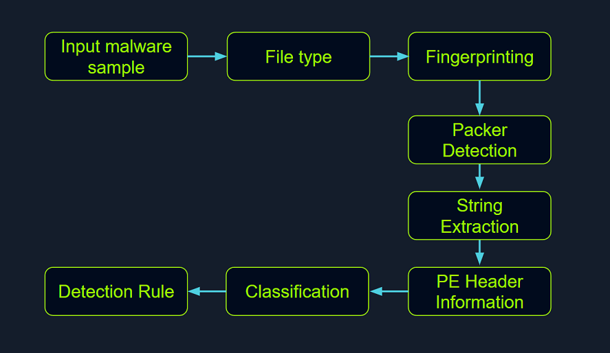
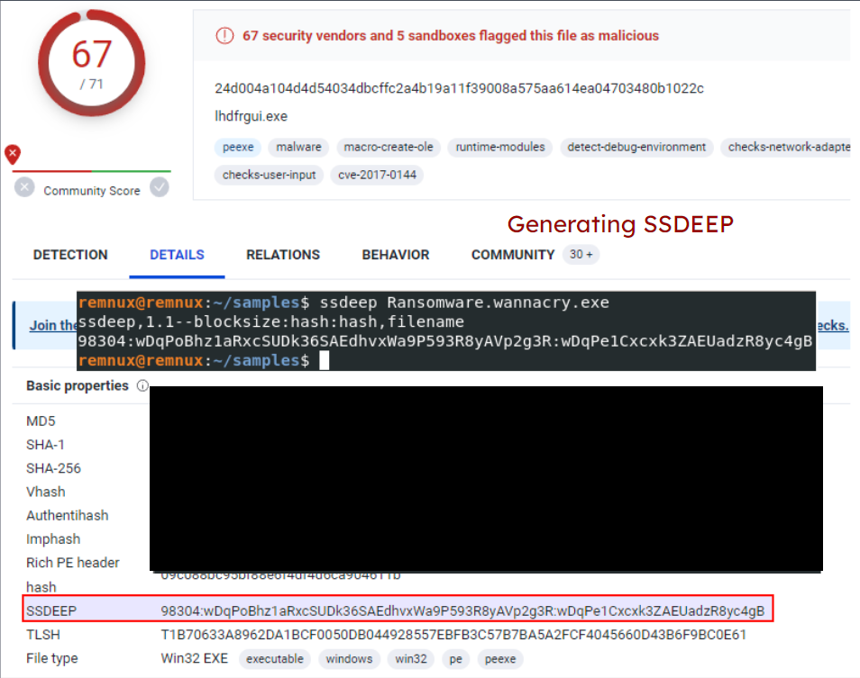
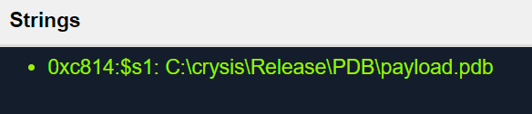

# Static Analysis On Linux (Phân tích tĩnh trên Linux)

Trong lĩnh vực phân tích malware, ta dùng một phương pháp gọi là static analysis (phân tích tĩnh) để xem xét kỹ malware mà không cần thực thi nó. Việc này bao gồm điều tra tỉ mỉ code, dữ liệu và các thành phần cấu trúc của malware, đóng vai trò là bước tiền đề quan trọng cho những phân tích sâu và chi tiết hơn về sau.

Thông qua static analysis, ta cố gắng trích xuất những thông tin then chốt, bao gồm:

- Loại file
- Hash của file
- Strings
- Các thành phần được nhúng
- Thông tin packer
- Imports
- Exports
- Assembly code



<div class="card bg-light">
    <div class="card-body">
				 <p class="mb-0">Bây giờ hãy kéo xuống cuối section này và bấm vào "Click here to spawn the target system!". Sau đó, SSH vào Target IP bằng thông tin đăng nhập được cung cấp. Phần lớn các thao tác/lệnh được trình bày từ đây đến hết section này đều có thể làm lại trên máy target, giúp ta nắm các chủ đề được trình bày một cách toàn diện hơn. </p>
    </div>
</div>

## Xác định loại file

Việc đầu tiên ở giai đoạn này là xác định những thông tin cơ bản về mẫu malware để đặt nền móng cho cuộc điều tra. Vì phần mở rộng (extension) của file có thể bị chỉnh sửa và thay đổi, nhiệm vụ của ta là tìm cách xác định loại file thực sự mà ta đang gặp. Việc xác định loại file đóng vai trò không thể thiếu trong static analysis, bảo đảm các quy trình ta áp dụng là phù hợp và kết quả thu được là chính xác.

Hãy lấy ví dụ một malware chạy trên Windows tên là `Ransomware.wannacry.exe`, nằm trong thư mục `/home/htb-student/Samples/MalwareAnalysis` trên máy target của section này.

Lệnh để kiểm tra loại file của malware này như sau.

```shell-session
[!bash!]$ file /home/htb-student/Samples/MalwareAnalysis/Ransomware.wannacry.exe
/home/htb-student/Samples/MalwareAnalysis/Ransomware.wannacry.exe: PE32 executable (GUI) Intel 80386, for MS Windows
```

Ta cũng có thể làm điều tương tự bằng cách kiểm tra header thủ công với lệnh `hexdump` như sau.

```shell-session
[!bash!]$ hexdump -C /home/htb-student/Samples/MalwareAnalysis/Ransomware.wannacry.exe | more
00000000  4d 5a 90 00 03 00 00 00  04 00 00 00 ff ff 00 00  |MZ..............|
00000010  b8 00 00 00 00 00 00 00  40 00 00 00 00 00 00 00  |........@.......|
00000020  00 00 00 00 00 00 00 00  00 00 00 00 00 00 00 00  |................|
00000030  00 00 00 00 00 00 00 00  00 00 00 00 f8 00 00 00  |................|
00000040  0e 1f ba 0e 00 b4 09 cd  21 b8 01 4c cd 21 54 68  |........!..L.!Th|
00000050  69 73 20 70 72 6f 67 72  61 6d 20 63 61 6e 6e 6f  |is program canno|
00000060  74 20 62 65 20 72 75 6e  20 69 6e 20 44 4f 53 20  |t be run in DOS |
00000070  6d 6f 64 65 2e 0d 0d 0a  24 00 00 00 00 00 00 00  |mode....$.......|
00000080  55 3c 53 90 11 5d 3d c3  11 5d 3d c3 11 5d 3d c3  |U<S..]=..]=..]=.|
00000090  6a 41 31 c3 10 5d 3d c3  92 41 33 c3 15 5d 3d c3  |jA1..]=..A3..]=.|
000000a0  7e 42 37 c3 1a 5d 3d c3  7e 42 36 c3 10 5d 3d c3  |~B7..]=.~B6..]=.|
000000b0  7e 42 39 c3 15 5d 3d c3  d2 52 60 c3 1a 5d 3d c3  |~B9..]=..R`..]=.|
000000c0  11 5d 3c c3 4a 5d 3d c3  27 7b 36 c3 10 5d 3d c3  |.]<.J]=.'{6..]=.|
000000d0  d6 5b 3b c3 10 5d 3d c3  52 69 63 68 11 5d 3d c3  |.[;..]=.Rich.]=.|
000000e0  00 00 00 00 00 00 00 00  00 00 00 00 00 00 00 00  |................|
000000f0  00 00 00 00 00 00 00 00  50 45 00 00 4c 01 04 00  |........PE..L...|
00000100  cc 8e e7 4c 00 00 00 00  00 00 00 00 e0 00 0f 01  |...L............|
00000110  0b 01 06 00 00 90 00 00  00 30 38 00 00 00 00 00  |.........08.....|
00000120  16 9a 00 00 00 10 00 00  00 a0 00 00 00 00 40 00  |..............@.|
00000130  00 10 00 00 00 10 00 00  04 00 00 00 00 00 00 00  |................|
00000140  04 00 00 00 00 00 00 00  00 b0 66 00 00 10 00 00  |..........f.....|
00000150  00 00 00 00 02 00 00 00  00 00 10 00 00 10 00 00  |................|
00000160  00 00 10 00 00 10 00 00  00 00 00 00 10 00 00 00  |................|
00000170  00 00 00 00 00 00 00 00  e0 a1 00 00 a0 00 00 00  |................|
00000180  00 00 31 00 54 a4 35 00  00 00 00 00 00 00 00 00  |..1.T.5.........|
00000190  00 00 00 00 00 00 00 00  00 00 00 00 00 00 00 00  |................|
*
```

Trên hệ thống Windows, sự hiện diện của chuỗi ASCII `MZ` (dạng hexadecimal: `4D 5A`) ở đầu file (gọi là "magic number") cho biết đó là một file thực thi. `MZ` là viết tắt của Mark Zbikowski, một trong những kiến trúc sư chủ chốt của MS-DOS.

## Malware Fingerprinting (lấy dấu vân tay malware)

Ở giai đoạn này, nhiệm vụ của ta là tạo ra một định danh duy nhất cho mẫu malware. Định danh này thường ở dạng cryptographic hash - MD5, SHA1 hoặc SHA256.

Fingerprinting được dùng cho nhiều mục đích, bao gồm:

- Nhận diện và theo dõi các mẫu malware
- Quét toàn bộ hệ thống để tìm sự hiện diện của malware giống hệt
- Xác nhận malware đó đã từng gặp và được phân tích trước đây hay chưa
- Chia sẻ với các bên liên quan dưới dạng IoC (Indicators of Compromise) hoặc như một phần của báo cáo threat intelligence

Ví dụ, để kiểm tra MD5 hash của malware nói trên, lệnh sẽ như sau.

```shell-session
[!bash!]$ md5sum /home/htb-student/Samples/MalwareAnalysis/Ransomware.wannacry.exe
db349b97c37d22f5ea1d1841e3c89eb4  /home/htb-student/Samples/MalwareAnalysis/Ransomware.wannacry.exe
```

Để kiểm tra SHA256 hash của malware nói trên, lệnh sẽ như sau.

```shell-session
[!bash!]$ sha256sum /home/htb-student/Samples/MalwareAnalysis/Ransomware.wannacry.exe
24d004a104d4d54034dbcffc2a4b19a11f39008a575aa614ea04703480b1022c  /home/htb-student/Samples/MalwareAnalysis/Ransomware.wannacry.exe
```

## Tra cứu hash của file

Bước tiếp theo là đối chiếu hash vừa tạo ở bước trước với các công cụ quét malware trực tuyến và sandbox như Cuckoo sandbox. Chẳng hạn, VirusTotal — một engine quét malware trực tuyến hợp tác với nhiều hãng antivirus — cho phép ta tìm kiếm theo hash của file. Bước này giúp ta so sánh kết quả của mình với những hiểu biết đã có về mẫu malware đó.

Hình dưới đây hiển thị kết quả từ [VirusTotal](https://www.virustotal.com/gui/home/search) sau khi gửi SHA256 hash của malware nói trên.


Mặc dù một file hash như MD5, SHA1 hay SHA256 rất có giá trị để nhận diện các mẫu giống hệt nhau nhưng mang tên khác nhau, nó lại không đủ khi cần nhận diện các mẫu malware tương tự nhau. Nguyên nhân chủ yếu là tác giả malware có thể thay đổi giá trị hash chỉ bằng cách sửa nhỏ code rồi biên dịch lại.

Tuy vậy, vẫn có những kỹ thuật giúp nhận diện các mẫu tương tự:

### Import Hashing (IMPHASH)

`IMPHASH`, viết tắt của "Import Hash", là một cryptographic hash được tính từ các hàm import của một file Windows Portable Executable (PE). Thuật toán của nó hoạt động như sau: trước tiên chuyển toàn bộ tên hàm được import sang chữ thường. Tiếp theo, tên DLL và tên hàm được ghép lại với nhau và sắp xếp theo thứ tự bảng chữ cái. Cuối cùng, một MD5 hash được tạo ra từ chuỗi kết quả. Vì vậy, hai file PE có các hàm import giống hệt nhau, theo cùng thứ tự, sẽ có cùng giá trị `IMPHASH`.

Ta có thể tìm `IMPHASH` trong tab `Details` của kết quả VirusTotal.


Lưu ý rằng ta cũng có thể dùng Python module [pefile](https://pypi.org/project/pefile/) để tính IMPHASH của một file như sau.

```python
import sys
import pefile
import peutils

pe_file = sys.argv[1]
pe = pefile.PE(pe_file)
imphash = pe.get_imphash()

print(imphash)
```

Để kiểm tra IMPHASH của malware [WannaCry](https://www.fortinet.com/resources/cyberglossary/wannacry-ransomware-attack) nói trên, lệnh sẽ như sau. `imphash_calc.py` (có sẵn tại `/home/htb-student`) chứa đoạn code Python ở trên.

```shell-session
[!bash!]$ python3 imphash_calc.py /home/htb-student/Samples/MalwareAnalysis/Ransomware.wannacry.exe
9ecee117164e0b870a53dd187cdd7174
```

### Fuzzy Hashing (SSDEEP)

`Fuzzy Hashing (SSDEEP)`, còn gọi là context-triggered piecewise hashing (CTPH), là một kỹ thuật hashing được thiết kế để tính ra một giá trị hash phản ánh mức độ tương đồng về nội dung giữa hai file. Kỹ thuật này chia file thành các khối (block) nhỏ có kích thước cố định và tính hash cho từng khối. Các giá trị hash thu được sau đó được gộp lại để tạo ra fuzzy hash cuối cùng.

Thuật toán `SSDEEP` gán trọng số lớn hơn cho các chuỗi khối chung dài hơn, nhờ đó rất hiệu quả trong việc nhận diện các file chỉ bị sửa đổi nhỏ, hoặc tương tự nhưng không giống hệt — chẳng hạn các biến thể khác nhau của cùng một mẫu độc hại.

Ta có thể tìm hash `SSDEEP` của một malware trong tab `Details` của kết quả VirusTotal.
	
Ta cũng có thể dùng lệnh `ssdeep` để tính hash `SSDEEP` của một file. Để kiểm tra hash `SSDEEP` của malware WannaCry nói trên, lệnh sẽ như sau.

```shell-session
[!bash!]$ ssdeep /home/htb-student/Samples/MalwareAnalysis/Ransomware.wannacry.exe
ssdeep,1.1--blocksize:hash:hash,filename
98304:wDqPoBhz1aRxcSUDk36SAEdhvxWa9P593R8yAVp2g3R:wDqPe1Cxcxk3ZAEUadzR8yc4gB,"/home/htb-student/Samples/MalwareAnalysis/Ransomware.wannacry.exe"
```



Có thể dùng các tham số dòng lệnh `-pb` để bật chế độ so khớp (matching mode) trong `SSDEEP` (khi đang đứng ở thư mục chứa các mẫu malware - trong trường hợp này là `/home/htb-student/Samples/MalwareAnalysis`).

```shell-session
[!bash!]$ ssdeep -pb *
potato.exe matches svchost.exe (99)

svchost.exe matches potato.exe (99)
```

`-p` biểu thị chế độ Pretty matching, còn `-b` dùng để chỉ hiển thị tên file, không kèm đường dẫn đầy đủ. 

Trong ví dụ trên, `SSDEEP` cho thấy hai mẫu malware (`svchost.exe` và `potato.exe`) tương đồng 99%.

### Section Hashing (Hashing các section của PE)

`Section hashing` (hashing các section của PE) là một kỹ thuật mạnh cho phép analyst xác định những section nào của một file Portable Executable (PE) đã bị sửa đổi. Kỹ thuật này đặc biệt hữu ích để nhận diện các biến thể nhỏ của mẫu malware — một chiến thuật phổ biến mà kẻ tấn công dùng để né phát hiện.

Kỹ thuật `Section Hashing` hoạt động bằng cách tính cryptographic hash của từng section. Khi so sánh hai file PE, nếu hash của các section tương ứng trong hai file trùng nhau, điều đó cho thấy section đó không bị sửa đổi giữa hai phiên bản của file.

Bằng cách áp dụng `section hashing`, các analyst bảo mật có thể xác định những phần của một file PE đã bị can thiệp hoặc thay đổi. Điều này giúp nhận diện các mẫu malware tương tự, ngay cả khi chúng đã bị chỉnh sửa nhẹ để né các phương pháp phát hiện truyền thống dựa trên signature.

Có thể dùng các công cụ như `pefile` trong Python để thực hiện `section hashing`. Ví dụ, trong Python, bạn có thể dùng module pefile để truy cập và tính hash dữ liệu trong từng section của một file PE như sau.

```python
import sys
import pefile
pe_file = sys.argv[1]
pe = pefile.PE(pe_file)
for section in pe.sections:
    print (section.Name, "MD5 hash:", section.get_hash_md5())
    print (section.Name, "SHA256 hash:", section.get_hash_sha256())
```

Hãy nhớ rằng dù `section hashing` là một kỹ thuật mạnh, nó không phải là tuyệt đối. Tác giả malware có thể dùng các chiến thuật như làm rối tên section (section name obfuscation) hoặc tạo tên section động để cố vượt qua kiểu phân tích này.

Ví dụ, để kiểm tra MD5 và SHA256 hash của các section PE trong một file thực thi Wannacry lưu tại thư mục `/home/htb-student/Samples/MalwareAnalysis`, lệnh sẽ như sau. `section_hashing.py` (có sẵn tại `/home/htb-student`) chứa đoạn code Python ở trên.

```shell-session
[!bash!]$ python3 section_hashing.py /home/htb-student/Samples/MalwareAnalysis/Ransomware.wannacry.exe
b'.text\x00\x00\x00' MD5 hash: c7613102e2ecec5dcefc144f83189153
b'.text\x00\x00\x00' SHA256 hash: 7609ecc798a357dd1a2f0134f9a6ea06511a8885ec322c7acd0d84c569398678
b'.rdata\x00\x00' MD5 hash: d8037d744b539326c06e897625751cc9
b'.rdata\x00\x00' SHA256 hash: 532e9419f23eaf5eb0e8828b211a7164cbf80ad54461bc748c1ec2349552e6a2
b'.data\x00\x00\x00' MD5 hash: 22a8598dc29cad7078c291e94612ce26
b'.data\x00\x00\x00' SHA256 hash: 6f93fb1b241a990ecc281f9c782f0da471628f6068925aaf580c1b1de86bce8a
b'.rsrc\x00\x00\x00' MD5 hash: 12e1bd7375d82cca3a51ca48fe22d1a9
b'.rsrc\x00\x00\x00' SHA256 hash: 1efe677209c1284357ef0c7996a1318b7de3836dfb11f97d85335d6d3b8a8e42
```

## Phân tích strings

Ở giai đoạn này, mục tiêu của ta là trích xuất các strings (ASCII & Unicode) từ một file binary. Strings có thể cung cấp manh mối và thông tin giá trị về chức năng của malware. Đôi khi, ta có thể tìm ra những strings đặc trưng được nhúng trong mẫu malware, chẳng hạn:

- Tên file được nhúng (vd: các file được drop)
- Địa chỉ IP hoặc tên miền
- Đường dẫn hoặc key registry
- Các hàm Windows API
- Tham số dòng lệnh
- Thông tin đặc trưng có thể gợi ý về một threat actor cụ thể

Có thể dùng lệnh `strings` của Linux để hiển thị các strings chứa trong một malware. Ví dụ, lệnh dưới đây sẽ hiển thị strings của một mẫu ransomware tên `dharma_sample.exe` nằm trong thư mục `/home/htb-student/Samples/MalwareAnalysis` trên máy target của section này.

```shell-session
[!bash!]$ strings -n 15 /home/htb-student/Samples/MalwareAnalysis/dharma_sample.exe
!This program cannot be run in DOS mode.
@@@@@@@@@@@@@@@@@@@@@@@@@@@@@@@@@@@@@@@@@@@>@@@?456789:;<=@@@@@@@
!"#$%&'()*+,-./0123@@@@@@@@@@@@@@@@@@@@@@@@@@@@@@@@@@@@@@@@@@@@@@@@@@@@@@@@@@@@@@@@@@@@@@@@@@@@@@@@@@@@@@@@@@@@@@@@@@@@@@@@@@@@@@@@@@@@@@@@@@@@@@@@@@@@@ABCDEFGHIJKLMNOPQRSTUVWXYZabcdefghijklmnopqrstuvwxyz0123456789+/
WaitForSingleObject
InitializeCriticalSectionAndSpinCount
LeaveCriticalSection
EnterCriticalSection
C:\crysis\Release\PDB\payload.pdb
0123456789ABCDEF
```

`-n` chỉ định in ra các chuỗi có độ dài tối thiểu bằng số được chỉ định - trong trường hợp này là `15`.

Đôi khi, phân tích strings có thể giúp liên kết một mẫu malware với một nhóm threat cụ thể nếu phát hiện được những điểm tương đồng đáng kể. Chẳng hạn, trong [ví dụ](https://thedfirreport.com/2020/06/16/the-little-ransomware-that-couldnt-dharma/) ở link được cung cấp, một string chứa đường dẫn PDB đã được dùng để liên kết mẫu malware với họ ransomware Dharma/Crysis.



---

Cũng cần lưu ý rằng còn có một giải pháp phân tích strings khác gọi là `FLOSS`. `FLOSS`, viết tắt của "FireEye Labs Obfuscated String Solver", là công cụ do đội FLARE của FireEye phát triển để tự động deobfuscate (giải làm rối) các strings trong malware. Nó được thiết kế để bổ sung cho các công cụ strings truyền thống, như lệnh strings trên các hệ thống Unix, vốn có thể bỏ sót những strings bị làm rối (obfuscated) mà malware thường dùng để né phát hiện.

Ví dụ, lệnh dưới đây sẽ hiển thị strings của một mẫu ransomware tên `dharma_sample.exe` nằm trong thư mục `/home/htb-student/Samples/MalwareAnalysis` trên máy target của section này.

```shell-session
[!bash!]$ floss /home/htb-student/Samples/MalwareAnalysis/dharma_sample.exe
INFO: floss: extracting static strings...
finding decoding function features: 100%|███████████████████████████████████████| 238/238 [00:00<00:00, 838.37 functions/s, skipped 5 library functions (2%)]
INFO: floss.stackstrings: extracting stackstrings from 223 functions
INFO: floss.results: %sh(
extracting stackstrings: 100%|████████████████████████████████████████████████████████████████████████████████████| 223/223 [00:01<00:00, 133.51 functions/s]
INFO: floss.tightstrings: extracting tightstrings from 10 functions...
extracting tightstrings from function 0x4065e0: 100%|████████████████████████████████████████████████████████████████| 10/10 [00:01<00:00,  5.91 functions/s]
INFO: floss.string_decoder: decoding strings
INFO: floss.results: EEED
INFO: floss.results: EEEDnnn
INFO: floss.results: uOKm
INFO: floss.results: %sh(
INFO: floss.results: uBIA
INFO: floss.results: uBIA
INFO: floss.results: \t\t\t\t\t\t\t\t
emulating function 0x405840 (call 4/9): 100%|████████████████████████████████████████████████████████████████████████| 25/25 [00:11<00:00,  2.19 functions/s]
INFO: floss: finished execution after 23.56 seconds

FLARE FLOSS RESULTS (version v2.0.0-0-gdd9bea8)
+------------------------+------------------------------------------------------------------------------------+
| file path              | /home/htb-student/Samples/MalwareAnalysis/dharma_sample.exe                        |
| extracted strings      |                                                                                    |
|  static strings        | 720                                                                                |
|  stack strings         | 1                                                                                  |
|  tight strings         | 0                                                                                  |
|  decoded strings       | 7                                                                                  |
+------------------------+------------------------------------------------------------------------------------+

------------------------------
| FLOSS STATIC STRINGS (720) |
------------------------------
-----------------------------
| FLOSS ASCII STRINGS (716) |
-----------------------------
!This program cannot be run in DOS mode.
Rich
.text
`.rdata
@.data
9A s
9A$v
A +B$
---SNIP---
+o*7
0123456789ABCDEF

------------------------------
| FLOSS UTF-16LE STRINGS (4) |
------------------------------
jjjj
%sh(
ssbss
0123456789ABCDEF

---------------------------
| FLOSS STACK STRINGS (1) |
---------------------------
%sh(

---------------------------
| FLOSS TIGHT STRINGS (0) |
---------------------------

-----------------------------
| FLOSS DECODED STRINGS (7) |
-----------------------------
EEED
EEEDnnn
uOKm
%sh(
uBIA
uBIA
\t\t\t\t\t\t\t\t
```

## Unpack malware được pack bằng UPX

Trong quá trình static analysis, ta có thể gặp một mẫu malware đã bị nén hoặc làm rối bằng một kỹ thuật gọi là packing. Packing phục vụ nhiều mục đích:

- Nó làm rối code, khiến việc nhận ra cấu trúc hay chức năng của code khó khăn hơn.
- Nó giảm kích thước file thực thi, giúp truyền tải nhanh hơn hoặc ít gây chú ý hơn.
- Nó gây khó dễ cho các nhà nghiên cứu bảo mật bằng cách cản trở các nỗ lực reverse engineering truyền thống.

Điều này có thể làm giảm hiệu quả của phân tích strings vì các tham chiếu tới strings thường bị che giấu hoặc loại bỏ. Packing cũng thay thế hoặc ngụy trang các section PE thông thường bằng một loader stub gọn nhẹ, stub này lấy lại code gốc từ một section dữ liệu đã nén. Kết quả là file malware vừa nhỏ hơn vừa khó phân tích hơn, vì code gốc không thể quan sát trực tiếp.

Một packer phổ biến được dùng trong nhiều biến thể malware là `Ultimate Packer for Executables (UPX)`.

Trước hết, hãy xem điều gì xảy ra khi ta chạy lệnh `strings` trên một mẫu malware được pack bằng UPX tên `credential_stealer.exe`, nằm trong thư mục `/home/htb-student/Samples/MalwareAnalysis/packed` trên máy target của section này.

```shell-session
[!bash!]$ strings /home/htb-student/Samples/MalwareAnalysis/packed/credential_stealer.exe
!This program cannot be run in DOS mode.
UPX0
UPX1
UPX2
3.96
UPX!
8MZu
HcP<H
VDgxt
$ /uX
OAUATUWVSH
%0rv
o?H9
c`fG
[^_]A\A]
> -P
        fo{Wnl
c9"^$!=
v/7>
07ZC
_L$AAl
mug.%(
#8%,X
e]'^
---SNIP---
```

Hãy quan sát các strings có chứa `UPX`, và để ý rằng phần còn lại của output không cho thông tin gì có giá trị về chức năng của malware.

Ta có thể unpack malware bằng công cụ `UPX` với lệnh sau (khi đang đứng ở thư mục chứa các mẫu malware đã pack - trong trường hợp này là `/home/htb-student/Samples/MalwareAnalysis/packed`).

```shell-session
[!bash!]$ upx -d -o unpacked_credential_stealer.exe credential_stealer.exe
                       Ultimate Packer for eXecutables
                          Copyright (C) 1996 - 2020
UPX 3.96        Markus Oberhumer, Laszlo Molnar & John Reiser   Jan 23rd 2020

        File size         Ratio      Format      Name
   --------------------   ------   -----------   -----------
     16896 <-      8704   51.52%    win64/pe     unpacked_credential_stealer.exe

Unpacked 1 file.
```

Giờ hãy chạy lệnh `strings` trên mẫu đã unpack.

```shell-session
[!bash!]$ strings unpacked_credential_stealer.exe
!This program cannot be run in DOS mode.
.text
P`.data
.rdata
`@.pdata
0@.xdata
0@.bss
.idata
.CRT
.tls
---SNIP---
AVAUATH
@A\A]A^
SeDebugPrivilege
SE Debug Privilege is adjusted
lsass.exe
Searching lsass PID
Lsass PID is: %lu
Error is - %lu
lsassmem.dmp
LSASS Memory is dumped successfully
Err 2: %lu
Unknown error
Argument domain error (DOMAIN)
Overflow range error (OVERFLOW)
Partial loss of significance (PLOSS)
Total loss of significance (TLOSS)
The result is too small to be represented (UNDERFLOW)
Argument singularity (SIGN)
_matherr(): %s in %s(%g, %g)  (retval=%g)
Mingw-w64 runtime failure:
Address %p has no image-section
  VirtualQuery failed for %d bytes at address %p
  VirtualProtect failed with code 0x%x
  Unknown pseudo relocation protocol version %d.
  Unknown pseudo relocation bit size %d.
.pdata
AdjustTokenPrivileges
LookupPrivilegeValueA
OpenProcessToken
MiniDumpWriteDump
CloseHandle
CreateFileA
CreateToolhelp32Snapshot
DeleteCriticalSection
EnterCriticalSection
GetCurrentProcess
GetCurrentProcessId
GetCurrentThreadId
GetLastError
GetStartupInfoA
GetSystemTimeAsFileTime
GetTickCount
InitializeCriticalSection
LeaveCriticalSection
OpenProcess
Process32First
Process32Next
QueryPerformanceCounter
RtlAddFunctionTable
RtlCaptureContext
RtlLookupFunctionEntry
RtlVirtualUnwind
SetUnhandledExceptionFilter
Sleep
TerminateProcess
TlsGetValue
UnhandledExceptionFilter
VirtualProtect
VirtualQuery
__C_specific_handler
__getmainargs
__initenv
__iob_func
__lconv_init
__set_app_type
__setusermatherr
_acmdln
_amsg_exit
_cexit
_fmode
_initterm
_onexit
abort
calloc
exit
fprintf
free
fwrite
malloc
memcpy
printf
puts
signal
strcmp
strlen
strncmp
vfprintf
ADVAPI32.dll
dbghelp.dll
KERNEL32.DLL
msvcrt.dll
```

Giờ ta thấy một output dễ hiểu hơn, bao gồm các strings thực sự có trong mẫu.
