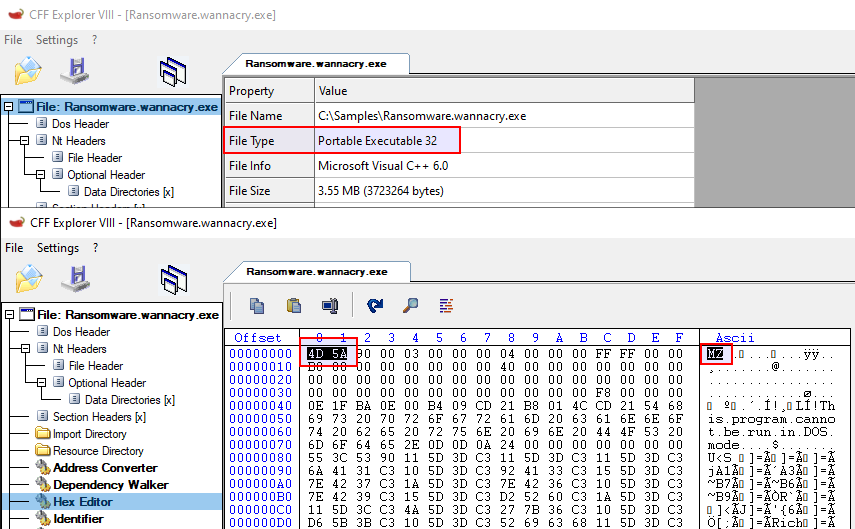
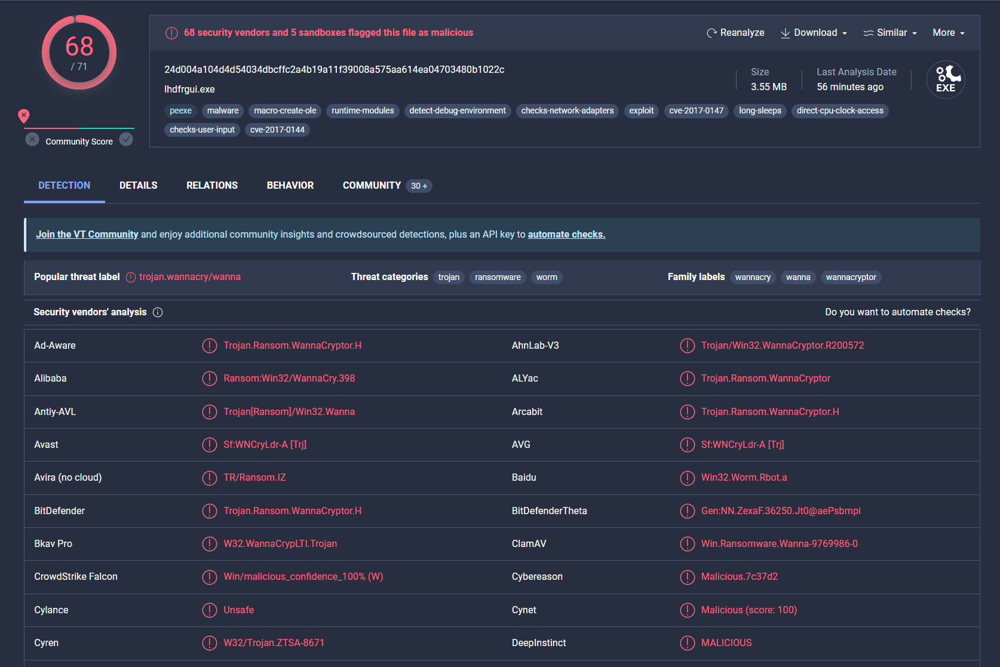
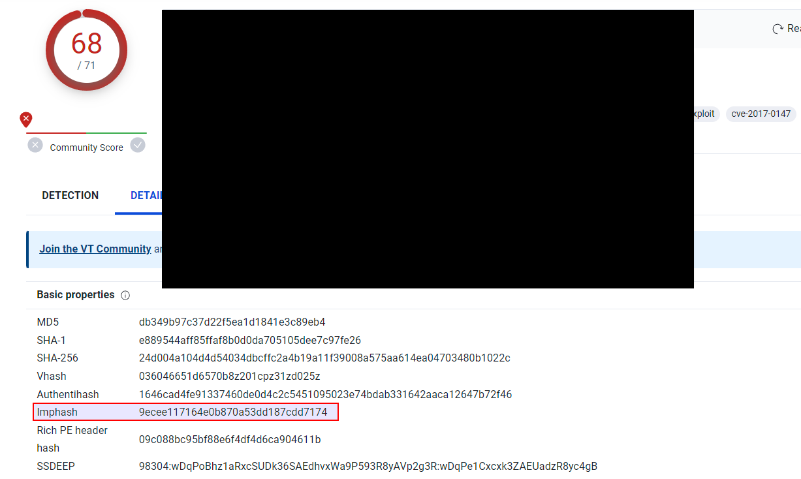
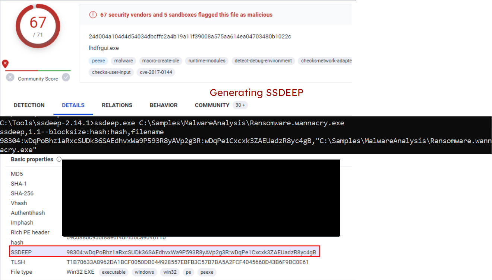
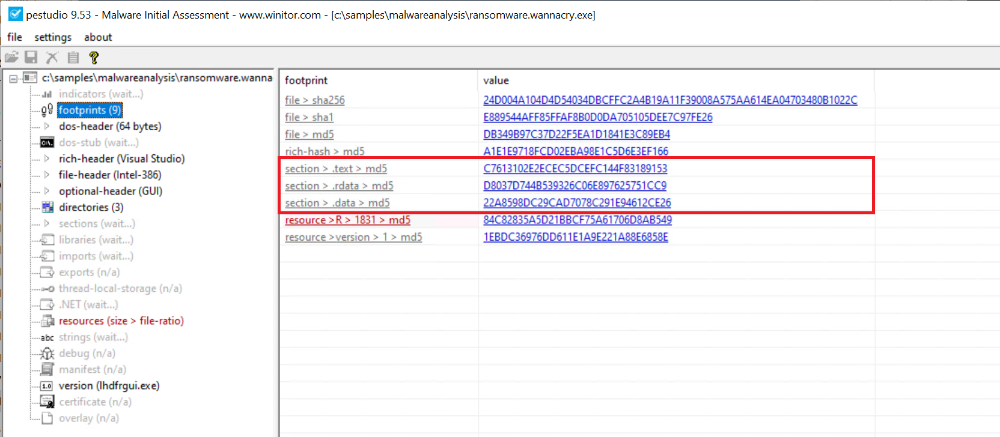
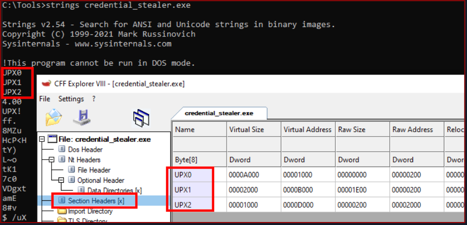

# Static Analysis On Windows (Phân tích tĩnh trên Windows)

Trong phần này, ta sẽ tập trung làm lại một số tác vụ static analysis đã thực hiện trên máy Linux, nhưng lần này dùng máy Windows.

<div class="card bg-light">
    <div class="card-body">
				 <p class="mb-0">Bây giờ hãy kéo xuống cuối section này và bấm vào "Click here to spawn the target system!". Sau đó, RDP vào Target IP bằng thông tin đăng nhập được cung cấp. Phần lớn các thao tác/lệnh được trình bày từ đây đến hết section này đều có thể làm lại trên máy target, giúp ta nắm các chủ đề được trình bày một cách toàn diện hơn. </p>
    </div>
</div>

```shell-session
[!bash!]$ xfreerdp /u:htb-student /p:'HTB_@cademy_stdnt!' /v:[Target IP] /dynamic-resolution
```

## Xác định loại file

Việc đầu tiên ở giai đoạn này là xác định những thông tin cơ bản về mẫu malware để đặt nền móng cho cuộc điều tra. Vì phần mở rộng (extension) của file có thể bị chỉnh sửa và thay đổi, nhiệm vụ của ta là tìm cách xác định loại file thực sự mà ta đang gặp. Việc xác định loại file đóng vai trò không thể thiếu trong static analysis, bảo đảm các quy trình ta áp dụng là phù hợp và kết quả thu được là chính xác.

Hãy lấy ví dụ một malware chạy trên Windows tên là `Ransomware.wannacry.exe`, nằm trong thư mục `C:\Samples\MalwareAnalysis` trên máy target của section này.

Ta có thể dùng một công cụ như `CFF Explorer` (có sẵn tại `C:\Tools\Explorer Suite`) để kiểm tra loại file của malware này như sau.



Trên hệ thống Windows, sự hiện diện của chuỗi ASCII `MZ` (dạng hexadecimal: `4D 5A`) ở đầu file (gọi là "magic number") cho biết đó là một file thực thi. `MZ` là viết tắt của Mark Zbikowski, một trong những kiến trúc sư chủ chốt của MS-DOS.


## Malware Fingerprinting (lấy dấu vân tay malware)

Ở giai đoạn này, nhiệm vụ của ta là tạo ra một định danh duy nhất cho mẫu malware. Định danh này thường ở dạng cryptographic hash - MD5, SHA1 hoặc SHA256.

Fingerprinting được dùng cho nhiều mục đích, bao gồm:

- Nhận diện và theo dõi các mẫu malware
- Quét toàn bộ hệ thống để tìm sự hiện diện của malware giống hệt
- Xác nhận malware đó đã từng gặp và được phân tích trước đây hay chưa
- Chia sẻ với các bên liên quan dưới dạng IoC (Indicators of Compromise) hoặc như một phần của báo cáo threat intelligence

Ví dụ, để kiểm tra MD5 hash của malware nói trên, ta có thể dùng PowerShell cmdlet `Get-FileHash` như sau.

```powershell-session
PS C:\Users\htb-student> Get-FileHash -Algorithm MD5 C:\Samples\MalwareAnalysis\Ransomware.wannacry.exe

Algorithm       Hash                                                                   Path
---------       ----                                                                   ----
MD5             DB349B97C37D22F5EA1D1841E3C89EB4                                       C:\Samples\MalwareAnalysis\Ra...
```

Để kiểm tra SHA256 hash của malware nói trên, lệnh sẽ như sau.

```powershell-session
PS C:\Users\htb-student> Get-FileHash -Algorithm SHA256 C:\Samples\MalwareAnalysis\Ransomware.wannacry.exe

Algorithm       Hash                                                                   Path
---------       ----                                                                   ----
SHA256          24D004A104D4D54034DBCFFC2A4B19A11F39008A575AA614EA04703480B1022C       C:\Samples\MalwareAnalysis\Ra...
```

## Tra cứu hash của file

Bước tiếp theo là đối chiếu hash vừa tạo ở bước trước với các công cụ quét malware trực tuyến và sandbox như Cuckoo sandbox. Chẳng hạn, VirusTotal — một engine quét malware trực tuyến hợp tác với nhiều hãng antivirus — cho phép ta tìm kiếm theo hash của file. Bước này giúp ta so sánh kết quả của mình với những hiểu biết đã có về mẫu malware đó.

Hình dưới đây hiển thị kết quả từ [VirusTotal](https://www.virustotal.com/gui/home/search) sau khi gửi SHA256 hash của malware nói trên.



Mặc dù một file hash như MD5, SHA1 hay SHA256 rất có giá trị để nhận diện các mẫu giống hệt nhau nhưng mang tên khác nhau, nó lại không đủ khi cần nhận diện các mẫu malware tương tự nhau. Nguyên nhân chủ yếu là tác giả malware có thể thay đổi giá trị hash chỉ bằng cách sửa nhỏ code rồi biên dịch lại.

Tuy vậy, vẫn có những kỹ thuật giúp nhận diện các mẫu tương tự:

### Import Hashing (IMPHASH)

`IMPHASH`, viết tắt của "Import Hash", là một cryptographic hash được tính từ các hàm import của một file Windows Portable Executable (PE). Thuật toán của nó hoạt động như sau: trước tiên chuyển toàn bộ tên hàm được import sang chữ thường. Tiếp theo, tên DLL và tên hàm được ghép lại với nhau và sắp xếp theo thứ tự bảng chữ cái. Cuối cùng, một MD5 hash được tạo ra từ chuỗi kết quả. Vì vậy, hai file PE có các hàm import giống hệt nhau, theo cùng thứ tự, sẽ có cùng giá trị `IMPHASH`.

Ta có thể tìm `IMPHASH` trong tab `Details` của kết quả VirusTotal.



Lưu ý rằng ta cũng có thể dùng Python module [pefile](https://pypi.org/project/pefile/) để tính `IMPHASH` của một file như sau.

```python
import sys
import pefile
import peutils

pe_file = sys.argv[1]
pe = pefile.PE(pe_file)
imphash = pe.get_imphash()

print(imphash)
```

Để kiểm tra `IMPHASH` của malware WannaCry nói trên, lệnh sẽ như sau. `imphash_calc.py` chứa đoạn code Python ở trên.

```cmd-session
C:\Scripts> python imphash_calc.py C:\Samples\MalwareAnalysis\Ransomware.wannacry.exe
9ecee117164e0b870a53dd187cdd7174
```

### Fuzzy Hashing (SSDEEP)

`Fuzzy Hashing (SSDEEP)`, còn gọi là context-triggered piecewise hashing (CTPH), là một kỹ thuật hashing được thiết kế để tính ra một giá trị hash phản ánh mức độ tương đồng về nội dung giữa hai file. Kỹ thuật này chia file thành các khối (block) nhỏ có kích thước cố định và tính hash cho từng khối. Các giá trị hash thu được sau đó được gộp lại để tạo ra fuzzy hash cuối cùng.

Thuật toán `SSDEEP` gán trọng số lớn hơn cho các chuỗi khối chung dài hơn, nhờ đó rất hiệu quả trong việc nhận diện các file chỉ bị sửa đổi nhỏ, hoặc tương tự nhưng không giống hệt — chẳng hạn các biến thể khác nhau của cùng một mẫu độc hại.

Ta có thể tìm hash `SSDEEP` của một malware trong tab `Details` của kết quả VirusTotal.
	
Ta cũng có thể dùng công cụ `ssdeep` (có sẵn tại `C:\Tools\ssdeep-2.14.1`) để tính hash `SSDEEP` của một file. Để kiểm tra hash `SSDEEP` của malware WannaCry nói trên, lệnh sẽ như sau.

```cmd-session
C:\Tools\ssdeep-2.14.1> ssdeep.exe C:\Samples\MalwareAnalysis\Ransomware.wannacry.exe
ssdeep,1.1--blocksize:hash:hash,filename
98304:wDqPoBhz1aRxcSUDk36SAEdhvxWa9P593R8yAVp2g3R:wDqPe1Cxcxk3ZAEUadzR8yc4gB,"C:\Samples\MalwareAnalysis\Ransomware.wannacry.exe"
```



### Section Hashing (Hashing các section của PE)

`Section hashing` (hashing các section của PE) là một kỹ thuật mạnh cho phép analyst xác định những section nào của một file Portable Executable (PE) đã bị sửa đổi. Kỹ thuật này đặc biệt hữu ích để nhận diện các biến thể nhỏ của mẫu malware — một chiến thuật phổ biến mà kẻ tấn công dùng để né phát hiện.

Kỹ thuật `Section Hashing` hoạt động bằng cách tính cryptographic hash của từng section. Khi so sánh hai file PE, nếu hash của các section tương ứng trong hai file trùng nhau, điều đó cho thấy section đó không bị sửa đổi giữa hai phiên bản của file.

Bằng cách áp dụng `section hashing`, các analyst bảo mật có thể xác định những phần của một file PE đã bị can thiệp hoặc thay đổi. Điều này giúp nhận diện các mẫu malware tương tự, ngay cả khi chúng đã bị chỉnh sửa nhẹ để né các phương pháp phát hiện truyền thống dựa trên signature.

Có thể dùng các công cụ như `pefile` trong Python để thực hiện `section hashing`. Ví dụ, trong Python, bạn có thể dùng module pefile để truy cập và tính hash dữ liệu trong từng section của một file PE như sau.

```python
import sys
import pefile
pe_file = sys.argv[1]
pe = pefile.PE(pe_file)
for section in pe.sections:
    print (section.Name, "MD5 hash:", section.get_hash_md5())
    print (section.Name, "SHA256 hash:", section.get_hash_sha256())
```

Hãy nhớ rằng dù `section hashing` là một kỹ thuật mạnh, nó không phải là tuyệt đối. Tác giả malware có thể dùng các chiến thuật như làm rối tên section (section name obfuscation) hoặc tạo tên section động để cố vượt qua kiểu phân tích này.

Ví dụ, để kiểm tra MD5 hash của malware nói trên, ta có thể dùng `pestudio` (có sẵn tại `C:\Tools\pestudio\pestudio`) như sau.



## Phân tích strings

Ở giai đoạn này, mục tiêu của ta là trích xuất các strings (ASCII & Unicode) từ một file binary. Strings có thể cung cấp manh mối và thông tin giá trị về chức năng của malware. Đôi khi, ta có thể tìm ra những strings đặc trưng được nhúng trong mẫu malware, chẳng hạn:

- Tên file được nhúng (vd: các file được drop)
- Địa chỉ IP hoặc tên miền
- Đường dẫn hoặc key registry
- Các hàm Windows API
- Tham số dòng lệnh
- Thông tin đặc trưng có thể gợi ý về một threat actor cụ thể

Có thể dùng file binary `strings` của `Sysinternals` trên Windows để hiển thị các strings chứa trong một malware. Ví dụ, lệnh dưới đây sẽ hiển thị strings của một mẫu ransomware tên `dharma_sample.exe` nằm trong thư mục `C:\Samples\MalwareAnalysis` trên máy target của section này.

```cmd-session
C:\Users\htb-student> strings C:\Samples\MalwareAnalysis\dharma_sample.exe

Strings v2.54 - Search for ANSI and Unicode strings in binary images.
Copyright (C) 1999-2021 Mark Russinovich
Sysinternals - www.sysinternals.com

!This program cannot be run in DOS mode.
gaT
Rich
.text
`.rdata
@.data
HQh
9A s
9A$v
---SNIP---
GetProcAddress
LoadLibraryA
WaitForSingleObject
InitializeCriticalSectionAndSpinCount
LeaveCriticalSection
GetLastError
EnterCriticalSection
ReleaseMutex
CloseHandle
KERNEL32.dll
RSDS%~m
#ka
C:\crysis\Release\PDB\payload.pdb
---SNIP---
```

Đôi khi, phân tích strings có thể giúp liên kết một mẫu malware với một nhóm threat cụ thể nếu phát hiện được những điểm tương đồng đáng kể. Chẳng hạn, trong [ví dụ](https://thedfirreport.com/2020/06/16/the-little-ransomware-that-couldnt-dharma/) ở link được cung cấp, một string chứa đường dẫn PDB đã được dùng để liên kết mẫu malware với họ ransomware Dharma/Crysis.


---

Cũng cần lưu ý rằng công cụ `FLOSS` cũng có sẵn cho hệ điều hành Windows.

Lệnh dưới đây sẽ hiển thị strings của một mẫu malware tên `shell.exe` nằm trong thư mục `C:\Samples\MalwareAnalysis` trên máy target của section này.

```cmd-session
C:\Samples\MalwareAnalysis> floss shell.exe
INFO: floss: extracting static strings...
finding decoding function features: 100%|████████████████████████████████████████████| 85/85 [00:00<00:00, 1361.51 functions/s, skipped 0 library functions]
INFO: floss.stackstrings: extracting stackstrings from 56 functions
INFO: floss.results: AQAPRQVH1
INFO: floss.results: JJM1
INFO: floss.results: RAQH
INFO: floss.results: AXAX^YZAXAYAZH
INFO: floss.results: XAYZH
INFO: floss.results: ws232
extracting stackstrings: 100%|██████████████████████████████████████████████████████████████████████████████████████| 56/56 [00:00<00:00, 81.46 functions/s]
INFO: floss.tightstrings: extracting tightstrings from 4 functions...
extracting tightstrings from function 0x402a90: 100%|█████████████████████████████████████████████████████████████████| 4/4 [00:00<00:00, 25.59 functions/s]
INFO: floss.string_decoder: decoding strings
emulating function 0x402a90 (call 1/1): 100%|███████████████████████████████████████████████████████████████████████| 22/22 [00:14<00:00,  1.51 functions/s]
INFO: floss: finished execution after 25.20 seconds


FLARE FLOSS RESULTS (version v2.3.0-0-g037fc4b)

+------------------------+------------------------------------------------------------------------------------+
| file path              | shell.exe                                                                          |
| extracted strings      |                                                                                    |
|  static strings        | 254                                                                                |
|  stack strings         | 6                                                                                  |
|  tight strings         | 0                                                                                  |
|  decoded strings       | 0                                                                                  |
+------------------------+------------------------------------------------------------------------------------+


 ──────────────────────
  FLOSS STATIC STRINGS
 ──────────────────────

+-----------------------------------+
| FLOSS STATIC STRINGS: ASCII (254) |
+-----------------------------------+

!This program cannot be run in DOS mode.
.text
P`.data
.rdata
`@.pdata
0@.xdata
0@.bss
.idata
.CRT
.tls
8MZu
HcP<H
D$ H
AUATUWVSH
D$ L
---SNIP---
C:\Windows\System32\notepad.exe
Message
Connection sent to C2
[-] Error code is : %lu
AQAPRQVH1
JJM1
RAQH
AXAX^YZAXAYAZH
XAYZH
ws2_32
PPM1
APAPH
WWWM1
VPAPAPAPI
Windows-Update/7.6.7600.256 %s
1Lbcfr7sAHTD9CgdQo3HTMTkV8LK4ZnX71
open
SOFTWARE\Microsoft\Windows\CurrentVersion\Run
WindowsUpdater
---SNIP---
TEMP
svchost.exe
%s\%s
http://ms-windows-update.com/svchost.exe
45.33.32.156
Sandbox detected
iuqerfsodp9ifjaposdfjhgosurijfaewrwergwea.com
SOFTWARE\VMware, Inc.\VMware Tools
InstallPath
C:\Program Files\VMware\VMware Tools\
Failed to open the registry key.
Unknown error
Argument domain error (DOMAIN)
Overflow range error (OVERFLOW)
Partial loss of significance (PLOSS)
Total loss of significance (TLOSS)
The result is too small to be represented (UNDERFLOW)
Argument singularity (SIGN)
_matherr(): %s in %s(%g, %g)  (retval=%g)
Mingw-w64 runtime failure:
Address %p has no image-section
  VirtualQuery failed for %d bytes at address %p
  VirtualProtect failed with code 0x%x
  Unknown pseudo relocation protocol version %d.
  Unknown pseudo relocation bit size %d.
.pdata
RegCloseKey
RegOpenKeyExA
RegQueryValueExA
RegSetValueExA
CloseHandle
CreateFileA
CreateProcessA
CreateRemoteThread
DeleteCriticalSection
EnterCriticalSection
GetComputerNameA
GetCurrentProcess
GetCurrentProcessId
GetCurrentThreadId
GetLastError
GetStartupInfoA
GetSystemTimeAsFileTime
GetTickCount
InitializeCriticalSection
LeaveCriticalSection
OpenProcess
QueryPerformanceCounter
RtlAddFunctionTable
RtlCaptureContext
RtlLookupFunctionEntry
RtlVirtualUnwind
SetUnhandledExceptionFilter
Sleep
TerminateProcess
TlsGetValue
UnhandledExceptionFilter
VirtualAllocEx
VirtualProtect
VirtualQuery
WriteFile
WriteProcessMemory
__C_specific_handler
__getmainargs
__initenv
__iob_func
__lconv_init
__set_app_type
__setusermatherr
_acmdln
_amsg_exit
_cexit
_fmode
_initterm
_onexit
_vsnprintf
abort
calloc
exit
fprintf
free
fwrite
getenv
malloc
memcpy
printf
puts
signal
sprintf
strcmp
strlen
strncmp
vfprintf
ShellExecuteA
MessageBoxA
InternetCloseHandle
InternetOpenA
InternetOpenUrlA
InternetReadFile
WSACleanup
WSAStartup
closesocket
connect
freeaddrinfo
getaddrinfo
htons
inet_addr
socket
ADVAPI32.dll
KERNEL32.dll
msvcrt.dll
SHELL32.dll
USER32.dll
WININET.dll
WS2_32.dll


+------------------------------------+
| FLOSS STATIC STRINGS: UTF-16LE (0) |
+------------------------------------+


 ─────────────────────
  FLOSS STACK STRINGS
 ─────────────────────

AQAPRQVH1
JJM1
RAQH
AXAX^YZAXAYAZH
XAYZH
ws232


 ─────────────────────
  FLOSS TIGHT STRINGS
 ─────────────────────


 ───────────────────────
  FLOSS DECODED STRINGS
 ───────────────────────

```

## Unpack malware được pack bằng UPX

Trong quá trình static analysis, ta có thể gặp một mẫu malware đã bị nén hoặc làm rối bằng một kỹ thuật gọi là packing. Packing phục vụ nhiều mục đích:

- Nó làm rối code, khiến việc nhận ra cấu trúc hay chức năng của code khó khăn hơn.
- Nó giảm kích thước file thực thi, giúp truyền tải nhanh hơn hoặc ít gây chú ý hơn.
- Nó gây khó dễ cho các nhà nghiên cứu bảo mật bằng cách cản trở các nỗ lực reverse engineering truyền thống.

Điều này có thể làm giảm hiệu quả của phân tích strings vì các tham chiếu tới strings thường bị che giấu hoặc loại bỏ. Packing cũng thay thế hoặc ngụy trang các section PE thông thường bằng một loader stub gọn nhẹ, stub này lấy lại code gốc từ một section dữ liệu đã nén. Kết quả là file malware vừa nhỏ hơn vừa khó phân tích hơn, vì code gốc không thể quan sát trực tiếp.

Một packer phổ biến được dùng trong nhiều biến thể malware là `Ultimate Packer for Executables (UPX)`.

Trước hết, hãy xem điều gì xảy ra khi ta chạy lệnh `strings` trên một mẫu malware được pack bằng UPX tên `credential_stealer.exe`, nằm trong thư mục `C:\Samples\MalwareAnalysis\packed` trên máy target của section này.

```cmd-session
C:\Users\htb-student> strings C:\Samples\MalwareAnalysis\packed\credential_stealer.exe

Strings v2.54 - Search for ANSI and Unicode strings in binary images.
Copyright (C) 1999-2021 Mark Russinovich
Sysinternals - www.sysinternals.com

!This program cannot be run in DOS mode.
UPX0
UPX1
UPX2
3.96
UPX!
ff.
8MZu
HcP<H
tY)
L~o
tK1
7c0
VDgxt
amE
8#v
$ /uX
OAUATUWVSH
Z6L
<=h
%0rv
o?H9
7sk
3H{
HZu
'.}
c|/
c`fG
Iq%
[^_]A\A]
> -P
fo{Wnl
c9"^$!=
;\V
%&m
')A
v/7>
07ZC
_L$AAl
mug.%(
t%n
#8%,X
e]'^
(hk
Dks
zC:
Vj<
w~5
m<6
|$PD
c(t
\3_
---SNIP---
```

Hãy quan sát các strings có chứa `UPX`, và để ý rằng phần còn lại của output không cho thông tin gì có giá trị về chức năng của malware.



Ta có thể unpack malware bằng công cụ `UPX` (có sẵn tại `C:\Tools\upx\upx-4.0.2-win64`) với lệnh sau.

```cmd-session
C:\Tools\upx\upx-4.0.2-win64> upx -d -o unpacked_credential_stealer.exe C:\Samples\MalwareAnalysis\packed\credential_stealer.exe
                       Ultimate Packer for eXecutables
                          Copyright (C) 1996 - 2023
UPX 4.0.2       Markus Oberhumer, Laszlo Molnar & John Reiser   Jan 30th 2023

        File size         Ratio      Format      Name
   --------------------   ------   -----------   -----------
     16896 <-      8704   51.52%    win64/pe     unpacked_credential_stealer.exe

Unpacked 1 file.
```

Giờ hãy chạy lệnh `strings` trên mẫu đã unpack.

```cmd-session
C:\Tools\upx\upx-4.0.2-win64> strings unpacked_credential_stealer.exe

Strings v2.54 - Search for ANSI and Unicode strings in binary images.
Copyright (C) 1999-2021 Mark Russinovich
Sysinternals - www.sysinternals.com

!This program cannot be run in DOS mode.
.text
P`.data
.rdata
`@.pdata
0@.xdata
0@.bss
.idata
.CRT
.tls
ff.
8MZu
HcP<H
---SNIP---
D$(
D$
D$0
D$(
D$
t'H
%5T
@A\A]A^
SeDebugPrivilege
SE Debug Privilege is adjusted
lsass.exe
Searching lsass PID
Lsass PID is: %lu
Error is - %lu
lsassmem.dmp
LSASS Memory is dumped successfully
Err 2: %lu
@u@
`p@
Unknown error
Argument domain error (DOMAIN)
Overflow range error (OVERFLOW)
Partial loss of significance (PLOSS)
Total loss of significance (TLOSS)
The result is too small to be represented (UNDERFLOW)
Argument singularity (SIGN)
_matherr(): %s in %s(%g, %g)  (retval=%g)
Mingw-w64 runtime failure:
Address %p has no image-section
  VirtualQuery failed for %d bytes at address %p
  VirtualProtect failed with code 0x%x
  Unknown pseudo relocation protocol version %d.
  Unknown pseudo relocation bit size %d.
.pdata
 0@
00@
`E@
`E@
@v@
hy@
`y@
@p@
0v@
Pp@
AdjustTokenPrivileges
LookupPrivilegeValueA
OpenProcessToken
MiniDumpWriteDump
CloseHandle
CreateFileA
CreateToolhelp32Snapshot
DeleteCriticalSection
EnterCriticalSection
GetCurrentProcess
GetCurrentProcessId
GetCurrentThreadId
GetLastError
GetStartupInfoA
GetSystemTimeAsFileTime
GetTickCount
InitializeCriticalSection
LeaveCriticalSection
OpenProcess
Process32First
Process32Next
QueryPerformanceCounter
RtlAddFunctionTable
RtlCaptureContext
RtlLookupFunctionEntry
RtlVirtualUnwind
SetUnhandledExceptionFilter
Sleep
TerminateProcess
TlsGetValue
UnhandledExceptionFilter
VirtualProtect
VirtualQuery
__C_specific_handler
__getmainargs
__initenv
__iob_func
__lconv_init
__set_app_type
__setusermatherr
_acmdln
_amsg_exit
_cexit
_fmode
_initterm
_onexit
abort
calloc
exit
fprintf
free
fwrite
malloc
memcpy
printf
puts
signal
strcmp
strlen
strncmp
vfprintf
ADVAPI32.dll
dbghelp.dll
KERNEL32.DLL
msvcrt.dll
```

Giờ ta thấy một output dễ hiểu hơn, bao gồm các strings thực sự có trong mẫu.
