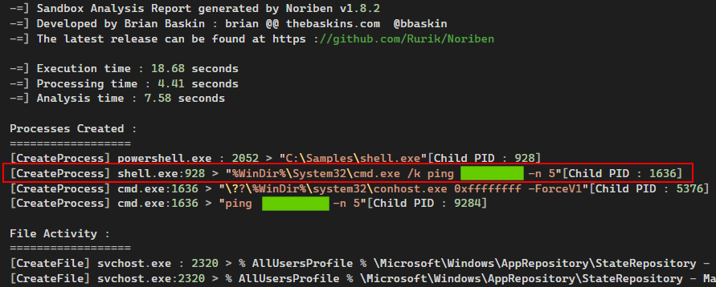
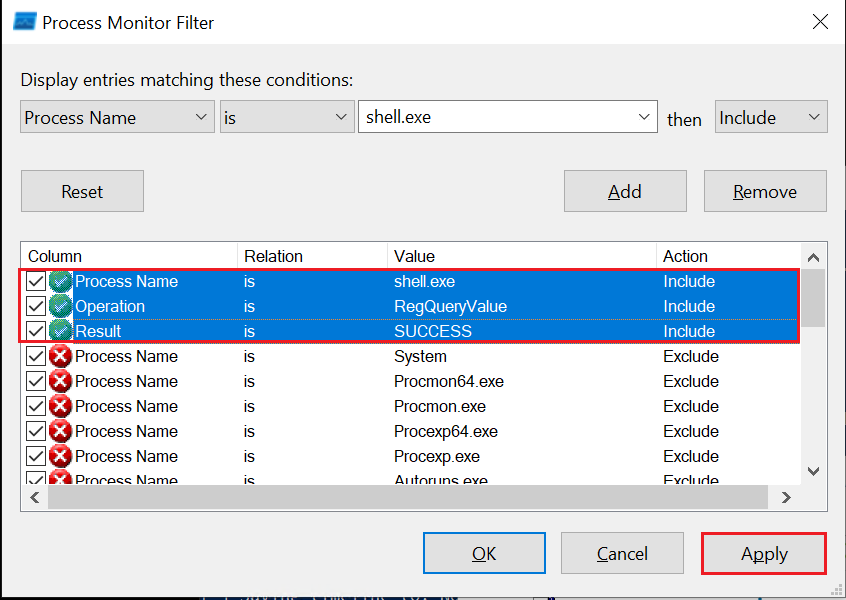
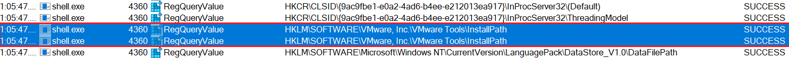

# Dynamic Analysis (Phân tích động)

Trong lĩnh vực phân tích malware, phân tích động hay phân tích hành vi (dynamic/behavioral analysis) là một cách tiếp cận không thể thiếu trong "kho vũ khí" điều tra của chúng ta. Trong phân tích động, ta quan sát và diễn giải hành vi của malware khi nó đang chạy, tức là đang hoạt động. Đây là điểm khác biệt quan trọng so với phân tích tĩnh (static analysis), nơi ta mổ xẻ các thuộc tính và nội dung của malware mà không thực thi nó. Mục tiêu chính của phân tích động là ghi lại và hiểu tác động thực tế của malware lên môi trường host, khiến nó trở thành một phần không thể thiếu của quá trình phân tích malware toàn diện.

Khi thực hiện phân tích động, ta đặt malware trong một môi trường được kiểm soát chặt chẽ, được giám sát và thường được cô lập, nhằm ngăn việc lây lan hay gây hại ngoài ý muốn. Môi trường này thường là một máy ảo (virtual machine – VM) mà malware không hề hay biết. Nó tin rằng mình đang tương tác với một hệ thống thật, trong khi chúng ta, với vai trò nhà nghiên cứu, có toàn quyền kiểm soát các tương tác của nó và có thể ghi lại hành vi của nó một cách đầy đủ.

Quy trình phân tích động của chúng ta có thể chia thành các bước sau:

- `Environment Setup`: Đầu tiên ta thiết lập một môi trường an toàn và được kiểm soát, thường là một `VM`, cô lập khỏi phần còn lại của mạng để tránh vô tình làm nhiễm bẩn hoặc phát tán malware. VM nên được thiết lập giống một hệ thống thực tế, có đầy đủ phần mềm, ứng dụng và cấu hình mạng mà một người dùng thật có thể có.

- `Baseline Capture`: Sau khi thiết lập xong môi trường, ta chụp lại một snapshot trạng thái sạch của hệ thống. Snapshot này bao gồm `system files`, `registry states`, `running processes`, `network configuration`, v.v. Baseline này đóng vai trò mốc tham chiếu để xác định những thay đổi do malware gây ra sau khi thực thi.

- `Tool Deployment (Pre-Execution)`: Để ghi nhận hiệu quả các hoạt động của malware, ta triển khai nhiều công cụ giám sát và ghi log. Các công cụ như `Process Monitor (Procmon)` thuộc Sysinternals Suite được dùng để ghi log system call, hoạt động file system, thao tác registry, v.v. Ta cũng có thể dùng các tiện ích như `Wireshark`, `tcpdump` và `Fiddler` để bắt network traffic, và `Regshot` để chụp snapshot registry của hệ thống trước và sau khi chạy. Cuối cùng, các công cụ như `INetSim`, `FakeDNS` và `FakeNet-NG` được dùng để giả lập các dịch vụ internet.

- `Malware Execution`: Khi các công cụ đã chạy và sẵn sàng, ta tiến hành thực thi mẫu malware trong môi trường cô lập. Trong quá trình thực thi, các công cụ giám sát ghi nhận và log lại mọi hoạt động, bao gồm việc tạo process, thay đổi file và registry, network traffic, v.v. 

- `Observation and Logging`: Mẫu malware được để chạy trong một khoảng thời gian đủ dài. Trong suốt thời gian đó, các công cụ giám sát cần mẫn ghi lại mọi động thái của nó, cung cấp cho ta cái nhìn toàn diện về hành vi và phương thức hoạt động (modus operandi) của nó.

- `Analysis of Collected Data`: Sau khi malware đã chạy xong, ta dừng việc thực thi của nó và dừng các công cụ giám sát. Lúc này ta xem xét các log và dữ liệu thu thập được, so sánh trạng thái hệ thống với baseline ban đầu để xác định những thay đổi do malware tạo ra.

Trong một số trường hợp, khi malware đặc biệt giỏi lẩn tránh (evasive) hoặc phức tạp, ta có thể dùng môi trường sandbox cho phân tích động. Các sandbox như `Cuckoo Sandbox`, `Joe Sandbox` hay `FireEye's Dynamic Threat Intelligence cloud` cung cấp một môi trường tự động, an toàn và được kiểm soát chặt chẽ để thực thi malware. Chúng được trang bị nhiều tính năng phân tích hành vi chuyên sâu và tạo ra các báo cáo chi tiết về hành vi mạng của malware, tương tác với file system, dấu vết bộ nhớ (memory footprint), v.v.

Tuy nhiên, cần nhớ rằng dù môi trường sandbox là công cụ giá trị, chúng không phải là hoàn hảo. Một số malware nâng cao có thể phát hiện môi trường sandbox và thay đổi hành vi tương ứng, khiến nhà nghiên cứu khó xác định được bản chất thật của chúng hơn.

<div class="card bg-light">
    <div class="card-body">
				 <p class="mb-0">Giờ hãy kéo xuống cuối section này và bấm vào "Click here to spawn the target system!". Sau đó, RDP vào Target IP bằng thông tin đăng nhập được cung cấp. Phần lớn các thao tác/lệnh được trình bày từ đây đến cuối section này có thể thực hiện lại trên target, giúp nắm các chủ đề được trình bày một cách toàn diện hơn. </p>
    </div>
</div>

```shell-session
[!bash!]$ xfreerdp /u:htb-student /p:'HTB_@cademy_stdnt!' /v:[Target IP] /dynamic-resolution
```

## Dynamic Analysis With Noriben (Phân tích động với Noriben)

[Noriben](https://github.com/Rurik/Noriben) là một công cụ mạnh trong bộ công cụ phân tích động của chúng ta, về cơ bản đóng vai trò một Python wrapper cho `ProcMon` của Sysinternals — một tiện ích giám sát hệ thống toàn diện. Nó điều phối hoạt động của `ProcMon`, tinh lọc output và bổ sung thêm một lớp hiểu biết đặc thù về malware vào quá trình này. Tận dụng `Noriben`, ta có thể ghi nhận hành vi malware thuận tiện hơn và hiểu chúng chính xác hơn.

Để hiểu `Noriben` hỗ trợ công việc phân tích động của ta như thế nào, trước tiên hãy điểm nhanh qua `ProcMon`. Công cụ này, thuộc `Sysinternals Suite`, giám sát theo thời gian thực hoạt động file system, Registry và process/thread. Nó kết hợp tính năng của các tiện ích như `Filemon`, `Regmon`, cùng các tính năng nâng cao như lọc (filtering), tô sáng nâng cao (advanced highlighting) và thuộc tính event chi tiết, khiến nó trở thành một công cụ giám sát hệ thống mạnh mẽ cho phân tích malware.

Tuy nhiên, khối lượng và phạm vi thông tin mà `ProcMon` thu thập có thể gây quá tải. Nếu không lọc đúng cách và phân tích theo ngữ cảnh, việc sàng lọc khối dữ liệu thô này trở thành một thách thức đáng kể. Đây là lúc Noriben vào cuộc. Nó dùng `ProcMon` để ghi nhận các system event nhưng sau đó lọc và phân tích dữ liệu này để trích xuất thông tin có ý nghĩa và chỉ ra chính xác các hoạt động độc hại.

Trong quy trình phân tích malware động, đây là cách ta sử dụng Noriben:

- `Setting Up Noriben`: Ta khởi động `Noriben` bằng cách chạy nó từ command line. Công cụ hỗ trợ nhiều tham số dòng lệnh để tùy chỉnh hoạt động. Ví dụ, ta có thể định thời lượng thu thập dữ liệu, chỉ định một mẫu malware tùy chọn để thực thi, hoặc chọn một file cấu hình `ProcMon` riêng.

- `Launching ProcMon`: Khi được khởi động, `Noriben` chạy `ProcMon` với một cấu hình định sẵn. Cấu hình này chứa một tập filter được thiết kế để loại bỏ hoạt động hệ thống bình thường và tập trung vào các dấu hiệu tiềm năng của hành động độc hại.

- `Executing the Malware Sample`: Khi `ProcMon` đang chạy, `Noriben` thực thi mẫu malware đã chọn. Trong giai đoạn này, `ProcMon` ghi nhận mọi hoạt động hệ thống, bao gồm các thao tác process, thay đổi file system và chỉnh sửa registry.

- `Monitoring and Logging`: `Noriben` kiểm soát thời lượng giám sát, và khi kết thúc, nó ra lệnh cho `ProcMon` lưu dữ liệu đã thu thập vào một file CSV rồi tắt ProcMon.

- `Data Analysis and Reporting`: Đây là lúc `Noriben` tỏa sáng. Nó xử lý file CSV do `ProcMon` tạo ra, áp dụng thêm filter và thực hiện phân tích theo ngữ cảnh. `Noriben` xác định các hoạt động có khả năng đáng ngờ và sắp xếp chúng vào các nhóm khác nhau, như hoạt động file system, thao tác process và kết nối mạng. Quá trình này cho ra một báo cáo rõ ràng, dễ đọc ở định dạng HTML hoặc TXT, làm nổi bật các đặc điểm hành vi của malware được phân tích.

Việc Noriben tích hợp với YARA rule là một tính năng đáng chú ý khác. Ta có thể tận dụng YARA rule để tăng cường khả năng lọc dữ liệu, giúp xác định các pattern cần quan tâm hiệu quả hơn.

---

Để minh họa, ta sẽ thực hiện phân tích động trên một mẫu malware tên `shell.exe`, nằm trong thư mục `C:\Samples\MalwareAnalysis` trên máy target của section này. Làm theo các bước sau:

- Mở một Command Line mới với quyền Administrator và di chuyển tới thư mục `C:\Tools\Noriben-master`.
- Khởi chạy Noriben như minh họa.

```cmd-session
C:\Tools\Noriben-master> python .\Noriben.py
[*] Using filter file: ProcmonConfiguration.PMC
[*] Using procmon EXE: C:\ProgramData\chocolatey\bin\procmon.exe
[*] Procmon session saved to: Noriben_27_Jul_23__23_40_319983.pml
[*] Launching Procmon ...
[*] Procmon is running. Run your executable now.
[*] When runtime is complete, press CTRL+C to stop logging.
```

- Vào `C:\Samples\MalwareAnalysis` và chạy `shell.exe` bằng cách double-click.
- `shell.exe` sẽ nhận ra nó đang chạy trong một sandbox. Đóng cửa sổ mà nó tạo ra.
- Chờ một phút cho tới khi `shell.exe` thực thi xong rồi đóng `ProcMon`.
- Sau khi đóng `ProcMon`, chờ thêm một phút, rồi quay lại Command Prompt đang chạy Noriben và dùng tổ hợp `Ctrl+C` để dừng nó.

```cmd-session
C:\Tools\Noriben-master> python .\Noriben.py
[*] Using filter file: ProcmonConfiguration.PMC
[*] Using procmon EXE: C:\ProgramData\chocolatey\bin\procmon.exe
[*] Procmon session saved to: Noriben_27_Jul_23__23_40_319983.pml
[*] Launching Procmon ...
[*] Procmon is running. Run your executable now.
[*] When runtime is complete, press CTRL+C to stop logging.

[*] Termination of Procmon commencing... please wait
[*] Procmon terminated
[*] Saving report to: Noriben_27_Jul_23__23_42_335666.txt
[*] Saving timeline to: Noriben_27_Jul_23__23_42_335666_timeline.csv
[*] Exiting with error code: 0: Normal exit
```

Bạn sẽ thấy Noriben tạo ra một báo cáo `.txt` bên trong thư mục của nó, tổng hợp mọi thông tin hành vi mà nó thu thập được.



Như đã đề cập, `Noriben` dùng `ProcMon` để ghi nhận các system event nhưng sau đó lọc và phân tích dữ liệu này để trích xuất thông tin có ý nghĩa và chỉ ra chính xác các hoạt động độc hại.

`Noriben` có thể lọc bỏ mất một số thông tin tiềm năng có giá trị. Chẳng hạn, báo cáo của Noriben không cho ta dữ liệu hữu ích nào về cách `shell.exe` nhận ra nó đang chạy trong sandbox hay máy ảo.

Hãy thử một cách tiếp cận khác: tự khởi chạy `ProcMon` (có tại `C:\Tools\sysinternals`) với cấu hình mặc định, bao quát hơn. Sau đó, chạy lại `shell.exe`. Việc này có thể giúp ta hiểu cách `shell.exe` phát hiện sự hiện diện của sandbox hay máy ảo.

Tiếp theo, cấu hình filter (`Ctrl+L`) như sau và bấm `Apply`.



Cuối cùng, di chuyển tới cuối danh sách kết quả. Tại đó có thể thấy `shell.exe` thực hiện việc phát hiện sandbox hoặc máy ảo bằng cách query registry để kiểm tra sự hiện diện của `VMware Tools`.


