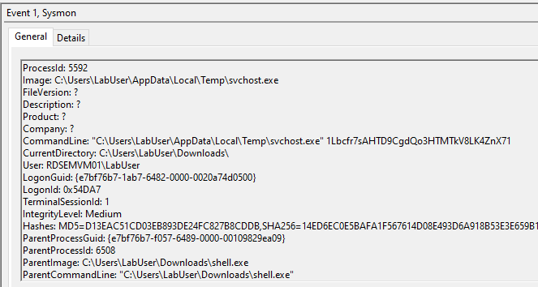
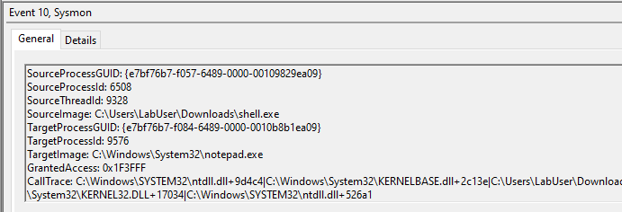
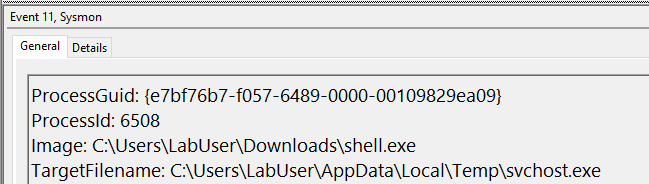
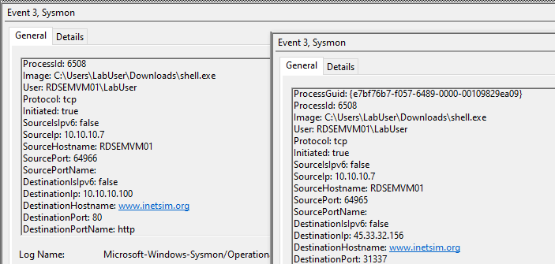

# Creating Detection Rules (Xây dựng detection rule)

Sau khi đã làm rõ các Tactics, Techniques và Procedures (TTP) mà malware này sử dụng, ta có thể tiến hành thiết kế các detection rule (rule phát hiện), chẳng hạn như rule `Yara` và `Sigma`.

<div class="card bg-light">
    <div class="card-body">
				 <p class="mb-0">Dù ta sẽ bắt đầu tìm hiểu các khái niệm về viết rule Yara và Sigma trong section này, ta mới chỉ chạm vào bề mặt. Đây là những chủ đề rộng và rất có chiều sâu, đòi hỏi phải được nghiên cứu toàn diện. Vì vậy, chúng tôi sẽ dành trọn một module có tên 'YARA & Sigma for SOC Analysts' để giúp bạn thực sự làm chủ những mảng quan trọng này của phòng thủ an ninh mạng. </p>
    </div>
</div>

<div class="card bg-light">
    <div class="card-body">
				 <p class="mb-0">Giờ hãy kéo xuống cuối section này và bấm vào "Click here to spawn the target system!". Sau đó, SSH vào Target IP bằng thông tin đăng nhập được cung cấp. Phần lớn các thao tác/lệnh được trình bày từ đây đến cuối section này có thể thực hiện lại trên target, giúp nắm các chủ đề được trình bày một cách toàn diện hơn. </p>
    </div>
</div>

## Yara

`YARA (Yet Another Recursive Acronym)`, một công cụ so khớp pattern mã nguồn mở được dùng rộng rãi, đồng thời là một framework phát hiện và phân loại malware dựa trên rule, cho phép ta tạo các rule tùy chỉnh để phát hiện các pattern hoặc đặc điểm cụ thể trong file, process hoặc bộ nhớ. Để soạn một rule `YARA` cho mẫu của ta, ta cần xem xét hành vi, đặc điểm hoặc các string/pattern cụ thể chỉ có ở mẫu mà ta muốn phát hiện.

Dưới đây là một ví dụ đơn giản về rule `YARA` khớp với sự hiện diện của string `Sandbox detected` trong một process. Xin nhắc lại rằng `shell.exe` đã thể hiện hành vi như vậy.

``` YARA
rule Shell_Sandbox_Detection {
    strings:
        $sandbox_string = "Sandbox detected"
    condition:
        $sandbox_string
}
```

Giờ hãy bổ sung thêm thật nhiều string và pattern vào rule để làm nó tốt hơn.

Ta có thể dùng công cụ `yarGen`, vốn tự động hóa quá trình tạo rule `YARA`, với mục tiêu chính là tạo ra những rule tốt nhất có thể để sau đó xử lý thủ công (post-processing). Tuy nhiên, để tạo ra một rule vững chắc, việc này đòi hỏi một bước chọn lọc tự động khôn ngoan ban đầu cùng một analyst có con mắt tinh tường.


Trước tiên, hãy tạo một thư mục mới tên `Test` bên trong thư mục `/home/htb-student/Samples/MalwareAnalysis` trên target của section này, rồi sao chép `shell.exe` (nằm trong thư mục `/home/htb-student/Samples/MalwareAnalysis`) vào thư mục `Test` vừa tạo như sau.

```shell-session
[!bash!]$ mkdir /home/htb-student/Samples/MalwareAnalysis/Test
```

```shell-session
[!bash!]$ cp /home/htb-student/Samples/MalwareAnalysis/shell.exe /home/htb-student/Samples/MalwareAnalysis/Test/
```

Để tự động tạo một rule Yara cho `shell.exe`, ta thực thi lệnh sau (bên trong thư mục `/home/htb-student/yarGen-0.23.4`).

```shell-session
[!bash!]$ sudo python3 yarGen.py -m /home/htb-student/Samples/MalwareAnalysis/Test/
------------------------------------------------------------------------
                   _____            
    __ _____ _____/ ___/__ ___      
   / // / _ `/ __/ (_ / -_) _ \     
   \_, /\_,_/_/  \___/\__/_//_/     
  /___/  Yara Rule Generator        
         Florian Roth, July 2020, Version 0.23.3
   
  Note: Rules have to be post-processed
  See this post for details: https://medium.com/@cyb3rops/121d29322282
------------------------------------------------------------------------
[+] Using identifier 'Test'
[+] Using reference 'https://github.com/Neo23x0/yarGen'
[+] Using prefix 'Test'
[+] Processing PEStudio strings ...
[+] Reading goodware strings from database 'good-strings.db' ...
    (This could take some time and uses several Gigabytes of RAM depending on your db size)
[+] Loading ./dbs/good-imphashes-part3.db ...
[+] Total: 4029 / Added 4029 entries
[+] Loading ./dbs/good-strings-part9.db ...
[+] Total: 788 / Added 788 entries
[+] Loading ./dbs/good-strings-part8.db ...
[+] Total: 332082 / Added 331294 entries
[+] Loading ./dbs/good-imphashes-part4.db ...
[+] Total: 6426 / Added 2397 entries
[+] Loading ./dbs/good-strings-part2.db ...
[+] Total: 1703601 / Added 1371519 entries
[+] Loading ./dbs/good-exports-part2.db ...
[+] Total: 90960 / Added 90960 entries
[+] Loading ./dbs/good-strings-part4.db ...
[+] Total: 3860655 / Added 2157054 entries
[+] Loading ./dbs/good-exports-part4.db ...
[+] Total: 172718 / Added 81758 entries
[+] Loading ./dbs/good-exports-part7.db ...
[+] Total: 223584 / Added 50866 entries
[+] Loading ./dbs/good-strings-part6.db ...
[+] Total: 4571266 / Added 710611 entries
[+] Loading ./dbs/good-strings-part7.db ...
[+] Total: 5828908 / Added 1257642 entries
[+] Loading ./dbs/good-exports-part1.db ...
[+] Total: 293752 / Added 70168 entries
[+] Loading ./dbs/good-exports-part3.db ...
[+] Total: 326867 / Added 33115 entries
[+] Loading ./dbs/good-imphashes-part9.db ...
[+] Total: 6426 / Added 0 entries
[+] Loading ./dbs/good-exports-part9.db ...
[+] Total: 326867 / Added 0 entries
[+] Loading ./dbs/good-imphashes-part5.db ...
[+] Total: 13764 / Added 7338 entries
[+] Loading ./dbs/good-imphashes-part8.db ...
[+] Total: 13947 / Added 183 entries
[+] Loading ./dbs/good-imphashes-part6.db ...
[+] Total: 13976 / Added 29 entries
[+] Loading ./dbs/good-strings-part1.db ...
[+] Total: 6893854 / Added 1064946 entries
[+] Loading ./dbs/good-imphashes-part7.db ...
[+] Total: 17382 / Added 3406 entries
[+] Loading ./dbs/good-exports-part6.db ...
[+] Total: 328525 / Added 1658 entries
[+] Loading ./dbs/good-imphashes-part2.db ...
[+] Total: 18208 / Added 826 entries
[+] Loading ./dbs/good-exports-part8.db ...
[+] Total: 332359 / Added 3834 entries
[+] Loading ./dbs/good-strings-part3.db ...
[+] Total: 9152616 / Added 2258762 entries
[+] Loading ./dbs/good-strings-part5.db ...
[+] Total: 12284943 / Added 3132327 entries
[+] Loading ./dbs/good-imphashes-part1.db ...
[+] Total: 19764 / Added 1556 entries
[+] Loading ./dbs/good-exports-part5.db ...
[+] Total: 404321 / Added 71962 entries
[+] Processing malware files ...
[+] Processing /home/htb-student/Samples/MalwareAnalysis/Test/shell.exe ...
[+] Generating statistical data ...
[+] Generating Super Rules ... (a lot of magic)
[+] Generating Simple Rules ...
[-] Applying intelligent filters to string findings ...
[-] Filtering string set for /home/htb-student/Samples/MalwareAnalysis/Test/shell.exe ...
[=] Generated 1 SIMPLE rules.
[=] All rules written to yargen_rules.yar
[+] yarGen run finished
```

Ta sẽ thấy `yarGen` tạo ra một file tên `yargen_rules.yar` chứa các string đặc trưng (unique), được tự động trích xuất và đưa vào rule.

```shell-session
[!bash!]$ cat yargen_rules.yar 
/*
   YARA Rule Set
   Author: yarGen Rule Generator
   Date: 2023-08-02
   Identifier: Test
   Reference: https://github.com/Neo23x0/yarGen
*/

/* Rule Set ----------------------------------------------------------------- */

rule _home_htb_student_Samples_MalwareAnalysis_Test_shell {
   meta:
      description = "Test - file shell.exe"
      author = "yarGen Rule Generator"
      reference = "https://github.com/Neo23x0/yarGen"
      date = "2023-08-02"
      hash1 = "bd841e796feed0088ae670284ab991f212cf709f2391310a85443b2ed1312bda"
   strings:
      $x1 = "C:\\Windows\\System32\\cmd.exe" fullword ascii
      $s2 = "http://ms-windows-update.com/svchost.exe" fullword ascii
      $s3 = "C:\\Windows\\System32\\notepad.exe" fullword ascii
      $s4 = "/k ping 127.0.0.1 -n 5" fullword ascii
      $s5 = "iuqerfsodp9ifjaposdfjhgosurijfaewrwergwea.com" fullword ascii
      $s6 = "  VirtualQuery failed for %d bytes at address %p" fullword ascii
      $s7 = "[-] Error code is : %lu" fullword ascii
      $s8 = "C:\\Program Files\\VMware\\VMware Tools\\" fullword ascii
      $s9 = "Failed to open the registry key." fullword ascii
      $s10 = "  VirtualProtect failed with code 0x%x" fullword ascii
      $s11 = "Connection sent to C2" fullword ascii
      $s12 = "VPAPAPAPI" fullword ascii
      $s13 = "AWAVAUATVSH" fullword ascii
      $s14 = "45.33.32.156" fullword ascii
      $s15 = "  Unknown pseudo relocation protocol version %d." fullword ascii
      $s16 = "AQAPRQVH1" fullword ascii
      $s17 = "connect" fullword ascii /* Goodware String - occured 429 times */
      $s18 = "socket" fullword ascii /* Goodware String - occured 452 times */
      $s19 = "tSIcK<L" fullword ascii
      $s20 = "Windows-Update/7.6.7600.256 %s" fullword ascii
   condition:
      uint16(0) == 0x5a4d and filesize < 60KB and
      1 of ($x*) and 4 of them
}
```

Ta có thể rà soát rule và chỉnh sửa khi cần, bổ sung thêm string và điều kiện để tăng độ tin cậy và hiệu quả của nó.

---

## Detecting Malware Using Yara Rules (Phát hiện malware bằng rule Yara)

Sau đó ta có thể dùng rule này để quét một thư mục như sau.

```shell-session
[!bash!]$ yara /home/htb-student/yarGen-0.23.4/yargen_rules.yar /home/htb-student/Samples/MalwareAnalysis/
home_htb_student_Samples_MalwareAnalysis_Test_shell /home/htb-student/Samples/MalwareAnalysis//shell.exe
```

Ta sẽ thấy `shell.exe` được trả về trong kết quả!

**Dưới đây là một số tài liệu tham khảo về rule YARA**:
- Tài liệu Yara : [https://yara.readthedocs.io/en/stable/writingrules.html](https://yara.readthedocs.io/en/stable/writingrules.html)
- Tài nguyên Yara - [https://github.com/InQuest/awesome-yara](https://github.com/InQuest/awesome-yara)
- The DFIR Report - [https://github.com/The-DFIR-Report/Yara-Rules](https://github.com/The-DFIR-Report/Yara-Rules)

## Sigma

`Sigma` là một định dạng rule toàn diện và được chuẩn hóa, được các security analyst và hệ thống `Security Information and Event Management (SIEM)` sử dụng rộng rãi. Mục tiêu là phát hiện và nhận diện các pattern hoặc hành vi cụ thể có thể là dấu hiệu của mối đe dọa hoặc sự kiện bảo mật. Định dạng chuẩn hóa của rule `Sigma` cho phép các đội bảo mật định nghĩa và chia sẻ logic phát hiện trên nhiều nền tảng bảo mật khác nhau.

Để xây dựng một rule `Sigma` dựa trên một số hành động nhất định - ví dụ, thả (drop) một file vào một vị trí tạm - ta có thể soạn một rule mẫu theo hướng như sau.

``` SIGMA
title: Suspicious File Drop in Users Temp Location
status: experimental
description: Detects suspicious activity where a file is dropped in the temp location

logsource:
    category: process_creation
detection:
    selection:
        TargetFilename:
            - '*\\AppData\\Local\\Temp\\svchost.exe'
    condition: selection
    level: high

falsepositives:
    - Legitimate exe file drops in temp location
```

Trong ví dụ này, rule được thiết kế để phát hiện khi file `svchost.exe` được drop vào thư mục `Temp`.

Trong quá trình phân tích, sẽ rất có lợi nếu có một agent giám sát hệ thống hoạt động liên tục. Trong bối cảnh này, ta chọn `Sysmon` để thu thập log. `Sysmon` là một công cụ mạnh, ghi nhận dữ liệu event chi tiết và hỗ trợ việc tạo rule `Sigma`. Các nhóm log của nó bao gồm process creation (`EventID 1`), network connection (`EventID 3`), file creation (`EventID 11`), registry modification (`EventID 13`), cùng nhiều loại khác. Việc xem xét kỹ các event này giúp xác định chính xác các indicator of compromise (`IOC`s – dấu hiệu xâm nhập) và hiểu các pattern hành vi, từ đó hỗ trợ xây dựng các detection rule hiệu quả.

Ví dụ, `Sysmon` đã thu thập các log như `process creation`, `process access`, `file creation` và `network connection`, cùng nhiều loại khác, tương ứng với các hoạt động do `shell.exe` thực hiện. Thông tin tổng hợp này đóng vai trò quan trọng trong việc giúp ta hiểu rõ hơn hành vi của mẫu và xây dựng các detection rule chính xác, hiệu quả hơn.

**Log Process Create**:



**Log Process Access** (không được cấu hình trên các target Windows của module này): 



**Log File Creation**: 



**Log Network Connection**: 



**Dưới đây là một số tài liệu tham khảo về rule Sigma**:
- Tài liệu Sigma : [https://github.com/SigmaHQ/sigma-specification](https://github.com/SigmaHQ/sigma-specification?tab=readme-ov-file#specification)
- Tài nguyên Sigma - [https://github.com/SigmaHQ/sigma/tree/master/rules](https://github.com/SigmaHQ/sigma/tree/master/rules)
- The DFIR Report - [https://github.com/The-DFIR-Report/Sigma-Rules/tree/main/rules](https://github.com/The-DFIR-Report/Sigma-Rules/tree/main/rules)
