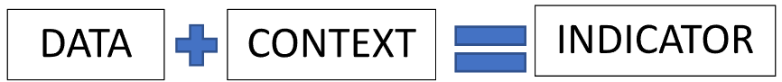
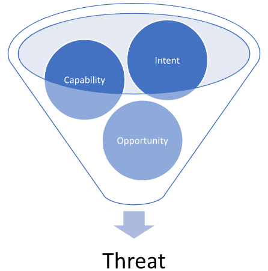
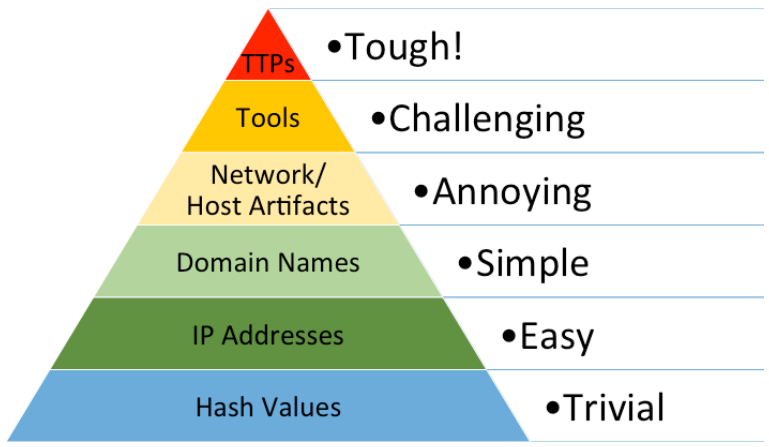

# Threat Hunting Glossary (Thuật ngữ Threat Hunting)

Trong lĩnh vực an ninh mạng và threat hunting, có một số thuật ngữ và khái niệm then chốt đóng vai trò quan trọng. Dưới đây là phần giải thích chi tiết về chúng:

- `Adversary`: Trong lĩnh vực Cyber Threat Intelligence (CTI), adversary (kẻ tấn công/đối thủ) chỉ một thực thể được thúc đẩy bởi những mục tiêu tương tự như tổ chức của bạn, dù là trái phép, tìm cách xâm nhập vào doanh nghiệp của bạn để thoả mãn các yêu cầu thu thập (collection requirements) của chúng, có thể bao gồm lợi ích tài chính, thông tin nội bộ hoặc tài sản trí tuệ có giá trị. Những kẻ tấn công này có trình độ kỹ thuật khác nhau và có động cơ để vượt qua các biện pháp bảo mật của bạn.

	Adversary có thể được phân thành các nhóm riêng biệt, gồm `cyber criminals` (tội phạm mạng), `insider threats` (mối đe doạ nội bộ), `hacktivists` (tin tặc hoạt động vì mục đích chính trị/xã hội) hoặc `state-sponsored operators` (các nhóm được nhà nước bảo trợ). Mỗi nhóm có những đặc điểm và động cơ riêng trong việc tìm cách truy cập trái phép và khai thác.

- `Advanced Persistent Threat (APT)`: APT thường gắn với các nhóm có tổ chức cao hoặc các thực thể cấp quốc gia sở hữu nguồn lực dồi dào, nhờ đó có thể thực hiện các hoạt động độc hại trong thời gian dài. Dù APT nhắm vào nhiều lĩnh vực khác nhau, chúng thể hiện sự ưu tiên rõ rệt với các mục tiêu giá trị cao, có thể bao gồm các tổ chức chính phủ, hạ tầng y tế và hệ thống quốc phòng.

	Trái với những gì cái tên có thể gợi ý, việc bị gắn nhãn APT không nhất thiết có nghĩa là nhóm đó sử dụng các kỹ thuật công nghệ tiên tiến. Thay vào đó, khía cạnh 'Advanced' có thể chỉ việc lập kế hoạch chiến lược tinh vi, còn 'Persistent' ám chỉ sự kiên trì bền bỉ của chúng trong việc đạt mục tiêu, được hậu thuẫn bởi nguồn lực đáng kể bao gồm, nhưng không giới hạn ở, tài chính, nhân lực và thời gian.

- `Tactics, Techniques, and Procedures (TTPs)`: Là một thuật ngữ mượn từ quân sự, TTP thể hiện các mẫu hoạt động đặc trưng hay 'signature' (dấu hiệu nhận dạng) của một kẻ tấn công.

	- `Tactics`: Thuật ngữ này mô tả các mục tiêu chiến lược và khái niệm hoạt động cấp cao mà kẻ tấn công sử dụng. Về cơ bản, nó trả lời câu hỏi 'tại sao' đằng sau hành động của chúng.
	- `Techniques`: Đây là các phương pháp cụ thể mà kẻ tấn công dùng để đạt các mục tiêu chiến thuật, trả lời câu hỏi 'như thế nào' đằng sau hành động của chúng. Technique không đưa ra hướng dẫn từng bước mà mô tả cách tiếp cận chung để đạt một mục tiêu.
	- `Procedures`: Đây là các hướng dẫn chi tiết, từng bước, về cơ bản là 'công thức' để triển khai từng technique.

	Phân tích TTP mang lại hiểu biết sâu sắc về cách kẻ tấn công xâm nhập vào mạng, di chuyển ngang (lateral movement) bên trong mạng và đạt được mục tiêu của chúng. Hiểu TTP cho phép tạo ra các Indicators of Compromise (IOC), giúp phát hiện và ngăn chặn các cuộc tấn công trong tương lai.
	
- `Indicator`: Khi được phân tích trong CTI, một indicator bao gồm cả dữ liệu kỹ thuật lẫn thông tin ngữ cảnh. Dữ liệu kỹ thuật đứng riêng lẻ, thiếu ngữ cảnh liên quan, có giá trị rất hạn chế hoặc không đáng kể đối với người phòng thủ mạng. Các chi tiết ngữ cảnh cho phép hiểu đầy đủ ý nghĩa của indicator, giúp phân tích và ứng phó mối đe doạ hiệu quả.

	

- `Threat`: Threat (mối đe doạ) là một khái niệm đa diện, gồm ba yếu tố cơ bản: intent (ý định), capability (năng lực) và opportunity (cơ hội).

	

	Thứ nhất, `intent` thể hiện lý do cốt lõi thúc đẩy kẻ tấn công nhắm vào và khai thác hạ tầng mạng của bạn. Ý định này có thể từ gián điệp doanh nghiệp, đến kiếm lợi tài chính thông qua tội phạm mạng, hoặc thậm chí nhắm vào các mối quan hệ kinh doanh của bạn với các thực thể khác.

	Thứ hai, `capability` chỉ các công cụ, nguồn lực và hậu thuẫn tài chính mà kẻ tấn công có để thực hiện thành công các hoạt động của chúng. Trình độ kỹ năng xâm nhập mạng của bạn và việc có đủ nguồn lực tài chính sẽ quyết định khả năng chúng duy trì các cuộc tấn công liên tục nhắm vào tổ chức của bạn.

	Cuối cùng, `opportunity` chỉ các điều kiện hoặc sự kiện tạo hoàn cảnh thuận lợi để kẻ tấn công thực hiện hoạt động. Điều này bao gồm các trường hợp kẻ tấn công có được các địa chỉ email hoặc thông tin đăng nhập liên quan từ mạng của bạn, cũng như việc chúng biết về các lỗ hổng trong những hệ thống phần mềm cụ thể.

- `Campaign`: Campaign (chiến dịch) chỉ một tập hợp các sự cố có chung Tactics, Techniques, and Procedures (TTP) tương tự và được cho là có các yêu cầu thu thập tương đồng. Loại intelligence này đòi hỏi nhiều thời gian và công sức để tổng hợp và phân tích, khi các doanh nghiệp và tổ chức dần dần báo cáo và phát hiện các hoạt động độc hại liên quan.

- `Indicators of Compromise (IOCs)`: IOC là các dấu vết hoặc artifact số thu được từ các vụ xâm nhập đang diễn ra hoặc đã xảy ra. Chúng đóng vai trò như những 'biển chỉ dẫn' về một kẻ tấn công hoặc hoạt động độc hại cụ thể. IOC có thể bao gồm nhiều thành phần như hash của file độc hại, địa chỉ IP đáng ngờ, URL, tên miền, và tên của các file thực thi hoặc script độc hại. Liên tục theo dõi, lập danh mục và phân tích IOC có thể nâng cao đáng kể khả năng phát hiện mối đe doạ của ta, giúp ứng phó với các mối đe doạ mạng nhanh hơn và hiệu quả hơn.

- `Pyramid of Pain`: Pyramid of Pain (kim tự tháp nỗi đau) là một mô hình trực quan quan trọng, trình bày thứ bậc các indicator có thể hỗ trợ ta phát hiện kẻ tấn công. Nó cũng cho thấy mức độ khó khăn trong việc thu thập những indicator cụ thể này và tác động sau đó của việc thu thập intelligence về chúng. Khái niệm Pyramid of Pain được David Bianco từ FireEye đưa ra trong bài thuyết trình sâu sắc của ông, [Intel-Driven Detection and Response to Increase Your Adversary’s Cost of Operations.](https://rvasec.com/slides/2014/Bianco_Pyramid%20of%20Pain.pdf) Càng lên cao trên Pyramid of Pain, việc thu được các Indicators of Compromise (IOC) đặc thù của kẻ tấn công càng khó khăn. Tuy nhiên, mặt ngược lại là việc nắm được những IOC đặc thù này buộc kẻ tấn công phải thay đổi phương thức tấn công — một việc chẳng hề đơn giản đối với chúng.

	

	- `Hash Values`: Hash là dấu vân tay số của file. Chúng được tạo bằng các thuật toán như MD5, SHA-1 hoặc SHA-256, nhận một đầu vào (hay 'message') và trả về một chuỗi byte có kích thước cố định. Ví dụ, các file binary malware có thể được nhận diện qua giá trị hash duy nhất của chúng. Tuy nhiên, chỉ một thay đổi nhỏ trên file, như thêm một byte hoặc đổi một ký tự, cũng sẽ làm giá trị hash thay đổi hoàn toàn, khiến đây là một indicator dễ thay đổi và do đó kém tin cậy hơn.

	- `IP Addresses`: Địa chỉ IP là định danh duy nhất của các thiết bị trên mạng. Chúng có thể được dùng để truy vết nguồn gốc của lưu lượng mạng hoặc của một cuộc tấn công tiềm tàng. Tuy nhiên, kẻ tấn công thường dùng các chiến thuật như IP spoofing, VPN, proxy hoặc mạng TOR để che giấu địa chỉ IP thật, khiến indicator ở mức này dễ thay đổi và có phần kém tin cậy.

	- `Domain Names`: Domain được dùng để định danh một hoặc nhiều địa chỉ IP. Ví dụ, tên miền www.example.com đại diện cho khoảng một chục địa chỉ IP. Các tác nhân độc hại thường dùng domain generation algorithm (DGA) để sinh ra một lượng lớn tên miền giả ngẫu nhiên nhằm né tránh phát hiện. Chúng cũng có thể dùng các dịch vụ dynamic DNS để nhanh chóng thay đổi địa chỉ IP gắn với một domain.

	- `Network/Host Artifacts`: 
		- `Network Artifacts`: Đây là những dấu vết còn sót lại từ hoạt động của kẻ tấn công trong hạ tầng mạng. Có thể tìm thấy chúng trong log mạng, packet capture, dữ liệu netflow hoặc log DNS request, v.v. Ví dụ có thể là một số mẫu nhất định trong lưu lượng mạng, packet header đặc trưng hoặc việc sử dụng giao thức bất thường. Kẻ tấn công khó thay đổi các network artifact mà không ảnh hưởng đến hiệu quả hoặc tính ẩn mình của hoạt động.

		- `Host Artifacts`: Mặt khác, host artifact chỉ những dấu vết hoạt động độc hại để lại trên từng hệ thống hoặc endpoint riêng lẻ. Chúng có thể được tìm thấy trong system log, hệ thống file, registry key, danh sách process đang chạy, các DLL đã được load, hoặc thậm chí trong bộ nhớ khả biến (volatile memory). Ví dụ, các entry bất thường trong Windows Registry, đường dẫn file đặc trưng hoặc các process đáng ngờ đang chạy đều có thể được coi là host artifact. Những indicator này cũng khá khó để kẻ tấn công thay đổi mà không ảnh hưởng đến chiến dịch xâm nhập hoặc làm lộ sự hiện diện của chúng.
		- Phân tích các artifact này có thể mang lại hiểu biết giá trị về công cụ, kỹ thuật và quy trình (TTP) của kẻ tấn công, đồng thời giúp phát hiện và ngăn chặn các cuộc tấn công trong tương lai. Tuy nhiên, vị trí cao hơn của Network và Host Artifacts trên Pyramid of Pain cho thấy chúng khó tận dụng hơn cho việc phát hiện, đồng thời cũng khó hơn để kẻ tấn công thay đổi hoặc làm rối (obfuscate).

	- `Tools`: Tools chỉ phần mềm mà kẻ tấn công dùng để thực hiện các cuộc tấn công. Có thể bao gồm malware, exploit, script hoặc các framework command and control (C2). Xác định được công cụ mà kẻ tấn công sử dụng có thể mang lại hiểu biết giá trị về năng lực và ý định của chúng. Tuy nhiên, những kẻ tấn công tinh vi thường dùng công cụ tự phát triển hoặc chỉnh sửa công cụ có sẵn để né tránh phát hiện.

	- `TTPs (Tactics, Techniques, and Procedures)`: Đây là đỉnh của Pyramid of Pain. TTP chỉ các phương pháp cụ thể mà kẻ tấn công dùng để thực hiện các cuộc tấn công. Tactics mô tả mục tiêu tổng thể của kẻ tấn công, techniques mô tả các hành động được thực hiện để đạt các mục tiêu đó, còn procedures là các bước chính xác được thực hiện để triển khai techniques. Xác định được TTP của kẻ tấn công mang lại hiểu biết giá trị nhất về hoạt động của chúng, và đây cũng là thứ khó thay đổi nhất đối với kẻ tấn công nếu không tốn chi phí và công sức đáng kể. Ví dụ có thể là việc dùng email spear-phishing để có initial access (tactic), khai thác một lỗ hổng phần mềm cụ thể (technique), và các bước cụ thể được thực hiện để khai thác lỗ hổng đó (procedure).
	
- `Diamond Model`: [Diamond Model of Intrusion Analysis](https://apps.dtic.mil/sti/pdfs/ADA586960.pdf) là một framework khái niệm được thiết kế để minh hoạ các khía cạnh cơ bản của một vụ xâm nhập mạng. Mô hình này do Sergio Caltagirone, Andrew Pendergast và Christopher Betz phát triển, nhằm cung cấp một cách tiếp cận có cấu trúc hơn để hiểu, phân tích và ứng phó với các mối đe doạ mạng.

	Mô hình được xây dựng xoay quanh bốn thành phần chính, được biểu diễn là các đỉnh của một hình thoi (diamond):
	
	- `Adversary`: Thành phần này đại diện cho cá nhân, nhóm hoặc tổ chức chịu trách nhiệm cho vụ xâm nhập mạng. Điều quan trọng là phải hiểu năng lực, động cơ và ý định của chúng để phòng thủ hiệu quả trước các cuộc tấn công.

	- `Capability`: Thành phần này đại diện cho các công cụ, kỹ thuật và quy trình (TTP) mà kẻ tấn công dùng để thực hiện vụ xâm nhập. Có thể bao gồm malware, exploit và các công cụ độc hại khác, cũng như các phương pháp cụ thể dùng để triển khai những công cụ này.

	- `Infrastructure`: Thành phần này đại diện cho các tài nguyên vật lý và ảo mà kẻ tấn công dùng để hỗ trợ vụ xâm nhập. Có thể bao gồm server, tên miền, địa chỉ IP và các tài nguyên mạng khác dùng để phát tán malware, điều khiển các hệ thống bị xâm nhập hoặc tuồn dữ liệu ra ngoài (exfiltrate).

	- `Victim`: Thành phần này đại diện cho mục tiêu của vụ xâm nhập, có thể là một cá nhân, tổ chức hoặc hệ thống. Hiểu được các lỗ hổng của nạn nhân, giá trị tài sản của họ và mức độ phơi nhiễm tiềm tàng trước các mối đe doạ là yếu tố then chốt để phòng thủ hiệu quả.

	Bốn thành phần này được kết nối bằng các mũi tên hai chiều, thể hiện các mối quan hệ và tương tác động giữa chúng. Ví dụ, một adversary sử dụng capability thông qua một infrastructure để nhắm vào một victim. Mô hình này cho phép nắm bắt các mối quan hệ phức tạp và xây dựng các chiến lược vững chắc cho việc phát hiện, giảm thiểu và dự đoán mối đe doạ.

	So sánh với mô hình Cyber Kill Chain, ta thấy Diamond Model cung cấp góc nhìn chi tiết hơn về hệ sinh thái của một vụ xâm nhập mạng. Trong khi Cyber Kill Chain tập trung nhiều hơn vào các giai đoạn của một cuộc tấn công (từ reconnaissance đến actions on objectives), Diamond Model đem lại cái nhìn toàn diện hơn về các thành phần tham gia vào vụ xâm nhập và mối quan hệ qua lại giữa chúng.

	Hãy xem xét một ví dụ kỹ thuật để minh hoạ Diamond Model:
	Giả sử một tổ chức tài chính (Victim) bị một nhóm tội phạm mạng (Adversary) nhắm tới. Nhóm này dùng email spear-phishing (Capability) gửi từ một botnet (Infrastructure) để phát tán một banking Trojan. Khi người nhận click vào link độc hại trong email, Trojan được cài lên hệ thống của họ, cho phép nhóm tội phạm mạng đánh cắp dữ liệu tài chính nhạy cảm.

	Trong kịch bản này, Diamond Model giúp làm nổi bật sự tương tác giữa các thành phần khác nhau của vụ xâm nhập. Bằng cách phân tích các thành phần này và tương tác giữa chúng, tổ chức tài chính có thể hiểu sâu hơn về mối đe doạ mà họ đang đối mặt và xây dựng các chiến lược hiệu quả hơn để giảm thiểu mối đe doạ này cũng như các mối đe doạ trong tương lai. Việc này có thể bao gồm tăng cường các giao thức bảo mật email, giám sát các dấu hiệu của banking Trojan cụ thể đó, hoặc triển khai các biện pháp phát hiện và ứng phó với hoạt động mạng bất thường gắn với botnet.

	Nhìn chung, Diamond Model cung cấp một góc nhìn bổ sung cho Cyber Kill Chain, mang đến một lăng kính khác để hiểu và ứng phó với các mối đe doạ mạng. Cả hai mô hình đều có thể là công cụ hữu ích trong kho vũ khí của một chuyên gia an ninh mạng.
