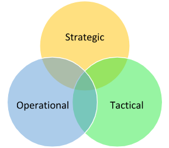

# Threat Intelligence Fundamentals (Kiến thức nền tảng về Threat Intelligence)

## Định nghĩa Cyber Threat Intelligence

`Cyber Threat Intelligence (CTI)` (tình báo mối đe doạ mạng) là một tài sản quan trọng trong kho vũ khí của chúng ta, mang lại những hiểu biết thiết yếu để củng cố khả năng phòng thủ trước các cuộc tấn công mạng. Mục tiêu chính của đội CTI là chuyển chiến lược phòng thủ của chúng ta từ chỗ chỉ phản ứng (reactive) sang thế chủ động, đón đầu (proactive). Họ đóng góp những hiểu biết then chốt cho Security Operations Center (SOC) của chúng ta.

Bốn nguyên tắc cơ bản khiến CTI trở thành một phần không thể thiếu trong chiến lược an ninh mạng của chúng ta:
	
- `Relevance`: Thế giới mạng tràn ngập các nguồn thông tin đa dạng, từ bài đăng trên mạng xã hội, báo cáo của các nhà cung cấp bảo mật cho đến những chia sẻ từ các tổ chức tương tự. Tuy nhiên, giá trị thực sự của thông tin này nằm ở mức độ liên quan của nó tới tổ chức của chúng ta. Ví dụ, nếu có một lỗ hổng được báo cáo trong một phần mềm mà chúng ta, hoặc các tổ chức đối tác tin cậy của chúng ta, không sử dụng, thì mức độ cấp bách của việc triển khai biện pháp phòng thủ đương nhiên giảm đi.
- `Timeliness`: Việc truyền đạt intelligence nhanh chóng tới đội phòng thủ là yếu tố then chốt để triển khai các biện pháp giảm thiểu (mitigation) hiệu quả. Giá trị của thông tin giảm dần theo thời gian — dữ liệu mới phát hiện có giá trị hơn, còn các indicator "cũ" mất dần tính liên quan vì kẻ tấn công có thể không còn dùng chúng nữa, hoặc tổ chức bị ảnh hưởng có thể đã xử lý xong.
- `Actionability`: Dữ liệu mà CTI analyst phân tích phải mang lại những hiểu biết có thể hành động được (actionable) cho đội phòng thủ. Nếu intelligence không đưa ra chỉ dẫn hành động rõ ràng thì giá trị của nó giảm đi. Intelligence phải được xem xét kỹ lưỡng cho tới khi nó mang lại những hiểu biết liên quan, kịp thời và có thể hành động được cho việc phòng thủ mạng của chúng ta. Intelligence không thể hành động được có thể dẫn tới một vòng lặp phân tích không hiệu quả tự duy trì, thường được gọi là "self-licking ice cream cone" (cây kem tự liếm — thứ chỉ tồn tại để phục vụ chính nó).
- `Accuracy`: Trước khi phổ biến bất kỳ intelligence nào, cần xác minh độ chính xác của nó. Indicator sai, quy kết (attribution) nhầm, hoặc Tactics, Techniques, and Procedures (TTP) không đúng có thể gây lãng phí thời gian và nguồn lực quý giá. Nếu độ chính xác của một thông tin nào đó chưa chắc chắn, nó cần được gắn nhãn mức độ tin cậy (confidence indicator), để đội phòng thủ biết về khả năng thiếu chính xác.

Khi bốn yếu tố này cộng hưởng với nhau, intelligence thu được cho phép chúng ta:

- Nắm được các hoạt động và chiến dịch (campaign) tiềm năng của kẻ tấn công có thể đang nhắm vào tổ chức của chúng ta.
- Làm giàu kho dữ liệu của chúng ta thông qua phân tích của các CTI analyst và những người phòng thủ mạng khác.
- Phát hiện TTP của kẻ tấn công, từ đó xây dựng các biện pháp giảm thiểu hiệu quả và hiểu rõ hơn về hành vi của kẻ tấn công.
- Cung cấp cho những người ra quyết định trong tổ chức các thông tin thích đáng để đưa ra quyết định sáng suốt, có tác động thực sự liên quan tới hoạt động kinh doanh.

---

## Sự khác biệt giữa Threat Intelligence & Threat Hunting

Threat Intelligence và Threat Hunting là hai chuyên ngành riêng biệt nhưng gắn bó chặt chẽ với nhau trong lĩnh vực an ninh mạng. Dù đảm nhận những chức năng khác nhau, cả hai đều đóng góp đáng kể vào việc hình thành một security analyst toàn diện. Tuy nhiên, cần lưu ý rằng chúng không thể thay thế cho nhau.

Threat Intelligence (dự đoán - Predictive): Mục tiêu chính ở đây là đón trước các bước đi của kẻ tấn công, xác định mục tiêu của chúng và nhận biết cách chúng thu thập thông tin. Kẻ tấn công có một mục tiêu cụ thể, và với tư cách là một đội làm Threat Intelligence, nhiệm vụ của chúng ta là dự đoán:
- Vị trí của cuộc tấn công dự định
- Thời điểm của cuộc tấn công
- Các chiến lược tác chiến mà kẻ tấn công sẽ sử dụng
- Mục tiêu cuối cùng của kẻ tấn công

Threat Hunting (phản ứng và chủ động - Reactive and Proactive): Đúng vậy, hai thuật ngữ này trái ngược nhau, nhưng chúng gói gọn bản chất của Threat Hunting. Một event hoặc sự cố khởi phát, dù xảy ra trong mạng của chúng ta hay trong mạng của một tổ chức cùng ngành, sẽ thúc đẩy đội của chúng ta tiến hành một chiến dịch nhằm xác định xem có kẻ tấn công nào đang hiện diện trong mạng hay không, hoặc đã từng hiện diện và né được việc phát hiện hay không.

Rốt cuộc, Threat Intelligence và Threat Hunting hỗ trợ lẫn nhau, tăng cường tư thế phòng thủ mạng (network defense posture) tổng thể của tổ chức. Khi đội Threat Intelligence phân tích các hoạt động của kẻ tấn công và xây dựng hồ sơ (profile) toàn diện về kẻ tấn công, thông tin này có thể được chia sẻ với các Threat Hunting analyst để định hướng hoạt động của họ. Ngược lại, kết quả từ các chiến dịch Threat Hunting có thể cung cấp thêm dữ liệu cho các Threat Intelligence analyst để tinh chỉnh intelligence và nâng cao độ chính xác của các dự đoán.

---

## Các tiêu chí của Cyber Threat Intelligence

Điều gì thực sự làm nên giá trị của Cyber Threat Intelligence (CTI)? Nó giải quyết những vấn đề gì? Như đã bàn ở trên, để CTI hiệu quả, nó phải có thể hành động được (Actionable), kịp thời (Timely), liên quan (Relevant) và chính xác (Accurate). Bốn yếu tố này tạo nên nền tảng của một CTI vững chắc, cuối cùng mang lại khả năng quan sát (visibility) các hoạt động của kẻ tấn công. Ngoài ra, CTI được xây dựng tốt còn mang lại những lợi ích phụ, chẳng hạn như:
- Hiểu được các mối đe doạ đối với tổ chức của chúng ta và các đơn vị đối tác
- Những hiểu biết tiềm năng về mạng của chính tổ chức
- Nâng cao nhận thức về những vấn đề tiềm ẩn có thể đã bị bỏ sót

Hơn nữa, từ góc độ lãnh đạo, CTI chất lượng cao giúp hoàn thành mục tiêu kinh doanh là giảm thiểu rủi ro hết mức có thể. Khi intelligence về một kẻ tấn công đang nhắm vào doanh nghiệp được thu thập và phân tích, nó giúp ban lãnh đạo đánh giá rủi ro một cách thích đáng, xây dựng kế hoạch hành động dự phòng nếu sự cố xảy ra, và cuối cùng là định hình vấn đề và phổ biến thông tin một cách mạch lạc, có ý nghĩa.

Khi thông tin này được tổng hợp, nó trở thành intelligence. Intelligence này sau đó có thể được phân thành ba loại khác nhau, mỗi loại có mức độ liên quan khác nhau đối với các đội khác nhau trong tổ chức. Các loại đó là:
- Strategic Intelligence (intelligence chiến lược)
- Operational Intelligence (intelligence tác chiến)
- Tactical Intelligence (intelligence chiến thuật)

Trong sơ đồ dưới đây, giao điểm lý tưởng nằm ngay ở chính giữa. Tại điểm hội tụ này, Cyber Threat Intelligence (CTI) analyst có đủ điều kiện để đưa ra bức chân dung toàn diện và chi tiết nhất về kẻ tấn công và phương thức hoạt động (modus operandi) của chúng.

`Strategic Intelligence` có các đặc điểm:
- Được tiêu thụ bởi các lãnh đạo cấp C (C-suite), các VP và những người lãnh đạo khác của công ty
- Hướng tới việc gắn intelligence trực tiếp với rủi ro của công ty để hỗ trợ ra quyết định
- Cung cấp cái nhìn tổng quan về hoạt động của kẻ tấn công theo thời gian
- Ánh xạ (map) TTP và phương thức hoạt động (Modus Operandi - MO) của kẻ tấn công
- Cố gắng trả lời câu hỏi Ai? (Who?) và Tại sao? (Why?)
- `Example`: Một báo cáo chứa strategic intelligence có thể phác hoạ mối đe doạ từ APT28 (còn gọi là Fancy Bear), một tác nhân cấp quốc gia (nation-state actor) có liên hệ với chính phủ Nga. Báo cáo này có thể đề cập tới các chiến dịch trước đây của nhóm, động cơ của nhóm (như gián điệp chính trị), mục tiêu (như chính phủ, quân đội và các tổ chức an ninh), cùng các chiến lược dài hạn. Báo cáo cũng có thể tìm hiểu cách nhóm này điều chỉnh tactic và công cụ theo thời gian, dựa trên dữ liệu lịch sử và bối cảnh địa chính trị.

`Operational Intelligence` có các đặc điểm:
- Cũng bao gồm TTP của kẻ tấn công (tương tự strategic intelligence)
- Cung cấp thông tin về các chiến dịch của kẻ tấn công
- Chi tiết hơn những gì có trong các báo cáo strategic intelligence
- Được tạo ra cho đội ngũ quản lý cấp trung
- Hướng tới việc trả lời câu hỏi Như thế nào? (How?) và Ở đâu? (Where?)
- `Example`: Một báo cáo chứa operational intelligence có thể cung cấp phân tích chi tiết về một chiến dịch ransomware do nhóm REvil thực hiện. Báo cáo sẽ bao gồm cách nhóm giành được initial access (như thông qua phishing hoặc khai thác lỗ hổng), các tactic lateral movement của nhóm (như credential dumping và lạm dụng các công cụ quản trị Windows), và cách nhóm thực thi payload ransomware (có thể là ngoài giờ làm việc để tối đa hoá thiệt hại và mã hoá càng nhiều hệ thống càng tốt).

`Tactical Intelligence` có các đặc điểm:
- Cung cấp thông tin có thể hành động ngay lập tức
- Được cung cấp cho những người phòng thủ mạng để hành động nhanh chóng
- Bao gồm chi tiết kỹ thuật về các cuộc tấn công đã xảy ra hoặc có thể xảy ra trong tương lai gần
- `Example`: Một báo cáo chứa tactical intelligence có thể bao gồm các địa chỉ IP, URL hoặc tên miền cụ thể liên quan tới các command and control server của REvil, hash của các mẫu ransomware REvil đã biết, các đường dẫn file, registry key hoặc mutex cụ thể gắn với REvil, hoặc thậm chí các chuỗi (string) đặc trưng trong code của ransomware. Loại thông tin này có thể được các công nghệ bảo mật và những người ứng cứu sự cố (incident responder) sử dụng trực tiếp để phát hiện, ngăn chặn và ứng phó với các mối đe doạ cụ thể.

Cần hiểu rằng có một mức độ chồng lấn nhất định giữa ba loại intelligence này. Đó là lý do chúng ta biểu diễn intelligence bằng biểu đồ Venn. Tactical intelligence góp phần hình thành bức tranh tác chiến (operational) và cái nhìn tổng quan chiến lược (strategic). Điều ngược lại cũng đúng.

---

## Cách đọc một báo cáo Tactical Threat Intelligence

Diễn giải các báo cáo threat intelligence chứa đầy tactical intelligence và Indicators of Compromise (IOC - dấu hiệu xâm nhập) là công việc đòi hỏi một phương pháp có cấu trúc, nhằm tối ưu khả năng phản ứng của chúng ta với tư cách là SOC analyst hoặc threat hunter. Hãy cùng đi sâu vào một quy trình chi tiết, theo từng bước, với một kịch bản giả định liên quan tới báo cáo threat intelligence về một chiến dịch malware Emotet tinh vi:

- `Comprehending the Report's Scope and Narrative`: Giai đoạn đầu của việc diễn giải báo cáo là hiểu bối cảnh rộng hơn của nó. Giả sử báo cáo của chúng ta mô tả một chiến dịch Emotet đang diễn ra nhắm vào các doanh nghiệp trong ngành của chúng ta. Báo cáo có thể đưa ra những hiểu biết ở tầm vĩ mô về mục tiêu của kẻ tấn công và các loại tổ chức nằm trong tầm ngắm của chúng. Khi nắm được câu chuyện tổng thể, chúng ta có thể đánh giá mức độ liên quan của mối đe doạ tới doanh nghiệp của mình.

- `Spotting and Classifying the IOCs`: Tactical intelligence thường bao gồm một danh sách IOC gắn với mối đe doạ. Trong kịch bản Emotet của chúng ta, chúng có thể bao gồm các địa chỉ IP liên quan tới command-and-control (C2) server, file hash của các payload Emotet, địa chỉ email hoặc tiêu đề email được dùng trong các chiến dịch phishing, URL của các website lừa đảo, hoặc những thay đổi Registry đặc trưng do malware tạo ra. Chúng ta nên phân chia các IOC này thành các nhóm để dễ hiểu hơn và cho ra kết quả có thể hành động được: IOC dựa trên mạng (Network-based IOC: IP, tên miền), IOC dựa trên host (Host-based IOC: file hash, registry key) và IOC dựa trên email (Email-based IOC: địa chỉ email, tiêu đề email). Ngoài ra, IOC cũng có thể bao gồm tên Mutex do malware tạo ra, hash của SSL certificate, các API call cụ thể mà malware thực hiện, hoặc thậm chí các mẫu (pattern) trong lưu lượng mạng (như User-Agent, HTTP header hoặc mẫu DNS request cụ thể). Hơn nữa, IOC có thể được bổ sung thêm dữ liệu. Ví dụ, địa chỉ IP có thể được bổ sung dữ liệu định vị địa lý (geolocation), thông tin WHOIS hoặc các tên miền liên quan.

- `Comprehending the Attack's Lifecycle`: Báo cáo nhiều khả năng sẽ mô tả các Tactics, Techniques, and Procedures (TTP) mà kẻ tấn công sử dụng, được ánh xạ tương ứng sang framework MITRE ATT&CK. Với chiến dịch Emotet, nó có thể bắt đầu bằng một email spear-phishing (Initial Access), tiếp tục bằng việc thực thi payload (Execution), thiết lập persistence (Persistence), thực hiện các tactic né tránh phòng thủ (Defense Evasion), và cuối cùng là tuồn dữ liệu ra ngoài hoặc triển khai các payload thứ cấp (Command and Control). Hiểu vòng đời này giúp chúng ta dự đoán các bước đi của kẻ tấn công và xây dựng phương án ứng phó hiệu quả.

- `Analysis and Validation of IOCs`: Không phải IOC nào cũng có cùng mức độ hữu ích hay chính xác. Chúng ta cần xác thực chúng, thường bằng cách đối chiếu với các nguồn threat intelligence hoặc cơ sở dữ liệu khác như VirusTotal hoặc OTX của AlienVault. Chúng ta cũng cần cân nhắc "tuổi" của IOC. Những IOC cũ hơn có thể không còn phù hợp nếu kẻ tấn công đã thay đổi hạ tầng hoặc tactic. Hơn nữa, đặt IOC vào đúng ngữ cảnh là điều thiết yếu để diễn giải chúng chính xác. Ví dụ, một địa chỉ IP được dùng làm C2 server cũng có thể đang host các website hợp lệ do việc dùng chung IP trong môi trường cloud. Analyst cũng nên xem xét độ tin cậy của nguồn và việc IOC đó đã từng được đưa vào whitelist trước đây hay chưa. Cuối cùng, hiểu được tỷ lệ false positive là điều then chốt để tránh tình trạng quá tải alert (alert fatigue).

- `Incorporating the IOCs into our Security Infrastructure`: Sau khi đã xác thực, chúng ta có thể tích hợp các IOC này vào các giải pháp bảo mật. Việc này có thể bao gồm cập nhật firewall rule với các địa chỉ IP hoặc tên miền độc hại, đưa file hash vào giải pháp endpoint detection and response (EDR), hoặc tạo các signature IDS/IPS mới. Với IOC dựa trên email, chúng ta có thể cập nhật email security gateway hoặc giải pháp chống spam. Khi triển khai IOC, chúng ta nên cân nhắc tác động tiềm tàng tới hoạt động kinh doanh. Ví dụ, chặn một địa chỉ IP có thể ảnh hưởng tới một dịch vụ quan trọng của doanh nghiệp. Trong những trường hợp như vậy, tạo alert thay vì chặn có thể phù hợp hơn. Ngoài ra, mọi thay đổi cần được ghi chép và phê duyệt theo quy trình quản lý thay đổi (change management) để duy trì tính toàn vẹn của hệ thống và tránh gián đoạn ngoài ý muốn.

- `Proactive Threat Hunting`: Với những hiểu biết có được từ báo cáo, chúng ta có thể chủ động hunting các dấu hiệu của mối đe doạ Emotet trong môi trường của mình. Việc này có thể bao gồm tìm kiếm trong log các kết nối mạng tới C2 server, quét endpoint để tìm các file hash đã xác định, hoặc kiểm tra log email để tìm các indicator của email phishing. Threat hunting không nên chỉ giới hạn ở việc tìm kiếm IOC. Chúng ta cũng nên tìm kiếm các dấu hiệu rộng hơn của những TTP được mô tả trong báo cáo. Ví dụ, Emotet thường dùng PowerShell để thực thi và né tránh phát hiện. Do đó, chúng ta có thể hunting các hoạt động PowerShell đáng ngờ, ngay cả khi chúng không khớp trực tiếp với một IOC nào. Cách tiếp cận này giúp phát hiện các biến thể của mối đe doạ không nằm trong danh sách IOC cụ thể của báo cáo.

- `Continuous Monitoring and Learning`: Sau khi triển khai các IOC, chúng ta phải liên tục giám sát môi trường để phát hiện bất kỳ kết quả khớp (hit) nào. Mọi phát hiện đều nên kích hoạt một quy trình ứng phó sự cố đã được định nghĩa trước. Hơn nữa, chúng ta nên tận dụng thông tin thu được từ báo cáo để nâng cao tư thế bảo mật (security posture). Việc này có thể bao gồm đào tạo người dùng về các tactic phishing mà nhóm Emotet sử dụng, hoặc cải thiện các detection rule để bắt được những kỹ thuật né tránh cụ thể mà malware này sử dụng. Trong khi chắc chắn nên học hỏi từ mỗi báo cáo, chúng ta cũng nên đóng góp ngược lại cho cộng đồng threat intelligence. Nếu phát hiện IOC hoặc TTP mới, chúng ta nên chia sẻ chúng với các nền tảng threat intelligence và các ISAC/ISAO (Information Sharing and Analysis Centers/Organizations - Trung tâm/Tổ chức chia sẻ và phân tích thông tin) để giúp các tổ chức khác phòng thủ trước mối đe doạ.

Quy trình tỉ mỉ, từng bước này, dù được điều chỉnh cho ví dụ Emotet của chúng ta, có thể áp dụng cho bất kỳ báo cáo threat intelligence nào chứa tactical intelligence và IOC. Bí quyết là phải có hệ thống, toàn diện và chủ động trong cách tiếp cận để tối đa hoá giá trị mà chúng ta thu được từ các báo cáo này.
