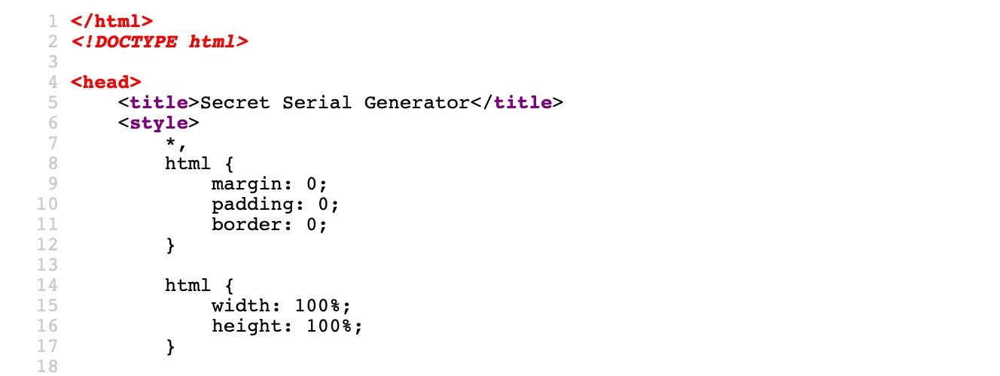

# Source Code (Mã nguồn)


Hầu hết website ngày nay đều dùng JavaScript để thực hiện các chức năng của mình. Trong khi `HTML` được dùng để xác định các field và tham số chính của website, và `CSS` được dùng để xác định thiết kế, thì `JavaScript` được dùng để thực hiện mọi chức năng cần thiết để website vận hành. Việc này diễn ra ngầm phía sau, và ta chỉ nhìn thấy phần front-end đẹp đẽ của website rồi tương tác với nó.

Dù toàn bộ source code này đều có sẵn ở phía client (client-side), nó được trình duyệt render ra nên ta thường không để ý tới source code HTML. Tuy nhiên, nếu muốn hiểu các chức năng client-side của một trang nào đó, ta thường bắt đầu bằng việc xem source code của trang. Phần này sẽ cho thấy cách ta có thể làm lộ ra source code chứa tất cả những thứ này và hiểu công dụng chung của nó.

---
## HTML

Ta sẽ bắt đầu bằng việc khởi động bài tập bên dưới, mở Firefox trong PwnBox và truy cập url được nêu trong câu hỏi:


Như ta thấy, website ghi `Secret Serial Generator`, không có ô nhập liệu nào và cũng không thể hiện chức năng rõ ràng nào. Vì vậy, bước tiếp theo là xem qua source code của nó. Ta có thể làm vậy bằng cách nhấn `[CTRL + U]`, thao tác này sẽ mở chế độ xem source của website:



Như ta thấy, ta có thể xem source code `HTML` của website.

<div class="card bg-light">
    <div class="card-body">
        <p class="mb-0">Source code HTML có thể chứa nhiều loại thông tin khác nhau, chẳng hạn comment, giúp hiểu code tốt hơn. Developer có thể để lại thông tin nhạy cảm, và thông tin đó có thể bị lợi dụng thêm. Việc đọc qua các comment trong HTML là rất đáng làm.</p>
    </div>
</div>

---
## CSS

Code `CSS` hoặc được định nghĩa `internally` (bên trong) ngay trong cùng file `HTML` giữa các phần tử `<style>`, hoặc được định nghĩa `externally` (bên ngoài) trong một file `.css` riêng và được tham chiếu trong code `HTML`.

Trong trường hợp này, ta thấy `CSS` được định nghĩa bên trong, như trong đoạn code dưới đây:
```HTML
    <style>
        *,
        html {
            margin: 0;
            padding: 0;
            border: 0;
        }
        ...SNIP...
        h1 {
            font-size: 144px;
        }
        p {
            font-size: 64px;
        }
    </style>
```

Nếu style `CSS` của một trang được định nghĩa bên ngoài, file `.css` bên ngoài đó sẽ được tham chiếu bằng thẻ `<link>` trong phần head của HTML, như sau:
```HTML
<head>
    <link rel="stylesheet" href="style.css">
</head>
```

---
## JavaScript

Khái niệm tương tự cũng áp dụng cho `JavaScript`. Nó có thể được viết bên trong giữa các phần tử `<script>`, hoặc viết vào một file `.js` riêng và được tham chiếu trong code `HTML`.

Ta có thể thấy trong source `HTML` rằng file `.js` được tham chiếu từ bên ngoài:
```HTML
<script src="secret.js"></script>
```

Ta có thể xem script bằng cách bấm vào `secret.js`, thao tác này sẽ đưa ta thẳng tới script. Khi mở ra, ta thấy code rất phức tạp và không thể hiểu nổi:
```JavaScript
eval(function (p, a, c, k, e, d) { e = function (c) { '...SNIP... |true|function'.split('|'), 0, {}))
```

Nguyên nhân là do `code obfuscation`. Nó là gì? Được thực hiện như thế nào? Được dùng ở đâu?
