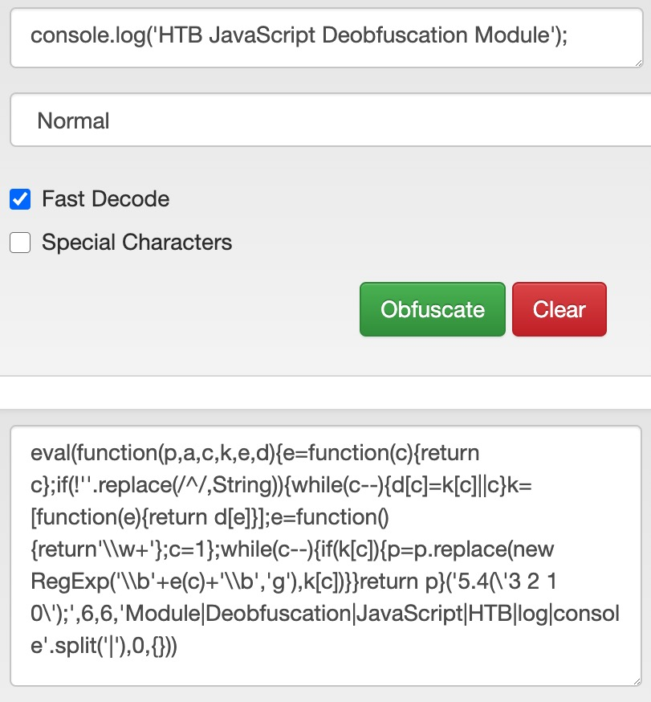

# Code Obfuscation (Làm rối mã)

Trước khi bắt đầu học về `deobfuscation`, ta cần học về `code obfuscation` trước đã. Nếu không hiểu code được obfuscate như thế nào, ta có thể không deobfuscate code thành công được, đặc biệt nếu nó được obfuscate bằng một obfuscator tự viết (custom obfuscator).

---
## Obfuscation là gì

Obfuscation là một kỹ thuật dùng để làm cho script khó đọc hơn đối với con người nhưng vẫn hoạt động y như cũ về mặt kỹ thuật, dù hiệu năng có thể chậm hơn. Việc này thường được thực hiện tự động bằng một công cụ obfuscation: công cụ nhận code làm đầu vào và cố gắng viết lại code theo cách khó đọc hơn nhiều, tuỳ theo thiết kế của nó.

Ví dụ, các code obfuscator thường biến code thành một "từ điển" (dictionary) chứa tất cả các từ và ký hiệu được dùng trong code, rồi cố gắng dựng lại code gốc trong lúc thực thi bằng cách tham chiếu tới từng từ và ký hiệu trong từ điển đó. Sau đây là ví dụ một đoạn code JavaScript đơn giản bị obfuscate:

Trong các ngôn ngữ `interpreted` (thông dịch) như `Python`, `PHP` và `JavaScript`, code được phát hành và thực thi mà không cần biên dịch. Trong khi `Python` và `PHP` thường nằm ở phía server nên bị ẩn khỏi người dùng cuối, thì `JavaScript` thường được dùng trong trình duyệt ở `client-side`, và code được gửi tới người dùng rồi thực thi ở dạng cleartext (văn bản rõ). Đó là lý do obfuscation rất thường được dùng với `JavaScript`.

---
## Các trường hợp sử dụng

Có nhiều lý do khiến developer cân nhắc obfuscate code của mình. Một lý do phổ biến là để che giấu code gốc và các chức năng của nó, ngăn code bị tái sử dụng hoặc sao chép khi chưa được developer cho phép, khiến việc reverse engineer chức năng gốc của code khó khăn hơn. Một lý do khác là để thêm một lớp bảo mật khi xử lý xác thực (authentication) hoặc mã hoá (encryption), nhằm ngăn các cuộc tấn công nhắm vào những lỗ hổng có thể tồn tại trong code.

`It must be noted that doing authentication or encryption on the client-side is not recommended, as code is more prone to attacks this way.` (Cần lưu ý rằng việc thực hiện xác thực hoặc mã hoá ở phía client là không được khuyến nghị, vì theo cách này code dễ bị tấn công hơn.)

Tuy nhiên, công dụng phổ biến nhất của obfuscation lại là cho các hành vi độc hại. Kẻ tấn công và các tác nhân độc hại (malicious actor) thường obfuscate script độc hại của mình để các hệ thống phát hiện và ngăn chặn xâm nhập (Intrusion Detection and Prevention system) không phát hiện ra script. Trong phần tiếp theo, ta sẽ học cách obfuscate một đoạn code JavaScript đơn giản và thử chạy nó trước và sau khi obfuscate để ghi nhận các khác biệt.
