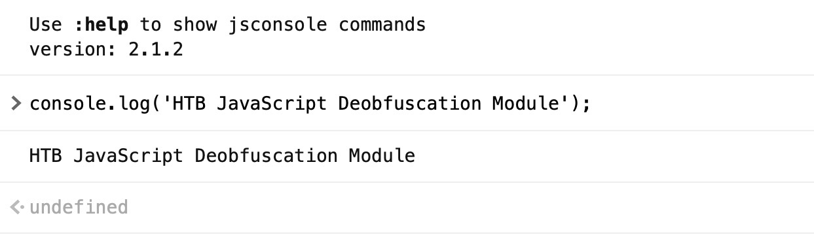
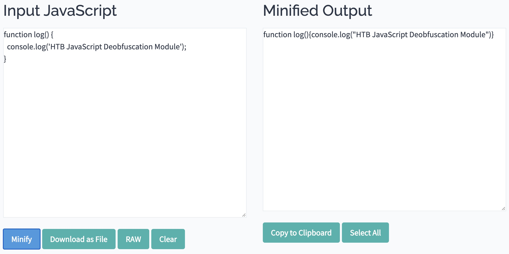
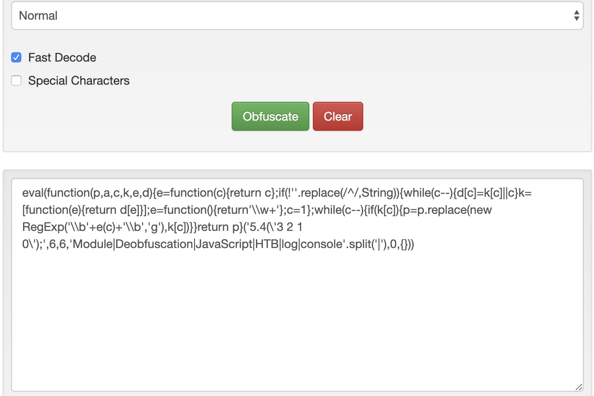
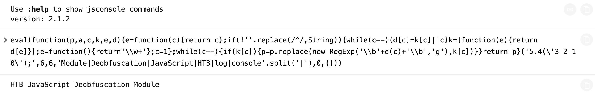

# Basic Obfuscation (Obfuscation cơ bản)


Code obfuscation thường không được làm thủ công, vì có rất nhiều công cụ cho nhiều ngôn ngữ khác nhau giúp obfuscate code tự động. Có thể tìm thấy nhiều công cụ online để làm việc này, dù nhiều tác nhân độc hại và developer chuyên nghiệp tự phát triển công cụ obfuscation riêng để khiến việc deobfuscate khó khăn hơn.

---
## Chạy code JavaScript

Hãy lấy dòng code sau làm ví dụ và thử obfuscate nó:
```javascript
console.log('HTB JavaScript Deobfuscation Module');
```

Trước tiên, hãy thử chạy đoạn code này ở dạng cleartext để xem nó hoạt động thực tế. Ta có thể vào [JSConsole](https://jsconsole.com), dán code vào, nhấn enter và xem output:


Ta thấy dòng code này in ra `HTB JavaScript Deobfuscation Module`, việc này được thực hiện bằng hàm `console.log()`.

---

## Minify code JavaScript

Một cách phổ biến để giảm khả năng đọc hiểu của một đoạn code JavaScript mà vẫn giữ nguyên đầy đủ chức năng là JavaScript minification (rút gọn code). `Code minification` nghĩa là dồn toàn bộ code vào một dòng duy nhất (thường rất dài). `Code minification` hữu ích hơn với code dài, vì nếu code của ta chỉ có một dòng thì khi minify trông cũng chẳng khác bao nhiêu.

Nhiều công cụ có thể giúp ta minify code JavaScript, như [javascript-minifier](https://javascript-minifier.com/). Ta chỉ cần sao chép code, bấm `Minify`, và sẽ nhận được output đã minify ở bên phải:



Một lần nữa, ta có thể sao chép code đã minify vào [JSConsole](https://jsconsole.com) và chạy nó, và thấy nó chạy đúng như mong đợi. Thông thường, code JavaScript đã minify được lưu với phần mở rộng `.min.js`.

<div class="card bg-light">
    <div class="card-body">
        <p class="mb-0">Lưu ý: Code minification không chỉ dành riêng cho JavaScript mà có thể áp dụng cho nhiều ngôn ngữ khác, như có thể thấy trên <a href="https://javascript-minifier.com/">javascript-minifier</a>.</p>
    </div>
</div>

---
## Packing code JavaScript

Bây giờ, hãy obfuscate dòng code của ta để nó trở nên khó hiểu và khó đọc hơn. Đầu tiên, ta sẽ thử dùng [BeautifyTools](http://beautifytools.com/javascript-obfuscator.php) để obfuscate code:



```javascript
eval(function(p,a,c,k,e,d){e=function(c){return c};if(!''.replace(/^/,String)){while(c--){d[c]=k[c]||c}k=[function(e){return d[e]}];e=function(){return'\\w+'};c=1};while(c--){if(k[c]){p=p.replace(new RegExp('\\b'+e(c)+'\\b','g'),k[c])}}return p}('5.4(\'3 2 1 0\');',6,6,'Module|Deobfuscation|JavaScript|HTB|log|console'.split('|'),0,{}))
```

Ta thấy code đã bị obfuscate hơn hẳn và khó đọc hơn nhiều. Ta có thể sao chép code này vào <https://jsconsole.com> để xác nhận rằng nó vẫn thực hiện chức năng chính:



Ta thấy output vẫn y hệt.

<div class="card bg-light">
    <div class="card-body">
        <p class="mb-0">Lưu ý: Kiểu obfuscation ở trên được gọi là "packing", thường dễ nhận ra nhờ sáu tham số của hàm khởi đầu "function(p,a,c,k,e,d)".</p>
    </div>
</div>

Một công cụ obfuscation dạng `packer` thường cố gắng chuyển toàn bộ từ và ký hiệu trong code thành một list hoặc dictionary, rồi tham chiếu tới chúng bằng hàm `(p,a,c,k,e,d)` để dựng lại code gốc trong lúc thực thi. `(p,a,c,k,e,d)` có thể khác nhau giữa các packer. Tuy nhiên, nó thường chứa một thứ tự nhất định mà các từ và ký hiệu của code gốc đã được pack theo, để biết cách sắp xếp lại chúng khi thực thi.

Dù packer làm rất tốt việc giảm khả năng đọc hiểu của code, ta vẫn có thể thấy các string chính của nó ở dạng cleartext, và chúng có thể làm lộ một phần chức năng. Đó là lý do ta có thể muốn tìm những cách tốt hơn để obfuscate code.
