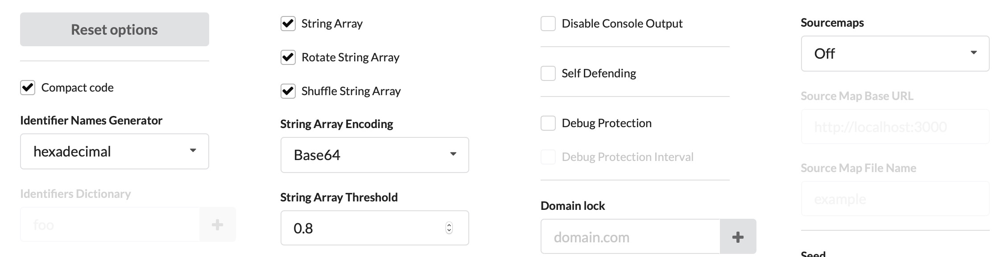
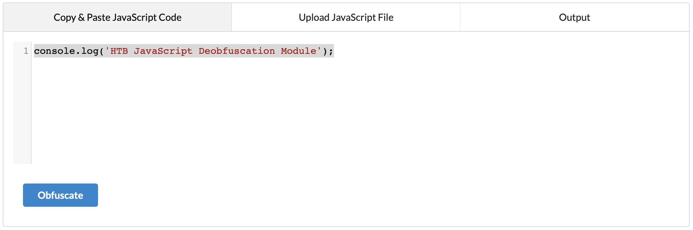
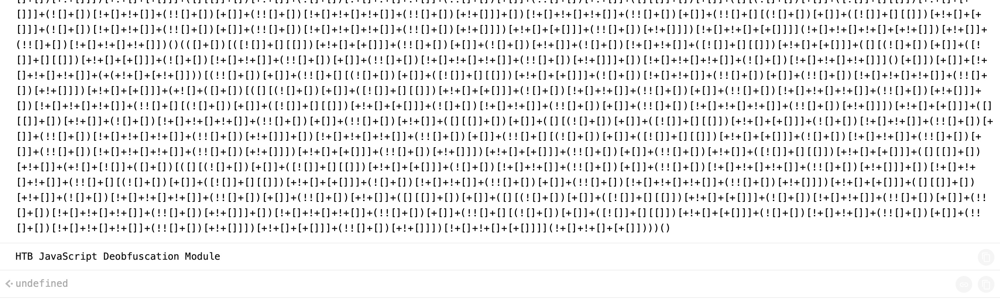

# Advanced Obfuscation (Obfuscation nâng cao)


Đến giờ, ta đã có thể obfuscate code và khiến nó khó đọc hơn. Tuy nhiên, code vẫn chứa các string ở dạng cleartext, và chúng có thể làm lộ chức năng gốc. Trong phần này, ta sẽ thử một vài công cụ có thể obfuscate code hoàn toàn và che giấu mọi dấu vết còn sót lại của chức năng gốc.

---
## Obfuscator

Hãy truy cập <https://obfuscator.io>. Trước khi bấm `obfuscate`, ta sẽ đổi `String Array Encoding` thành `Base64`, như hình dưới:



Bây giờ, ta có thể dán code vào và bấm `obfuscate`:


Ta nhận được đoạn code sau:
```javascript
var _0x1ec6=['Bg9N','sfrciePHDMfty3jPChqGrgvVyMz1C2nHDgLVBIbnB2r1Bgu='];(function(_0x13249d,_0x1ec6e5){var _0x14f83b=function(_0x3f720f){while(--_0x3f720f){_0x13249d['push'](_0x13249d['shift']());}};_0x14f83b(++_0x1ec6e5);}(_0x1ec6,0xb4));var _0x14f8=function(_0x13249d,_0x1ec6e5){_0x13249d=_0x13249d-0x0;var _0x14f83b=_0x1ec6[_0x13249d];if(_0x14f8['eOTqeL']===undefined){var _0x3f720f=function(_0x32fbfd){var _0x523045='abcdefghijklmnopqrstuvwxyzABCDEFGHIJKLMNOPQRSTUVWXYZ0123456789+/=',_0x4f8a49=String(_0x32fbfd)['replace'](/=+$/,'');var _0x1171d4='';for(var _0x44920a=0x0,_0x2a30c5,_0x443b2f,_0xcdf142=0x0;_0x443b2f=_0x4f8a49['charAt'](_0xcdf142++);~_0x443b2f&&(_0x2a30c5=_0x44920a%0x4?_0x2a30c5*0x40+_0x443b2f:_0x443b2f,_0x44920a++%0x4)?_0x1171d4+=String['fromCharCode'](0xff&_0x2a30c5>>(-0x2*_0x44920a&0x6)):0x0){_0x443b2f=_0x523045['indexOf'](_0x443b2f);}return _0x1171d4;};_0x14f8['oZlYBE']=function(_0x8f2071){var _0x49af5e=_0x3f720f(_0x8f2071);var _0x52e65f=[];for(var _0x1ed1cf=0x0,_0x79942e=_0x49af5e['length'];_0x1ed1cf<_0x79942e;_0x1ed1cf++){_0x52e65f+='%'+('00'+_0x49af5e['charCodeAt'](_0x1ed1cf)['toString'](0x10))['slice'](-0x2);}return decodeURIComponent(_0x52e65f);},_0x14f8['qHtbNC']={},_0x14f8['eOTqeL']=!![];}var _0x20247c=_0x14f8['qHtbNC'][_0x13249d];return _0x20247c===undefined?(_0x14f83b=_0x14f8['oZlYBE'](_0x14f83b),_0x14f8['qHtbNC'][_0x13249d]=_0x14f83b):_0x14f83b=_0x20247c,_0x14f83b;};console[_0x14f8('0x0')](_0x14f8('0x1'));
```

Đoạn code này rõ ràng bị obfuscate nhiều hơn, và ta không còn thấy chút dấu vết nào của code gốc. Giờ ta có thể thử chạy nó trên <https://jsconsole.com> để xác nhận nó vẫn thực hiện chức năng ban đầu. Hãy thử nghịch các thiết lập obfuscation trên <https://obfuscator.io> để tạo ra code bị obfuscate nhiều hơn nữa, rồi chạy lại trên <https://jsconsole.com> để xác nhận nó vẫn thực hiện chức năng ban đầu.

---
## More Obfuscation (Obfuscate sâu hơn nữa)

Đến đây ta đã có ý niệm rõ ràng về cách code obfuscation hoạt động. Vẫn còn rất nhiều biến thể công cụ code obfuscation, mỗi công cụ obfuscate code theo một cách khác nhau. Lấy ví dụ đoạn code JavaScript sau:

```javascript
[][(![]+[])[+[]]+([![]]+[][[]])[+!+[]+[+[]]]+(![]+[])[!+[]+!+[]]+(!![]+[])[+[]]+(!![]+[])[!+[]+!+[]+!+[]]+(!![]+[])[+!+[]]][([][(![]+[])[+[]]+([![]]+[][[]])[+!+[]+[+[]]]+(![]+[])[!+[]+!+[]]+(!![]+[])[+[]]+(!![]+[])[!+[]+!+[]+!+[]]+(!![]+[])[+!+[]]]+[])[!+[]+!+[]+!+[]]+(!![]+[][(![]+[])[+[]]+([![]]+[][[]])[+!+[]+[+[]]]+(![]+[])[!+[]+!+[]]+(!![]+[])[+[]]+(!![]+[])[!+[]+!+[]+!+[]]+(!![]+[])[+!+[]]])[+!+[]+[+[]]]+([][[]]+[])[+!+[]]+(![]+[])[!+[]+!+[]+!+[]]+(!![]+[])[+[]]+(!![]+[])[+!+[]]+([][[]]+[])[+[]]+([][(!
...SNIP...
[]]+(!![]+[][(![]+[])[+[]]+([![]]+[][[]])[+!+[]+[+[]]]+(![]+[])[!+[]+!+[]]+(!![]+[])[+[]]+(!![]+[])[!+[]+!+[]+!+[]]+(!![]+[])[+!+[]]])[+!+[]+[+[]]]+([][[]]+[])[+!+[]]+(![]+[])[!+[]+!+[]+!+[]]+(!![]+[])[+[]]+(!![]+[])[+!+[]]+([][[]]+[])[+[]]+([][(![]+[])[+[]]+([![]]+[][[]])[+!+[]+[+[]]]+(![]+[])[!+[]+!+[]]+(!![]+[])[+[]]+(!![]+[])[!+[]+!+[]+!+[]]+(!![]+[])[+!+[]]]+[])[!+[]+!+[]+!+[]]+(!![]+[])[+[]]+(!![]+[][(![]+[])[+[]]+([![]]+[][[]])[+!+[]+[+[]]]+(![]+[])[!+[]+!+[]]+(!![]+[])[+[]]+(!![]+[])[!+[]+!+[]+!+[]]+(!![]+[])[+!+[]]])[+!+[]+[+[]]]+(!![]+[])[+!+[]]])[!+[]+!+[]+[+[]]]](!+[]+!+[]+[+[]])))()
```

Ta vẫn có thể chạy đoạn code này, và nó vẫn thực hiện chức năng ban đầu:


<div class="card bg-light">
    <div class="card-body">
        <p class="mb-0"><b>Lưu ý:</b> Đoạn code trên đã bị cắt bớt vì code đầy đủ quá dài, nhưng code đầy đủ vẫn sẽ chạy thành công.</p>
    </div>
</div>

Ta có thể thử obfuscate code bằng chính công cụ này tại [JSF](http://www.jsfuck.com), rồi chạy lại. Ta sẽ nhận thấy code có thể mất một lúc mới chạy xong, điều này cho thấy code obfuscation có thể ảnh hưởng tới hiệu năng như đã đề cập trước đó.

Còn nhiều JavaScript obfuscator khác, như [JJ Encode](https://utf-8.jp/public/jjencode.html) hay [AA Encode](https://utf-8.jp/public/aaencode.html). Tuy nhiên, các obfuscator như vậy thường khiến việc thực thi/biên dịch code rất chậm, nên không được khuyến nghị dùng trừ khi có lý do rõ ràng, như vượt qua (bypass) các bộ lọc hoặc hạn chế trên web.
