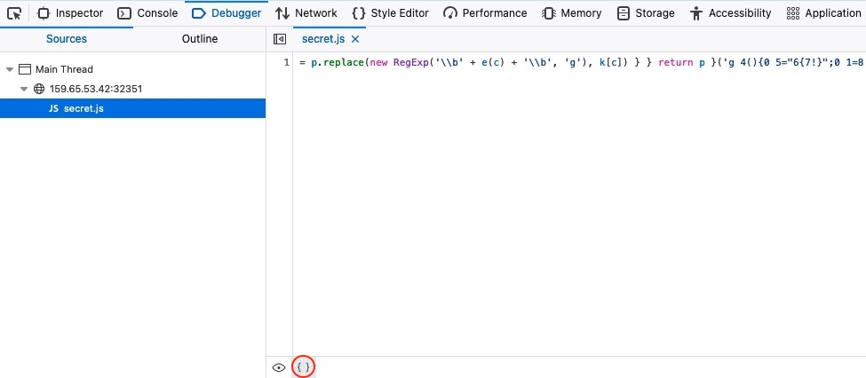
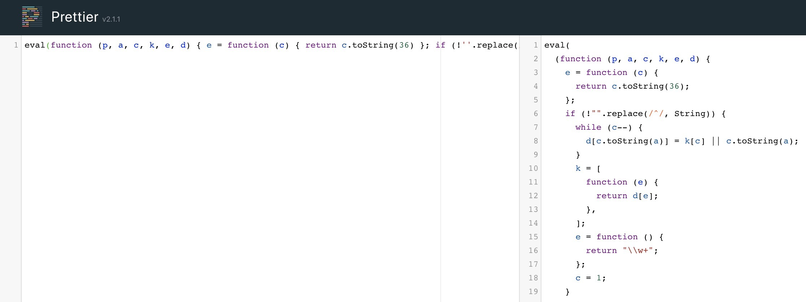
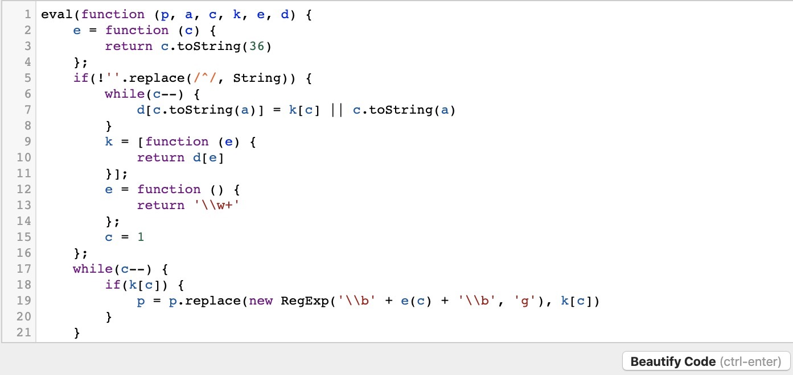
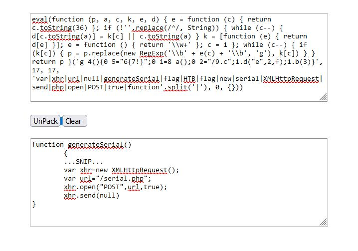

# Deobfuscation (Giải làm rối mã)


Giờ đã hiểu cách code obfuscation hoạt động, hãy bắt đầu học về deobfuscation. Cũng như có các công cụ obfuscate code tự động, cũng có các công cụ beautify (định dạng lại cho dễ đọc) và deobfuscate code tự động.

---
## Beautify

Ta thấy đoạn code hiện có được viết hết trên một dòng duy nhất. Kiểu này được gọi là code `Minified JavaScript`. Để định dạng code cho đúng, ta cần `Beautify` code. Cách cơ bản nhất để làm việc này là dùng `Browser Dev Tools` (công cụ dành cho nhà phát triển của trình duyệt).

Ví dụ, nếu dùng Firefox, ta có thể mở debugger của trình duyệt bằng [ `CTRL+SHIFT+Z` ], rồi bấm vào script `secret.js`. Script sẽ được hiển thị ở định dạng gốc, nhưng ta có thể bấm nút '`{ }`' ở phía dưới để `Pretty Print` script về đúng định dạng JavaScript:


Ngoài ra, ta có thể dùng nhiều công cụ online hoặc plugin cho code editor, như [Prettier](https://prettier.io/playground/) hay [Beautifier](https://beautifier.io/). Hãy sao chép script `secret.js`:
```JavaScript
eval(function (p, a, c, k, e, d) { e = function (c) { return c.toString(36) }; if (!''.replace(/^/, String)) { while (c--) { d[c.toString(a)] = k[c] || c.toString(a) } k = [function (e) { return d[e] }]; e = function () { return '\\w+' }; c = 1 }; while (c--) { if (k[c]) { p = p.replace(new RegExp('\\b' + e(c) + '\\b', 'g'), k[c]) } } return p }('g 4(){0 5="6{7!}";0 1=8 a();0 2="/9.c";1.d("e",2,f);1.b(3)}', 17, 17, 'var|xhr|url|null|generateSerial|flag|HTB|flag|new|serial|XMLHttpRequest|send|php|open|POST|true|function'.split('|'), 0, {}))
```

Ta thấy cả hai website đều định dạng code khá tốt:




Tuy nhiên, code vẫn chưa thật sự dễ đọc. Đó là vì code ta đang xử lý không chỉ bị minify mà còn bị obfuscate. Vì vậy, chỉ định dạng hay beautify code là chưa đủ. Để xử lý, ta cần các công cụ deobfuscate code.

---
## Deobfuscate

Ta có thể tìm được nhiều công cụ online tốt để deobfuscate code JavaScript và biến nó thành thứ ta hiểu được. Một công cụ tốt là [UnPacker](https://matthewfl.com/unPacker.html). Hãy thử sao chép đoạn code đã bị obfuscate ở trên và chạy nó trong UnPacker bằng cách bấm nút `UnPack`.

<div class="card bg-light">
    <div class="card-body">
        <p class="mb-0">Mẹo: Đảm bảo không để dòng trống nào trước script, vì điều này có thể ảnh hưởng tới quá trình deobfuscation và cho kết quả không chính xác.</p>
    </div>
</div>



Ta thấy công cụ này deobfuscate code JavaScript tốt hơn nhiều và cho ra output mà ta có thể hiểu được:

```javascript
function generateSerial() {
  ...SNIP...
  var xhr = new XMLHttpRequest;
  var url = "/serial.php";
  xhr.open("POST", url, true);
  xhr.send(null);
};
```

Như đã đề cập, phương pháp obfuscation được dùng ở trên là `packing`. Một cách khác để `unpacking` code như vậy là tìm giá trị `return` ở cuối và dùng `console.log` để in nó ra thay vì thực thi nó.

---
## Reverse Engineering

Dù cho đến giờ các công cụ này làm khá tốt việc gỡ rối code thành thứ ta hiểu được, khi code bị obfuscate và encode nhiều hơn, các công cụ tự động sẽ khó làm sạch nó hơn nhiều. Điều này đặc biệt đúng nếu code được obfuscate bằng một công cụ obfuscation tự viết.

Trong những trường hợp như vậy, ta cần reverse engineer code thủ công để hiểu nó đã được obfuscate như thế nào và chức năng của nó. Nếu bạn muốn tìm hiểu thêm về JavaScript Deobfuscation nâng cao và Reverse Engineering, có thể tham khảo module [Secure Coding 101](https://academy.hackthebox.com/module/details/38), module này đề cập chủ đề này một cách kỹ lưỡng.
