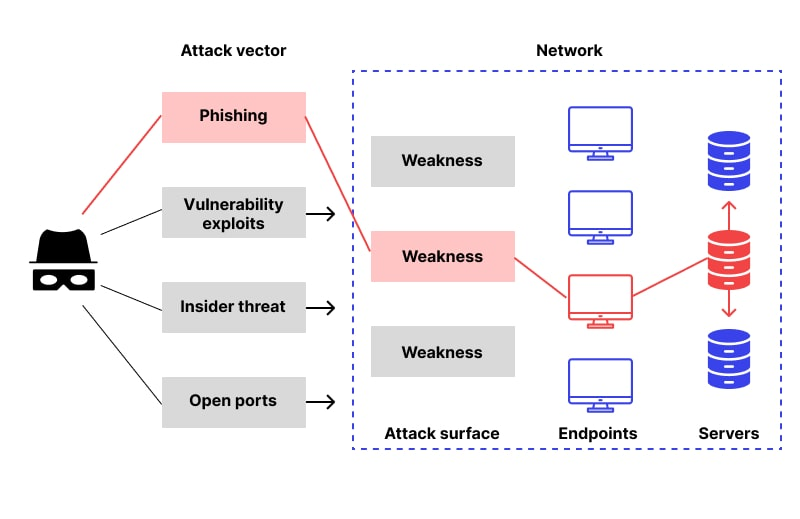

# Elements of a Proper Incident Report (Các thành phần của một báo cáo sự cố đúng chuẩn)

## Executive Summary (Tóm tắt dành cho lãnh đạo)

Hãy xem `Executive Summary` là cánh cửa dẫn vào báo cáo của chúng ta, được thiết kế để phục vụ nhiều đối tượng độc giả, bao gồm cả các bên liên quan (stakeholder) không chuyên về kỹ thuật. Phần này cần cung cấp cho người đọc một cái nhìn tổng quan ngắn gọn, các phát hiện chính, các hành động tức thời đã thực hiện, và tác động đối với các bên liên quan. Vì nhiều bên liên quan có thể chỉ đọc mỗi phần `Executive Summary`, việc làm thật tốt phần này là điều bắt buộc. Dưới đây là phân tích chi tiết hơn về những gì cần có trong `Executive Summary`:

|Mục|Mô tả|
|-------|-------|
|Incident ID (Mã sự cố)|Mã định danh duy nhất của sự cố.|
|Incident Overview (Tổng quan sự cố)|Cung cấp bản tóm tắt ngắn gọn về các diễn biến của sự cố (bao gồm cả lần phát hiện ban đầu) và nêu rõ loại sự cố. Đó là một cuộc tấn công ransomware, một vụ xâm phạm dữ liệu (data breach) quy mô lớn, hay cả hai? Phần này cũng cần bao gồm thời gian và ngày ước tính xảy ra sự cố, cũng như thời lượng của nó, các hệ thống/dữ liệu bị ảnh hưởng, và trạng thái (đang diễn ra, đã giải quyết, hay đã leo thang (escalated))|
|Key Findings (Các phát hiện chính)|Liệt kê mọi phát hiện nổi bật rút ra từ sự cố. Nguyên nhân gốc rễ (root cause) là gì? Có CVE cụ thể nào bị khai thác không? Dữ liệu nào (nếu có) đã bị xâm phạm, bị tuồn ra ngoài (exfiltrate) hoặc bị đặt vào tình trạng nguy hiểm?|
|Immediate Actions Taken (Các hành động tức thời đã thực hiện)|Nêu khái quát các biện pháp phản ứng tức thời đã thực hiện. Các hệ thống bị ảnh hưởng có được cô lập kịp thời không? Đã xác định được nguyên nhân gốc rễ chưa? Chúng ta có thuê dịch vụ của bên thứ ba nào không, và nếu có thì đó là ai?|
|Stakeholder Impact (Tác động đến các bên liên quan)|Đánh giá tác động tiềm tàng đối với các bên liên quan khác nhau. Ví dụ, có khách hàng nào bị gián đoạn dịch vụ (downtime) không, và hậu quả tài chính là gì? Dữ liệu nhân viên có bị xâm phạm không? Thông tin độc quyền có bị đặt vào rủi ro không, và những hệ luỵ tiềm tàng là gì?|

## Technical Analysis (Phân tích kỹ thuật)

Đây là phần chúng ta đi sâu vào các khía cạnh kỹ thuật, mổ xẻ các sự kiện đã diễn ra trong sự cố. Nhiều khả năng đây sẽ là phần dài nhất của báo cáo sự cố. Cần đề cập đến các điểm chính sau:

#### Các hệ thống & dữ liệu bị ảnh hưởng

Nêu rõ tất cả các hệ thống và dữ liệu có khả năng đã bị truy cập hoặc chắc chắn đã bị xâm phạm trong sự cố. Nếu dữ liệu bị tuồn ra ngoài (exfiltrate), hãy nêu cụ thể dung lượng hoặc số lượng, nếu xác định được.

#### Nguồn bằng chứng & phân tích

Nhấn mạnh các bằng chứng đã được xem xét kỹ lưỡng, kết quả, và phương pháp phân tích đã áp dụng. Ví dụ, nếu việc bị xâm phạm được xác nhận thông qua web access log, hãy đính kèm ảnh chụp màn hình để làm tài liệu. Việc duy trì tính toàn vẹn của bằng chứng (evidence integrity) là rất quan trọng, đặc biệt trong các vụ án hình sự. Một best practice là tính hash các file để đảm bảo tính toàn vẹn của chúng.

#### Indicators of Compromise (IoCs – dấu hiệu xâm phạm)

IoC đóng vai trò quan trọng trong việc hunting (truy lùng) các vụ xâm phạm tiềm tàng trên toàn bộ môi trường rộng hơn của chúng ta, hoặc thậm chí trong các tổ chức đối tác. Cũng có thể quy kết (attribute) cuộc tấn công cho một nhóm đe doạ (threat group) cụ thể dựa trên các IoC đã xác định. Chúng có thể là bất cứ thứ gì, từ lưu lượng outbound bất thường cho đến các process lạ và scheduled task do kẻ tấn công khởi tạo.

#### Root Cause Analysis (Phân tích nguyên nhân gốc rễ)

Trong phần này, hãy trình bày chi tiết quá trình phân tích nguyên nhân gốc rễ đã thực hiện và giải thích cặn kẽ nguyên nhân sâu xa của sự cố bảo mật (các lỗ hổng bị khai thác, các điểm thất bại, v.v.).

#### Technical Timeline (Dòng thời gian kỹ thuật)

Đây là thành phần then chốt để hiểu được trình tự các sự kiện của sự cố. Dòng thời gian cần bao gồm:

- Reconnaissance (trinh sát)
- Initial Compromise (xâm nhập ban đầu)
- C2 Communications (liên lạc C2)
- Enumeration (liệt kê thông tin)
- Lateral Movement (di chuyển ngang)
- Data Access & Exfiltration (truy cập & tuồn dữ liệu ra ngoài)
- Malware Deployment or Activity (triển khai hoặc hoạt động của malware, bao gồm Process Injection và Persistence)
- Containment Times (thời điểm ngăn chặn)
- Eradication Times (thời điểm loại bỏ)
- Recovery Times (thời điểm khôi phục)

#### Bản chất của cuộc tấn công

Đi sâu vào loại tấn công, cũng như các tactic, technique và procedure (TTP) mà kẻ tấn công đã sử dụng.

---

## Impact Analysis (Phân tích tác động)

Đưa ra đánh giá về những ảnh hưởng tiêu cực mà sự cố đã gây ra cho dữ liệu, hoạt động và danh tiếng của tổ chức. Phân tích này nhằm định lượng và định tính mức độ thiệt hại do sự cố gây ra, xác định những hệ thống, quy trình hoặc tập dữ liệu nào đã bị xâm phạm. Nó cũng đánh giá các hệ quả tiềm tàng đối với hoạt động kinh doanh, như thiệt hại tài chính, các khoản phạt theo quy định và tổn hại danh tiếng.

---

## Response and Recovery Analysis (Phân tích phản ứng và khôi phục)

Nêu khái quát các hành động cụ thể đã thực hiện để ngăn chặn (contain) sự cố bảo mật, loại bỏ (eradicate) mối đe doạ và khôi phục hoạt động bình thường. Phần này đóng vai trò như một bản tường thuật theo trình tự thời gian về các biện pháp đã triển khai nhằm giảm thiểu tác động và ngăn chặn các sự cố tương tự tái diễn trong tương lai.

Dưới đây là phân tích những gì phần "Response and Recovery" thường bao gồm:

#### Các hành động phản ứng tức thời

**Thu hồi quyền truy cập (Revocation of Access)**
- `Identification of Compromised Accounts/Systems`: Mô tả chi tiết cách các tài khoản hoặc hệ thống bị xâm phạm đã được xác định, bao gồm các công cụ và phương pháp đã sử dụng.
- `Timeframe`: Thời điểm chính xác khi truy cập trái phép bị phát hiện và sau đó bị thu hồi, chính xác đến từng phút nếu có thể.
- `Method of Revocation`: Giải thích các phương pháp kỹ thuật đã dùng để thu hồi quyền truy cập, như vô hiệu hoá tài khoản, thay đổi phân quyền, hoặc chỉnh sửa firewall rule.
- `Impact`: Đánh giá việc thu hồi quyền truy cập ngay lập tức đã đạt được gì, bao gồm việc ngăn chặn dữ liệu bị tuồn ra ngoài hoặc hệ thống bị xâm phạm thêm.

**Chiến lược ngăn chặn (Containment Strategy)**
- `Short-term Containment`: Các hành động tức thời được thực hiện để cô lập các hệ thống bị ảnh hưởng khỏi mạng nhằm ngăn threat actor thực hiện lateral movement.
- `Long-term Containment`: Các biện pháp mang tính chiến lược, như phân đoạn mạng (network segmentation) hoặc triển khai kiến trúc zero-trust, nhằm cô lập lâu dài các hệ thống bị ảnh hưởng.
- `Effectiveness`: Đánh giá mức độ hiệu quả của các chiến lược ngăn chặn trong việc hạn chế tác động của sự cố.

#### Các biện pháp loại bỏ (Eradication)

**Gỡ bỏ malware (Malware Removal)**
- `Identification`: Quy trình chi tiết về cách malware hoặc mã độc đã được xác định, bao gồm việc sử dụng các công cụ Endpoint Detection and Response (EDR) hoặc phân tích forensic.
- `Removal Techniques`: Các công cụ cụ thể hoặc phương pháp thủ công đã dùng để gỡ bỏ malware.
- `Verification`: Các bước đã thực hiện để đảm bảo malware đã bị loại bỏ hoàn toàn, như kiểm tra checksum hoặc phân tích heuristic.

**Vá hệ thống (System Patching)**
- `Vulnerability Identification`: Các lỗ hổng đã được phát hiện như thế nào, bao gồm các mã CVE nếu có.
- `Patch Management`: Mô tả chi tiết quy trình vá lỗi, bao gồm các giai đoạn kiểm thử, triển khai và xác minh.
- `Fallback Procedures`: Các bước để hoàn tác (revert) bản vá trong trường hợp chúng gây mất ổn định hệ thống hoặc các vấn đề khác.

#### Các bước khôi phục

**Khôi phục dữ liệu (Data Restoration)**
- `Backup Validation`: Quy trình xác thực tính toàn vẹn của các bản sao lưu (backup) trước khi khôi phục.
- `Restoration Process`: Mô tả từng bước cách dữ liệu đã được khôi phục, bao gồm mọi phương pháp giải mã đã dùng nếu dữ liệu bị mã hoá.
- `Data Integrity Checks`: Các phương pháp dùng để xác minh tính toàn vẹn của dữ liệu đã khôi phục.

**Xác thực hệ thống (System Validation)**
- `Security Measures`: Các hành động đã thực hiện để đảm bảo hệ thống an toàn trước khi đưa chúng hoạt động trở lại, như cấu hình lại firewall hoặc cập nhật Intrusion Detection Systems (IDS).
- `Operational Checks`: Các bài kiểm thử được thực hiện để xác nhận hệ thống hoạt động đầy đủ và vận hành như mong đợi trong môi trường production.

#### Các hành động sau sự cố

**Giám sát (Monitoring)**
- `Enhanced Monitoring Plans`: Kế hoạch chi tiết cho việc giám sát liên tục nhằm phát hiện các lỗ hổng hoặc mẫu tấn công (attack pattern) tương tự trong tương lai.
- `Tools and Technologies`: Các công cụ giám sát cụ thể sẽ được sử dụng, và cách chúng tích hợp với các hệ thống hiện có để có một cái nhìn tổng thể.

**Bài học rút ra (Lessons Learned)**
- `Gap Analysis`: Đánh giá kỹ lưỡng xem những biện pháp bảo mật nào đã thất bại và vì sao.
- `Recommendations for Improvement`: Các khuyến nghị cụ thể, có thể hành động được dựa trên các bài học rút ra, được phân loại theo mức độ ưu tiên và lộ trình triển khai.
- `Future Strategy`: Các thay đổi dài hạn về chính sách, kiến trúc, hoặc đào tạo nhân sự để ngăn chặn các sự cố tương tự.

---

## Diagrams (Sơ đồ)

Vì phần tường thuật có thể trở nên cực kỳ phức tạp, các công cụ trực quan có thể vô cùng hữu ích để đơn giản hoá những chi tiết rắc rối của sự cố:

* `Incident Flowchart`
	* Minh hoạ diễn tiến của cuộc tấn công, từ điểm xâm nhập ban đầu cho đến quá trình lan rộng khắp mạng.

* `Affected Systems Map`
	* Mô tả topology mạng, làm nổi bật các node bị xâm phạm. Dùng mã màu hoặc chú thích để thể hiện mức độ nghiêm trọng của từng vụ xâm phạm.

* `Attack Vector Diagram` 
	* Dùng mũi tên, node và chú thích để truy vết một cách trực quan đường đi của kẻ tấn công cũng như các hoạt động khai thác (và hậu khai thác) xuyên qua các lớp phòng thủ của chúng ta.

	
	
---

## Appendices (Phụ lục)

Phần này đóng vai trò là kho lưu trữ các tài liệu bổ sung, cung cấp thêm bối cảnh, bằng chứng hoặc chi tiết kỹ thuật vốn rất quan trọng để hiểu toàn diện về sự cố, tác động của nó và các hành động phản ứng đã thực hiện. Phần này thường được xem là xương sống của báo cáo, cung cấp dữ liệu thô và các artifact có thể được xác minh độc lập, qua đó tăng thêm độ tin cậy và chiều sâu cho phần tường thuật trình bày trong thân báo cáo.

Phần `Appendices` có thể bao gồm:
- Các file log
- Sơ đồ mạng (trước và sau sự cố)
- Bằng chứng forensic (disk image, memory dump, v.v.)
- Các đoạn code
- Danh sách kiểm tra ứng phó sự cố (Incident Response Checklist)
- Hồ sơ liên lạc (Communication Records)
- Tài liệu pháp lý và quy định (biểu mẫu tuân thủ, NDA đã ký bởi các chuyên gia tư vấn bên ngoài, v.v.)
- Bảng thuật ngữ và từ viết tắt

---

## Best Practices (Thực hành tốt nhất)
- `Root Cause Analysis`: Luôn hướng tới việc tìm ra nguyên nhân gốc rễ của sự cố để ngăn chặn tái diễn trong tương lai.
- `Community Sharing`: Chia sẻ các chi tiết không nhạy cảm với cộng đồng những người làm phòng thủ để cải thiện an ninh mạng chung.
- `Regular Updates`: Cập nhật thường xuyên cho tất cả các bên liên quan trong suốt quá trình ứng phó sự cố.
- `External Review`: Cân nhắc nhờ các chuyên gia an ninh mạng bên thứ ba xác thực các phát hiện.

---

## Kết luận

Một báo cáo sự cố được soạn thảo tỉ mỉ là điều bắt buộc sau một vụ xâm phạm hoặc tấn công bảo mật. Các báo cáo này cung cấp phân tích đầy đủ về những gì đã sai, những biện pháp nào đã hiệu quả, lý do đằng sau chúng, và các chiến lược phòng ngừa trong tương lai.
