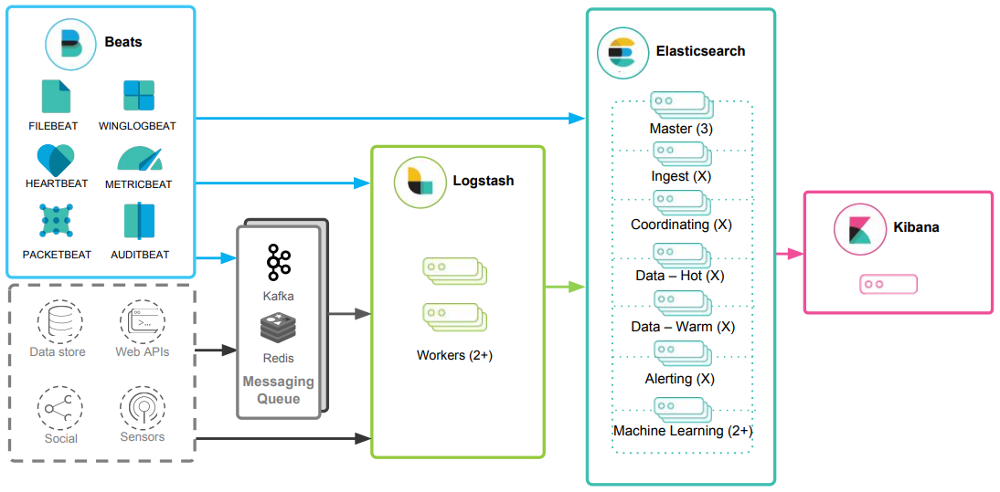
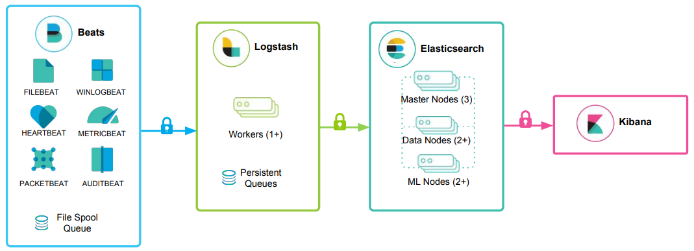
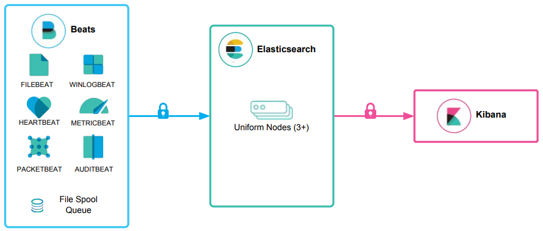
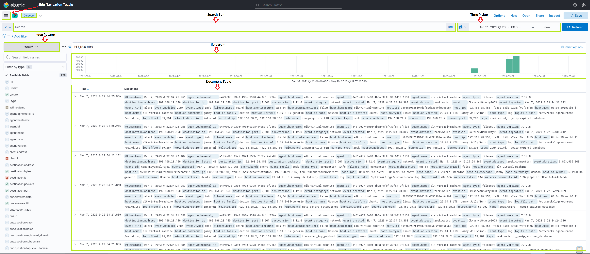
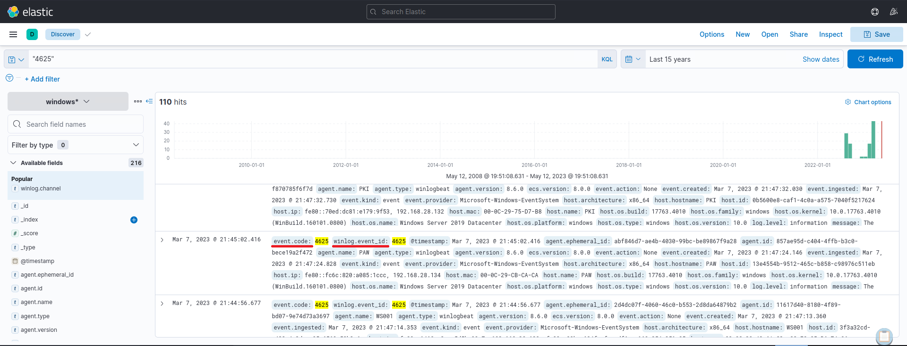
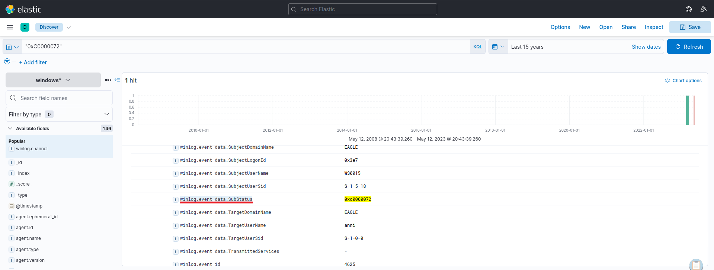

# Introduction To The Elastic Stack (Giới thiệu về Elastic Stack)


## Elastic Stack là gì?

Elastic stack, do Elastic phát triển, là một bộ ứng dụng mã nguồn mở gồm chủ yếu ba ứng dụng (Elasticsearch, Logstash và Kibana) phối hợp nhịp nhàng với nhau, cung cấp cho người dùng khả năng tìm kiếm và trực quan hoá toàn diện để phân tích và khám phá các nguồn file log theo thời gian thực.


Kiến trúc tổng quan của Elastic stack có thể được mở rộng trong các môi trường tiêu tốn nhiều tài nguyên bằng cách bổ sung Kafka, RabbitMQ và Redis để làm bộ đệm (buffering) và tăng khả năng chịu lỗi (resiliency), cùng nginx cho mục đích bảo mật.



Hãy cùng đi sâu vào từng thành phần của Elastic stack.

`Elasticsearch` là một search engine phân tán, dựa trên JSON, được thiết kế với các RESTful API. Là thành phần cốt lõi của Elastic stack, nó đảm nhận việc đánh index (indexing), lưu trữ và truy vấn. Elasticsearch cho phép người dùng thực hiện các query phức tạp và các thao tác phân tích trên các bản ghi file log đã được Logstash xử lý.

`Logstash` chịu trách nhiệm thu thập, biến đổi và vận chuyển các bản ghi file log. Thế mạnh của nó nằm ở khả năng hợp nhất dữ liệu từ nhiều nguồn khác nhau và chuẩn hoá chúng. Logstash hoạt động trong ba mảng chính:

1. `Process input`: Logstash tiếp nhận (ingest) các bản ghi file log từ các vị trí từ xa, chuyển chúng sang định dạng mà máy có thể hiểu được. Nó có thể nhận bản ghi qua nhiều [phương thức input](https://www.elastic.co/guide/en/logstash/current/input-plugins.html) khác nhau, chẳng hạn đọc từ một flat file, một TCP socket, hoặc trực tiếp từ các thông điệp syslog. Sau khi xử lý input, Logstash chuyển sang chức năng tiếp theo.

2. `Transform and enrich log records`: Logstash cung cấp nhiều cách để [chỉnh sửa định dạng](https://www.elastic.co/guide/en/logstash/current/filter-plugins.html) và thậm chí cả nội dung của một bản ghi log. Cụ thể, các filter plugin có thể thực hiện xử lý trung gian trên một event, thường dựa trên một điều kiện được định sẵn. Khi một bản ghi log đã được biến đổi, Logstash tiếp tục xử lý nó.

3. `Send log records to Elasticsearch`: Logstash sử dụng các [output plugin](https://www.elastic.co/guide/en/logstash/current/output-plugins.html) để truyền các bản ghi log tới Elasticsearch.

`Kibana` đóng vai trò là công cụ trực quan hoá cho các document của Elasticsearch. Người dùng có thể xem dữ liệu được lưu trong Elasticsearch và thực thi query thông qua Kibana. Ngoài ra, Kibana giúp việc hiểu kết quả query trở nên đơn giản hơn nhờ bảng, biểu đồ và các dashboard tuỳ chỉnh.

Lưu ý: `Beats` là một thành phần bổ sung của Elastic stack. Đây là các data shipper (công cụ gửi dữ liệu) gọn nhẹ, đơn mục đích, được thiết kế để cài đặt trên các máy từ xa nhằm chuyển tiếp log và metric tới Logstash hoặc trực tiếp tới Elasticsearch. Beats đơn giản hoá việc thu thập dữ liệu từ nhiều nguồn khác nhau và đảm bảo Elastic Stack nhận được những thông tin cần thiết để phân tích và trực quan hoá.

`Beats` -> `Logstash` -> `Elasticsearch` -> `Kibana`



`Beats` -> `Elasticsearch` -> `Kibana`



---

## Elastic Stack trong vai trò một giải pháp SIEM

Elastic stack có thể được dùng như một giải pháp Security Information and Event Management (SIEM) để thu thập, lưu trữ, phân tích và trực quan hoá dữ liệu liên quan đến bảo mật từ nhiều nguồn khác nhau.

Để triển khai Elastic stack như một giải pháp SIEM, dữ liệu liên quan đến bảo mật từ các nguồn như firewall, IDS/IPS và endpoint cần được đưa (ingest) vào Elastic stack bằng Logstash. Elasticsearch cần được cấu hình để lưu trữ và đánh index dữ liệu bảo mật, còn Kibana được dùng để tạo các dashboard và visualization tuỳ chỉnh nhằm cung cấp góc nhìn sâu về các event liên quan đến bảo mật.

Để phát hiện các incident liên quan đến bảo mật, có thể dùng Elasticsearch để thực hiện tìm kiếm và tương quan (correlation) trên dữ liệu bảo mật đã thu thập.

Là analyst của Security Operations Center (SOC), nhiều khả năng ta sẽ dùng Kibana rất nhiều như giao diện chính khi làm việc với Elastic stack. Vì vậy, việc thành thạo các chức năng và tính năng của nó là điều thiết yếu.



Kibana Query Language (KQL) là một ngôn ngữ truy vấn mạnh mẽ và thân thiện, được thiết kế riêng để tìm kiếm và phân tích dữ liệu trong Kibana. Nó đơn giản hoá việc rút ra thông tin từ dữ liệu Elasticsearch đã được đánh index, mang lại cách tiếp cận trực quan hơn so với Query DSL của Elasticsearch. Hãy cùng khám phá các khía cạnh kỹ thuật và các thành phần chính của ngôn ngữ KQL.

- `Basic Structure`: Các query KQL được tạo thành từ các cặp `field:value`, trong đó field đại diện cho thuộc tính của dữ liệu và value đại diện cho dữ liệu cần tìm. Ví dụ:

```shell-session
event.code:4625
```

Query KQL `event.code:4625` lọc dữ liệu trong Kibana để hiển thị các event có [Windows event code 4625](https://www.ultimatewindowssecurity.com/securitylog/encyclopedia/event.aspx?eventid=4625). Windows event code này gắn với các lần đăng nhập thất bại trên hệ điều hành Windows.

Bằng query này, SOC analyst có thể xác định các lần đăng nhập thất bại trên máy Windows trong index của Elasticsearch, đồng thời điều tra nguồn gốc của các lần thử đó và các mối đe doạ bảo mật tiềm ẩn. Loại query này có thể giúp phát hiện tấn công brute force, đoán mật khẩu và các hoạt động đáng ngờ khác liên quan đến việc đăng nhập trên hệ thống Windows.

Bằng cách tinh chỉnh query thêm với các điều kiện bổ sung như địa chỉ IP nguồn, username hoặc khoảng thời gian, SOC analyst có thể có được những thông tin cụ thể hơn và điều tra hiệu quả các security incident tiềm ẩn.

- `Free Text Search`: KQL hỗ trợ tìm kiếm văn bản tự do (free text search), cho phép tìm một thuật ngữ cụ thể trên nhiều field mà không cần chỉ định tên field. Ví dụ:

```shell-session
"svc-sql1"
```

Query này trả về các bản ghi chứa chuỗi "svc-sql1" ở bất kỳ field nào đã được đánh index.

- `Logical Operators`: KQL hỗ trợ các toán tử logic AND, OR và NOT để xây dựng các query phức tạp hơn. Có thể dùng dấu ngoặc đơn để nhóm các biểu thức và kiểm soát thứ tự đánh giá. Ví dụ:

```shell-session
event.code:4625 AND winlog.event_data.SubStatus:0xC0000072
```

Query KQL `event.code:4625 AND winlog.event_data.SubStatus:0xC0000072` lọc dữ liệu trong Kibana để hiển thị các event có Windows event code 4625 (đăng nhập thất bại) và giá trị SubStatus là 0xC0000072.

Trên Windows, giá trị SubStatus cho biết lý do đăng nhập thất bại. Giá trị SubStatus 0xC0000072 cho biết tài khoản hiện đang bị vô hiệu hoá (disabled).

Bằng query này, SOC analyst có thể xác định các lần đăng nhập thất bại nhắm vào các tài khoản đã bị vô hiệu hoá. Hành vi như vậy cần được điều tra thêm, vì thông tin đăng nhập của tài khoản bị vô hiệu hoá có thể đã bị kẻ tấn công phát hiện bằng cách nào đó.

- `Comparison Operators`: KQL hỗ trợ nhiều toán tử so sánh như `:`, `:>`, `:>=`, `:<`, `:<=` và `:!`. Các toán tử này cho phép định nghĩa điều kiện chính xác để so khớp giá trị field. Ví dụ:

```shell-session
event.code:4625 AND winlog.event_data.SubStatus:0xC0000072 AND @timestamp >= "2023-03-03T00:00:00.000Z" AND @timestamp <= "2023-03-06T23:59:59.999Z"
```

Bằng query này, SOC analyst có thể xác định các lần đăng nhập thất bại nhắm vào các tài khoản đã bị vô hiệu hoá, diễn ra trong khoảng từ ngày 3 tháng 3 năm 2023 đến ngày 6 tháng 3 năm 2023

- `Wildcards and Regular Expressions`: KQL hỗ trợ wildcard và regular expression (biểu thức chính quy) để tìm các mẫu (pattern) trong giá trị field. Ví dụ:

```shell-session
event.code:4625 AND user.name: admin*
```

Query KQL `event.code:4625 AND user.name: admin*` của Kibana lọc dữ liệu trong Kibana để hiển thị các event có Windows event code 4625 (đăng nhập thất bại) và có username bắt đầu bằng "admin", chẳng hạn "admin", "administrator", "admin123", v.v.

Query này (nếu được mở rộng) có thể hữu ích trong việc xác định các lần đăng nhập có khả năng độc hại nhắm vào các tài khoản quản trị (administrator).

---

## Cách xác định dữ liệu sẵn có

---

"Làm sao để xác định các field và value sẵn có?", có thể bạn sẽ hỏi.  Hãy xem cách ta có thể đã xác định các field và value sẵn có mà ta dùng trong phần này.

**Ví dụ**: Xác định các lần đăng nhập thất bại nhắm vào các tài khoản đã bị vô hiệu hoá, diễn ra trong khoảng từ ngày 3 tháng 3 năm 2023 đến ngày 6 tháng 3 năm 2023
KQL:
```shell-session
event.code:4625 AND winlog.event_data.SubStatus:0xC0000072 AND @timestamp >= "2023-03-03T00:00:00.000Z" AND @timestamp <= "2023-03-06T23:59:59.999Z"
```

**Cách tiếp cận 1 để xác định dữ liệu và field: Tận dụng free text search của KQL**

Sử dụng tính năng [Discover](https://www.elastic.co/guide/en/kibana/current/discover.html), ta có thể dễ dàng khám phá và sàng lọc dữ liệu sẵn có, đồng thời nắm được cấu trúc của các field sẵn có, trước khi bắt đầu xây dựng query KQL.
- Khi dùng search engine để tìm các Windows event log gắn với các lần đăng nhập thất bại, ta sẽ bắt gặp các tài liệu như [https://www.ultimatewindowssecurity.com/securitylog/encyclopedia/event.aspx?eventid=4625](https://www.ultimatewindowssecurity.com/securitylog/encyclopedia/event.aspx?eventid=4625)
- Dùng free text search của KQL, ta có thể tìm `"4625"`. Trong các bản ghi trả về, ta để ý thấy `event.code:4625`, `winlog.event_id:4625` và `@timestamp`
	- `event.code` liên quan đến [Elastic Common Schema (ECS)](https://www.elastic.co/guide/en/ecs/current/ecs-event.html#field-event-code)
	- `winlog.event_id` liên quan đến [Winlogbeat](https://www.elastic.co/guide/en/beats/winlogbeat/current/exported-fields-winlog.html)
	- Nếu tổ chức ta đang làm việc sử dụng Elastic stack ở tất cả các văn phòng và bộ phận bảo mật, nên ưu tiên dùng các field ECS trong query vì những lý do sẽ được đề cập ở cuối phần này.
	- `@timestamp` thường chứa thời gian được trích xuất từ event gốc và nó [khác với `event.created`](https://discuss.elastic.co/t/winlogbeat-timestamp-different-with-event-create-time/278160)
	
- Về các tài khoản bị vô hiệu hoá, tài liệu nói trên cho ta biết rằng giá trị SubStatus 0xC0000072 bên trong một Windows event log 4625 cho biết tài khoản hiện đang bị vô hiệu hoá. Một lần nữa dùng free text search của KQL, ta có thể tìm `"0xC0000072"`. Khi mở rộng bản ghi trả về, ta để ý thấy `winlog.event_data.SubStatus`, field này liên quan đến [Winlogbeat](https://www.elastic.co/guide/en/beats/winlogbeat/current/exported-fields-winlog.html)
	

**Cách tiếp cận 2 để xác định dữ liệu và field: Tận dụng tài liệu của Elastic**

Có thể là một ý hay khi làm quen trước với bộ tài liệu đầy đủ của Elastic trước khi đi sâu vào tính năng "Discover". Tài liệu cung cấp rất nhiều thông tin về các loại field khác nhau mà ta có thể gặp. Một số tài liệu tốt để bắt đầu là:
- [Elastic Common Schema (ECS)](https://www.elastic.co/guide/en/ecs/current/ecs-reference.html)
- [Elastic Common Schema (ECS) event fields](https://www.elastic.co/guide/en/ecs/current/ecs-event.html)
- [Winlogbeat fields](https://www.elastic.co/guide/en/beats/winlogbeat/current/exported-fields-winlog.html)
- [Winlogbeat ECS fields](https://www.elastic.co/guide/en/beats/winlogbeat/current/exported-fields-ecs.html)
- [Winlogbeat security module fields](https://www.elastic.co/guide/en/beats/winlogbeat/current/exported-fields-security.html)
- [Filebeat fields](https://www.elastic.co/guide/en/beats/filebeat/current/exported-fields.html)
- [Filebeat ECS fields](https://www.elastic.co/guide/en/beats/filebeat/current/exported-fields-ecs.html)

## Elastic Common Schema (ECS)

---

Elastic Common Schema (ECS) là một bộ từ vựng chung và có thể mở rộng cho các event và log trên toàn bộ Elastic Stack, đảm bảo định dạng field nhất quán giữa các nguồn dữ liệu khác nhau. Khi thực hiện tìm kiếm bằng Kibana Query Language (KQL) trong Elastic Stack, việc dùng các field ECS mang lại một số lợi thế chính:

- `Unified Data View`: ECS áp đặt một cách tiếp cận có cấu trúc và nhất quán đối với dữ liệu, cho phép có cái nhìn thống nhất trên nhiều nguồn dữ liệu. Ví dụ, dữ liệu đến từ Windows log, lưu lượng mạng, endpoint event hay các nguồn dữ liệu trên cloud đều có thể được tìm kiếm và tương quan bằng cùng các tên field.

- `Improved Search Efficiency`: Bằng cách chuẩn hoá tên field giữa các loại dữ liệu khác nhau, ECS đơn giản hoá việc viết query bằng KQL. Điều này có nghĩa là analyst có thể xây dựng query hiệu quả mà không cần nhớ tên field riêng của từng nguồn dữ liệu.

- `Enhanced Correlation`: ECS giúp việc tương quan event giữa các nguồn khác nhau dễ dàng hơn, điều này có vai trò then chốt trong các cuộc điều tra an ninh mạng. Ví dụ, bạn có thể tương quan một địa chỉ IP liên quan đến một security incident với log lưu lượng mạng, log firewall và dữ liệu endpoint để có hiểu biết toàn diện hơn về incident đó.

- `Better Visualizations`: Quy ước đặt tên field nhất quán giúp nâng cao hiệu quả của các visualization trong Kibana. Vì mọi nguồn dữ liệu đều tuân theo cùng một schema, việc tạo dashboard và visualization trở nên dễ dàng và trực quan hơn. Điều này có thể giúp nhận ra xu hướng, phát hiện bất thường (anomaly) và trực quan hoá các security incident.

- `Interoperability with Elastic Solutions`: Dùng các field ECS đảm bảo tương thích hoàn toàn với các tính năng và giải pháp nâng cao của Elastic Stack, như Elastic Security, Elastic Observability và Elastic Machine Learning. Điều này cho phép thực hiện threat hunting nâng cao, phát hiện bất thường (anomaly detection) và giám sát hiệu năng.

- `Future-proofing`: Vì ECS là schema nền tảng trên toàn bộ Elastic Stack, việc áp dụng ECS đảm bảo khả năng tương thích về sau với các cải tiến và tính năng mới được đưa vào hệ sinh thái Elastic.

<div class="card bg-light">
    <div class="card-body">
				 <p class="mb-0">Vui lòng chờ 3-5 phút để Kibana sẵn sàng sau khi khởi tạo (spawn) target của các câu hỏi bên dưới. </p>
    </div>
</div>
