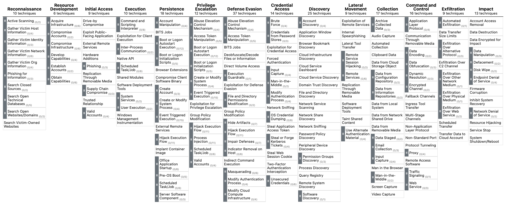

# MITRE ATT&CK & Security Operations (MITRE ATT&CK và hoạt động vận hành bảo mật)

## MITRE ATT&CK là gì?

Framework [MITRE ATT&CK](https://attack.mitre.org/) (Adversarial Tactics, Techniques, and Common Knowledge) là một nguồn tài liệu đồ sộ, được cập nhật thường xuyên, mô tả các tactic, technique và procedure (TTP) mà các tác nhân đe doạ mạng (threat actor) sử dụng. Phương pháp có cấu trúc này giúp các chuyên gia an ninh mạng hiểu, nhận diện và phản ứng với các mối đe doạ một cách chủ động và có hiểu biết hơn.

Framework ATT&CK gồm các ma trận (matrix) được thiết kế riêng cho từng bối cảnh điện toán khác nhau, như hệ thống doanh nghiệp (enterprise), di động (mobile) hay cloud. Mỗi ma trận liên kết các tactic (mục tiêu mà kẻ tấn công muốn đạt được) và technique (phương pháp được dùng để đạt các mục tiêu đó) với các TTP cụ thể. Sự liên kết này cho phép đội bảo mật phân tích và dự đoán hoạt động của kẻ tấn công một cách có hệ thống.

---

## Các use case của MITRE ATT&CK trong Security Operations

Framework MITRE ATT&CK không chỉ là một nguồn tài liệu toàn diện để hiểu các tactic, technique và procedure (TTP) của kẻ tấn công, mà còn đóng vai trò quan trọng trong nhiều khía cạnh của Security Operations. Các khía cạnh này bao gồm:

- `Detection and Response`: Framework hỗ trợ các SOC xây dựng kế hoạch phát hiện và phản ứng dựa trên các TTP đã biết của kẻ tấn công, giúp đội bảo mật xác định các mối nguy tiềm ẩn và xây dựng các biện pháp đối phó chủ động.

- `Security Evaluation and Gap Analysis`: Tổ chức có thể tận dụng framework ATT&CK để xác định điểm mạnh và điểm yếu trong tình trạng bảo mật (security posture) của mình, từ đó ưu tiên đầu tư vào các biện pháp kiểm soát bảo mật (security control) để phòng thủ hiệu quả trước các mối đe doạ liên quan.

- `SOC Maturity Assessment`: Framework ATT&CK cho phép tổ chức đánh giá mức độ trưởng thành (maturity) của Security Operations Center (SOC) bằng cách đo lường khả năng phát hiện, phản ứng và giảm thiểu các TTP khác nhau. Việc đánh giá này giúp xác định các lĩnh vực cần cải thiện và ưu tiên nguồn lực để củng cố tình trạng bảo mật tổng thể.

- `Threat Intelligence`: Framework cung cấp một ngôn ngữ và định dạng thống nhất để mô tả hành động của kẻ tấn công, giúp tổ chức củng cố threat intelligence và cải thiện sự phối hợp giữa các đội nội bộ hoặc với các bên liên quan bên ngoài.

- `Cyber Threat Intelligence Enrichment`: Tận dụng framework ATT&CK có thể giúp tổ chức làm giàu (enrich) cyber threat intelligence bằng cách cung cấp ngữ cảnh về TTP của kẻ tấn công, cũng như thông tin về các mục tiêu tiềm năng và indicator of compromise (IOC). Việc làm giàu này giúp đưa ra quyết định sáng suốt hơn và xây dựng chiến lược giảm thiểu mối đe doạ hiệu quả hơn.

- `Behavioral Analytics Development`: Bằng cách ánh xạ (map) các TTP được mô tả trong framework ATT&CK với các hành vi cụ thể của người dùng và hệ thống, tổ chức có thể xây dựng các mô hình phân tích hành vi (behavioral analytics) để nhận diện các hoạt động bất thường là dấu hiệu của mối đe doạ tiềm ẩn. Cách tiếp cận này nâng cao khả năng phát hiện và giúp đội bảo mật chủ động giảm thiểu rủi ro.

- `Red Teaming and Penetration Testing`: Framework ATT&CK đưa ra một cách có hệ thống để tái hiện các technique thực tế của kẻ tấn công trong các bài tập red teaming và penetration test, qua đó đánh giá năng lực phòng thủ của tổ chức.

- `Training and Education`: Tính toàn diện và được tổ chức tốt của framework ATT&CK khiến nó trở thành một nguồn tài liệu tuyệt vời để đào tạo và giáo dục các chuyên gia bảo mật về những tactic và phương pháp mới nhất của kẻ tấn công.

Tóm lại, framework MITRE ATT&CK là một tài sản không thể thiếu đối với security operations, cung cấp một ngôn ngữ và cấu trúc chung để mô tả và hiểu hành vi của kẻ tấn công. Nó đóng vai trò thiết yếu trong việc nâng cao nhiều khía cạnh của security operations, từ threat intelligence và behavioral analytics đến đánh giá mức độ trưởng thành của SOC và làm giàu cyber threat intelligence.
