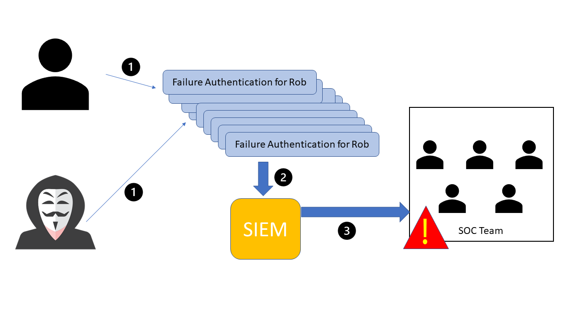
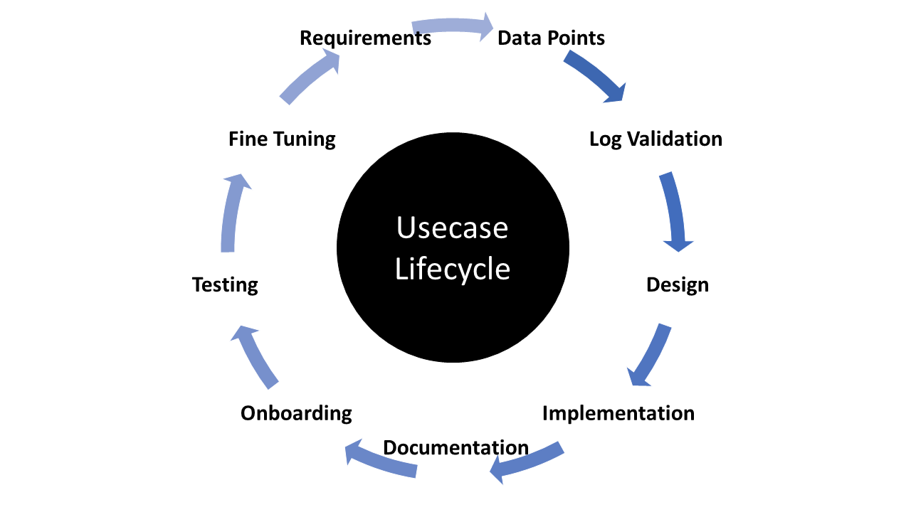
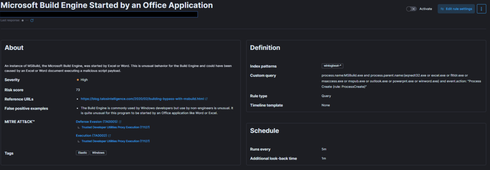
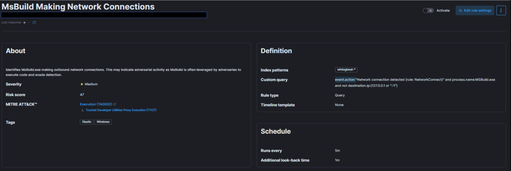

# SIEM Use Case Development (Phát triển use case cho SIEM)

## SIEM use case là gì?

Sử dụng các SIEM use case (tình huống sử dụng) là một khía cạnh nền tảng khi xây dựng một chiến lược an ninh mạng vững chắc, vì chúng cho phép nhận diện và phát hiện hiệu quả các security incident tiềm ẩn. Use case được thiết kế để minh hoạ những tình huống cụ thể mà một sản phẩm hoặc dịch vụ có thể được áp dụng, và chúng có thể trải dài từ các kịch bản chung, chẳng hạn các lần đăng nhập thất bại, đến các kịch bản phức tạp hơn như phát hiện một đợt bùng phát ransomware.

Ví dụ, hãy xét tình huống một người dùng tên Rob gặp 10 lần xác thực thất bại liên tiếp. Các event này có thể đến từ chính người dùng thật do quên thông tin đăng nhập, hoặc từ một tác nhân độc hại đang cố brute force để vào tài khoản. Trong cả hai trường hợp, 10 event này đều được gửi tới hệ thống SIEM, hệ thống sẽ tương quan (correlate) chúng thành một event duy nhất và kích hoạt một alert gửi tới đội SOC thuộc nhóm use case "brute force".

Dựa trên dữ liệu log được tạo ra trong SIEM, đội SOC sau đó chịu trách nhiệm thực hiện hành động phù hợp. Ví dụ này chỉ minh hoạ một trong rất nhiều use case có thể xây dựng, từ những tình huống đơn giản đến phức tạp hơn.

---

## Vòng đời phát triển SIEM use case

Cần xem xét các giai đoạn quan trọng sau khi phát triển bất kỳ use case nào:

1. `Requirements`:
Hiểu rõ mục đích hoặc sự cần thiết của use case, xác định chính xác kịch bản cụ thể cần có alert hoặc thông báo. Yêu cầu có thể do khách hàng, analyst hoặc nhân viên đề xuất. Ví dụ, mục tiêu có thể là thiết kế một detection use case cho tấn công brute force, kích hoạt alert sau 10 lần đăng nhập thất bại liên tiếp trong vòng 4 phút.

2. `Data Points`:
Xác định tất cả các điểm dữ liệu (data point) trong mạng nơi một tài khoản người dùng có thể được dùng để đăng nhập. Thu thập thông tin về các nguồn dữ liệu tạo ra log cho các lần truy cập trái phép hoặc đăng nhập thất bại. Ví dụ, dữ liệu có thể đến từ máy Windows, máy Linux, endpoint, server hoặc ứng dụng. Đảm bảo log ghi lại các chi tiết thiết yếu như user, timestamp, nguồn, đích, v.v.

3. `Log Validation`:
Kiểm tra và xác thực log, đảm bảo chúng chứa đầy đủ các thông tin quan trọng như user, timestamp, nguồn, đích, tên máy và tên ứng dụng. Xác nhận rằng tất cả log đều được nhận trong các event xác thực người dùng khác nhau đối với các data point quan trọng, bao gồm xác thực local, xác thực trên web, xác thực ứng dụng, VPN và OWA (Outlook).

4. `Design and Implementation`:
Sau khi đã xác định và kiểm tra toàn bộ log với các data point và nguồn khác nhau, bắt đầu thiết kế use case bằng cách định nghĩa các điều kiện mà khi thoả mãn thì alert sẽ được kích hoạt. Xem xét ba tham số chính: Condition (điều kiện), Aggregation (gộp) và Priority (mức ưu tiên). Ví dụ, trong use case tấn công brute force, tạo alert cho 10 lần đăng nhập thất bại trong 4 phút, đồng thời cân nhắc aggregation để tránh false positive và đặt mức ưu tiên của alert dựa trên quyền hạn của người dùng bị nhắm tới.

5. `Documentation`:
Standard Operating Procedures (SOP – quy trình vận hành chuẩn) mô tả chi tiết các quy trình chuẩn mà analyst phải tuân theo khi xử lý alert. Nội dung bao gồm các điều kiện, aggregation, mức ưu tiên và thông tin về các đội khác mà analyst cần báo cáo hoạt động. SOP cũng chứa escalation matrix (ma trận chuyển cấp).

6. `Onboarding`:
Bắt đầu với giai đoạn phát triển (development) trước khi đưa alert trực tiếp vào môi trường production. Xác định và khắc phục mọi thiếu sót để giảm false positive, sau đó mới chuyển sang production.

7. `Periodic Update/Fine-tuning`:
Thường xuyên lấy phản hồi từ analyst và duy trì các correlation rule luôn cập nhật bằng cách whitelist. Liên tục tinh chỉnh và tối ưu use case để đảm bảo tính hiệu quả và độ chính xác.

---

## Cách xây dựng SIEM use case

- Hiểu rõ nhu cầu, rủi ro của bạn và thiết lập alert để giám sát tất cả các hệ thống cần thiết cho phù hợp.

- Xác định mức ưu tiên và mức độ ảnh hưởng (impact), sau đó ánh xạ (map) alert với kill chain hoặc framework MITRE.

- Thiết lập Time to Detection (TTD – thời gian phát hiện) và Time to Response (TTR – thời gian phản ứng) cho alert để đánh giá hiệu quả của SIEM và hiệu suất làm việc của analyst.

- Tạo một Standard Operating Procedure (SOP) để quản lý alert.

- Phác thảo quy trình tinh chỉnh alert dựa trên việc giám sát SIEM.

- Xây dựng Incident Response Plan (IRP – kế hoạch ứng phó sự cố) để xử lý các incident true positive.

- Thiết lập Service Level Agreements (SLA) và Operational Level Agreements (OLA) giữa các đội cho việc xử lý alert và tuân thủ IRP.

- Triển khai và duy trì quy trình kiểm toán (audit) đối với việc quản lý alert và báo cáo incident của analyst.

- Tạo tài liệu để rà soát trạng thái ghi log của các máy hoặc hệ thống, cơ sở để tạo alert và tần suất kích hoạt của chúng.

- Xây dựng một tài liệu knowledge base (cơ sở tri thức) cho các thông tin thiết yếu và các cập nhật cho công cụ quản lý case (case management).

---

## Ví dụ 1 (Microsoft Build Engine được khởi chạy bởi một ứng dụng Office)

Bây giờ, hãy cùng xem một ví dụ thực tế sử dụng Elastic stack làm giải pháp SIEM để hiểu cách ánh xạ từng điểm ở trên.

Trong ảnh chụp được cung cấp (một detection use case), ta cần xác định rủi ro và đối tượng mà ta muốn giám sát.

MSBuild, một phần của Microsoft Build Engine, là một hệ thống build phần mềm, lắp ráp ứng dụng dựa trên file input dạng XML của nó. Thông thường, Microsoft Visual Studio tạo ra file input này, nhưng .NET framework và các trình biên dịch khác cũng có thể biên dịch ứng dụng mà không cần nó. Kẻ tấn công [khai thác khả năng](https://blog.talosintelligence.com/building-bypass-with-msbuild/) của MSBuild cho phép nhúng source code độc hại vào file cấu hình hoặc file project của nó. 

Khi giám sát các tham số command-line của tiến trình được thực thi (process execution), điều quan trọng là phải điều tra những trường hợp trình duyệt web hoặc file thực thi của Microsoft Office khởi chạy MSBuild. Hành vi đáng ngờ này gợi ý khả năng hệ thống đã bị xâm nhập. Khi đã thiết lập được baseline (đường cơ sở), các lời gọi MSBuild bất thường sẽ dễ nhận ra và tương đối hiếm, tránh làm tăng khối lượng công việc cho đội.

Để xử lý rủi ro này, ta tạo một detection use case trong giải pháp SIEM để giám sát các trường hợp MSBuild được khởi chạy bởi Excel hoặc Word, vì hành vi này có thể cho thấy một payload script độc hại đang được thực thi.

Tiếp theo, hãy xác định mức ưu tiên, mức độ ảnh hưởng và ánh xạ alert với kill chain hoặc framework MITRE.

Dựa trên rủi ro và threat intelligence nói trên, technique này, được gọi là Living-off-the-land binaries ([LoLBins](https://www.cynet.com/attack-techniques-hands-on/what-are-lolbins-and-how-do-attackers-use-them-in-fileless-attacks)), là một mối đe doạ nghiêm trọng nếu bị phát hiện, khiến nó thuộc nhóm rủi ro cao trên phạm vi toàn cầu. Do đó, ta gán cho nó mức severity HIGH, dù điều này có thể thay đổi tuỳ theo bối cảnh và đặc thù cụ thể của tổ chức bạn.

Về việc ánh xạ MITRE, use case này liên quan đến việc vượt qua các kỹ thuật phát hiện bằng cách sử dụng LoLBins, thuộc tactic Defense Evasion ([TA0005](https://attack.mitre.org/tactics/TA0005/)), technique Trusted Developer Utilities Proxy Execution ([T1127](https://attack.mitre.org/techniques/T1127/)) và sub-technique Trusted Developer Utilities Proxy Execution: MSBuild ([T1127.001](https://attack.mitre.org/techniques/T1127/001/)).  Ngoài ra, việc thực thi binary MSBuild trên endpoint cũng thuộc tactic Execution ([TA0002](https://attack.mitre.org/tactics/TA0002/)).

Để xác định TTD và TTR, ta cần tập trung vào khoảng thời gian chạy của rule và pipeline tiếp nhận dữ liệu (data ingestion) đã đề cập trước đó. Trong ví dụ này, ta đặt rule chạy mỗi năm phút, giám sát toàn bộ log đi vào.

Khi tạo SOP và lập tài liệu về cách xử lý alert, cần xem xét các điểm sau:

- process.name
- process.parent.name
- event.action
- máy mà alert được phát hiện
- người dùng gắn với máy đó
- hoạt động của người dùng trong khoảng +/- 2 ngày quanh thời điểm alert được tạo
- Sau khi thu thập các thông tin này, bên phòng thủ nên trao đổi với người dùng và kiểm tra máy của người dùng để phân tích system log, antivirus log và proxy log từ SIEM nhằm có cái nhìn đầy đủ.

Đội SOC nên ghi lại tất cả các điểm trên cùng với Incident Response Plan để các Incident Handler có thể tham khảo trong quá trình phân tích.

Để tinh chỉnh rule, điều cần thiết là phải hiểu các điều kiện có thể gây ra false positive. Ví dụ, dù Build Engine phổ biến với các lập trình viên Windows, việc người không làm kỹ thuật sử dụng nó lại là điều bất thường. Loại trừ tên các parent process hợp lệ khỏi rule giúp tránh false positive. Chi tiết hơn về việc tinh chỉnh rule SIEM sẽ được trình bày sau.

---

## Ví dụ 2 (MSBuild tạo kết nối mạng)

Ví dụ 1 đã bàn về một detection use case và rule có mức severity cao. Bây giờ, hãy xem xét một use case có mức severity trung bình sử dụng giải pháp SIEM để hiểu rõ hơn mỗi điểm trên góp phần như thế nào vào hiệu quả của use case.

Trong ảnh chụp được cung cấp, ta cần xác định rủi ro và đối tượng mà ta đang cố gắng giám sát.

Giống như Ví dụ 1, ta lại tập trung vào binary MsBuild.exe. Tuy nhiên, lần này ta xét kịch bản một máy cố gắng giao tiếp ra ngoài (outbound) với một địa chỉ IP từ xa hoặc có khả năng độc hại, và tiến trình đứng sau kết nối đó là MsBuild.exe. Điều này sẽ gây báo động, vì nó có thể cho thấy hoạt động của kẻ tấn công. MsBuild thường bị kẻ tấn công lợi dụng để thực thi code và né tránh việc bị phát hiện.

Để xử lý rủi ro này, ta cần một giải pháp giám sát có khả năng phát hiện các trường hợp MsBuild chịu trách nhiệm cho các kết nối outbound độc hại. Ta tạo một detection use case trong giải pháp SIEM cho mục đích này.

Tiếp theo, hãy xác định mức ưu tiên, mức độ ảnh hưởng và ánh xạ alert với kill chain hoặc framework MITRE.

Khác với ví dụ trước, tình huống này có thể xảy ra bất cứ khi nào MsBuild.exe thiết lập một kết nối outbound. Tiến trình này cũng có thể kết nối tới một địa chỉ IP hợp lệ, chẳng hạn IP của Microsoft để cập nhật. Do đó, ta có thể gặp nhiều false positive hơn trừ khi triển khai một quy trình threat intelligence vững chắc. Vì vậy, ta nên gán cho detection rule này mức severity MEDIUM thay vì HIGH.

Giống như Ví dụ 1, để thực hiện được mối đe doạ cụ thể này, kẻ tấn công cần thực thi binary MsBuild trên endpoint, điều này thuộc tactic Execution (TA0002).

Hầu hết các điểm khác vẫn giữ nguyên, nhưng SOP và Incident Response Plan sẽ khác khi xử lý loại alert cụ thể này. Bên phòng thủ sẽ cần tập trung vào event.action, địa chỉ IP và danh tiếng (reputation) của IP đó, cùng các yếu tố khác.
