# SIEM Visualization Example 1: Failed Logon Attempts (All Users) (Ví dụ visualization SIEM 1: Các lần đăng nhập thất bại – tất cả người dùng)

Dashboard trong các giải pháp SIEM đóng vai trò là nơi chứa nhiều visualization (biểu đồ trực quan hoá), cho phép ta sắp xếp và hiển thị dữ liệu một cách có ý nghĩa.

Trong phần này và các phần tiếp theo, ta sẽ tạo một dashboard và một số visualization từ đầu.

---

## Xây dựng Dashboard & Visualization đầu tiên

Kéo xuống cuối phần này và bấm vào `Click here to spawn the target system!`

Bây giờ, truy cập `http://[Target IP]:5601`, bấm vào nút bật/tắt thanh điều hướng bên (side navigation toggle), rồi bấm vào "Dashboard".

Xoá dashboard "SOC-Alerts" hiện có như sau.

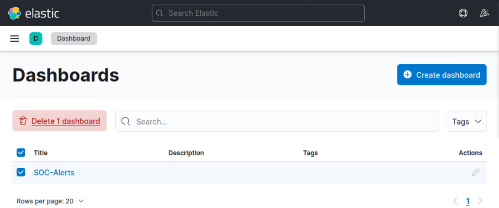

Khi vào lại trang Dashboard, ta sẽ thấy một thông báo cho biết hiện chưa có dashboard nào. Ngoài ra, sẽ có tuỳ chọn để tạo một Dashboard mới cùng visualization đầu tiên của nó. Để bắt đầu tạo dashboard đầu tiên, ta chỉ cần bấm nút "Create new dashboard".

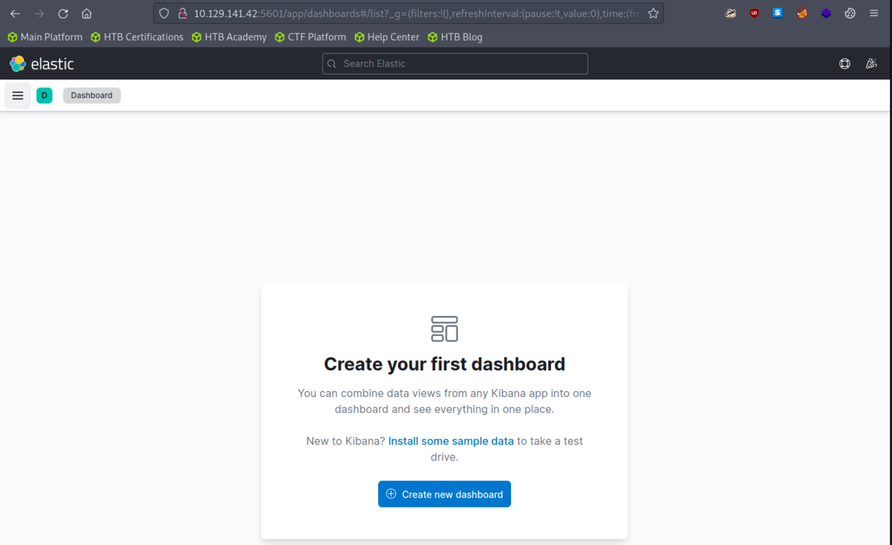

Giờ, để bắt đầu tạo visualization đầu tiên, ta chỉ cần bấm nút "Create visualization".

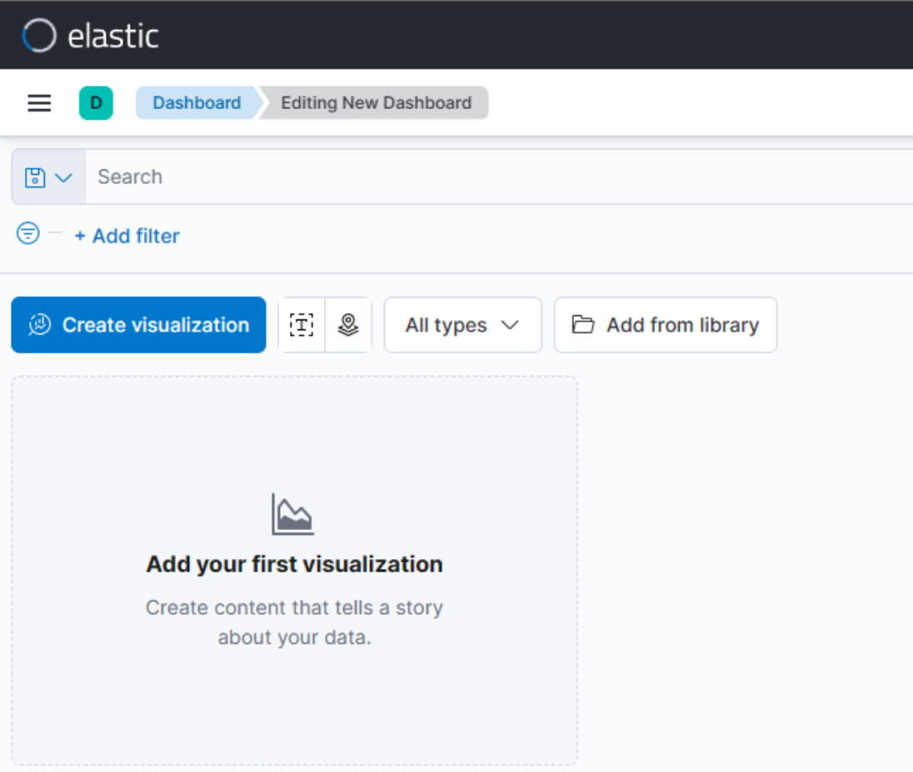

Khi bắt đầu tạo visualization đầu tiên, cửa sổ mới sau đây sẽ xuất hiện với nhiều tuỳ chọn và thiết lập. 

Trước khi cấu hình bất cứ gì, điều quan trọng là ta phải bấm vào biểu tượng lịch để mở bộ chọn thời gian (time picker). Sau đó, ta cần chỉ định khoảng thời gian là "last 15 years". Cuối cùng, bấm nút "Apply" để áp dụng khoảng thời gian đã chỉ định cho dữ liệu.


Có bốn điểm ta cần chú ý trên cửa sổ này:

1. Một tuỳ chọn filter cho phép ta lọc dữ liệu trước khi tạo biểu đồ. Ví dụ, nếu mục tiêu là hiển thị các lần đăng nhập thất bại, ta có thể dùng filter để chỉ xét các event ID khớp với `4625 – Failed logon attempt on a Windows system`. Hình sau minh hoạ cách chỉ định một filter như vậy.

	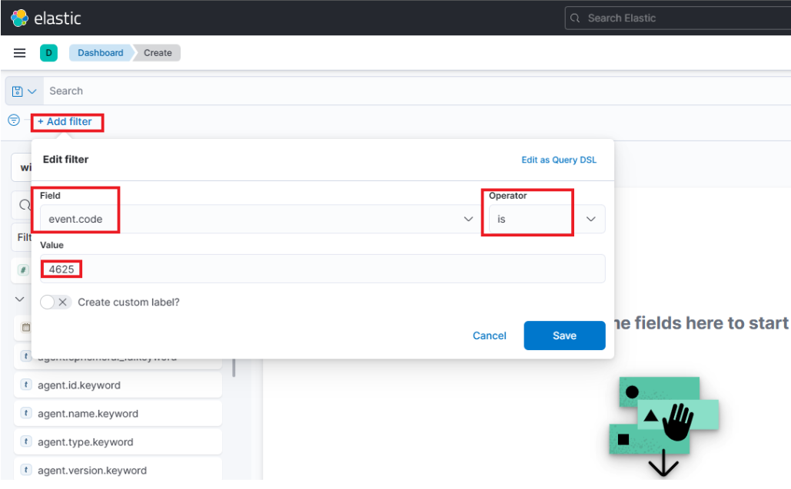

2. Trường này cho biết tập dữ liệu (index) mà ta sẽ dùng. Dữ liệu từ các nguồn hạ tầng khác nhau thường được tách vào các index khác nhau, như network, Windows, Linux, v.v. Trong ví dụ cụ thể này, ta sẽ chỉ định `windows*` trong "Index pattern".

3. Thanh tìm kiếm này cho phép ta kiểm tra lại sự tồn tại của một field cụ thể trong tập dữ liệu, như một cách nữa để đảm bảo ta đang xem đúng dữ liệu. Ví dụ, giả sử ta quan tâm tới field `user.name.keyword`. Ta có thể dùng thanh tìm kiếm để tìm nhanh và xác minh field này có hiện diện và được phát hiện trong tập dữ liệu đã chọn hay không. Nhờ đó ta xác nhận được mình đang truy cập đúng field mong muốn và làm việc với dữ liệu chính xác.

	

	Có thể bạn sẽ hỏi: "Tại sao lại là `user.name.keyword` mà không phải `user.name`?". Ta nên dùng field `.keyword` khi thực hiện aggregation (tổng hợp dữ liệu). Hãy tham khảo [câu hỏi trên stackoverflow](https://stackoverflow.com/questions/48869795/difference-between-a-field-and-the-field-keyword) này để có câu trả lời chi tiết hơn.


4. Cuối cùng, menu thả xuống này cho phép ta chọn loại visualization muốn tạo. Tuỳ chọn mặc định hiển thị ở hình trước là "Bar vertical stacked". Nếu bấm vào nút đó, các tuỳ chọn khác có sẵn sẽ hiện ra (hình đã được lược bớt vì không phải mọi tuỳ chọn đều vừa màn hình). Từ danh sách mở rộng này, ta có thể chọn loại visualization phù hợp nhất với yêu cầu và nhu cầu trình bày dữ liệu của mình.

	

---

Với visualization này, hãy chọn tuỳ chọn "Table". Sau khi chọn "Table", ta có thể bấm vào tuỳ chọn "Rows". Thao tác này cho phép ta chọn các thành phần dữ liệu cụ thể muốn đưa vào dạng xem bảng.


Hãy cấu hình phần "Rows" như sau.

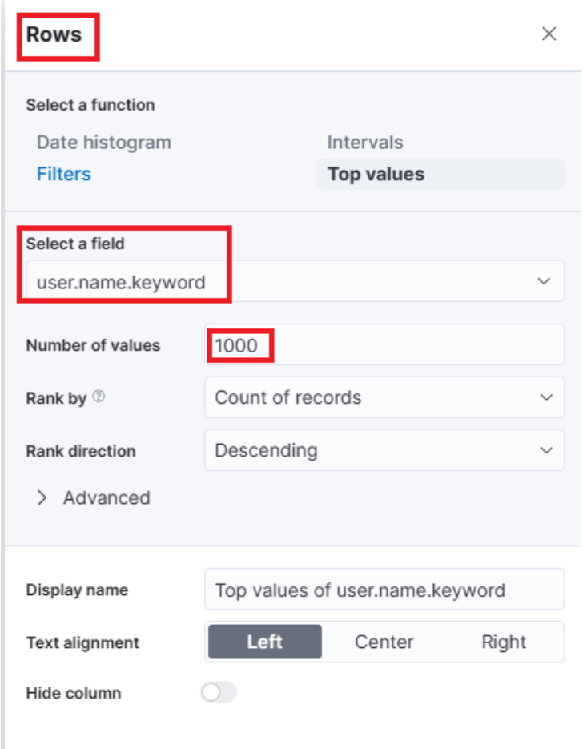

**Lưu ý**: Bạn sẽ thấy `Rank by Alphabetical` chứ không phải `Rank by Count of records` như trong ảnh chụp màn hình ở trên. Điều này không sao. Khi bạn thực hiện bước cấu hình tiếp theo bên dưới, `Count of records` sẽ xuất hiện.

Tiếp theo, hãy đóng cửa sổ "Rows" và chuyển sang phần cấu hình "Metrics".

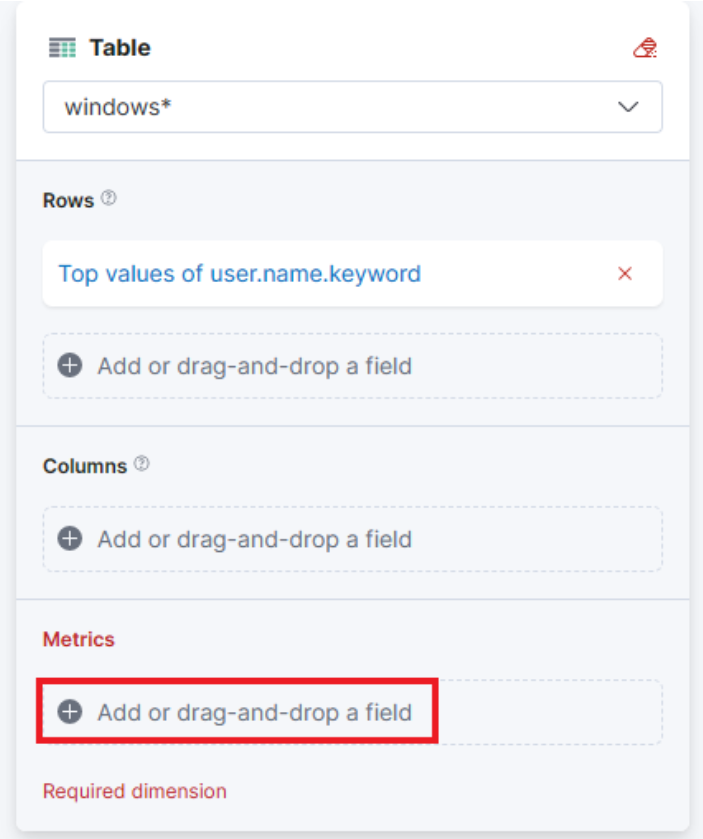

Trong cửa sổ "Metrics", hãy chọn "count" làm metric mong muốn.


Ngay khi chọn "Count" làm metric, ta sẽ thấy bảng được điền dữ liệu (giả sử có event trong tập dữ liệu đã chọn)

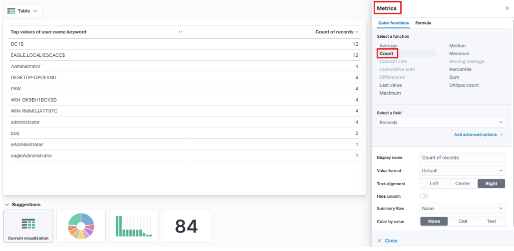

Một bổ sung cuối cùng cho bảng là thêm một thiết lập "Rows" nữa để hiển thị máy nơi xảy ra lần đăng nhập thất bại. Để làm việc này, ta sẽ chọn field `host.hostname.keyword`, đại diện cho máy tính ghi nhận (report) lần đăng nhập thất bại. Nhờ đó ta có thể hiển thị hostname hoặc tên máy bên cạnh số lần đăng nhập thất bại, như trong hình.

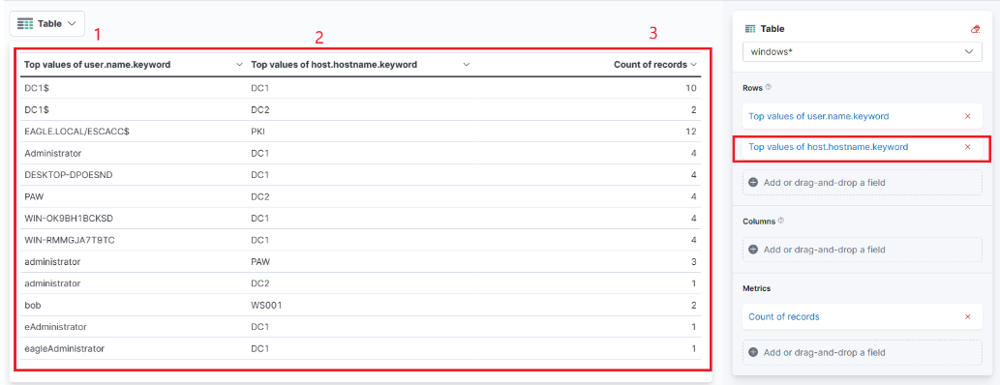

Giờ ta thấy ba cột trong bảng, chứa các thông tin sau:

1. Username của những người đăng nhập (Lưu ý: Hiện tại nó hiển thị cả user lẫn máy tính. Lý tưởng nhất là nên áp dụng một filter để loại các thiết bị máy tính và chỉ hiển thị user).
2. Máy nơi diễn ra lần thử đăng nhập.

3. Số lần event đã xảy ra (dựa trên khung thời gian đã chỉ định hoặc toàn bộ tập dữ liệu, tuỳ thiết lập).

Cuối cùng, bấm "Save and return", bạn sẽ thấy visualization mới được thêm vào dashboard, trông như hình sau.

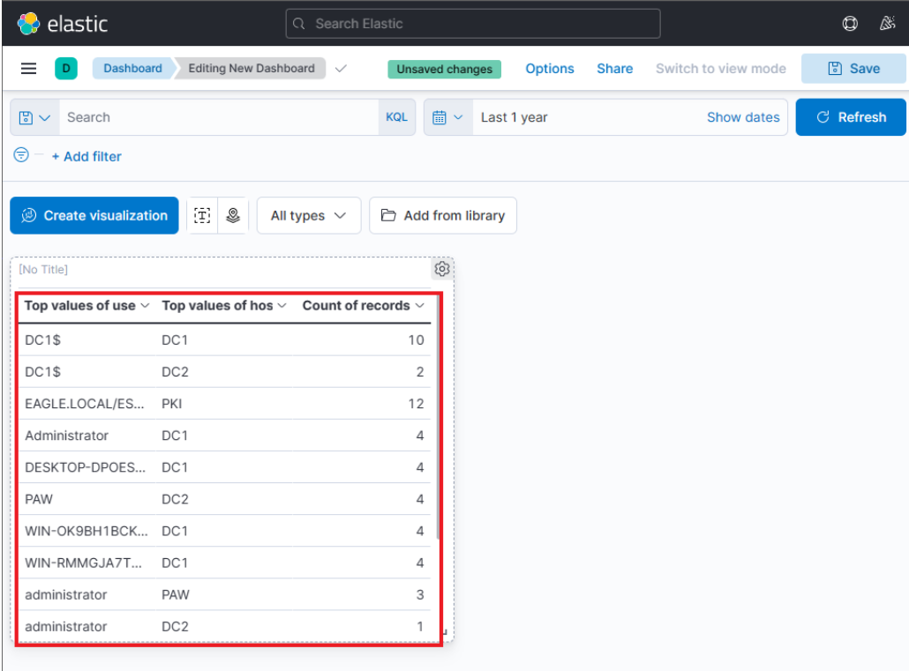

Đừng quên lưu cả dashboard. Ta có thể làm việc này đơn giản bằng cách bấm nút "Save".

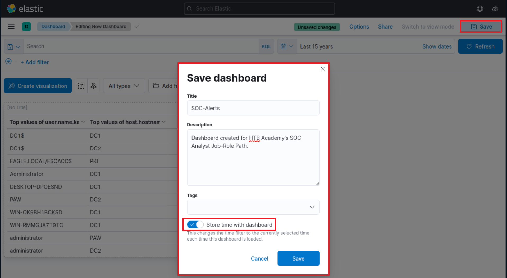

---

## Tinh chỉnh Visualization

Giả sử SOC Manager đề xuất các tinh chỉnh sau:

- Cần đặt tên cột rõ ràng hơn trong visualization
- Cần đưa Logon Type vào visualization
- Kết quả trong visualization cần được sắp xếp
- Các username DESKTOP-DPOESND, WIN-OK9BH1BCKSD và WIN-RMMGJA7T9TC
không nên được giám sát
- Không nên giám sát [các tài khoản máy tính (computer account)](https://learn.microsoft.com/en-us/azure/active-directory/fundamentals/service-accounts-computer) (đây không phải cách làm tốt)

Hãy tinh chỉnh visualization đã tạo để đáp ứng các đề xuất trên.

Truy cập `http://[Target IP]:5601`, bấm vào nút bật/tắt thanh điều hướng bên, rồi bấm vào "Dashboard".

Dashboard ta đã tạo trước đó sẽ hiển thị. Hãy bấm vào biểu tượng "bút chì"/chỉnh sửa.


Giờ hãy bấm nút "bánh răng" ở góc trên bên phải của visualization, rồi bấm "Edit lens".

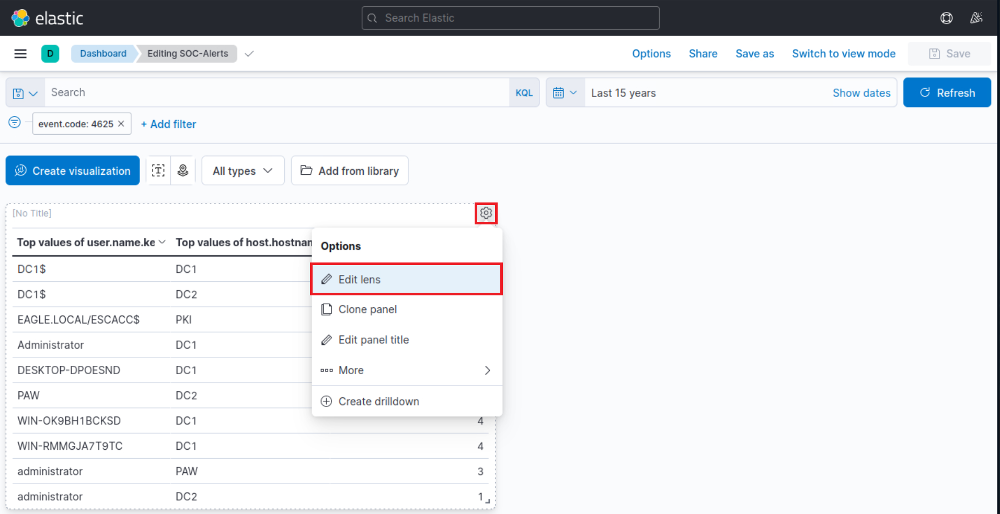

"Top values of user.name.keyword" cần được thay đổi như sau.

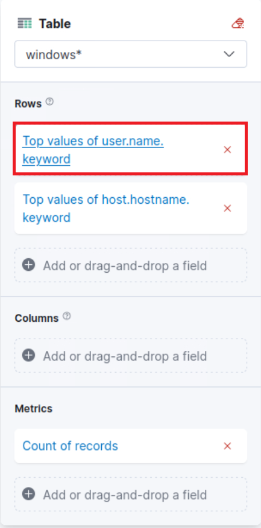

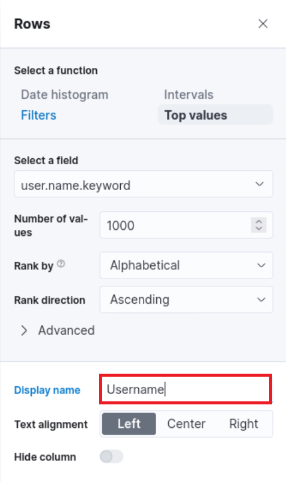

"Top values of host.hostname.keyword" cần được thay đổi như sau.

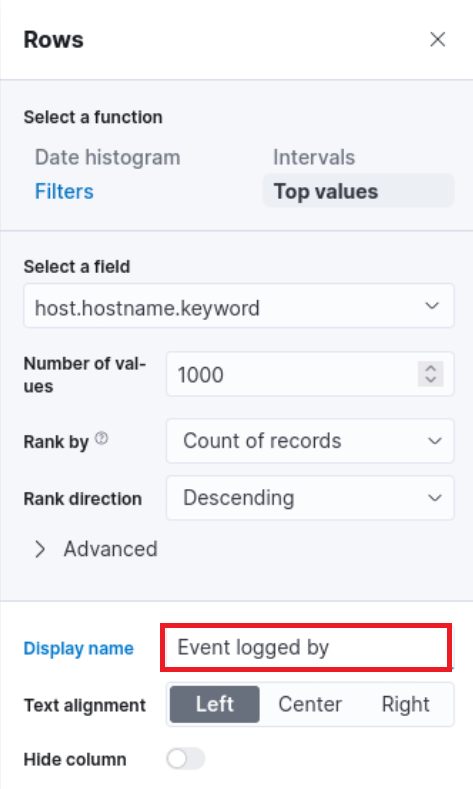

Có thể thêm "Logon Type" như sau (ta sẽ dùng field `winlog.logon.type.keyword`).

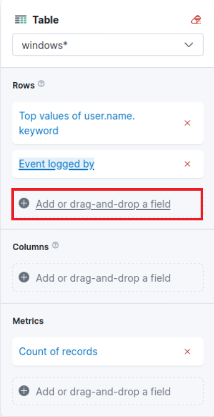
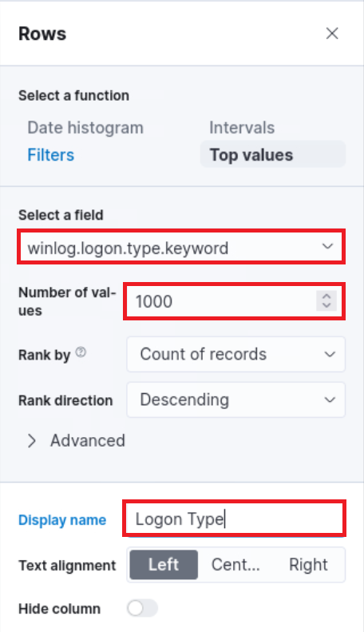

"Count of records" cần được thay đổi như sau.
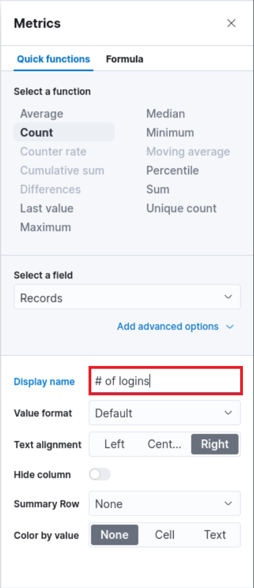

Ta có thể thêm việc sắp xếp kết quả như sau.
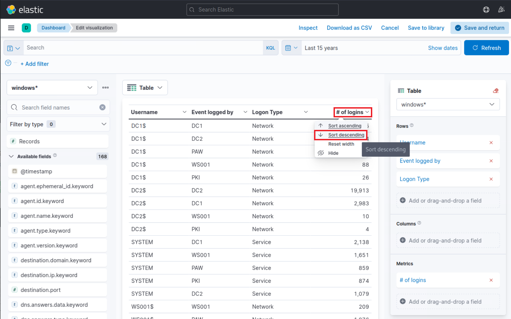

Giờ ta chỉ cần bấm "Save and return".

Có thể loại các username DESKTOP-DPOESND, WIN-OK9BH1BCKSD và WIN-RMMGJA7T9TC
bằng cách chỉ định thêm các filter như sau.

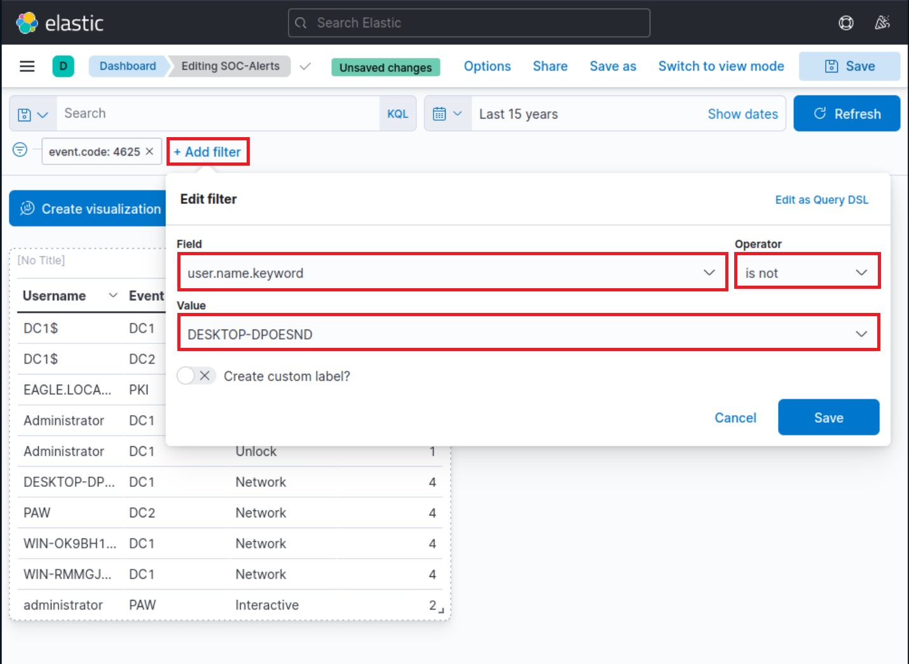

Có thể loại các tài khoản máy tính bằng cách chỉ định truy vấn KQL sau và bấm nút "Update".

```shell-session
NOT user.name: *$ AND winlog.channel.keyword: Security
```

Phần `AND winlog.channel.keyword: Security` nhằm đảm bảo không tính các log không liên quan.

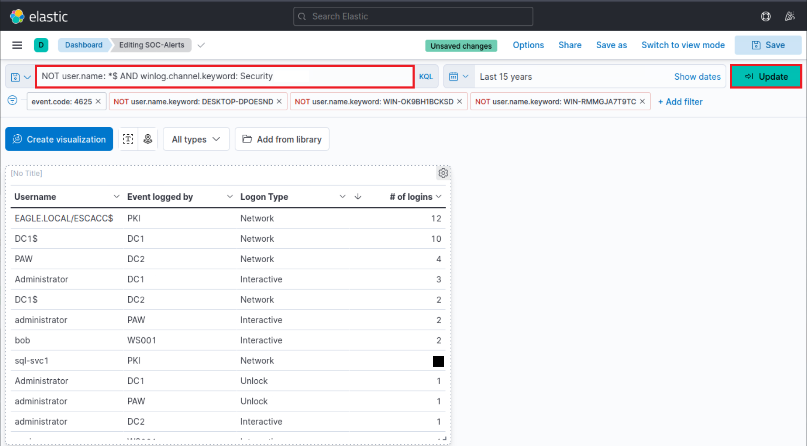

Đây là visualization của ta sau tất cả các tinh chỉnh đã thực hiện. 

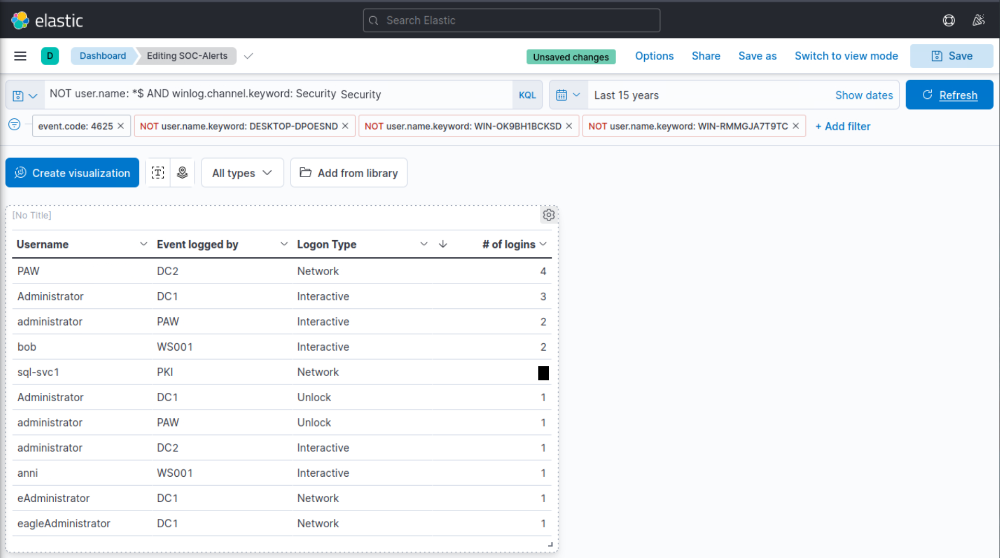

Cuối cùng, hãy đặt tiêu đề cho visualization bằng cách bấm vào "No Title".

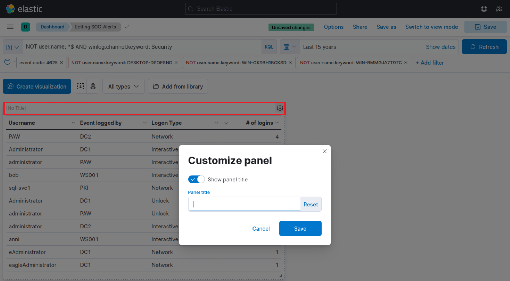

Đừng quên bấm nút "Save" (nút ở phía trên bên phải cửa sổ).

<div class="card bg-light">
    <div class="card-body">
				 <p class="mb-0">Vui lòng chờ 3-5 phút để Kibana sẵn sàng sau khi khởi tạo (spawn) target của các câu hỏi bên dưới. </p>
    </div>
</div>
