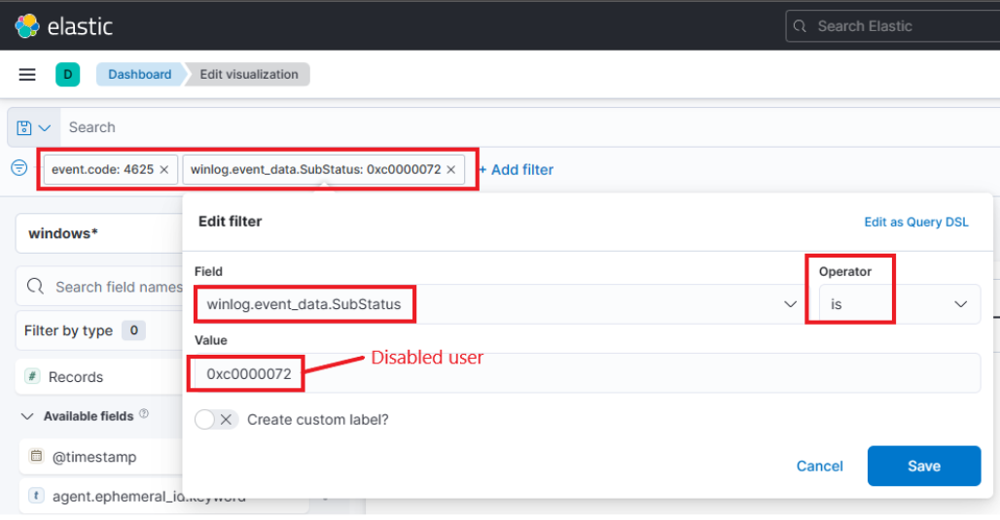
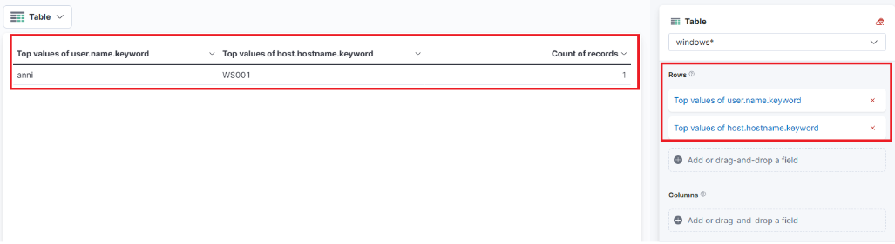

# SIEM Visualization Example 2: Failed Logon Attempts (Disabled Users) (Ví dụ visualization SIEM 2: Các lần đăng nhập thất bại – người dùng bị vô hiệu hoá)

Trong ví dụ visualization SIEM này, ta muốn tạo visualization để giám sát các lần đăng nhập thất bại nhắm vào những user đã bị vô hiệu hoá (disabled).

Ta nói "thất bại" vì không thể đăng nhập bằng một user đã bị vô hiệu hoá, nên việc đăng nhập sẽ không bao giờ thành công kể cả khi cung cấp đúng thông tin đăng nhập. Trong trường hợp cung cấp đúng thông tin đăng nhập, log Windows sẽ chứa thêm giá trị SubStatus là 0xC0000072, cho biết lý do thất bại.

Kéo xuống cuối phần này và bấm vào `Click here to spawn the target system!`.

Truy cập `http://[Target IP]:5601`, bấm vào nút bật/tắt thanh điều hướng bên (side navigation toggle), rồi bấm vào "Dashboard".

Một dashboard dựng sẵn sẽ hiển thị. Hãy bấm vào biểu tượng "bút chì"/chỉnh sửa.

Giờ, để bắt đầu tạo visualization đầu tiên, ta chỉ cần bấm nút "Create visualization".

Khi bắt đầu tạo visualization đầu tiên, cửa sổ mới sau đây sẽ xuất hiện với nhiều tuỳ chọn và thiết lập.

Có bốn điểm ta cần chú ý trên cửa sổ này:

1. Một tuỳ chọn filter cho phép ta lọc dữ liệu trước khi tạo biểu đồ. Trong trường hợp này, mục tiêu của ta là chỉ hiển thị các lần đăng nhập thất bại nhắm vào user bị vô hiệu hoá. Ta có thể dùng filter để chỉ xét các event ID khớp với `4625 – Failed logon attempt on a Windows system`, giống như ở ví dụ visualization trước. Tuy nhiên, lần này ta cũng cần xét tới SubStatus (field `winlog.event_data.SubStatus`) — khi có giá trị 0xC0000072, nó cho biết lần thất bại là do đăng nhập bằng user bị vô hiệu hoá. Hình sau minh hoạ cách chỉ định một filter như vậy.

	

2. Trường này cho biết tập dữ liệu (index) mà ta sẽ dùng. Dữ liệu từ các nguồn hạ tầng khác nhau thường được tách vào các index khác nhau, như network, Windows, Linux, v.v. Trong ví dụ cụ thể này, ta sẽ chỉ định `windows*` trong "Index pattern".

3. Thanh tìm kiếm này cho phép ta kiểm tra lại sự tồn tại của một field cụ thể trong tập dữ liệu, như một cách nữa để đảm bảo ta đang xem đúng dữ liệu. Giống visualization trước, ta quan tâm tới field `user.name.keyword`. Ta có thể dùng thanh tìm kiếm để tìm nhanh và xác minh field này có hiện diện và được phát hiện trong tập dữ liệu đã chọn hay không. Nhờ đó ta xác nhận được mình đang truy cập đúng field mong muốn và làm việc với dữ liệu chính xác.

	

4. Cuối cùng, menu thả xuống này cho phép ta chọn loại visualization muốn tạo. Tuỳ chọn mặc định hiển thị ở hình trước là "Bar vertical stacked". Nếu bấm vào nút đó, các tuỳ chọn khác có sẵn sẽ hiện ra (hình đã được lược bớt vì không phải mọi tuỳ chọn đều vừa màn hình). Từ danh sách mở rộng này, ta có thể chọn loại visualization phù hợp nhất với yêu cầu và nhu cầu trình bày dữ liệu của mình.

	

---

Với visualization này, hãy chọn tuỳ chọn "Table". Sau khi chọn "Table", ta có thể bấm vào tuỳ chọn "Rows". Thao tác này cho phép ta chọn các thành phần dữ liệu cụ thể muốn đưa vào dạng xem bảng.

Hãy cấu hình phần "Rows" như sau.

Tiếp theo, hãy đóng cửa sổ "Rows" và chuyển sang phần cấu hình "Metrics".

Trong cửa sổ "Metrics", hãy chọn "count" làm metric mong muốn.

Một bổ sung cuối cùng cho bảng là thêm một thiết lập "Rows" nữa để hiển thị máy nơi xảy ra lần đăng nhập thất bại. Để làm việc này, ta sẽ chọn field `host.hostname.keyword`, đại diện cho máy tính ghi nhận (report) lần đăng nhập thất bại. Nhờ đó ta có thể hiển thị hostname hoặc tên máy bên cạnh số lần đăng nhập thất bại, như trong hình.

Giờ ta thấy ba cột trong bảng, chứa các thông tin sau:

1. User bị vô hiệu hoá có thông tin đăng nhập đã tạo ra event đăng nhập thất bại. 

2. Máy nơi diễn ra lần thử đăng nhập.

3. Số lần event đã xảy ra (dựa trên khung thời gian đã chỉ định hoặc toàn bộ tập dữ liệu, tuỳ thiết lập).

Cuối cùng, bấm "Save and return", bạn sẽ thấy visualization mới được thêm vào dashboard.

    

				 
Vui lòng chờ 3-5 phút để Kibana sẵn sàng sau khi khởi tạo (spawn) target của các câu hỏi bên dưới. 

    

