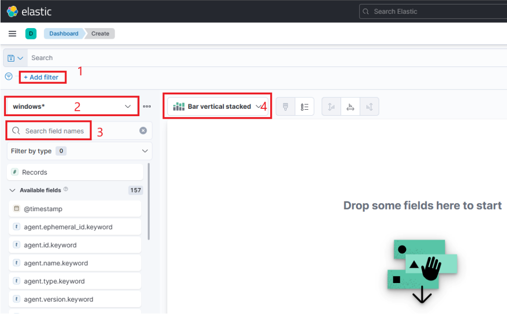
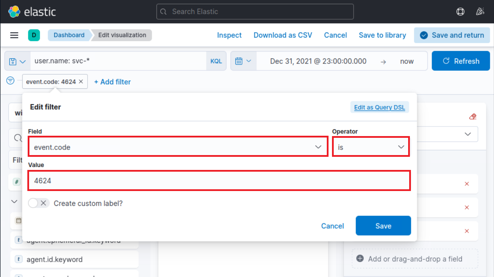
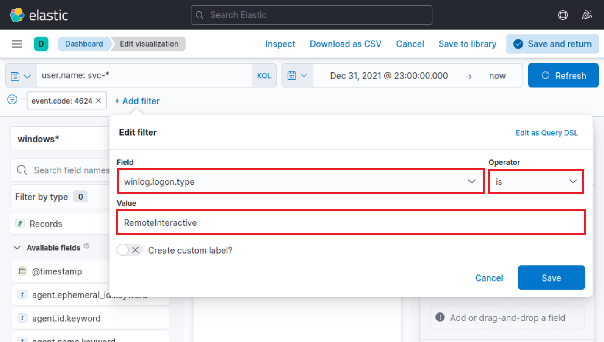
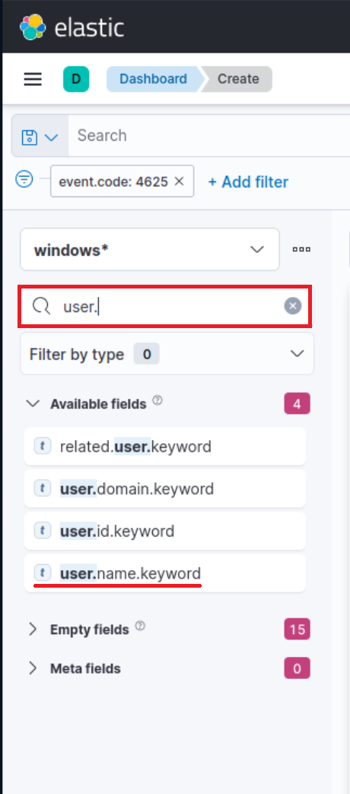
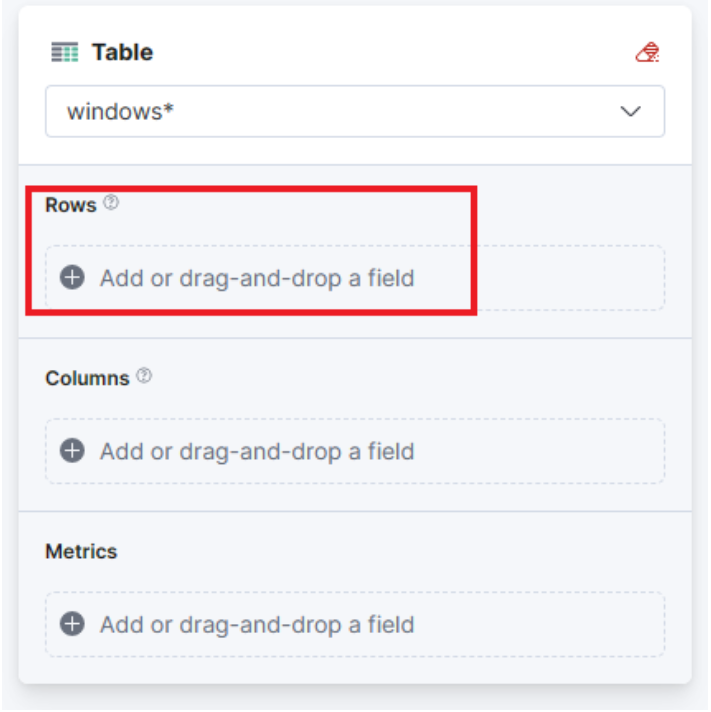
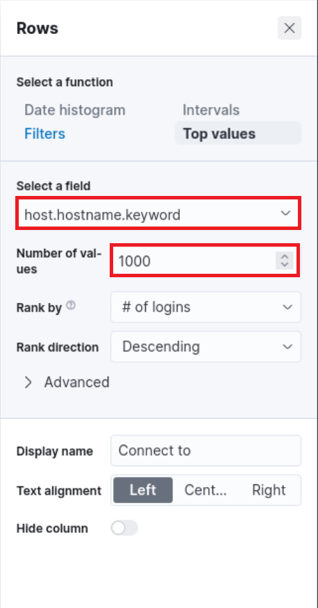
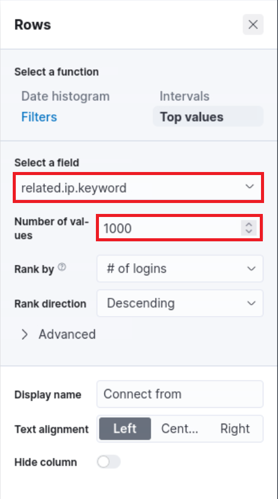
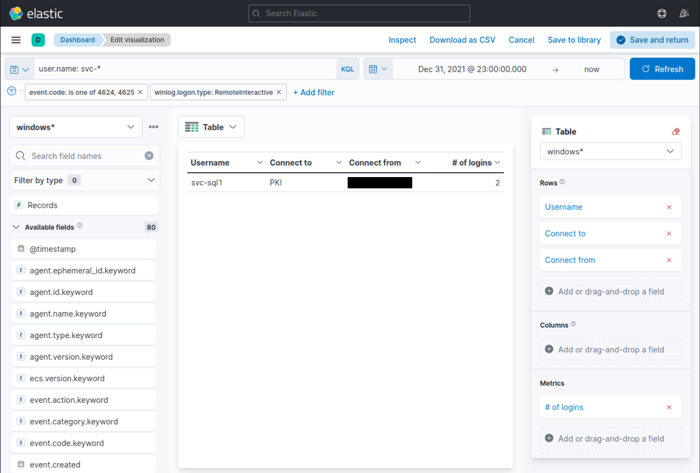

# SIEM Visualization Example 3: Successful RDP Logon Related To Service Accounts (Ví dụ visualization SIEM 3: Đăng nhập RDP thành công liên quan tới service account)

Trong ví dụ visualization SIEM này, ta muốn tạo một visualization để giám sát các lần đăng nhập RDP thành công liên quan cụ thể tới service account (tài khoản dịch vụ). Trong môi trường doanh nghiệp/thực tế, thông tin đăng nhập của service account không bao giờ được dùng để đăng nhập RDP. Bộ phận IT Operations đã thông báo với ta rằng mọi service account trong môi trường đều bắt đầu bằng `svc-`.

Lý do tạo visualization này xuất phát từ thực tế là service account thường sở hữu quyền hạn đặc biệt cao. Ta cần theo dõi sát cách các service account được sử dụng.

Visualization của ta sẽ dựa trên Windows event log sau.

- [4624: An account was successfully logged on](https://www.ultimatewindowssecurity.com/securitylog/encyclopedia/event.aspx?eventid=4624)

Kéo xuống cuối phần này và bấm vào `Click here to spawn the target system!`.

Truy cập `http://[Target IP]:5601`, bấm vào nút bật/tắt thanh điều hướng bên (side navigation toggle), rồi bấm vào "Dashboard".

Một dashboard dựng sẵn sẽ hiển thị. Hãy bấm vào biểu tượng "bút chì"/chỉnh sửa.


Giờ, để bắt đầu tạo visualization đầu tiên, ta chỉ cần bấm nút "Create visualization".

Khi bắt đầu tạo visualization đầu tiên, cửa sổ mới sau đây sẽ xuất hiện với nhiều tuỳ chọn và thiết lập.



Có bốn điểm ta cần chú ý trên cửa sổ này:

1. Một tuỳ chọn filter cho phép ta lọc dữ liệu trước khi tạo biểu đồ. Trong trường hợp này, mục tiêu của ta là hiển thị các lần đăng nhập RDP thành công liên quan cụ thể tới service account. Ta có thể dùng filter để chỉ xét các event ID khớp với `4624 – An account was successfully logged on`. Tuy nhiên, lần này ta cũng cần xét tới logon type, giá trị này phải là `RemoteInteractive` (field `winlog.logon.type`). Các hình sau minh hoạ cách chỉ định những filter như vậy.

	

	

2. Trường này cho biết tập dữ liệu (index) mà ta sẽ dùng. Dữ liệu từ các nguồn hạ tầng khác nhau thường được tách vào các index khác nhau, như network, Windows, Linux, v.v. Trong ví dụ cụ thể này, ta sẽ chỉ định `windows*` trong "Index pattern".

3. Thanh tìm kiếm này cho phép ta kiểm tra lại sự tồn tại của một field cụ thể trong tập dữ liệu, như một cách nữa để đảm bảo ta đang xem đúng dữ liệu. Ta quan tâm tới field `user.name.keyword`. Ta có thể dùng thanh tìm kiếm để tìm nhanh và xác minh field này có hiện diện và được phát hiện trong tập dữ liệu đã chọn hay không. Nhờ đó ta xác nhận được mình đang truy cập đúng field mong muốn và làm việc với dữ liệu chính xác.

	

4. Cuối cùng, menu thả xuống này cho phép ta chọn loại visualization muốn tạo. Tuỳ chọn mặc định hiển thị ở hình trước là "Bar vertical stacked". Nếu bấm vào nút đó, các tuỳ chọn khác có sẵn sẽ hiện ra (hình đã được lược bớt vì không phải mọi tuỳ chọn đều vừa màn hình). Từ danh sách mở rộng này, ta có thể chọn loại visualization phù hợp nhất với yêu cầu và nhu cầu trình bày dữ liệu của mình.

	

---

Với visualization này, hãy chọn tuỳ chọn "Table". Sau khi chọn "Table", ta có thể bấm vào tuỳ chọn "Rows". Thao tác này cho phép ta chọn các thành phần dữ liệu cụ thể muốn đưa vào dạng xem bảng.



Hãy cấu hình phần "Rows" như sau.


Tiếp theo, hãy đóng cửa sổ "Rows" và chuyển sang phần cấu hình "Metrics".


Trong cửa sổ "Metrics", hãy chọn "count" làm metric mong muốn.


Một bổ sung cuối cùng cho bảng là thêm hai thiết lập "Rows" nữa để hiển thị máy nơi diễn ra lần đăng nhập RDP thành công và máy đã khởi tạo lần đăng nhập RDP thành công đó. Để làm việc này, ta sẽ chọn field `host.hostname.keyword` đại diện cho máy tính ghi nhận (report) lần đăng nhập RDP thành công và field `related.ip.keyword` đại diện cho IP của máy tính khởi tạo lần đăng nhập RDP thành công. Nhờ đó ta có thể hiển thị các máy liên quan bên cạnh số lần đăng nhập thành công, như trong hình.





Như đã nói, ta muốn giám sát các lần đăng nhập RDP thành công liên quan cụ thể tới service account, khi biết chắc rằng mọi service account trong môi trường đều bắt đầu bằng `svc-`. Vì vậy, để hoàn tất visualization, ta cần chỉ định truy vấn KQL sau.

```shell-session
user.name: svc-*
```

**Lưu ý**: Như bạn thấy, ta không dùng field `.keyword` trong truy vấn KQL.



Giờ ta thấy bốn cột trong bảng, chứa các thông tin sau:

1. Service account có thông tin đăng nhập đã tạo ra event đăng nhập RDP thành công. 

2. Máy nơi diễn ra lần thử đăng nhập.

3. IP của máy đã khởi tạo lần thử đăng nhập.

4. Số lần event đã xảy ra (dựa trên khung thời gian đã chỉ định hoặc toàn bộ tập dữ liệu, tuỳ thiết lập).

Cuối cùng, bấm "Save and return", bạn sẽ thấy visualization mới được thêm vào dashboard.

<div class="card bg-light">
    <div class="card-body">
				 <p class="mb-0">Vui lòng chờ 3-5 phút để Kibana sẵn sàng sau khi khởi tạo (spawn) target của các câu hỏi bên dưới. </p>
    </div>
</div>
