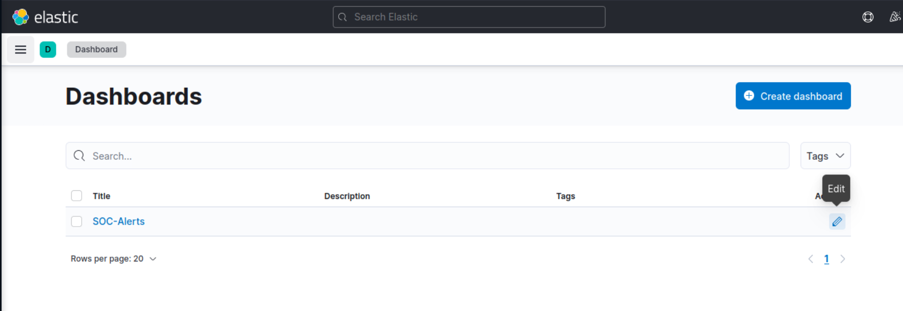
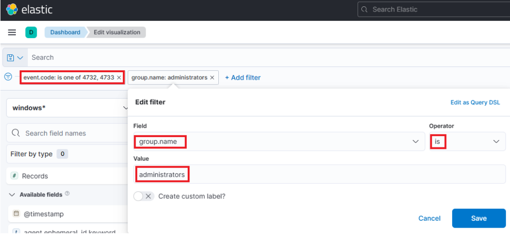
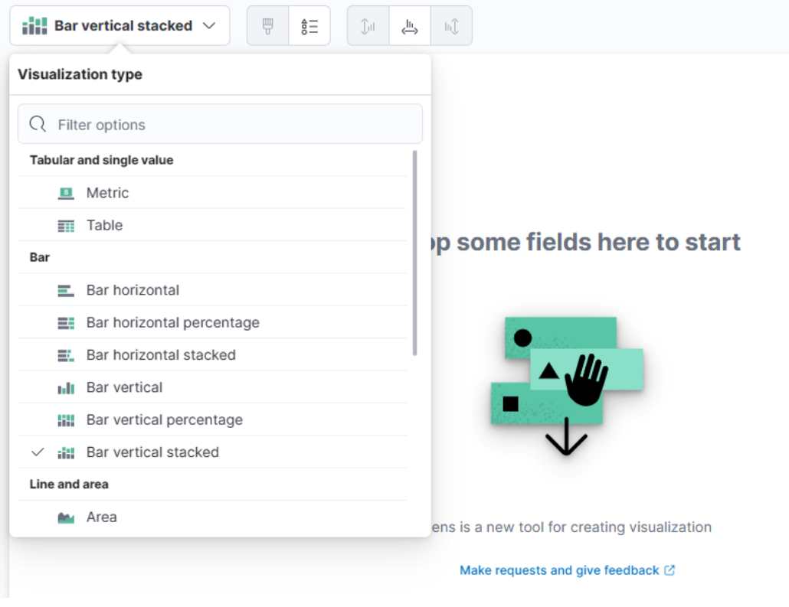
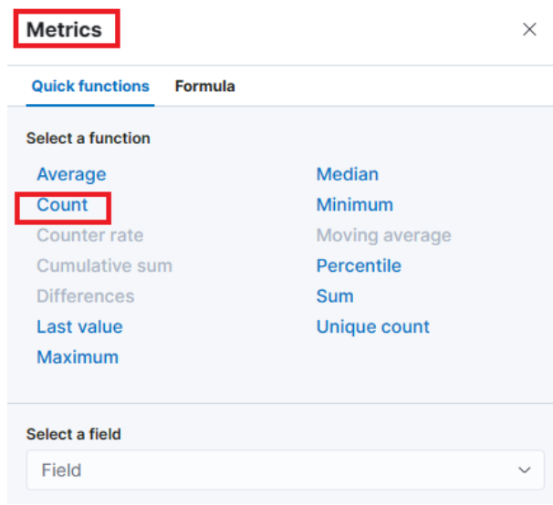
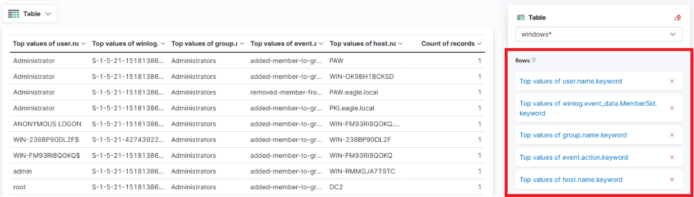
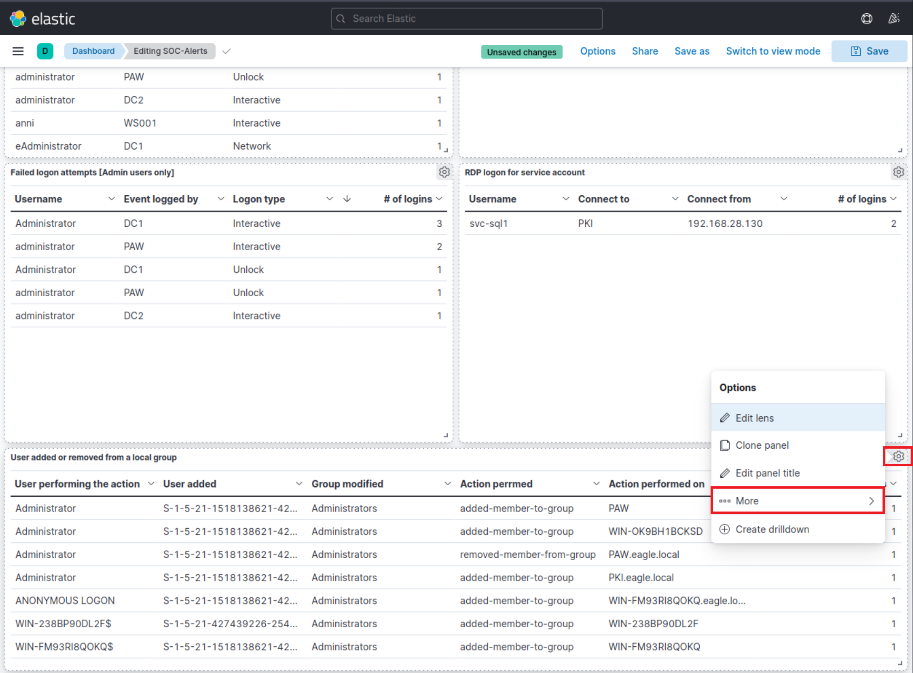
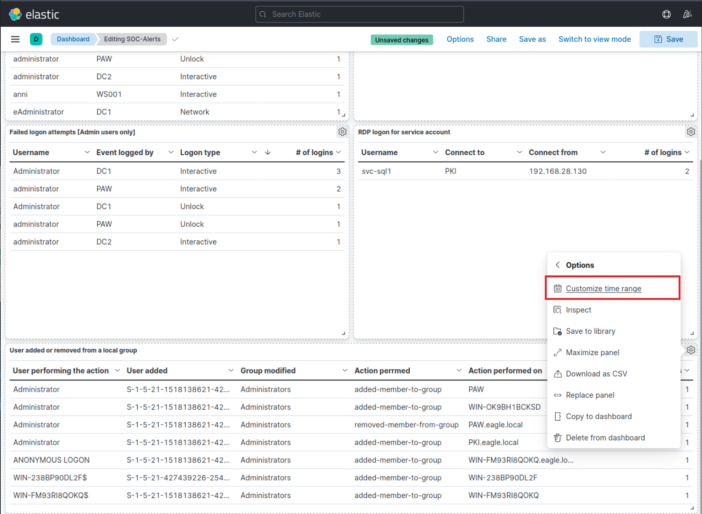
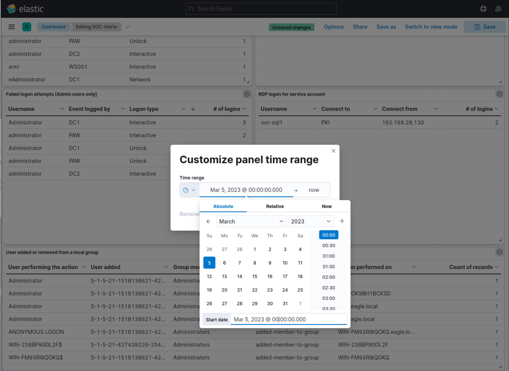

# SIEM Visualization Example 4: Users Added Or Removed From A Local Group (Within A Specific Timeframe) (Ví dụ visualization SIEM 4: User được thêm vào hoặc gỡ khỏi một local group – trong một khung thời gian cụ thể)

Trong ví dụ visualization SIEM này, ta muốn tạo một visualization để giám sát việc thêm hoặc gỡ user khỏi local group "Administrators" từ ngày 5 tháng 3 năm 2023 tới nay.

Visualization của ta sẽ dựa trên các Windows event log sau.

- [4732: A member was added to a security-enabled local group](https://www.ultimatewindowssecurity.com/securitylog/encyclopedia/event.aspx?eventid=4732)
- [4733: A member was removed from a security-enabled local group](https://www.ultimatewindowssecurity.com/securitylog/encyclopedia/event.aspx?eventid=4733)

Kéo xuống cuối phần này và bấm vào `Click here to spawn the target system!`.

Truy cập `http://[Target IP]:5601`, bấm vào nút bật/tắt thanh điều hướng bên (side navigation toggle), rồi bấm vào "Dashboard".

Một dashboard dựng sẵn sẽ hiển thị. Hãy bấm vào biểu tượng "bút chì"/chỉnh sửa.

Giờ, để bắt đầu tạo visualization đầu tiên, ta chỉ cần bấm nút "Create visualization".

Khi bắt đầu tạo visualization đầu tiên, cửa sổ mới sau đây sẽ xuất hiện với nhiều tuỳ chọn và thiết lập.

Có bốn điểm ta cần chú ý trên cửa sổ này:

1. Một tuỳ chọn filter cho phép ta lọc dữ liệu trước khi tạo biểu đồ. Trong trường hợp này, mục tiêu của ta là hiển thị việc thêm hoặc gỡ user khỏi local group "Administrators". Ta có thể dùng filter để chỉ xét các event ID khớp với `4732 – A member was added to a security-enabled local group` và `4733 – A member was removed from a security-enabled local group`. Ta cũng có thể dùng filter để chỉ xét các event 4732 và 4733 mà local group là "Administrators".

	

2. Trường này cho biết tập dữ liệu (index) mà ta sẽ dùng. Dữ liệu từ các nguồn hạ tầng khác nhau thường được tách vào các index khác nhau, như network, Windows, Linux, v.v. Trong ví dụ cụ thể này, ta sẽ chỉ định `windows*` trong "Index pattern".

3. Thanh tìm kiếm này cho phép ta kiểm tra lại sự tồn tại của một field cụ thể trong tập dữ liệu, như một cách nữa để đảm bảo ta đang xem đúng dữ liệu. Ta quan tâm tới field `user.name.keyword`. Ta có thể dùng thanh tìm kiếm để tìm nhanh và xác minh field này có hiện diện và được phát hiện trong tập dữ liệu đã chọn hay không. Nhờ đó ta xác nhận được mình đang truy cập đúng field mong muốn và làm việc với dữ liệu chính xác.

	

4. Cuối cùng, menu thả xuống này cho phép ta chọn loại visualization muốn tạo. Tuỳ chọn mặc định hiển thị ở hình trước là "Bar vertical stacked". Nếu bấm vào nút đó, các tuỳ chọn khác có sẵn sẽ hiện ra (hình đã được lược bớt vì không phải mọi tuỳ chọn đều vừa màn hình). Từ danh sách mở rộng này, ta có thể chọn loại visualization phù hợp nhất với yêu cầu và nhu cầu trình bày dữ liệu của mình.

	

---

Với visualization này, hãy chọn tuỳ chọn "Table". Sau khi chọn "Table", ta có thể bấm vào tuỳ chọn "Rows". Thao tác này cho phép ta chọn các thành phần dữ liệu cụ thể muốn đưa vào dạng xem bảng.

Hãy cấu hình phần "Rows" như sau.

Tiếp theo, hãy đóng cửa sổ "Rows" và chuyển sang phần cấu hình "Metrics".

Trong cửa sổ "Metrics", hãy chọn "count" làm metric mong muốn.

Một bổ sung cuối cùng cho bảng là thêm một số thiết lập "Rows" nữa để hiểu rõ hơn.

- User nào đã được thêm vào hoặc gỡ khỏi group? (field `winlog.event_data.MemberSid.keyword`)
- Việc thêm hoặc gỡ được thực hiện với group nào? (kiểm tra lại xem có đúng là group "Administrators" không) (field `group.name.keyword`)
- User được thêm vào hay bị gỡ khỏi group? (field `event.action.keyword`)
- Hành động diễn ra trên máy nào? (field `host.name.keyword`)

	

Bấm "Save and return", bạn sẽ thấy visualization mới được thêm vào dashboard.

Như đã nói, ta muốn giám sát việc thêm hoặc gỡ user khỏi local group "Administrators" *trong một khung thời gian cụ thể (từ ngày 5 tháng 3 năm 2023 tới nay)*.

Ta có thể thu hẹp phạm vi của visualization như sau.

Cuối cùng, hãy bấm nút "Save" để mọi chỉnh sửa của ta được lưu lại.

    

				 
Vui lòng chờ 3-5 phút để Kibana sẵn sàng sau khi khởi tạo (spawn) target của các câu hỏi bên dưới. 

    

    

	  
<code>Note</code>: Vì Elasticsearch dùng <code>buckets</code> để tổng hợp (aggregate) dữ liệu (khoảng thời gian, v.v.) thành các nhóm, ta phải luôn dùng khoảng thời gian <code>absolute</code> (tuyệt đối) mỗi khi tạo visualization. Nếu không lưu ý điều này, bucket sẽ hiển thị theo khoảng tuần thay vì theo ngày. Ví dụ, một khoảng thời gian tuyệt đối có thể là từ ngày 1 tháng 1 tới ngày 31 tháng 1 năm 2023.

    

