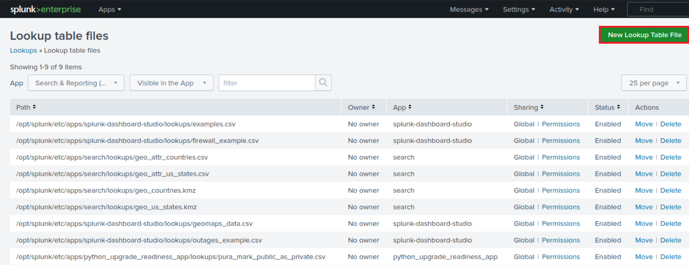
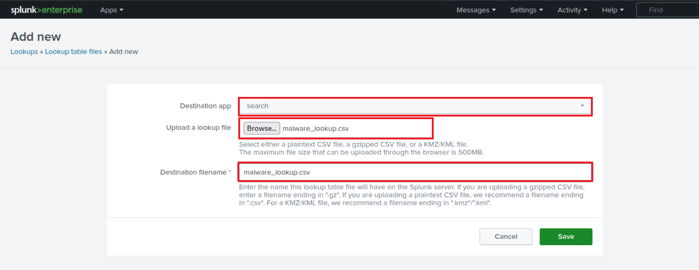
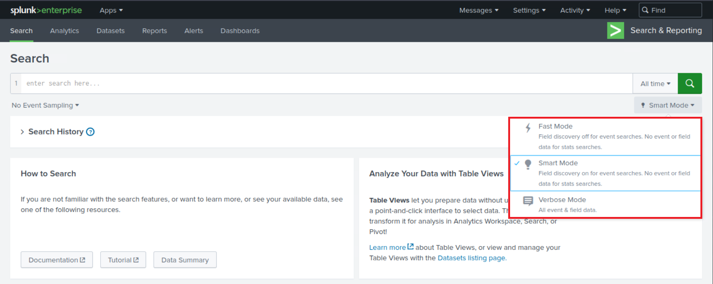

# Introduction To Splunk & SPL (Giới thiệu Splunk & SPL)


## Splunk là gì?

Splunk là một giải pháp phần mềm phân tích dữ liệu có khả năng mở rộng cao, linh hoạt và mạnh mẽ, nổi tiếng với khả năng tiếp nhận (ingest), đánh index, phân tích và trực quan hoá khối lượng khổng lồ dữ liệu máy (machine data). Splunk có thể phục vụ nhiều mảng công việc khác nhau, bao gồm an ninh mạng, tuân thủ (compliance), data pipeline, giám sát IT, observability, cũng như quản lý IT và quản lý kinh doanh nói chung.


`architecture` (kiến trúc) của Splunk (Splunk Enterprise) gồm nhiều lớp phối hợp với nhau để thu thập, đánh index, tìm kiếm, phân tích và trực quan hoá dữ liệu. Kiến trúc này có thể chia thành các thành phần chính sau:
- `Forwarders`: Forwarder chịu trách nhiệm thu thập dữ liệu. Chúng thu thập machine data từ nhiều nguồn khác nhau và chuyển tiếp (forward) tới các indexer. Các loại forwarder được dùng trong Splunk gồm:
	- `Universal Forwarder (UF)`: Đây là một agent gọn nhẹ, thu thập dữ liệu và chuyển tiếp tới các Splunk indexer mà không qua bất kỳ bước tiền xử lý nào. Universal Forwarder là các gói phần mềm riêng lẻ, có thể dễ dàng cài đặt trên các nguồn từ xa mà không ảnh hưởng đáng kể tới hiệu năng mạng hay host.
	- `Heavy Forwarder (HF)`: Agent này dùng để thu thập dữ liệu từ các nguồn từ xa, đặc biệt cho các tác vụ tổng hợp dữ liệu nặng liên quan tới các nguồn như firewall hoặc các điểm định tuyến/lọc dữ liệu. Theo [Splexicon](https://docs.splunk.com/Splexicon:Heavyforwarder), heavy forwarder khác biệt với các loại forwarder khác ở chỗ chúng parse (phân tích cú pháp) dữ liệu trước khi chuyển tiếp, nhờ đó có thể định tuyến dữ liệu theo các tiêu chí cụ thể như nguồn hoặc loại event. Chúng cũng có thể đánh index dữ liệu cục bộ đồng thời chuyển tiếp dữ liệu đó tới một indexer khác. Thông thường, Heavy Forwarder được triển khai làm các "node thu thập dữ liệu" (data collection node) chuyên dụng để truy cập dữ liệu qua API/script, và chúng chỉ hỗ trợ Splunk Enterprise.
	- Lưu ý rằng có các `HTTP Event Collectors (HECs)` dùng để thu thập dữ liệu trực tiếp từ ứng dụng theo cách có thể mở rộng. HEC hoạt động bằng phương thức JSON dựa trên token hoặc raw API. Trong quá trình này, dữ liệu được gửi thẳng tới tầng Indexer để xử lý tiếp.
- `Indexers`: Indexer nhận dữ liệu từ forwarder, tổ chức và lưu trữ nó trong các index. Trong khi đánh index dữ liệu, indexer tạo ra các tập thư mục được phân loại theo độ cũ (age), trong đó mỗi thư mục chứa dữ liệu thô (raw data) đã nén và các index tương ứng trỏ tới dữ liệu thô đó. Indexer cũng xử lý các search query từ người dùng và trả về kết quả.
- `Search Heads`: Search head điều phối các search job, phân phát chúng tới các indexer và gộp kết quả lại. Chúng cũng cung cấp giao diện để người dùng tương tác với Splunk. Trên Search Head, có thể tạo các `Knowledge Objects` để trích xuất thêm field và xử lý dữ liệu mà không sửa đổi dữ liệu gốc trong index. Cần nói thêm rằng Search Head còn cung cấp nhiều công cụ giúp trải nghiệm tìm kiếm phong phú hơn, bao gồm report, dashboard và visualization.
- `Deployment Server`: Quản lý cấu hình cho các forwarder, phân phối app và bản cập nhật.
- `Cluster Master`: Cluster master điều phối hoạt động của các indexer trong môi trường cluster, đảm bảo việc nhân bản dữ liệu (data replication) và search affinity.
- `License Master`: Quản lý thông tin license của nền tảng Splunk.

Các `key components` (thành phần chính) của Splunk gồm:
- `Splunk Web Interface`: Đây là giao diện đồ hoạ để người dùng tương tác với Splunk, thực hiện các tác vụ như tìm kiếm, tạo alert, dashboard và report.
- `Search Processing Language (SPL)`: Ngôn ngữ query của Splunk, cho phép người dùng tìm kiếm, lọc và xử lý dữ liệu đã được đánh index.
- `Apps and Add-ons`: App cung cấp các chức năng cụ thể trong Splunk, còn add-on mở rộng khả năng hoặc tích hợp với các hệ thống khác. Splunk App cho phép nhiều workspace cùng tồn tại trên một Splunk instance, phục vụ các use case và vai trò người dùng khác nhau. Các app dựng sẵn này có trên [Splunkbase](https://splunkbase.splunk.com/), cung cấp thêm chức năng và các giải pháp được cấu hình sẵn. Splunk Technology Add-on đóng vai trò là lớp trừu tượng (abstraction layer) cho các phương thức thu thập dữ liệu. Chúng thường bao gồm các field extraction liên quan, cho phép tính năng schema-on-the-fly. Ngoài ra, Technology Add-on còn bao gồm các file cấu hình liên quan (props/transforms) cùng các script hoặc binary hỗ trợ. Ngược lại, một Splunk App có thể được xem là một giải pháp toàn diện, thường dùng một hoặc nhiều Technology Add-on để tăng cường khả năng của nó.
- `Knowledge Objects`: Bao gồm field, tag, event type, lookup, macro, data model và alert — những thứ làm giàu dữ liệu trong Splunk, giúp việc tìm kiếm và phân tích dễ dàng hơn.

---

## Splunk như một giải pháp SIEM

Trong lĩnh vực an ninh mạng, Splunk có thể đóng vai trò quan trọng như một giải pháp quản lý log, nhưng giá trị thực sự của nó nằm ở khả năng Security Information and Event Management (SIEM) hướng phân tích (analytics-driven). Splunk với vai trò SIEM có thể hỗ trợ phân tích dữ liệu theo thời gian thực và dữ liệu lịch sử, giám sát an ninh mạng, incident response (ứng phó sự cố) và threat hunting. Hơn nữa, nó giúp các tổ chức nâng cao khả năng phát hiện bằng cách tận dụng User Behavior Analytics (phân tích hành vi người dùng).

Như đã đề cập, Splunk Processing Language (SPL) là một ngôn ngữ gồm hơn một trăm command, function, argument và clause. Nó là xương sống của việc phân tích dữ liệu trong Splunk, được dùng để tìm kiếm, lọc, biến đổi và trực quan hoá dữ liệu.

Giả sử `main` là một index chứa log Windows Security và Sysmon, cùng nhiều loại log khác.

1. **Tìm kiếm cơ bản (Basic Searching)**

	Khía cạnh cơ bản nhất của SPL là tìm kiếm. Theo mặc định, một search trả về tất cả event, nhưng có thể thu hẹp lại bằng keyword, toán tử boolean, toán tử so sánh và ký tự wildcard. Ví dụ, tìm kiếm error sẽ trả về tất cả event chứa từ đó.

	Các toán tử boolean `AND`, `OR` và `NOT` được dùng cho các query cụ thể hơn.
	
	Lệnh `search` thường được ngầm hiểu (implicit) ở đầu mỗi SPL query và thường không được viết ra. Tuy nhiên, dưới đây là một ví dụ dùng cú pháp search tường minh (explicit):
	```shell-session
	search index="main" "UNKNOWN"
	```
	
	Bằng cách chỉ định index là `main`, query thu hẹp phạm vi tìm kiếm chỉ còn các event được lưu trong index `main`. Sau đó, chuỗi `UNKNOWN` được dùng làm keyword để lọc và lấy ra các event có chứa chuỗi cụ thể này.
	
	**Lưu ý**: Wildcard (`*`) có thể thay thế cho số lượng ký tự bất kỳ trong tìm kiếm và trong giá trị field. Ví dụ (cú pháp search ngầm định):
	```shell-session
	index="main" "*UNKNOWN*"
	```
	
	SPL query này sẽ tìm trong index `main` các event có chứa chuỗi `UNKNOWN` ở bất kỳ vị trí nào trong dữ liệu event.

2. **Field và toán tử so sánh (Fields and Comparison Operators)**

	Splunk tự động nhận diện một số dữ liệu là field (như `source`, `sourcetype`, `host`, `EventCode`, v.v.), và người dùng có thể tự định nghĩa thêm field. Các field này có thể dùng với toán tử so sánh (`=`, `!=`, `<`, `>`, `<=`, `>=`) để tìm kiếm chính xác hơn. Ví dụ:
	```shell-session
	index="main" EventCode!=1
	```
	
	SPL (Splunk Processing Language) query này dùng để tìm trong index `main` những event `not` (không) có giá trị `EventCode` bằng `1`.
	
3. **Lệnh fields**

	Lệnh `fields` chỉ định những field nào được đưa vào hoặc loại khỏi kết quả tìm kiếm. Ví dụ:
	```shell-session
	index="main" sourcetype="WinEventLog:Sysmon" EventCode=1 | fields - User
	```
	
	Sau khi lấy toàn bộ event tạo process (process creation) từ index `main`, lệnh `fields` loại field `User` khỏi kết quả tìm kiếm. Do đó, kết quả sẽ chứa tất cả các field thường có trong log [Sysmon Event ID 1](https://www.ultimatewindowssecurity.com/securitylog/encyclopedia/event.aspx?eventid=90001), ngoại trừ user đã khởi tạo process. Lưu ý rằng việc dùng `sourcetype` giới hạn phạm vi chỉ trong các event log của Sysmon.
	
4. **Lệnh table**

	Lệnh `table` trình bày kết quả tìm kiếm dưới dạng bảng. Ví dụ:
	```shell-session
	index="main" sourcetype="WinEventLog:Sysmon" EventCode=1 | table _time, host, Image
	```
	
	Query này trả về các event tạo process, rồi sắp xếp các field được chọn (_time, host và Image) thành dạng bảng. `_time` là timestamp của event, `host` là tên host nơi event xảy ra, và `Image` là tên file thực thi đại diện cho process.
	
5. **Lệnh rename**

	Lệnh `rename` đổi tên một field trong kết quả tìm kiếm. Ví dụ:
	```shell-session
	index="main" sourcetype="WinEventLog:Sysmon" EventCode=1 | rename Image as Process
	```
	
	Lệnh này đổi tên field `Image` thành `Process` trong kết quả tìm kiếm. Field `Image` trong log Sysmon biểu thị tên file thực thi của process. Sau khi đổi tên, mọi tham chiếu tiếp theo tới `Process` sẽ trỏ tới thứ vốn là field `Image` ban đầu.
	
6. **Lệnh dedup**

	Lệnh 'dedup' loại bỏ các event trùng lặp. Ví dụ:
	```shell-session
	index="main" sourcetype="WinEventLog:Sysmon" EventCode=1 | dedup Image
	```
	
	Lệnh `dedup` loại bỏ các mục trùng lặp dựa trên field `Image` trong các event tạo process. Nghĩa là nếu cùng một process (`Image`) được tạo nhiều lần, nó sẽ chỉ xuất hiện một lần trong kết quả, qua đó loại bỏ sự lặp lại.
	
7. **Lệnh sort**

	Lệnh `sort` sắp xếp kết quả tìm kiếm. Ví dụ:
	```shell-session
	index="main" sourcetype="WinEventLog:Sysmon" EventCode=1 | sort - _time
	```
	
	Lệnh này sắp xếp tất cả event tạo process trong index `main` theo thứ tự giảm dần của timestamp (_time), tức là các event gần đây nhất được hiển thị trước.
	
8. **Lệnh stats**

	Lệnh `stats` thực hiện các phép toán thống kê. Ví dụ:
	```shell-session
	index="main" sourcetype="WinEventLog:Sysmon" EventCode=3 | stats count by _time, Image
	```
	
	Query này sẽ trả về một bảng, trong đó mỗi hàng là một tổ hợp duy nhất của timestamp (`_time`) và process (`Image`). Cột count cho biết số event kết nối mạng (network connection) đã xảy ra đối với process cụ thể đó tại thời điểm cụ thể đó.

	Tuy nhiên, rất khó trực quan hoá dữ liệu này theo thời gian cho từng process, vì dữ liệu của mỗi process nằm rải rác khắp bảng. Ta sẽ phải lọc thủ công theo process (`Image`) để xem số lượng theo thời gian của từng process.
	
9. **Lệnh chart**

	Lệnh `chart` tạo visualization dữ liệu dựa trên các phép toán thống kê. Ví dụ:
	```shell-session
	index="main" sourcetype="WinEventLog:Sysmon" EventCode=3 | chart count by _time, Image
	```
	Query này sẽ trả về một bảng, trong đó mỗi hàng là một timestamp duy nhất (`_time`) và mỗi cột là một process duy nhất (`Image`). Giá trị trong ô cho biết số event kết nối mạng đã xảy ra đối với mỗi process tại mỗi thời điểm cụ thể.

	Với lệnh `chart`, bạn có thể dễ dàng trực quan hoá dữ liệu theo thời gian cho từng process vì mỗi process có cột riêng. Bạn có thể nhanh chóng thấy ngay số event kết nối mạng theo thời gian của từng process.
	
10. **Lệnh eval**

	Lệnh `eval` tạo mới hoặc định nghĩa lại field. Ví dụ:
	```shell-session
	index="main" sourcetype="WinEventLog:Sysmon" EventCode=1 | eval Process_Path=lower(Image)
	```
	
	Lệnh này tạo một field mới `Process_Path` chứa phiên bản chữ thường (lowercase) của field `Image`. Nó không thay đổi field `Image` thực tế, mà tạo một field mới có thể dùng trong các thao tác tiếp theo hoặc để hiển thị.

11. **Lệnh rex**

	Lệnh `rex` trích xuất field mới từ các field có sẵn bằng regular expression. Ví dụ:
	```shell-session
		index="main" EventCode=4662 | rex max_match=0 "[^%](?<guid>{.*})" | table guid
	```
	
	- `index="main" EventCode=4662` lọc các event thuộc index `main` có `EventCode` bằng `4662`. Việc này thu hẹp phạm vi tìm kiếm xuống các event cụ thể có EventCode đã chỉ định.
	- `rex max_match=0 "[^%](?<guid>{.*})"` dùng lệnh rex để trích xuất các giá trị khớp với pattern từ các field của event. Pattern regex `{.*}` tìm các chuỗi con bắt đầu bằng `{` và kết thúc bằng `}`. Phần `[^%]` đảm bảo kết quả khớp không bắt đầu bằng ký tự `%`. Giá trị bắt được bên trong cặp ngoặc nhọn được gán cho named capture group `guid`.
	- `table guid` hiển thị các GUID đã trích xuất ở output. Lệnh này dùng để định dạng kết quả và chỉ hiển thị field `guid`.
	- Tuỳ chọn `max_match=0` đảm bảo mọi lần xuất hiện của pattern đều được trích xuất từ mỗi event. Theo mặc định, lệnh rex chỉ trích xuất lần xuất hiện đầu tiên.

	Điều này hữu ích vì GUID không được tự động trích xuất từ các event log 4662.
	
12. **Lệnh lookup**

	Lệnh `lookup` làm giàu dữ liệu bằng các nguồn bên ngoài. Ví dụ:
	
	Giả sử có file CSV sau, tên là `malware_lookup.csv`.
	
	```shell-session
	filename, is_malware
	notepad.exe, false
	cmd.exe, false
	powershell.exe, false
	sharphound.exe, true
	randomfile.exe, true
	```
	
	File CSV này cần được thêm thành một Lookup table mới như sau.
	
	
	
	
	
	
	
	
	
	```shell-session
	index="main" sourcetype="WinEventLog:Sysmon" EventCode=1 | rex field=Image "(?P<filename>[^\\\]+)$" | eval filename=lower(filename) | lookup malware_lookup.csv filename OUTPUTNEW is_malware | table filename, is_malware
	```
	
	- `index="main" sourcetype="WinEventLog:Sysmon" EventCode=1`: Đây là điều kiện tìm kiếm. Nó tìm các log Sysmon (được xác định bởi sourcetype) có EventCode bằng 1 (đại diện cho event tạo process) trong index "main".
	- `| rex field=Image "(?P<filename>[^\\\]+)$"`: Lệnh này dùng regular expression (regex) để trích xuất một phần của field Image. Field Image trong log Sysmon EventCode=1 thường chứa đường dẫn đầy đủ tới file của process. Regex này có nghĩa là: bắt lấy mọi thứ đứng sau dấu backslash cuối cùng (chính là tên file) và lưu nó thành filename.
	- `| eval filename=lower(filename)`: Lệnh này lấy filename vừa trích xuất và chuyển sang chữ thường. Hàm lower() được dùng để đảm bảo việc tìm kiếm không phân biệt hoa thường (case-insensitive).
	- `| lookup malware_lookup.csv filename OUTPUTNEW is_malware`: Lệnh này thực hiện thao tác lookup, dùng filename làm khoá (key). Lookup table (malware_lookup.csv) được kỳ vọng chứa danh sách tên file của các file thực thi độc hại đã biết. Nếu tìm thấy kết quả khớp trong lookup table, field mới is_malware sẽ được thêm vào event, cho biết process đó có bị coi là độc hại hay không dựa trên lookup table. `<-- filename in this part of the query is the first column title in the CSV` (filename ở phần này của query chính là tiêu đề cột đầu tiên trong file CSV).
	- `| table filename, is_malware`: Lệnh này định dạng output để chỉ hiển thị các field filename và is_malware. Nếu một hàng không có is_malware, nghĩa là không tìm thấy kết quả khớp trong lookup table cho filename đó.

	Tóm lại, query này trích xuất tên file của các process mới được tạo, chuyển chúng sang chữ thường, so sánh với danh sách tên file độc hại đã biết, và trình bày kết quả trong một bảng.
	
	Dưới đây là một query tương đương, đồng thời loại bỏ trùng lặp.
	
	```shell-session
	index="main" sourcetype="WinEventLog:Sysmon" EventCode=1 | eval filename=mvdedup(split(Image, "\\")) | eval filename=mvindex(filename, -1) | eval filename=lower(filename) | lookup malware_lookup.csv filename OUTPUTNEW is_malware | table filename, is_malware | dedup filename, is_malware
	```
	
	- `index="main" sourcetype="WinEventLog:Sysmon" EventCode=1`: Đây là điều kiện tìm kiếm. Nó lấy dữ liệu từ index `main` với sourcetype là `WinEventLog:Sysmon` và `EventCode` là `1`. Sysmon `EventCode` `1` biểu thị một event tạo process.
	- `| eval filename=mvdedup(split(Image, "\\"))`: Lệnh này tách field `Image` (chứa đường dẫn file) thành nhiều phần tử tại mỗi dấu backslash và biến nó thành một multivalue field. Hàm `mvdedup` được dùng để loại bỏ mọi giá trị trùng lặp trong multivalue field này.
	- `| eval filename=mvindex(filename, -1)`: Ở đây, hàm `mvindex` được dùng để chọn phần tử cuối cùng của multivalue field tạo ra ở bước trước. Trong ngữ cảnh đường dẫn file, đây thường chính là tên file thực sự.
	- `| eval filename=lower(filename)`: Lệnh này lấy field filename và chuyển sang chữ thường bằng hàm lower. Việc này nhằm đảm bảo tìm kiếm không phân biệt hoa thường và chuẩn hoá dữ liệu.
	- `| lookup malware_lookup.csv filename OUTPUTNEW is_malware`: Lệnh này thực hiện thao tác lookup. Lệnh `lookup` lấy field `filename` và kiểm tra xem nó có khớp với mục nào trong lookup table `malware_lookup.csv` hay không. Nếu khớp, nó thêm một field mới, `is_malware`, vào event, cho biết process có bị gắn cờ là độc hại hay không.
	- `| table filename, is_malware`: Lệnh `table` được dùng để định dạng output, trong trường hợp này chỉ hiển thị các field `filename` và `is_malware` dưới dạng bảng.
	- `| dedup filename, is_malware`: Lệnh này loại bỏ các event trùng lặp dựa trên các field filename và is_malware. Nói cách khác, nếu trong kết quả tìm kiếm có nhiều mục giống hệt nhau về các field `filename` và `is_malware`, lệnh `dedup` sẽ chỉ giữ lại lần xuất hiện đầu tiên và loại bỏ tất cả các bản trùng lặp sau đó.

	Tóm lại, SPL query này tìm trong log Sysmon các event tạo process, trích xuất `file name` từ field `Image`, chuyển sang chữ thường, đối chiếu với danh sách malware đã biết trong file `malware_lookup.csv`, rồi hiển thị kết quả trong một bảng, loại bỏ mọi bản trùng lặp dựa trên các field `filename` và `is_malware`.
	
13. **Lệnh inputlookup**

	Lệnh `inputlookup` lấy dữ liệu từ một lookup file mà không join nó vào kết quả tìm kiếm. Ví dụ:

	```shell-session
	| inputlookup malware_lookup.csv
	```

	Lệnh này lấy toàn bộ bản ghi từ file `malware_lookup.csv`. Kết quả không được join với bất kỳ kết quả tìm kiếm nào, nhưng có thể dùng để kiểm tra nội dung của lookup file hoặc cho các thao tác tiếp theo như lọc hoặc join với các tập dữ liệu khác.
	
14. **Khoảng thời gian (Time Range)**

	Mỗi event trong Splunk đều có timestamp. Bằng time range picker hoặc các lệnh `earliest` và `latest`, bạn có thể giới hạn tìm kiếm trong những khoảng thời gian cụ thể. Ví dụ:
	```shell-session
	index="main" earliest=-7d EventCode!=1
	```
	
	Bằng cách kết hợp điều kiện `index="main"` với `earliest=-7d` và `EventCode!=1`, query sẽ lấy các event từ index `main` xảy ra trong bảy ngày gần nhất và không có giá trị `EventCode` bằng `1`.
		
15. **Lệnh transaction**

	Lệnh `transaction` được dùng trong Splunk để nhóm các event có chung đặc điểm thành các transaction, thường dùng để theo dõi các phiên (session) hoặc hoạt động của người dùng trải dài qua nhiều event. Ví dụ:
	```shell-session
	index="main" sourcetype="WinEventLog:Sysmon" (EventCode=1 OR EventCode=3) | transaction Image startswith=eval(EventCode=1) endswith=eval(EventCode=3) maxspan=1m | table Image |  dedup Image 
	```
	
	- `index="main" sourcetype="WinEventLog:Sysmon" (EventCode=1 OR EventCode=3)`: Đây là điều kiện tìm kiếm. Nó lấy dữ liệu từ index `main` với sourcetype là `WinEventLog:Sysmon` và `EventCode` là `1` hoặc `3`. Trong log Sysmon, `EventCode 1` là event tạo process, còn `EventCode 3` là event kết nối mạng.
	- `| transaction Image startswith=eval(EventCode=1) endswith=eval(EventCode=3) maxspan=1m`: Lệnh transaction ở đây được dùng để nhóm các event dựa trên field Image, đại diện cho file thực thi hoặc script liên quan tới event. Việc nhóm này tuân theo các điều kiện: transaction bắt đầu bằng một event có `EventCode` là `1` và kết thúc bằng một event có `EventCode` là `3`. Mệnh đề `maxspan=1m` giới hạn transaction trong các event xảy ra trong khung thời gian 1 phút. Lệnh transaction có thể liên kết các event liên quan với nhau để giúp hiểu rõ hơn chuỗi hoạt động đang diễn ra trong hệ thống.
	- `| table Image`: Lệnh này định dạng output thành bảng, chỉ hiển thị field `Image`.
	- `| dedup Image`: Cuối cùng, lệnh `dedup` loại bỏ các mục trùng lặp khỏi tập kết quả. Ở đây, nó loại bỏ mọi giá trị `Image` trùng lặp. Lệnh chỉ giữ lại lần xuất hiện đầu tiên và loại bỏ các bản trùng lặp sau đó dựa trên field `Image`.

	Tóm lại, query này nhằm xác định các chuỗi hoạt động (tạo process rồi tiếp theo là một kết nối mạng) gắn với cùng một file thực thi hoặc script trong khung thời gian 1 phút. Nó trình bày kết quả dưới dạng bảng, đảm bảo các file thực thi/script được liệt kê là duy nhất. Query này có thể rất có giá trị trong threat hunting, đặc biệt khi tìm kiếm các indicator of compromise như chuỗi tạo process và kết nối mạng diễn ra nhanh liên tiếp do cùng một file thực thi khởi tạo.

16. **Subsearch (tìm kiếm lồng)**

	Subsearch trong Splunk là một search được lồng bên trong một search khác. Nó được dùng để tính ra một tập kết quả, rồi tập kết quả đó được dùng trong search bên ngoài. Ví dụ:
	```shell-session
	index="main" sourcetype="WinEventLog:Sysmon" EventCode=1 NOT [ search index="main" sourcetype="WinEventLog:Sysmon" EventCode=1 | top limit=100 Image | fields Image ] | table _time, Image, CommandLine, User, ComputerName
	```
	
	Trong query này:
	- `index="main" sourcetype="WinEventLog:Sysmon" EventCode=1`: Search chính, lấy các event `EventCode=1 (Process Creation)`.
	- `NOT []`: Cặp ngoặc vuông chứa subsearch. Khi đặt `NOT` trước nó, search chính sẽ loại trừ mọi kết quả mà subsearch trả về.
	- `search index="main" sourcetype="WinEventLog:Sysmon" EventCode=1 | top limit=100 Image | fields Image`: Subsearch lấy các event `EventCode=1 (Process Creation)`, rồi dùng lệnh `top` để trả về 100 tên `Image` (process) phổ biến nhất.
	- `table _time, Image, CommandLine, User, Computer`: Phần này trình bày kết quả cuối cùng dưới dạng bảng, hiển thị timestamp của event (`_time`), tên process (`Image`), command line dùng để chạy process (`CommandLine`), user đã chạy process (`User`), và máy tính nơi event xảy ra (`ComputerName`).

	Query này có thể giúp làm nổi bật các process bất thường hoặc hiếm gặp, những process có thể đáng điều tra thêm vì khả năng liên quan tới hoạt động độc hại. Hãy nhớ điều chỉnh limit trong subsearch cho phù hợp với môi trường của bạn.

	Lưu ý thêm, loại search này có thể tạo ra nhiều nhiễu (noise) trong các môi trường thường xuyên phát sinh process mới và độc nhất, vì vậy việc tinh chỉnh (tuning) cẩn thận và nắm rõ ngữ cảnh là rất quan trọng.
	
---

Đây mới chỉ là phần nổi của tảng băng chìm về SPL. Bộ lệnh đồ sộ và cú pháp linh hoạt của nó mang lại khả năng phân tích dữ liệu toàn diện. Như với mọi ngôn ngữ, sự thành thạo đến từ luyện tập và kinh nghiệm. Dưới đây là một số tài liệu tuyệt vời để bắt đầu:
- [https://docs.splunk.com/Documentation/SCS/current/SearchReference/Introduction](https://docs.splunk.com/Documentation/SCS/current/SearchReference/Introduction)
- [https://docs.splunk.com/Documentation/SplunkCloud/latest/SearchReference/](https://docs.splunk.com/Documentation/SplunkCloud/latest/SearchReference/)
- [https://docs.splunk.com/Documentation/SplunkCloud/latest/Search/](https://docs.splunk.com/Documentation/SplunkCloud/latest/Search/)

---

## Cách xác định dữ liệu có sẵn

**Cách tiếp cận 1 để xác định dữ liệu và field: Tận dụng ứng dụng Search & Reporting của Splunk (SPL)**

Trong bất kỳ hệ thống Security Information and Event Management (SIEM) mạnh mẽ nào như Splunk, việc hiểu rõ các nguồn dữ liệu có sẵn, dữ liệu mà chúng cung cấp và các field bên trong là điều then chốt để khai thác hệ thống hiệu quả. Trong Splunk, ta chủ yếu dùng ứng dụng Search & Reporting để làm việc này. Hãy cùng tìm hiểu cách xác định các loại nguồn dữ liệu (data source type), dữ liệu và field trong Splunk.

Splunk có thể tiếp nhận rất nhiều loại nguồn dữ liệu. Ta phân loại các nguồn dữ liệu này thành các source type, quyết định cách Splunk định dạng dữ liệu đầu vào. Để xác định các source type có sẵn, ta có thể chạy lệnh SPL sau, `after selecting the suitable time range in the time picker of the Search & Reporting application` (sau khi chọn khoảng thời gian phù hợp trong time picker của ứng dụng Search & Reporting).


```shell-session
| eventcount summarize=false index=* | table index
```

Query này dùng `eventcount` để đếm event trong tất cả các index, sau đó `summarize=false` được dùng để hiển thị số lượng riêng cho từng index, và cuối cùng lệnh `table` được dùng để trình bày dữ liệu dạng bảng.

```shell-session
| metadata type=sourcetypes
```

Search này dùng lệnh `metadata`, lệnh cung cấp nhiều số liệu thống kê về các indexed field được chỉ định. Ở đây ta tập trung vào `sourcetypes`. Kết quả là danh sách tất cả `sourcetypes` trong môi trường Splunk, kèm metadata bổ sung như thời điểm đầu tiên thấy source type (`firstTime`), thời điểm cuối cùng thấy nó (`lastTime`), và số lượng host (`totalCount`).

Để có góc nhìn đơn giản hơn, ta có thể dùng search sau.

```shell-session
| metadata type=sourcetypes index=* | table sourcetype
```

Ở đây, lệnh `metadata` lấy metadata về dữ liệu trong các index. Argument `type=sourcetypes` yêu cầu Splunk trả về metadata về các sourcetype. Lệnh `table` được dùng để trình bày dữ liệu dạng bảng.


```shell-session
| metadata type=sources index=* | table source
```

Lệnh này trả về danh sách tất cả các nguồn dữ liệu trong môi trường Splunk.

Khi đã biết các source type, ta có thể tìm hiểu loại dữ liệu chúng chứa. Giả sử ta quan tâm tới một sourcetype tên `WinEventLog:Security`, ta có thể dùng lệnh table để trình bày dữ liệu thô như sau.

```shell-session
sourcetype="WinEventLog:Security" | table _raw
```

Lệnh `table` tạo một bảng với các field được chỉ định làm cột. Ở đây, `_raw` đại diện cho dữ liệu event thô. Lệnh này sẽ trả về dữ liệu thô của source type được chỉ định.

Splunk tự động trích xuất một tập field mặc định cho mọi event mà nó đánh index, nhưng cũng có thể trích xuất thêm field tuỳ theo source type của dữ liệu. Để xem tất cả field có trong một source type cụ thể, ta có thể dùng lệnh `table`.

```shell-session
sourcetype="WinEventLog:Security" | table *
```

Lệnh này tạo một bảng với tất cả field có trong sourcetype `WinEventLog:Security`. Tuy nhiên, cần thận trọng, vì dùng `table *` có thể tạo ra một bảng rất rộng nếu event có số lượng field lớn. Điều này có thể không thực tế về mặt hiển thị hoặc không hiệu quả cho việc phân tích dữ liệu.

Cách tốt hơn là xác định các field bạn quan tâm bằng lệnh `fields` như đã đề cập trước đó, rồi chỉ định các tên field đó trong lệnh `table`. Ví dụ:

```shell-session
sourcetype="WinEventLog:Security" | fields Account_Name, EventCode | table Account_Name, EventCode
```

Nếu chỉ muốn xem danh sách tên field mà không kèm dữ liệu, ta có thể dùng lệnh `fieldsummary` thay thế.

```shell-session
sourcetype="WinEventLog:Security" | fieldsummary
```

Search này sẽ trả về một bảng gồm mọi field tìm thấy trong các event mà search trả về (trên sourcetype đã chỉ định). Bảng gồm nhiều cột thông tin về mỗi field:

- `field`: Tên của field.
- `count`: Số event có chứa field.
- `distinct_count`: Số giá trị khác nhau (distinct) của field.
- `is_exact`: Số đếm là chính xác hay chỉ là ước tính.
- `max`: Giá trị lớn nhất của field.
- `mean`: Giá trị trung bình của field.
- `min`: Giá trị nhỏ nhất của field.
- `numeric_count`: Số giá trị dạng số trong field.
- `stdev`: Độ lệch chuẩn (standard deviation) của field.
- `values`: Các giá trị mẫu của field.

Ta cũng có thể thấy:
- `modes`: Các giá trị phổ biến nhất của field.
- `numBuckets`: Số bucket được dùng để ước tính distinct count.

Lưu ý rằng các giá trị do lệnh `fieldsummary` cung cấp được tính dựa trên các event mà search trả về. Vì vậy nếu muốn thấy tất cả field trong một `sourcetype` cụ thể, ta cần đảm bảo khoảng thời gian đủ rộng để bao quát mọi field có thể có.

```shell-session
index=* sourcetype=* | bucket _time span=1d | stats count by _time, index, sourcetype | sort - _time
```

Đôi khi ta muốn biết các event phân bố theo thời gian như thế nào. Query này lấy toàn bộ dữ liệu (`index=* sourcetype=*`), sau đó lệnh `bucket` được dùng để nhóm các event dựa trên field `_time` thành các bucket 1 ngày. Lệnh `stats` sau đó đếm số event cho mỗi ngày (`_time`), `index` và `sourcetype`. Cuối cùng, lệnh `sort` sắp xếp kết quả theo thứ tự giảm dần của `_time`.

```shell-session
index=* sourcetype=* | rare limit=10 index, sourcetype
```

Lệnh `rare` có thể giúp ta xác định các loại event không phổ biến, có thể là dấu hiệu của hành vi bất thường. Query này lấy toàn bộ dữ liệu và tìm 10 tổ hợp index và sourcetype hiếm nhất.

```shell-session
index="main" | rare limit=20 useother=f ParentImage
```

Lệnh này hiển thị 20 giá trị ít phổ biến nhất của field `ParentImage`.

```shell-session
index=* sourcetype=* | fieldsummary | where count < 100 | table field, count, distinct_count
```

Một query phức tạp hơn có thể cung cấp bản tóm tắt chi tiết về các field. Search này hiển thị bản tóm tắt của tất cả field (`fieldsummary`), lọc ra các field xuất hiện trong ít hơn 100 event (`where count < 100`), rồi hiển thị một bảng (`table`) gồm tên field, tổng số lượng và số giá trị distinct.

```shell-session
index=* | sistats count by index, sourcetype, source, host
```

Ta cũng có thể dùng lệnh `sistats` để khám phá sự đa dạng của event. Lệnh này đếm số event theo index, sourcetype, source và host, giúp ta có bức tranh rõ ràng về sự đa dạng và phân bố của dữ liệu.

```shell-session
index=* sourcetype=* | rare limit=10 field1, field2, field3
```

Lệnh rare cũng có thể dùng để tìm các tổ hợp giá trị field không phổ biến. Thay `field1`, `field2`, `field3` bằng các field bạn quan tâm. Lệnh này sẽ hiển thị 10 tổ hợp hiếm nhất của các field này.

Bằng cách kết hợp các lệnh và kỹ thuật SPL ở trên, ta có thể khám phá và hiểu được các loại nguồn dữ liệu, dữ liệu chúng chứa và các field bên trong. Sự hiểu biết này là nền tảng để xây dựng các search, report, alert và dashboard hiệu quả trong Splunk.

Cuối cùng, hãy nhớ tuân theo các chính sách quản trị dữ liệu (data governance) của tổ chức khi khám phá dữ liệu và source type, để đảm bảo bạn tuân thủ mọi hướng dẫn cần thiết về quyền riêng tư và bảo mật.

<div class="card bg-light">
    <div class="card-body">
				 <p class="mb-0">Bạn có thể áp dụng thành công từng search nêu trên vào dữ liệu trong Splunk instance của target mà bạn có thể khởi tạo (spawn) bên dưới. Chúng tôi đặc biệt khuyến khích chạy và thậm chí sửa đổi các search này để làm quen với SPL (Search Processing Language) và các khả năng của nó. </p>
    </div>
</div>

---

**Cách tiếp cận 2 để xác định dữ liệu và field: Tận dụng giao diện người dùng (User Interface) của Splunk**

Khi dùng giao diện người dùng của ứng dụng `Search & Reporting`, việc xác định các loại nguồn dữ liệu có sẵn, dữ liệu chúng chứa và các field bên trong trở thành một công việc đòi hỏi tương tác với nhiều phần khác nhau của UI. Hãy xem cách ta có thể dùng hiệu quả giao diện Splunk Web để xác định các thành phần này.

- `Data Sources`: Điều đầu tiên ta muốn xác định là các nguồn dữ liệu. Ta có thể làm việc này bằng cách vào menu `Settings`, thường nằm ở góc trên bên phải của Splunk instance. Trong menu thả xuống, ta sẽ thấy `Data inputs`. Bấm vào `Data inputs`, ta sẽ thấy danh sách các phương thức nhập dữ liệu khác nhau, bao gồm files & directories, HTTP event collector, forwarder, script và nhiều phương thức khác. Đây là các nguồn khác nhau mà qua đó dữ liệu có thể được đưa vào Splunk. Bấm vào từng mục sẽ cho ta cái nhìn tổng quan về các nguồn dữ liệu đang được sử dụng.
- `Data (Events)`: Giờ hãy chuyển sang xác định chính dữ liệu, hay nói cách khác là các event. Để làm việc này, ta sẽ vào app `Search & Reporting`. Khám phá các event ở chế độ `Fast` cho phép ta lướt nhanh qua dữ liệu. Ngược lại, chế độ `Verbose` cho phép ta đi sâu vào chi tiết của từng event, bao gồm dữ liệu event thô và tất cả field mà Splunk đã trích xuất từ nó.
	
	Trong thanh tìm kiếm, ta có thể đơn giản nhập `*` rồi bấm search, thao tác này sẽ hiển thị toàn bộ dữ liệu đã được đánh index. Tuy nhiên, đây thường là một lượng dữ liệu khổng lồ và có thể không phải là cách hiệu quả nhất. Cách tốt hơn có thể là tận dụng time picker và chọn một khoảng thời gian nhỏ hơn (nhưng cần cẩn thận khi làm vậy để không bỏ sót các log lịch sử quan trọng/hữu ích).
- `Fields`: Cuối cùng, để xác định các field trong dữ liệu, hãy xem chi tiết một event. Ta có thể bấm vào bất kỳ event nào trong kết quả tìm kiếm để mở rộng nó.
	
Ta cũng có thể thấy ở phía bên trái của ứng dụng "Search & Reporting" hai nhóm field: `Selected Fields` và `Interesting Fields`. `Selected Fields` là các field luôn được hiển thị trong event (như `host`, `source` và `sourcetype`), còn `Interesting Fields` là những field xuất hiện trong ít nhất 20% số event. Bấm vào `All fields`, ta có thể thấy tất cả field có trong event.
	
- `Data Models`: Data Model cung cấp góc nhìn có tổ chức, phân cấp về dữ liệu, đơn giản hoá các tập dữ liệu phức tạp thành những cấu trúc dễ hiểu. Chúng được thiết kế để giúp việc tạo report, visualization và dashboard có ý nghĩa trở nên dễ dàng hơn mà không cần hiểu sâu về các nguồn dữ liệu bên dưới hay phải viết các SPL query phức tạp. Dưới đây là cách ta có thể dùng tính năng Data Models để xác định và hiểu dữ liệu:
	- `Accessing Data Models`: Để truy cập Data Models, ta bấm vào tab `Settings` ở góc trên bên phải giao diện Splunk Web. Sau đó chọn `Data Models` trong mục `Knowledge`. Thao tác này sẽ đưa ta tới trang quản lý Data Models. `<-- If it appears empty, please execute a search and navigate to the Data Models page again.` (Nếu trang trống, hãy chạy một search rồi vào lại trang Data Models.)
	- `Understanding Existing Data Models`: Trên trang quản lý Data Models, ta có thể thấy danh sách các Data Model có sẵn. Chúng có thể gồm các model do chính ta hoặc đội của ta tạo ra, hoặc các model do Splunk App cung cấp. Mỗi Data Model gắn với một app context cụ thể và được xây dựng để mô tả dữ liệu có cấu trúc liên quan tới mục đích của app đó.
	- `Exploring Data Models`: Bấm vào tên một Data Model, ta sẽ được đưa tới `Data Model Editor`. Đây chính là nơi thể hiện sức mạnh thực sự của Data Model. Tại đây, ta có thể xem cấu trúc phân cấp của data model, được chia thành các `objects`. Mỗi object đại diện cho một phần cụ thể của dữ liệu và chứa các `fields` liên quan tới object đó.
		
	Ví dụ, nếu có một Data Model mô tả lưu lượng web, ta có thể thấy các object như `Web Transactions`, `Web Errors`, v.v. Bên trong các object này, ta sẽ thấy các field như `status`, `url`, `user`, v.v.
- `Pivots`: Pivot là một tính năng cực kỳ mạnh mẽ trong Splunk, cho phép ta tạo các report và visualization phức tạp mà không cần viết SPL query. Chúng cung cấp giao diện tương tác kéo-thả (drag-and-drop) để định nghĩa và tinh chỉnh tiêu chí báo cáo dữ liệu. Vì vậy, đây cũng là công cụ tuyệt vời để xác định và khám phá dữ liệu cùng các field có sẵn trong môi trường Splunk. Để bắt đầu dùng Pivot nhằm xác định dữ liệu và field có sẵn, ta có thể dùng nút `Pivot` xuất hiện khi duyệt một data model cụ thể trên trang `Data Models`.
	
	
	

---

## Bài tập thực hành

Kéo xuống cuối section này và bấm vào `Click here to spawn the target system!`

Bây giờ, truy cập `http://[Target IP]:8000`, mở ứng dụng `Search & Reporting` và trả lời các câu hỏi bên dưới.
