# Using Splunk Applications (Sử dụng các ứng dụng Splunk)

## Các ứng dụng Splunk

Ứng dụng Splunk (Splunk application, hay app) là các gói mà ta thêm vào hệ thống triển khai Splunk Enterprise hoặc Splunk Cloud để mở rộng khả năng và quản lý các loại dữ liệu vận hành cụ thể. Mỗi ứng dụng được thiết kế riêng để xử lý dữ liệu từ những công nghệ hoặc use case cụ thể, thực chất đóng vai trò như một gói tri thức dựng sẵn cho loại dữ liệu đó. App có thể cung cấp nhiều khả năng, từ data input tuỳ chỉnh, visualization tuỳ chỉnh, dashboard, alert, report, và nhiều thứ khác.

Splunk App cho phép nhiều workspace cùng tồn tại trên một Splunk instance, phục vụ các use case và vai trò người dùng khác nhau. Các app dựng sẵn này có thể tìm thấy trên Splunkbase.

Là một phần không thể thiếu trong hoạt động an ninh mạng của chúng ta, các Splunk app được thiết kế cho mục đích Security Information and Event Management (SIEM) cung cấp nhiều khả năng giúp nâng cao năng lực phát hiện, điều tra và ứng phó với các mối đe doạ. Chúng được thiết kế để tiếp nhận (ingest), phân tích và trực quan hoá dữ liệu liên quan tới bảo mật, giúp ta phát hiện các mối đe doạ phức tạp và thực hiện các cuộc điều tra chuyên sâu.

Khi dùng các app này trong môi trường Splunk, ta cần cân nhắc các yếu tố như khối lượng dữ liệu, yêu cầu phần cứng và license. Nhiều app có thể tiêu tốn nhiều tài nguyên, vì vậy ta phải đảm bảo hệ thống triển khai Splunk có quy mô phù hợp để gánh thêm khối lượng công việc. Hơn nữa, cũng cần đảm bảo có đúng license cho các app trả phí (premium), và nắm được khả năng mức sử dụng license tăng lên do các data input được bổ sung.

Trong phần này, ta sẽ dùng `Sysmon App for Splunk` do Mike Haag phát triển.

Để tải về, thêm và sử dụng ứng dụng này, hãy làm theo các bước dưới đây:

1. Đăng ký một tài khoản miễn phí tại [splunkbase](https://splunkbase.splunk.com/)
	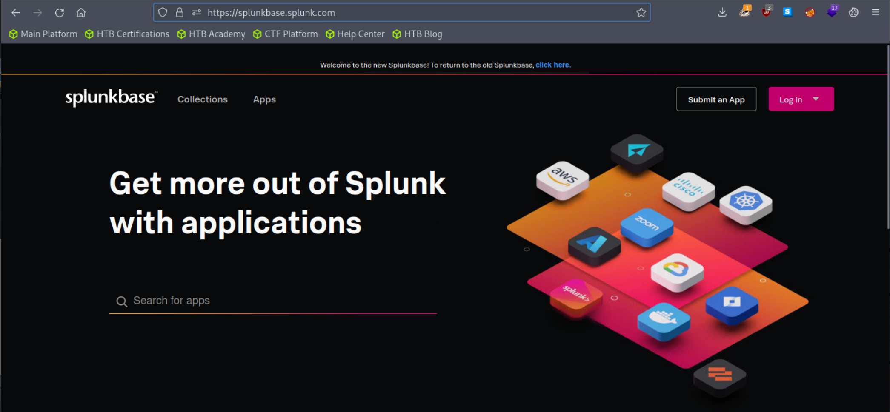
2. Sau khi đăng ký, đăng nhập vào tài khoản của bạn
3. Vào trang [Sysmon App for Splunk](https://splunkbase.splunk.com/app/3544) để tải ứng dụng về.
	
4. Thêm ứng dụng vào search head của bạn như sau.
	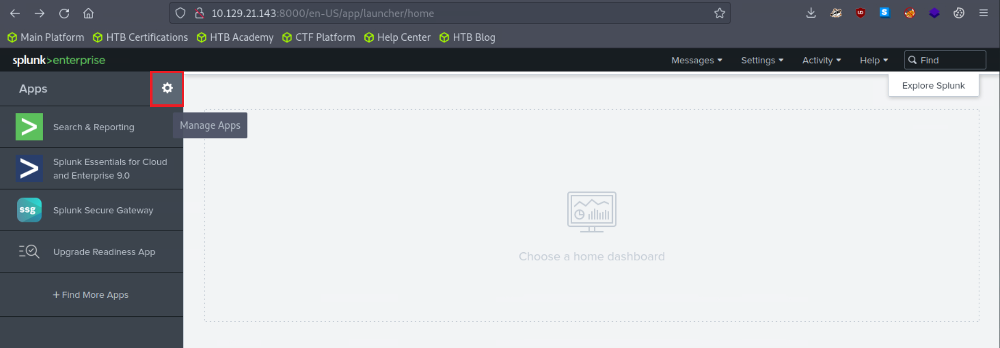
	
	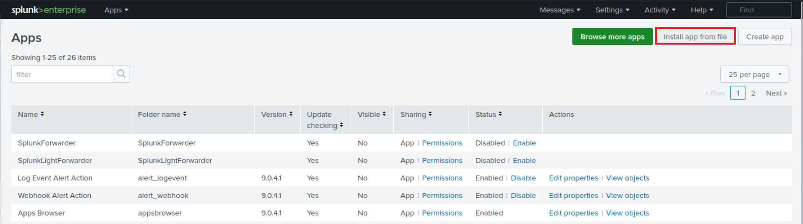
	
	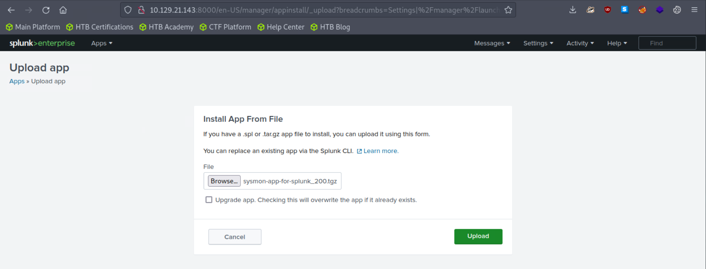
5. Điều chỉnh [macro](https://docs.splunk.com/Documentation/Splunk/latest/Knowledge/Definesearchmacros) của ứng dụng như sau để các event được nạp lên.
	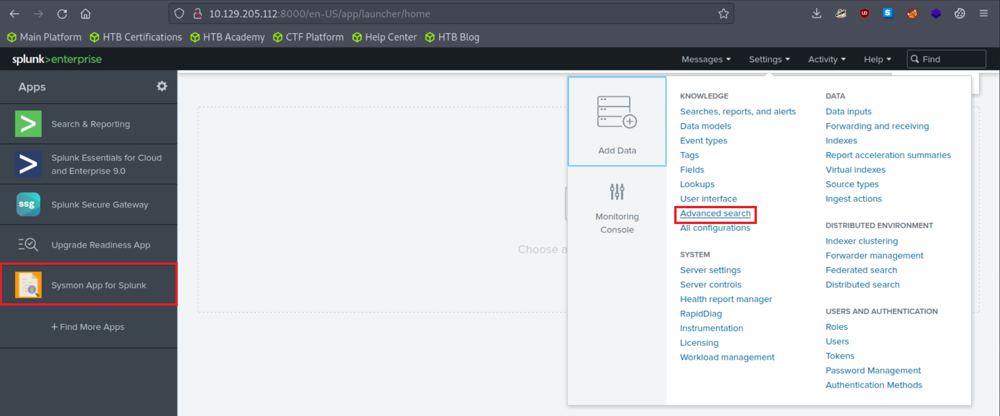
	
	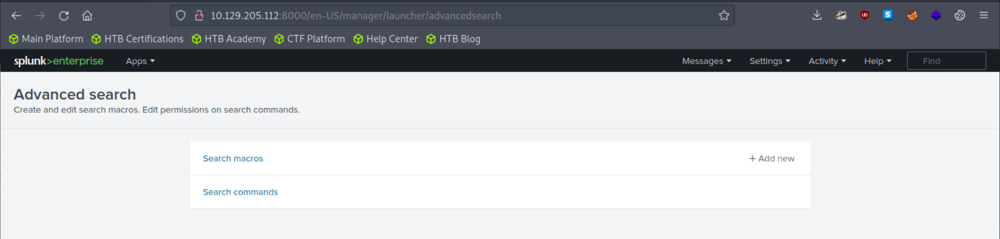
	
	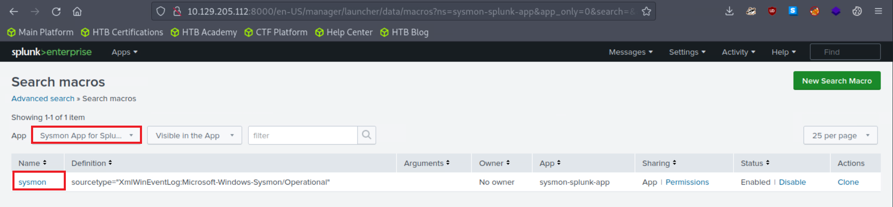
	
	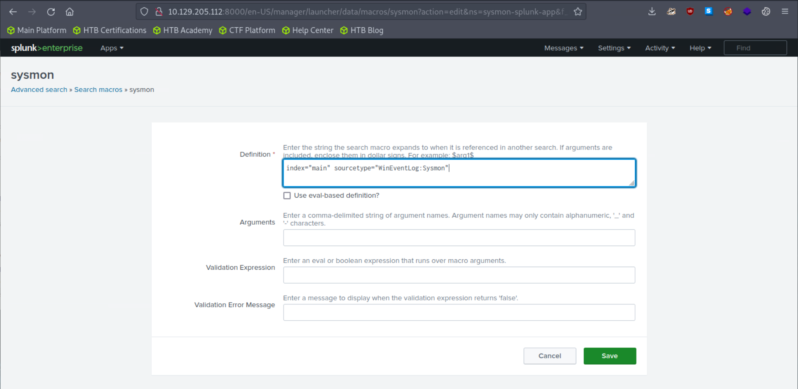

Hãy truy cập Sysmon App for Splunk bằng cách tìm nó trong cột "Apps" trên trang chủ Splunk, rồi vào tab `File Activity`.
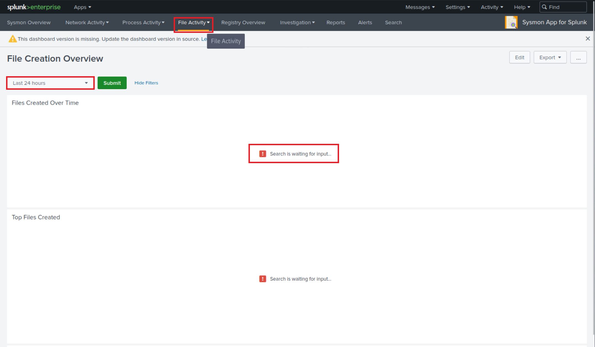

Bây giờ hãy chọn "All time" trên time picker và bấm "Submit". Kết quả được tạo thành công; tuy nhiên, không có kết quả nào xuất hiện trong mục "Top Systems".
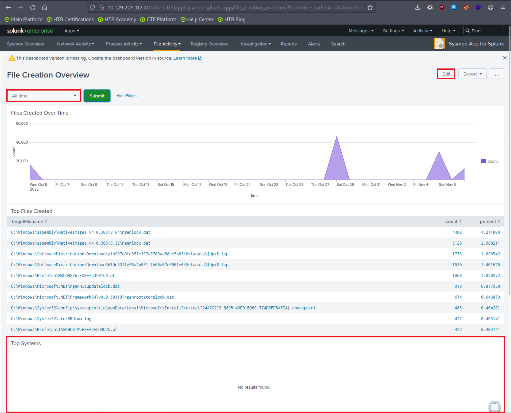

Ta có thể sửa lỗi đó bằng cách bấm "Edit" (góc trên bên phải màn hình) và chỉnh sửa search.
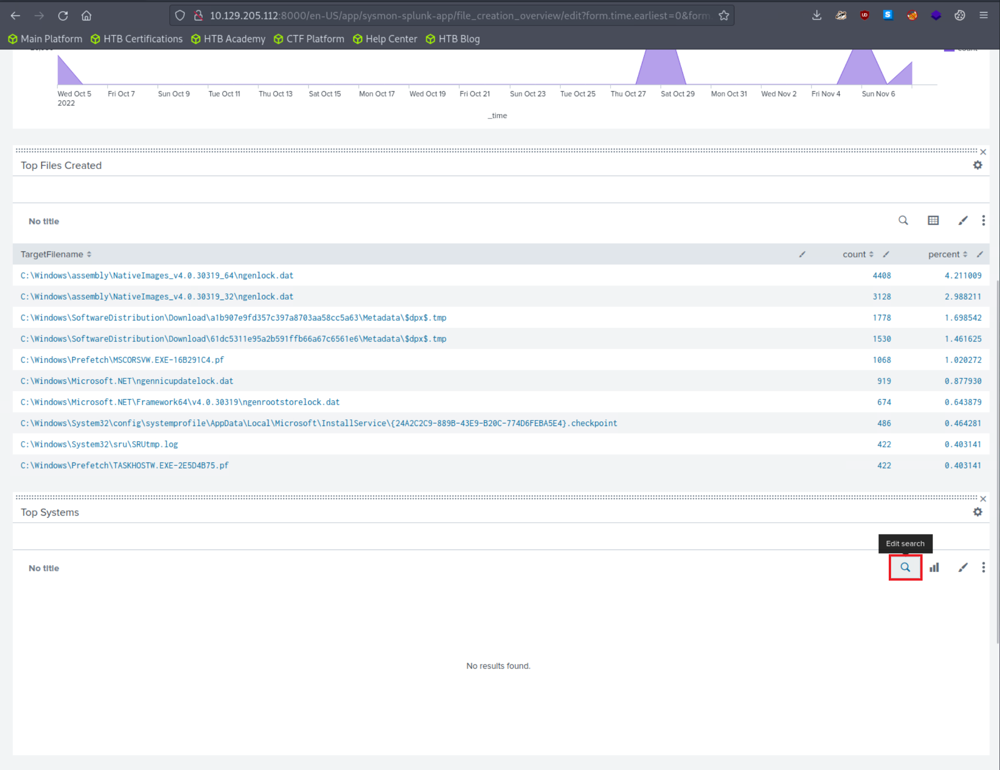

Các Sysmon Event có ID 11 không chứa field tên là `Computer`, nhưng có field tên là `ComputerName`. Hãy sửa lại cho đúng và bấm "Apply"
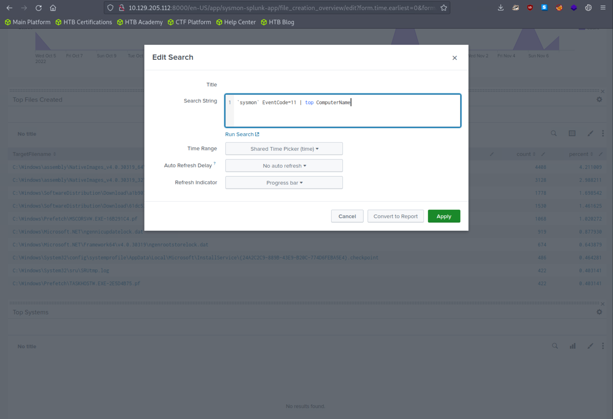

Giờ đây kết quả sẽ được tạo thành công trong mục "Top Systems".
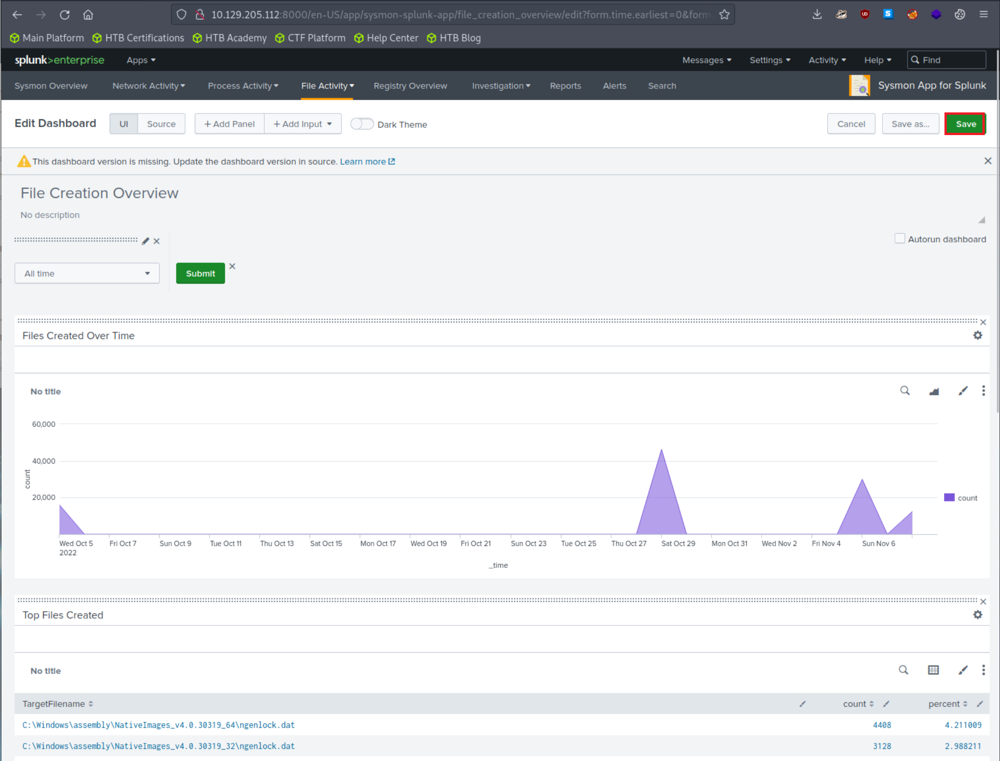

    

				 
Bạn cứ thoải mái khám phá và thử nghiệm với ứng dụng Splunk này. Một bài tập rất tốt là sửa các search khi chúng không tạo ra kết quả do chỉ định những field không tồn tại, và tiếp tục cho tới khi nhận được kết quả mong muốn. 

    

---

## Bài tập thực hành

Kéo xuống cuối section này và bấm vào `Click here to spawn the target system!`

Bây giờ, truy cập `http://[Target IP]:8000`, mở ứng dụng `Sysmon App for Splunk` và trả lời các câu hỏi bên dưới.
