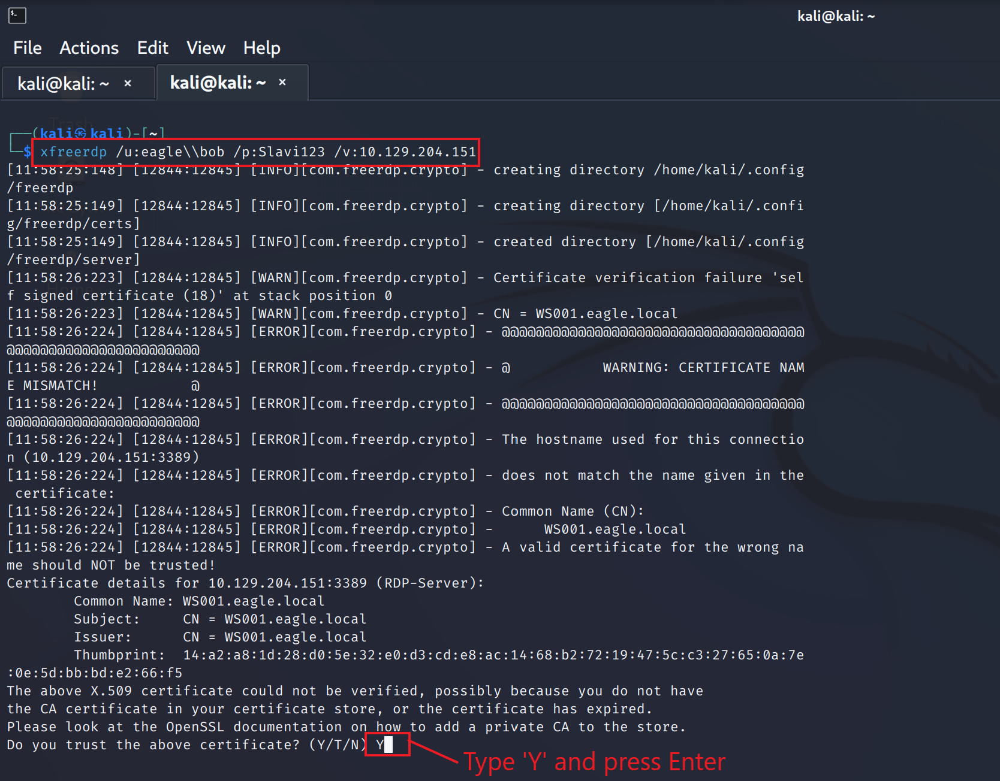
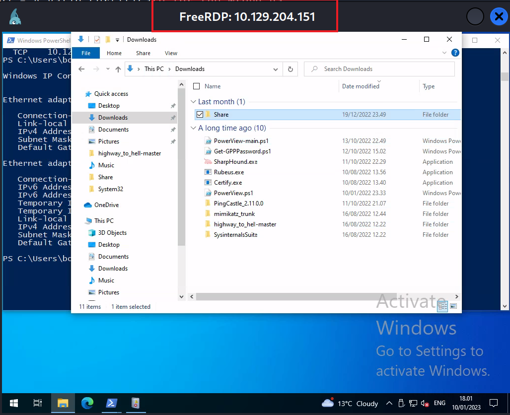
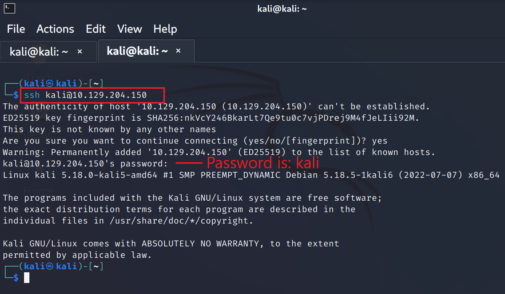
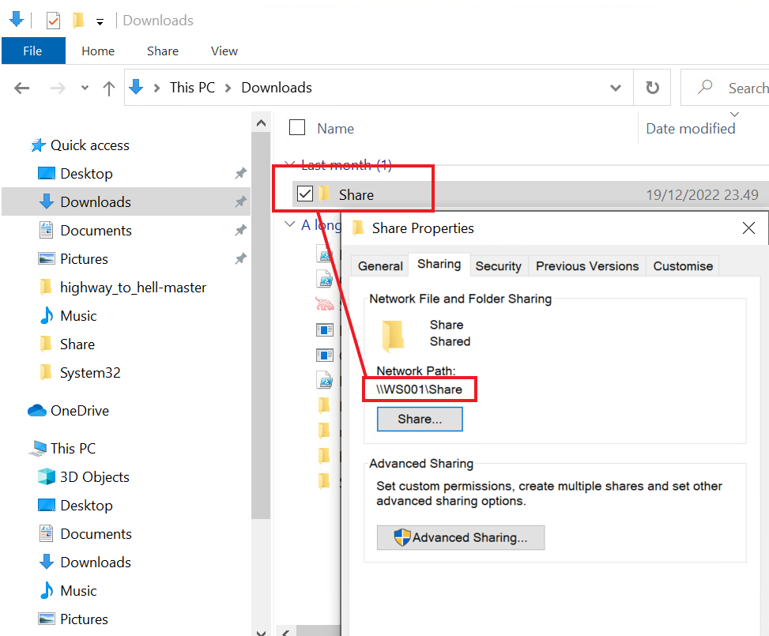
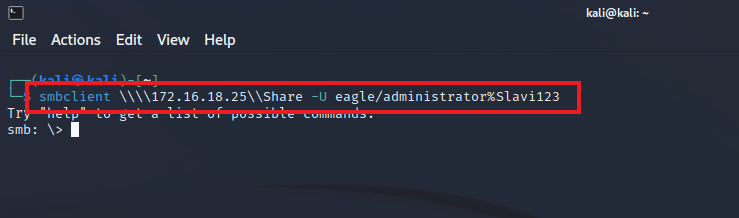

# Overview (Tổng quan)


Trong module này, ta sẽ đi sâu vào nhiều cuộc tấn công khác nhau. Với mỗi cuộc tấn công, mục tiêu là:

1) Mô tả cuộc tấn công.
2) Hướng dẫn từng bước (walkthrough) cách thực hiện cuộc tấn công.
3) Đưa ra các kỹ thuật phòng ngừa và biện pháp kiểm soát bù trừ (compensating control).
4) Thảo luận về khả năng phát hiện (detection).
5) Thảo luận về cách tiếp cận 'honeypot' để phát hiện cuộc tấn công, nếu áp dụng được.

Dưới đây là danh sách đầy đủ tất cả các cuộc tấn công được mô tả trong module này:

- `Kerberoasting`
- `AS-REProasting`
- `GPP Passwords`
- `Misconfigured GPO Permissions (or GPO-deployed files)`
- `Credentials in Network Shares`
- `Credentials in User Attributes`
- `DCSync`
- `Kerberos Golden Ticket`
- `Kerberos Constrained Delegation attack`
- `Print Spooler & NTLM Relaying`
- `Coercing attacks & Kerberos Unconstrained Delegation`
- `Object ACLs`
- `PKI Misconfigurations` - `ESC1`
- `PKI Misconfigurations` - `ESC8` (`Coercing` + `Certificates`)

---

## Môi trường lab

Trong module này, chúng tôi cũng cung cấp một môi trường thực hành (playground) để bạn có thể thử nghiệm và làm theo các walkthrough được cung cấp, tự mình thực hiện các cuộc tấn công này. Lưu ý rằng mục đích của các walkthrough là minh hoạ vấn đề chứ không phải mô tả chuyên sâu các cuộc tấn công. Ngoài ra, các module khác trên nền tảng đã đề cập rất chi tiết về các cuộc tấn công này.

Các cuộc tấn công sẽ được thực hiện từ máy Windows 10 (WS001) và máy Kali Linux được cung cấp. Giả định là kẻ tấn công đã giành được khả năng thực thi code từ xa (remote code execution, dưới dạng nào đó) trên máy Windows 10 (WS001) đó. User mà ta giả định đã bị xâm nhập là `Bob` — một user thông thường trong Active Directory, không được gán quyền đặc biệt nào.

Môi trường gồm các máy sau cùng địa chỉ IP tương ứng:

- `DC1`: `172.16.18.3`
- `DC2`: `172.16.18.4`
- `Server01`: `172.16.18.10`
- `PKI`: `172.16.18.15`
- `WS001`: `DHCP or 172.16.18.25` (tuỳ section)
- `Kali Linux`: `DHCP or 172.16.18.20` (tuỳ section)

---

## Kết nối tới môi trường lab

Phần lớn các host nêu trên đều có lỗ hổng với nhiều cuộc tấn công và nằm trong một mạng cô lập, có thể truy cập qua VPN. Khi đã kết nối VPN, học viên có thể truy cập trực tiếp vào máy WS001 và/hoặc Kali (tuỳ section) — như đã đề cập, đây sẽ là điểm bám ban đầu (initial foothold) và thiết bị của kẻ tấn công xuyên suốt các kịch bản.

Dưới đây là hướng dẫn (từ một host Linux):

- Cách kết nối tới máy Windows WS001
- Cách kết nối tới máy Kali
- Cách chuyển file giữa WS001 và máy tấn công Linux của bạn

---

## Kết nối tới WS001 qua RDP

Khi đã kết nối VPN, bạn có thể truy cập máy Windows qua RDP. Hầu hết các bản phân phối Linux đều có sẵn phần mềm client 'xfreerdp' — một lựa chọn để thực hiện kết nối RDP này. Để truy cập máy, ta sẽ dùng tài khoản user Bob với password là 'Slavi123'. Để kết nối, chạy lệnh sau:

```shell-session
[!bash!]$ xfreerdp /u:eagle\\bob /p:Slavi123 /v:TARGET_IP /dynamic-resolution
```



Nếu kết nối thành công, một cửa sổ mới hiển thị desktop của WS001 sẽ xuất hiện trên màn hình của bạn, như hình dưới đây:



---

## Kết nối tới Kali qua SSH

Khi đã kết nối VPN, ta có thể truy cập máy Kali qua SSH. Thông tin đăng nhập của máy là mặc định 'kali/kali'. Để kết nối, dùng lệnh sau:

```shell-session
[!bash!]$ ssh kali@TARGET_IP
```



<div class="card bg-light">
    <div class="card-body">
        <p class="mb-0"><b><code>Note:</code></b> Chúng tôi cũng đã bật RDP trên host Kali. Với các section mà host Kali là target chính, nên kết nối bằng RDP. Thông tin đăng nhập để kết nối sẽ được cung cấp cho từng câu hỏi challenge. </p>
    </div>
</div>

```shell-session
[!bash!]$ xfreerdp /v:TARGET_IP /u:kali /p:kali /dynamic-resolution
```

---

## Chuyển file giữa WS001 và máy tấn công Linux của bạn

Để thuận tiện cho việc chuyển file giữa các máy, chúng tôi đã tạo một thư mục chia sẻ trên WS001, có thể truy cập qua SMB.



Để truy cập thư mục từ máy Kali, bạn có thể dùng lệnh 'smbclient'. Truy cập thư mục cần xác thực, nên bạn sẽ phải cung cấp thông tin đăng nhập. Có thể chạy lệnh với tài khoản Administrator như sau:

```shell-session
[!bash!]$ smbclient \\\\TARGET_IP\\Share -U eagle/administrator%Slavi123
```



Sau khi kết nối, bạn có thể dùng các lệnh `put` hoặc `get` để lần lượt upload hoặc download file.
