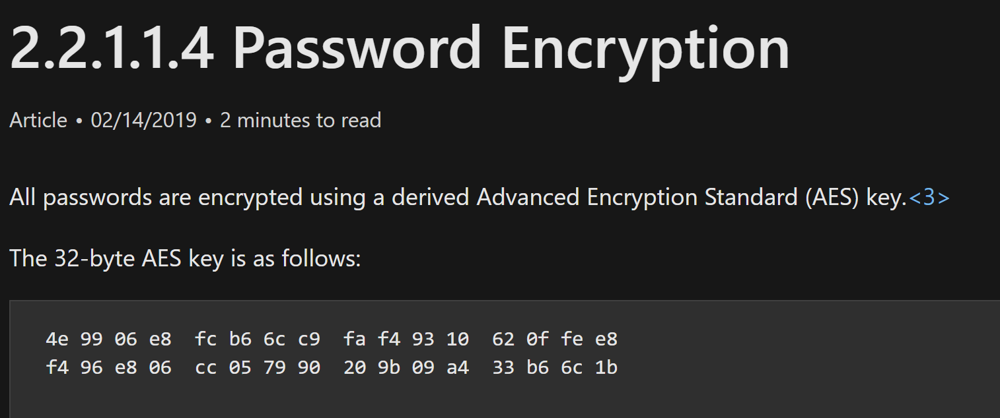
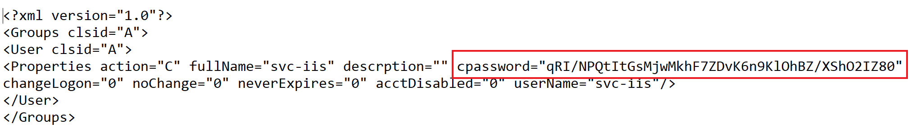
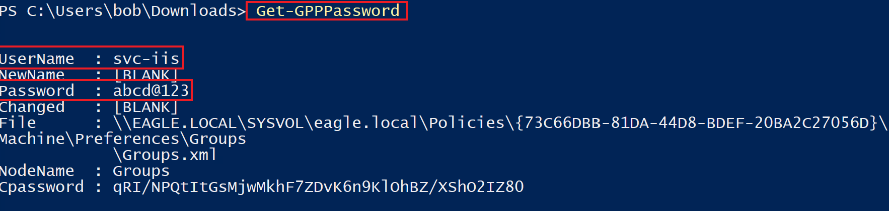
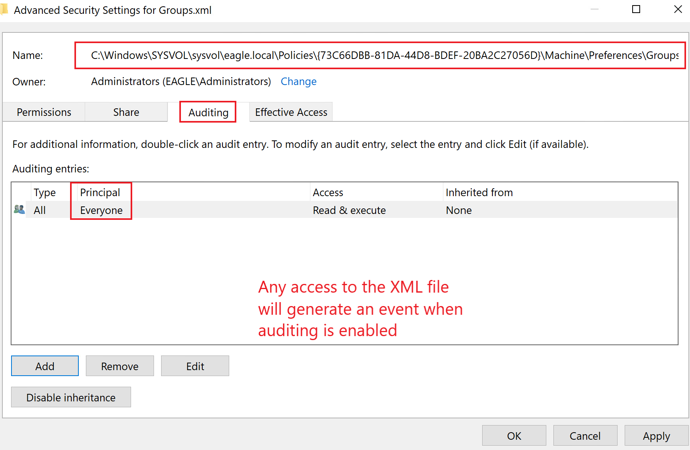
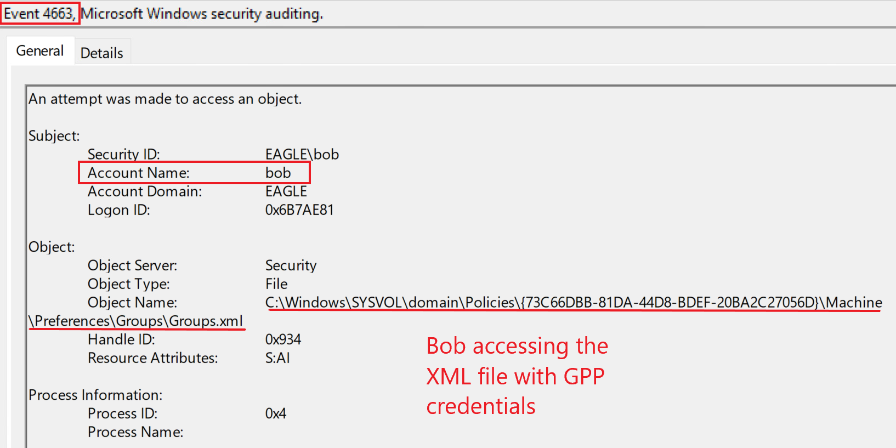
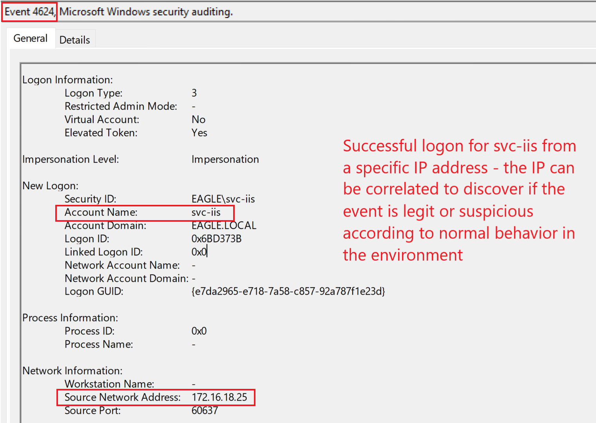
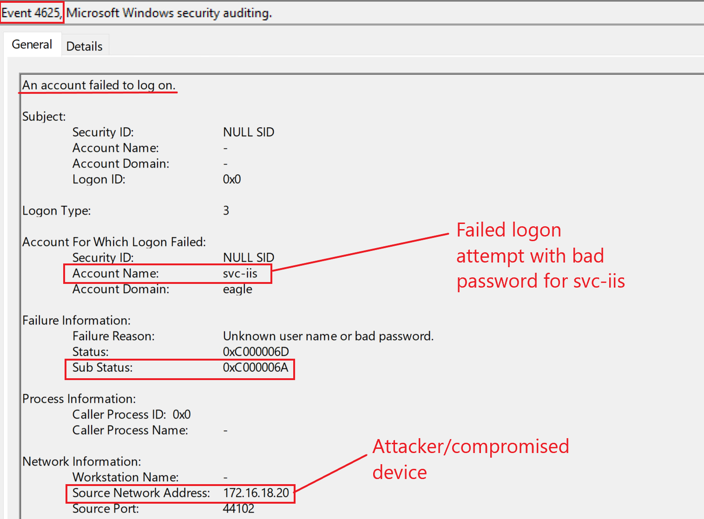
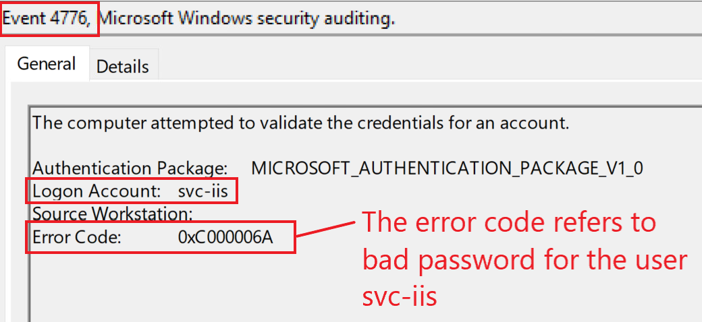

# GPP Passwords (Mật khẩu GPP)


## Description (Mô tả)

`SYSVOL` là một network share có trên tất cả các Domain Controller, chứa logon script, dữ liệu group policy và các dữ liệu khác cần thiết trên phạm vi toàn domain. AD lưu tất cả group policy tại `\\<DOMAIN>\SYSVOL\<DOMAIN>\Policies\`. Khi Microsoft phát hành nó cùng Windows Server 2008, `Group Policy Preferences` (`GPP`) đã giới thiệu khả năng lưu và dùng credential trong nhiều kịch bản, tất cả đều được AD lưu trong thư mục policies trong `SYSVOL`.

Trong các cuộc engagement, ta có thể gặp các scheduled task và script được chạy dưới một user cụ thể và chứa username cùng một phiên bản mật khẩu đã mã hoá trong các file XML policy. Khoá mã hoá mà AD dùng để mã hoá các file XML policy (`same` – giống nhau cho tất cả các môi trường Active Directory) đã bị công bố trên Microsoft Docs, cho phép bất kỳ ai cũng có thể giải mã credential được lưu trong các file policy. Bất kỳ ai cũng giải mã được credential vì thư mục `SYSVOL` có thể truy cập bởi toàn bộ 'Authenticated Users' trong domain, bao gồm cả user và computer. Microsoft đã công bố [khoá riêng AES trên MSDN](https://learn.microsoft.com/en-us/openspecs/windows_protocols/ms-gppref/2c15cbf0-f086-4c74-8b70-1f2fa45dd4be?redirectedfrom=MSDN):
  

  
Ngoài ra, để tham khảo, đây là ví dụ một file XML chứa mật khẩu đã mã hoá trông như thế nào (lưu ý rằng property có tên là `cpassword`):



---

## Attack (Tấn công)

Để lạm dụng `GPP Passwords`, ta sẽ dùng hàm [Get-GPPPassword](https://github.com/PowerShellMafia/PowerSploit/blob/master/Exfiltration/Get-GPPPassword.ps1) từ `PowerSploit`, hàm này tự động phân tích tất cả file XML trong thư mục Policies trong `SYSVOL`, nhặt ra những file có property `cpassword` và giải mã chúng ngay khi phát hiện:

```powershell-session
PS C:\Users\bob\Downloads> Import-Module .\Get-GPPPassword.ps1
PS C:\Users\bob\Downloads> Get-GPPPassword

UserName  : svc-iis
NewName   : [BLANK]
Password  : abcd@123
Changed   : [BLANK]
File      : \\EAGLE.LOCAL\SYSVOL\eagle.local\Policies\{73C66DBB-81DA-44D8-BDEF-20BA2C27056D}\
            Machine\Preferences\Groups\Groups.xml
NodeName  : Groups
Cpassword : qRI/NPQtItGsMjwMkhF7ZDvK6n9KlOhBZ/XShO2IZ80
```
  


---

## Prevention (Phòng chống)

Khi khoá mã hoá bị công khai và bắt đầu bị lạm dụng, Microsoft đã phát hành một bản patch (`KB2962486)` vào năm 2014 để ngăn việc `caching credentials` (lưu đệm credential) trong GPP. Do đó, GPP không còn lưu mật khẩu trong các môi trường đã được patch mới nữa. Tuy nhiên, đáng tiếc là có vô số môi trường Active Directory được xây dựng sau năm 2015, vì lý do nào đó, vẫn chứa credential trong `SYSVOL`. Vì vậy, rất nên liên tục đánh giá và rà soát môi trường để đảm bảo không có credential nào bị phơi bày ở đây.
  
Điều quan trọng cần biết là nếu một tổ chức xây dựng môi trường AD của mình trước năm 2014, nhiều khả năng credential của họ vẫn còn được cache vì bản patch không xoá các credential đã lưu sẵn (nó chỉ ngăn việc cache các credential mới).

---

## Detection (Phát hiện)

Có hai kỹ thuật phát hiện cho cuộc tấn công này:

- Việc truy cập file XML chứa credential nên là một red flag nếu ta đang audit truy cập file; điều này thực tế hơn (do khối lượng nếu không thì quá lớn) về mặt phát hiện nếu đó là một file XML giả (dummy), không gắn với GPO nào. Trong trường hợp này, sẽ không có lý do gì để ai đó động tới file này, và mọi nỗ lực truy cập đều nhiều khả năng đáng ngờ. Như `Get-GPPPasswords` đã minh hoạ, nó phân tích tất cả các file XML trong thư mục Policies. Để audit, ta có thể sinh ra một event mỗi khi một user đọc file:
 


Khi audit đã được bật, mọi truy cập vào file sẽ sinh ra một Event với ID `4663`:


  
- Các lần thử logon (thất bại hoặc thành công, tuỳ thuộc mật khẩu còn hợp lệ hay không) của user có credential bị phơi bày là một cách khác để phát hiện việc lạm dụng cuộc tấn công này; việc này sẽ sinh ra một trong các event `4624` (`successful logon` – logon thành công), `4625` (`failed logon` – logon thất bại), hoặc `4768` (`TGT requested` – yêu cầu TGT). Một lần logon thành công với tài khoản trong kịch bản tấn công của ta sẽ sinh ra event sau trên Domain Controller:



Trong trường hợp một service account, ta có thể đối chiếu (correlate) các lần thử logon với thiết bị mà nỗ lực xác thực xuất phát, vì việc này dễ phát hiện, giả sử ta biết các tài khoản nhất định được dùng ở đâu (nhất là nếu logon xuất phát từ một workstation, điều vốn là hành vi bất thường đối với một service account).

---

## Honeypot (Bẫy honeypot)

Cuộc tấn công này mang lại cơ hội tuyệt vời để dựng một cái bẫy: ta có thể dùng một user bán đặc quyền (semi-privileged) với một `wrong password` (mật khẩu sai). Service account mang lại cơ hội thực tế hơn vì:

  - Mật khẩu thường được kỳ vọng là đã cũ, không bị đổi gần đây hay thường xuyên.
  - Dễ đảm bảo rằng lần đổi mật khẩu cuối cùng cũ hơn thời điểm file GPP XML được sửa lần cuối. Nếu mật khẩu của user bị đổi sau khi file được sửa, thì không kẻ tấn công nào sẽ thử đăng nhập bằng tài khoản này (mật khẩu nhiều khả năng không còn hợp lệ).
  - Lên lịch cho user thực hiện một tác vụ giả nào đó để đảm bảo có các lần thử logon gần đây.

Khi làm những điều trên, ta có thể cấu hình một alert rằng nếu có bất kỳ lần thử logon thành công hay thất bại nào với service account này, thì đó chắc chắn là hành vi độc hại (giả sử ta đã whitelist lần logon của tác vụ giả vốn mô phỏng hoạt động logon trong alert).
  
Vì mật khẩu được cung cấp là sai, ta chủ yếu sẽ chờ đợi các lần logon thất bại. Ba event ID (`4625`, `4771`, và `4776`) có thể cho thấy điều này; đây là cách chúng trông ra sao trong môi trường thực hành của ta nếu một kẻ tấn công đang cố xác thực với mật khẩu sai:

- `4625`



- `4771`


- `4776`


