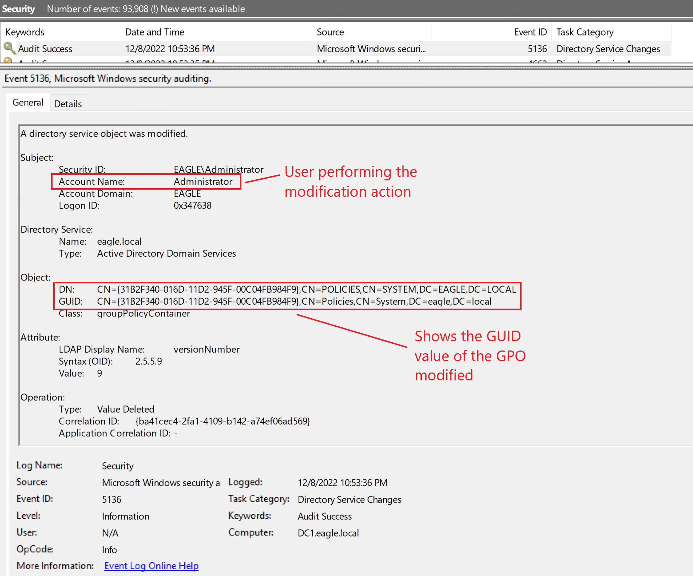
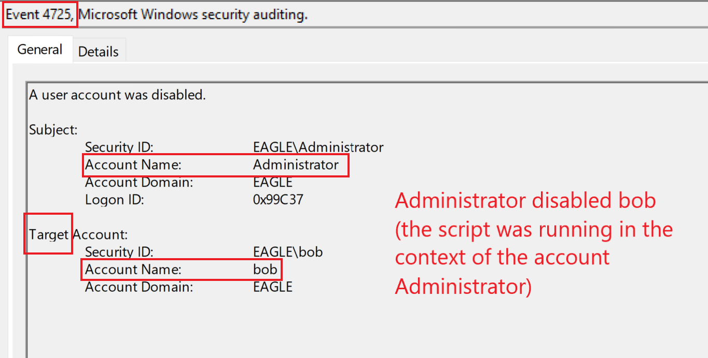

# GPO Permissions/GPO Files (Quyền GPO / File GPO)


## Description (Mô tả)

Một [Group Policy Object (GPO)](https://learn.microsoft.com/en-us/previous-versions/windows/desktop/policy/group-policy-objects) là một tập hợp ảo các policy setting, có một tên duy nhất. `GPOs` là công cụ quản lý cấu hình được dùng rộng rãi nhất trong Active Directory. Mỗi GPO chứa một tập hợp gồm không hoặc nhiều policy setting. Chúng được link (liên kết) tới một `Organizational Unit` trong cấu trúc AD để các setting của chúng được áp dụng cho các object nằm trong OU đó hoặc bất kỳ OU con nào của OU mà GPO được link tới. GPO có thể bị giới hạn phạm vi áp dụng bằng cách chỉ định, ví dụ, một AD group (mặc định, nó áp dụng cho Authenticated Users) hoặc một WMI filter (vd: chỉ áp dụng cho các máy Windows 10).

Khi ta tạo một GPO mới, chỉ Domain admin (và các vai trò đặc quyền tương tự) mới có thể sửa nó. Tuy nhiên, trong các môi trường, ta sẽ gặp các kiểu delegation (uỷ quyền) khác nhau cho phép các tài khoản ít đặc quyền hơn được thực hiện chỉnh sửa trên GPO; đây chính là chỗ nảy sinh vấn đề. Nhiều tổ chức có các GPO mà 'Authenticated Users' hoặc 'Domain Users' có thể sửa đổi, điều này đồng nghĩa với việc bất kỳ user nào bị xâm nhập cũng sẽ cho phép kẻ tấn công thay đổi các GPO đó. Việc thay đổi có thể bao gồm thêm start-up script hoặc một scheduled task để thực thi một file, chẳng hạn. Quyền truy cập này sẽ cho phép kẻ tấn công xâm nhập tất cả các computer object trong các OU mà các GPO có lỗ hổng được link tới.

Tương tự, các administrator thực hiện cài đặt phần mềm qua GPO hoặc cấu hình các start-up script đặt trên network share. Nếu network share bị cấu hình sai, kẻ tấn công có thể thay thế file mà hệ thống sẽ thực thi bằng một file độc hại. Trong các kịch bản này, bản thân GPO có thể không có cấu hình sai nào, chỉ là NTFS permission trên các file được triển khai bị cấu hình sai.

---

## Attack (Tấn công)

Không có hướng dẫn tấn công chi tiết ở đây - nó chỉ đơn giản là một thao tác sửa GPO hoặc thay thế file.

---

## Prevention (Phòng chống)

Một cách để ngăn cuộc tấn công này là khoá chặt (lock down) quyền GPO để chỉ được sửa bởi một nhóm user cụ thể hoặc một tài khoản cụ thể, vì điều này sẽ hạn chế đáng kể khả năng ai có thể sửa GPO hay thay đổi quyền của nó (trái ngược với việc giao cho tất cả mọi người trong Domain admin, mà ở một số tổ chức con số này có thể dễ dàng hơn 50). Tương tự, đừng bao giờ triển khai các file lưu ở network location sao cho nhiều user có thể sửa được share permission.

Ta cũng nên rà soát quyền của các GPO một cách chủ động và đều đặn, với lựa chọn tự động hoá một task chạy mỗi giờ và cảnh báo nếu phát hiện bất kỳ sai lệch nào so với quyền kỳ vọng.

---

## Detection (Phát hiện)

May mắn là việc phát hiện khi một GPO bị sửa đổi khá đơn giản. Nếu audit Directory Service Changes được bật, thì event ID `5136` sẽ được sinh ra:



Từ góc độ phòng thủ, nếu một user `not` (không) được kỳ vọng có quyền sửa GPO bỗng nhiên xuất hiện ở đây, thì cần giương một red flag.

---

## Honeypot (Bẫy honeypot)

Một suy nghĩ phổ biến là do các cuộc tấn công này dễ phát hiện, nên việc để một GPO cấu hình sai trong môi trường cho các threat agent lạm dụng là đáng giá; điều này cũng đúng với một file được triển khai vì chúng có thể được giám sát liên tục để phát hiện mọi thay đổi trên file (vd: liên tục kiểm tra xem giá trị hash của file có bị thay đổi hay không). Tuy nhiên, việc triển khai các kỹ thuật này chỉ được khuyến nghị nếu tổ chức đã trưởng thành và chủ động trong việc phản ứng với các lỗ hổng mức high/critical; đó là vì nếu trong tương lai, một đường leo thang (escalation path) được phát hiện qua một số thay đổi GPO nào đó, thì trừ khi có thể giảm thiểu nó theo thời gian thực, cái bẫy (`trap`) sẽ phản tác dụng và trở thành điểm yếu nhất.

Tuy nhiên, khi triển khai một honeypot dùng GPO cấu hình sai, hãy cân nhắc những điều sau:

- GPO chỉ được link tới các server không trọng yếu.
- Có sẵn cơ chế tự động hoá liên tục để giám sát các thay đổi của GPO. - - Nếu file GPO bị sửa đổi, ta sẽ vô hiệu hoá (disable) ngay lập tức user thực hiện việc sửa đổi.
- GPO nên được tự động unlink khỏi mọi vị trí nếu phát hiện có sửa đổi.

Hãy xem xét script sau để minh hoạ cách PowerShell có thể tự động hoá việc này. Trong trường hợp của ta, honeypot GPO được nhận diện bằng một giá trị GUID, và hành động mong muốn là disable (các) tài khoản liên quan tới thay đổi này. Lý do có thể có nhiều tài khoản là vì ta sẽ chạy script mỗi 15 phút dưới dạng một scheduled task. Vì vậy, nếu nhiều user bị xâm nhập được dùng để sửa GPO trong khung thời gian này, ta sẽ disable tất cả ngay lập tức. Script có một đoạn được comment-out có thể dùng để gửi email như một alert, nhưng cho mục đích PoC, ta sẽ hiển thị output ra command line:

```powershell
# Define filter for the last 15 minutes
$TimeSpan = (Get-Date) - (New-TimeSpan -Minutes 15)

# Search for event ID 5136 (GPO modified) in the past 15 minutes
$Logs = Get-WinEvent -FilterHashtable @{LogName='Security';id=5136;StartTime=$TimeSpan} -ErrorAction SilentlyContinue |`
Where-Object {$_.Properties[8].Value -match "CN={73C66DBB-81DA-44D8-BDEF-20BA2C27056D},CN=POLICIES,CN=SYSTEM,DC=EAGLE,DC=LOCAL"}


if($Logs){
    $emailBody = "Honeypot GPO '73C66DBB-81DA-44D8-BDEF-20BA2C27056D' was modified`r`n"
    $disabledUsers = @()
    ForEach($log in $logs){
        If(((Get-ADUser -identity $log.Properties[3].Value).Enabled -eq $true) -and ($log.Properties[3].Value -notin $disabledUsers)){
            Disable-ADAccount -Identity $log.Properties[3].Value
            $emailBody = $emailBody + "Disabled user " + $log.Properties[3].Value + "`r`n"
            $disabledUsers += $log.Properties[3].Value
        }
    }
    # Send an alert via email - complete the command below
    # Send-MailMessage
    $emailBody
}
```

Ta sẽ thấy output sau (hoặc nội dung email nếu được cấu hình) nếu script phát hiện honeypot GPO đã bị sửa đổi:

```powershell-session
PS C:\scripts> # Define filter for the last 15 minutes
$TimeSpan = (Get-Date) - (New-TimeSpan -Minutes 15)

# Search for event ID 5136 (GPO modified) in the past 15 minutes
$Logs = Get-WinEvent -FilterHashtable @{LogName='Security';id=5136;StartTime=$TimeSpan} -ErrorAction SilentlyContinue |`
Where-Object {$_.Properties[8].Value -match "CN={73C66DBB-81DA-44D8-BDEF-20BA2C27056D},CN=POLICIES,CN=SYSTEM,DC=EAGLE,DC=LOCAL"}


if($Logs){
    $emailBody = "Honeypot GPO '73C66DBB-81DA-44D8-BDEF-20BA2C27056D' was modified`r`n"
    $disabledUsers = @()
    ForEach($log in $logs){
        # Write-Host "User performing the modification is " $log.Properties[3].Value
        If(((Get-ADUser -identity $log.Properties[3].Value).Enabled -eq $true) -and ($log.Properties[3].Value -notin $disabledUsers)){
            Disable-ADAccount -Identity $log.Properties[3].Value
            $emailBody = $emailBody + "Disabled user " + $log.Properties[3].Value + "`r`n"
            $disabledUsers += $log.Properties[3].Value
        }
    }
    # Send an alert via email
    # Send-MailMessage
    $emailBody
}

Honeypot GPO '73C66DBB-81DA-44D8-BDEF-20BA2C27056D' was modified
Disabled user bob


PS C:\scripts> 
```

Như ta thấy ở trên, user `bob` bị phát hiện đang sửa đổi honeypot GPO của ta và do đó bị disable. Việc disable user sau đó sẽ tạo ra một event với ID `4725`:


