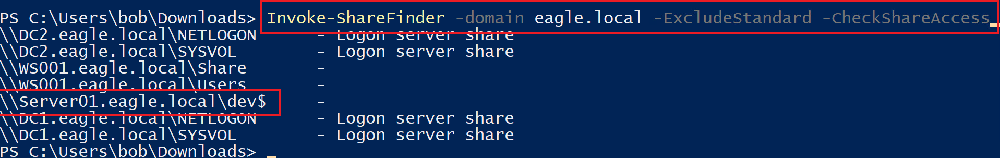
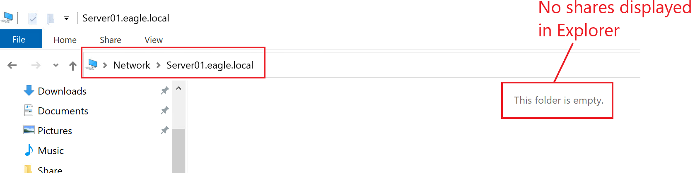
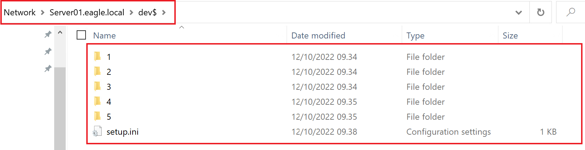
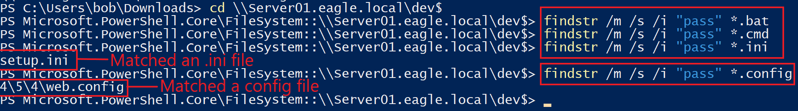
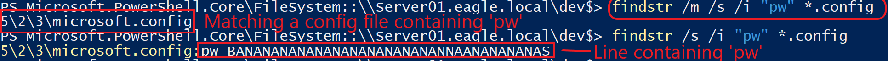
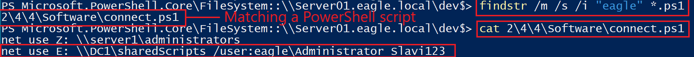
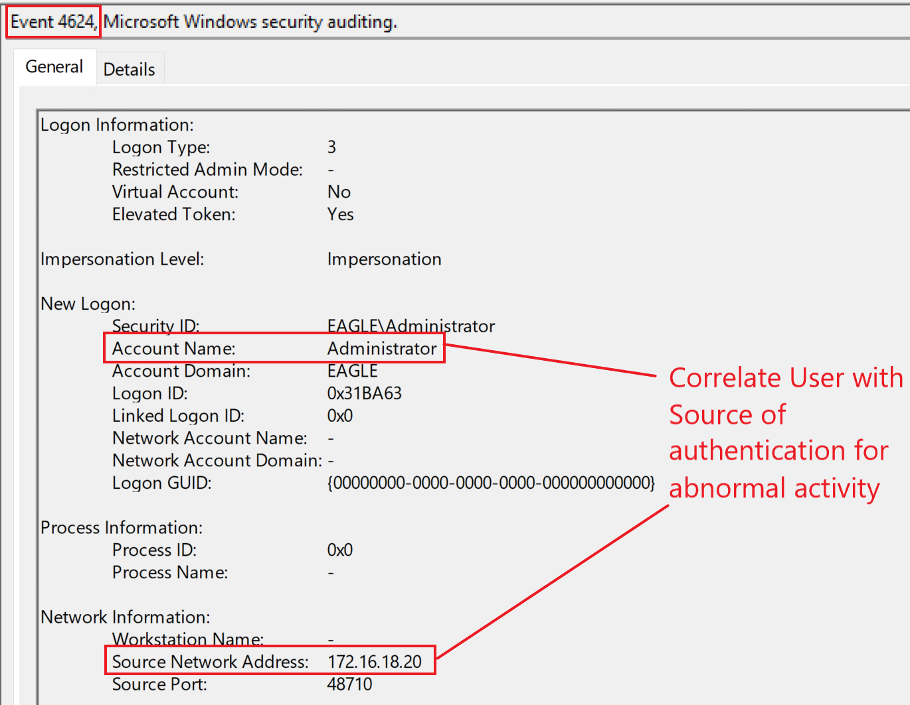
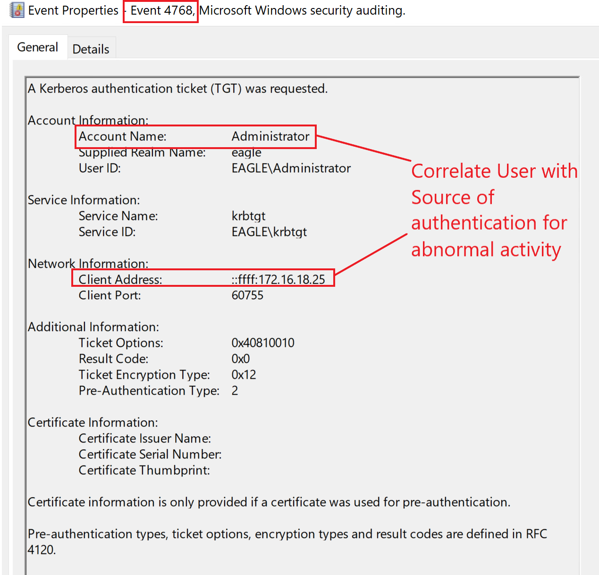
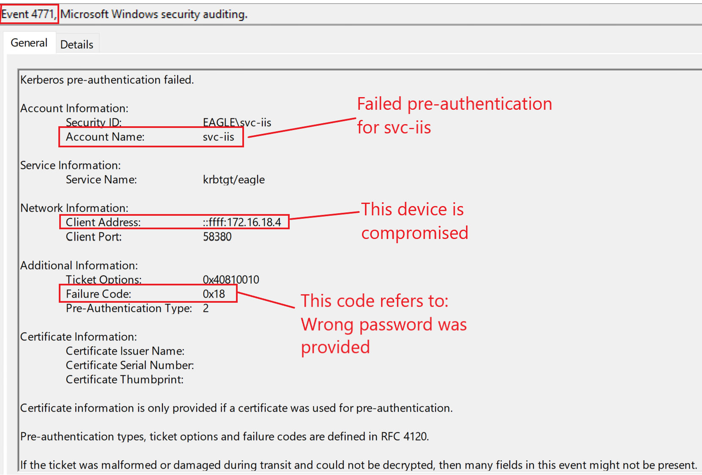

# Credentials in Shares (Credential trong các share)


## Description (Mô tả)

Credential bị phơi bày trong các network share (có lẽ) là cấu hình sai hay gặp nhất trong Active Directory cho tới nay. Bất kỳ doanh nghiệp vừa/lớn nào cũng chắc chắn sẽ có credential bị phơi bày, dù điều này cũng có thể xảy ra ở các doanh nghiệp nhỏ. Cảm giác gần như ta đang chuyển từ "Đừng để mật khẩu trên tờ giấy note dán trên màn hình" sang "Đừng để credential không mã hoá và các authorization token vương vãi khắp nơi".

Ta thường tìm thấy credential trong các network share bên trong các script và file cấu hình (batch, cmd, PowerShell, conf, ini, và config). Ngược lại, credential trên máy cá nhân của một user chủ yếu nằm trong file text, bảng Excel, hoặc tài liệu Word. Khác biệt chính giữa việc lưu credential trên các share và trên các máy là loại trước đặt ra rủi ro cao hơn hẳn, vì nó có thể bị truy cập bởi mọi user. Một network share có thể bị truy cập bởi mọi user vì bốn lý do chính:

- Một admin user ban đầu tạo share với quyền truy cập được khoá chặt đúng cách nhưng rốt cuộc lại mở nó cho tất cả mọi người. Một admin khác của server cũng có thể là thủ phạm. Dù sao đi nữa, share cuối cùng trở nên mở cho `Everyone` hoặc `Users,` và nhớ rằng group `Users` của một server chứa `Domain users` làm thành viên trong các môi trường Active Directory. Do đó mọi domain user sẽ có ít nhất quyền read (người ta nhầm lẫn cho rằng việc thêm 'Users' sẽ chỉ cấp quyền truy cập cho những ai cục bộ trên server hoặc cho Administrators).
- Administrator thêm các script chứa credential vào một share mà không biết đó là thư mục được chia sẻ. Nhiều admin test script của họ trong một thư mục `scripts` ở ổ `C:\`; tuy nhiên, nếu thư mục đó được chia sẻ (ví dụ, với `Users`), thì dữ liệu bên trong các script cũng bị phơi bày trên mạng.
- Một ví dụ khác là cố ý tạo một share mở để chuyển dữ liệu tới một server (ví dụ, một ứng dụng hoặc vài file khác) rồi quên đóng nó lại sau đó.
- Cuối cùng, trong trường hợp các hidden share (thư mục có tên kết thúc bằng dấu đô la `$`), có một ngộ nhận rằng user không thể tìm thấy thư mục trừ khi họ biết nó tồn tại ở đâu; sự hiểu lầm này đến từ việc `Explorer` trong Windows không hiển thị các file hay thư mục có tên kết thúc bằng `$`, tuy nhiên, bất kỳ công cụ nào khác cũng sẽ hiển thị nó.

---

## Attack (Tấn công)

Bước đầu tiên là xác định những share nào tồn tại trong một domain. Có rất nhiều công cụ sẵn có làm được việc này, chẳng hạn [Invoke-ShareFinder](https://github.com/darkoperator/Veil-PowerView/blob/master/PowerView/functions/Invoke-ShareFinder.ps1) của PowerView. Hàm này cho phép chỉ định rằng các default share nên bị lọc bỏ (như `c$` và `IPC$`) và cũng kiểm tra xem user đang gọi hàm có quyền truy cập vào phần còn lại của các share mà nó tìm thấy hay không. Output cuối cùng chứa một danh sách các share không mặc định mà tài khoản user hiện tại có ít nhất quyền read:

```powershell-session
PS C:\Users\bob\Downloads> Invoke-ShareFinder -domain eagle.local -ExcludeStandard -CheckShareAccess

\\DC2.eagle.local\NETLOGON      - Logon server share
\\DC2.eagle.local\SYSVOL        - Logon server share
\\WS001.eagle.local\Share       -
\\WS001.eagle.local\Users       -
\\Server01.eagle.local\dev$     -
\\DC1.eagle.local\NETLOGON      - Logon server share
\\DC1.eagle.local\SYSVOL        - Logon server share
```



Môi trường thực hành có ít share trong domain, tuy nhiên, trong các môi trường production, con số có thể lên tới hàng ngàn (đòi hỏi những khoảng thời gian dài để phân tích).

Hình trên cho thấy một share có tên `dev$`. Do có dấu đô la, nếu ta duyệt server chứa share này bằng Windows Explorer, ta sẽ thấy một danh sách rỗng (các share như `C$` và `IPC$` mặc dù có sẵn mặc định, Explorer không hiển thị chúng vì dấu đô la):



Tuy nhiên, vì ta có đường dẫn `UNC` từ output, nếu ta duyệt tới nó, ta sẽ thấy được nội dung bên trong share:



Có vài công cụ tự động tồn tại, chẳng hạn [SauronEye](https://github.com/vivami/SauronEye), có thể phân tích một tập hợp file và nhặt ra các từ khớp. Tuy nhiên, vì có ít share trong môi trường thực hành, ta sẽ dùng cách tiếp cận thủ công hơn (`Living Off the Land`) và dùng lệnh có sẵn `findstr` cho cuộc tấn công này. Khi chạy `findstr`, ta sẽ chỉ định các tham số sau:

- `/s` buộc tìm trong thư mục hiện tại và tất cả thư mục con
- `/i` bỏ qua phân biệt hoa-thường trong từ khoá tìm kiếm
- `/m` chỉ hiển thị tên file đối với file khớp từ khoá. Ta rất cần cái này trong các môi trường production thực tế vì lượng text trả về khổng lồ. Ví dụ, điều này có thể là hàng ngàn dòng trong các script PowerShell chứa tham số `PassThru` khi khớp chuỗi `pass`.
- `term` (từ khoá) định nghĩa thứ ta đang tìm. Các ứng viên tốt bao gồm `pass`, `pw`, và tên `NETBIOS` của domain. Trong môi trường thực hành, nó là `eagle`. Các mục tiêu hấp dẫn cho lần tìm kiếm này sẽ là các kiểu file như `.bat`, `.cmd`, `.ps1`, `.conf`, `.config`, và `.ini`. 
Đây là cách `findstr` có thể được chạy để hiển thị đường dẫn của các file có khớp chứa `pass` so với vị trí hiện tại:

```powershell-session
PS C:\Users\bob\Downloads> cd \\Server01.eagle.local\dev$
PS Microsoft.PowerShell.Core\FileSystem::\\Server01.eagle.local\dev$> findstr /m /s /i "pass" *.bat
PS Microsoft.PowerShell.Core\FileSystem::\\Server01.eagle.local\dev$> findstr /m /s /i "pass" *.cmd
PS Microsoft.PowerShell.Core\FileSystem::\\Server01.eagle.local\dev$> findstr /m /s /i "pass" *.ini
setup.ini
PS Microsoft.PowerShell.Core\FileSystem::\\Server01.eagle.local\dev$> findstr /m /s /i "pass" *.config
4\5\4\web.config
```



Tương tự, ta có thể chạy `findstr` tìm `pw` làm từ khoá tìm kiếm. Lưu ý rằng nếu ta bỏ tham số `/m', nó sẽ hiển thị chính xác dòng trong file nơi khớp xảy ra:

```powershell-session
PS Microsoft.PowerShell.Core\FileSystem::\\Server01.eagle.local\dev$> findstr /m /s /i "pw" *.config

5\2\3\microsoft.config
PS Microsoft.PowerShell.Core\FileSystem::\\Server01.eagle.local\dev$> findstr /s /i "pw" *.config
5\2\3\microsoft.config:pw BANANANANANANANANANANANANNAANANANANAS
```



Một từ khoá tìm kiếm hiển nhiên nhưng lại ít được dùng là tên `NetBIOS` của domain. Các lệnh như `runas` và `net` nhận mật khẩu như một tham số vị trí trên command line thay vì truyền qua `pass`, `pw`, hay bất kỳ từ khoá nào khác. Nó thường được định nghĩa dạng `/user:DOMAIN\USERNAME PASSWORD`. Đây là lần tìm kiếm được chạy trong domain thực hành:

```powershell-session
PS Microsoft.PowerShell.Core\FileSystem::\\Server01.eagle.local\dev$> findstr /m /s /i "eagle" *.ps1

2\4\4\Software\connect.ps1
PS Microsoft.PowerShell.Core\FileSystem::\\Server01.eagle.local\dev$> findstr /s /i "eagle" *.ps1
2\4\4\Software\connect.ps1:net use E: \\DC1\sharedScripts /user:eagle\Administrator Slavi123
```



Lệnh cuối cùng đọc file text và hiển thị nội dung của nó, bao gồm cả credential; đây sẽ là credential của tài khoản built-in của domain (không hiếm khi tìm thấy quyền domain admin trong các file script này).

Lưu ý rằng việc chạy `findstr` với các tham số như trên gần đây bị `Windows Defender` nhận diện là hành vi đáng ngờ.

---

## Prevention (Phòng chống)

Best practice để ngăn các cuộc tấn công này là khoá chặt mọi share trong domain sao cho không có quyền nào bị buông lỏng.

Về mặt kỹ thuật, không có cách nào ngăn những gì user để lại trong các script hay các file bị phơi bày khác, nên việc thực hiện quét định kỳ (vd: hàng tuần) trên các môi trường AD để phát hiện mọi share mở mới hoặc credential bị phơi bày trong các share cũ là cần thiết.

---

## Detection (Phát hiện)

Hiểu và phân tích hành vi của user là kỹ thuật phát hiện tốt nhất đối với việc lạm dụng các credential phát hiện được trong các share. Giả sử ta biết thời gian và vị trí đăng nhập của user qua phân tích dữ liệu. Khi đó, sẽ rất dễ để cảnh báo về các hành vi có vẻ đáng ngờ—ví dụ, tài khoản 'Administrator' được phát hiện trong cuộc tấn công mô tả ở trên. Nếu ta là một tổ chức trưởng thành có dùng `Privileged Access Workstation`, ta sẽ được cảnh báo khi các user đặc quyền không xác thực từ những máy đó. Đây sẽ là các alert trên event ID `4624`/`4625` (logon thất bại và thành công) và `4768` (Kerberos TGT requested).

Dưới đây là một ví dụ về một logon thành công với event ID `4624` cho tài khoản Administrator:



Tương tự, nếu Kerberos được dùng để xác thực, event ID `4768` sẽ được sinh ra:



Một kỹ thuật phát hiện khác là khám phá các kết nối `one-to-many` (một tới nhiều), ví dụ, khi `Invoke-ShareFinder` quét mọi thiết bị trong domain để lấy danh sách các network share của chúng. Sẽ là bất thường nếu một workstation kết nối tới hàng trăm hoặc thậm chí hàng ngàn thiết bị khác cùng lúc.

---

## Honeypot (Bẫy honeypot)

Cuộc tấn công này mang lại một lý do tuyệt vời nữa để để lại một honeypot user trong các môi trường AD: một username bán đặc quyền với một mật khẩu `wrong` (sai). Kẻ tấn công rốt cuộc có thể phát hiện tài khoản honeypot nếu mật khẩu bị đổi sau ngày sửa đổi cuối cùng của file.
Dưới đây là một thiết lập tốt cho tài khoản:

- Một `service account` được tạo cách đây 2+ năm. Lần đổi mật khẩu cuối cùng nên ít nhất là một năm trước.
- Thời gian sửa đổi cuối cùng của file chứa mật khẩu `fake` (giả) phải sau lần đổi mật khẩu cuối cùng của tài khoản. Vì đó là mật khẩu giả, không có rủi ro một threat agent xâm nhập được tài khoản.
- Tài khoản vẫn còn active trong môi trường.
- Script chứa credential nên thực tế. (Ví dụ, nếu ta chọn một `MSSQL service account`, một `connection string` có thể làm lộ credential.)

Vì mật khẩu được cung cấp là sai, ta chủ yếu sẽ chờ đợi các lần logon thất bại. Ba event ID (`4625`, `4771`, và `4776`) có thể cho thấy điều này. Đây là cách chúng trông ra sao trong môi trường thực hành của ta nếu một kẻ tấn công đang cố xác thực với tài khoản `svc-iis` và một mật khẩu sai:

- `4625`


- `4771`



- `4776`


