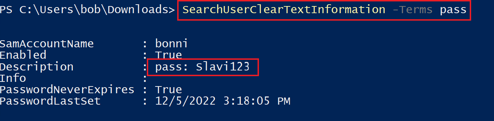
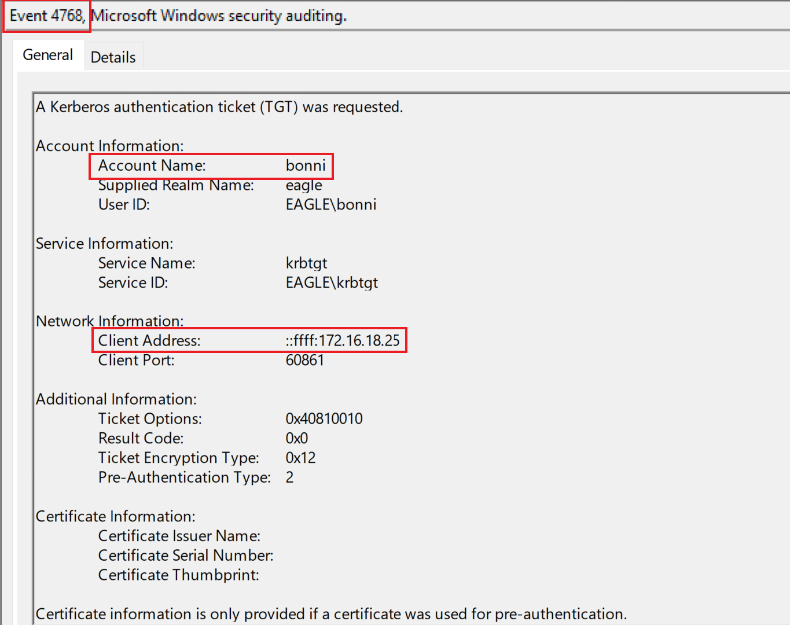

# Credentials in Object Properties (Credential trong property của object)


## Description (Mô tả)

Các object trong Active Directory có vô số property khác nhau; ví dụ, một object `user` có thể chứa các property mang thông tin như:

- Tài khoản có đang active hay không
- Khi nào tài khoản hết hạn
- Lần đổi mật khẩu gần nhất là khi nào
- Tên của tài khoản là gì
- Vị trí văn phòng và số điện thoại của nhân viên

Khi administrator tạo tài khoản, họ điền vào các property đó. Một thực hành phổ biến trong quá khứ là thêm mật khẩu của user (hoặc của service account) vào property `Description` hoặc `Info`, với suy nghĩ rằng cần quyền administrative trong AD mới xem được các property này. Tuy nhiên, `every` (mọi) domain user đều đọc được hầu hết các property của một object (bao gồm cả `Description` và `Info`).

---

## Attack (Tấn công)

Một script PowerShell đơn giản có thể truy vấn toàn bộ domain bằng cách tìm các từ khoá/chuỗi cụ thể trong field `Description` hoặc `Info`:

```powershell
Function SearchUserClearTextInformation
{
    Param (
        [Parameter(Mandatory=$true)]
        [Array] $Terms,

        [Parameter(Mandatory=$false)]
        [String] $Domain
    )

    if ([string]::IsNullOrEmpty($Domain)) {
        $dc = (Get-ADDomain).RIDMaster
    } else {
        $dc = (Get-ADDomain $Domain).RIDMaster
    }

    $list = @()

    foreach ($t in $Terms)
    {
        $list += "(`$_.Description -like `"*$t*`")"
        $list += "(`$_.Info -like `"*$t*`")"
    }

    Get-ADUser -Filter * -Server $dc -Properties Enabled,Description,Info,PasswordNeverExpires,PasswordLastSet |
        Where { Invoke-Expression ($list -join ' -OR ') } | 
        Select SamAccountName,Enabled,Description,Info,PasswordNeverExpires,PasswordLastSet | 
        fl
}
```

Ta sẽ chạy script để săn chuỗi `pass`, nhằm tìm mật khẩu `Slavi123` trong property `Description` của user `bonni`:

```powershell-session
PS C:\Users\bob\Downloads> SearchUserClearTextInformation -Terms "pass"

SamAccountName       : bonni
Enabled              : True
Description          : pass: Slavi123
Info                 : 
PasswordNeverExpires : True
PasswordLastSet      : 05/12/2022 15.18.05
```



---

## Prevention (Phòng chống)

Ta có nhiều lựa chọn để ngăn cuộc tấn công/cấu hình sai này:

- `Perform` (thực hiện) `continuous assessments` (đánh giá liên tục) để phát hiện vấn đề lưu credential trong property của object.
- `Educate` (đào tạo) các nhân viên có đặc quyền cao tránh lưu credential trong property của object.
- `Automate` (tự động hoá) tối đa quá trình tạo user để đảm bảo administrator không xử lý tài khoản thủ công, giảm rủi ro đưa credential hardcode vào các user object.

---

## Detection (Phát hiện)

Baselining (lập đường nền) hành vi của user là kỹ thuật tốt nhất để phát hiện việc lạm dụng credential bị phơi bày trong property của object. Dù việc này có thể khó với các tài khoản user thông thường, việc kích hoạt một alert cho các administrator/service account có hành vi dễ hiểu và lập được baseline thì dễ hơn. Các công cụ tự động giám sát hành vi của user đã cho thấy tỉ lệ thành công cao hơn trong việc phát hiện các lần logon bất thường. Trong ví dụ ở trên, giả sử credential được cung cấp còn hợp lệ, ta sẽ chờ đợi các event với event ID `4624`/`4625` (logon thất bại và thành công) và `4768` (Kerberos TGT requested). Dưới đây là một ví dụ về event ID `4768`:



Đáng tiếc, event ID `4738` được sinh ra khi một user object bị sửa đổi lại không cho thấy property cụ thể nào bị thay đổi, cũng không cung cấp giá trị mới của các property. Do đó, ta không thể dùng event này để phát hiện khi administrator thêm credential vào property của object.

---

## Honeypot (Bẫy honeypot)

Lưu credential trong property của object là một kỹ thuật honeypot tuyệt vời cho các môi trường chưa thực sự trưởng thành. Nếu còn đang chật vật với vệ sinh an ninh mạng (cyber hygiene) cơ bản, thì nhiều khả năng sẽ có những vấn đề như vậy (lưu credential trong property của object) trong một môi trường AD. Để thiết lập một honeypot user, ta cần đảm bảo những điều sau:

- Mật khẩu/credential được cấu hình trong field `Description`, vì đó là chỗ dễ bị bất kỳ kẻ tấn công nào nhặt được nhất.
- Mật khẩu được cung cấp là giả/sai.
- Tài khoản được enable và có các lần thử đăng nhập gần đây.
- Dù ta có thể dùng một user thông thường hoặc một service account, service account nhiều khả năng bị phơi bày thế này hơn vì administrator hay tạo chúng thủ công. Ngược lại, các hệ thống HR tự động thường tạo tài khoản nhân viên (và nhân viên nhiều khả năng đã đổi mật khẩu rồi).
- Tài khoản có lần cấu hình mật khẩu cuối cùng cách đây 2+ năm (làm cho việc mật khẩu nhiều khả năng còn dùng được trở nên đáng tin hơn).

Vì mật khẩu được cung cấp là sai, ta chủ yếu sẽ chờ đợi các lần logon thất bại; ba event ID (`4625`, `4771`, và `4776`) có thể cho thấy điều này. Đây là cách chúng trông ra sao trong môi trường thực hành của ta nếu một kẻ tấn công đang cố xác thực với tài khoản `svc-iis` và một mật khẩu sai:

- `4625`


- `4771`


- `4776`


