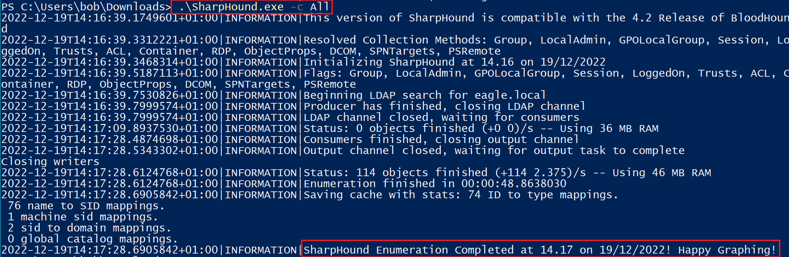
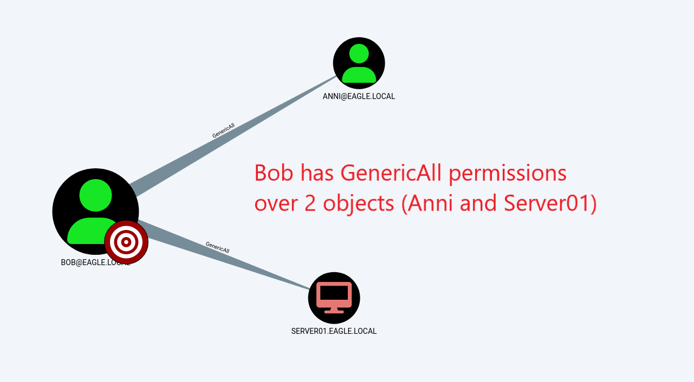
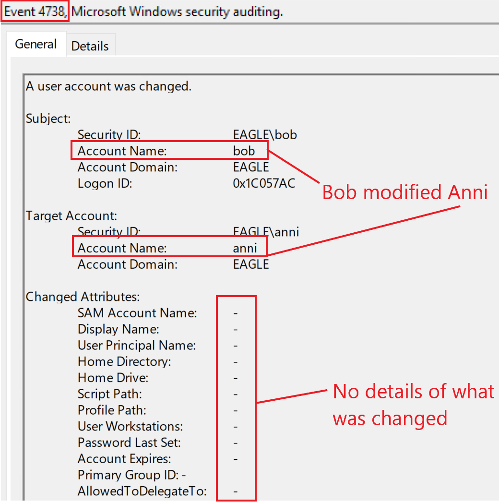
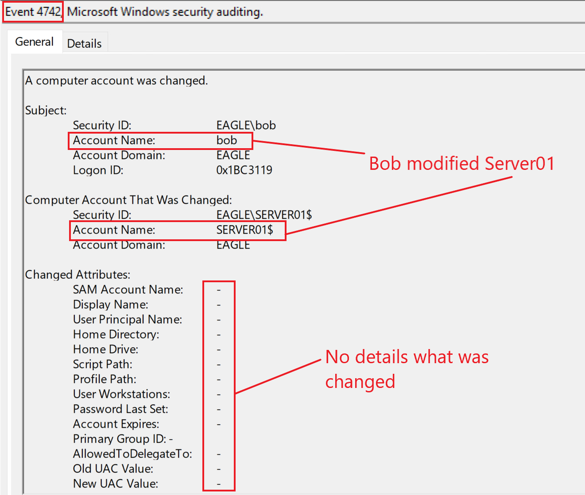

# Object ACLs


## Mô tả

Trong Active Directory, [Access Control Lists (ACLs)](https://learn.microsoft.com/en-us/windows/win32/secauthz/access-control-lists) (danh sách kiểm soát truy cập) là các bảng, hay đơn giản là các danh sách, xác định những trustee có quyền truy cập vào một object cụ thể và kiểu truy cập của họ. Trustee có thể là bất kỳ security principal nào, chẳng hạn user account, group hoặc login session. Mỗi `access control list` có một tập `access control entries` (`ACE`), và mỗi ACE xác định trustee cùng kiểu truy cập mà trustee đó có. Vì vậy, một object có thể được nhiều trustee truy cập, do có thể có nhiều ACE khác nhau. Access control list cũng được dùng cho mục đích audit (kiểm toán), chẳng hạn ghi lại số lần cố gắng truy cập vào một securable object và kiểu truy cập. Securable object là bất kỳ object có tên nào trong Active Directory có chứa security descriptor — thành phần chứa thông tin bảo mật về object, bao gồm cả ACL.

Một ví dụ về `Access Control Entry` là: mặc định, AD trao cho Domain Admins quyền thay đổi password của mọi object. Tuy nhiên, quyền cũng có thể được ủy quyền (delegate) cho một số user hoặc group nhất định để thực hiện một hành động cụ thể trên các object khác; đó có thể là reset password, thay đổi thành viên group hoặc xóa object. Trong các tổ chức lớn, nếu gần như không thể tránh việc các user không có đặc quyền (non-privileged) rốt cuộc lại nắm giữ các quyền được ủy quyền, thì tổ chức nên loại bỏ lỗi do con người và có tài liệu quy trình được định nghĩa rõ ràng. Ví dụ, giả sử một nhân viên (vô tình/cố ý) đổi phòng ban của mình từ IT sang Security Operations. Khi đó, tổ chức phải có quy trình để thu hồi mọi quyền và quyền truy cập vào các hệ thống và ứng dụng. Trong các môi trường AD thực tế, ta thường gặp những trường hợp như:

- Toàn bộ Domain users được thêm làm Administrators trên tất cả Server
- Everyone có thể chỉnh sửa mọi object (có toàn quyền trên chúng).
- Toàn bộ Domain users có quyền truy cập các thuộc tính mở rộng (extended properties) của computer chứa password LAPS.

---

## Tấn công

Để xác định các ACL có khả năng bị lạm dụng, ta sẽ dùng [BloodHound](https://github.com/BloodHoundAD/BloodHound) để vẽ đồ thị quan hệ giữa các object và [SharpHound](https://github.com/BloodHoundAD/SharpHound) để quét môi trường, truyền `All` cho tham số `-c` (dạng viết tắt của `CollectionMethod`):

```powershell-session
PS C:\Users\bob\Downloads> .\SharpHound.exe -c All

2022-12-19T14:16:39.1749601+01:00|INFORMATION|This version of SharpHound is compatible with the 4.2 Release of BloodHound
2022-12-19T14:16:39.3312221+01:00|INFORMATION|Resolved Collection Methods: Group, LocalAdmin, GPOLocalGroup, Session, LoggedOn, Trusts, ACL, Container, RDP, ObjectProps, DCOM, SPNTargets, PSRemote
2022-12-19T14:16:39.3468314+01:00|INFORMATION|Initializing SharpHound at 14.16 on 19/12/2022
2022-12-19T14:16:39.5187113+01:00|INFORMATION|Flags: Group, LocalAdmin, GPOLocalGroup, Session, LoggedOn, Trusts, ACL, Container, RDP, ObjectProps, DCOM, SPNTargets, PSRemote
2022-12-19T14:16:39.7530826+01:00|INFORMATION|Beginning LDAP search for eagle.local
2022-12-19T14:16:39.7999574+01:00|INFORMATION|Producer has finished, closing LDAP channel
2022-12-19T14:16:39.7999574+01:00|INFORMATION|LDAP channel closed, waiting for consumers
2022-12-19T14:17:09.8937530+01:00|INFORMATION|Status: 0 objects finished (+0 0)/s -- Using 36 MB RAM
2022-12-19T14:17:28.4874698+01:00|INFORMATION|Consumers finished, closing output channel
2022-12-19T14:17:28.5343302+01:00|INFORMATION|Output channel closed, waiting for output task to complete
Closing writers
2022-12-19T14:17:28.6124768+01:00|INFORMATION|Status: 114 objects finished (+114 2.375)/s -- Using 46 MB RAM
2022-12-19T14:17:28.6124768+01:00|INFORMATION|Enumeration finished in 00:00:48.8638030
2022-12-19T14:17:28.6905842+01:00|INFORMATION|Saving cache with stats: 74 ID to type mappings.
 76 name to SID mappings.
 1 machine sid mappings.
 2 sid to domain mappings.
 0 global catalog mappings.
2022-12-19T14:17:28.6905842+01:00|INFORMATION|SharpHound Enumeration Completed at 14.17 on 19/12/2022! Happy Graphing!
```



File ZIP do `SharpHound` tạo ra sau đó có thể được trực quan hóa trong `BloodHound`. Thay vì tìm mọi ACL bị cấu hình sai trong môi trường, ta sẽ tập trung vào các đường leo thang (escalation path) tiềm năng bắt nguồn từ user Bob (user ban đầu của ta, đã bị chiếm quyền và ta kiểm soát hoàn toàn). Vì vậy, hình sau minh họa các quyền truy cập khác nhau mà Bob có trong môi trường:



Bob có toàn quyền trên user Anni và computer Server01. Dưới đây là những gì Bob có thể làm với từng object:

1) Trường hợp 1: Toàn quyền trên user Anni. Trong trường hợp này, Bob có thể chỉnh sửa object Anni bằng cách gán thêm một giá trị SPN rồi thực hiện tấn công Kerberoast nhắm vào nó (nếu bạn còn nhớ, thành công của tấn công này phụ thuộc vào độ mạnh của password). Tuy nhiên, Bob cũng có thể thay đổi password của user Anni rồi đăng nhập bằng tài khoản đó, nhờ vậy trực tiếp kế thừa và có thể làm mọi thứ Anni làm được (nếu Anni là Domain admin thì Bob cũng sẽ có quyền tương tự).
2) Trường hợp 2: Toàn quyền kiểm soát một computer object cũng có thể mang lại nhiều lợi ích. Nếu môi trường dùng `LAPS`, Bob có thể lấy password được lưu trong các thuộc tính và xác thực với tư cách tài khoản Administrator cục bộ trên server này. Một đường leo thang khác là lạm dụng` Resource-Based Kerberos Delegation`, cho phép Bob xác thực với tư cách bất kỳ ai tới server này. Hãy nhớ lại từ tấn công trước rằng Server01 được tin cậy cho Unconstrained delegation, nên nếu Bob giành được quyền quản trị trên server này, anh ta có một đường leo thang tiềm năng để chiếm danh tính của một Domain Controller hoặc một computer object nhạy cảm khác.

Ta cũng có thể dùng [ADACLScanner](https://github.com/canix1/ADACLScanner) để tạo báo cáo về `discretionary access control lists` (`DACLs`) và `system access control lists` (`SACLs`).

---

## Phòng ngừa

Có ba việc ta có thể làm:

- Bắt đầu `continuous assessment` (đánh giá liên tục) để phát hiện xem đây có phải là vấn đề trong môi trường AD hay không.
- `Educate` (đào tạo) các nhân viên có đặc quyền cao để tránh làm việc này.
- `Automate` (tự động hóa) càng nhiều càng tốt quy trình quản lý truy cập, và chỉ cấp quyền truy cập đặc quyền cho các tài khoản quản trị; điều này đảm bảo administrator không chỉnh sửa tài khoản thủ công, qua đó giảm rủi ro vô tình trao các quyền được ủy quyền cho user không có đặc quyền.

---

## Phát hiện

May mắn là ta có nhiều cách để phát hiện việc object AD bị chỉnh sửa. Không may là các event được sinh ra cho object bị chỉnh sửa lại không đầy đủ, vì chúng không cung cấp khả năng quan sát chi tiết những gì đã bị thay đổi. Ví dụ, trong trường hợp thứ nhất mô tả ở trên, Bob chỉnh sửa Anni bằng cách thêm một giá trị SPN. Làm vậy, Bob sẽ có điều kiện để thực hiện Kerberoasting nhắm vào Anni. Khi giá trị SPN được thêm, một event có ID `4738`, "A user account was changed", được sinh ra. Tuy nhiên, event này không thể hiện tất cả các thuộc tính user đã bị sửa, kể cả SPN. Do đó, event chỉ thông báo rằng một user đã bị chỉnh sửa chứ không nêu cụ thể chính xác cái gì đã thay đổi (dù nó có khá nhiều field có thể hữu ích). Dưới đây là event sẽ được sinh ra nếu Bob thêm một giá trị SPN giả bất kỳ vào User Object của Anni:



Tuy vậy, dùng event này ta có thể biết được liệu một user không có đặc quyền có thực hiện các hành động đặc quyền lên user khác hay không. Ví dụ, nếu tất cả user đặc quyền có quy ước đặt tên bắt đầu bằng "adminxxxx", thì mọi thay đổi không gắn với "adminxxxx" đều đáng ngờ. Nếu việc lạm dụng ACL dẫn tới reset password, event ID `4724` sẽ được ghi log.

Tương tự, nếu Bob thực hiện kịch bản thứ hai, một event có ID `4742` sẽ được sinh ra; đáng tiếc là event này cũng hạn chế về lượng thông tin có thể cung cấp, tuy nhiên nó vẫn thông báo về hành động, cho thấy tài khoản Bob đã bị chiếm quyền và bị dùng với mục đích độc hại. Sau đây là event ID `4742` được sinh ra khi Bob chỉnh sửa Server01:



---

## Honeypot

ACL bị cấu hình sai có thể là một cơ chế hiệu quả để phát hiện hành vi đáng ngờ. Có hai cách tiếp cận:

1) Gán ACL tương đối cao cho một user account dùng làm honeypot thông qua một kỹ thuật đã bàn trước đó — ví dụ, một user có thông tin đăng nhập `fake` (giả) bị lộ trong field description. Việc tài khoản được gán ACL có thể kích thích kẻ tấn công thử kiểm tra xem password bị lộ của tài khoản có hợp lệ không, vì nó có tiềm năng cao.
2) Có một tài khoản mà `everyone` hoặc nhiều user có thể chỉnh sửa. Lý tưởng nhất, user này là một honeypot user, có một số hoạt động để giả lập user thật. Mọi thay đổi xảy ra trên honeypot user này đều là độc hại, vì không có lý do hợp lệ nào để bất kỳ ai thực hiện hành động trên nó (trừ admin, những người thỉnh thoảng có thể cần reset password của tài khoản để nó trông thật hơn). Vì vậy, mọi event ID `4738` gắn với honeypot user đều nên kích hoạt alert. Ngoài ra, các tổ chức trưởng thành có thể lập tức vô hiệu hóa user thực hiện thay đổi và khởi động điều tra forensic trên thiết bị nguồn. Để đầy đủ, nếu quay lại ví dụ Bob/Anni, một thay đổi trên tài khoản của Anni sẽ được phát hiện như sau:


