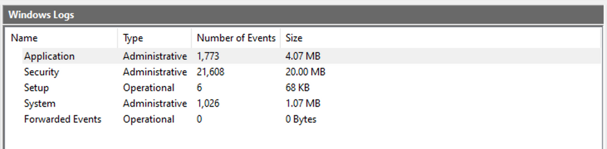
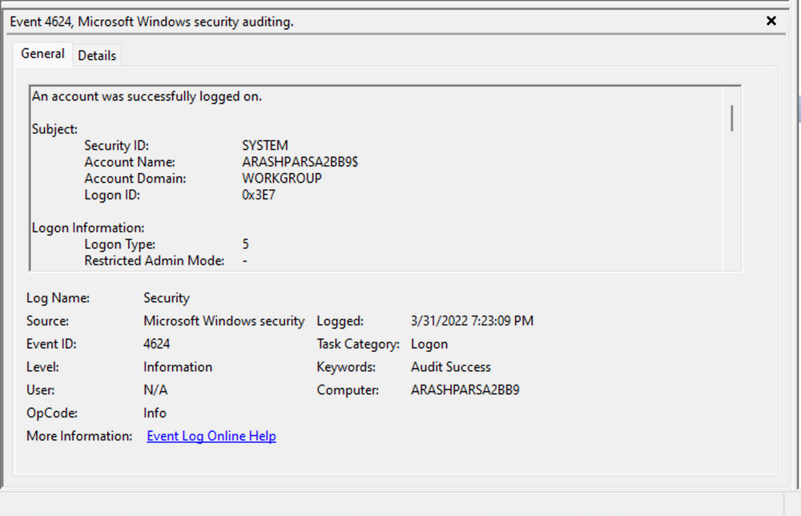

# Windows Event Logs

## Kiến thức cơ bản về Windows Event Logging

`Windows Event Logs` là một phần cố hữu của hệ điều hành Windows, lưu log từ nhiều thành phần khác nhau của hệ thống, bao gồm bản thân hệ thống, các ứng dụng chạy trên đó, ETW provider, service và nhiều thành phần khác. 

Cơ chế ghi event log của Windows cung cấp khả năng ghi log toàn diện cho lỗi ứng dụng, event bảo mật và thông tin chẩn đoán. Là những người làm an ninh mạng, ta tận dụng các log này rất nhiều cho việc phân tích và phát hiện xâm nhập (intrusion detection). 

Các log được phân loại thành nhiều event log khác nhau, như "Application", "System", "Security" và các log khác, để sắp xếp event theo nguồn hoặc mục đích của chúng.

Có thể truy cập event log bằng ứng dụng `Event Viewer` hoặc theo cách lập trình bằng các API như Windows Event Log API.

Mở `Windows Event Viewer` với tư cách người dùng quản trị (administrative user) cho phép ta khám phá các log hiện có.




Các Windows event log mặc định gồm `Application`, `Security`, `Setup`, `System` và `Forwarded Events`. Trong khi bốn log đầu tiên lần lượt bao quát lỗi ứng dụng, event bảo mật, hoạt động cài đặt hệ thống và thông tin hệ thống chung, thì mục "Forwarded Events" lại đặc biệt: nó hiển thị dữ liệu event log được chuyển tiếp (forward) từ các máy khác. Tính năng ghi log tập trung này rất hữu ích cho quản trị viên hệ thống muốn có một góc nhìn hợp nhất. Trong phần phân tích hiện tại, ta tập trung vào event log từ một máy duy nhất.

Cần lưu ý rằng Windows Event Viewer có thể mở và hiển thị các file `.evtx` đã lưu trước đó; các file này sau đó sẽ nằm trong mục "Saved Logs".


---

## Cấu trúc của một Event Log

Khi xem xét log 	`Application`, ta gặp hai mức (level) event riêng biệt: `information` và `error`. 


Event information cung cấp thông tin chung về việc sử dụng ứng dụng, như event khởi động hoặc dừng ứng dụng. Ngược lại, event error làm nổi bật các lỗi cụ thể và thường cung cấp thông tin chi tiết về sự cố gặp phải.


Mỗi mục trong Windows Event Log là một "Event" và chứa các thành phần chính sau:

1. `Log Name`: Tên của event log (vd: Application, System, Security, v.v.).
2. `Source`: Phần mềm đã ghi event.
3. `Event ID`: Mã định danh duy nhất của event.
4. `Task Category`: Thường chứa một giá trị hoặc tên giúp ta hiểu mục đích hoặc công dụng của event.
5. `Level`: Mức độ nghiêm trọng của event (Information, Warning, Error, Critical và Verbose).
6. `Keywords`: Keywords là các cờ (flag) cho phép ta phân loại event theo những cách vượt ra ngoài các tuỳ chọn phân loại khác. Đây thường là các nhóm rộng, như "Audit Success" hoặc "Audit Failure" trong log Security.
7. `User`: Tài khoản người dùng đang đăng nhập khi event xảy ra.
8. `OpCode`: Field này có thể xác định thao tác cụ thể mà event báo cáo.
9. `Logged`: Ngày giờ event được ghi lại.
10. `Computer`: Tên máy tính nơi event xảy ra.
10. `XML Data`: Toàn bộ thông tin ở trên cũng có trong định dạng XML cùng với dữ liệu event bổ sung.

Field `Keywords` đặc biệt hữu ích khi lọc event log để tìm các loại event cụ thể. Nó có thể tăng đáng kể độ chính xác của các query tìm kiếm vì cho phép ta chỉ định những event cần quan tâm, nhờ đó việc quản lý log hiệu quả và hữu hiệu hơn.

Nhìn kỹ hơn vào event log ở trên, ta thấy một số thành phần quan trọng. `Event ID` ở góc trên bên trái đóng vai trò mã định danh duy nhất, có thể tra cứu thêm trên website của Microsoft để có thêm thông tin. Nhãn "SideBySide" bên cạnh event ID là nguồn (source) của event. Bên dưới là phần mô tả lỗi chung, thường chứa rất nhiều chi tiết. Bằng cách nhấp vào phần details, ta có thể phân tích sâu hơn tác động của event qua dạng XML hoặc dạng hiển thị đã được định dạng gọn gàng.


Ngoài ra, ta có thể trích xuất thêm thông tin bổ sung từ event log, chẳng hạn process ID nơi lỗi xảy ra, giúp phân tích chính xác hơn.


Chuyển sang log bảo mật (security log), hãy xem xét event ID 4624, một event rất thường gặp (mô tả chi tiết tại [https://docs.microsoft.com/en-us/windows/security/threat-protection/auditing/event-4624](https://docs.microsoft.com/en-us/windows/security/threat-protection/auditing/event-4624)). 



Theo tài liệu của Microsoft, event này biểu thị việc tạo một phiên đăng nhập (logon session) trên máy đích, xuất phát từ máy được truy cập nơi phiên được thiết lập. Trong log này có các chi tiết quan trọng, bao gồm "Logon ID", cho phép ta liên kết (correlate) lần đăng nhập này với các event khác có cùng "Logon ID". Một chi tiết quan trọng khác là "Logon Type", cho biết kiểu đăng nhập. Trong trường hợp này, nó chỉ ra kiểu đăng nhập Service, gợi ý rằng "SYSTEM" đã khởi tạo một service mới. Tuy nhiên, cần điều tra thêm để xác định cụ thể service nào liên quan, bằng các kỹ thuật correlation với dữ liệu bổ sung như "Logon ID".

---

## Tận dụng Custom XML Query

Để việc phân tích gọn hơn, ta có thể tạo các custom XML query để xác định các event liên quan, lấy "Logon ID" làm điểm xuất phát. Vào "Filter Current Log" -> "XML" -> "Edit Query Manually", ta có thể dùng ngôn ngữ custom XML query, cho phép tìm kiếm log chi tiết hơn.


Trong query ví dụ, ta tập trung vào các event chứa field "SubjectLogonId" có giá trị "0x3E7". Giá trị này được chọn vì ta cần liên kết các event gắn với một "Logon ID" cụ thể và hiểu các chi tiết liên quan trong những event đó. 


Đáng chú ý là nếu cần hỗ trợ khi viết query, ta có thể bật các filter tự động và xem chúng tác động thế nào tới dạng biểu diễn XML. Để được hướng dẫn thêm, Microsoft có các bài viết hữu ích về [advanced XML filtering in the Windows Event Viewer](https://techcommunity.microsoft.com/t5/ask-the-directory-services-team/advanced-xml-filtering-in-the-windows-event-viewer/ba-p/399761).

Bằng cách xây dựng các query như vậy, ta có thể thu hẹp phạm vi vào tài khoản chịu trách nhiệm khởi tạo service và loại bỏ các chi tiết không cần thiết. Cách tiếp cận này giúp làm rõ bức tranh về các hoạt động đăng nhập gần đây gắn với Logon ID đã chỉ định. Tuy vậy, dù đã lọc như thế, lượng dữ liệu vẫn còn khá lớn.

Đi sâu dần vào chi tiết log sẽ hé lộ dần một câu chuyện. Chẳng hạn, việc phân tích bắt đầu với [Event ID 4907](https://docs.microsoft.com/en-us/windows/security/threat-protection/auditing/event-4907), biểu thị một thay đổi audit policy.


Trong [phần mô tả event](https://learn.microsoft.com/en-us/windows/security/threat-protection/auditing/event-4907), ta tìm thấy thông tin giá trị, chẳng hạn "This event generates when the SACL of an object (for example, a registry key or file) was changed." (Event này được tạo khi SACL của một object, ví dụ registry key hoặc file, bị thay đổi.)

Nếu chưa quen với SACL, tham khảo link được cung cấp ([https://docs.microsoft.com/en-us/windows/win32/secauthz/access-control-lists](https://docs.microsoft.com/en-us/windows/win32/secauthz/access-control-lists)) sẽ giúp hiểu rõ về access control list (ACL – danh sách kiểm soát truy cập). Chữ "S" trong SACL nghĩa là system access control list, cho phép quản trị viên ghi log các lần cố gắng truy cập vào các object được bảo vệ. Mỗi Access Control Entry (ACE) trong SACL chỉ định những loại truy cập nào của một trustee cụ thể sẽ kích hoạt việc tạo bản ghi trong security event log. Các ACE trong SACL có thể tạo bản ghi audit khi truy cập thất bại, thành công, hoặc cả hai. Để biết thêm về SACL, xem [Audit Generation](https://learn.microsoft.com/en-us/windows/win32/secauthz/audit-generation) và [SACL Access Right](https://learn.microsoft.com/en-us/windows/win32/secauthz/sacl-access-right)."

Dựa trên thông tin này, có thể thấy rõ quyền (permission) của một file đã bị thay đổi để điều chỉnh việc ghi log hoặc audit các lần cố gắng truy cập. Xem kỹ thêm chi tiết event sẽ thấy thêm những điểm đáng chú ý.


Ví dụ, process chịu trách nhiệm cho thay đổi được xác định là "SetupHost.exe", cho thấy đây có thể là một process cài đặt (dù cần lưu ý malware đôi khi giả danh dưới tên hợp lệ). Object bị tác động có vẻ là "bootmanager", và ta có thể so sánh security descriptor mới và cũ ("NewSd" và "OldSd") để xác định những thay đổi. Có thể hiểu ý nghĩa từng field trong security descriptor thông qua các tài liệu tham khảo như bài [ACE Strings](https://docs.microsoft.com/en-us/windows/win32/secauthz/ace-strings?redirectedfrom=MSDN) và [Understanding SDDL Syntax](https://itconnect.uw.edu/wares/msinf/other-help/understanding-sddl-syntax/).

Từ các event quan sát được, ta có thể suy ra đã có một tiến trình cài đặt diễn ra, bao gồm việc tạo một file mới và cấu hình ban đầu cho quyền bảo mật nhằm phục vụ audit. Tiếp theo, ta gặp event logon, sau đó là event "special logon".


Phân tích event special logon, ta hiểu được các quyền của token được cấp cho người dùng khi đăng nhập thành công. 


Danh sách đầy đủ các đặc quyền (privilege) có trong tài liệu về [privilege constants](https://docs.microsoft.com/en-us/windows/win32/secauthz/privilege-constants). Ví dụ, đặc quyền "SeDebugPrivilege" cho biết người dùng có khả năng can thiệp vào vùng bộ nhớ không thuộc về họ.

---

## Các Windows Event Log hữu ích

Dưới đây là danh sách mang tính tham khảo (không đầy đủ) các Windows event log hữu ích.

1. **Windows System Logs**
	- [Event ID 1074](https://serverfault.com/questions/885601/windows-event-codes-for-startup-shutdown-lock-unlock) `(System Shutdown/Restart)`: Event log này cho biết khi nào và vì sao hệ thống bị tắt hoặc khởi động lại. Bằng cách giám sát các event này, bạn có thể xác định có những lần tắt máy hoặc khởi động lại bất thường hay không, qua đó có thể phát hiện hoạt động độc hại như nhiễm malware hoặc truy cập trái phép của người dùng.
	- [Event ID 6005](https://superuser.com/questions/1137371/how-to-find-out-if-windows-was-running-at-a-given-time) `(The Event log service was started)`: Event log này đánh dấu thời điểm Event Log Service được khởi động. Đây là bản ghi quan trọng vì nó có thể biểu thị một lần khởi động hệ thống, cung cấp điểm xuất phát để điều tra hiệu năng hệ thống hoặc các sự cố bảo mật tiềm ẩn quanh khoảng thời gian đó. Nó cũng có thể dùng để phát hiện các lần khởi động lại hệ thống trái phép.
	- [Event ID 6006](https://learn.microsoft.com/en-us/answers/questions/235563/server-issue) `(The Event log service was stopped)`: Event log này biểu thị thời điểm Event Log Service bị dừng. Nó thường xuất hiện khi hệ thống đang tắt. Việc event này xuất hiện bất thường hoặc ngoài dự kiến có thể là dấu hiệu cố ý làm gián đoạn service để che giấu hoạt động bất hợp pháp.
	- [Event ID 6013](https://serverfault.com/questions/885601/windows-event-codes-for-startup-shutdown-lock-unlock) `(Windows uptime)`: Event này xuất hiện mỗi ngày một lần và cho biết thời gian hoạt động liên tục (uptime) của hệ thống tính bằng giây. Uptime ngắn hơn dự kiến có thể nghĩa là hệ thống đã bị khởi động lại, có thể là dấu hiệu của một vụ xâm nhập tiềm ẩn hoặc hoạt động trái phép trên hệ thống.
	- [Event ID 7040](https://www.slideshare.net/Hackerhurricane/finding-attacks-with-these-6-events) `(Service status change)`: Event này cho biết có thay đổi về kiểu khởi động (startup type) của service, có thể từ manual sang automatic hoặc ngược lại. Nếu startup type của một service quan trọng bị thay đổi, đó có thể là dấu hiệu hệ thống bị can thiệp.
	
2. **Windows Security Logs**
	- [Event ID 1102](https://www.ultimatewindowssecurity.com/securitylog/encyclopedia/event.aspx?eventid=1102) `(The audit log was cleared)`: Việc xoá audit log thường là dấu hiệu của nỗ lực xoá bằng chứng về một vụ xâm nhập hoặc hoạt động độc hại.
	- [Event ID 1116](https://learn.microsoft.com/en-us/microsoft-365/security/defender-endpoint/troubleshoot-microsoft-defender-antivirus?view=o365-worldwide) `(Antivirus malware detection)`: Event này đặc biệt quan trọng vì nó ghi lại khi Defender phát hiện malware. Số lượng event này tăng vọt có thể cho thấy một cuộc tấn công có chủ đích hoặc malware lây nhiễm trên diện rộng.
	- [Event ID 1118](https://learn.microsoft.com/en-us/microsoft-365/security/defender-endpoint/troubleshoot-microsoft-defender-antivirus?view=o365-worldwide) `(Antivirus remediation activity has started)`: Event này cho biết Defender đã bắt đầu quá trình gỡ bỏ hoặc cách ly (quarantine) malware đã phát hiện. Cần giám sát các event này để đảm bảo hoạt động khắc phục (remediation) thành công.
	- [Event ID 1119](https://learn.microsoft.com/en-us/microsoft-365/security/defender-endpoint/troubleshoot-microsoft-defender-antivirus?view=o365-worldwide) `(Antivirus remediation activity has succeeded)`: Event này cho biết quá trình khắc phục malware đã phát hiện đã thành công. Thường xuyên giám sát các event này giúp đảm bảo các mối đe doạ đã xác định được vô hiệu hoá hiệu quả.
	- [Event ID 1120](https://learn.microsoft.com/en-us/microsoft-365/security/defender-endpoint/troubleshoot-microsoft-defender-antivirus?view=o365-worldwide) `(Antivirus remediation activity has failed)`: Event này là phiên bản đối lập của 1119 và cho biết quá trình khắc phục đã thất bại. Cần giám sát chặt chẽ và xử lý ngay các event này để đảm bảo các mối đe doạ được vô hiệu hoá hiệu quả.
	- [Event ID 4624](https://www.ultimatewindowssecurity.com/securitylog/encyclopedia/event.aspx?eventid=4624) `(Successful Logon)`: Event này ghi lại các lần đăng nhập thành công. Thông tin này rất quan trọng để thiết lập hành vi bình thường (baseline) của người dùng. Hành vi bất thường, như cố gắng đăng nhập vào giờ lạ hoặc từ các vị trí khác nhau, có thể là dấu hiệu của một mối đe doạ bảo mật tiềm ẩn.
	- [Event ID 4625](https://www.ultimatewindowssecurity.com/securitylog/encyclopedia/event.aspx?eventid=4625) `(Failed Logon)`: Event này ghi lại các lần đăng nhập thất bại. Nhiều lần đăng nhập thất bại có thể là dấu hiệu một cuộc tấn công brute-force đang diễn ra.
	- [Event ID 4648](https://www.ultimatewindowssecurity.com/securitylog/encyclopedia/event.aspx?eventid=4648) `(A logon was attempted using explicit credentials)`: Event này được kích hoạt khi người dùng đăng nhập bằng thông tin đăng nhập tường minh (explicit credentials) để chạy một chương trình. Bất thường trong các event đăng nhập này có thể cho thấy lateral movement (di chuyển ngang) trong mạng — một kỹ thuật phổ biến của kẻ tấn công.
	- [Event ID 4656](https://www.ultimatewindowssecurity.com/securitylog/encyclopedia/event.aspx?eventid=4656) `(A handle to an object was requested)`: Event này được kích hoạt khi có yêu cầu handle tới một object (như file, registry key hoặc process). Đây có thể là event hữu ích để phát hiện các nỗ lực truy cập tài nguyên nhạy cảm.
	- [Event ID 4672](https://www.ultimatewindowssecurity.com/securitylog/encyclopedia/event.aspx?eventid=4672) `(Special Privileges Assigned to a New Logon)`: Event này được ghi mỗi khi một tài khoản đăng nhập với đặc quyền super user. Theo dõi các event này giúp đảm bảo đặc quyền super user không bị lạm dụng hoặc dùng với mục đích độc hại.
	- [Event ID 4698](https://www.ultimatewindowssecurity.com/securitylog/encyclopedia/event.aspx?eventid=4698) `(A scheduled task was created)`: Event này được kích hoạt khi một scheduled task được tạo. Giám sát event này giúp bạn phát hiện các cơ chế persistence (duy trì truy cập), vì kẻ tấn công thường dùng scheduled task để duy trì truy cập và chạy code độc hại.
	- [Event ID 4700](https://www.ultimatewindowssecurity.com/securitylog/encyclopedia/event.aspx?eventid=4700) & [Event ID 4701](https://www.ultimatewindowssecurity.com/securitylog/encyclopedia/event.aspx?eventid=4701) `(A scheduled task was enabled/disabled)`: Event này ghi lại việc bật hoặc tắt một scheduled task. Scheduled task thường bị kẻ tấn công thao túng để duy trì persistence hoặc chạy code độc hại, vì vậy các log này có thể cung cấp thông tin giá trị về các hoạt động đáng ngờ.
	- [Event ID 4702](https://www.ultimatewindowssecurity.com/securitylog/encyclopedia/event.aspx?eventid=4702) `(A scheduled task was updated)`: Tương tự 4698, event này được kích hoạt khi một scheduled task được cập nhật. Giám sát các lần cập nhật này giúp phát hiện những thay đổi có thể biểu thị ý đồ độc hại.
	- [Event ID 4719](https://www.ultimatewindowssecurity.com/securitylog/encyclopedia/event.aspx?eventid=4719) `(System audit policy was changed)`: Event này ghi lại các thay đổi audit policy trên máy tính. Đó có thể là dấu hiệu ai đó đang cố xoá dấu vết bằng cách tắt audit hoặc thay đổi những event nào được audit.
	- [Event ID 4738](https://www.ultimatewindowssecurity.com/securitylog/encyclopedia/event.aspx?eventid=4738) `(A user account was changed)`: Event này ghi lại mọi thay đổi đối với tài khoản người dùng, bao gồm thay đổi đặc quyền, thành viên nhóm (group membership) và cài đặt tài khoản. Các thay đổi tài khoản ngoài dự kiến có thể là dấu hiệu bị chiếm đoạt tài khoản (account takeover) hoặc mối đe doạ nội bộ (insider threat).
	- [Event ID 4771](https://www.ultimatewindowssecurity.com/securitylog/encyclopedia/event.aspx?eventid=4771) `(Kerberos pre-authentication failed)`: Event này tương tự 4625 (đăng nhập thất bại) nhưng dành riêng cho xác thực Kerberos. Số lượng bất thường của các log này có thể cho thấy kẻ tấn công đang cố brute force service Kerberos của bạn.
	- [Event ID 4776](https://www.ultimatewindowssecurity.com/securitylog/encyclopedia/event.aspx?eventid=4776) `(The domain controller attempted to validate the credentials for an account)`: Event này giúp theo dõi cả các lần xác thực thông tin đăng nhập thành công lẫn thất bại bởi domain controller. Nhiều lần thất bại có thể gợi ý một cuộc tấn công brute-force.
	- [Event ID 5001](https://learn.microsoft.com/en-us/microsoft-365/security/defender-endpoint/troubleshoot-microsoft-defender-antivirus?view=o365-worldwide) `(Antivirus real-time protection configuration has changed)`: Event này cho biết cài đặt bảo vệ thời gian thực (real-time protection) của Defender đã bị sửa đổi. Các thay đổi trái phép có thể cho thấy nỗ lực vô hiệu hoá hoặc làm suy yếu chức năng của Defender.
	- [Event ID 5140](https://www.ultimatewindowssecurity.com/securitylog/encyclopedia/event.aspx?eventid=5140) `(A network share object was accessed)`: Event này được ghi mỗi khi một network share được truy cập. Điều này có thể rất quan trọng để xác định truy cập trái phép vào các network share.
	- [Event ID 5142](https://www.ultimatewindowssecurity.com/securitylog/encyclopedia/event.aspx?eventid=5142) `(A network share object was added)`: Event này biểu thị việc tạo một network share mới. Các network share trái phép có thể được dùng để tuồn (exfiltrate) dữ liệu ra ngoài hoặc phát tán malware trong mạng.
	- [Event ID 5145](https://www.ultimatewindowssecurity.com/securitylog/encyclopedia/event.aspx?eventid=5145) `(A network share object was checked to see whether client can be granted desired access)`: Event này cho biết ai đó đã cố truy cập một network share. Các lần kiểm tra kiểu này diễn ra thường xuyên có thể cho thấy một người dùng hoặc malware đang cố lập bản đồ các network share để khai thác về sau.
	- [Event ID 5157](https://www.ultimatewindowssecurity.com/securitylog/encyclopedia/event.aspx?eventid=5157) `(The Windows Filtering Platform has blocked a connection)`: Event này được ghi khi Windows Filtering Platform chặn một lần cố gắng kết nối. Điều này có thể hữu ích để xác định lưu lượng độc hại trong mạng của bạn.
	- [Event ID 7045](https://www.ultimatewindowssecurity.com/securitylog/encyclopedia/event.aspx?eventid=7045) `(A service was installed in the system)`: Sự xuất hiện đột ngột của các service lạ có thể gợi ý việc cài đặt malware, vì nhiều loại malware tự cài đặt dưới dạng service.


Hãy nhớ rằng một trong những yếu tố then chốt của việc phát hiện mối đe doạ (threat detection) là hiểu rõ thế nào là "bình thường" trong môi trường của mình. Những bất thường có thể là dấu hiệu đe doạ ở môi trường này lại có thể là hành vi bình thường ở môi trường khác. Điều quan trọng là phải tinh chỉnh (tune) hệ thống giám sát và cảnh báo cho phù hợp với môi trường của ta, nhằm giảm thiểu false positive và giúp các mối đe doạ thật dễ phát hiện hơn. Ngoài ra, cần có một giải pháp quản lý log tập trung có khả năng thu thập, phân tích cú pháp (parse) và cảnh báo về các event này theo thời gian thực. Thường xuyên giám sát và xem xét các log này giúp phát hiện sớm và giảm thiểu các mối đe doạ. Cuối cùng, ta cần đảm bảo liên kết (correlate) các log này với các log hệ thống và log bảo mật khác để có góc nhìn toàn diện hơn về các event bảo mật trong môi trường của mình.

---

## Bài tập thực hành

Kéo xuống cuối section này và nhấp vào `Click here to spawn the target system!`

Bây giờ, RDP tới `[Target IP]` bằng thông tin đăng nhập được cung cấp, mở Windows Event Viewer và trả lời các câu hỏi bên dưới.

```shell-session
[!bash!]$ xfreerdp /u:Administrator /p:'HTB_@cad3my_lab_W1n10_r00t!@0' /v:[Target IP] /dynamic-resolution
```
