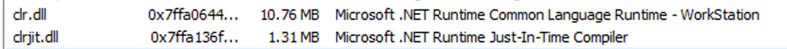
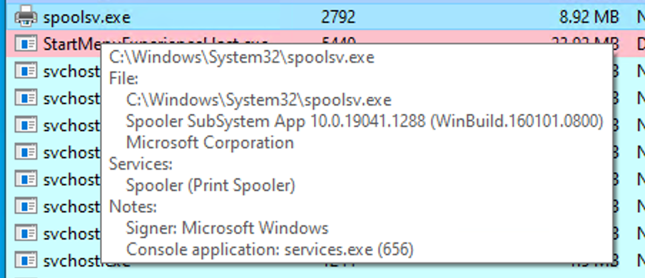
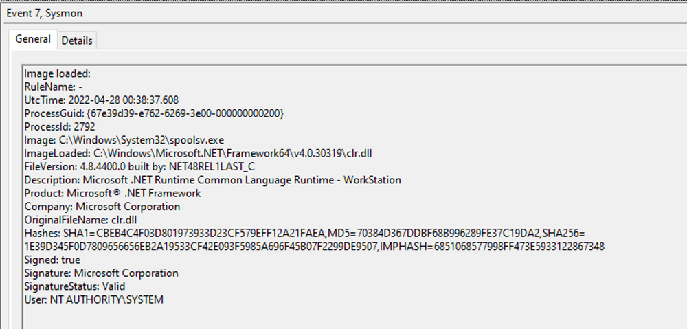

# Analyzing Evil With Sysmon & Event Logs (Phân tích hoạt động độc hại bằng Sysmon & Event Logs)

Trong quá trình theo đuổi một nền an ninh mạng vững chắc, điều quan trọng là phải hiểu cách xác định và phân tích các event độc hại một cách hiệu quả. Dựa trên phần tìm hiểu trước đó về các event lành tính (benign), giờ đây ta sẽ đi sâu vào lĩnh vực các hoạt động độc hại và khám phá các kỹ thuật phát hiện chúng.

---

## Kiến thức cơ bản về Sysmon

Khi điều tra các event độc hại, một số event ID đóng vai trò là indicator of compromise (IOC) thường gặp. Ví dụ, `Event ID 4624` cung cấp thông tin về các event đăng nhập mới, cho phép ta giám sát và phát hiện các kiểu truy cập và đăng nhập đáng ngờ của người dùng. Tương tự, `Event ID 4688` cung cấp thông tin về các process mới được tạo, hỗ trợ việc xác định các lần khởi chạy process bất thường hoặc độc hại. Để mở rộng độ bao phủ của event log, ta có thể bổ sung thêm Sysmon, công cụ mang lại khả năng ghi event bổ sung.

`System Monitor (Sysmon)` là một Windows system service và device driver, vẫn thường trú (resident) qua các lần khởi động lại hệ thống để giám sát và ghi lại hoạt động của hệ thống vào Windows event log. Sysmon cung cấp thông tin chi tiết về việc tạo process, kết nối mạng, thay đổi thời gian tạo file và nhiều thứ khác.

Các thành phần chính của Sysmon gồm:
- Một Windows service để giám sát hoạt động hệ thống.
- Một device driver hỗ trợ thu thập dữ liệu hoạt động hệ thống.
- Một event log để hiển thị dữ liệu hoạt động đã thu thập.

Khả năng đặc biệt của Sysmon nằm ở việc nó ghi lại được những thông tin mà bình thường không xuất hiện trong Security Event log, và điều này khiến nó trở thành một công cụ mạnh mẽ cho việc giám sát hệ thống chuyên sâu cũng như phân tích forensic trong an ninh mạng.

Sysmon phân loại các kiểu hoạt động hệ thống khác nhau bằng event ID, trong đó mỗi ID tương ứng với một kiểu event cụ thể. Ví dụ, `Event ID 1` tương ứng với các event "Process Creation", và `Event ID 3` chỉ các event "Network Connection". Danh sách đầy đủ các Sysmon event ID có thể xem [tại đây](https://learn.microsoft.com/en-us/sysinternals/downloads/sysmon).

Để kiểm soát chi tiết hơn những event nào được ghi lại, Sysmon dùng một file cấu hình (configuration file) dựa trên XML. File cấu hình cho phép bạn bao gồm (include) hoặc loại trừ (exclude) một số kiểu event nhất định dựa trên các thuộc tính khác nhau như tên process, địa chỉ IP, v.v. Ta có thể tham khảo các ví dụ phổ biến về các file cấu hình Sysmon hữu ích:
- Để có cấu hình toàn diện, ta có thể truy cập: [https://github.com/SwiftOnSecurity/sysmon-config](https://github.com/SwiftOnSecurity/sysmon-config). <-- `We will use this one in this section!`
- Một lựa chọn khác là: [https://github.com/olafhartong/sysmon-modular](https://github.com/olafhartong/sysmon-modular), cung cấp cách tiếp cận theo dạng module.

Để bắt đầu, bạn có thể cài đặt Sysmon bằng cách tải nó về từ tài liệu chính thức của Microsoft ([https://docs.microsoft.com/en-us/sysinternals/downloads/sysmon](https://docs.microsoft.com/en-us/sysinternals/downloads/sysmon)). Sau khi tải xong, mở một command prompt với quyền administrator và chạy lệnh sau để cài đặt Sysmon.

```cmd-session
C:\Tools\Sysmon> sysmon.exe -i -accepteula -h md5,sha256,imphash -l -n
```


Để dùng một cấu hình Sysmon tuỳ chỉnh, chạy lệnh sau sau khi đã cài đặt Sysmon.

```shell-session
C:\Tools\Sysmon> sysmon.exe -c filename.xml
```

**Lưu ý**: Cần lưu ý rằng [Sysmon for Linux](https://github.com/Sysinternals/SysmonForLinux) cũng tồn tại.

---

## Ví dụ phát hiện 1: Phát hiện DLL Hijacking

Trong trường hợp cụ thể của ta, mục tiêu là phát hiện một vụ DLL hijack. Các Sysmon event log ID liên quan đến DLL hijack có thể tìm thấy trong tài liệu Sysmon ([https://docs.microsoft.com/en-us/sysinternals/downloads/sysmon](https://docs.microsoft.com/en-us/sysinternals/downloads/sysmon)). Để phát hiện một vụ DLL hijack, ta cần tập trung vào `Event Type 7`, tương ứng với các event module load. Để làm được điều này, ta cần sửa đổi file cấu hình Sysmon `sysmonconfig-export.xml` đã tải về từ [https://github.com/SwiftOnSecurity/sysmon-config](https://github.com/SwiftOnSecurity/sysmon-config).

Khi xem xét cấu hình đã sửa đổi, ta thấy comment "include" biểu thị những event cần được bao gồm. 


Trong trường hợp phát hiện DLL hijack, ta đổi "include" thành "exclude" để đảm bảo không có gì bị loại trừ, cho phép ta thu thập được dữ liệu cần thiết.


Để dùng cấu hình Sysmon đã cập nhật, chạy lệnh sau.

```cmd-session
C:\Tools\Sysmon> sysmon.exe -c sysmonconfig-export.xml
```


Với cấu hình Sysmon đã sửa đổi, ta có thể bắt đầu quan sát các event image load. Để xem các event này, vào Event Viewer và truy cập "Applications and Services" -> "Microsoft" -> "Windows" -> "Sysmon." Kiểm tra nhanh sẽ thấy sự hiện diện của event ID mà ta nhắm tới.


Giờ hãy xem một Sysmon event ID 7 trông như thế nào.


Event log này chứa trạng thái ký số (signing status) của DLL (trong trường hợp này là do Microsoft ký), process hoặc image chịu trách nhiệm nạp DLL, và DLL cụ thể đã được nạp. Trong ví dụ của ta, ta thấy "MMC.exe" đã nạp "psapi.dll", cũng do Microsoft ký. Cả hai file đều nằm trong thư mục System32.

Bây giờ, hãy tiến hành xây dựng một cơ chế phát hiện. Để hiểu sâu hơn về DLL hijack, việc nghiên cứu là tối quan trọng. Ta tình cờ tìm thấy một [bài blog](https://www.wietzebeukema.nl/blog/hijacking-dlls-in-windows) đầy thông tin, cung cấp một danh sách đầy đủ các kỹ thuật DLL hijack khác nhau. Phục vụ cho việc phát hiện, ta sẽ tập trung vào một vụ hijack cụ thể liên quan đến file thực thi dễ bị tấn công calc.exe và một danh sách các DLL có thể bị hijack. 


Hãy thử thực hiện vụ hijack lấy "calc.exe" và "WININET.dll" làm ví dụ. Để đơn giản hoá quá trình, ta có thể dùng [reflective DLL](https://github.com/stephenfewer/ReflectiveDLLInjection/tree/master/bin) "hello world" của Stephen Fewer. Cần lưu ý rằng DLL hijacking không bắt buộc phải dùng reflective DLL.

Bằng cách làm theo các bước cần thiết — gồm đổi tên `reflective_dll.x64.dll` thành `WININET.dll`, di chuyển `calc.exe` từ `C:\Windows\System32` cùng với `WININET.dll` sang một thư mục có quyền ghi (như thư mục `Desktop`), rồi chạy `calc.exe` — ta đạt được kết quả. Thay vì ứng dụng Calculator, một [MessageBox](https://learn.microsoft.com/en-us/windows/win32/api/winuser/nf-winuser-messageboxa) được hiển thị.


Tiếp theo, ta phân tích tác động của vụ hijack. Đầu tiên, ta lọc event log để tập trung vào `Event ID 7`, đại diện cho các event module load, bằng cách nhấp "Filter Current Log...". 


Sau đó, ta tìm các phiên bản của "calc.exe", bằng cách nhấp "Find...", để xác định lần nạp DLL liên quan đến vụ hijack của ta.


Kết quả từ Sysmon cung cấp những thông tin giá trị. Giờ ta có thể quan sát một số indicator of compromise (IOC) để tạo các detection rule hiệu quả. Tuy nhiên, trước khi tiếp tục, hãy so sánh điều này với một lần nạp "wininet.dll" hợp lệ bởi "calc.exe".


Hãy xem xét các IOC này:

1. "calc.exe", vốn nằm trong System32, lẽ ra không nên xuất hiện trong một thư mục có quyền ghi. Do đó, một bản sao của "calc.exe" trong thư mục có quyền ghi chính là một IOC, vì nó luôn phải nằm trong System32 hoặc có thể là Syswow64.

2. "WININET.dll", vốn nằm trong System32, lẽ ra không nên được calc.exe nạp từ bên ngoài System32. Nếu có các lần nạp "WININET.dll" xảy ra bên ngoài System32 với "calc.exe" là parent process, điều đó cho thấy một vụ DLL hijack bên trong calc.exe. Dù cần thận trọng khi cảnh báo trên mọi lần nạp "WININET.dll" bên ngoài System32 (vì một số ứng dụng có thể đóng gói kèm các phiên bản DLL cụ thể để đảm bảo ổn định), thì trong trường hợp "calc.exe" ta có thể khẳng định chắc chắn đây là vụ hijack nhờ tên DLL không thay đổi — thứ mà kẻ tấn công không thể sửa để né tránh phát hiện.

3. "WININET.dll" gốc do Microsoft ký, trong khi DLL được inject của ta vẫn chưa ký (unsigned).

Ba IOC mạnh mẽ này cung cấp một phương tiện hiệu quả để phát hiện một vụ DLL hijack liên quan đến calc.exe. Cần lưu ý rằng dù Sysmon và event log cung cấp telemetry giá trị cho việc hunting và tạo alert rule, chúng không phải là nguồn thông tin duy nhất.

---

## Ví dụ phát hiện 2: Phát hiện Unmanaged PowerShell/C-Sharp Injection

Trước khi đi sâu vào các kỹ thuật phát hiện, hãy tìm hiểu nhanh về C# và môi trường runtime của nó. C# được coi là một ngôn ngữ "managed" (có quản lý), nghĩa là nó cần một runtime ở backend để thực thi code. [Common Language Runtime (CLR)](https://docs.microsoft.com/en-us/dotnet/standard/clr) đóng vai trò là môi trường runtime này. [Managed code](https://docs.microsoft.com/en-us/dotnet/standard/managed-code) không chạy trực tiếp dưới dạng assembly; thay vào đó, nó được biên dịch thành một dạng bytecode mà runtime sẽ xử lý và thực thi. Do đó, một managed process phụ thuộc vào CLR để thực thi code C#.

Là bên phòng thủ, ta có thể tận dụng kiến thức này để phát hiện các lần inject hoặc thực thi C# bất thường trong môi trường của mình. Để làm được điều đó, ta có thể dùng một tiện ích hữu ích tên là [Process Hacker](https://processhacker.sourceforge.io/).


Bằng cách dùng Process Hacker, ta có thể quan sát một loạt các process trong môi trường của mình. Sắp xếp các process theo tên, ta có thể nhận ra những khác biệt thú vị được mã hoá bằng màu sắc. Đáng chú ý, "powershell.exe", một managed process, được tô màu xanh lá so với các process khác. Di chuột lên powershell.exe sẽ hiện nhãn "Process is managed (.NET)," xác nhận trạng thái managed của nó.


Xem xét các module load của `powershell.exe`, bằng cách nhấp chuột phải vào `powershell.exe`, chọn "Properties", rồi vào "Modules", ta có thể tìm thấy thông tin liên quan. 



Sự hiện diện của "Microsoft .NET Runtime...", `clr.dll` và `clrjit.dll` nên thu hút sự chú ý của ta. Hai DLL này được dùng khi code C# chạy như một phần của runtime để thực thi bytecode. Nếu ta thấy các DLL này được nạp trong những process thường không cần đến chúng, điều đó gợi ý một cuộc tấn công [execute-assembly](https://www.cobaltstrike.com/blog/cobalt-strike-3-11-the-snake-that-eats-its-tail/) hoặc [unmanaged PowerShell injection](https://www.youtube.com/watch?v=7tvfb9poTKg&ab_channel=RaphaelMudge) tiềm ẩn.

Để minh hoạ unmanaged PowerShell injection, ta có thể inject một [DLL kiểu unmanaged PowerShell](https://github.com/leechristensen/UnmanagedPowerShell) vào một process bất kỳ, chẳng hạn `spoolsv.exe`. Ta có thể làm điều đó bằng cách dùng [PSInject project](https://github.com/EmpireProject/PSInject) theo cách sau.

```powershell-session
 powershell -ep bypass
 Import-Module .\Invoke-PSInject.ps1
 Invoke-PSInject -ProcId [Process ID of spoolsv.exe] -PoshCode "V3JpdGUtSG9zdCAiSGVsbG8sIEd1cnU5OSEi"
```



Sau khi inject, ta thấy "spoolsv.exe" chuyển từ trạng thái unmanaged sang managed.


Ngoài ra, bằng cách tham chiếu cả tab "Modules" liên quan của Process Hacker và Sysmon `Event ID 7`, ta có thể xem xét thông tin DLL load để xác nhận sự hiện diện của các DLL nói trên.




---

## Ví dụ phát hiện 3: Phát hiện Credential Dumping

Một khía cạnh quan trọng khác của an ninh mạng là phát hiện các hoạt động credential dumping. Một công cụ được sử dụng rộng rãi cho credential dumping là [Mimikatz](https://github.com/gentilkiwi/mimikatz), cung cấp nhiều phương pháp để trích xuất thông tin đăng nhập (credential) của Windows. Một lệnh cụ thể, "sekurlsa::logonpasswords", cho phép dump các password hash hoặc password dạng plaintext bằng cách truy cập vào [Local Security Authority Subsystem Service (LSASS)](https://en.wikipedia.org/wiki/Local_Security_Authority_Subsystem_Service). LSASS chịu trách nhiệm quản lý thông tin đăng nhập của người dùng và là mục tiêu hàng đầu của các công cụ credential-dumping như Mimikatz.

Cuộc tấn công có thể được thực hiện như sau.

```cmd-session
C:\Tools\Mimikatz> mimikatz.exe

  .#####.   mimikatz 2.2.0 (x64) #18362 Feb 29 2020 11:13:36
 .## ^ ##.  "A La Vie, A L'Amour" - (oe.eo)
 ## / \ ##  /*** Benjamin DELPY `gentilkiwi` ( benjamin@gentilkiwi.com )
 ## \ / ##       > http://blog.gentilkiwi.com/mimikatz
 '## v ##'       Vincent LE TOUX             ( vincent.letoux@gmail.com )
  '#####'        > http://pingcastle.com / http://mysmartlogon.com   ***/

mimikatz # privilege::debug
Privilege '20' OK

mimikatz # sekurlsa::logonpasswords

Authentication Id : 0 ; 1128191 (00000000:001136ff)
Session           : RemoteInteractive from 2
User Name         : Administrator
Domain            : DESKTOP-NU10MTO
Logon Server      : DESKTOP-NU10MTO
Logon Time        : 5/31/2023 4:14:41 PM
SID               : S-1-5-21-2712802632-2324259492-1677155984-500
        msv :
         [00000003] Primary
         * Username : Administrator
         * Domain   : DESKTOP-NU10MTO
         * NTLM     : XXXXXXXXXXXXXXXXXXXXXXXXXXXXXXXX
         * SHA1     : XXXXXXXXXXXXXXXXXXXXXXXXXXXXXXXX0812156b
        tspkg :
        wdigest :
         * Username : Administrator
         * Domain   : DESKTOP-NU10MTO
         * Password : (null)
        kerberos :
         * Username : Administrator
         * Domain   : DESKTOP-NU10MTO
         * Password : (null)
        ssp :   KO
        credman :
```

Như ta thấy, kết quả của lệnh "sekurlsa::logonpasswords" cung cấp những thông tin mạnh mẽ về các thông tin đăng nhập đã bị xâm phạm. 

Để phát hiện hoạt động này, ta có thể dựa vào một Sysmon event khác. Thay vì tập trung vào các lần nạp DLL, ta chuyển sự chú ý sang các event process access. Bằng cách kiểm tra `Sysmon event ID 10`, đại diện cho các event "ProcessAccess", ta có thể xác định mọi nỗ lực đáng ngờ nhằm truy cập LSASS.


Ví dụ, nếu ta thấy một file bất kỳ ("AgentEXE" trong trường hợp này) từ một thư mục bất kỳ ("Downloads" trong trường hợp này) đang cố truy cập LSASS, điều đó cho thấy hành vi bất thường. Ngoài ra, việc `SourceUser` khác với `TargetUser` (ví dụ "waldo" là `SourceUser` và "SYSTEM" là `TargetUser`) càng làm nổi bật sự bất thường. Cũng đáng lưu ý rằng như một phần của quá trình credential dumping dựa trên mimikatz, người dùng phải yêu cầu [SeDebugPrivileges](https://devblogs.microsoft.com/oldnewthing/20080314-00/?p=23113). Như tên gọi gợi ý, nó chủ yếu được dùng cho mục đích debug. Đây có thể là một Indicator of Compromise (IOC) khác.

Xin lưu ý rằng một số process hợp lệ cũng có thể truy cập LSASS, chẳng hạn các process liên quan đến xác thực hoặc các công cụ bảo mật như AV hay EDR.

---

## Bài tập thực hành

Kéo xuống cuối section này và nhấp vào `Click here to spawn the target system!`

Sau đó, RDP tới `[Target IP]` bằng thông tin đăng nhập được cung cấp và trả lời các câu hỏi bên dưới. Đừng quên cấu hình Sysmon cho phù hợp trước khi bạn tái hiện các cuộc tấn công.

```shell-session
[!bash!]$ xfreerdp /u:Administrator /p:'HTB_@cad3my_lab_W1n10_r00t!@0' /v:[Target IP] /dynamic-resolution
```
