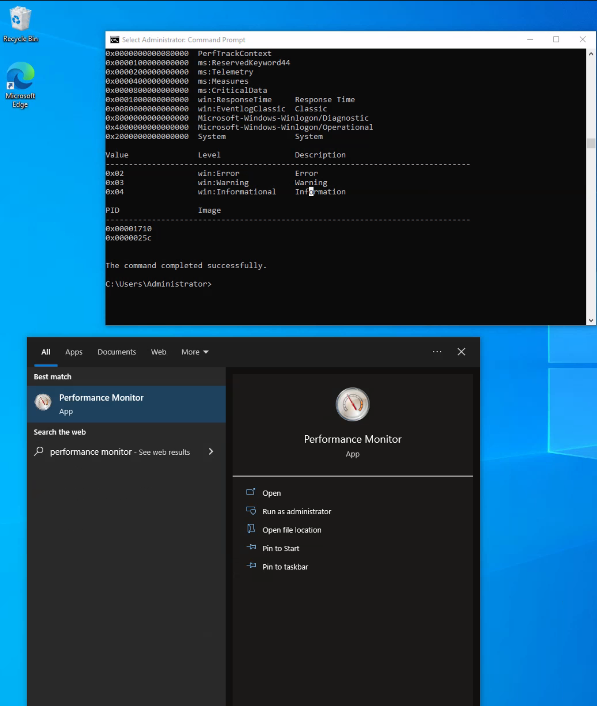
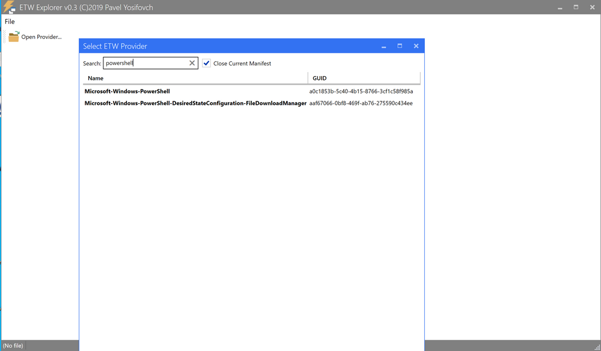

# Event Tracing for Windows (ETW)

Trong lĩnh vực phát hiện mối đe doạ (threat detection) và ứng phó sự cố (incident response) hiệu quả, ta thường phải dựa vào lượng dữ liệu log hạn chế mà mình có. Tuy nhiên, cách làm này chưa khai thác hết kho thông tin khổng lồ có thể thu được từ một nguồn tài nguyên mạnh mẽ là `Event Tracing for Windows (ETW)`. Đáng tiếc, sự bỏ sót này xuất phát từ việc thiếu hiểu biết và chưa đánh giá đúng những insight toàn diện, chi tiết mà ETW có thể mang lại.

---

## ETW là gì?

Theo Microsoft, `Event Tracing For Windows (ETW)` là một cơ chế tracing (truy vết) đa dụng, tốc độ cao do hệ điều hành cung cấp. Bằng cơ chế buffering (đệm) và logging được triển khai trong kernel, ETW cung cấp cơ chế tracing cho các event phát sinh từ cả ứng dụng user-mode lẫn driver thiết bị kernel-mode.

ETW, với vai trò là một cơ chế event tracing hiệu năng cao được tích hợp sâu trong hệ điều hành Windows, mang lại một cơ hội vô song để tăng cường năng lực phòng thủ của chúng ta. Kiến trúc của nó cho phép tạo, thu thập và phân tích một cách linh động nhiều loại event xảy ra trong hệ thống, từ đó tạo ra các log chi tiết, theo thời gian thực, bao quát nhiều loại hoạt động khác nhau.

Bằng cách tận dụng hiệu quả ETW, ta có thể khai thác một loạt nguồn telemetry phong phú, vượt qua những giới hạn của dữ liệu log truyền thống. ETW ghi lại nhiều loại event đa dạng, bao gồm system call, việc tạo và kết thúc process, hoạt động mạng, thay đổi file và registry, cùng nhiều khía cạnh khác. Gộp lại, các event này dệt nên một bức tranh chi tiết về hoạt động của hệ thống, cung cấp ngữ cảnh vô giá để nhận diện hành vi bất thường, phát hiện các sự cố bảo mật tiềm ẩn và hỗ trợ điều tra forensic.

Tính linh hoạt và khả năng mở rộng của ETW càng được nhấn mạnh nhờ khả năng tích hợp liền mạch với Event Provider. Đây là các thành phần chuyên biệt tạo ra những loại event cụ thể và có thể được tích hợp liền mạch vào ứng dụng, thành phần hệ điều hành hoặc phần mềm bên thứ ba. Nhờ đó, việc tích hợp này đảm bảo bao phủ rộng các nguồn event tiềm năng. Hơn nữa, khả năng mở rộng của ETW cho phép tạo các provider tuỳ chỉnh (custom provider) phù hợp với yêu cầu riêng của tổ chức, qua đó thúc đẩy một cách tiếp cận logging và giám sát có mục tiêu, tập trung.

Đáng chú ý, bản chất nhẹ và mức ảnh hưởng hiệu năng tối thiểu khiến ETW trở thành giải pháp telemetry lý tưởng cho giám sát thời gian thực và đánh giá bảo mật liên tục. Bằng cách bật và cấu hình có chọn lọc các event provider liên quan, ta có thể tinh chỉnh phạm vi thu thập dữ liệu cho khớp với các mục tiêu bảo mật cụ thể, đạt được sự cân bằng hài hoà giữa độ phong phú của thông tin và các yếu tố về hiệu năng hệ thống.

Ngoài ra, sự tồn tại của các công cụ và tiện ích mạnh mẽ, bao gồm Message Analyzer của Microsoft và cmdlet `Get-WinEvent` của PowerShell, giúp đơn giản hoá đáng kể việc truy xuất, parse và phân tích log ETW. Các công cụ này cung cấp khả năng lọc nâng cao, cơ chế tương quan (correlation) event và tính năng giám sát thời gian thực, giúp các thành viên blue team rút ra những insight có thể hành động được (actionable) từ kho thông tin khổng lồ mà ETW ghi lại.


---

## Kiến trúc & các thành phần của ETW

Kiến trúc nền tảng và các thành phần chính của Event Tracing for Windows (ETW) được minh hoạ trong sơ đồ dưới đây từ [Microsoft](https://web.archive.org/web/20200725154736/https://docs.microsoft.com/en-us/archive/blogs/ntdebugging/part-1-etw-introduction-and-overview).


- `Controllers`: Đúng như tên gọi, thành phần Controllers đảm nhận việc kiểm soát mọi khía cạnh liên quan đến hoạt động của ETW. Nó bao gồm các chức năng như khởi tạo và kết thúc trace session, cũng như bật hoặc tắt provider trong một trace cụ thể. Trace session có thể đăng ký (subscribe) tới một hoặc nhiều provider, qua đó cho phép các provider bắt đầu ghi log. Một ví dụ về controller được dùng rộng rãi là tiện ích có sẵn "logman.exe", hỗ trợ quản lý các hoạt động ETW.

Cốt lõi trong kiến trúc của ETW là mô hình publish-subscribe. Mô hình này gồm hai thành phần chính:
- `Providers`: Provider đóng vai trò then chốt trong việc tạo event và ghi chúng vào các ETW session được chỉ định. Ứng dụng có thể đăng ký ETW provider, cho phép chúng tạo và truyền đi rất nhiều event. Có bốn loại provider khác nhau được dùng trong ETW.
	- `MOF Providers`: Các provider này dựa trên Managed Object Format (MOF) và có thể tạo event theo các MOF schema định sẵn. Chúng mang lại cách tạo event linh hoạt và được dùng rộng rãi trong nhiều tình huống.
	- `WPP Providers`: Viết tắt của "Windows Software Trace Preprocessor", WPP provider tận dụng các macro và annotation chuyên biệt trong source code của ứng dụng để tạo event. Loại provider này thường được dùng cho mục đích tracing và debug kernel-mode ở mức thấp.
	- `Manifest-based Providers`: Manifest-based provider là dạng provider hiện đại hơn trong ETW. Chúng dựa vào các file XML manifest định nghĩa cấu trúc và đặc điểm của event. Cách tiếp cận này mang lại tính linh hoạt cao hơn và dễ quản lý hơn, cho phép tạo và tuỳ chỉnh event một cách linh động.
	- `TraceLogging Providers`: TraceLogging provider mang lại cách tạo event đơn giản và hiệu quả. Chúng tận dụng TraceLogging API, được giới thiệu trong các phiên bản Windows gần đây, giúp tinh gọn quá trình tạo event với lượng code tối thiểu.
- `Consumers`: Consumer đăng ký nhận các event cụ thể mà chúng quan tâm và nhận các event đó để xử lý hoặc phân tích tiếp. Mặc định, event thường được chuyển tới một file .ETL (Event Trace Log) để xử lý. Tuy nhiên, một kịch bản consumer khác là tận dụng khả năng của Windows API để xử lý và tiêu thụ (consume) event.
- `Channels`: Để thu thập và tiêu thụ event hiệu quả, ETW dựa vào các event channel. Event channel đóng vai trò như các container logic để tổ chức và lọc event dựa trên đặc điểm và mức độ quan trọng của chúng. ETW hỗ trợ nhiều channel, mỗi channel có mục đích và đối tượng sử dụng riêng. Event consumer có thể chọn đăng ký các channel cụ thể để nhận những event phù hợp với use case của mình.
- `ETL files`: ETW hỗ trợ chuyên biệt việc ghi event xuống đĩa thông qua các file event trace log, thường gọi là "file ETL". Các file này đóng vai trò nơi lưu trữ bền vững cho event, cho phép phân tích offline, lưu trữ dài hạn và điều tra forensic. ETW cho phép xoay vòng (rotation) và quản lý file ETL liền mạch để đảm bảo sử dụng dung lượng lưu trữ hiệu quả.

**Lưu ý**: 
- ETW hỗ trợ event provider ở cả kernel mode lẫn user mode. 
- Một số event provider tạo ra lượng event rất lớn, có thể làm quá tải tài nguyên hệ thống nếu chúng luôn hoạt động. Vì vậy, để tránh tiêu tốn tài nguyên không cần thiết, các provider này thường bị tắt theo mặc định và chỉ được bật khi một tracing session yêu cầu kích hoạt chúng.
- Ngoài các khả năng vốn có, ETW có thể được mở rộng thông qua custom event provider.
- [Chỉ những event của ETW provider có thuộc tính Channel mới có thể được event log tiêu thụ](https://medium.com/threat-hunters-forge/threat-hunting-with-etw-events-and-helk-part-1-installing-silketw-6eb74815e4a0)


---

## Tương tác với ETW

`Logman` là một tiện ích cài sẵn để quản lý Event Tracing for Windows (ETW) và Event Tracing Session. Công cụ này vô cùng hữu ích để tạo, khởi động, dừng và kiểm tra các tracing session. Nó đặc biệt hữu ích khi cần xác định những session nào đang được thiết lập để thu thập dữ liệu, hoặc khi bắt đầu tự thu thập dữ liệu của riêng bạn.

Dùng tham số `-ets` cho phép kiểm tra trực tiếp các event tracing session, cung cấp cái nhìn về các tracing session trên toàn hệ thống. Ví dụ, có thể thấy các Event Tracing Session của Sysmon ở gần cuối phần thông tin hiển thị.

```cmd-session
C:\Tools> logman.exe query -ets

Data Collector Set                      Type                          Status
-------------------------------------------------------------------------------
Circular Kernel Context Logger          Trace                         Running
Eventlog-Security                       Trace                         Running
DiagLog                                 Trace                         Running
Diagtrack-Listener                      Trace                         Running
EventLog-Application                    Trace                         Running
EventLog-Microsoft-Windows-Sysmon-Operational Trace                         Running
EventLog-System                         Trace                         Running
LwtNetLog                               Trace                         Running
Microsoft-Windows-Rdp-Graphics-RdpIdd-Trace Trace                         Running
NetCore                                 Trace                         Running
NtfsLog                                 Trace                         Running
RadioMgr                                Trace                         Running
UBPM                                    Trace                         Running
WdiContextLog                           Trace                         Running
WiFiSession                             Trace                         Running
SHS-06012023-115154-7-7f                Trace                         Running
UserNotPresentTraceSession              Trace                         Running
8696EAC4-1288-4288-A4EE-49EE431B0AD9    Trace                         Running
ScreenOnPowerStudyTraceSession          Trace                         Running
SYSMON TRACE                            Trace                         Running
MSDTC_TRACE_SESSION                     Trace                         Running
SysmonDnsEtwSession                     Trace                         Running
MpWppTracing-20230601-115025-00000003-ffffffff Trace                         Running
WindowsUpdate_trace_log                 Trace                         Running
Admin_PS_Provider                       Trace                         Running
Terminal-Services-LSM-ApplicationLag-3764 Trace                         Running
Microsoft.Windows.Remediation           Trace                         Running
SgrmEtwSession                          Trace                         Running

The command completed successfully.
```

Khi kiểm tra trực tiếp một Event Tracing Session, ta sẽ thấy các thông tin chi tiết của session gồm Name, Max Log Size, Log Location và các provider đã đăng ký. Thông tin này vô giá đối với người ứng phó sự cố (incident responder). Việc phát hiện một session đang ghi lại các provider liên quan đến điều bạn quan tâm có thể cung cấp những log quan trọng cho cuộc điều tra.

Lưu ý rằng tham số “-ets” là thiết yếu cho lệnh. Nếu thiếu nó, Logman sẽ không nhận diện được Event Tracing Session.

Với mỗi provider đăng ký vào session, ta có thể thu được các dữ liệu quan trọng:
- `Name / Provider GUID`: Đây là định danh duy nhất của provider.
- `Level`: Mô tả mức (level) của event, cho biết session đang lọc theo warning, informational, critical hay tất cả event.
- `Keywords Any`: Keyword tạo bộ lọc dựa trên loại event mà provider tạo ra.

```cmd-session
C:\Tools> logman.exe query "EventLog-System" -ets


Name:                 EventLog-System
Status:               Running
Root Path:            %systemdrive%\PerfLogs\Admin
Segment:              Off
Schedules:            On
Segment Max Size:     100 MB

Name:                 EventLog-System\EventLog-System
Type:                 Trace
Append:               Off
Circular:             Off
Overwrite:            Off
Buffer Size:          64
Buffers Lost:         0
Buffers Written:      47
Buffer Flush Timer:   1
Clock Type:           System
File Mode:            Real-time

Provider:
Name:                 Microsoft-Windows-FunctionDiscoveryHost
Provider Guid:        {538CBBAD-4877-4EB2-B26E-7CAEE8F0F8CB}
Level:                255
KeywordsAll:          0x0
KeywordsAny:          0x8000000000000000 (System)
Properties:           65
Filter Type:          0

Provider:
Name:                 Microsoft-Windows-Subsys-SMSS
Provider Guid:        {43E63DA5-41D1-4FBF-ADED-1BBED98FDD1D}
Level:                255
KeywordsAll:          0x0
KeywordsAny:          0x4000000000000000 (System)
Properties:           65
Filter Type:          0

Provider:
Name:                 Microsoft-Windows-Kernel-General
Provider Guid:        {A68CA8B7-004F-D7B6-A698-07E2DE0F1F5D}
Level:                255
KeywordsAll:          0x0
KeywordsAny:          0x8000000000000000 (System)
Properties:           65
Filter Type:          0

Provider:
Name:                 Microsoft-Windows-FilterManager
Provider Guid:        {F3C5E28E-63F6-49C7-A204-E48A1BC4B09D}
Level:                255
KeywordsAll:          0x0
KeywordsAny:          0x8000000000000000 (System)
Properties:           65
Filter Type:          0

--- SNIP ---

The command completed successfully.
```

Bằng lệnh `logman query providers`, ta có thể tạo danh sách tất cả provider có sẵn trên hệ thống, kèm GUID tương ứng của chúng.


```cmd-session
C:\Tools> logman.exe query providers

Provider                                 GUID
-------------------------------------------------------------------------------
ACPI Driver Trace Provider               {DAB01D4D-2D48-477D-B1C3-DAAD0CE6F06B}
Active Directory Domain Services: SAM    {8E598056-8993-11D2-819E-0000F875A064}
Active Directory: Kerberos Client        {BBA3ADD2-C229-4CDB-AE2B-57EB6966B0C4}
Active Directory: NetLogon               {F33959B4-DBEC-11D2-895B-00C04F79AB69}
ADODB.1                                  {04C8A86F-3369-12F8-4769-24E484A9E725}
ADOMD.1                                  {7EA56435-3F2F-3F63-A829-F0B35B5CAD41}
Application Popup                        {47BFA2B7-BD54-4FAC-B70B-29021084CA8F}
Application-Addon-Event-Provider         {A83FA99F-C356-4DED-9FD6-5A5EB8546D68}
ATA Port Driver Tracing Provider         {D08BD885-501E-489A-BAC6-B7D24BFE6BBF}
AuthFw NetShell Plugin                   {935F4AE6-845D-41C6-97FA-380DAD429B72}
BCP.1                                    {24722B88-DF97-4FF6-E395-DB533AC42A1E}
BFE Trace Provider                       {106B464A-8043-46B1-8CB8-E92A0CD7A560}
BITS Service Trace                       {4A8AAA94-CFC4-46A7-8E4E-17BC45608F0A}
Certificate Services Client CredentialRoaming Trace {EF4109DC-68FC-45AF-B329-CA2825437209}
Certificate Services Client Trace        {F01B7774-7ED7-401E-8088-B576793D7841}
Circular Kernel Session Provider         {54DEA73A-ED1F-42A4-AF71-3E63D056F174}
Classpnp Driver Tracing Provider         {FA8DE7C4-ACDE-4443-9994-C4E2359A9EDB}
Critical Section Trace Provider          {3AC66736-CC59-4CFF-8115-8DF50E39816B}
DBNETLIB.1                               {BD568F20-FCCD-B948-054E-DB3421115D61}
Deduplication Tracing Provider           {5EBB59D1-4739-4E45-872D-B8703956D84B}
Disk Class Driver Tracing Provider       {945186BF-3DD6-4F3F-9C8E-9EDD3FC9D558}
Downlevel IPsec API                      {94335EB3-79EA-44D5-8EA9-306F49B3A041}
Downlevel IPsec NetShell Plugin          {E4FF10D8-8A88-4FC6-82C8-8C23E9462FE5}
Downlevel IPsec Policy Store             {94335EB3-79EA-44D5-8EA9-306F49B3A070}
Downlevel IPsec Service                  {94335EB3-79EA-44D5-8EA9-306F49B3A040}
EA IME API                               {E2A24A32-00DC-4025-9689-C108C01991C5}
Error Instrument                         {CD7CF0D0-02CC-4872-9B65-0DBA0A90EFE8}
FD Core Trace                            {480217A9-F824-4BD4-BBE8-F371CAAF9A0D}
FD Publication Trace                     {649E3596-2620-4D58-A01F-17AEFE8185DB}
FD SSDP Trace                            {DB1D0418-105A-4C77-9A25-8F96A19716A4}
FD WNet Trace                            {8B20D3E4-581F-4A27-8109-DF01643A7A93}
FD WSDAPI Trace                          {7E2DBFC7-41E8-4987-BCA7-76CADFAD765F}
FDPHost Service Trace                    {F1C521CA-DA82-4D79-9EE4-D7A375723B68}
File Kernel Trace; Operation Set 1       {D75D8303-6C21-4BDE-9C98-ECC6320F9291}
File Kernel Trace; Operation Set 2       {058DD951-7604-414D-A5D6-A56D35367A46}
File Kernel Trace; Optional Data         {7DA1385C-F8F5-414D-B9D0-02FCA090F1EC}
File Kernel Trace; Volume To Log         {127D46AF-4AD3-489F-9165-F00BA64D5467}
FWPKCLNT Trace Provider                  {AD33FA19-F2D2-46D1-8F4C-E3C3087E45AD}
FWPUCLNT Trace Provider                  {5A1600D2-68E5-4DE7-BCF4-1C2D215FE0FE}
Heap Trace Provider                      {222962AB-6180-4B88-A825-346B75F2A24A}
IKEEXT Trace Provider                    {106B464D-8043-46B1-8CB8-E92A0CD7A560}
IMAPI1 Shim                              {1FF10429-99AE-45BB-8A67-C9E945B9FB6C}
IMAPI2 Concatenate Stream                {0E85A5A5-4D5C-44B7-8BDA-5B7AB54F7E9D}
IMAPI2 Disc Master                       {0E85A5A5-4D5C-44B7-8BDA-5B7AB54F7E91}
IMAPI2 Disc Recorder                     {0E85A5A5-4D5C-44B7-8BDA-5B7AB54F7E93}
IMAPI2 Disc Recorder Enumerator          {0E85A5A5-4D5C-44B7-8BDA-5B7AB54F7E92}
IMAPI2 dll                               {0E85A5A5-4D5C-44B7-8BDA-5B7AB54F7E90}
IMAPI2 Interleave Stream                 {0E85A5A5-4D5C-44B7-8BDA-5B7AB54F7E9E}
IMAPI2 Media Eraser                      {0E85A5A5-4D5C-44B7-8BDA-5B7AB54F7E97}
IMAPI2 MSF                               {0E85A5A5-4D5C-44B7-8BDA-5B7AB54F7E9F}
IMAPI2 Multisession Sequential           {0E85A5A5-4D5C-44B7-8BDA-5B7AB54F7EA0}
IMAPI2 Pseudo-Random Stream              {0E85A5A5-4D5C-44B7-8BDA-5B7AB54F7E9C}
IMAPI2 Raw CD Writer                     {0E85A5A5-4D5C-44B7-8BDA-5B7AB54F7E9A}
IMAPI2 Raw Image Writer                  {07E397EC-C240-4ED7-8A2A-B9FF0FE5D581}
IMAPI2 Standard Data Writer              {0E85A5A5-4D5C-44B7-8BDA-5B7AB54F7E98}
IMAPI2 Track-at-Once CD Writer           {0E85A5A5-4D5C-44B7-8BDA-5B7AB54F7E99}
IMAPI2 Utilities                         {0E85A5A5-4D5C-44B7-8BDA-5B7AB54F7E94}
IMAPI2 Write Engine                      {0E85A5A5-4D5C-44B7-8BDA-5B7AB54F7E96}
IMAPI2 Zero Stream                       {0E85A5A5-4D5C-44B7-8BDA-5B7AB54F7E9B}
IMAPI2FS Tracing                         {F8036571-42D9-480A-BABB-DE7833CB059C}
Intel-iaLPSS-GPIO                        {D386CC7A-620A-41C1-ABF5-55018C6C699A}
Intel-iaLPSS-I2C                         {D4AEAC44-AD44-456E-9C90-33F8CDCED6AF}
Intel-iaLPSS2-GPIO2                      {63848CFF-3EC7-4DDF-8072-5F95E8C8EB98}
Intel-iaLPSS2-I2C                        {C2F86198-03CA-4771-8D4C-CE6E15CBCA56}
IPMI Driver Trace                        {D5C6A3E9-FA9C-434E-9653-165B4FC869E4}
IPMI Provider Trace                      {651D672B-E11F-41B7-ADD3-C2F6A4023672}
KMDFv1 Trace Provider                    {544D4C9D-942C-46D5-BF50-DF5CD9524A50}
Layer2 Security HC Diagnostics Trace     {2E8D9EC5-A712-48C4-8CE0-631EB0C1CD65}
Local Security Authority (LSA)           {CC85922F-DB41-11D2-9244-006008269001}
LsaSrv                                   {199FE037-2B82-40A9-82AC-E1D46C792B99}
Microsoft-Antimalware-AMFilter           {CFEB0608-330E-4410-B00D-56D8DA9986E6}
Microsoft-Antimalware-Engine             {0A002690-3839-4E3A-B3B6-96D8DF868D99}
Microsoft-Antimalware-Engine-Instrumentation {68621C25-DF8D-4A6B-AABC-19A22E296A7C}
Microsoft-Antimalware-NIS                {102AAB0A-9D9C-4887-A860-55DE33B96595}
Microsoft-Antimalware-Protection         {E4B70372-261F-4C54-8FA6-A5A7914D73DA}
Microsoft-Antimalware-RTP                {8E92DEEF-5E17-413B-B927-59B2F06A3CFC}
Microsoft-Antimalware-Scan-Interface     {2A576B87-09A7-520E-C21A-4942F0271D67}
Microsoft-Antimalware-Service            {751EF305-6C6E-4FED-B847-02EF79D26AEF}
Microsoft-Antimalware-ShieldProvider     {928F7D29-0577-5BE5-3BD3-B6BDAB9AB307}
Microsoft-Antimalware-UacScan            {D37E7910-79C8-57C4-DA77-52BB646364CD}
Microsoft-AppV-Client                    {E4F68870-5AE8-4E5B-9CE7-CA9ED75B0245}
Microsoft-AppV-Client-StreamingUX        {28CB46C7-4003-4E50-8BD9-442086762D12}
Microsoft-AppV-ServiceLog                {9CC69D1C-7917-4ACD-8066-6BF8B63E551B}
Microsoft-AppV-SharedPerformance         {FB4A19EE-EB5A-47A4-BC52-E71AAC6D0859}
Microsoft-Client-Licensing-Platform      {B6CC0D55-9ECC-49A8-B929-2B9022426F2A}
Microsoft-Gaming-Services                {BC1BDB57-71A2-581A-147B-E0B49474A2D4}
Microsoft-IE                             {9E3B3947-CA5D-4614-91A2-7B624E0E7244}
Microsoft-IE-JSDumpHeap                  {7F8E35CA-68E8-41B9-86FE-D6ADC5B327E7}
Microsoft-IEFRAME                        {5C8BB950-959E-4309-8908-67961A1205D5}
Microsoft-JScript                        {57277741-3638-4A4B-BDBA-0AC6E45DA56C}
Microsoft-OneCore-OnlineSetup            {41862974-DA3B-4F0B-97D5-BB29FBB9B71E}
Microsoft-PerfTrack-IEFRAME              {B2A40F1F-A05A-4DFD-886A-4C4F18C4334C}
Microsoft-PerfTrack-MSHTML               {FFDB9886-80F3-4540-AA8B-B85192217DDF}
Microsoft-User Experience Virtualization-Admin {61BC445E-7A8D-420E-AB36-9C7143881B98}
Microsoft-User Experience Virtualization-Agent Driver {DE29CF61-5EE6-43FF-9AAC-959C4E13CC6C}
Microsoft-User Experience Virtualization-App Agent {1ED6976A-4171-4764-B415-7EA08BC46C51}
Microsoft-User Experience Virtualization-IPC {21D79DB0-8E03-41CD-9589-F3EF7001A92A}
Microsoft-User Experience Virtualization-SQM Uploader {57003E21-269B-4BDC-8434-B3BF8D57D2D5}
Microsoft-Windows Networking VPN Plugin Platform {E5FC4A0F-7198-492F-9B0F-88FDCBFDED48}
Microsoft-Windows-AAD                    {4DE9BC9C-B27A-43C9-8994-0915F1A5E24F}
Microsoft-Windows-ACL-UI                 {EA4CC8B8-A150-47A3-AFB9-C8D194B19452}

The command completed successfully.
```

Windows 10 có hơn 1.000 provider tích hợp sẵn. Hơn nữa, phần mềm bên thứ ba (Third-Party Software) thường đi kèm ETW provider riêng, đặc biệt là những phần mềm hoạt động ở Kernel mode.

Do số lượng provider rất lớn, thường nên lọc chúng bằng `findstr`. Ví dụ, bạn sẽ thấy nhiều kết quả cho "Winlogon" trong ví dụ dưới đây.

```cmd-session
C:\Tools> logman.exe query providers | findstr "Winlogon"
Microsoft-Windows-Winlogon               {DBE9B383-7CF3-4331-91CC-A3CB16A3B538}
Windows Winlogon Trace                   {D451642C-63A6-11D7-9720-00B0D03E0347}
```

Khi chỉ định một provider cụ thể với Logman, ta sẽ hiểu sâu hơn về chức năng của provider đó. Kết quả sẽ cho biết các Keyword có thể dùng để lọc, các event level có sẵn và những process nào đang sử dụng provider.

```cmd-session
C:\Tools> logman.exe query providers Microsoft-Windows-Winlogon

Provider                                 GUID
-------------------------------------------------------------------------------
Microsoft-Windows-Winlogon               {DBE9B383-7CF3-4331-91CC-A3CB16A3B538}

Value               Keyword              Description
-------------------------------------------------------------------------------
0x0000000000010000  PerfInstrumentation
0x0000000000020000  PerfDiagnostics
0x0000000000040000  NotificationEvents
0x0000000000080000  PerfTrackContext
0x0000100000000000  ms:ReservedKeyword44
0x0000200000000000  ms:Telemetry
0x0000400000000000  ms:Measures
0x0000800000000000  ms:CriticalData
0x0001000000000000  win:ResponseTime     Response Time
0x0080000000000000  win:EventlogClassic  Classic
0x8000000000000000  Microsoft-Windows-Winlogon/Diagnostic
0x4000000000000000  Microsoft-Windows-Winlogon/Operational
0x2000000000000000  System               System

Value               Level                Description
-------------------------------------------------------------------------------
0x02                win:Error            Error
0x03                win:Warning          Warning
0x04                win:Informational    Information

PID                 Image
-------------------------------------------------------------------------------
0x00001710
0x0000025c


The command completed successfully.
```

Các keyword `Microsoft-Windows-Winlogon/Diagnostic` và `Microsoft-Windows-Winlogon/Operational` tham chiếu tới các event log được tạo ra từ provider này.

Cũng có các lựa chọn thay thế dựa trên GUI. Đó là:

1. Dùng giao diện đồ hoạ của công cụ `Performance Monitor`, ta có thể trực quan hoá các trace session đang chạy. Có thể xem tổng quan chi tiết của một trace cụ thể chỉ bằng cách double-click vào nó. Thao tác này hiển thị mọi dữ liệu liên quan đến trace, từ các provider đang tham gia và các tính năng được kích hoạt của chúng cho tới bản chất của chính trace đó. Ngoài ra, có thể chỉnh sửa các session này cho phù hợp với nhu cầu bằng cách thêm hoặc bỏ provider. Cuối cùng, ta có thể tạo session mới bằng cách chọn mục "User Defined".

	

	

2. Metadata của ETW Provider cũng có thể được xem qua [dự án EtwExplorer](https://github.com/zodiacon/EtwExplorer).

	

---

## Các provider hữu ích

- `Microsoft-Windows-Kernel-Process`: ETW provider này đóng vai trò quan trọng trong việc giám sát hoạt động liên quan đến process trong Windows kernel. Nó có thể giúp phát hiện các hành vi process bất thường như process injection, process hollowing và các tactic khác thường được malware và các nhóm tấn công có chủ đích dai dẳng (APT – advanced persistent threat) sử dụng.
- `Microsoft-Windows-Kernel-File`: Đúng như tên gọi, provider này tập trung vào các thao tác liên quan đến file. Nó có thể dùng cho các kịch bản phát hiện liên quan đến truy cập file trái phép, thay đổi các file hệ thống quan trọng, hoặc các thao tác file đáng ngờ cho thấy dấu hiệu exfiltration hoặc ransomware.
- `Microsoft-Windows-Kernel-Network`: ETW provider này cung cấp khả năng quan sát (visibility) các hoạt động liên quan đến mạng ở mức kernel. Nó đặc biệt hữu ích trong việc phát hiện các cuộc tấn công qua mạng như data exfiltration, kết nối mạng trái phép và các dấu hiệu tiềm ẩn của giao tiếp command and control (C2).
- `Microsoft-Windows-SMBClient/SMBServer`: Các provider này giám sát hoạt động của SMB (Server Message Block) client và server, cung cấp thông tin về chia sẻ file và giao tiếp mạng. Chúng có thể dùng để phát hiện các mẫu lưu lượng SMB bất thường, có thể là dấu hiệu của lateral movement hoặc data exfiltration.
- `Microsoft-Windows-DotNETRuntime`: Provider này tập trung vào các event của .NET runtime, nên rất phù hợp để nhận diện các bất thường trong quá trình thực thi ứng dụng .NET, khả năng khai thác lỗ hổng .NET, hoặc việc load .NET assembly độc hại.
- `OpenSSH`: Giám sát ETW provider OpenSSH có thể cung cấp thông tin quan trọng về các lần thử kết nối Secure Shell (SSH), các lần xác thực thành công và thất bại, cũng như các cuộc tấn công brute force tiềm ẩn.
- `Microsoft-Windows-VPN-Client`: Provider này cho phép theo dõi các event của VPN (Virtual Private Network) client. Nó có thể hữu ích để nhận diện các kết nối VPN trái phép hoặc đáng ngờ.
- `Microsoft-Windows-PowerShell`: ETW provider này theo dõi việc thực thi PowerShell và hoạt động lệnh, nên vô cùng hữu ích để phát hiện việc sử dụng PowerShell đáng ngờ, script block logging, và các hành vi lạm dụng hoặc khai thác tiềm ẩn.
- `Microsoft-Windows-Kernel-Registry`: Provider này giám sát các thao tác registry, nên hữu ích cho các kịch bản phát hiện liên quan đến thay đổi registry key — thường gắn với cơ chế persistence, cài đặt malware hoặc thay đổi cấu hình hệ thống.
- `Microsoft-Windows-CodeIntegrity`: Provider này giám sát các bước kiểm tra tính toàn vẹn (integrity) của code và driver, có thể là yếu tố then chốt để nhận diện các nỗ lực load driver hoặc code chưa được ký (unsigned) hoặc độc hại.
- `Microsoft-Antimalware-Service`: ETW provider này có thể dùng để phát hiện các vấn đề tiềm ẩn với dịch vụ antimalware, bao gồm dịch vụ bị vô hiệu hoá, thay đổi cấu hình, hoặc các kỹ thuật né tránh (evasion) mà malware có thể sử dụng.
- `WinRM`: Giám sát provider Windows Remote Management (WinRM) có thể làm lộ ra hoạt động quản trị từ xa trái phép hoặc đáng ngờ, thường là dấu hiệu của lateral movement hoặc thực thi lệnh từ xa.
- `Microsoft-Windows-TerminalServices-LocalSessionManager`: Provider này theo dõi các session Terminal Services cục bộ, nên hữu ích để phát hiện hoạt động remote desktop trái phép hoặc đáng ngờ.
- `Microsoft-Windows-Security-Mitigations`: Provider này theo dõi hiệu quả và hoạt động của các biện pháp giảm thiểu bảo mật (security mitigation) đang được áp dụng. Nó rất cần thiết để nhận diện các nỗ lực bypass những cơ chế kiểm soát bảo mật này.
- `Microsoft-Windows-DNS-Client`: ETW provider này cung cấp khả năng quan sát hoạt động của DNS client, điều cốt yếu để phát hiện các cuộc tấn công dựa trên DNS, bao gồm DNS tunneling hoặc các DNS request bất thường có thể cho thấy giao tiếp C2.
- `Microsoft-Antimalware-Protection`: Provider này giám sát hoạt động của các cơ chế bảo vệ antimalware. Nó có thể dùng để phát hiện mọi vấn đề với các cơ chế này, chẳng hạn tính năng bảo vệ bị tắt, thay đổi cấu hình, hoặc dấu hiệu của các kỹ thuật né tránh mà các tác nhân độc hại sử dụng.

---

## Các provider bị hạn chế (Restricted Providers)

Trong lĩnh vực bảo mật hệ điều hành Windows, một số ETW provider được coi là "restricted" (bị hạn chế). Các provider này cung cấp telemetry giá trị nhưng chỉ những process có đủ quyền cần thiết mới truy cập được. Tính độc quyền này được thiết kế để đảm bảo dữ liệu hệ thống nhạy cảm luôn được bảo vệ khỏi các mối đe doạ tiềm ẩn.

Một trong những provider giá trị cao, bị hạn chế này là `Microsoft-Windows-Threat-Intelligence`. Provider này cung cấp thông tin quan trọng về các mối đe doạ bảo mật tiềm ẩn và thường được tận dụng trong các hoạt động Digital Forensics and Incident Response (DFIR). Tuy nhiên, để truy cập provider này, process phải được cấp một đặc quyền cụ thể, gọi là Protected Process Light (PPL).

Theo Elastic:*Để có thể chạy dưới dạng PPL, một nhà cung cấp anti-malware phải nộp đơn cho Microsoft, chứng minh danh tính, ký các văn bản pháp lý ràng buộc, triển khai một driver Early Launch Anti-Malware (ELAM), chạy nó qua một bộ kiểm thử (test suite) và gửi cho Microsoft để nhận một chữ ký Authenticode đặc biệt. Đây không phải là một quy trình đơn giản. Khi hoàn tất quy trình này, nhà cung cấp có thể dùng driver ELAM đó để Windows bảo vệ dịch vụ anti-malware của họ bằng cách chạy nó dưới dạng PPL.* Dù vậy, [vẫn tồn tại các cách workaround để truy cập provider `Microsoft-Windows-Threat-Intelligence`](https://specterops.io/blog/2023/03/15/uncovering-windows-events/).

Trong bối cảnh `Microsoft-Windows-Threat-Intelligence`, quyền truy cập đặc quyền này mang lại nhiều lợi ích. Provider này có thể ghi lại dữ liệu rất chi tiết về các mối đe doạ tiềm ẩn, giúp các chuyên gia bảo mật phát hiện và phân tích những cuộc tấn công tinh vi có thể đã lọt qua các lớp phòng thủ khác. Telemetry của nó có thể đóng vai trò bằng chứng quan trọng trong điều tra forensic, cho biết chi tiết về nguồn gốc của mối đe doạ, các hệ thống và dữ liệu mà nó đã tương tác, cũng như những thay đổi mà nó đã thực hiện. Hơn nữa, bằng cách giám sát provider này theo thời gian thực, các đội bảo mật có thể nhận diện các mối đe doạ đang diễn ra và can thiệp để giảm thiểu thiệt hại.

Trong section tiếp theo, ta sẽ dùng ETW để điều tra các cuộc tấn công có thể né được phát hiện nếu ta chỉ dựa vào Sysmon để giám sát và phân tích, do những hạn chế vốn có của Sysmon trong việc ghi lại một số event nhất định.

---

## Tài liệu tham khảo

- [https://nasbench.medium.com/a-primer-on-event-tracing-for-windows-etw-997725c082bf](https://nasbench.medium.com/a-primer-on-event-tracing-for-windows-etw-997725c082bf)
- [https://bmcder.com/blog/a-begginers-all-inclusive-guide-to-etw](https://web.archive.org/web/20230222121234/https://bmcder.com/blog/a-begginers-all-inclusive-guide-to-etw)
