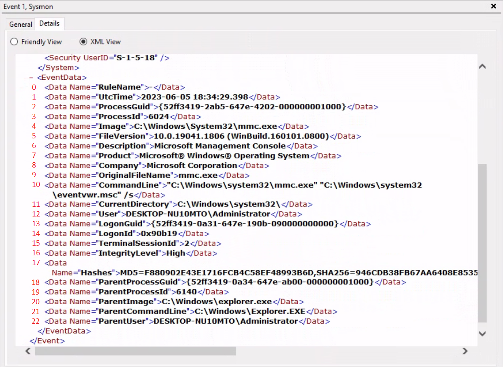

# Get-WinEvent

Hiểu được tầm quan trọng của việc phân tích hàng loạt (mass analysis) Windows Event Logs và log Sysmon là điều then chốt trong lĩnh vực an ninh mạng, đặc biệt trong các tình huống Incident Response (IR – ứng phó sự cố) và threat hunting. Các log này chứa thông tin vô giá về trạng thái hệ thống, hoạt động của người dùng, các mối đe doạ tiềm ẩn, các thay đổi trên hệ thống và thông tin phục vụ khắc phục sự cố (troubleshooting). Tuy nhiên, các log này cũng có thể rất đồ sộ và khó xử lý. Với các tổ chức quy mô lớn, việc sinh ra hàng triệu log mỗi ngày không phải là hiếm. Vì vậy, để chắt lọc thông tin hữu ích từ các log này, ta cần những công cụ và kỹ thuật hiệu quả để phân tích log hàng loạt.

Một trong những công cụ đó là [Get-WinEvent cmdlet](https://learn.microsoft.com/en-us/powershell/module/microsoft.powershell.diagnostics/get-winevent?view=powershell-7.3) trong PowerShell.

---

## Sử dụng Get-WinEvent

Cmdlet `Get-WinEvent` là công cụ không thể thiếu trong PowerShell để query Windows Event logs hàng loạt. Cmdlet này cho phép ta truy xuất nhiều loại event log khác nhau, bao gồm các Windows event log cổ điển (classic) như log System và Application, các log do công nghệ Windows Event Log sinh ra, và log Event Tracing for Windows (ETW).

Để nhanh chóng xác định các log hiện có, ta có thể dùng parameter `-ListLog` kết hợp với cmdlet Get-WinEvent. Khi chỉ định `*` làm giá trị cho parameter, ta lấy về tất cả log mà không áp dụng tiêu chí lọc nào. Nhờ đó ta có được danh sách đầy đủ các log cùng các thuộc tính (property) liên quan. Chạy lệnh sau, ta có thể lấy danh sách log và hiển thị các property thiết yếu như `LogName`, `RecordCount`, `IsClassicLog`, `IsEnabled`, `LogMode` và `LogType`. Ký tự `|` là toán tử pipe. Nó dùng để chuyển output của một lệnh (ở đây là lệnh `Get-WinEvent`) sang một lệnh khác (ở đây là lệnh `Select-Object`).

```powershell-session
PS C:\Users\Administrator> Get-WinEvent -ListLog * | Select-Object LogName, RecordCount, IsClassicLog, IsEnabled, LogMode, LogType | Format-Table -AutoSize

LogName                                                                                RecordCount IsClassicLog IsEnabled  LogMode        LogType
-------                                                                                ----------- ------------ ---------  -------        -------
Windows PowerShell                                                                            2916         True      True Circular Administrative
System                                                                                        1786         True      True Circular Administrative
Security                                                                                      8968         True      True Circular Administrative
Key Management Service                                                                           0         True      True Circular Administrative
Internet Explorer                                                                                0         True      True Circular Administrative
HardwareEvents                                                                                   0         True      True Circular Administrative
Application                                                                                   2079         True      True Circular Administrative
Windows Networking Vpn Plugin Platform/OperationalVerbose                                                 False     False Circular    Operational
Windows Networking Vpn Plugin Platform/Operational                                                        False     False Circular    Operational
SMSApi                                                                                           0        False      True Circular    Operational
Setup                                                                                           16        False      True Circular    Operational
OpenSSH/Operational                                                                              0        False      True Circular    Operational
OpenSSH/Admin                                                                                    0        False      True Circular Administrative
Network Isolation Operational                                                                             False     False Circular    Operational
Microsoft-WindowsPhone-Connectivity-WiFiConnSvc-Channel                                          0        False      True Circular    Operational
Microsoft-Windows-WWAN-SVC-Events/Operational                                                    0        False      True Circular    Operational
Microsoft-Windows-WPD-MTPClassDriver/Operational                                                 0        False      True Circular    Operational
Microsoft-Windows-WPD-CompositeClassDriver/Operational                                           0        False      True Circular    Operational
Microsoft-Windows-WPD-ClassInstaller/Operational                                                 0        False      True Circular    Operational
Microsoft-Windows-Workplace Join/Admin                                                           0        False      True Circular Administrative
Microsoft-Windows-WorkFolders/WHC                                                                0        False      True Circular    Operational
Microsoft-Windows-WorkFolders/Operational                                                        0        False      True Circular    Operational
Microsoft-Windows-Wordpad/Admin                                                                           False     False Circular    Operational
Microsoft-Windows-WMPNSS-Service/Operational                                                     0        False      True Circular    Operational
Microsoft-Windows-WMI-Activity/Operational                                                     895        False      True Circular    Operational
Microsoft-Windows-wmbclass/Trace                                                                          False     False Circular    Operational
Microsoft-Windows-WLAN-AutoConfig/Operational                                                    0        False      True Circular    Operational
Microsoft-Windows-Wired-AutoConfig/Operational                                                   0        False      True Circular    Operational
Microsoft-Windows-Winsock-WS2HELP/Operational                                                    0        False      True Circular    Operational
Microsoft-Windows-Winsock-NameResolution/Operational                                                      False     False Circular    Operational
Microsoft-Windows-Winsock-AFD/Operational                                                                 False     False Circular    Operational
Microsoft-Windows-WinRM/Operational                                                            230        False      True Circular    Operational
Microsoft-Windows-WinNat/Oper                                                                             False     False Circular    Operational
Microsoft-Windows-Winlogon/Operational                                                         648        False      True Circular    Operational
Microsoft-Windows-WinINet-Config/ProxyConfigChanged                                              2        False      True Circular    Operational
--- SNIP ---
```

Lệnh này cung cấp thông tin giá trị về từng log, bao gồm tên log, số record hiện có, log ở định dạng `.evt` cổ điển hay định dạng `.evtx` mới hơn, trạng thái bật/tắt (enabled), chế độ log (Circular, Retain hoặc AutoBackup) và loại log (Administrative, Analytical, Debug hoặc Operational).


Ngoài ra, ta có thể khám phá các event log provider gắn với từng log bằng parameter `-ListProvider`. Event log provider đóng vai trò là nguồn sinh ra event trong các log. Chạy lệnh sau cho phép ta lấy danh sách provider và các log liên kết tương ứng của chúng.

```powershell-session
PS C:\Users\Administrator> Get-WinEvent -ListProvider * | Format-Table -AutoSize

Name                                                                       LogLinks
----                                                                       --------
PowerShell                                                                 {Windows PowerShell}
Workstation                                                                {System}
WMIxWDM                                                                    {System}
WinNat                                                                     {System}
Windows Script Host                                                        {System}
Microsoft-Windows-IME-OEDCompiler                                          {Microsoft-Windows-IME-OEDCompiler/Analytic}
Microsoft-Windows-DeviceSetupManager                                       {Microsoft-Windows-DeviceSetupManager/Operat...
Microsoft-Windows-Search-ProfileNotify                                     {Application}
Microsoft-Windows-Eventlog                                                 {System, Security, Setup, Microsoft-Windows-...
Microsoft-Windows-Containers-BindFlt                                       {Microsoft-Windows-Containers-BindFlt/Operat...
Microsoft-Windows-NDF-HelperClassDiscovery                                 {Microsoft-Windows-NDF-HelperClassDiscovery/...
Microsoft-Windows-FirstUX-PerfInstrumentation                              {FirstUXPerf-Analytic}
--- SNIP ---
```

Lệnh này cho ta cái nhìn tổng quan về các provider hiện có và mối liên kết của chúng với các log cụ thể. Nhờ đó ta xác định được những provider đáng quan tâm để phục vụ việc lọc (filter).

Giờ hãy tập trung vào việc truy xuất các event log cụ thể bằng cmdlet Get-WinEvent. Ở mức cơ bản nhất, Get-WinEvent truy xuất event log từ máy tính local hoặc remote. Các ví dụ dưới đây minh hoạ cách truy xuất event từ nhiều log khác nhau. 

1. **Truy xuất event từ log System**

	```powershell-session
	PS C:\Users\Administrator> Get-WinEvent -LogName 'System' -MaxEvents 50 | Select-Object TimeCreated, ID, ProviderName, LevelDisplayName, Message | Format-Table -AutoSize
	
	TimeCreated            Id ProviderName                             LevelDisplayName Message
	-----------            -- ------------                             ---------------- -------
	6/2/2023 9:41:42 AM    16 Microsoft-Windows-Kernel-General         Information      The access history in hive \??\C:\Users\Administrator\AppData\Local\Packages\MicrosoftWindows.Client.CBS_cw5...
	6/2/2023 9:38:32 AM    16 Microsoft-Windows-Kernel-General         Information      The access history in hive \??\C:\Users\Administrator\AppData\Local\Packages\Microsoft.Windows.ShellExperien...
	6/2/2023 9:38:32 AM 10016 Microsoft-Windows-DistributedCOM         Warning          The machine-default permission settings do not grant Local Activation permission for the COM Server applicat...
	6/2/2023 9:37:31 AM    16 Microsoft-Windows-Kernel-General         Information      The access history in hive \??\C:\Users\Administrator\AppData\Local\Packages\Microsoft.WindowsAlarms_8wekyb3...
	6/2/2023 9:37:31 AM    16 Microsoft-Windows-Kernel-General         Information      The access history in hive \??\C:\Users\Administrator\AppData\Local\Packages\microsoft.windowscommunications...
	6/2/2023 9:37:31 AM    16 Microsoft-Windows-Kernel-General         Information      The access history in hive \??\C:\Users\Administrator\AppData\Local\Packages\Microsoft.Windows.ContentDelive...
	6/2/2023 9:36:35 AM    16 Microsoft-Windows-Kernel-General         Information      The access history in hive \??\C:\Users\Administrator\AppData\Local\Packages\Microsoft.YourPhone_8wekyb3d8bb...
	6/2/2023 9:36:32 AM    16 Microsoft-Windows-Kernel-General         Information      The access history in hive \??\C:\Users\Administrator\AppData\Local\Packages\Microsoft.AAD.BrokerPlugin_cw5n...
	6/2/2023 9:36:30 AM    16 Microsoft-Windows-Kernel-General         Information      The access history in hive \??\C:\Users\Administrator\AppData\Local\Packages\Microsoft.Windows.Search_cw5n1h...
	6/2/2023 9:36:29 AM    16 Microsoft-Windows-Kernel-General         Information      The access history in hive \??\C:\Users\Administrator\AppData\Local\Packages\Microsoft.Windows.StartMenuExpe...
	6/2/2023 9:36:14 AM    16 Microsoft-Windows-Kernel-General         Information      The access history in hive \??\C:\Users\Administrator\AppData\Local\Microsoft\Windows\UsrClass.dat was clear...
	6/2/2023 9:36:14 AM    16 Microsoft-Windows-Kernel-General         Information      The access history in hive \??\C:\Users\Administrator\ntuser.dat was cleared updating 2366 keys and creating...
	6/2/2023 9:36:14 AM  7001 Microsoft-Windows-Winlogon               Information      User Logon Notification for Customer Experience Improvement Program	
	6/2/2023 9:33:04 AM    16 Microsoft-Windows-Kernel-General         Information      The access history in hive \??\C:\Windows\AppCompat\Programs\Amcache.hve was cleared updating 920 keys and c...
	6/2/2023 9:31:54 AM    16 Microsoft-Windows-Kernel-General         Information      The access history in hive \??\C:\Windows\ServiceProfiles\NetworkService\AppData\Local\Microsoft\Windows\Del...
	6/2/2023 9:30:23 AM    16 Microsoft-Windows-Kernel-General         Information      The access history in hive \??\C:\Windows\System32\config\COMPONENTS was cleared updating 54860 keys and cre...
	6/2/2023 9:30:16 AM    15 Microsoft-Windows-Kernel-General         Information      Hive \SystemRoot\System32\config\DRIVERS was reorganized with a starting size of 3956736 bytes and an ending...
	6/2/2023 9:30:10 AM  1014 Microsoft-Windows-DNS-Client             Warning          Name resolution for the name settings-win.data.microsoft.com timed out after none of the configured DNS serv...
	6/2/2023 9:29:54 AM  7026 Service Control Manager                  Information      The following boot-start or system-start driver(s) did not load: ...
	6/2/2023 9:29:54 AM 10148 Microsoft-Windows-WinRM                  Information      The WinRM service is listening for WS-Management requests. ...
	6/2/2023 9:29:51 AM 51046 Microsoft-Windows-DHCPv6-Client          Information      DHCPv6 client service is started
	--- SNIP ---
	```
	Ví dụ này truy xuất 50 event đầu tiên từ log System. Lệnh chọn các property cụ thể, gồm thời điểm tạo event, ID, tên provider, tên hiển thị của level (level display name) và message. Điều này giúp việc phân tích và troubleshooting dễ dàng hơn.
	
2. **Truy xuất event từ Microsoft-Windows-WinRM/Operational**

	```powershell-session
	PS C:\Users\Administrator> Get-WinEvent -LogName 'Microsoft-Windows-WinRM/Operational' -MaxEvents 30 | Select-Object TimeCreated, ID, ProviderName, LevelDisplayName, Message | Format-Table -AutoSize
	
	TimeCreated            Id ProviderName            LevelDisplayName Message
	-----------            -- ------------            ---------------- -------
	6/2/2023 9:30:15 AM   132 Microsoft-Windows-WinRM Information      WSMan operation Enumeration completed successfully
	6/2/2023 9:30:15 AM   145 Microsoft-Windows-WinRM Information      WSMan operation Enumeration started with resourceUri...
	6/2/2023 9:30:15 AM   132 Microsoft-Windows-WinRM Information      WSMan operation Enumeration completed successfully
	6/2/2023 9:30:15 AM   145 Microsoft-Windows-WinRM Information      WSMan operation Enumeration started with resourceUri...
	6/2/2023 9:29:54 AM   209 Microsoft-Windows-WinRM Information      The Winrm service started successfully
	--- SNIP ---
	```
	Trong ví dụ này, event được truy xuất từ log Microsoft-Windows-WinRM/Operational. Lệnh lấy 30 event đầu tiên và chọn các property liên quan để hiển thị, gồm thời điểm tạo event, ID, tên provider, level display name và message.

	Để lấy các event cũ nhất, thay vì tự sắp xếp kết quả, ta có thể dùng parameter `-Oldest` với cmdlet Get-WinEvent. Parameter này cho phép lấy các event đầu tiên theo thứ tự thời gian. Lệnh sau minh hoạ cách lấy 30 event cũ nhất từ log 'Microsoft-Windows-WinRM/Operational'.
	```powershell-session
	PS C:\Users\Administrator> Get-WinEvent -LogName 'Microsoft-Windows-WinRM/Operational' -Oldest -MaxEvents 30 | Select-Object TimeCreated, ID, ProviderName, LevelDisplayName, Message | Format-Table -AutoSize
	
	TimeCreated           Id ProviderName            LevelDisplayName Message
	-----------            -- ------------            ---------------- -------
	8/3/2022 4:41:38 PM  145 Microsoft-Windows-WinRM Information      WSMan operation Enumeration started with resourceUri ...
	8/3/2022 4:41:42 PM  254 Microsoft-Windows-WinRM Information      Activity Transfer
	8/3/2022 4:41:42 PM  161 Microsoft-Windows-WinRM Error            The client cannot connect to the destination specifie...
	8/3/2022 4:41:42 PM  142 Microsoft-Windows-WinRM Error            WSMan operation Enumeration failed, error code 215085...
	8/3/2022 9:51:03 AM  145 Microsoft-Windows-WinRM Information      WSMan operation Enumeration started with resourceUri ...
	8/3/2022 9:51:07 AM  254 Microsoft-Windows-WinRM Information      Activity Transfer
	```

3. **Truy xuất event từ file .evtx**

	Nếu bạn có một file `.evtx` được export từ máy khác hoặc đã sao lưu (back up) một log có sẵn, bạn có thể dùng cmdlet Get-WinEvent để đọc và query các log đó. Khả năng này đặc biệt hữu ích cho mục đích audit hoặc khi cần phân tích log trong script.

	Để lấy các log entry từ một `.evtx file`, bạn cần cung cấp đường dẫn file log qua parameter `-Path`. Ví dụ dưới đây minh hoạ cách đọc event từ file 'C:\Tools\chainsaw\EVTX-ATTACK-SAMPLES\Execution\exec_sysmon_1_lolbin_pcalua.evtx', đại diện cho một log Windows PowerShell đã được export.

	```powershell-session
	PS C:\Users\Administrator> Get-WinEvent -Path 'C:\Tools\chainsaw\EVTX-ATTACK-SAMPLES\Execution\exec_sysmon_1_lolbin_pcalua.evtx' -MaxEvents 5 | Select-Object TimeCreated, ID, ProviderName, LevelDisplayName, Message | Format-Table -AutoSize
	
	TimeCreated           Id ProviderName             LevelDisplayName Message
	-----------           -- ------------             ---------------- -------
	5/12/2019 10:01:51 AM  1 Microsoft-Windows-Sysmon Information      Process Create:...
	5/12/2019 10:01:50 AM  1 Microsoft-Windows-Sysmon Information      Process Create:...
	5/12/2019 10:01:43 AM  1 Microsoft-Windows-Sysmon Information      Process Create:...
	```
	Bằng cách chỉ định đường dẫn file log qua parameter `-Path`, ta có thể lấy event từ chính file đó. Lệnh chọn các property liên quan và định dạng output để dễ phân tích, hiển thị thời điểm tạo event, ID, tên provider, level display name và message.
	

4. **Lọc event bằng FilterHashtable**

	Để lọc Windows event log, ta có thể dùng parameter `-FilterHashtable`, cho phép định nghĩa các điều kiện cụ thể cho những log muốn truy xuất.
	```powershell-session
	PS C:\Users\Administrator> Get-WinEvent -FilterHashtable @{LogName='Microsoft-Windows-Sysmon/Operational'; ID=1,3} | Select-Object TimeCreated, ID, ProviderName, LevelDisplayName, Message | Format-Table -AutoSize

	TimeCreated           Id ProviderName             LevelDisplayName Message
	-----------           -- ------------             ---------------- -------
	6/2/2023 10:40:09 AM   1 Microsoft-Windows-Sysmon Information      Process Create:...
	6/2/2023 10:39:01 AM   1 Microsoft-Windows-Sysmon Information      Process Create:...
	6/2/2023 10:34:12 AM   1 Microsoft-Windows-Sysmon Information      Process Create:...
	6/2/2023 10:33:26 AM   1 Microsoft-Windows-Sysmon Information      Process Create:...
	6/2/2023 10:33:16 AM   1 Microsoft-Windows-Sysmon Information      Process Create:...
	6/2/2023 9:36:10 AM    3 Microsoft-Windows-Sysmon Information      Network connection detected:...
	5/29/2023 6:30:26 PM   1 Microsoft-Windows-Sysmon Information      Process Create:...
	5/29/2023 6:30:24 PM   3 Microsoft-Windows-Sysmon Information      Network connection detected:...
	```

	Lệnh trên truy xuất các event có ID 1 và 3 từ event log `Microsoft-Windows-Sysmon/Operational`, chọn các property cụ thể từ những event đó và hiển thị dưới dạng bảng. **Lưu ý**: Nếu ta thấy Sysmon event ID 1 và 3 (liên quan tới các binary "nguy hiểm" hoặc ít gặp) xảy ra trong một khoảng thời gian ngắn, đó có thể là dấu hiệu của một process đang giao tiếp với server Command and Control (C2).
	
	Với các event đã export, lệnh tương đương như sau.

	```powershell-session
	PS C:\Users\Administrator> Get-WinEvent -FilterHashtable @{Path='C:\Tools\chainsaw\EVTX-ATTACK-SAMPLES\Execution\sysmon_mshta_sharpshooter_stageless_meterpreter.evtx'; ID=1,3} | Select-Object TimeCreated, ID, ProviderName, LevelDisplayName, Message | Format-Table -AutoSize
	
	TimeCreated           Id ProviderName             LevelDisplayName Message
	-----------           -- ------------             ---------------- -------
	6/15/2019 12:14:32 AM  1 Microsoft-Windows-Sysmon Information      Process Create:...
	6/15/2019 12:13:44 AM  3 Microsoft-Windows-Sysmon Information      Network connection detected:...
	6/15/2019 12:13:42 AM  1 Microsoft-Windows-Sysmon Information      Process Create:...
	```
	**Lưu ý**: Các log này liên quan tới một process giao tiếp với server Command and Control (C2) ngay sau khi được tạo.
	
	Nếu muốn lấy event log theo một khoảng ngày (`5/28/23 - 6/2/2023`), có thể làm như sau.
	```powershell-session
	 PS C:\Users\Administrator> $startDate = (Get-Date -Year 2023 -Month 5 -Day 28).Date
	 PS C:\Users\Administrator> $endDate   = (Get-Date -Year 2023 -Month 6 -Day 3).Date
	 PS C:\Users\Administrator> Get-WinEvent -FilterHashtable @{LogName='Microsoft-Windows-Sysmon/Operational'; ID=1,3; StartTime=$startDate; EndTime=$endDate} | Select-Object TimeCreated, ID, ProviderName, LevelDisplayName, Message | Format-Table -AutoSize
	 
	 TimeCreated           Id ProviderName             LevelDisplayName Message
	-----------           -- ------------             ---------------- -------
	6/2/2023 3:26:56 PM    1 Microsoft-Windows-Sysmon Information      Process Create:...
	6/2/2023 3:25:20 PM    1 Microsoft-Windows-Sysmon Information      Process Create:...
	6/2/2023 3:25:20 PM    1 Microsoft-Windows-Sysmon Information      Process Create:...
	6/2/2023 3:24:13 PM    1 Microsoft-Windows-Sysmon Information      Process Create:...
	6/2/2023 3:24:13 PM    1 Microsoft-Windows-Sysmon Information      Process Create:...
	6/2/2023 3:23:41 PM    1 Microsoft-Windows-Sysmon Information      Process Create:...
	6/2/2023 3:20:27 PM    1 Microsoft-Windows-Sysmon Information      Process Create:...
	6/2/2023 3:20:26 PM    1 Microsoft-Windows-Sysmon Information      Process Create:...
	--- SNIP ---
	```
	
	**Lưu ý**: Lệnh trên lọc từ ngày bắt đầu (tính cả ngày này) đến ngày kết thúc (không tính ngày này). Đó là lý do ta chỉ định ngày 3 tháng 6 chứ không phải ngày 2.

5. **Lọc event bằng FilterHashtable & XML**

	Xét một tình huống phát hiện xâm nhập, trong đó đã xác định được một kết nối mạng đáng ngờ tới một IP cụ thể (`52.113.194.132`). Khi đã cài Sysmon, bạn có thể dùng log [Event ID 3 (Network Connection)](https://www.ultimatewindowssecurity.com/securitylog/encyclopedia/event.aspx?eventid=90003) để điều tra mối đe doạ tiềm ẩn này.

	```powershell-session
	PS C:\Users\Administrator> Get-WinEvent -FilterHashtable @{LogName='Microsoft-Windows-Sysmon/Operational'; ID=3} |
	`ForEach-Object {
    $xml = [xml]$_.ToXml()
    $eventData = $xml.Event.EventData.Data
    New-Object PSObject -Property @{
        SourceIP = $eventData | Where-Object {$_.Name -eq "SourceIp"} | Select-Object -ExpandProperty '#text'
        DestinationIP = $eventData | Where-Object {$_.Name -eq "DestinationIp"} | Select-Object -ExpandProperty '#text'
        ProcessGuid = $eventData | Where-Object {$_.Name -eq "ProcessGuid"} | Select-Object -ExpandProperty '#text'
        ProcessId = $eventData | Where-Object {$_.Name -eq "ProcessId"} | Select-Object -ExpandProperty '#text'
    }
	}  | Where-Object {$_.DestinationIP -eq "52.113.194.132"}

	DestinationIP  ProcessId SourceIP       ProcessGuid
	-------------  --------- --------       -----------
	52.113.194.132 9196      10.129.205.123 {52ff3419-51ad-6475-1201-000000000e00}
	52.113.194.132 5996      10.129.203.180 {52ff3419-54f3-6474-3d03-000000000c00}
	```

	Script này sẽ truy xuất tất cả event network connection của Sysmon (ID 3), parse dữ liệu XML của từng event để lấy các chi tiết cụ thể (source IP, destination IP, Process GUID và Process ID), rồi lọc kết quả để chỉ giữ các event có destination IP trùng với IP bị nghi ngờ.

	Tiếp theo, ta có thể dùng `ProcessGuid` để lần ngược về process gốc đã tạo kết nối, từ đó hiểu được process tree và xác định mọi file thực thi hoặc script độc hại.

	Bạn có thể thắc mắc làm sao ta biết được `Event.EventData.Data`. Định dạng Windows XML EventLog (EVTX) có thể xem [tại đây](https://github.com/libyal/libevtx/blob/main/documentation/Windows%20XML%20Event%20Log%20(EVTX).asciidoc).

	Ở section "Tapping Into ETW", ta đã tìm hoạt động load `clr.dll` và `mscoree.dll` bất thường trong các process mà bình thường không cần tới chúng. Lệnh dưới đây tận dụng Event ID 7 của Sysmon để phát hiện việc load các DLL nói trên.

	```powershell-session
	PS C:\Users\Administrator> $Query = @"
		<QueryList>
			<Query Id="0">
				<Select Path="Microsoft-Windows-Sysmon/Operational">*[System[(EventID=7)]] and *[EventData[Data='mscoree.dll']] or *[EventData[Data='clr.dll']]
				</Select>
			</Query>
		</QueryList>
	"@
	PS C:\Users\Administrator> Get-WinEvent -FilterXml $Query | ForEach-Object {Write-Host $_.Message `n}
	Image loaded:
	RuleName: -
	UtcTime: 2023-06-05 22:23:16.560
	ProcessGuid: {52ff3419-6054-647e-aa02-000000001000}
	ProcessId: 2936
	Image: C:\Tools\GhostPack Compiled Binaries\Seatbelt.exe
	ImageLoaded: C:\Windows\Microsoft.NET\Framework64\v4.0.30319\clr.dll
	FileVersion: 4.8.4515.0 built by: NET48REL1LAST_C
	Description: Microsoft .NET Runtime Common Language Runtime - 	WorkStation
	Product: Microsoft® .NET Framework
	Company: Microsoft Corporation
	OriginalFileName: clr.dll
	Hashes: MD5=2B0E5597FF51A3A4D5BB2DDAB0214531,SHA256=8D09CE35C987EADCF01686BB559920951B0116985FE4FEB5A488A6A8F7C4BDB9,IMPHASH=259C196C67C4E02F941CAD54D9D9BB8A
	Signed: true
	Signature: Microsoft Corporation
	SignatureStatus: Valid
	User: DESKTOP-NU10MTO\Administrator

	Image loaded:
	RuleName: -
	UtcTime: 2023-06-05 22:23:16.544
	ProcessGuid: {52ff3419-6054-647e-aa02-000000001000}
	ProcessId: 2936
	Image: C:\Tools\GhostPack Compiled Binaries\Seatbelt.exe
	ImageLoaded: C:\Windows\System32\mscoree.dll
	FileVersion: 10.0.19041.1 (WinBuild.160101.0800)
	Description: Microsoft .NET Runtime Execution Engine
	Product: Microsoft® Windows® Operating System
	Company: Microsoft Corporation
	OriginalFileName: mscoree.dll
	Hashes: MD5=D5971EF71DE1BDD46D537203ABFCC756,SHA256=8828DE042D008783BA5B31C82935A3ED38D5996927C3399B3E1FC6FE723FC84E,IMPHASH=65F23EFA1EB51A5DAAB399BFAA840074
	Signed: true
	Signature: Microsoft Windows
	SignatureStatus: Valid
	User: DESKTOP-NU10MTO\Administrator
	--- SNIP ---
	```

6. **Lọc event bằng FilterXPath**

	Để dùng XPath query với Get-WinEvent, ta cần dùng parameter `-FilterXPath`. Parameter này cho phép ta viết một XPath query để lọc event log.

	Ví dụ, nếu muốn lấy các event Process Creation ([Sysmon Event ID 1](https://www.ultimatewindowssecurity.com/securitylog/encyclopedia/event.aspx?eventid=90001)) trong log Sysmon để phát hiện việc cài đặt bất kỳ công cụ [Sysinternals](https://learn.microsoft.com/en-us/sysinternals/) nào, ta có thể dùng lệnh dưới đây. **Lưu ý**: Khi cài một công cụ Sysinternals, người dùng phải chấp nhận EULA được hiển thị. Thao tác chấp nhận này liên quan tới registry key có trong lệnh bên dưới.

	```powershell-session
	 PS C:\Users\Administrator> Get-WinEvent -LogName 'Microsoft-Windows-Sysmon/Operational' -FilterXPath "*[EventData[Data[@Name='Image']='C:\Windows\System32\reg.exe']] and *[EventData[Data[@Name='CommandLine']='`"C:\Windows\system32\reg.exe`" ADD HKCU\Software\Sysinternals /v EulaAccepted /t REG_DWORD /d 1 /f']]" | Select-Object TimeCreated, ID, ProviderName, LevelDisplayName, Message | Format-Table -AutoSize
	 
	 TimeCreated           Id ProviderName             LevelDisplayName Message
	-----------           -- ------------             ---------------- -------
	5/29/2023 12:44:46 AM  1 Microsoft-Windows-Sysmon Information      Process Create:...
	5/29/2023 12:29:53 AM  1 Microsoft-Windows-Sysmon Information      Process Create:...
	 ```
	 
	 **Lưu ý**: Có thể xác định `Image` và `CommandLine` bằng cách xem dạng XML của bất kỳ Sysmon event nào có ID 1, chẳng hạn qua Event Viewer.
	

	Cuối cùng, giả sử ta muốn điều tra mọi kết nối mạng tới một địa chỉ IP đáng ngờ cụ thể (`52.113.194.132`) mà Sysmon đã ghi log. Để làm vậy, ta có thể dùng lệnh sau.

	```powershell-session
	PS C:\Users\Administrator> Get-WinEvent -LogName 'Microsoft-Windows-Sysmon/Operational' -FilterXPath "*[System[EventID=3] and EventData[Data[@Name='DestinationIp']='52.113.194.132']]"

   ProviderName: Microsoft-Windows-Sysmon

	TimeCreated                      Id LevelDisplayName Message
	-----------                      -- ---------------- -------
	5/29/2023 6:30:24 PM              3 Information      Network connection detected:...
	5/29/2023 12:32:05 AM             3 Information      Network connection detected:...
	```

7. **Lọc event dựa trên giá trị property**

	Parameter `-Property *`, khi dùng với `Select-Object`, yêu cầu lệnh chọn tất cả property của các object được truyền vào. Trong ngữ cảnh lệnh Get-WinEvent, các property này bao gồm mọi thông tin có sẵn về event. Hãy xem một ví dụ hiển thị tất cả property của các log Sysmon event ID 1.

	```powershell-session
	PS C:\Users\Administrator> Get-WinEvent -FilterHashtable @{LogName='Microsoft-Windows-Sysmon/Operational'; ID=1} -MaxEvents 1 | Select-Object -Property *
	

	Message            : Process Create:
                       RuleName: -
                       UtcTime: 2023-06-03 01:24:25.104
                       ProcessGuid: {52ff3419-9649-647a-1902-000000001000}
                       ProcessId: 1036
                       Image: C:\Windows\System32\taskhostw.exe
                       FileVersion: 10.0.19041.1806 (WinBuild.160101.0800)
                       Description: Host Process for Windows Tasks
                       Product: Microsoft® Windows® Operating System
                       Company: Microsoft Corporation
                       OriginalFileName: taskhostw.exe
                       CommandLine: taskhostw.exe -RegisterDevice -ProtectionStateChanged -FreeNetworkOnly
                       CurrentDirectory: C:\Windows\system32\
                       User: NT AUTHORITY\SYSTEM
                       LogonGuid: {52ff3419-85d0-647a-e703-000000000000}
                       LogonId: 0x3E7
                       TerminalSessionId: 0
                       IntegrityLevel: System
                       Hashes: MD5=C7B722B96F3969EACAE9FA205FAF7EF0,SHA256=76D3D02B265FA5768294549C938D3D9543CC9FEF6927
                       4728E0A72E3FCC335366,IMPHASH=3A0C6863CDE566AF997DB2DEFFF9D924
                       ParentProcessGuid: {00000000-0000-0000-0000-000000000000}
                       ParentProcessId: 1664
                       ParentImage: -
                       ParentCommandLine: -
                       ParentUser: -
	Id                   : 1
	Version              : 5
	Qualifiers           :
	Level                : 4
	Task                 : 1
	Opcode               : 0
	Keywords             : -9223372036854775808
	RecordId             : 32836
	ProviderName         : Microsoft-Windows-Sysmon
	ProviderId           : 5770385f-c22a-43e0-bf4c-06f5698ffbd9
	LogName              : Microsoft-Windows-Sysmon/Operational
	ProcessId            : 2900
	ThreadId             : 2436
	MachineName          : DESKTOP-NU10MTO
	UserId               : S-1-5-18
	TimeCreated          : 6/2/2023 6:24:25 PM
	ActivityId           :
	RelatedActivityId    :
	ContainerLog         : Microsoft-Windows-Sysmon/Operational
	MatchedQueryIds      : {}
	Bookmark             : 		System.Diagnostics.Eventing.Reader.EventBookmark
	LevelDisplayName     : Information
	OpcodeDisplayName    : Info
	TaskDisplayName      : Process Create (rule: ProcessCreate)
	KeywordsDisplayNames : {}
	Properties           : {System.Diagnostics.Eventing.Reader.EventProperty,
                       System.Diagnostics.Eventing.Reader.EventProperty,
                       System.Diagnostics.Eventing.Reader.EventProperty,
                       System.Diagnostics.Eventing.Reader.EventProperty...}
	```
	
	Giờ hãy xem ví dụ một lệnh truy xuất các event `Process Create` từ log `Microsoft-Windows-Sysmon/Operational`, kiểm tra parent command line của từng event xem có chứa chuỗi `-enc` không, rồi hiển thị tất cả property của các event khớp dưới dạng danh sách (list).
	
	```powershell-session
	PS C:\Users\Administrator> Get-WinEvent -FilterHashtable @{LogName='Microsoft-Windows-Sysmon/Operational'; ID=1} | Where-Object {$_.Properties[21].Value -like "*-enc*"} | Format-List
	
	TimeCreated  : 5/29/2023 12:44:58 AM
	ProviderName : Microsoft-Windows-Sysmon
	Id           : 1
	Message      : Process Create:
               RuleName: -
               UtcTime: 2023-05-29 07:44:58.467
               ProcessGuid: {52ff3419-57fa-6474-7005-000000000c00}
               ProcessId: 2660
               Image: C:\Windows\Microsoft.NET\Framework64\v4.0.30319\csc.exe
               FileVersion: 4.8.4084.0 built by: NET48REL1
               Description: Visual C# Command Line Compiler
               Product: Microsoft® .NET Framework
               Company: Microsoft Corporation
               OriginalFileName: csc.exe
               CommandLine: "C:\Windows\Microsoft.NET\Framework64\v4.0.30319\csc.exe" /noconfig /fullpaths
               @"C:\Users\ADMINI~1\AppData\Local\Temp\z5erlc11.cmdline"
               CurrentDirectory: C:\Users\Administrator\
               User: DESKTOP-NU10MTO\Administrator
               LogonGuid: {52ff3419-57f9-6474-8071-510000000000}
               LogonId: 0x517180
               TerminalSessionId: 0
               IntegrityLevel: High
               Hashes: MD5=F65B029562077B648A6A5F6A1AA76A66,SHA256=4A6D0864E19C0368A47217C129B075DDDF61A6A262388F9D2104
               5D82F3423ED7,IMPHASH=EE1E569AD02AA1F7AECA80AC0601D80D
               ParentProcessGuid: {52ff3419-57f9-6474-6e05-000000000c00}
               ParentProcessId: 5840
               ParentImage: C:\Windows\System32\WindowsPowerShell\v1.0\powershell.exe
               ParentCommandLine: "C:\Windows\System32\WindowsPowerShell\v1.0\powershell.exe" -NoProfile
               -NonInteractive -ExecutionPolicy Unrestricted -EncodedCommand JgBjAGgAYwBwAC4AYwBvAG0AIAA2ADUAMAAwADEAIA
               A+ACAAJABuAHUAbABsAAoAaQBmACAAKAAkAFAAUwBWAGUAcgBzAGkAbwBuAFQAYQBiAGwAZQAuAFAAUwBWAGUAcgBzAGkAbwBuACAALQ
               BsAHQAIABbAFYAZQByAHMAaQBvAG4AXQAiADMALgAwACIAKQAgAHsACgAnAHsAIgBmAGEAaQBsAGUAZAAiADoAdAByAHUAZQAsACIAbQ
               BzAGcAIgA6ACIAQQBuAHMAaQBiAGwAZQAgAHIAZQBxAHUAaQByAGUAcwAgAFAAbwB3AGUAcgBTAGgAZQBsAGwAIAB2ADMALgAwACAAbw
               ByACAAbgBlAHcAZQByACIAfQAnAAoAZQB4AGkAdAAgADEACgB9AAoAJABlAHgAZQBjAF8AdwByAGEAcABwAGUAcgBfAHMAdAByACAAPQ
               AgACQAaQBuAHAAdQB0ACAAfAAgAE8AdQB0AC0AUwB0AHIAaQBuAGcACgAkAHMAcABsAGkAdABfAHAAYQByAHQAcwAgAD0AIAAkAGUAeA
               BlAGMAXwB3AHIAYQBwAHAAZQByAF8AcwB0AHIALgBTAHAAbABpAHQAKABAACgAIgBgADAAYAAwAGAAMABgADAAIgApACwAIAAyACwAIA
               BbAFMAdAByAGkAbgBnAFMAcABsAGkAdABPAHAAdABpAG8AbgBzAF0AOgA6AFIAZQBtAG8AdgBlAEUAbQBwAHQAeQBFAG4AdAByAGkAZQ
               BzACkACgBJAGYAIAAoAC0AbgBvAHQAIAAkAHMAcABsAGkAdABfAHAAYQByAHQAcwAuAEwAZQBuAGcAdABoACAALQBlAHEAIAAyACkAIA
               B7ACAAdABoAHIAbwB3ACAAIgBpAG4AdgBhAGwAaQBkACAAcABhAHkAbABvAGEAZAAiACAAfQAKAFMAZQB0AC0AVgBhAHIAaQBhAGIAbA
               BlACAALQBOAGEAbQBlACAAagBzAG8AbgBfAHIAYQB3ACAALQBWAGEAbAB1AGUAIAAkAHMAcABsAGkAdABfAHAAYQByAHQAcwBbADEAXQ
               AKACQAZQB4AGUAYwBfAHcAcgBhAHAAcABlAHIAIAA9ACAAWwBTAGMAcgBpAHAAdABCAGwAbwBjAGsAXQA6ADoAQwByAGUAYQB0AGUAKA
               AkAHMAcABsAGkAdABfAHAAYQByAHQAcwBbADAAXQApAAoAJgAkAGUAeABlAGMAXwB3AHIAYQBwAHAAZQByAA==
               ParentUser: DESKTOP-NU10MTO\Administrator

	TimeCreated  : 5/29/2023 12:44:57 AM
	ProviderName : Microsoft-Windows-Sysmon
	Id           : 1
	Message      : Process Create:
               RuleName: -
               UtcTime: 2023-05-29 07:44:57.919
               ProcessGuid: {52ff3419-57f9-6474-6f05-000000000c00}
               ProcessId: 3060
               Image: C:\Windows\System32\chcp.com
               FileVersion: 10.0.19041.1806 (WinBuild.160101.0800)
               Description: Change CodePage Utility
               Product: Microsoft® Windows® Operating System
               Company: Microsoft Corporation
               OriginalFileName: CHCP.COM
               CommandLine: "C:\Windows\system32\chcp.com" 65001
               CurrentDirectory: C:\Users\Administrator\
               User: DESKTOP-NU10MTO\Administrator
               LogonGuid: {52ff3419-57f9-6474-8071-510000000000}
               LogonId: 0x517180
               TerminalSessionId: 0
               IntegrityLevel: High
               Hashes: MD5=33395C4732A49065EA72590B14B64F32,SHA256=025622772AFB1486F4F7000B70CC51A20A640474D6E4DBE95A70
               BEB3FD53AD40,IMPHASH=75FA51C548B19C4AD5051FAB7D57EB56
               ParentProcessGuid: {52ff3419-57f9-6474-6e05-000000000c00}
               ParentProcessId: 5840
               ParentImage: C:\Windows\System32\WindowsPowerShell\v1.0\powershell.exe
               ParentCommandLine: "C:\Windows\System32\WindowsPowerShell\v1.0\powershell.exe" -NoProfile
               -NonInteractive -ExecutionPolicy Unrestricted -EncodedCommand JgBjAGgAYwBwAC4AYwBvAG0AIAA2ADUAMAAwADEAIA
               A+ACAAJABuAHUAbABsAAoAaQBmACAAKAAkAFAAUwBWAGUAcgBzAGkAbwBuAFQAYQBiAGwAZQAuAFAAUwBWAGUAcgBzAGkAbwBuACAALQ
               BsAHQAIABbAFYAZQByAHMAaQBvAG4AXQAiADMALgAwACIAKQAgAHsACgAnAHsAIgBmAGEAaQBsAGUAZAAiADoAdAByAHUAZQAsACIAbQ
               BzAGcAIgA6ACIAQQBuAHMAaQBiAGwAZQAgAHIAZQBxAHUAaQByAGUAcwAgAFAAbwB3AGUAcgBTAGgAZQBsAGwAIAB2ADMALgAwACAAbw
               ByACAAbgBlAHcAZQByACIAfQAnAAoAZQB4AGkAdAAgADEACgB9AAoAJABlAHgAZQBjAF8AdwByAGEAcABwAGUAcgBfAHMAdAByACAAPQ
               AgACQAaQBuAHAAdQB0ACAAfAAgAE8AdQB0AC0AUwB0AHIAaQBuAGcACgAkAHMAcABsAGkAdABfAHAAYQByAHQAcwAgAD0AIAAkAGUAeA
               BlAGMAXwB3AHIAYQBwAHAAZQByAF8AcwB0AHIALgBTAHAAbABpAHQAKABAACgAIgBgADAAYAAwAGAAMABgADAAIgApACwAIAAyACwAIA
               BbAFMAdAByAGkAbgBnAFMAcABsAGkAdABPAHAAdABpAG8AbgBzAF0AOgA6AFIAZQBtAG8AdgBlAEUAbQBwAHQAeQBFAG4AdAByAGkAZQ
               BzACkACgBJAGYAIAAoAC0AbgBvAHQAIAAkAHMAcABsAGkAdABfAHAAYQByAHQAcwAuAEwAZQBuAGcAdABoACAALQBlAHEAIAAyACkAIA
               B7ACAAdABoAHIAbwB3ACAAIgBpAG4AdgBhAGwAaQBkACAAcABhAHkAbABvAGEAZAAiACAAfQAKAFMAZQB0AC0AVgBhAHIAaQBhAGIAbA
               BlACAALQBOAGEAbQBlACAAagBzAG8AbgBfAHIAYQB3ACAALQBWAGEAbAB1AGUAIAAkAHMAcABsAGkAdABfAHAAYQByAHQAcwBbADEAXQ
               AKACQAZQB4AGUAYwBfAHcAcgBhAHAAcABlAHIAIAA9ACAAWwBTAGMAcgBpAHAAdABCAGwAbwBjAGsAXQA6ADoAQwByAGUAYQB0AGUAKA
               AkAHMAcABsAGkAdABfAHAAYQByAHQAcwBbADAAXQApAAoAJgAkAGUAeABlAGMAXwB3AHIAYQBwAHAAZQByAA==
               ParentUser: DESKTOP-NU10MTO\Administrator
	--- SNIP ---
	```
	- `| Where-Object {$_.Properties[21].Value -like "*-enc*"}`: Phần này của lệnh lọc tiếp các event đã truy xuất. Ký tự '|' (toán tử pipe) chuyển output của lệnh trước (tức các event đã được lọc) sang cmdlet 'Where-Object'. Cmdlet 'Where-Object' lọc output dựa trên script block đi sau nó.
		- `$_`: Trong script block, $_ chỉ object hiện tại trong pipeline, tức từng event riêng lẻ đã được truy xuất và truyền sang từ lệnh trước.
		- `.Properties[21].Value`: Property `Properties` của một Sysmon event "Process Create" là một mảng (array) chứa nhiều dữ liệu khác nhau về event. Index `21` cụ thể tương ứng với property `ParentCommandLine` của event, chứa chính xác command line đã dùng để khởi chạy process.
			
		- `-like "*-enc*"`: Đây là toán tử so sánh khớp chuỗi theo một chuỗi wildcard, trong đó `*` đại diện cho một dãy ký tự bất kỳ. Ở đây, nó tìm mọi command line có chứa `-enc` ở bất kỳ vị trí nào. Chuỗi `-enc` có thể là một phần của các lệnh đáng ngờ; ví dụ, đây là parameter phổ biến trong lệnh PowerShell để biểu thị một encoded command, thứ có thể được dùng để obfuscate (làm rối) các script độc hại.
		- `| Format-List`: Cuối cùng, output của lệnh trước (các event thoả điều kiện đã chỉ định) được truyền sang cmdlet `Format-List`. Cmdlet này hiển thị các property của object đầu vào dưới dạng danh sách, giúp dễ đọc và phân tích hơn.
	
		
---

## Bài tập thực hành

Kéo xuống cuối section này và nhấp vào `Click here to spawn the target system!`

Sau đó, RDP tới `[Target IP]` bằng thông tin đăng nhập được cung cấp và trả lời câu hỏi bên dưới.

```shell-session
[!bash!]$ xfreerdp /u:Administrator /p:'HTB_@cad3my_lab_W1n10_r00t!@0' /v:[Target IP] /dynamic-resolution
```
