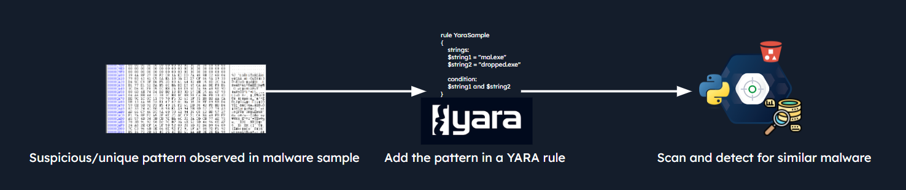
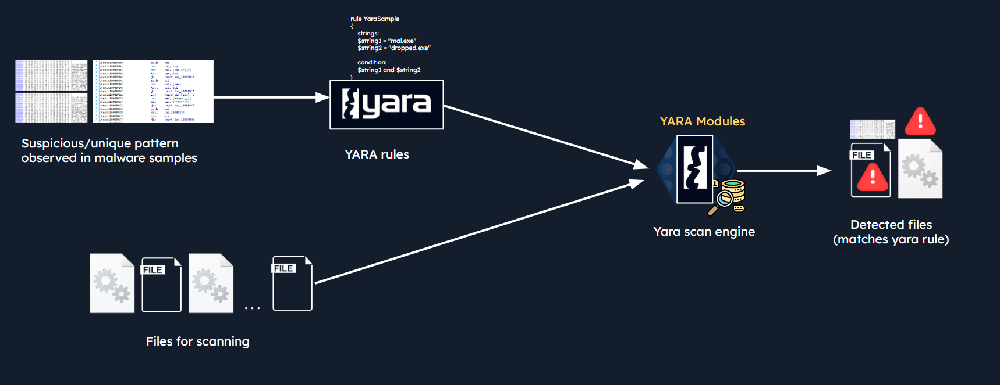

# YARA and YARA Rules (YARA và rule YARA)

`YARA` là một công cụ so khớp mẫu (pattern-matching) mạnh mẽ đồng thời là một định dạng rule, dùng để nhận diện và phân loại file dựa trên các mẫu, đặc điểm hoặc nội dung cụ thể. SOC analyst thường dùng rule YARA để phát hiện và phân loại mẫu malware, file đáng ngờ hoặc các indicator of compromise (IOC).

Rule YARA thường được viết theo một cú pháp rule định nghĩa các điều kiện và mẫu cần khớp bên trong file. Các rule này có thể chứa nhiều thành phần khác nhau như chuỗi (string), biểu thức chính quy (regular expression) và toán tử logic Boolean, giúp analyst tạo ra các detection rule phức tạp và chính xác. Cần lưu ý rằng rule YARA có thể nhận diện cả mẫu dạng văn bản lẫn dạng nhị phân, và cũng có thể áp dụng cho các hoạt động memory forensics (điều tra số trên bộ nhớ).

Khi được áp dụng, YARA quét các file hoặc thư mục và so khớp chúng với các rule đã định nghĩa. Nếu một file khớp với một mẫu hoặc điều kiện cụ thể, nó có thể kích hoạt alert hoặc cần được xem xét kỹ hơn như một mối đe doạ bảo mật tiềm ẩn.



Rule YARA đặc biệt hữu ích cho SOC analyst khi phân tích mẫu malware, tiến hành điều tra forensic hoặc thực hiện threat hunting. Sự linh hoạt và khả năng mở rộng của YARA khiến nó trở thành một công cụ giá trị trong cộng đồng an ninh mạng.

## Các ứng dụng của Yara

- **`Malware Detection and Classification`**: YARA thường được dùng để phát hiện và nhận diện mẫu malware dựa trên các mẫu, đặc điểm hoặc indicator cụ thể. Có thể tạo rule YARA để so khớp với signature, hành vi hoặc thuộc tính file của malware đã biết, giúp nhận diện file độc hại và có thể ngăn chặn việc bị xâm nhập sâu hơn. Trong phạm vi digital forensics (điều tra số), YARA cũng có thể nhận diện các mẫu đáng ngờ hoặc độc hại trong các memory image đã thu thập.
- **`File Analysis and Classification`**: YARA rất có giá trị trong việc phân tích và phân loại file dựa trên các mẫu hoặc thuộc tính cụ thể. Analyst có thể tạo rule YARA để phân loại file theo định dạng hoặc kiểu file, phiên bản, metadata, packer hoặc các đặc điểm khác. Khả năng này hữu ích trong phân tích forensic, nghiên cứu malware, hoặc xác định các loại file cụ thể trong những tập dữ liệu lớn.
- **`Indicator of Compromise (IOC) Detection`**: YARA có thể được dùng để tìm kiếm các indicator of compromise (IOC) cụ thể bên trong file hoặc thư mục. Bằng cách định nghĩa rule YARA nhắm vào các mẫu IOC cụ thể như tên file, registry key hoặc artifact mạng, đội bảo mật có thể nhận diện các vụ xâm phạm tiềm ẩn hoặc các cuộc tấn công đang diễn ra.
- **`Community-driven Rule Sharing`**: Với YARA, ta có thể tận dụng một cộng đồng thường xuyên đóng góp và chia sẻ detection rule. Điều này giúp ta liên tục cập nhật và tinh chỉnh các cơ chế phát hiện của mình.
- **`Create Custom Security Solutions`**: Bằng cách kết hợp rule YARA với các kỹ thuật khác như phân tích tĩnh (static analysis) và động (dynamic analysis), sandboxing và giám sát hành vi, ta có thể xây dựng các giải pháp bảo mật hiệu quả.
- **`Custom Yara Signatures/Rules`**: YARA cho phép ta tạo các rule tuỳ biến phù hợp với nhu cầu và môi trường riêng của tổ chức. Bằng cách triển khai các rule tuỳ biến này trong hạ tầng bảo mật, chẳng hạn các giải pháp antivirus hoặc endpoint detection and response (EDR), ta có thể nâng cao năng lực phòng thủ. Rule YARA tuỳ biến có thể giúp nhận diện những mối đe doạ đặc thù hoặc có chủ đích nhắm vào tài sản, ứng dụng hoặc ngành nghề riêng của tổ chức.
- **`Incident Response`**: YARA hỗ trợ ứng phó sự cố bằng cách cho phép analyst nhanh chóng tìm kiếm và phân tích file hoặc memory image để tìm các mẫu hoặc indicator cụ thể. Bằng cách áp dụng rule YARA trong quá trình điều tra, analyst có thể xác định các artifact liên quan, xác định phạm vi sự cố và thu thập thông tin quan trọng phục vụ công tác khắc phục (remediation).
- **`Proactive Threat Hunting`**: Thay vì chờ alert, ta có thể tận dụng YARA để chủ động tìm kiếm trên khắp các môi trường của mình, săn lùng các mối đe doạ tiềm ẩn hoặc tàn dư của các lần lây nhiễm trước đây.

## YARA hoạt động như thế nào?

Tóm lại, YARA scan engine, được trang bị các YARA module, quét một tập file bằng cách so sánh nội dung của chúng với các mẫu được định nghĩa trong một tập rule. Khi một file khớp với các mẫu và điều kiện được chỉ định trong một rule YARA, file đó được coi là file bị phát hiện (detected). Quy trình này giúp analyst nhận diện hiệu quả những file thể hiện hành vi hoặc đặc điểm cụ thể, hỗ trợ phát hiện malware, nhận diện IOC và threat hunting. Luồng xử lý này được minh hoạ trong sơ đồ dưới đây.



Trong sơ đồ trên, ta thấy YARA scan engine, sử dụng các YARA module, so khớp các mẫu được định nghĩa trong một tập rule với một tập file, từ đó phát hiện ra những file thoả mãn các mẫu và điều kiện đã chỉ định. Đây là cách rule YARA giúp nhận diện mối đe doạ. Hãy tìm hiểu chi tiết hơn.

- **`Set of Rules (containing suspicious patterns)`**: Trước hết, ta có một hoặc nhiều rule YARA do security analyst tạo ra. Các rule này định nghĩa các mẫu, đặc điểm hoặc indicator cụ thể cần được so khớp bên trong file. Rule có thể chứa string, regular expression, chuỗi byte và các indicator đáng quan tâm khác. Rule thường được lưu ở định dạng file rule YARA (vd: file `.yara` hoặc `.yar`) để dễ quản lý và tái sử dụng.
- **`Set of Files (for scanning)`**: Một tập file, chẳng hạn file thực thi, tài liệu hoặc các file nhị phân hay văn bản khác, được đưa vào làm đầu vào cho YARA scan engine. Các file có thể nằm trên ổ đĩa cục bộ, trong một thư mục, hoặc thậm chí bên trong memory image hay bản bắt lưu lượng mạng (network traffic capture).
- **`YARA Scan Engine`**: YARA scan engine là thành phần cốt lõi, chịu trách nhiệm thực hiện việc quét và so khớp file với các rule YARA đã định nghĩa. Nó sử dụng các YARA module — tập hợp các thuật toán và kỹ thuật — để so sánh hiệu quả nội dung file với các mẫu được chỉ định trong rule.
- **`Scanning and Matching`**: YARA scan engine lần lượt duyệt qua từng file trong tập, mỗi lần một file. Với mỗi file, nó phân tích nội dung từng byte một, tìm các kết quả khớp với mẫu được định nghĩa trong rule YARA. YARA scan engine dùng nhiều kỹ thuật so khớp khác nhau, bao gồm so khớp chuỗi (string matching), regular expression và so khớp nhị phân (binary matching), để nhận diện các mẫu và indicator bên trong file.
- **`Detection of Files`**: Khi một file khớp với các mẫu và điều kiện được chỉ định trong một rule YARA, file đó được coi là file bị phát hiện. YARA scan engine ghi lại thông tin về kết quả khớp, như rule đã khớp, đường dẫn file và offset trong file nơi xảy ra khớp, đồng thời đưa ra output thể hiện việc phát hiện; output này có thể được xử lý tiếp, ghi log hoặc dùng cho các hành động tiếp theo.

## Cấu trúc rule YARA

Hãy đi sâu vào cấu trúc của một rule YARA. Rule YARA gồm nhiều thành phần định nghĩa các điều kiện và mẫu cần so khớp bên trong file. Một ví dụ về rule YARA như sau:

```yara
rule my_rule {

    meta:
        author = "Author Name"
        description = "example rule"
        hash = ""
    
    strings: 
        $string1 = "test"
        $string2 = "rule"
        $string3 = "htb"

    condition: 
        all of them
} 
```

Mỗi rule trong YARA bắt đầu bằng từ khoá `rule`, theo sau là một `rule identifier` (định danh rule). Rule identifier phân biệt chữ hoa chữ thường, ký tự đầu tiên không được là chữ số, và không được dài quá 128 ký tự.

Các từ khoá sau đây là từ khoá dành riêng (reserved) và không được dùng làm identifier:


Bây giờ, hãy cùng xem qua cấu trúc rule YARA bằng ví dụ một rule nhận diện các chuỗi liên quan tới ransomware [WannaCry](https://www.mandiant.com/resources/blog/wannacry-malware-profile). Rule dưới đây chỉ thị cho YARA gắn cờ mọi file chứa đủ cả ba chuỗi được chỉ định là `Ransomware_WannaCry`.

```yara
rule Ransomware_WannaCry {

    meta:
        author = "Madhukar Raina"
        version = "1.0"
        description = "Simple rule to detect strings from WannaCry ransomware"
        reference = "https://www.virustotal.com/gui/file/ed01ebfbc9eb5bbea545af4d01bf5f1071661840480439c6e5babe8e080e41aa/behavior" 
    
    strings:
        $wannacry_payload_str1 = "tasksche.exe" fullword ascii
        $wannacry_payload_str2 = "www.iuqerfsodp9ifjaposdfjhgosurijfaewrwergwea.com" ascii
        $wannacry_payload_str3 = "mssecsvc.exe" fullword ascii
    
    condition:
        all of them
}
```

Đó là cấu trúc cơ bản của một rule YARA. Nó bắt đầu bằng một `header` chứa `metadata`, tiếp theo là các `conditions` định nghĩa ngữ cảnh của những file cần khớp, và một `body` chỉ định các mẫu hoặc indicator cần tìm. Việc dùng metadata và `tags` giúp tổ chức và ghi chú tài liệu cho các rule một cách hiệu quả.

**Phân tích chi tiết rule YARA**:

1. **`Rule Header`**: Rule header cung cấp metadata và định danh cho rule. Nó thường bao gồm:
	- `Rule name`: Một cái tên mô tả cho rule.
    - `Rule tags`: Các tag hoặc nhãn tuỳ chọn để phân loại rule.
    - `Rule metadata`: Thông tin bổ sung như tác giả, mô tả và ngày tạo.

	**Ví dụ**:

	```yara
	rule Ransomware_WannaCry {
	    meta:
  	  ...
	}    
	```
	
2. **`Rule Meta`**: Phần rule meta cho phép định nghĩa thêm metadata cho rule. Metadata này có thể gồm thông tin về tác giả của rule, tài liệu tham khảo, phiên bản, v.v.

	**Ví dụ**:

	```yara
	rule Ransomware_WannaCry {
	    meta:
	        author = "Madhukar Raina"
	        version = "1.0"
	        description = "Simple rule to detect strings from WannaCry ransomware"
	        reference = 	"https://www.virustotal.com/gui/file/ed01ebfbc9eb5bbea545af4d01bf5f1071661840480439c6e5babe8e080e41aa/behavior" 
	    ...
	}
	```

3. **`Rule Body`**: Rule body chứa các mẫu hoặc indicator cần so khớp bên trong file. Đây là nơi logic phát hiện thực sự được định nghĩa.

	**Ví dụ**:

	```yara
	rule Ransomware_WannaCry {
    
	    ...    
    
	    strings:
	        $wannacry_payload_str1 = "tasksche.exe" fullword ascii
	        $wannacry_payload_str2 = "www.iuqerfsodp9ifjaposdfjhgosurijfaewrwergwea.com" ascii
	        $wannacry_payload_str3 = "mssecsvc.exe" fullword ascii
    
	    ...

	}
	```

4. **`Rule Conditions`**: Rule condition định nghĩa ngữ cảnh hoặc đặc điểm của những file cần khớp. Condition có thể dựa trên thuộc tính file, string hoặc các indicator khác. Condition được chỉ định bên trong phần condition.

	**Ví dụ**:

	```yara
	rule Ransomware_WannaCry {
	    ...
    
	    condition:
	        all of them
	}
	```

	Trong rule YARA này, phần condition chỉ ghi đơn giản `all of them`, nghĩa là tất cả các string được định nghĩa trong rule đều phải xuất hiện thì rule mới kích hoạt kết quả khớp.

	Hãy xem thêm một ví dụ nữa về condition, chỉ định rằng kích thước của file được phân tích phải nhỏ hơn `100` kilobyte (KB).

	```yara
	    condition:
	        filesize < 100KB and (uint16(0) == 0x5A4D or uint16(0) == 0x4D5A)
	```

	Condition này cũng chỉ định rằng 2 byte đầu tiên của file phải là `0x5A4D` (ASCII `MZ`) hoặc `0x4D5A` (ASCII `ZM`), bằng cách dùng `uint16(0)`:

	```yara
	uint16(offset)
	```
	Đây là cách `uint16(0)` hoạt động:
	- `uint16`: Cho biết kiểu dữ liệu cần trích xuất, là một số nguyên không dấu `16`-bit (`2` byte).
	- `(0)`: Giá trị bên trong dấu ngoặc đơn là offset nơi bắt đầu trích xuất. Ở đây, `0` nghĩa là hàm sẽ trích xuất giá trị 16-bit bắt đầu từ đầu dữ liệu đang được quét. Condition dùng uint16(0) để so sánh 2 byte đầu tiên của file với các giá trị cụ thể.

---

Cần lưu ý rằng YARA cung cấp một cú pháp linh hoạt và có thể mở rộng, cho phép dùng các tính năng và kỹ thuật nâng cao hơn như modifier, toán tử logic và module bên ngoài (external module). Những tính năng này có thể tăng khả năng diễn đạt và hiệu quả của rule YARA cho từng kịch bản phát hiện cụ thể.

Hãy nhớ rằng rule YARA có thể được tuỳ biến cho phù hợp với các use case và nhu cầu phát hiện cụ thể của ta. Thường xuyên thực hành và thử nghiệm sẽ giúp ta hiểu sâu hơn và thành thạo hơn trong việc viết rule YARA. [YARA documentation](https://yara.readthedocs.io/en/latest/) có thêm nhiều chi tiết chuyên sâu.
