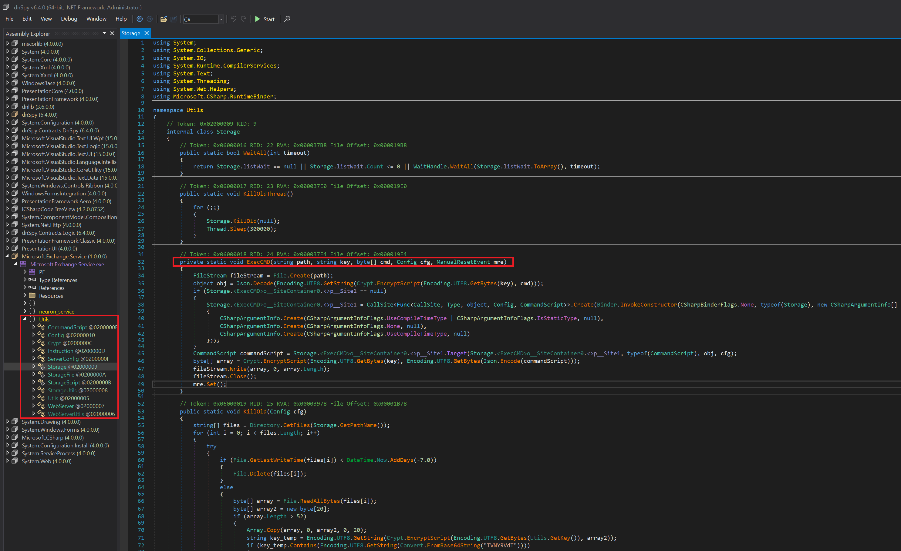

# Developing YARA Rules (Phát triển rule YARA)

Trong section này, ta sẽ tìm hiểu cách phát triển rule YARA thủ công và tự động.

<div class="card bg-light">
    <div class="card-body">
				 <p class="mb-0">Giờ hãy kéo xuống cuối section này và bấm vào "Click here to spawn the target system!". Sau đó, SSH vào Target IP bằng thông tin đăng nhập được cung cấp. Phần lớn các thao tác/lệnh được trình bày từ đây đến hết section này đều có thể thực hiện lại bên trong target, giúp ta nắm các chủ đề được trình bày một cách toàn diện hơn. </p>
    </div>
</div>

Hãy cùng bước vào thế giới rule YARA, lấy ví dụ minh hoạ là một sample tên `svchost.exe` nằm trong thư mục `/home/htb-student/Samples/YARASigma` trên target của section này. Ta muốn hiểu quy trình đằng sau việc xây dựng một rule YARA, vậy hãy bắt tay vào làm.

Trước tiên, ta cần phân tích chuỗi (string analysis) trên sample malware của mình.

```shell-session
[!bash!]$ strings svchost.exe
!This program cannot be run in DOS mode.
UPX0
UPX1
UPX2
3.96
UPX!
8MZu
HcP<H
<1~o
VDgxt
D$ /
OAUATUWVSH
15384
[^_]A\A]
^$<V
---SNIP---
X]_^[H
QRAPH
(AXZY
KERNEL32.DLL
msvcrt.dll
ExitProcess
GetProcAddress
LoadLibraryA
VirtualProtect
exit
```

Ngay từ vài chuỗi đầu tiên, có thể thấy rõ file đã được pack bằng packer UPX (Ultimate Packer for eXecutables). Từ phát hiện này, ta có thể dùng các chuỗi liên quan đến UPX để xây dựng một rule YARA cơ bản nhắm vào các sample được pack bằng UPX.

```yara
rule UPX_packed_executable
{
    meta:
    description = "Detects UPX-packed executables"

    strings: 
    $string_1 = "UPX0"
    $string_2 = "UPX1"
    $string_3 = "UPX2"

    condition:
    all of them
}
```
Dưới đây là phân tích ngắn gọn về rule YARA ta vừa viết để phát hiện các file thực thi bị pack bằng UPX:
- `Rule Name`: `UPX_packed_executable`
- `Meta Description`: Mô tả rule, cho biết rule này phát hiện các file thực thi bị pack bằng UPX.
- `Strings Section`: `strings` định nghĩa các chuỗi mà rule sẽ tìm kiếm trong file.
    - `$string_1` = "UPX0": Khớp với chuỗi `UPX0` trong file.
    - `$string_2` = "UPX1": Khớp với chuỗi `UPX1` trong file.
    - `$string_3` = "UPX2": Khớp với chuỗi `UPX2` trong file.
- `Condition`: `condition` chỉ định các tiêu chí phải được thoả mãn để rule kích hoạt một match (khớp).
	- `all of them`: Chỉ định rằng tất cả các chuỗi đã định nghĩa (`$string_1`, `$string_2` và `$string_3`) đều phải được tìm thấy trong file.

Về bản chất, rule `UPX_packed_executable` (nằm trên target của section này tại `/home/htb-student/Rules/yara/upx_packed.yar`) quét tìm các chuỗi `UPX0`, `UPX1` và `UPX2` bên trong một file. Nếu rule tìm thấy cả ba chuỗi, nó sẽ đưa ra alert, gợi ý rằng file có thể đã được pack bằng packer UPX. Rule này là công cụ tiện lợi khi ta cần tìm các file thực thi đã bị nén hoặc obfuscate bằng phương pháp UPX.

## Phát triển rule YARA bằng yarGen

Hãy tiếp tục khám phá thế giới rule YARA với một sample tên `dharma_sample.exe` nằm trong thư mục `/home/htb-student/Samples/YARASigma` trên target của section này.

Một lần nữa, ta cần phân tích chuỗi trên sample malware của mình.

```shell-session
[!bash!]$ strings dharma_sample.exe
!This program cannot be run in DOS mode.
Rich
.text
`.rdata
@.data
9A s
---SNIP---
~?h@
~?hP
hz-A
u       jd
@@@@@@@@@@@@@@@@@@@@@@@@@@@@@@@@@@@@@@@@@@@>@@@?456789:;<=@@@@@@@
@@@@@@
 !"#$%&'()*+,-./0123@@@@@@@@@@@@@@@@@@@@@@@@@@@@@@@@@@@@@@@@@@@@@@@@@@@@@@@@@@@@@@@@@@@@@@@@@@@@@@@@@@@@@@@@@@@@@@@@@@@@@@@@@@@@@@@@@@@@@@@@@@@@@@@@@@@@@ABCDEFGHIJKLMNOPQRSTUVWXYZabcdefghijklmnopqrstuvwxyz0123456789+/
---SNIP---
GetProcAddress
LoadLibraryA
WaitForSingleObject
InitializeCriticalSectionAndSpinCount
LeaveCriticalSection
GetLastError
EnterCriticalSection
ReleaseMutex
CloseHandle
KERNEL32.dll
RSDS%~m
C:\crysis\Release\PDB\payload.pdb
---SNIP---
```

Sau khi chạy lệnh `strings` trên `dharma_sample.exe`, ta thấy `C:\crysis\Release\PDB\payload.pdb` — một chuỗi khá đặc trưng (unique). Kết hợp với các chuỗi đặc trưng khác, ta có thể viết một rule YARA tinh chỉnh hơn. Hãy dùng `yarGen` để đẩy nhanh quá trình này.

[yarGen](https://github.com/Neo23x0/yarGen) là công cụ quen thuộc của ta khi cần một trình tạo rule YARA tự động. Điểm quý giá của nó là khả năng sinh ra hàng loạt rule YARA dựa trên các chuỗi tìm thấy trong file độc hại, đồng thời né các chuỗi thường gặp trong phần mềm lành tính. Điều này khả thi vì yarGen đi kèm một cơ sở dữ liệu khổng lồ gồm các chuỗi và opcode của goodware (phần mềm hợp lệ). Trước khi bắt đầu, ta cần giải nén các file ZIP chứa những cơ sở dữ liệu này.

Cách cài đặt và chạy yarGen như sau:
- Tải bản release mới nhất từ mục `release`
- Cài đặt mọi dependency bằng `pip install -r requirements.txt`
- Chạy `python yarGen.py --update` để tự động tải các cơ sở dữ liệu tích hợp sẵn. Chúng sẽ được lưu vào thư mục con './dbs' (Dung lượng tải: `913 MB`).
- Xem phần help bằng `python yarGen.py --help` để biết thêm thông tin về các tham số dòng lệnh.

**Lưu ý**: yarGen nằm trong thư mục `/home/htb-student/yarGen-0.23.4` trên target của section này.

Hãy đặt sample vào một thư mục `temp` (trên target của section này đã có sẵn một thư mục như vậy tại `/home/htb-student/temp`) và chỉ định đường dẫn bằng các tham số dòng lệnh sau.

```shell-session
[!bash!]$ python3 yarGen.py -m /home/htb-student/temp -o htb_sample.yar

------------------------------------------------------------------------
                   _____
    __ _____ _____/ ___/__ ___
   / // / _ `/ __/ (_ / -_) _ \
   \_, /\_,_/_/  \___/\__/_//_/
  /___/  Yara Rule Generator
         Florian Roth, July 2020, Version 0.23.3

  Note: Rules have to be post-processed
  See this post for details: https://medium.com/@cyb3rops/121d29322282
------------------------------------------------------------------------
[+] Using identifier 'temp'
[+] Using reference 'https://github.com/Neo23x0/yarGen'
[+] Using prefix 'temp'
[+] Processing PEStudio strings ...
[+] Reading goodware strings from database 'good-strings.db' ...
    (This could take some time and uses several Gigabytes of RAM depending on your db size)
[+] Loading ./dbs/good-imphashes-part3.db ...
[+] Total: 4029 / Added 4029 entries
[+] Loading ./dbs/good-strings-part9.db ...
[+] Total: 788 / Added 788 entries
[+] Loading ./dbs/good-strings-part8.db ...
[+] Total: 332082 / Added 331294 entries
[+] Loading ./dbs/good-imphashes-part4.db ...
[+] Total: 6426 / Added 2397 entries
[+] Loading ./dbs/good-strings-part2.db ...
[+] Total: 1703601 / Added 1371519 entries
[+] Loading ./dbs/good-exports-part2.db ...
[+] Total: 90960 / Added 90960 entries
[+] Loading ./dbs/good-strings-part4.db ...
[+] Total: 3860655 / Added 2157054 entries
[+] Loading ./dbs/good-exports-part4.db ...
[+] Total: 172718 / Added 81758 entries
[+] Loading ./dbs/good-exports-part7.db ...
[+] Total: 223584 / Added 50866 entries
[+] Loading ./dbs/good-strings-part6.db ...
[+] Total: 4571266 / Added 710611 entries
[+] Loading ./dbs/good-strings-part7.db ...
[+] Total: 5828908 / Added 1257642 entries
[+] Loading ./dbs/good-exports-part1.db ...
[+] Total: 293752 / Added 70168 entries
[+] Loading ./dbs/good-exports-part3.db ...
[+] Total: 326867 / Added 33115 entries
[+] Loading ./dbs/good-imphashes-part9.db ...
[+] Total: 6426 / Added 0 entries
[+] Loading ./dbs/good-exports-part9.db ...
[+] Total: 326867 / Added 0 entries
[+] Loading ./dbs/good-imphashes-part5.db ...
[+] Total: 13764 / Added 7338 entries
[+] Loading ./dbs/good-imphashes-part8.db ...
[+] Total: 13947 / Added 183 entries
[+] Loading ./dbs/good-imphashes-part6.db ...
[+] Total: 13976 / Added 29 entries
[+] Loading ./dbs/good-strings-part1.db ...
[+] Total: 6893854 / Added 1064946 entries
[+] Loading ./dbs/good-imphashes-part7.db ...
[+] Total: 17382 / Added 3406 entries
[+] Loading ./dbs/good-exports-part6.db ...
[+] Total: 328525 / Added 1658 entries
[+] Loading ./dbs/good-imphashes-part2.db ...
[+] Total: 18208 / Added 826 entries
[+] Loading ./dbs/good-exports-part8.db ...
[+] Total: 332359 / Added 3834 entries
[+] Loading ./dbs/good-strings-part3.db ...
[+] Total: 9152616 / Added 2258762 entries
[+] Loading ./dbs/good-strings-part5.db ...
[+] Total: 12284943 / Added 3132327 entries
[+] Loading ./dbs/good-imphashes-part1.db ...
[+] Total: 19764 / Added 1556 entries
[+] Loading ./dbs/good-exports-part5.db ...
[+] Total: 404321 / Added 71962 entries
[+] Processing malware files ...
[+] Processing /home/htb-student/temp/dharma_sample.exe ...
[+] Generating statistical data ...
[+] Generating Super Rules ... (a lot of magic)
[+] Generating Simple Rules ...
[-] Applying intelligent filters to string findings ...
[-] Filtering string set for /home/htb-student/temp/dharma_sample.exe ...
[=] Generated 1 SIMPLE rules.
[=] All rules written to htb_sample.yar
[+] yarGen run finished
```

**Phân tích lệnh**:

- `yarGen.py`: Đây là tên script Python của yarGen sẽ được thực thi.
- `-m /home/htb-student/temp`: Tuỳ chọn này chỉ định thư mục nguồn chứa các file sample (vd: malware hoặc file đáng ngờ). Script sẽ phân tích các sample này để sinh ra rule YARA.
- `-o htb_sample.yar`: Tuỳ chọn này chỉ định tên file output cho các rule YARA được sinh ra. Trong trường hợp này, rule YARA sẽ được lưu vào file tên `htb_sample.yar`.

Các rule YARA thu được sẽ được ghi vào file `htb_sample.yar` trong thư mục `/home/htb-student/yarGen-0.23.4` trên target của section này. Hãy xem nội dung của rule vừa được sinh ra.

```shell-session
[!bash!]$ cat htb_sample.yar
/*
   YARA Rule Set
   Author: yarGen Rule Generator
   Date: 2023-08-24
   Identifier: temp
   Reference: https://github.com/Neo23x0/yarGen
*/

/* Rule Set ----------------------------------------------------------------- */

rule dharma_sample {
   meta:
      description = "temp - file dharma_sample.exe"
      author = "yarGen Rule Generator"
      reference = "https://github.com/Neo23x0/yarGen"
      date = "2023-08-24"
      hash1 = "bff6a1000a86f8edf3673d576786ec75b80bed0c458a8ca0bd52d12b74099071"
   strings:
      $x1 = "C:\\crysis\\Release\\PDB\\payload.pdb" fullword ascii
      $s2 = "sssssbs" fullword ascii
      $s3 = "sssssbsss" fullword ascii
      $s4 = "RSDS%~m" fullword ascii
      $s5 = "{RDqP^\\" fullword ascii
      $s6 = "QtVN$0w" fullword ascii
      $s7 = "Ffsc<{" fullword ascii
      $s8 = "^N3Y.H_K" fullword ascii
      $s9 = "tb#w\\6" fullword ascii
      $s10 = "-j6EPUc" fullword ascii
      $s11 = "8QS#5@3" fullword ascii
      $s12 = "h1+LI;d8" fullword ascii
      $s13 = "H;B cl" fullword ascii
      $s14 = "Wy]z@p]E" fullword ascii
      $s15 = "ipgypA" fullword ascii
      $s16 = "+>^wI{H" fullword ascii
      $s17 = "mF@S/]" fullword ascii
      $s18 = "OA_<8X-|" fullword ascii
      $s19 = "s+aL%M" fullword ascii
      $s20 = "sXtY9P" fullword ascii
   condition:
      uint16(0) == 0x5a4d and filesize < 300KB and
      1 of ($x*) and 4 of them
}
```

Giờ là lúc kiểm chứng. Ta sẽ chạy YARA với rule vừa tạo để xem nó có "đánh hơi" ra match nào không khi quét kho sample malware tại `home/htb-student/Samples/YARASigma` trên target của section này.

```shell-session
[!bash!]$ yara htb_sample.yar /home/htb-student/Samples/YARASigma 
dharma_sample /home/htb-student/Samples/YARASigma/dharma_sample.exe
dharma_sample /home/htb-student/Samples/YARASigma/pdf_reader.exe
dharma_sample /home/htb-student/Samples/YARASigma/microsoft.com
dharma_sample /home/htb-student/Samples/YARASigma/check_updates.exe
dharma_sample /home/htb-student/Samples/YARASigma/KB5027505.exe
```

Như ta thấy, các file `pdf_reader.exe`, `microsoft.com`, `check_updates.exe` và `KB5027505.exe` đều bị rule này phát hiện (tất nhiên là ngoài `dharma_sample.exe`).

## Phát triển rule YARA thủ công

#### Ví dụ 1: ZoxPNG RAT được APT17 sử dụng

Giờ hãy đi sâu hơn một chút...

Ta muốn phát triển một rule YARA để quét tìm một biến thể cụ thể của RAT `ZoxPNG` được `APT17` sử dụng, dựa trên:
- Một sample tên `legit.exe` nằm trong thư mục `/home/htb-student/Samples/YARASigma` trên target của section này
- Một [bài viết của Intezer](https://intezer.com/blog/research/evidence-aurora-operation-still-active-part-2-more-ties-uncovered-between-ccleaner-hack-chinese-hackers-2/)
- Phân tích chuỗi
- Imphash
- Kích thước file phổ biến của các sample

Hãy bắt đầu với bước phân tích chuỗi như sau.

```shell-session
[!bash!]$ strings legit.exe
!This program cannot be run in DOS mode.
Rich
.text
`.rdata
@.data
---SNIP---
ABCDEFGHIJKLMNOPQRSTUVWXYZabcdefghijklmnopqrstuvwxyz0123456789+/
 deflate 1.1.4 Copyright 1995-2002 Jean-loup Gailly

 inflate 1.1.4 Copyright 1995-2002 Mark Adler
Sleep
LocalAlloc
CloseHandle
GetLastError
VirtualFree
VirtualAlloc
GetProcAddress
LoadLibraryA
GetCurrentProcessId
GlobalMemoryStatusEx
GetCurrentProcess
GetACP
GetVersionExA
GetComputerNameA
GetTickCount
GetSystemTime
LocalFree
CreateProcessA
CreatePipe
TerminateProcess
ReadFile
PeekNamedPipe
WriteFile
SetFilePointer
CreateFileA
GetFileSize
GetDiskFreeSpaceExA
GetDriveTypeA
GetLogicalDriveStringsA
CreateDirectoryA
FindClose
FindNextFileA
FindFirstFileA
MoveFileExA
OpenProcess
KERNEL32.dll
LookupAccountSidA
ADVAPI32.dll
SHFileOperationA
SHELL32.dll
strcpy
rand
sprintf
memcpy
strncpy
srand
_snprintf
atoi
strcat
strlen
printf
memset
strchr
memcmp
MSVCRT.dll
_exit
_XcptFilter
exit
__p___initenv
__getmainargs
_initterm
__setusermatherr
_adjust_fdiv
__p__commode
__p__fmode
__set_app_type
_except_handler3
_controlfp
InternetCrackUrlA
InternetCloseHandle
InternetReadFile
HttpQueryInfoA
HttpSendRequestA
InternetSetOptionA
HttpAddRequestHeadersA
HttpOpenRequestA
InternetConnectA
InternetOpenA
WININET.dll
ObtainUserAgentString
urlmon.dll
WTSFreeMemory
WTSEnumerateProcessesA
WTSAPI32.dll
GetModuleFileNameExA
PSAPI.DLL
calloc
free
http://%s/imgres?q=A380&hl=en-US&sa=X&biw=1440&bih=809&tbm=isus&tbnid=aLW4-J8Q1lmYBM:&imgrefurl=http://%s&docid=1bi0Ti1ZVr4bEM&imgurl=http://%s/%04d-%02d/%04d%02d%02d%02d%02d%02d.png&w=800&h=600&ei=CnJcUcSBL4rFkQX444HYCw&zoom=1&ved=1t:3588,r:1,s:0,i:92&iact=rc&dur=368&page=1&tbnh=184&tbnw=259&start=0&ndsp=20&tx=114&ty=58
http://0.0.0.0/1
http://0.0.0.0/2
Mozilla/4.0 (compatible; MSIE 8.0; Windows NT 6.1; WOW64; Trident/4.0; SLCC2; .NETCLR 2.0.50727)
image/pjpeg
image/jpeg
image/x-xbitmap
image/gif
Content-Type: application/x-www-form-urlencoded
B64:[%s]
Step 11
Step 10
Step 9
Step 8
Step 7
Step 6
Content-Type: image/x-png
Step 5
Step 4
Connection: close
Accept-Encoding: gzip, deflate
Accept-Language: en-US
Pragma: no-cache
User-Agent:
Cookie: SESSIONID=%s
Step 3
HTTP/1.1
Step 2
POST
Step 1
Get URL Info Error
[IISEND=0x%08X][Recv:] 0x%08X %s
IISCMD Error:%d
hWritePipe2 Error:%d
kernel32.dll
QueryFullProcessImageName
Not Support This Function!
1.1.4
need dictionary
incorrect data check
incorrect header check
invalid window size
unknown compression method
incompatible version
buffer error
insufficient memory
data error
stream error
file error
stream end
invalid bit length repeat
too many length or distance symbols
invalid stored block lengths
invalid block type
invalid distance code
invalid literal/length code
incomplete dynamic bit lengths tree
oversubscribed dynamic bit lengths tree
incomplete literal/length tree
oversubscribed literal/length tree
empty distance tree with lengths
incomplete distance tree
oversubscribed distance tree
Z0X03
>0!0
Western Cape1
Durbanville1
Thawte1
Thawte Certification1
Thawte Timestamping CA0
121221000000Z
201230235959Z0^1
Symantec Corporation100.
'Symantec Time Stamping Services CA - G20
"W*o
]jxdE
`F~T
&0$0"
http://ocsp.thawte.com0
80604
.http://crl.thawte.com/ThawteTimestampingCA.crl0
TimeStamp-2048-10
y@b%
thawte, Inc.1(0&
Certification Services Division1806
/(c) 2006 thawte, Inc. - For authorized use only1
thawte Primary Root CA0
061117000000Z
360716235959Z0
thawte, Inc.1(0&
Certification Services Division1806
/(c) 2006 thawte, Inc. - For authorized use only1
thawte Primary Root CA0
l[HhIY7
tf/j8
S}+
>n)i
B0@0
WHP0
Thawte, Inc.1$0"
Thawte Code Signing CA - G20
110622000000Z
130721235959Z0
Seoul1
Seongdong-gu1
        4NB Corp.1"0
tigation Development Team1
        4NB Corp.0
LO'%
oWx6
IB-8l3
40200
*http://cs-g2-crl.thawte.com/ThawteCSG2.crl0
&0$0"
http://ocsp.thawte.com0
}1JBAe
^b/1
a{b2
Ti,[\{
thawte, Inc.1(0&
Certification Services Division1806
/(c) 2006 thawte, Inc. - For authorized use only1
thawte Primary Root CA0
100208000000Z
200207235959Z0J1
Thawte, Inc.1$0"
Thawte Code Signing CA - G20
,p&7E
rqD=X
n8}v
-0+0)
#http://crl.thawte.com/ThawtePCA.crl0
&0$0"
http://ocsp.thawte.com0
VeriSignMPKI-2-100
---SNIP---
Symantec Corporation100.
'Symantec Time Stamping Services CA - G20
121018000000Z
201229235959Z0b1
Symantec Corporation1402
+Symantec Time Stamping Services Signer - G40
2oNW
a;EQ
g0e0*
http://ts-ocsp.ws.symantec.com07
+http://ts-aia.ws.symantec.com/tss-ca-g2.cer0<
50301
+http://ts-crl.ws.symantec.com/tss-ca-g2.crl0(
TimeStamp-2048-20
---SNIP---
Thawte, Inc.1$0"
Thawte Code Signing CA - G2
1(0&
www.4nb.co.kr 0
#Ak_
$>X[hL
0r0^1
Symantec Corporation100.
'Symantec Time Stamping Services CA - G2
130529085845Z0#
*PU19
mOLT
}Jdf6
K%&J
(E~Q
Eev7aSp
```

Tiếp theo, hãy dùng các hash được nêu trong bài viết của Intezer để xác định kích thước phổ biến của các sample. Có vẻ như không có sample liên quan nào có kích thước lớn hơn 200KB. Một ví dụ về sample đã được xác định như sau. [https://www.hybrid-analysis.com/sample/ee362a8161bd442073775363bf5fa1305abac2ce39b903d63df0d7121ba60550](https://www.hybrid-analysis.com/sample/ee362a8161bd442073775363bf5fa1305abac2ce39b903d63df0d7121ba60550).

Cuối cùng, Imphash của sample có thể được tính như sau, bằng script `imphash_calc.py` nằm trong thư mục `/home/htb-student` trên target của section này.

```shell-session
[!bash!]$ python3 imphash_calc.py /home/htb-student/Samples/YARASigma/legit.exe
414bbd566b700ea021cfae3ad8f4d9b9
```

Một rule YARA tốt để phát hiện biến thể ZoxPNG nói trên nằm trong thư mục `/home/htb-student/Rules/yara` trên target của section này, được lưu với tên `apt_apt17_mal_sep17_2.yar`.

```yara
/*
   Yara Rule Set
   Author: Florian Roth
   Date: 2017-10-03
   Identifier: APT17 Oct 10
   Reference: https://goo.gl/puVc9q
*/

/* Rule Set ----------------------------------------------------------------- */

import "pe"

rule APT17_Malware_Oct17_Gen {
   meta:
      description = "Detects APT17 malware"
      license = "Detection Rule License 1.1 https://github.com/Neo23x0/signature-base/blob/master/LICENSE"
      author = "Florian Roth (Nextron Systems)"
      reference = "https://goo.gl/puVc9q"
      date = "2017-10-03"
      hash1 = "0375b4216334c85a4b29441a3d37e61d7797c2e1cb94b14cf6292449fb25c7b2"
      hash2 = "07f93e49c7015b68e2542fc591ad2b4a1bc01349f79d48db67c53938ad4b525d"
      hash3 = "ee362a8161bd442073775363bf5fa1305abac2ce39b903d63df0d7121ba60550"
   strings:
      $x1 = "Mozilla/4.0 (compatible; MSIE 8.0; Windows NT 6.1; WOW64; Trident/4.0; SLCC2; .NETCLR 2.0.50727)" fullword ascii
      $x2 = "http://%s/imgres?q=A380&hl=en-US&sa=X&biw=1440&bih=809&tbm=isus&tbnid=aLW4-J8Q1lmYBM" ascii

      $s1 = "hWritePipe2 Error:%d" fullword ascii
      $s2 = "Not Support This Function!" fullword ascii
      $s3 = "Cookie: SESSIONID=%s" fullword ascii
      $s4 = "http://0.0.0.0/1" fullword ascii
      $s5 = "Content-Type: image/x-png" fullword ascii
      $s6 = "Accept-Language: en-US" fullword ascii
      $s7 = "IISCMD Error:%d" fullword ascii
      $s8 = "[IISEND=0x%08X][Recv:] 0x%08X %s" fullword ascii
   condition:
      ( uint16(0) == 0x5a4d and filesize < 200KB and (
            pe.imphash() == "414bbd566b700ea021cfae3ad8f4d9b9" or
            1 of ($x*) or
            6 of them
         )
      )
}
```

**Phân tích rule YARA**:

- **`Rule Imports`**: Module là các phần mở rộng cho chức năng lõi của YARA.
	- `import "pe"`: Khi import [PE module](https://yara.readthedocs.io/en/stable/modules/pe.html), rule YARA có thể dùng một tập hợp các hàm và cấu trúc chuyên dụng để kiểm tra và phân tích chi tiết các file `PE`. Điều này giúp rule chính xác hơn khi phát hiện các đặc điểm trong file thực thi Windows.
- **`Rule Meta`**:
	- `description`: Cho biết mục đích chính của rule, đó là phát hiện malware của APT17.
	- `license`: Trỏ tới vị trí và phiên bản của giấy phép (license) quy định việc sử dụng rule YARA này.
	- `author`: Rule được viết bởi Florian Roth thuộc Nextron Systems.
	- `reference`: Cung cấp một đường link đi sâu hơn vào chi tiết về malware hoặc bối cảnh của rule này.
	- `date`: Ngày rule được tạo hoặc cập nhật lần cuối, trong trường hợp này là ngày 3 tháng 10 năm 2017.
	- `hash1`, `hash2`, `hash3`: Các giá trị hash, nhiều khả năng là của các sample liên quan đến APT17, được tác giả dùng làm tham chiếu hoặc làm dữ liệu nền tảng để tạo rule.
- **`Rule Body`**: Rule chứa một loạt chuỗi, là các indicator tiềm năng của malware APT17. Các chuỗi này được chia thành hai nhóm
	- `$x* strings`
	- `$s* strings`
- **`Rule Condition`**: Đây là trái tim của rule, nơi chứa logic phát hiện thực sự.
	- `uint16(0) == 0x5a4d`: Kiểm tra xem hai byte đầu tiên của file có phải là `MZ` không — đây là magic number của file thực thi Windows. Như vậy, ta đang tập trung phát hiện các binary Windows.
	- `filesize < 200KB`: Giới hạn rule chỉ quét các file nhỏ, cụ thể là những file nhỏ hơn `200KB`.
	- `pe.imphash() == "414bbd566b700ea021cfae3ad8f4d9b9"`: Kiểm tra import hash (`imphash`) của file PE (Portable Executable). Imphash rất hữu ích để phân loại và gom nhóm (clustering) các sample malware dựa trên các thư viện mà chúng import.
	- `1 of ($x*)`: Phải có ít nhất `one` (một) trong các `$x strings` (từ phần strings) xuất hiện trong file.
	- `6 of them`: Yêu cầu tìm thấy ít nhất `six` (sáu) chuỗi (`from both $x and $s categories` — từ cả hai nhóm $x và $s) trong file được quét.

#### Ví dụ 2: Neuron được Turla sử dụng

Ta muốn phát triển một rule YARA để quét tìm các instance của `Neuron Service` được `Turla` sử dụng, dựa trên:
- Một sample tên `Microsoft.Exchange.Service.exe` nằm trong thư mục `/home/htb-student/Samples/YARASigma` trên target của section này
- Một [báo cáo phân tích của National Cyber Security Centre](https://web.archive.org/web/20250607083048/https://www.ncsc.gov.uk/static-assets/documents/Turla%20group%20using%20Neuron%20and%20Nautilus%20tools%20alongside%20Snake%20malware_1.pdf)

Vì báo cáo có nêu rằng cả Neuron client lẫn Neuron service đều được viết bằng .NET framework, ta sẽ thực hiện "reversing" .NET thay vì phân tích chuỗi.

Việc này có thể thực hiện bằng công cụ [monodis](https://www.mono-project.com/docs/tools+libraries/tools/monodis/) như sau.

```shell-session
[!bash!]$ monodis --output=code Microsoft.Exchange.Service.exe
```

```shell-session
[!bash!]$ cat code
.assembly extern System.Configuration.Install
{
  .ver 4:0:0:0
  .publickeytoken = (B0 3F 5F 7F 11 D5 0A 3A ) // .?_....:
}
---SNIP---
  .class public auto ansi abstract sealed beforefieldinit StorageUtils
  } // end of class Utils.StorageUtils
---SNIP---
           default void ExecCMD (string path, string key, unsigned int8[] cmd, class Utils.Config cfg, class [mscorlib]System.Threading.ManualResetEvent mre)  cil managed
        IL_0028:  ldsfld class [System.Core]System.Runtime.CompilerServices.CallSite`1<class [mscorlib]System.Func`5<class [System.Core]System.Runtime.CompilerServices.CallSite,class [mscorlib]System.Type,object,class Utils.Config,class Utils.CommandScript>> Utils.Storage/'<ExecCMD>o__SiteContainer0'::'<>p__Site1'
        IL_0070:  stsfld class [System.Core]System.Runtime.CompilerServices.CallSite`1<class [mscorlib]System.Func`5<class [System.Core]System.Runtime.CompilerServices.CallSite,class [mscorlib]System.Type,object,class Utils.Config,class Utils.CommandScript>> Utils.Storage/'<ExecCMD>o__SiteContainer0'::'<>p__Site1'
        IL_0075:  ldsfld class [System.Core]System.Runtime.CompilerServices.CallSite`1<class [mscorlib]System.Func`5<class [System.Core]System.Runtime.CompilerServices.CallSite,class [mscorlib]System.Type,object,class Utils.Config,class Utils.CommandScript>> Utils.Storage/'<ExecCMD>o__SiteContainer0'::'<>p__Site1'
        IL_007f:  ldsfld class [System.Core]System.Runtime.CompilerServices.CallSite`1<class [mscorlib]System.Func`5<class [System.Core]System.Runtime.CompilerServices.CallSite,class [mscorlib]System.Type,object,class Utils.Config,class Utils.CommandScript>> Utils.Storage/'<ExecCMD>o__SiteContainer0'::'<>p__Site1'
    } // end of method Storage::ExecCMD
  .class nested private auto ansi abstract sealed beforefieldinit '<ExecCMD>o__SiteContainer0'
  } // end of class <ExecCMD>o__SiteContainer0
        IL_0077:  call void class Utils.Storage::ExecCMD(string, string, unsigned int8[], class Utils.Config, class [mscorlib]System.Threading.ManualResetEvent)
---SNIP---
        IL_0029:  ldftn void class Utils.Storage::KillOldThread()
           default void KillOldThread ()  cil managed
    } // end of method Storage::KillOldThread
---SNIP---

        IL_0201:  ldstr "EncryptScript"
        IL_04a4:  call unsigned int8[] class Utils.Crypt::EncryptScript(unsigned int8[], unsigned int8[])
        IL_0eff:  call unsigned int8[] class Utils.Crypt::EncryptScript(unsigned int8[], unsigned int8[])
        IL_0f4e:  call unsigned int8[] class Utils.Crypt::EncryptScript(unsigned int8[], unsigned int8[])
        IL_0fec:  call unsigned int8[] class Utils.Crypt::EncryptScript(unsigned int8[], unsigned int8[])
        IL_102f:  call unsigned int8[] class Utils.Crypt::EncryptScript(unsigned int8[], unsigned int8[])
        IL_0018:  call unsigned int8[] class Utils.Crypt::EncryptScript(unsigned int8[], unsigned int8[])
        IL_00b1:  call unsigned int8[] class Utils.Crypt::EncryptScript(unsigned int8[], unsigned int8[])
          IL_009a:  call unsigned int8[] class Utils.Crypt::EncryptScript(unsigned int8[], unsigned int8[])
          IL_0142:  call unsigned int8[] class Utils.Crypt::EncryptScript(unsigned int8[], unsigned int8[])
           default unsigned int8[] EncryptScript (unsigned int8[] pwd, unsigned int8[] data)  cil managed
    } // end of method Crypt::EncryptScript
            IL_00a0:  call unsigned int8[] class Utils.Crypt::EncryptScript(unsigned int8[], unsigned int8[])
          IL_0052:  call unsigned int8[] class Utils.Crypt::EncryptScript(unsigned int8[], unsigned int8[])
---SNIP---
```

Bằng cách xem qua nội dung trên, ta có thể xác định các hàm và class bên trong .NET assembly.

**Lưu ý**: Một giải pháp reversing tốt hơn là nạp .NET assembly (`Microsoft.Exchange.Service.exe`) vào một .NET debugger và trình chỉnh sửa assembly như [dnSpy](https://github.com/dnSpy/dnSpy).



Một rule YARA tốt để nhận diện các instance của Neuron Service nằm trong thư mục `/home/htb-student/Rules/yara` trên target của section này, được lưu với tên `neuron_1.yar`.

```yara
rule neuron_functions_classes_and_vars {
 meta:
   description = "Rule for detection of Neuron based on .NET functions and class names"
   author = "NCSC UK"
   reference = "https://www.ncsc.gov.uk/file/2691/download?token=RzXWTuAB"
   reference2 = "https://www.ncsc.gov.uk/alerts/turla-group-malware"
   hash = "d1d7a96fcadc137e80ad866c838502713db9cdfe59939342b8e3beacf9c7fe29"
 strings:
   $class1 = "StorageUtils" ascii
   $class2 = "WebServer" ascii
   $class3 = "StorageFile" ascii
   $class4 = "StorageScript" ascii
   $class5 = "ServerConfig" ascii
   $class6 = "CommandScript" ascii
   $class7 = "MSExchangeService" ascii
   $class8 = "W3WPDIAG" ascii
   $func1 = "AddConfigAsString" ascii
   $func2 = "DelConfigAsString" ascii
   $func3 = "GetConfigAsString" ascii
   $func4 = "EncryptScript" ascii
   $func5 = "ExecCMD" ascii
   $func6 = "KillOldThread" ascii
   $func7 = "FindSPath" ascii
   $dotnetMagic = "BSJB" ascii
 condition:
   (uint16(0) == 0x5A4D and uint16(uint32(0x3c)) == 0x4550) and $dotnetMagic and 6 of them
}
```

**Phân tích rule YARA**:

- **`Strings Section`**:
	- `$class1 = "StorageUtils" ascii` đến `$class8 = "W3WPDIAG" ascii`: Đây là tám chuỗi ASCII tương ứng với tên các class bên trong .NET assembly.
	- `$func1 = "AddConfigAsString" ascii` đến `$func7 = "FindSPath" ascii`: Bảy chuỗi ASCII này đại diện cho tên class hoặc tên hàm bên trong .NET assembly.
	- `$dotnetMagic = "BSJB" ascii`: Signature này có mặt trong CLI header (Common Language Infrastructure) của các binary .NET, và sự hiện diện của nó có thể dùng để cho biết file là một .NET assembly. Cụ thể, nó nằm trong field Signature của CLI header — phần nằm sau PE header và các bảng bổ sung.
- **`Condition Section`**:
	- `uint16(0) == 0x5A4D`: Kiểm tra xem hai byte đầu tiên ở đầu file có phải là `MZ` không — magic number cho biết định dạng Windows Portable Executable (PE).
	- `uint16(uint32(0x3c)) == 0x4550`: Phép kiểm tra hai bước. Đầu tiên, nó đọc một giá trị 32-bit (4 byte) tại offset `0x3c` của file. Trong file PE, offset này thường chứa một con trỏ (pointer) tới PE header. Sau đó, nó kiểm tra xem hai byte tại vị trí con trỏ đó có phải là `PE` (`0x4550`) không, cho thấy đây là một PE header hợp lệ. Điều này đảm bảo file đúng là định dạng PE hợp lệ chứ không phải file bị hỏng hay bị obfuscate.
	- `$dotnetMagic`: Xác minh sự hiện diện của chuỗi `BSJB`. Signature này có mặt trong CLI header (Common Language Infrastructure) của các binary .NET, và sự hiện diện của nó có thể dùng để cho biết file là một .NET assembly.
	- `6 of them`: Điều kiện này quy định phải tìm thấy ít nhất sáu trong số các chuỗi đã định nghĩa trước đó (class hoặc hàm) trong file. Điều này đảm bảo rằng kể cả khi một vài signature bị thiếu hoặc đã bị sửa đổi, rule vẫn sẽ kích hoạt nếu vẫn còn lại một số lượng đáng kể.

#### Ví dụ 3: Stonedrill được dùng trong các cuộc tấn công Shamoon 2.0

Ta muốn phát triển một rule YARA để quét tìm các instance của `Stonedrill` được dùng trong các cuộc tấn công `Shamoon 2.0`, dựa trên:
- Một sample tên `sham2.exe` nằm trong thư mục `/home/htb-student/Samples/YARASigma` trên target của section này
- Một [báo cáo phân tích của Kaspersky](https://kas.pr/9s5A)

Báo cáo có đề cập: *... nhiều sample có thêm một resource
`encrypted` (được mã hoá) với một tên cụ thể, dù không độc nhất, là `101`.*

Trong file PE, dữ liệu bị mã hoá/nén/obfuscate thường đồng nghĩa với [entropy](https://cocomelonc.github.io/malware/2022/11/05/malware-analysis-6.html) cao. Ta có thể dùng script `entropy_pe_section.py` nằm trong thư mục `/home/htb-student` trên target của section này để kiểm tra xem resource section của sample có chứa thứ gì bị mã hoá/nén hay không, như sau.

```shell-session
[!bash!]$ python3 entropy_pe_section.py -f /home/htb-student/Samples/YARASigma/sham2.exe
        virtual address: 0x1000
        virtual size: 0x25f86
        raw size: 0x26000
        entropy: 6.4093453613451885
.rdata
        virtual address: 0x27000
        virtual size: 0x62d2
        raw size: 0x6400
        entropy: 4.913675128870228
.data
        virtual address: 0x2e000
        virtual size: 0xb744
        raw size: 0x9000
        entropy: 1.039771174750106
.rsrc
        virtual address: 0x3a000
        virtual size: 0xc888
        raw size: 0xca00
        entropy: 7.976847940518103
```

Ta nhận thấy resource section (`.rsrc`) có entropy cao (`8.0` là giá trị entropy tối đa). Có thể mặc định rằng resource section chứa thứ gì đó đáng ngờ.

Một rule YARA tốt để nhận diện các instance của Stonedrill nằm trong thư mục `/home/htb-student/Rules/yara` trên target của section này, được lưu với tên `stonedrill.yar`.

```yara
import "pe"
import "math"

rule susp_file_enumerator_with_encrypted_resource_101 {
meta:
  copyright = "Kaspersky Lab"
  description = "Generic detection for samples that enumerate files with encrypted resource called 101"
  reference = "https://securelist.com/from-shamoon-to-stonedrill/77725/"
  hash = "2cd0a5f1e9bcce6807e57ec8477d222a"
  hash = "c843046e54b755ec63ccb09d0a689674"
  version = "1.4"
strings:
  $mz = "This program cannot be run in DOS mode."
  $a1 = "FindFirstFile" ascii wide nocase
  $a2 = "FindNextFile" ascii wide nocase
  $a3 = "FindResource" ascii wide nocase
  $a4 = "LoadResource" ascii wide nocase

condition:
uint16(0) == 0x5A4D and
all of them and
filesize < 700000 and
pe.number_of_sections > 4 and
pe.number_of_signatures == 0 and
pe.number_of_resources > 1 and pe.number_of_resources < 15 and for any i in (0..pe.number_of_resources - 1):
( (math.entropy(pe.resources[i].offset, pe.resources[i].length) > 7.8) and pe.resources[i].id == 101 and
pe.resources[i].length > 20000 and
pe.resources[i].language == 0 and
not ($mz in (pe.resources[i].offset..pe.resources[i].offset + pe.resources[i].length))
)
}
```

**Phân tích rule YARA**:

- **`Rule Imports`**: Module là các phần mở rộng cho chức năng lõi của YARA.
	- `import "pe"`: Khi import [PE module](https://yara.readthedocs.io/en/stable/modules/pe.html), rule YARA có thể dùng một tập hợp các hàm và cấu trúc chuyên dụng để kiểm tra và phân tích chi tiết các file `PE`. Điều này giúp rule chính xác hơn khi phát hiện các đặc điểm trong file thực thi Windows.
	- `import "math"`: Import module math, cung cấp các hàm toán học như tính entropy.
- **`Rule Meta`**:
	- `copyright = "Kaspersky Lab"`: Rule do Kaspersky Lab viết hoặc giữ bản quyền.
	- `description = "Generic detection for samples that enumerate files with encrypted resource called 101"`: Rule nhằm phát hiện các sample có liệt kê file và có một resource được mã hoá với định danh "101".
	- `reference = "https://securelist.com/from-shamoon-to-stonedrill/77725/"`: Cung cấp một URL để tham khảo thêm bối cảnh hoặc thông tin về rule.
	- `hash`: Hai giá trị hash được đưa ra, nhiều khả năng là ví dụ về các file độc hại đã biết khớp với rule này.
  - `version = "1.4"`: Số phiên bản của rule YARA.
- **`Strings Section`**:
	- `$mz = "This program cannot be run in DOS mode."`: Chuỗi ASCII thường xuất hiện trong phần DOS stub của file PE.
	- `$a1 = "FindFirstFile", $a2 = "FindNextFile"`: Các chuỗi ứng với những hàm Windows API dùng để liệt kê (enumerate) file. Việc sử dụng các hàm API `FindFirstFileW` và `FindNextFileW` có thể được nhận ra qua phân tích chuỗi.
	- `$a3 = "FindResource", $a4 = "LoadResource"`: Như đã đề cập, các sample Stonedrill có resource được mã hoá. Những chuỗi này có thể tìm thấy qua phân tích chuỗi và liên quan đến các hàm Windows API dùng để xử lý resource bên trong file thực thi.
- **`Rule Condition`**:
	- `uint16(0) == 0x5A4D`: Kiểm tra xem hai byte đầu tiên của file có phải là "MZ" không, cho biết đây là file PE của Windows.
	- `all of them`: Tất cả các chuỗi $a1, $a2, $a3, $a4 đều phải có mặt trong file.
	- `filesize < 700000`: Kích thước file phải nhỏ hơn `700,000` byte.
	- `pe.number_of_sections > 4`: File PE phải có nhiều hơn `four` (bốn) section.
	- `pe.number_of_signatures == 0`: File không được có chữ ký số (digitally signed).
	- `pe.number_of_resources > 1 and pe.number_of_resources < 15`: File phải chứa nhiều hơn một nhưng ít hơn `15` resource.
	- `for any i in (0..pe.number_of_resources - 1): ( (math.entropy(pe.resources[i].offset, pe.resources[i].length) > 7.8) and pe.resources[i].id == 101 and pe.resources[i].length > 20000 and pe.resources[i].language == 0 and not ($mz in (pe.resources[i].offset..pe.resources[i].offset + pe.resources[i].length)))`: Duyệt qua từng resource trong file và kiểm tra xem entropy của dữ liệu resource có lớn hơn `7.8` không, định danh của resource có phải là `101` không, độ dài resource có lớn hơn `20,000` byte không, định danh ngôn ngữ (language identifier) của resource có phải là `0` không, và chuỗi DOS stub có vắng mặt trong resource không. Không bắt buộc mọi resource đều phải thoả điều kiện; chỉ cần một resource đáp ứng tất cả các tiêu chí là đủ để toàn bộ rule YARA match.

## Tài liệu phát triển rule YARA

Như bạn có thể hình dung, tài liệu tốt nhất để phát triển rule YARA chính là tài liệu chính thức, có thể xem tại [đường link](https://yara.readthedocs.io/en/latest/writingrules.html) sau.

Tài liệu tốt thứ hai về cách phát triển rule YARA hiệu quả đến từ [Kaspersky](https://www.slideshare.net/KasperskyLabGlobal/upping-the-apt-hunting-game-learn-the-best-yara-practices-from-kaspersky).

Dưới đây là một số bài blog giải thích chi tiết hơn cách dùng `yarGen` để phát triển rule YARA:
- [How to Write Simple but Sound Yara Rules - Part 1](https://www.nextron-systems.com/2015/02/16/write-simple-sound-yara-rules/)
- [How to Write Simple but Sound Yara Rules - Part 2](https://www.nextron-systems.com/2015/10/17/how-to-write-simple-but-sound-yara-rules-part-2/)
- [How to Write Simple but Sound Yara Rules - Part 3](https://www.nextron-systems.com/2016/04/15/how-to-write-simple-but-sound-yara-rules-part-3/)

`yarGen` là một công cụ tuyệt vời để phát triển các rule yara tốt bằng cách trích xuất các pattern đặc trưng (unique). Sau khi rule được phát triển với sự trợ giúp của yarGen, ta chắc chắn cần rà soát lại và thêm/bớt một số pattern để rule thực sự hiệu quả.

Trong bài blog [này](https://cyb3rops.medium.com/how-to-post-process-yara-rules-generated-by-yargen-121d29322282), Florian Roth có đề cập rằng mục đích chính của yarGen là tạo ra những rule tốt nhất có thể để phục vụ việc hậu xử lý (post-processing) thủ công — nghe có vẻ là một việc tẻ nhạt, nhưng sự kết hợp giữa bước sàng lọc sơ bộ tự động thông minh và một analyst có óc phản biện sẽ vượt trội hơn cả quy trình tạo rule hoàn toàn thủ công lẫn hoàn toàn tự động.

---

Tiếp theo, ta sẽ đi sâu hơn vào việc sử dụng YARA, mở rộng hoạt động săn tìm mối đe doạ (threat hunting) từ filesystem sang bộ nhớ và cả bên trong các memory image.
